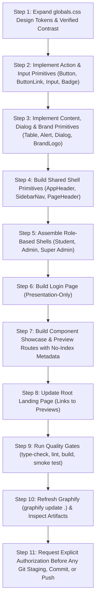

# NMIT HackLeague — Phase 2 Implementation Plan
## UI Design System, Branding Integration & Role-Based Page Shells

**Document Revision:** 1.1 (Final Review Corrections Pass)  
**Date:** October 12, 2026  
**Phase:** 02 of 13  
**Status:** PROPOSED — Awaiting Project Owner Authorization  
**Implementation Authorization:** NOT AUTHORIZED (Planning and Plan-Correction Only)  
**Authoritative Source Documents:**
- `rules.md` (SHA-256: `180e1b953e6bceb3177dfb5bd8bb54e1fd0dace8837c7a7aaa421b107b5acb7f`)
- `NMIT_HackLeague_Development_Phases.md` (SHA-256: `eb76a4b7c2a47af67ae3b7ac767cfbfdc9363e68fc2995885190c114262edbc9`)
- `PHASE_01_IMPLEMENTATION_PLAN.md` (Baseline Commit `8beea9238203eba601e0ec598e3b4923f9b8adc6`)

---

## A. Executive Summary

### A.1 Purpose and Objective
Phase 2 establishes the complete visual presentation foundation, official institutional branding integration, reusable design-token system, component library primitives, and common responsive page shells for the **NMIT HackLeague** portal.

As mandated by `NMIT_HackLeague_Development_Phases.md` (Phase 2, lines 58–77) and `rules.md` (Section 15, lines 428–501), this phase transitions the project from a minimal Phase 1 foundation into a cohesive, professional institutional platform. It delivers the shared visual architecture across three distinct user roles:
1. **Student Workspace Shell** (participation, team collaboration, milestone submission overview)
2. **Club Administrator Workspace Shell** (event setup, participant review, round monitoring)
3. **Institutional Super Admin Workspace Shell** (college-wide governance, audit logs, system-level oversight)

Additionally, Phase 2 implements a polished, presentation-only **Login Page** and a development-scoped **Component Showcase & Shell Preview Suite** to verify all tokens, component variants, interaction states, and accessibility behaviors across desktop, tablet, and mobile breakpoints.

### A.2 Phase Scope Boundaries & Guarantees
- **Pure Visual Presentation & Client Layout:** Phase 2 is strictly concerned with styling, layout composition, accessible interactions, responsive behavior, and design tokens.
- **Zero Premature Business Logic:** No Supabase integration, authentication sessions, database connections, route guards, API handlers, or real student records are created.
- **Zero Invented Data:** All demonstration content is explicitly labelled as placeholder or preview data (`[Demo Mode / Preview Workspace]`), adhering strictly to `rules.md` Section 15.
- **Preserved Architecture:** The Next.js 16.4.0 (App Router, Turbopack), React 19, TypeScript 5.9, and Tailwind CSS v4 (`@tailwindcss/postcss`) baseline established in Phase 1 is fully maintained without modification to core dependencies.
- **Git Safety & Authorization:** Committing and pushing to Git are **not** automatically authorized by completing implementation. Any commit or push requires separate, explicit authorization from the project owner.

---

## B. Repository Baseline

### B.1 Verified Git & Repository State
*Verified via read-only repository inspection on October 12, 2026:*
- **Root Directory:** `/Volumes/CodingVault/web/HackLeague`
- **Active Branch:** `v1` (Mandatory initial development branch per `rules.md` Section 20)
- **Local Commit Hash:** `8beea9238203eba601e0ec598e3b4923f9b8adc6` (`HEAD -> v1, origin/v1`)
  - Commit message: `feat(phase-1): establish foundational baseline and repository setup`
- **Remote Configuration:**
  - `origin`: `https://github.com/srujan-s22/nmit-hackleague.git`
  - `refs/heads/v1` confirmed synchronized at `8beea9238203eba601e0ec598e3b4923f9b8adc6`
  - `main` branch remains untouched and unborn (0 commits).
- **Working Tree Status:** Clean with untracked local additions:
  - `PHASE_02_IMPLEMENTATION_PLAN.md` (The Phase 2 planning document)
  - `public/nmit-logo.svg` (Official NMIT logo)
  - `public/Group 3.svg` (Official HackLeague logo)
  - `public/nmit.jpeg` (Owner-provided image; excluded from Phase 2 scope)
  - `graphify-out/` (Local code knowledge graph generated via `graphify update .`)

### B.2 Framework, Tooling & Dependency Baseline
*Verified in `package.json` and `package-lock.json`:*
- **Framework:** Next.js `16.4.0` (App Router, Turbopack enabled)
- **UI Core:** React `19.3.0`, React DOM `19.3.0`
- **Language:** TypeScript `5.9.3` (`tsconfig.json` target `ES2017`, strict mode enabled)
- **Styling Pipeline:**
  - `tailwindcss`: `4.3.3`
  - `@tailwindcss/postcss`: `4.3.3`
  - `postcss`: `8.5.29`
  - `postcss.config.mjs`: Loads `@tailwindcss/postcss`
  - `src/app/globals.css`: Imports `tailwindcss` and initializes institutional color theme.
- **Linting & Code Quality:**
  - `eslint`: `9.39.5` (Flat config in `eslint.config.mjs`)
  - `eslint-config-next`: `16.4.0` (`core-web-vitals`)
- **Package Scripts:**
  - `npm run dev`: Starts local Next.js Turbopack development server.
  - `npm run build`: Executes Next.js Turbopack production build.
  - `npm run start`: Starts production HTTP server.
  - `npm run lint`: Executes ESLint 9 across all project files.
  - `npm run type-check`: Executes `tsc --noEmit`.

### B.3 Existing Application Source Files
*Current `src/` directory layout:*
```
src/
└── app/
    ├── globals.css      # Core Tailwind CSS v4 @import and @theme tokens
    ├── layout.tsx       # Root HTML shell with metadata and font smoothing
    └── page.tsx         # Phase 1 minimal baseline landing card
```

### B.4 Official Brand Assets in `public/`
*Verified via filesystem inspection — strictly limited to the two intended assets:*
1. **NMIT Institutional Wordmark Logo:**
   - **Path:** `public/nmit-logo.svg`
   - **Format:** SVG (Scalable Vector Graphics, XML version 1.1)
   - **Dimensions / ViewBox:** `viewBox="0 0 669 63"` (Aspect Ratio ~ $10.62 : 1$)
   - **Colors:** `#2E3690` (Official NMIT Blue)
   - **Content:** Institutional seal/crest vector and official text: *"NMIT | NITTE MEENAKSHI INSTITUTE OF TECHNOLOGY | An Autonomous Institution, Affiliated to VTU"*.
   - **Suitability:** High-resolution horizontal vector mark; delivers contrast $> 10:1$ on `#FFFFFF` and `#F5F6F4` surfaces.
2. **HackLeague Portal Emblem / Logo:**
   - **Path:** `public/Group 3.svg`
   - **Format:** SVG (Scalable Vector Graphics)
   - **Dimensions / ViewBox:** `viewBox="0 0 585 641"` (Aspect Ratio ~ $0.91 : 1$)
   - **Colors:** Stroke and fill in `#00FF95` (Vibrant HackLeague neon mint).
   - **Content:** Hexagonal geometric badge with interlocking coding/circuit monogram paths.
   - **Path & Handling Note:** The asset filename contains a space (`Group 3.svg`). It is preserved as provided on disk without moving or renaming, and referenced safely in web components as `/Group%203.svg` or `/Group 3.svg` in `next/image` / ``.
3. **Exclusion of `public/nmit.jpeg`:**
   - The file `public/nmit.jpeg` is present on disk but is **not** an approved branding requirement for Phase 2. In strict compliance with user instructions, it is completely excluded from the component inventory, layout shells, and branding integration. Only the two intended SVG vector assets are used.

### B.5 Graphify Baseline & Workflow
*Verified via installed tooling inspection:*
- **CLI Binary:** `graphify` (via uv Python 3.14 tool environment)
- **Current Output Artifacts:** `graphify-out/` (contains `graph.json`, `graph.html`, `GRAPH_REPORT.md`, `manifest.json`, and cached AST extraction)
- **Current Graph Metrics:** 232 nodes, 220 edges, 17 detected communities based on Phase 1 commit `8beea923`.
- **Verified Code-Update Command:** `graphify update .` executes local AST re-extraction on changed code files with zero LLM API dependency and updates `graphify-out/`.

---

## C. Requirements Traceability Matrix

| Roadmap Item (`NMIT_HackLeague_Development_Phases.md`) | `rules.md` Requirement | Phase 2 Planned Implementation Artifact | Verification / QA Method |
| :--- | :--- | :--- | :--- |
| **P2-01: Professional, restrained white-theme design system** | Section 15: White/off-white foundation, charcoal text, soft grey borders, light green/red accents. Zero multi-color gradients. | `src/app/globals.css` with `@theme` token definitions; CSS variables in `:root`. | CSS compilation check; token inspection in showcase; automated contrast checks. |
| **P2-02: Established typography, spacing, borders, radii, shadows** | Section 15: Consistent spacing hierarchy, thin borders, restrained corner radii, subtle shadows. | Centralized Tailwind v4 utility scale and token documentation in Showcase. | Visual inspection on `/preview/showcase`; responsive rendering check. |
| **P2-03: Reusable Button, Link, Input, Table, Badge, Dialog components** | Section 15: Accessible focus states, semantic markup, keyboard navigation, clean error handling. | `src/components/ui/` (`button.tsx`, `button-link.tsx`, `input.tsx`, `table.tsx`, `badge.tsx`, `dialog.tsx`, etc.). | Type-check (`tsc`), lint (`eslint`), keyboard interaction test, screen-reader markup review. |
| **P2-04: Consistent Student layout shell** | Section 15: Clean, restrained navigation, clear content hierarchy, mobile responsive. | `src/components/shells/student-shell.tsx` & `/preview/shells/student`. | Viewport testing at 375px, 768px, 1440px; navigation toggle verification. |
| **P2-05: Consistent Admin workspace shell** | Section 15 & Section 13: Sidebar/topbar arrangement, table containers, filter bars. | `src/components/shells/admin-shell.tsx` & `/preview/shells/admin`. | Sidebar collapse/expand test; table layout overflow verification. |
| **P2-06: Consistent Super Admin workspace shell** | Section 15: Coherent with admin shell, distinguished scope, system governance layout. | `src/components/shells/super-admin-shell.tsx` & `/preview/shells/super-admin`. | Layout alignment review; visual parity check with admin shell. |
| **P2-07: Official NMIT and HackLeague brand integration** | Section 15: Use only the two official logos in `public/`, maintain aspect ratios, accessible alt text, no invented marks. | `src/components/ui/brand-logo.tsx` consuming `public/nmit-logo.svg` & `public/Group 3.svg`. | Visual rendering review at multiple sizes; sharp vector check; SVG aspect ratio verification. |
| **P2-08: Polished login page presentation** | Section 15: Professional login presentation, white background, clear fields, presentation-only. | `src/app/login/page.tsx` (visual presentation only; zero live auth). | Form styling review, loading/disabled state preview, mobile layout test. |
| **P2-09: No fake production data or fake metrics** | Section 15: Clearly labeled demo/empty states; no fabricated students, scores, or activity. | All preview pages populated with `[Demo Mode / Preview Workspace]` labels and purposeful empty/demo states. | Content audit across all preview routes to confirm zero misleading production data. |
| **P2-10: Graphify post-phase refresh** | Operating Rule 2: Graphify refreshed after completed development phase. | Step in implementation plan to run `graphify update .` and inspect `graphify-out/`. | Check `graphify-out/GRAPH_REPORT.md` freshness and node additions. |

---

## D. Design Specification & Design Tokens

### D.1 Color Token Architecture & Mathematically Verified Contrast Ratios
All colors are specified as concrete CSS variables in `:root` and mapped directly into the Tailwind CSS v4 `@theme` block inside `src/app/globals.css`.

Every foreground/background pairing below has been mathematically calculated against the WCAG 2.1 relative luminance specification ($L = 0.2126R + 0.7152G + 0.0722B$):

#### 1. Core Surfaces & Backgrounds
- `--color-surface-canvas`: `#FFFFFF` (Primary page background for pure white theme)
- `--color-surface-subtle`: `#F5F6F4` (Approved institutional off-white for sidebars, cards, and secondary sections)
- `--color-surface-muted`: `#ECEFEA` (Elevated table headers, hovered list items, tertiary container fills)
- `--color-surface-inverse`: `#252825` (Charcoal surface for dark banners or high-contrast tooltips)

#### 2. Borders & Interactive Boundaries (WCAG 2.1 SC 1.4.11 Non-Text Contrast $\ge$ 3.0:1)
- `--color-border-subtle`: `#E6E9E5` (Approved soft grey for standard 1px structural dividers and container separation)
- `--color-border-default`: `#D8DDD6` (Standard decorative dividers and inactive element outlines)
- `--color-border-interactive`: `#858C82` (Form input outlines, checkbox borders, and interactive control boundaries)
  - Contrast against `#FFFFFF`: **3.46 : 1** (Passes WCAG 2.1 SC 1.4.11 $\ge$ 3.0:1)
  - Contrast against `#F5F6F4`: **3.19 : 1** (Passes WCAG 2.1 SC 1.4.11 $\ge$ 3.0:1)
- `--color-border-focus`: `#252825` (High-contrast 2px keyboard focus ring outline)
  - Contrast against `#FFFFFF`: **14.91 : 1** (Passes WCAG 2.1 SC 1.4.11 $\ge$ 3.0:1)

#### 3. Typography & Text Contrast (WCAG 2.1 SC 1.4.3 Contrast Minimum $\ge$ 4.5:1)
- **Primary Text:** `--color-text-primary`: `#252825` (Approved charcoal for primary headings, body, and labels)
  - Contrast against `#FFFFFF`: **14.91 : 1** (Passes WCAG AA 4.5:1 and AAA 7.0:1)
  - Contrast against `#F5F6F4`: **13.75 : 1** (Passes WCAG AA 4.5:1 and AAA 7.0:1)
- **Secondary Text:** `--color-text-secondary`: `#575B56` (Neutral text for descriptions, subtitles, table cell details)
  - Contrast against `#FFFFFF`: **6.92 : 1** (Passes WCAG AA 4.5:1)
  - Contrast against `#F5F6F4`: **6.38 : 1** (Passes WCAG AA 4.5:1)
- **Helper & Placeholder Text:** `--color-text-helper`: `#5C635B` (Corrected token replacing failing `#828880`)
  - Contrast against `#FFFFFF`: **6.19 : 1** (Passes WCAG AA 4.5:1)
  - Contrast against `#F5F6F4`: **5.71 : 1** (Passes WCAG AA 4.5:1)
  - *Correction Note:* The previously proposed `#828880` had a contrast ratio of only 3.63:1, failing WCAG AA for ordinary text. The corrected `#5C635B` token ensures all readable form helper and placeholder text satisfies the 4.5:1 threshold.
- **Genuinely Disabled Text:** `--color-text-disabled`: `#8A9188` (Contrast against `#FFFFFF`: 3.24:1)
  - *WCAG Exemption Rule:* WCAG 2.1 Success Criterion 1.4.3 explicitly exempts inactive/disabled user interface components from the 4.5:1 requirement. This token is strictly reserved for controls with `disabled` or `aria-disabled="true"`. It must never be used for ordinary readable text, helper text, or input placeholders.
- **Inverse Text:** `--color-text-inverse`: `#FFFFFF` (Pure white text on charcoal buttons; contrast 14.91:1)

#### 4. Semantic Status & Feedback Tokens (WCAG 2.1 SC 1.4.3 $\ge$ 4.5:1)
- **Success / Approved / Active:**
  - Background: `--color-status-success-bg`: `#E3F1E6`
  - Text: `--color-status-success-text`: `#1B5E20`
  - Border: `--color-status-success-border`: `#C8E6C9`
  - Contrast of text on background: **6.74 : 1** (Passes WCAG AA 4.5:1)
- **Error / Rejected / Destructive:**
  - Background: `--color-status-error-bg`: `#F8E8E6`
  - Text: `--color-status-error-text`: `#B71C1C`
  - Border: `--color-status-error-border`: `#FFCDD2`
  - Contrast of text on background: **5.53 : 1** (Passes WCAG AA 4.5:1)
- **Warning / Pending / In-Review:**
  - Background: `--color-status-warning-bg`: `#FFF8E1`
  - Text: `--color-status-warning-text`: `#7A5E00` (Corrected deep amber token replacing borderline `#8D6E10`)
  - Border: `--color-status-warning-border`: `#FFE082`
  - Contrast of text on background: **5.77 : 1** (Passes WCAG AA 4.5:1)
- **Informational / Milestone:**
  - Background: `--color-status-info-bg`: `#E8F0FE`
  - Text: `--color-status-info-text`: `#1A56A2`
  - Border: `--color-status-info-border`: `#C2D7FA`
  - Contrast of text on background: **6.33 : 1** (Passes WCAG AA 4.5:1)

#### 5. Institutional Identity Accents
- `--color-brand-nmit-blue`: `#2E3690` (Official NMIT Blue from `nmit-logo.svg`; contrast on white: **10.26 : 1**)
- `--color-brand-hackleague-mint`: `#00FF95` (Official HackLeague green from `Group 3.svg`)

*Compliance Caveat:* Specifying verified mathematical token ratios is a foundational prerequisite but does not by itself guarantee end-to-end accessibility; the implementation still requires interactive keyboard, focus, and screen-reader testing.

### D.2 Typography Scale
Uses a modern system font stack (`-apple-system, BlinkMacSystemFont, "Segoe UI", Roboto, Helvetica, Arial, sans-serif`) ensuring zero external font network dependencies and instant rendering:

| Token / Class | Font Size | Line Height | Font Weight | Usage |
| :--- | :--- | :--- | :--- | :--- |
| `text-display` | 32px (`2rem`) | 40px (`2.5rem`) | 700 (Bold) | Login page hero titles, primary portal heading |
| `text-h1` | 24px (`1.5rem`) | 32px (`2rem`) | 700 (Bold) | Main workspace page headers, role dashboard title |
| `text-h2` | 20px (`1.25rem`) | 28px (`1.75rem`) | 600 (Semibold) | Card section headers, table section titles |
| `text-h3` | 16px (`1rem`) | 24px (`1.5rem`) | 600 (Semibold) | Modal titles, form group headers, card subheadings |
| `text-body` | 14px (`0.875rem`) | 20px (`1.25rem`) | 400 (Regular) | Primary body copy, table cell content, input values |
| `text-body-medium`| 14px (`0.875rem`) | 20px (`1.25rem`) | 500 (Medium) | Navigation labels, table header titles, button labels |
| `text-caption` | 12px (`0.75rem`) | 16px (`1rem`) | 500 (Medium) | Status badges, helper text, breadcrumbs, timestamps |
| `text-micro` | 11px (`0.6875rem`) | 14px (`0.875rem`) | 500 (Medium) | Demo mode indicator, sub-caption metadata |

### D.3 Spacing, Border Radii & Elevation Scales
- **Spacing Scale:** Standard 4px grid (`4px`, `8px`, `12px`, `16px`, `20px`, `24px`, `32px`, `40px`, `48px`, `64px`).
- **Border Radii:**
  - `rounded-xs`: 2px (Badges, tags)
  - `rounded-sm`: 4px (Buttons, text inputs, selects)
  - `rounded-md`: 6px (Cards, modal dialogs, alerts)
  - `rounded-lg`: 8px (Outer shell containers, popovers)
- **Border Widths:**
  - Default: 1px solid (`border border-border-subtle` or `border-border-interactive`)
  - Focus Ring: 2px solid with 2px offset (`ring-2 ring-offset-2 ring-border-focus`)
- **Shadows (Restrained Material Design):**
  - `--shadow-subtle`: `0 1px 2px 0 rgba(0, 0, 0, 0.03)` (Cards, input fields)
  - `--shadow-card`: `0 1px 3px 0 rgba(0, 0, 0, 0.05), 0 1px 2px -1px rgba(0, 0, 0, 0.05)` (Elevated cards)
  - `--shadow-dialog`: `0 10px 15px -3px rgba(0, 0, 0, 0.08), 0 4px 6px -4px rgba(0, 0, 0, 0.05)` (Modal dialogs)
  - Strictly **NO** glowing effects, drop-shadow blobs, or neon glows.

---

## E. Component Inventory, API Contracts & Server/Client Boundaries

Shared components live in `src/components/ui/` and `src/components/layout/`. To minimize client-side bundle size, components are **Server Components by default** and only opt into `"use client"` when genuine DOM interactivity, state, or event listeners are required.

### E.1 Actions: Button vs. Link Separation

To prevent mixing button and anchor attributes ambiguously, action triggers are strictly separated into two distinct, semantic components sharing a centralized styling helper:

#### 1. Shared Button Style Helper (`src/components/ui/button.tsx`)
```typescript
export interface ButtonStyleOptions {
  variant?: 'primary' | 'secondary' | 'tertiary' | 'destructive' | 'outline';
  size?: 'sm' | 'md' | 'lg';
  fullWidth?: boolean;
}

export function getButtonClasses({
  variant = 'primary',
  size = 'md',
  fullWidth = false,
}: ButtonStyleOptions = {}): string {
  // Returns composable Tailwind CSS utility strings
}
```

#### 2. `Button` Component (`src/components/ui/button.tsx`)
- **Responsibility:** Strictly represents a semantic `<button type="button | submit | reset">` for page interactions, form submissions, and dialog triggers. It does **not** render navigation links.
- **Component Type:** Client Component (`"use client"`).
- **Props API:**
  ```typescript
  export interface ButtonProps extends React.ButtonHTMLAttributes<HTMLButtonElement>, ButtonStyleOptions {
    isLoading?: boolean;
    leftIcon?: React.ReactNode;
    rightIcon?: React.ReactNode;
  }
  ```
- **Accessibility:** Semantic `<button>`, visible 2px focus ring, `aria-busy={isLoading}`, accessible spinner with `aria-hidden="true"`, native keyboard activation (`Enter` / `Space`).

#### 3. `ButtonLink` Component (`src/components/ui/button-link.tsx`)
- **Responsibility:** Strictly represents a semantic navigation link wrapping Next.js `<Link href="...">` styled with identical visual button variants.
- **Component Type:** Server Component (Pure markup, zero client JavaScript overhead).
- **Props API:**
  ```typescript
  import Link, { LinkProps } from 'next/link';

  export interface ButtonLinkProps extends LinkProps, ButtonStyleOptions {
    children: React.ReactNode;
    className?: string;
    leftIcon?: React.ReactNode;
    rightIcon?: React.ReactNode;
  }
  ```
- **Accessibility:** Semantic `<a>` tag rendered by Next.js `Link`, native link keyboard activation (`Enter`), link role announced to screen readers.

#### 4. `IconButton` (`src/components/ui/icon-button.tsx`)
- **Responsibility:** Compact trigger containing exclusively an icon (e.g. mobile drawer menu toggle, dialog dismiss).
- **Component Type:** Client Component (`"use client"`).
- **Props API:**
  ```typescript
  export interface IconButtonProps extends React.ButtonHTMLAttributes<HTMLButtonElement> {
    icon: React.ReactNode;
    'aria-label': string; // Mandatory for accessibility
    variant?: 'ghost' | 'outline' | 'secondary';
    size?: 'sm' | 'md' | 'lg';
  }
  ```

---

### E.2 Form Controls & Field Primitives

#### 1. `Input` (`src/components/ui/input.tsx`)
- **Responsibility:** Single-line text input with integrated label, helper text, and validation error presentation.
- **Component Type:** Client Component (`"use client"` for dynamic form event listeners).
- **Props API:**
  ```typescript
  export interface InputProps extends React.InputHTMLAttributes<HTMLInputElement> {
    label?: string;
    helperText?: string;
    error?: string;
    leftAddon?: React.ReactNode;
    rightAddon?: React.ReactNode;
  }
  ```
- **Accessibility:** Explicit `<label htmlFor={id}>` association. Sets `aria-invalid={!!error}` and connects helper/error via `aria-describedby`.

#### 2. `Textarea` (`src/components/ui/textarea.tsx`)
- **Responsibility:** Multi-line text field primitive with identical form validation contract.
- **Component Type:** Client Component (`"use client"`).

#### 3. `Select` (`src/components/ui/select.tsx`)
- **Responsibility:** Native accessible dropdown selector with styled SVG chevron indicator.
- **Component Type:** Client Component (`"use client"`).

#### 4. `Checkbox` (`src/components/ui/checkbox.tsx`)
- **Responsibility:** Accessible binary toggle with custom styled SVG check indicator.
- **Component Type:** Client Component (`"use client"`).

---

### E.3 Content, Status & Feedback Primitives

#### 1. `Badge` (`src/components/ui/badge.tsx`)
- **Responsibility:** Inline visual status indicator (e.g. "Approved", "Pending Review").
- **Component Type:** **Server Component** (Pure layout & styling).
- **Variants:** `neutral`, `success`, `error`, `warning`, `info`.

#### 2. `Card` (`src/components/ui/card.tsx`)
- **Responsibility:** Clean structured container for grouping content sections.
- **Component Type:** **Server Component** (Pure structural layout).
- **Sub-components:** `Card`, `CardHeader`, `CardTitle`, `CardDescription`, `CardContent`, `CardFooter`.

#### 3. `Table` (`src/components/ui/table.tsx`)
- **Responsibility:** Accessible, responsive tabular data presentation for admin and hackathon management.
- **Component Type:** **Server Component** (Pure semantic HTML markup).
- **Sub-components:** `Table`, `TableHeader`, `TableBody`, `TableFooter`, `TableHead`, `TableRow`, `TableCell`, `TableCaption`.
- **Features:** Wrapped in overflow-x scroll container; alternating subtle row hover; clean 1px borders; bold uppercase captions.

#### 4. `Alert` (`src/components/ui/alert.tsx`)
- **Responsibility:** Inline feedback, warning, error, or confirmation notification banner.
- **Component Type:** Server Component (Client only if optional dismissible `onClose` is passed).
- **Variants:** `info`, `success`, `warning`, `error`.

#### 5. `EmptyState` (`src/components/ui/empty-state.tsx`)
- **Responsibility:** Purposeful placeholder component for empty tables or unstarted workflows.
- **Component Type:** **Server Component**.

#### 6. `Skeleton` (`src/components/ui/skeleton.tsx`)
- **Responsibility:** Subtle, low-contrast loading placeholder for asynchronous views.
- **Component Type:** **Server Component** (`animate-pulse bg-surface-muted rounded-sm`).

---

### E.4 Dialog Primitive: Native HTML `<dialog>` Implementation

#### 1. `Dialog` (`src/components/ui/dialog.tsx`)
- **Responsibility:** Accessible modal overlay for confirmations, detail views, and action flows.
- **Architecture:** Implemented using native HTML `<dialog>` with `showModal()` and `.close()`.
- **Why Native `<dialog>`:**
  1. **Native Focus Trapping:** When opened via `showModal()`, the browser automatically traps keyboard focus within the dialog without complex third-party libraries or manual listeners.
  2. **Native Escape Key Handling:** The browser natively handles the `Escape` key to close the dialog and fires the standard `cancel` event.
  3. **Native Focus Restoration:** The browser automatically restores keyboard focus to the triggering element upon closing.
  4. **Native Backdrop:** Built-in `::backdrop` pseudo-element provides standard dimmed modal background overlay.
- **Component Type:** Client Component (`"use client"` to manage the DOM `dialogRef` and open/close state).
- **Props API:**
  ```typescript
  export interface DialogProps {
    isOpen: boolean;
    onClose: () => void;
    title: string;
    description?: string;
    children: React.ReactNode;
    footer?: React.ReactNode;
    maxWidth?: 'sm' | 'md' | 'lg' | 'xl';
  }
  ```
- **Accessibility Contracts:**
  - `aria-labelledby="dialog-title"` explicitly pointing to the modal title heading.
  - `aria-describedby="dialog-desc"` pointing to the optional description.
  - Dedicated dismiss button (`IconButton`) carrying mandatory `aria-label="Close dialog"`.
  - Body scroll lock (`document.body.style.overflow = 'hidden'`) managed cleanly in `useEffect`.

---

### E.5 Official Brand Logo Integration Component

#### 1. `BrandLogo` (`src/components/ui/brand-logo.tsx`)
- **Responsibility:** Unified component for rendering the two official NMIT and HackLeague brand assets with accurate aspect ratios, sharp vector rendering, and accessible labeling.
- **Component Type:** **Server Component** (Pure vector image presentation).
- **Supported Assets (Strictly 2 Official Logos):**
  - `nmit`: `public/nmit-logo.svg` (Horizontal banner wordmark)
  - `hackleague`: `public/Group 3.svg` (Hexagonal portal badge emblem)
  - `combined`: Dual-branding lockup (NMIT wordmark + HackLeague emblem)
  - *(Note: `nmit.jpeg` is completely excluded from the component API).*
- **Props API:**
  ```typescript
  export interface BrandLogoProps extends React.HTMLAttributes<HTMLDivElement> {
    asset: 'nmit' | 'hackleague' | 'combined';
    variant?: 'light' | 'dark';
    size?: 'sm' | 'md' | 'lg';
    priority?: boolean;
  }
  ```
- **Sizing & Framing Rules:**
  - `nmit`: Preserves $10.62 : 1$ aspect ratio. Rendered heights: `sm` (24px), `md` (32px), `lg` (40px).
  - `hackleague`: Preserves $0.91 : 1$ aspect ratio. Rendered heights: `sm` (28px), `md` (36px), `lg` (48px). Framed in a subtle 1px border container (`border border-border-subtle bg-surface-subtle p-1 rounded-md`) when rendered on pure white surfaces to ensure crisp visual definition.
  - `combined`: Renders HackLeague emblem alongside charcoal typography `"NMIT HackLeague"` with the NMIT horizontal vector banner positioned cleanly in the header hierarchy.

---

## F. Shell and Route Architecture

### F.1 Architecture Philosophy & Preview-Route Exposure Policy
Phase 2 implements common workspace shells without premature authentication guards or database calls.

#### Preview-Route Exposure Policy (Proportionate Isolation):
- **Preview Routes:**
  - `/preview/showcase` (Design System tokens and component catalog)
  - `/preview/shells/student` (Interactive Student Workspace shell preview)
  - `/preview/shells/admin` (Interactive Club Administrator shell preview)
  - `/preview/shells/super-admin` (Interactive Institutional Super Admin shell preview)
- **Phase 2 Development Status:** These routes are public within the development build to facilitate manual visual QA and browser automation testing.
- **Search Engine Isolation:** Every preview route explicitly exports Next.js metadata disabling indexing:
  ```typescript
  export const metadata: Metadata = {
    robots: {
      index: false,
      follow: false,
    },
  };
  ```
- **Visual Prominence & Banner:** Every preview page displays a prominent top alert banner:
  `[PREVIEW WORKSPACE — Internal UI verification only. Not a production feature.]`
- **Pre-Production Gating Requirement:** The plan explicitly mandates that prior to live production deployment (Phase 13), all `/preview/*` routes must either be:
  1. Gated behind a development-environment check (`if (process.env.NODE_ENV === 'production') notFound();`), OR
  2. Deleted entirely after verifying that production screens in subsequent phases fully consume the design system.

### F.2 Shared Shell Foundations (`src/components/layout/`)
1. **`AppHeader` (`src/components/layout/app-header.tsx`):**
   - Top navigation bar with dual brand logo.
   - Context indicator badge (`Student`, `Admin`, `Super Admin`).
   - Mobile hamburger menu toggle button (`IconButton`).
   - Profile indicator placeholder (`Demo User / Institutional Account`).
   - *Client Component (`"use client"`)* for mobile menu open/close toggle state.
2. **`SidebarNav` (`src/components/layout/sidebar-nav.tsx`):**
   - Desktop vertical navigation bar with active-link indicator (`bg-surface-subtle text-text-primary font-medium border-l-2 border-text-primary`).
   - Grouped navigation sections with clean section titles.
   - Responsive drawer with backdrop for mobile/tablet screens.
   - *Client Component (`"use client"`)* for mobile drawer toggle.
3. **`PageHeader` (`src/components/layout/page-header.tsx`):**
   - Standardized workspace page title, breadcrumb navigation, and right-aligned action button slots.
   - *Server Component* (Pure layout).

### F.3 Student Shell (`src/components/shells/student-shell.tsx`)
- **Target Audience:** College students participating in hackathons.
- **Visual Personality:** Open, intuitive, clear milestone progression.
- **Navigation Items (Visual Placeholders):**
  - *My Hackathons* (Registered events, upcoming deadlines)
  - *Browse Events* (College-wide hackathon catalog)
  - *My Teams* (Active teams, invitations)
  - *Milestones & Submissions* (Evidence upload overview)
  - *Points & Badges* (Participation points overview)

### F.4 Administrator Shell (`src/components/shells/admin-shell.tsx`)
- **Target Audience:** Club organizers, department coordinators, hackathon judges.
- **Visual Personality:** Efficient, data-dense, structured tables, clear filter controls.
- **Navigation Items (Visual Placeholders):**
  - *Event Management* (Hackathon creation, round scheduling)
  - *Registration Review* (Team verification, student status)
  - *Submissions & Judging* (Round scoring, evidence verification)
  - *Leaderboard & Results* (Points calculation)
  - *Club Settings* (Organizer profiles)

### F.5 Super Admin Shell (`src/components/shells/super-admin-shell.tsx`)
- **Target Audience:** College authorities, head of department, platform administrators.
- **Visual Personality:** Authoritative, governance-focused, system-wide integrity.
- **Navigation Items (Visual Placeholders):**
  - *Institution Overview* (Cross-club analytics overview)
  - *User & Role Governance* (Student verification approvals, organizer permissions)
  - *Audit Logs & Retention* (System access logs, export controls)
  - *Policy & System Settings* (College ID rules, academic year configuration)
- **Visual Distinction:** Carries an institutional banner badge: `"Super Admin Workspace | NMIT Governance"`.

---

## G. File-by-File Implementation Manifest

Every planned file addition or modification is itemized below. There are **zero file deletions** in Phase 2.

| Exact File Path | Action | Component Type | Purpose & Scope | Key Dependencies |
| :--- | :--- | :--- | :--- | :--- |
| `src/app/globals.css` | **Modify** | CSS | Expand `@theme` block with full verified design token palette. | Tailwind CSS v4 |
| `src/components/ui/button.tsx` | **Create** | Client (`"use client"`) | Reusable `Button` component and `getButtonClasses` helper. | `globals.css` |
| `src/components/ui/button-link.tsx` | **Create** | Server | Semantic navigation link wrapping Next.js `Link` styled as a button. | `button.tsx`, Next.js `Link` |
| `src/components/ui/icon-button.tsx` | **Create** | Client (`"use client"`) | Reusable accessible `IconButton` for compact triggers and mobile menu toggles. | `button.tsx` |
| `src/components/ui/input.tsx` | **Create** | Client (`"use client"`) | Form `Input` primitive with label, helper text, error state, and accessible ARIA bindings. | `globals.css` |
| `src/components/ui/textarea.tsx` | **Create** | Client (`"use client"`) | Multi-line text field primitive with identical form validation contract. | `globals.css` |
| `src/components/ui/select.tsx` | **Create** | Client (`"use client"`) | Accessible native `Select` dropdown with custom SVG chevron and label/error bindings. | `globals.css` |
| `src/components/ui/checkbox.tsx` | **Create** | Client (`"use client"`) | Accessible `Checkbox` toggle with custom SVG check indicator. | `globals.css` |
| `src/components/ui/badge.tsx` | **Create** | Server | Status `Badge` primitive with 5 semantic color variants and optional dot indicator. | `globals.css` |
| `src/components/ui/card.tsx` | **Create** | Server | Structured container primitives (`Card`, `CardHeader`, `CardTitle`, `CardContent`, etc.). | `globals.css` |
| `src/components/ui/table.tsx` | **Create** | Server | Accessible tabular data primitives (`Table`, `TableHeader`, `TableRow`, `TableCell`, etc.). | `globals.css` |
| `src/components/ui/alert.tsx` | **Create** | Server | Inline notification callout banner with 4 semantic status variants. | `globals.css` |
| `src/components/ui/empty-state.tsx` | **Create** | Server | Purposeful placeholder component for empty tables or unstarted workflows. | `button.tsx` |
| `src/components/ui/skeleton.tsx` | **Create** | Server | Subtle pulsing skeleton placeholder for asynchronous loading views. | `globals.css` |
| `src/components/ui/dialog.tsx` | **Create** | Client (`"use client"`) | Accessible modal primitive wrapping native HTML `<dialog>` with `showModal()`. | `icon-button.tsx` |
| `src/components/ui/brand-logo.tsx` | **Create** | Server | Unified logo rendering component for the 2 official brand marks (`nmit-logo.svg`, `Group 3.svg`). | `public/` assets |
| `src/components/layout/app-header.tsx` | **Create** | Client (`"use client"`) | Shared top bar with brand lockup, role indicator, and mobile menu toggle. | `brand-logo.tsx`, `icon-button.tsx` |
| `src/components/layout/sidebar-nav.tsx` | **Create** | Client (`"use client"`) | Desktop sidebar and mobile drawer navigation with active-link indicators. | `button-link.tsx` |
| `src/components/layout/page-header.tsx` | **Create** | Server | Standardized workspace page heading, breadcrumbs, and action button slots. | `globals.css` |
| `src/components/shells/student-shell.tsx` | **Create** | Server | Layout wrapper component for Student workspace. | `app-header.tsx`, `sidebar-nav.tsx` |
| `src/components/shells/admin-shell.tsx` | **Create** | Server | Layout wrapper component for Club Administrator workspace. | `app-header.tsx`, `sidebar-nav.tsx` |
| `src/components/shells/super-admin-shell.tsx`| **Create** | Server | Layout wrapper component for Super Admin governance workspace. | `app-header.tsx`, `sidebar-nav.tsx` |
| `src/app/login/page.tsx` | **Create** | Client (`"use client"`) | Polished visual login presentation with dual branding, fields, and error states (no live auth). | `brand-logo.tsx`, `input.tsx`, `button.tsx` |
| `src/app/preview/showcase/page.tsx` | **Create** | Client (`"use client"`) | Complete design system showcase displaying all tokens, components, and states. | All `src/components/ui/` |
| `src/app/preview/shells/student/page.tsx` | **Create** | Server | Interactive preview page demonstrating Student workspace shell with demo cards. | `student-shell.tsx`, `card.tsx`, `badge.tsx` |
| `src/app/preview/shells/admin/page.tsx` | **Create** | Server | Interactive preview page demonstrating Admin shell with demo data tables. | `admin-shell.tsx`, `table.tsx`, `badge.tsx` |
| `src/app/preview/shells/super-admin/page.tsx`| **Create**| Server | Interactive preview page demonstrating Super Admin shell with audit tables. | `super-admin-shell.tsx`, `table.tsx` |
| `src/app/page.tsx` | **Modify** | Server | Update Phase 1 baseline homepage to feature Phase 2 active status and direct preview navigation links. | `button-link.tsx`, `brand-logo.tsx` |

---

## H. Official Branding Integration Specification

### H.1 Asset Inventory & Technical Properties (Strictly 2 Official Logos)
1. **NMIT Official Wordmark:**
   - **File:** `public/nmit-logo.svg`
   - **Dimensions:** Native vector (`viewBox="0 0 669 63"`)
   - **Primary Color:** `#2E3690` (Official NMIT Blue)
   - **Aspect Ratio:** $10.62 : 1$
   - **Usage Rules:** Display horizontally in top navigation header and login page banner. Minimum display height: 24px; standard desktop height: 32px.
   - **Accessibility:** `alt="Nitte Meenakshi Institute of Technology — Official Institutional Logo"`
2. **HackLeague Official Emblem:**
   - **File:** `public/Group 3.svg`
   - **Dimensions:** Native vector (`viewBox="0 0 585 641"`)
   - **Primary Color:** `#00FF95` (Neon Mint)
   - **Aspect Ratio:** $0.91 : 1$
   - **Usage Rules:** Display as primary portal emblem in topbar and hero mark on the login card. Minimum display height: 28px; standard height: 36px; login hero size: 56px.
   - **Accessibility:** `alt="NMIT HackLeague — Official Portal Emblem"`

### H.2 Sizing, Framing & Contrast Guidelines
- **NMIT Vector Contrast:** Delivers contrast $> 10:1$ on `#FFFFFF` and `#F5F6F4`.
- **HackLeague Emblem Framing:** Because `#00FF95` is a vibrant light hue, when placed on pure white surfaces it is framed in a subtle 1px border container (`border border-border-subtle bg-surface-subtle p-1 rounded-md`) or paired immediately adjacent to dark charcoal typography (`#252825`), ensuring prominent visual definition without modifying the raw vector graphic.
- **Prohibited Modifications:** No recoloring, stretching, distortion, decorative gradients, glowing dropshadows, or 3D extrusions are permitted. The official vector paths are rendered as provided.

---

## I. Responsive and Accessibility Matrix

### I.1 Breakpoint Strategy (Tailwind CSS v4 Standard)
- **Mobile (`< 640px`):** Single column layout, full-width buttons, collapsible mobile drawer navigation, stacked forms.
- **Tablet (`640px – 1023px`):** Responsive grid (2-column cards), scrollable tables with horizontal scroll cues, collapsible sidebar.
- **Desktop (`>= 1024px`):** Permanent 240px sidebar navigation, fixed 64px topbar, multi-column dashboard layouts, max container width 1280px (`max-w-7xl`).

### I.2 Viewport Behavior Specification

| Interface Area | Mobile (`< 640px`) | Tablet (`640px - 1023px`) | Desktop (`>= 1024px`) |
| :--- | :--- | :--- | :--- |
| **Top Navigation Bar** | Height 56px; shows HackLeague mark + hamburger menu button; NMIT logo scales to fit. | Height 64px; dual logos displayed; hamburger menu button. | Height 64px; dual branding lockup displayed; full user indicator. |
| **Workspace Sidebar** | Hidden by default; slides out as full-height modal drawer with backdrop. | Collapsible icon drawer or standard drawer. | Permanent 240px left sidebar with section dividers and active indicator. |
| **Data Tables** | Horizontal scroll container with scroll shadow indicator; compact padding (`py-2 px-3`). | Horizontal scroll container; standard cell padding (`py-3 px-4`). | Full-width tabular layout with sorted headers and action buttons. |
| **Modal Dialogs (`<dialog>`)** | Full-width modal (`w-full mx-4 rounded-md`); bottom sheet styling. | Centered modal (`max-w-md` or `max-w-lg`). | Centered modal with backdrop dimming and focus trap. |
| **Login Page** | Stacked card (`w-full max-w-sm px-4`); dual logos stacked vertically. | Centered card (`max-w-md p-8`); dual logos side-by-side or stacked. | Centered card (`max-w-md p-8`) on subtle institutional background. |

### I.3 Accessibility Compliance (WCAG 2.1 AA)
1. **Perceivable:**
   - Text contrast ratio exceeds 4.5:1 for body and helper text, and 3.0:1 for large headings (Charcoal `#252825` on `#FFFFFF` achieves 14.91:1; Helper text `#5C635B` achieves 6.19:1).
   - Interactive control boundaries (form field borders) exceed 3.0:1 (`#858C82` achieves 3.46:1).
   - Status indicators pair color with text labels or icons; never communicate status through color alone.
   - Non-text elements (logos, icons) carry appropriate `alt` or `aria-label` attributes; decorative icons carry `aria-hidden="true"`.
2. **Operable:**
   - Full keyboard navigation across all interactive elements (`Tab`, `Shift+Tab`, `Enter`, `Space`, `Escape`).
   - Visible 2px focus ring (`ring-2 ring-offset-2 ring-border-focus`) on all buttons, links, inputs, and dialogs.
   - Native `<dialog>` focus trapping prevents keyboard focus from escaping active modal overlays.
3. **Understandable:**
   - Clear input labels positioned above form fields with explicit `htmlFor` / `id` bindings.
   - Error messages clearly describe validation requirements and link via `aria-describedby`.
4. **Robust:**
   - Valid semantic HTML5 landmarks (`<header>`, `<nav>`, `<aside>`, `<main>`, `<dialog>`, `<table>`).
   - Clean TypeScript types ensuring standard DOM element properties are respected.

---

## J. Acceptance Criteria

Phase 2 will be considered complete and verified only when all of the following criteria are met:

1. **Design Token Integrity:**
   - All colors, typography sizes, spacing, borders, and radii in `src/app/globals.css` conform to the approved institutional palette (`#FFFFFF`, `#F5F6F4`, `#252825`, `#E6E9E5`, `#E3F1E6`, `#F8E8E6`).
   - Zero multi-color gradients, neon glow effects, or decorative SaaS glassmorphism blobs in any CSS or component.
2. **Reusable Component Coverage & Semantics:**
   - All 15 planned shared UI components (`Button`, `ButtonLink`, `IconButton`, `Input`, `Textarea`, `Select`, `Checkbox`, `Badge`, `Card`, `Table`, `Alert`, `EmptyState`, `Skeleton`, `Dialog`, `BrandLogo`) compile cleanly.
   - Semantic separation is strictly enforced: `Button` renders `<button>`, while `ButtonLink` renders Next.js `<Link>` / `<a>`.
3. **Native `<dialog>` Focus & Dismissal Behavior:**
   - Dialog component uses native HTML `<dialog>` with `showModal()`, traps focus natively, dismisses on `Escape`, provides an explicit close button with `aria-label="Close dialog"`, and restores focus to the trigger element.
4. **Role Shell Consistency:**
   - Student, Admin, and Super Admin shells share the exact same underlying design tokens and layout primitives while exposing their distinct navigation hierarchies.
5. **Visual Login Quality:**
   - The login page at `/login` renders a professional, centered institutional card with both official logos, email/password fields, accessible error states, and a primary charcoal sign-in button.
   - Zero real authentication, Supabase client, session storage, or fake successful login flows are present.
6. **Brand Asset Fidelity (Strictly 2 Logos):**
   - Both `public/nmit-logo.svg` and `public/Group 3.svg` render sharply at their intended sizes without stretching, aspect-ratio distortion, or broken asset paths.
   - `public/nmit.jpeg` is not used in any component or layout.
7. **Preview Route Exposure & Policy:**
   - Preview routes (`/preview/showcase`, `/preview/shells/*`) include `robots: { index: false, follow: false }` metadata and display a prominent preview banner.
   - Documented pre-production policy mandates reviewing and restricting preview routes prior to Phase 13 launch.
8. **No Fabricated Production Data:**
   - All preview cards, tables, and dashboards are explicitly tagged with `[Demo Mode / Preview Workspace]` indicators. Zero invented student USNs, fake scores, or real personal information.
9. **Engineering Quality Gates:**
   - `npm run type-check` (`tsc --noEmit`) passes with exit code `0`.
   - `npm run lint` (`eslint .`) passes with exit code `0` (0 errors, 0 warnings).
   - `npm run build` (`next build`) completes successfully with Turbopack, generating all static preview routes.
   - Production server smoke test returns `HTTP 200 OK` for `/`, `/login`, and all preview routes.
10. **Security Audit Gate:**
    - `npm audit --omit=dev` confirms exit code `0` with 0 production vulnerabilities.
    - Scoped dev-only exception for GHSA-vfj7-8cjw-p6xm in `eslint-config-next` remains preserved and isolated.
11. **Knowledge Graph Synchronization & Safety:**
    - `graphify update .` executes successfully after implementation, regenerating `graphify-out/` to index all new UI components and layout shells.
    - `graphify-out/` is verified and preserved without being staged or committed to Git unless explicitly approved under repository rules.
12. **Git State & Authorization Gate:**
    - Zero commits or pushes are made without separate, explicit authorization from the project owner.

---

## K. Verification and Visual QA Plan

### K.1 Command-Line Quality Suite
*The exact commands available in the repository:*
```bash
# 1. Type-checking across all new components and pages
npm run type-check

# 2. ESLint 9 verification with Flat Config & Core Web Vitals
npm run lint

# 3. Next.js Turbopack optimized production build
npm run build

# 4. Production dependency security audit
npm audit --omit=dev
```

### K.2 Production Server Smoke Test
```bash
# Start production server on dedicated test port
./node_modules/.bin/next start -p 3400 &
SERVER_PID=$!
sleep 2

# Verify HTTP 200 OK across all Phase 2 endpoints
curl -s -I http://localhost:3400/ | grep "HTTP/1.1 200"
curl -s -I http://localhost:3400/login | grep "HTTP/1.1 200"
curl -s -I http://localhost:3400/preview/showcase | grep "HTTP/1.1 200"
curl -s -I http://localhost:3400/preview/shells/student | grep "HTTP/1.1 200"
curl -s -I http://localhost:3400/preview/shells/admin | grep "HTTP/1.1 200"
curl -s -I http://localhost:3400/preview/shells/super-admin | grep "HTTP/1.1 200"

kill $SERVER_PID
```

### K.3 Visual QA & Accessibility Inspection Workflow
Using Chrome DevTools MCP tools (`navigate_page`, `resize_page`, `take_screenshot`, `evaluate_script`) and the `a11y-debugging` skill:
1. **Desktop Viewport (1440 x 900 px):**
   - Verify dual logo alignment and vector sharpness in topbar.
   - Verify sidebar width (240px), active navigation border, and text readability.
   - Inspect table column alignment and card grid layout.
2. **Tablet Viewport (768 x 1024 px):**
   - Verify responsive sidebar behavior (drawer toggle or compact mode).
   - Verify data table horizontal scroll wrapper and absence of viewport clipping.
3. **Mobile Viewport (375 x 812 px):**
   - Verify mobile hamburger menu toggle opens and closes accessible drawer.
   - Verify login page card padding and touch-target minimums (>= 44x44px for buttons).
   - Confirm zero horizontal body overflow (`document.documentElement.scrollWidth <= window.innerWidth`).
4. **Keyboard Navigation & Native `<dialog>` Verification:**
   - Tab through the Showcase and Login forms to confirm prominent 2px focus rings (`ring-2 ring-offset-2 ring-border-focus`).
   - Open dialog, verify focus is trapped within dialog, and press `Escape` to verify native dismissal. Verify focus returns to trigger element.

---

## L. Graphify Update, Diff Inspection and Generated-File Safety

### L.1 Workflow & Refresh Policy
Graphify is an established analysis tool in this repository. In accordance with Operating Rule 2:
- Graphify must be updated immediately upon completion of Phase 2 implementation, prior to final sign-off.
- The update reflects all new component ASTs, layout hierarchies, and relationships in `graphify-out/`.

### L.2 Exact Refresh Command
```bash
# Run incremental AST update on the repository (no LLM / API key needed)
graphify update .
```

### L.3 Verification & Generated-File Safety Steps
1. Verify that `graphify update .` exits with code `0`.
2. Inspect `graphify-out/GRAPH_REPORT.md`:
   - Confirm that total node count has increased to reflect the new `src/components/ui/` and `src/components/shells/` components.
   - Confirm that new community hubs include `src/components/ui` and `src/components/shells`.
3. Verify that `graphify-out/graph.json` was updated without file corruption.
4. **Generated-File Safety & Git Exclusion:**
   - `graphify-out/` is currently untracked in the working tree.
   - The implementation workflow must preserve existing files in `graphify-out/` and user work.
   - `graphify-out/` must **not** be staged or committed to Git unless explicitly approved under the project's repository rules. Staging will strictly use the explicit 28-file Phase 2 manifest.
5. If `graphify update .` fails with an unexpected error:
   - Report the exact error message and exit status factually.
   - Do not suppress the failure or bypass repository verification.

---

## M. Risks, Dependencies, and Mitigations

| Identified Risk | Severity | Likelihood | Concrete Mitigation Strategy |
| :--- | :--- | :--- | :--- |
| **Global CSS Regressions in Tailwind v4** | Medium | Low | Maintain the strict `@theme` block in `src/app/globals.css`. Avoid `@apply` chains; rely on atomic utilities mapped to tokens. |
| **Inconsistent Button vs Link Semantics** | Medium | Low | Strictly enforce `Button` for actions and `ButtonLink` for navigation. Shared `getButtonClasses` ensures visual parity without mixing DOM attributes. |
| **Modal Focus Leaks or Trapping Issues** | Medium | Low | Use native HTML `<dialog>` with `showModal()`. Native browser behavior manages focus trapping, `Escape` key, and focus return automatically. |
| **Low Contrast on Form Fields or Placeholders** | High | Low | Token `--color-text-helper: #5C635B` verified at 6.19:1 on white. Interactive field border `--color-border-interactive: #858C82` verified at 3.46:1 on white. |
| **Preview Routes Accidentally Exposed in Production** | Medium | Low | Export `robots: noindex, nofollow` on all preview routes; display preview banner; require pre-production gate in Phase 13 to delete or restrict behind `NODE_ENV`. |
| **Accidental Backend / Auth Scope Creep** | High | Low | Explicitly ban Supabase imports, `fetch()` calls to external APIs, cookie manipulation, and database schemas in Phase 2. Code reviews will reject any non-presentation logic. |
| **Unapproved Git Commit or Push** | High | Low | Explicitly require separate user authorization for any Git state change. Never commit or push automatically. |

---

## N. Strict Scope Boundaries

### In Scope for Phase 2:
- Centralized Tailwind CSS v4 design token architecture with mathematically verified contrast ratios (`globals.css`).
- Complete shared UI component library (15 primitives: buttons, links, inputs, selects, cards, tables, badges, dialog, etc.).
- Official NMIT and HackLeague brand assets integration and sizing rules (strictly 2 official SVG logos).
- Common responsive layout shells for Student, Admin, and Super Admin workspaces.
- Polished, presentation-only Login Page (`/login`).
- Component Showcase & Shell Previews (`/preview/showcase`, `/preview/shells/*`).
- Responsive verification across mobile (375px), tablet (768px), and desktop (1440px).
- Graphify knowledge graph post-phase refresh (`graphify update .`).

### Explicitly Out of Scope for Phase 2 (Deferred to Later Phases):
- **Secondary Crest Asset:** `public/nmit.jpeg` is excluded from Phase 2.
- **Phase 3:** Supabase database setup, SQL migrations, RLS policies, storage bucket configuration.
- **Phase 4:** Real user authentication, Supabase Auth integration, session management, password recovery, email verification, student ID image upload.
- **Phase 5:** Role-based authorization rules, protected route middleware, admin permission checks.
- **Phase 6–9:** Hackathon creation CRUD, team formation, round submission logic, points calculations, leaderboards.
- **Production Deployment:** Vercel deployment, DNS configuration, live environment variables.

---

## O. Implementation Sequence (For Authorized Execution)

When implementation is explicitly authorized, execution must proceed in the following strict chronological order:



1. **Step 1 — Design Tokens:** Expand `src/app/globals.css` with verified `@theme` tokens, root variables, and high-contrast helper/border values.
2. **Step 2 — Action & Input Primitives:** Implement `button.tsx` (with `getButtonClasses`), `button-link.tsx`, `icon-button.tsx`, `input.tsx`, `textarea.tsx`, `select.tsx`, `checkbox.tsx`, `badge.tsx`.
3. **Step 3 — Content, Dialog & Brand Primitives:** Implement `card.tsx`, `table.tsx`, `alert.tsx`, `empty-state.tsx`, `skeleton.tsx`, native `<dialog>` in `dialog.tsx`, and `brand-logo.tsx` (using only `nmit-logo.svg` and `Group 3.svg`).
4. **Step 4 — Layout Primitives:** Implement `src/components/layout/` (`app-header.tsx`, `sidebar-nav.tsx`, `page-header.tsx`).
5. **Step 5 — Role Shells:** Implement `src/components/shells/` (`student-shell.tsx`, `admin-shell.tsx`, `super-admin-shell.tsx`).
6. **Step 6 — Login Page:** Implement `src/app/login/page.tsx` using `BrandLogo`, `Input`, and `Button`.
7. **Step 7 — Showcase & Previews:** Implement `src/app/preview/showcase/page.tsx` and the three shell preview pages with `robots: noindex` metadata and preview banners.
8. **Step 8 — Root Landing Page Update:** Update `src/app/page.tsx` to provide clear access to the previews and login page.
9. **Step 9 — Quality Gate Execution:** Execute `npm run type-check`, `npm run lint`, `npm run build`, and the production HTTP smoke test.
10. **Step 10 — Knowledge Graph Refresh:** Execute `graphify update .`, inspect diff and node count, and preserve `graphify-out/` without staging it.
11. **Step 11 — Git Authorization Gate:** Stop and report all verification results. **Do not commit or push** without separate, explicit authorization from the project owner.

---

## P. Final Readiness Checklist

- [ ] **Document Integrity:** Plan strictly adheres to `rules.md` (SHA-256 `180e1b95...`) and `NMIT_HackLeague_Development_Phases.md` (SHA-256 `eb76a4b7...`).
- [ ] **Zero Implementation Performed:** No application source files, package files, or git state altered during planning.
- [ ] **Branch Guard:** Verified repository is active on branch `v1` (local and remote synced at commit `8beea923`).
- [ ] **Strict Branding Scope:** Exclusively the 2 official logos (`nmit-logo.svg`, `Group 3.svg`) are planned; `nmit.jpeg` is excluded.
- [ ] **Mathematically Verified Contrast:** Every token pair verified against WCAG AA standards (Body text 14.91:1, Helper text 6.19:1, Interactive borders 3.46:1, Focus ring 14.91:1).
- [ ] **Component Semantics:** `Button` (<button>) strictly separated from `ButtonLink` (<a>/Link).
- [ ] **Native `<dialog>` Architecture:** Native modal behavior, native focus trap, `Escape` dismissal, and focus restoration specified.
- [ ] **Client/Server Boundaries:** Pure layout components are Server Components; `"use client"` is limited to stateful interactive elements.
- [ ] **Preview Route Policy:** No-index metadata, preview banners, and pre-production gating requirements explicitly documented.
- [ ] **Zero Premature Features:** Confirmed zero Supabase, Auth, DB schema, or live business logic in scope.
- [ ] **Graphify Protocol & Safety:** Post-implementation refresh command (`graphify update .`) specified with generated-file safety and Git staging exclusion.
- [ ] **Git Authorization Gate:** Explicit rule established: No commits or pushes without separate, explicit owner authorization.
- [ ] **Readiness Verdict:** Complete, corrected, implementation-ready plan finalized and ready for project owner sign-off.
