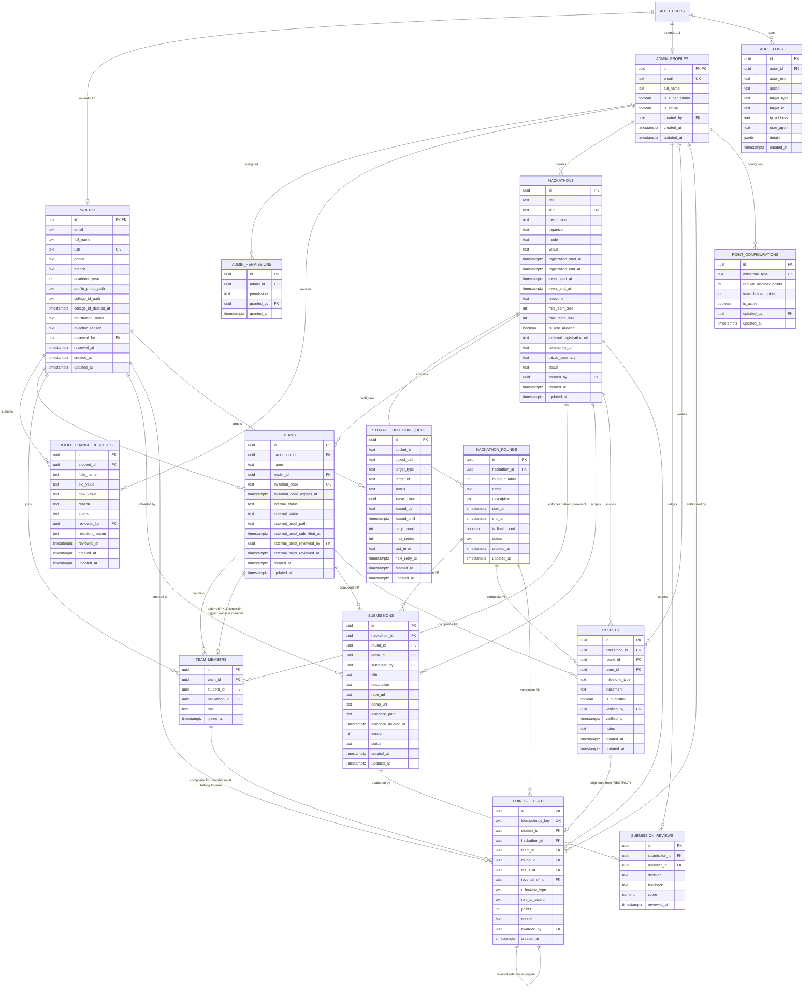
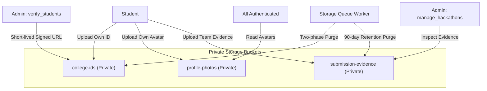

# NMIT HackLeague — Phase 3 Implementation Plan
## Database Architecture, PostgreSQL Schema, Row-Level Security & Storage Foundations

**Document Revision:** 1.7 (Final Phase 3 Architecture Correction & Conditional Implementation Gate)  
**Date:** October 12, 2026  
**Phase:** 03 of 13 (`Supabase Setup and Database Design`)  
**Status:** REVISION 1.7 — READY FOR PHASE 3 IMPLEMENTATION  
**Implementation Authorization:** CONDITIONAL — Authorized for local execution upon Stage A acceptance gate pass  
**Authoritative Source Documents:**
- `rules.md` (Canonical Project Rules & Source of Truth)
- `NMIT_HackLeague_Development_Phases.md` / `hackleague_plan.md` (Phase Roadmap)
- `PHASE_01_IMPLEMENTATION_PLAN.md` (Phase 1 Baseline Commit `8beea9238203eba601e0ec598e3b4923f9b8adc6`)
- `PHASE_02_IMPLEMENTATION_PLAN.md` (Phase 2 Baseline Commit `f8bd43a9611e2eb582b4f0ff7dd3976f17e9a485`)

---

## Document Revision History

| Revision | Date | Author / Role | Summary of Changes & Corrections |
| :--- | :--- | :--- | :--- |
| **1.0** | Oct 12, 2026 | Senior Software Architect | Initial draft covering 14 tables, Mermaid ERD, RLS matrix, Storage design, and implementation checklist. |
| **1.1** | Oct 12, 2026 | Security Reviewer & DB Designer | Addressed initial review findings: column-level protection triggers, `join_team_with_code` procedure, partial unique indexes for points, composite foreign keys, and synthetic seed structure. |
| **1.2** | Oct 12, 2026 | Principal Database Architect & Security Engineer | Timestamp standardization to `now()`, initial points `idempotency_key`, single Super Admin safeguards, team leader uniqueness, and storage deletion queue introduction. |
| **1.3** | Oct 12, 2026 | Lead Architect & Principal Database Security Reviewer | Comprehensive RLS matrix, circular deferred foreign key, points composite foreign keys to memberships, initial function inventory, and storage queue lifecycle. |
| **1.4** | Oct 12, 2026 | Principal Systems Architect & Security Reviewer | Hardened RLS and grants, bidirectional deferred constraint triggers for team leader integrity, points idempotency keys, transactional identity swap recovery, storage queue leasing, and 11-migration structure. |
| **1.5** | Oct 12, 2026 | Principal Database Architect & Security Reviewer | Final Technical Correction & PostgreSQL Validation Pass: Replaced instantaneous trigger with deferred constraint trigger `trg_verify_single_active_super_admin`, out-of-band recovery procedure, storage worker `auth.role()` assertions, 5-column migration dependency mapping, portable leader count verification, submission column reconciliation, CSPRNG invitation token generation, and personal data minimization. |
| **1.6** | Oct 12, 2026 | Principal PostgreSQL Architect & Supabase Security Engineer | Final Architecture Correction & Approval-Gate Audit: Replaced flawed `current_user` checks with `session_user` and `auth.role()` in `recover_super_admin_identity` and storage workers; reconciled 10-permission catalogue from `rules.md`; enforced case-insensitive team uniqueness via expression index `uq_teams_hackathon_name_ci`; made `p_result_id` mandatory for participation milestone awards; refined idempotency and storage worker lifecycle. |
| **1.7** | Oct 12, 2026 | Principal PostgreSQL Architect & Database Migration Specialist | **Final Phase 3 Correction & Executable Architecture Gate:**<br>1. **PostgreSQL Routine Invocation Paths & PostgREST Boundary:** Explicitly distinguished PostgreSQL `FUNCTION` (26 routines) vs `PROCEDURE` (1 routine: `recover_super_admin_identity`). Documented that PostgREST `rpc()` exclusively exposes functions, while procedures require SQL `CALL` for out-of-band database administration. Documented supported execution paths, roles, grants, error/transaction handling, and audit trails for all routines.<br>2. **Test Invocation Syntax Alignment:** Corrected routine invocation syntax across Section 19 test suites. Fixed `TS-PTS-06` to use function invocation syntax (`SELECT ...` / `supabase.rpc(...)`) instead of invalid `CALL`, ensuring authorization tests evaluate permissions rather than routine-type errors; corrected `TS-PTS-04` terminology.<br>3. **RLS, Policy & Grant Matrix Reconciliation:** Reconciled Table 14.1 across all 15 public tables and Storage buckets. Explicitly resolved anonymous profile access by denying `anon` (`REVOKE ALL ON profiles FROM anon, PUBLIC`, zero anon policy) and documenting distinct student and administrator policies. Aligned test reference identifiers with Section 19 test IDs (`TS-...`).<br>4. **Whole-Document Specification & Inventory Synchronization:** Synchronized exact object counts across all sections (15 public tables, 27 database routines [11 trigger functions, 4 helpers, 7 client RPCs, 4 server worker functions, 1 administrative stored procedure], 22 table triggers, 3 private storage buckets, 11 linear migrations, 6 synthetic local auth fixtures). |

---

## 1. Executive Summary

### 1.1 Purpose and Architectural Objective
Phase 3 establishes the database, security, and storage foundations of **NMIT HackLeague**. Following the successful establishment of the project foundation (Phase 1) and the complete design system, institutional branding integration, presentation login, and role-based shells (Phase 2), Phase 3 translates the domain requirements into a production-grade, relational PostgreSQL architecture deployed on Supabase.

This document defines:
1. A **normalized, maintainable PostgreSQL database schema** of **15 public application tables** enforcing relational integrity at the database layer (preventing impossible states, duplicate memberships, orphaned child records, cross-event corruption, crediting non-members, and negative/unbalanced points).
2. A **defense-in-depth authorization model** featuring PostgreSQL **Row-Level Security (RLS)**, column-level update protection triggers (`trg_protect_profile_columns`, `trg_protect_submission_columns`), parameterless security helper functions with pinned `search_path`, and strict server-side boundary checks that ensure neither presentation components nor browser clients can bypass access controls.
3. A **private object storage architecture** across three dedicated Supabase Storage buckets (`college-ids`, `profile-photos`, and `submission-evidence`), backed by a durable, leased transactional deletion queue (`storage_deletion_queue`), preventing public URL exposure, unauthenticated enumeration, cross-tenant file overwrites, and unauthorized downloads of sensitive student records.
4. A **reproducible, version-controlled migration lifecycle** using the Supabase CLI, designed for zero destructive resets, schema-drift detection, and safe forward-fixes across 11 dependency-ordered migrations.
5. A **strictly synthetic, privacy-compliant development seed dataset** covering all roles, lifecycle states, and edge cases with zero real student PII.
6. A comprehensive, ordered **Phase 3 implementation checklist** structured into discrete, reviewable execution units.

### 1.2 Phase Scope Boundaries & Guarantees
- **Pure Architectural Blueprint:** This document is an architectural specification. No migrations will be executed, no tables created, no buckets provisioned, no dependencies installed, and no application code modified during Phase 3.
- **Strict Identity Separation:** Supabase Auth (`auth.users`) exclusively owns authentication identities, passwords, password hashing, and session tokens. Application profiles (`public.profiles` and `public.admin_profiles`) extend Auth via strict 1:1 foreign keys (`id REFERENCES auth.users(id) ON DELETE RESTRICT`). Application code never duplicates or manages passwords.
- **Verification vs. Approval Invariant:** Email verification (handled by Supabase Auth / Resend) is strictly decoupled from administrative approval (managed in `public.profiles.registration_status`). A verified email does not grant student access; the student remains in `under_review` until an authorized administrator verifies their college ID card and profile details.
- **Super Admin Invariants:** Exactly one Super Admin exists at platform launch. A partial unique index (`uq_single_super_admin`) prevents multiple Super Admins, while a deferred constraint trigger (`trg_verify_single_active_super_admin`) and deletion trigger (`trg_prevent_super_admin_deletion`) prevent the sole active Super Admin from being demoted, deactivated, or deleted. Public registration for Super Admin is strictly prohibited.
- **One Team per Hackathon Invariant:** A student may participate in multiple hackathons simultaneously, but **may belong to at most one team per hackathon**. This invariant is enforced at the database layer via composite foreign keys and unique constraints (`UNIQUE (hackathon_id, student_id)` on `public.team_members`).
- **Immutable Points Ledger:** Points are not stored as mutable summary numbers susceptible to silent overwrites. Points are modeled as an auditable ledger (`public.points_ledger`) where every award, role bonus, or correction is an explicit transaction linked to a verified milestone and an authorizing administrator.
- **Git Safety & Working Tree Isolation:** Planning is performed on branch `v1`. Untracked files (`public/nmit.jpeg`, `graphify-out/`, `hackleague_plan.md`) are strictly preserved.

---

## 2. Repository and Architecture Findings

### 2.1 Git & Branch Inspection
- **Current Branch:** `v1` (Active and aligned with `origin/v1`).
- **Commit Baseline:** `f8bd43a9611e2eb582b4f0ff7dd3976f17e9a485` (`feat(phase-2): add design system and role-based UI shells`).
- **Working Tree:** Pristine with zero staged or unstaged modifications. Untracked files `graphify-out/`, `hackleague_plan.md`, and `public/nmit.jpeg` remain untouched.
- **Remotes:** `origin` -> `https://github.com/srujan-s22/nmit-hackleague.git`. Branch `main` remains untouched.

### 2.2 Application Stack & Dependency Inspection
- **Framework:** Next.js `16.4.0` (App Router, Turbopack enabled).
- **Core Libraries:** React `19.0.0`, React DOM `19.0.0`.
- **Styling:** Tailwind CSS v4 (`@tailwindcss/postcss` `4.0.0`, PostCSS `8.4.49`) using CSS variables and `@theme` tokens in `src/app/globals.css`.
- **TypeScript:** Version `5.7.0` with strict type checking enabled (`tsconfig.json`).
- **Existing Supabase Footprint:**
  - Zero Supabase libraries are installed in `package.json` (`@supabase/supabase-js` and `@supabase/ssr` have not yet been introduced).
  - No Supabase directory (`supabase/migrations`, `supabase/config.toml`) currently exists.
  - Environment template (`.env.example`) has commented-out placeholders for `NEXT_PUBLIC_SUPABASE_URL`, `NEXT_PUBLIC_SUPABASE_ANON_KEY`, and `SUPABASE_SERVICE_ROLE_KEY`.

---

## 3. Phase 3 Scope and Completion-Criteria Mapping

| Roadmap Scope Item | Completion Criterion | Implementation Method in Phase 3 | Verification & Proof Method |
| :--- | :--- | :--- | :--- |
| **Supabase Integration & Config** | Reproducible configuration | Initialize `supabase/config.toml` matching local and remote project specs. | `supabase status` succeeds; project config matches project settings. |
| **SQL Migrations** | Version-controlled and reproducible | Sequential, explicit SQL files in `supabase/migrations/` using timestamp prefixes; strict drift failure (no silent masking via `IF NOT EXISTS` on new application tables). | `supabase db reset` applies all 11 migrations from scratch with exit code 0. |
| **Relational Schema Design** | Integrity enforced by database constraints | DDL for **15 normalized public tables** with composite foreign keys, composite unique constraints, check constraints, circular deferred keys, constraint triggers, and cross-hackathon invariants. | DDL compilation check; constraint violation test suite (duplicate USN, duplicate team join, cross-event foreign key mismatch, crediting non-member). |
| **Row-Level & Column-Level Security** | Tested against all roles | `ENABLE ROW LEVEL SECURITY` and `FORCE ROW LEVEL SECURITY` on all 15 tables; granular policies for anon, student, admin, super admin; column modification triggers (`trg_protect_profile_columns`, `trg_protect_submission_columns`). | Role-impersonation SQL test suite verifying permitted reads/writes and blocked unauthorized attempts, including direct update attacks on approval/status columns. |
| **Private Storage Buckets & Deletion Queue** | Secure access; durable deletion lifecycle | Bucket creation SQL for `college-ids`, `profile-photos`, `submission-evidence`; storage RLS policies; durable transactional queue table (`storage_deletion_queue`) with worker leasing. | Storage API tests confirming blocked unauthenticated access, cross-student download attempts, and programmatic verification of physical object deletion via leased queue processor. |
| **Safe Seed Data** | Zero real student PII | Synthetic fixtures in `supabase/seed.sql` with deterministic UUIDs in `auth.users` modeling students, admins, events, teams, and points; environment check preventing production runs. | Seed execution check; automated regex scan confirming zero real emails or production USNs. |
| **Audit Trails & Tamper Resistance** | Append-only audit log | Trigger-based `public.audit_logs` table with update/delete prevention triggers. | Attempted `UPDATE` and `DELETE` queries on `audit_logs` fail with explicit Postgres exceptions. |

---

## 4. Existing-State Inventory and Prerequisites

### 4.1 Required Prerequisites Before Phase 3 Implementation
1. **Supabase CLI:** Installation of Supabase CLI (via Homebrew or `npx supabase`) for local migration execution, RLS policy validation, and schema generation.
2. **Local Docker Engine:** Docker Desktop or OrbStack running locally to host the local Supabase PostgreSQL database, Auth emulator, and Storage emulator during development.
3. **Dependency Additions (To be added in implementation phase):**
   - `@supabase/supabase-js` (core Supabase client)
   - `@supabase/ssr` (Next.js App Router server/client SSR integration)
4. **Environment Configuration:**
   - `.env.local` created locally (never committed) with local Supabase test keys:
     - `NEXT_PUBLIC_SUPABASE_URL=http://127.0.0.1:54321`
     - `NEXT_PUBLIC_SUPABASE_ANON_KEY=...`
     - `SUPABASE_SERVICE_ROLE_KEY=...`

---

## 5. Proposed Entity-Relationship Diagram (ERD)



---

## 6. Table-by-Table Schema Specification

### 6.1 Table: `public.profiles`
- **Purpose:** Stores profile data for registered students, linked 1:1 to Supabase Auth.
- **Columns & PostgreSQL Types:**
  - `id`: `UUID PRIMARY KEY REFERENCES auth.users(id) ON DELETE RESTRICT`
  - `email`: `TEXT NOT NULL`
  - `full_name`: `TEXT NOT NULL`
  - `usn`: `TEXT NOT NULL UNIQUE` (Normalized uppercase via trigger `trg_profiles_normalize_usn`).
  - `phone`: `TEXT NOT NULL`
  - `branch`: `TEXT NOT NULL`
  - `academic_year`: `INTEGER NOT NULL`
  - `profile_photo_path`: `TEXT NULL`
  - `college_id_path`: `TEXT NULL`
  - `college_id_deleted_at`: `TIMESTAMPTZ NULL`
  - `registration_status`: `TEXT NOT NULL DEFAULT 'draft'`
  - `rejection_reason`: `TEXT NULL`
  - `reviewed_by`: `UUID NULL REFERENCES public.admin_profiles(id) ON DELETE SET NULL`
  - `reviewed_at`: `TIMESTAMPTZ NULL`
  - `created_at`: `TIMESTAMPTZ NOT NULL DEFAULT now()`
  - `updated_at`: `TIMESTAMPTZ NOT NULL DEFAULT now()`
- **Data Minimization Rationale:** Sensitive demographic fields (`sex`, `dob`) are strictly omitted from the Phase 3 schema. Capturing speculative, unverified demographic data violates privacy-by-design standards and neither attribute is required for team formation, academic authorization, or platform operations.
- **Constraints:**
  - `CONSTRAINT chk_profiles_usn_format CHECK (usn ~* '^[0-9][A-Z]{2}[0-9]{2}[A-Z]{2}[0-9]{3}$')` (Validates standard VTU/NMIT USN format, e.g. `1NT21CS001`).
  - `CONSTRAINT chk_profiles_academic_year CHECK (academic_year BETWEEN 1 AND 4)`
  - `CONSTRAINT chk_profiles_status CHECK (registration_status IN ('draft', 'pending_verification', 'under_review', 'approved', 'rejected', 'suspended'))`
- **USN Normalization Strategy:** Trigger `trg_profiles_normalize_usn` runs `BEFORE INSERT OR UPDATE` executing `NEW.usn = UPPER(TRIM(NEW.usn));`. This eliminates the need for redundant expression indexes and guarantees database-level case-insensitive uniqueness on the single `UNIQUE (usn)` constraint.
- **Column-Level Security & Modification Trigger:**
```sql
CREATE OR REPLACE FUNCTION public.protect_profile_columns()
RETURNS TRIGGER AS $$
BEGIN
  -- Administrative fields guarded from non-admin updates
  IF (OLD.registration_status IS DISTINCT FROM NEW.registration_status OR
      OLD.rejection_reason IS DISTINCT FROM NEW.rejection_reason OR
      OLD.reviewed_by IS DISTINCT FROM NEW.reviewed_by OR
      OLD.reviewed_at IS DISTINCT FROM NEW.reviewed_at OR
      OLD.college_id_deleted_at IS DISTINCT FROM NEW.college_id_deleted_at) THEN
    
    IF NOT (public.current_has_permission('verify_students') OR public.current_is_super_admin()) THEN
      RAISE EXCEPTION 'Unauthorized column modification: registration_status and review metadata can only be updated by authorized administrators.';
    END IF;
  END IF;

  -- Approved student details frozen against direct modification
  IF OLD.registration_status = 'approved' AND NOT public.current_is_super_admin() THEN
    IF (OLD.usn IS DISTINCT FROM NEW.usn OR
        OLD.full_name IS DISTINCT FROM NEW.full_name OR
        OLD.branch IS DISTINCT FROM NEW.branch OR
        OLD.academic_year IS DISTINCT FROM NEW.academic_year) THEN
      RAISE EXCEPTION 'Approved student details cannot be modified directly. Submit a profile change request.';
    END IF;
  END IF;

  RETURN NEW;
END;
$$ LANGUAGE plpgsql SECURITY DEFINER SET search_path = public, pg_temp;

CREATE TRIGGER trg_protect_profile_columns
BEFORE UPDATE ON public.profiles
FOR EACH ROW EXECUTE FUNCTION public.protect_profile_columns();
```
- **Indexes:**
  - `CREATE INDEX idx_profiles_email ON public.profiles (LOWER(TRIM(email)));`
  - `CREATE INDEX idx_profiles_status ON public.profiles (registration_status);`
  - `CREATE INDEX idx_profiles_branch_year ON public.profiles (branch, academic_year);`
- **Timestamp Behavior:** Managed automatically via trigger `trg_profiles_updated_at` invoking `public.handle_updated_at()`.

---

### 6.2 Table: `public.admin_profiles`
- **Purpose:** Stores identity and global governance metadata for administrative users (Super Admin and Admins), linked 1:1 to Supabase Auth.
- **Columns & PostgreSQL Types:**
  - `id`: `UUID PRIMARY KEY REFERENCES auth.users(id) ON DELETE RESTRICT`
  - `email`: `TEXT NOT NULL UNIQUE`
  - `full_name`: `TEXT NOT NULL`
  - `is_super_admin`: `BOOLEAN NOT NULL DEFAULT false`
  - `is_active`: `BOOLEAN NOT NULL DEFAULT true`
  - `created_by`: `UUID NULL REFERENCES public.admin_profiles(id) ON DELETE SET NULL`
  - `created_at`: `TIMESTAMPTZ NOT NULL DEFAULT now()`
  - `updated_at`: `TIMESTAMPTZ NOT NULL DEFAULT now()`
- **Single Super Admin Safeguards & Concurrency Serialization:**
  - **At-most-one engine invariant:** Partial unique index `CREATE UNIQUE INDEX uq_single_super_admin ON public.admin_profiles (is_super_admin) WHERE (is_super_admin = true);`.
  - **Single Super Admin Invariant & Deferred Constraint Trigger:**
    - Engine-level at-most-one invariant: Partial unique index `CREATE UNIQUE INDEX uq_single_super_admin ON public.admin_profiles (is_super_admin) WHERE (is_super_admin = true);`.
    - Engine-level exactly-one active Super Admin verification at transaction commit:
```sql
CREATE OR REPLACE FUNCTION public.verify_single_active_super_admin()
RETURNS TRIGGER AS $$
DECLARE
  v_active_super_admins INT;
BEGIN
  -- Evaluated at transaction commit across all administrative mutations
  SELECT COUNT(*) INTO v_active_super_admins
  FROM public.admin_profiles
  WHERE is_super_admin = true AND is_active = true;

  IF v_active_super_admins <> 1 THEN
    RAISE EXCEPTION 'Administrative invariant violation: system must have exactly 1 active Super Admin at transaction commit (found %).', v_active_super_admins;
  END IF;

  RETURN COALESCE(NEW, OLD);
END;
$$ LANGUAGE plpgsql;

CREATE CONSTRAINT TRIGGER trg_verify_single_active_super_admin
AFTER INSERT OR UPDATE OR DELETE ON public.admin_profiles
DEFERRABLE INITIALLY DEFERRED
FOR EACH ROW EXECUTE FUNCTION public.verify_single_active_super_admin();
```
  - **Protection against unauthorized role changes:**
```sql
CREATE OR REPLACE FUNCTION public.protect_admin_profiles()
RETURNS TRIGGER AS $$
BEGIN
  -- Prevent privilege escalation or unauthorized role changes by non-super-admins
  IF (OLD.is_super_admin IS DISTINCT FROM NEW.is_super_admin OR
      OLD.is_active IS DISTINCT FROM NEW.is_active) THEN
    -- In SECURITY DEFINER, session_user identifies connecting role (current_user is routine owner postgres)
    IF NOT (public.current_is_super_admin() OR session_user IN ('postgres', 'supabase_admin') OR auth.role() = 'service_role') THEN
      RAISE EXCEPTION 'Privilege escalation blocked: only Super Admin or database administrator can alter administrator roles or status.';
    END IF;
  END IF;

  RETURN NEW;
END;
$$ LANGUAGE plpgsql SECURITY DEFINER SET search_path = public, pg_temp;

CREATE TRIGGER trg_protect_admin_profiles
BEFORE UPDATE ON public.admin_profiles
FOR EACH ROW EXECUTE FUNCTION public.protect_admin_profiles();
```
  - **Protection against direct deletion of Super Admin:**
```sql
CREATE OR REPLACE FUNCTION public.prevent_super_admin_deletion()
RETURNS TRIGGER AS $$
BEGIN
  IF OLD.is_super_admin = true THEN
    RAISE EXCEPTION 'Deletion blocked: Super Admin accounts cannot be deleted directly. Perform an authorized disaster recovery transition first.';
  END IF;
  RETURN OLD;
END;
$$ LANGUAGE plpgsql;

CREATE TRIGGER trg_prevent_super_admin_deletion
BEFORE DELETE ON public.admin_profiles
FOR EACH ROW EXECUTE FUNCTION public.prevent_super_admin_deletion();
```
- **Out-of-Band Super Admin Concurrency-Safe Disaster Recovery & Bootstrap Lifecycle:**
  - **The `SECURITY DEFINER` Caller Verification Boundary:** Inside a PostgreSQL `SECURITY DEFINER` routine, `current_user` evaluates to the procedure owner (`postgres`). Checking `current_user` inside such a routine is tautological and cannot prove original caller authority. Caller identity must instead be asserted via `session_user` (the connecting database session role) and `auth.role()` (the verified JWT claim when routed through the authenticated server layer).
  - **Out-of-Band Channel Isolation:** If Super Admin credentials become permanently inaccessible, recovery is executed strictly via trusted out-of-band project owner access:
    1. Direct PostgreSQL connection (`psql`) connecting as `postgres` or `supabase_admin` (where `session_user IN ('postgres', 'supabase_admin')`).
    2. Supabase Dashboard SQL Editor (running with direct database admin privileges).
    3. Server-side CLI disaster recovery script utilizing the secure `service_role` key in a trusted environment (where `auth.role() = 'service_role'`).
  - **Client Isolation:** `EXECUTE` privileges are completely revoked from `PUBLIC`, `anon`, and `authenticated`. No browser client can invoke this procedure.
  - **Initial Bootstrap vs. Steady-State Invariant:**
    - *Steady-State:* Constraint trigger `trg_verify_single_active_super_admin` (`DEFERRABLE INITIALLY DEFERRED`) guarantees that at transaction commit, exactly 1 active Super Admin exists.
    - *Initial Bootstrap:* On a fresh database, the table is initialized empty. The initial Super Admin row must be inserted as part of the seed transaction before any ordinary admins are committed. Because the trigger is deferred to transaction commit, the initial bootstrap transaction commits with count = 1, ensuring zero initialization blockage while preventing any commit with 0 or >1 active Super Admins.
  - Trusted Recovery Procedure (`public.recover_super_admin_identity`):
```sql
CREATE OR REPLACE PROCEDURE public.recover_super_admin_identity(
  p_replacement_auth_uid UUID,
  p_replacement_email TEXT,
  p_replacement_full_name TEXT,
  p_reason TEXT
)
AS $$
DECLARE
  v_old_admin_id UUID;
BEGIN
  -- 1. Strictly verify database administrator or service_role authority.
  -- session_user checks the real connecting database role (current_user is routine owner postgres).
  IF session_user NOT IN ('postgres', 'supabase_admin') AND (auth.role() IS NULL OR auth.role() <> 'service_role') THEN
    RAISE EXCEPTION 'Access denied: Super Admin disaster recovery requires out-of-band database administrator or service_role authority.';
  END IF;

  IF TRIM(p_reason) = '' THEN
    RAISE EXCEPTION 'Mandatory audit reason required for disaster recovery.';
  END IF;

  -- 2. Verify replacement auth user exists in auth.users
  IF NOT EXISTS (SELECT 1 FROM auth.users WHERE id = p_replacement_auth_uid) THEN
    RAISE EXCEPTION 'Replacement user ID % does not exist in auth.users.', p_replacement_auth_uid;
  END IF;

  -- 3. Lock all admin rows FOR UPDATE to serialize concurrent operations
  PERFORM 1 FROM public.admin_profiles FOR UPDATE;

  -- 4. Locate current Super Admin
  SELECT id INTO v_old_admin_id
  FROM public.admin_profiles
  WHERE is_super_admin = true
  LIMIT 1;

  -- 5. Demote old Super Admin (preserves old admin PK id and historical foreign keys)
  IF v_old_admin_id IS NOT NULL THEN
    UPDATE public.admin_profiles
    SET is_super_admin = false,
        is_active = false,
        updated_at = now()
    WHERE id = v_old_admin_id;
  END IF;

  -- 6. Upsert replacement identity as active Super Admin (does NOT mutate old admin's id)
  INSERT INTO public.admin_profiles (id, email, full_name, is_super_admin, is_active)
  VALUES (p_replacement_auth_uid, p_replacement_email, p_replacement_full_name, true, true)
  ON CONFLICT (id) DO UPDATE
  SET is_super_admin = true,
      is_active = true,
      email = EXCLUDED.email,
      full_name = EXCLUDED.full_name,
      updated_at = now();

  -- 7. Log immutable audit trail with actor details
  INSERT INTO public.audit_logs (actor_id, actor_role, action, target_type, target_id, details)
  VALUES (
    p_replacement_auth_uid,
    'system_recovery',
    'super_admin.disaster_recovery',
    'admin_profile',
    p_replacement_auth_uid::text,
    jsonb_build_object(
      'previous_super_admin_id', v_old_admin_id,
      'new_super_admin_id', p_replacement_auth_uid,
      'reason', p_reason
    )
  );
  -- At transaction commit, deferred trigger trg_verify_single_active_super_admin verifies exactly 1 active Super Admin
END;
$$ LANGUAGE plpgsql SECURITY DEFINER SET search_path = public, pg_temp;

REVOKE ALL ON PROCEDURE public.recover_super_admin_identity(UUID, TEXT, TEXT, TEXT) FROM PUBLIC, anon, authenticated;
GRANT EXECUTE ON PROCEDURE public.recover_super_admin_identity(UUID, TEXT, TEXT, TEXT) TO service_role;
```
  - **Guarantees:** Preserves all foreign keys (`awarded_by`, `created_by`, `verified_by`), avoids primary-key mutation, maintains `uq_single_super_admin` at every state, and deferred trigger `trg_verify_single_active_super_admin` ensures exactly one active Super Admin exists at commit.

---

### 6.3 Table: `public.admin_permissions`
- **Purpose:** Implements granular, capability-based operational permissions for admins.
- **Columns & PostgreSQL Types:**
  - `id`: `UUID PRIMARY KEY DEFAULT gen_random_uuid()`
  - `admin_id`: `UUID NOT NULL REFERENCES public.admin_profiles(id) ON DELETE CASCADE`
  - `permission`: `TEXT NOT NULL`
  - `granted_by`: `UUID NOT NULL REFERENCES public.admin_profiles(id) ON DELETE RESTRICT`
  - `granted_at`: `TIMESTAMPTZ NOT NULL DEFAULT now()`
- **Constraints:**
  - `CONSTRAINT uq_admin_permission UNIQUE (admin_id, permission)`
  - `CONSTRAINT chk_admin_permissions_key CHECK (permission IN ('verify_students', 'manage_password_resets', 'manage_hackathons', 'manage_teams', 'manage_followups', 'manage_students', 'view_analytics', 'export_data', 'view_audit_logs', 'manage_points'))`
- **Timestamp Behavior:** Immutable grant record (`granted_at`). Omit `updated_at`.

---

### 6.4 Table: `public.hackathons`
- **Purpose:** Stores hackathon lifecycle records, metadata, eligibility criteria, and operational windows.
- **Columns & PostgreSQL Types:**
  - `id`: `UUID PRIMARY KEY DEFAULT gen_random_uuid()`
  - `title`: `TEXT NOT NULL`
  - `slug`: `TEXT NOT NULL UNIQUE`
  - `description`: `TEXT NOT NULL`
  - `organizer`: `TEXT NOT NULL`
  - `mode`: `TEXT NOT NULL`
  - `venue`: `TEXT NULL`
  - `registration_start_at`: `TIMESTAMPTZ NOT NULL`
  - `registration_end_at`: `TIMESTAMPTZ NOT NULL`
  - `event_start_at`: `TIMESTAMPTZ NOT NULL`
  - `event_end_at`: `TIMESTAMPTZ NOT NULL`
  - `timezone`: `TEXT NOT NULL DEFAULT 'Asia/Kolkata'`
  - `min_team_size`: `INTEGER NOT NULL DEFAULT 1`
  - `max_team_size`: `INTEGER NOT NULL DEFAULT 4`
  - `is_solo_allowed`: `BOOLEAN NOT NULL DEFAULT false`
  - `external_registration_url`: `TEXT NULL`
  - `community_url`: `TEXT NULL`
  - `prizes_summary`: `TEXT NULL`
  - `status`: `TEXT NOT NULL DEFAULT 'draft'`
  - `created_by`: `UUID NOT NULL REFERENCES public.admin_profiles(id) ON DELETE RESTRICT`
  - `created_at`: `TIMESTAMPTZ NOT NULL DEFAULT now()`
  - `updated_at`: `TIMESTAMPTZ NOT NULL DEFAULT now()`
- **Constraints:**
  - `CONSTRAINT chk_hackathons_mode CHECK (mode IN ('offline', 'online', 'hybrid'))`
  - `CONSTRAINT chk_hackathons_status CHECK (status IN ('draft', 'published', 'registration_closed', 'ongoing', 'completed', 'archived'))`
  - `CONSTRAINT chk_hackathons_team_size CHECK (min_team_size >= 1 AND max_team_size >= min_team_size)`
  - `CONSTRAINT chk_hackathons_reg_window CHECK (registration_end_at > registration_start_at)`
  - `CONSTRAINT chk_hackathons_event_window CHECK (event_end_at >= event_start_at)`
  - `CONSTRAINT chk_hackathons_chronology CHECK (event_start_at >= registration_start_at)`
- **Composite Unique Keys for Child Relational Integrity:**
  - `CONSTRAINT uq_hackathons_id_status UNIQUE (id, status)`
- **Historical Retention Rule:** Hackathons with child records (`teams`, `submissions`, `results`) enforce `ON DELETE RESTRICT`. They transition to `completed` and `archived`. Deletions are permitted only for unreferenced `draft` events.

---

### 6.5 Table: `public.hackathon_rounds`
- **Purpose:** Configures event-specific round sequencing, schedules, and evaluation milestones.
- **Columns & PostgreSQL Types:**
  - `id`: `UUID PRIMARY KEY DEFAULT gen_random_uuid()`
  - `hackathon_id`: `UUID NOT NULL REFERENCES public.hackathons(id) ON DELETE RESTRICT`
  - `round_number`: `INTEGER NOT NULL`
  - `name`: `TEXT NOT NULL`
  - `description`: `TEXT NULL`
  - `start_at`: `TIMESTAMPTZ NOT NULL`
  - `end_at`: `TIMESTAMPTZ NOT NULL`
  - `is_final_round`: `BOOLEAN NOT NULL DEFAULT false`
  - `status`: `TEXT NOT NULL DEFAULT 'scheduled'`
  - `created_at`: `TIMESTAMPTZ NOT NULL DEFAULT now()`
  - `updated_at`: `TIMESTAMPTZ NOT NULL DEFAULT now()`
- **Composite Keys for Cross-Hackathon Integrity:**
  - `CONSTRAINT uq_hackathon_round_number UNIQUE (hackathon_id, round_number)`
  - `CONSTRAINT uq_hackathon_rounds_composite UNIQUE (id, hackathon_id)` (Allows child tables to reference `(round_id, hackathon_id)`).

---

### 6.6 Table: `public.teams`
- **Purpose:** Stores participation teams, confidential invitation tokens, and internal/external registration states.
- **Columns & PostgreSQL Types:**
  - `id`: `UUID PRIMARY KEY DEFAULT gen_random_uuid()`
  - `hackathon_id`: `UUID NOT NULL REFERENCES public.hackathons(id) ON DELETE RESTRICT`
  - `name`: `TEXT NOT NULL`
  - `leader_id`: `UUID NOT NULL REFERENCES public.profiles(id) ON DELETE RESTRICT`
  - `invitation_code`: `TEXT NOT NULL UNIQUE` (Unguessable, 12-char cryptographic token).
  - `invitation_code_expires_at`: `TIMESTAMPTZ NOT NULL DEFAULT (now() + interval '7 days')`
  - `internal_status`: `TEXT NOT NULL DEFAULT 'forming'`
  - `external_status`: `TEXT NOT NULL DEFAULT 'not_submitted'`
  - `external_proof_path`: `TEXT NULL`
  - `external_proof_submitted_at`: `TIMESTAMPTZ NULL`
  - `external_proof_reviewed_by`: `UUID NULL REFERENCES public.admin_profiles(id) ON DELETE SET NULL`
  - `external_proof_reviewed_at`: `TIMESTAMPTZ NULL`
  - `created_at`: `TIMESTAMPTZ NOT NULL DEFAULT now()`
  - `updated_at`: `TIMESTAMPTZ NOT NULL DEFAULT now()`
- **Name Validation & Constraints:**
  - `CONSTRAINT chk_teams_name_valid CHECK (length(TRIM(name)) >= 2 AND length(TRIM(name)) <= 50)`
  - `CONSTRAINT uq_teams_composite_hackathon UNIQUE (id, hackathon_id)`
  - `CONSTRAINT fk_teams_leader_member FOREIGN KEY (id, leader_id) REFERENCES public.team_members(team_id, student_id) DEFERRABLE INITIALLY DEFERRED`
- **Case-Insensitive Trimmed Uniqueness Index:**
  - `CREATE UNIQUE INDEX uq_teams_hackathon_name_ci ON public.teams (hackathon_id, LOWER(TRIM(name)));` (Guarantees case-insensitive, whitespace-trimmed uniqueness per hackathon at the engine level).
- **Team Leadership Constraint Trigger on `teams`:**
```sql
CREATE OR REPLACE FUNCTION public.verify_team_leader_integrity()
RETURNS TRIGGER AS $$
DECLARE
  v_leader_member_id UUID;
BEGIN
  -- Assert that team_members contains exactly one leader whose student_id matches leader_id
  SELECT student_id INTO v_leader_member_id
  FROM public.team_members
  WHERE team_id = NEW.id AND role = 'leader';

  IF v_leader_member_id IS NULL THEN
    RAISE EXCEPTION 'Team leadership integrity violation: team % has no assigned leader in team_members.', NEW.id;
  END IF;

  IF v_leader_member_id <> NEW.leader_id THEN
    RAISE EXCEPTION 'Team leadership integrity violation: teams.leader_id (%) does not match leader in team_members (%).', NEW.leader_id, v_leader_member_id;
  END IF;

  RETURN NEW;
END;
$$ LANGUAGE plpgsql;

CREATE CONSTRAINT TRIGGER trg_verify_team_leader_integrity
AFTER INSERT OR UPDATE ON public.teams
DEFERRABLE INITIALLY DEFERRED
FOR EACH ROW EXECUTE FUNCTION public.verify_team_leader_integrity();
```

---

### 6.7 Table: `public.team_members`
- **Purpose:** Maps student memberships to teams and enforces the critical **one-team-per-hackathon** invariant and **single-leader** invariant at the database layer.
- **Columns & PostgreSQL Types:**
  - `id`: `UUID PRIMARY KEY DEFAULT gen_random_uuid()`
  - `team_id`: `UUID NOT NULL`
  - `student_id`: `UUID NOT NULL REFERENCES public.profiles(id) ON DELETE RESTRICT`
  - `hackathon_id`: `UUID NOT NULL`
  - `role`: `TEXT NOT NULL DEFAULT 'member'`
  - `joined_at`: `TIMESTAMPTZ NOT NULL DEFAULT now()`
- **Referential Integrity & Constraints:**
  - `CONSTRAINT fk_team_members_team_composite FOREIGN KEY (team_id, hackathon_id) REFERENCES public.teams(id, hackathon_id) ON DELETE RESTRICT`
  - `CONSTRAINT uq_team_members_unique_team_student UNIQUE (team_id, student_id)`
  - `CONSTRAINT uq_team_members_one_team_per_hackathon UNIQUE (hackathon_id, student_id)`
  - `CONSTRAINT uq_team_members_t_s_h UNIQUE (team_id, student_id, hackathon_id)` (Referenced by `points_ledger` composite foreign key).
  - `CONSTRAINT chk_team_members_role CHECK (role IN ('leader', 'member'))`
- **Single-Leader Database Invariant:**
  - Partial unique index: `CREATE UNIQUE INDEX uq_team_single_leader ON public.team_members (team_id) WHERE (role = 'leader');`
- **Team Leadership Constraint Trigger on `team_members`:**
```sql
CREATE OR REPLACE FUNCTION public.verify_team_member_leader_integrity()
RETURNS TRIGGER AS $$
DECLARE
  v_team_id UUID;
  v_leader_count INT;
  v_team_leader_id UUID;
BEGIN
  -- If an UPDATE modifies team_id, validate old team leadership first
  IF TG_OP = 'UPDATE' AND OLD.team_id IS DISTINCT FROM NEW.team_id THEN
    -- If old team still exists, validate its invariant
    IF EXISTS (SELECT 1 FROM public.teams WHERE id = OLD.team_id) THEN
      SELECT COUNT(*) INTO v_leader_count
      FROM public.team_members
      WHERE team_id = OLD.team_id AND role = 'leader';

      IF v_leader_count <> 1 THEN
        RAISE EXCEPTION 'Team leadership integrity violation: old team % must have exactly 1 leader (found %).', OLD.team_id, v_leader_count;
      END IF;

      SELECT student_id INTO v_team_leader_id
      FROM public.team_members
      WHERE team_id = OLD.team_id AND role = 'leader'
      LIMIT 1;

      IF EXISTS (SELECT 1 FROM public.teams WHERE id = OLD.team_id AND leader_id <> v_team_leader_id) THEN
        RAISE EXCEPTION 'Team leadership integrity violation: teams.leader_id does not match team_members leader for old team.';
      END IF;
    END IF;
  END IF;

  v_team_id := COALESCE(NEW.team_id, OLD.team_id);

  -- If the team row itself was deleted in this transaction, skip validation to permit clean team deletion
  IF NOT EXISTS (SELECT 1 FROM public.teams WHERE id = v_team_id) THEN
    RETURN COALESCE(NEW, OLD);
  END IF;

  -- Assert exactly one leader membership exists for this active team
  SELECT COUNT(*) INTO v_leader_count
  FROM public.team_members
  WHERE team_id = v_team_id AND role = 'leader';

  IF v_leader_count <> 1 THEN
    RAISE EXCEPTION 'Team leadership integrity violation: team % must have exactly 1 leader (found %).', v_team_id, v_leader_count;
  END IF;

  SELECT student_id INTO v_team_leader_id
  FROM public.team_members
  WHERE team_id = v_team_id AND role = 'leader'
  LIMIT 1;

  -- Assert teams.leader_id matches
  IF EXISTS (SELECT 1 FROM public.teams WHERE id = v_team_id AND leader_id <> v_team_leader_id) THEN
    RAISE EXCEPTION 'Team leadership integrity violation: teams.leader_id does not match team_members leader for team %.', v_team_id;
  END IF;

  RETURN COALESCE(NEW, OLD);
END;
$$ LANGUAGE plpgsql;

CREATE CONSTRAINT TRIGGER trg_verify_member_leader_integrity
AFTER INSERT OR UPDATE OR DELETE ON public.team_members
DEFERRABLE INITIALLY DEFERRED
FOR EACH ROW EXECUTE FUNCTION public.verify_team_member_leader_integrity();
```

---

### 6.8 Table: `public.submissions`
- **Purpose:** Stores round milestone claims, project repositories, demo links, and evidence metadata.
- **Columns & PostgreSQL Types:**
  - `id`: `UUID PRIMARY KEY DEFAULT gen_random_uuid()`
  - `hackathon_id`: `UUID NOT NULL`
  - `round_id`: `UUID NOT NULL`
  - `team_id`: `UUID NOT NULL`
  - `submitted_by`: `UUID NOT NULL REFERENCES public.profiles(id) ON DELETE RESTRICT`
  - `title`: `TEXT NOT NULL`
  - `description`: `TEXT NULL`
  - `repo_url`: `TEXT NULL`
  - `demo_url`: `TEXT NULL`
  - `evidence_path`: `TEXT NULL`
  - `evidence_deleted_at`: `TIMESTAMPTZ NULL`
  - `version`: `INTEGER NOT NULL DEFAULT 1`
  - `status`: `TEXT NOT NULL DEFAULT 'submitted'`
  - `created_at`: `TIMESTAMPTZ NOT NULL DEFAULT now()`
  - `updated_at`: `TIMESTAMPTZ NOT NULL DEFAULT now()`
- **Cross-Hackathon Composite Foreign Keys:**
  - `CONSTRAINT fk_submissions_team_composite FOREIGN KEY (team_id, hackathon_id) REFERENCES public.teams(id, hackathon_id) ON DELETE RESTRICT`
  - `CONSTRAINT fk_submissions_round_composite FOREIGN KEY (round_id, hackathon_id) REFERENCES public.hackathon_rounds(id, hackathon_id) ON DELETE RESTRICT`
  - `CONSTRAINT uq_submissions_composite UNIQUE (id, hackathon_id)`
  - `CONSTRAINT uq_submission_version UNIQUE (round_id, team_id, version)`
  - `CONSTRAINT chk_submissions_status CHECK (status IN ('submitted', 'under_review', 'accepted', 'rejected', 'revision_requested'))`
- **Submission Column Protection Trigger (`trg_protect_submission_columns`):**
```sql
CREATE OR REPLACE FUNCTION public.protect_submission_columns()
RETURNS TRIGGER AS $$
BEGIN
  -- Immutable structural linkages and creation timestamp
  IF (OLD.hackathon_id <> NEW.hackathon_id OR
      OLD.round_id <> NEW.round_id OR
      OLD.team_id <> NEW.team_id OR
      OLD.submitted_by <> NEW.submitted_by OR
      OLD.created_at <> NEW.created_at) THEN
    RAISE EXCEPTION 'Cannot alter structural submission linkages (hackathon, round, team, submitted_by, created_at).';
  END IF;

  -- Non-admin updates cannot alter status or evidence_deleted_at
  IF NOT (public.current_has_permission('manage_hackathons') OR public.current_is_super_admin()) THEN
    IF OLD.status IS DISTINCT FROM NEW.status THEN
      RAISE EXCEPTION 'Students cannot alter submission review status.';
    END IF;
    IF OLD.evidence_deleted_at IS DISTINCT FROM NEW.evidence_deleted_at THEN
      RAISE EXCEPTION 'Students cannot alter evidence deletion timestamps.';
    END IF;
  END IF;

  -- Admin updates cannot alter student submission content (title, description, repos, evidence, version)
  IF (public.current_has_permission('manage_hackathons') OR public.current_is_super_admin()) AND NOT public.current_is_team_member(OLD.team_id) THEN
    IF (OLD.title IS DISTINCT FROM NEW.title OR
        OLD.description IS DISTINCT FROM NEW.description OR
        OLD.repo_url IS DISTINCT FROM NEW.repo_url OR
        OLD.demo_url IS DISTINCT FROM NEW.demo_url OR
        OLD.evidence_path IS DISTINCT FROM NEW.evidence_path OR
        OLD.version IS DISTINCT FROM NEW.version) THEN
      RAISE EXCEPTION 'Administrators cannot modify student submission payload; only review status and administrative metadata may be updated.';
    END IF;
  END IF;

  RETURN NEW;
END;
$$ LANGUAGE plpgsql SECURITY DEFINER SET search_path = public, pg_temp;

CREATE TRIGGER trg_protect_submission_columns
BEFORE UPDATE ON public.submissions
FOR EACH ROW EXECUTE FUNCTION public.protect_submission_columns();
```

---

### 6.9 Table: `public.submission_reviews`
- **Purpose:** Stores judge and administrator evaluation scores, qualitative feedback, and qualification decisions.
- **Columns & PostgreSQL Types:**
  - `id`: `UUID PRIMARY KEY DEFAULT gen_random_uuid()`
  - `submission_id`: `UUID NOT NULL REFERENCES public.submissions(id) ON DELETE CASCADE`
  - `reviewer_id`: `UUID NOT NULL REFERENCES public.admin_profiles(id) ON DELETE RESTRICT`
  - `decision`: `TEXT NOT NULL`
  - `feedback`: `TEXT NULL`
  - `score`: `NUMERIC(5,2) NULL`
  - `reviewed_at`: `TIMESTAMPTZ NOT NULL DEFAULT now()`
- **Constraints:**
  - `CONSTRAINT chk_submission_reviews_decision CHECK (decision IN ('accepted', 'rejected', 'revision_requested'))`
  - `CONSTRAINT chk_submission_reviews_score CHECK (score IS NULL OR (score >= 0 AND score <= 100))`
  - `CONSTRAINT uq_submission_reviewer UNIQUE (submission_id, reviewer_id)`
- **Timestamp Behavior:** Immutable review event (`reviewed_at`). Omit `updated_at`.

---

### 6.10 Table: `public.results`
- **Purpose:** Records verified competition outcomes, round advancements, placements, and award declarations.
- **Columns & PostgreSQL Types:**
  - `id`: `UUID PRIMARY KEY DEFAULT gen_random_uuid()`
  - `hackathon_id`: `UUID NOT NULL`
  - `round_id`: `UUID NULL`
  - `team_id`: `UUID NOT NULL`
  - `milestone_type`: `TEXT NOT NULL`
  - `placement`: `TEXT NULL`
  - `is_published`: `BOOLEAN NOT NULL DEFAULT false`
  - `verified_by`: `UUID NOT NULL REFERENCES public.admin_profiles(id) ON DELETE RESTRICT`
  - `verified_at`: `TIMESTAMPTZ NOT NULL DEFAULT now()`
  - `notes`: `TEXT NULL`
  - `created_at`: `TIMESTAMPTZ NOT NULL DEFAULT now()`
  - `updated_at`: `TIMESTAMPTZ NOT NULL DEFAULT now()`
- **Cross-Hackathon Composite Foreign Keys:**
  - `CONSTRAINT fk_results_team_composite FOREIGN KEY (team_id, hackathon_id) REFERENCES public.teams(id, hackathon_id) ON DELETE RESTRICT`
  - `CONSTRAINT fk_results_round_composite FOREIGN KEY (round_id, hackathon_id) REFERENCES public.hackathon_rounds(id, hackathon_id) ON DELETE RESTRICT`
  - `CONSTRAINT uq_results_composite UNIQUE (id, hackathon_id)`
  - `CONSTRAINT chk_results_milestone CHECK (milestone_type IN ('participation', 'round_qualification', 'win_placement'))`
  - `CONSTRAINT chk_results_round_linkage CHECK (milestone_type <> 'round_qualification' OR round_id IS NOT NULL)`

---

### 6.11 Table: `public.points_ledger`
- **Purpose:** Immutable, auditable ledger recording all earned points, role bonuses, administrative adjustments, and reversals per student.
- **Columns & PostgreSQL Types:**
  - `id`: `UUID PRIMARY KEY DEFAULT gen_random_uuid()`
  - `idempotency_key`: `TEXT NOT NULL UNIQUE` (Generated deterministically: `hackathon_id:student_id:milestone_type[:round_id]` or UUID for adjustments/reversals).
  - `student_id`: `UUID NOT NULL REFERENCES public.profiles(id) ON DELETE RESTRICT`
  - `hackathon_id`: `UUID NOT NULL REFERENCES public.hackathons(id) ON DELETE RESTRICT`
  - `team_id`: `UUID NOT NULL`
  - `round_id`: `UUID NULL`
  - `result_id`: `UUID NULL`
  - `reversal_of_id`: `UUID NULL REFERENCES public.points_ledger(id) ON DELETE RESTRICT`
  - `milestone_type`: `TEXT NOT NULL`
  - `role_at_award`: `TEXT NOT NULL`
  - `points`: `INTEGER NOT NULL`
  - `reason`: `TEXT NOT NULL`
  - `awarded_by`: `UUID NOT NULL REFERENCES public.admin_profiles(id) ON DELETE RESTRICT`
  - `created_at`: `TIMESTAMPTZ NOT NULL DEFAULT now()`
- **Cross-Hackathon Composite Foreign Keys & Relational Membership Integrity:**
  - `CONSTRAINT fk_points_ledger_team_member FOREIGN KEY (team_id, student_id, hackathon_id) REFERENCES public.team_members(team_id, student_id, hackathon_id) ON DELETE RESTRICT`
  - `CONSTRAINT fk_points_round_composite FOREIGN KEY (round_id, hackathon_id) REFERENCES public.hackathon_rounds(id, hackathon_id) ON DELETE RESTRICT`
  - `CONSTRAINT fk_points_result_composite FOREIGN KEY (result_id, hackathon_id) REFERENCES public.results(id, hackathon_id) ON DELETE RESTRICT`
- **Constraints & Reversal Invariants:**
  - `CONSTRAINT chk_points_ledger_milestone CHECK (milestone_type IN ('participation', 'round_qualification', 'win_placement', 'manual_adjustment', 'reversal'))`
  - `CONSTRAINT chk_points_ledger_role CHECK (role_at_award IN ('leader', 'member'))`
  - `CONSTRAINT chk_points_ledger_points CHECK (points <> 0)`
  - `CONSTRAINT chk_points_ledger_round_required CHECK (milestone_type <> 'round_qualification' OR round_id IS NOT NULL)`
  - `CONSTRAINT chk_points_ledger_reversal_ref CHECK (milestone_type <> 'reversal' OR reversal_of_id IS NOT NULL)`
  - `CONSTRAINT chk_points_ledger_reversal_negative CHECK (milestone_type <> 'reversal' OR points < 0)`
- **Unambiguous Partial Unique Constraints:**
  - `CREATE UNIQUE INDEX uq_points_ledger_participation ON public.points_ledger (student_id, hackathon_id) WHERE (milestone_type = 'participation');`
  - `CREATE UNIQUE INDEX uq_points_ledger_round_qualification ON public.points_ledger (student_id, hackathon_id, round_id) WHERE (milestone_type = 'round_qualification');`
  - `CREATE UNIQUE INDEX uq_points_ledger_win ON public.points_ledger (student_id, hackathon_id) WHERE (milestone_type = 'win_placement');`
  - `CREATE UNIQUE INDEX uq_points_ledger_single_reversal ON public.points_ledger (reversal_of_id) WHERE (milestone_type = 'reversal');`
- **Immutability Enforcement:**
```sql
CREATE OR REPLACE FUNCTION public.prevent_points_ledger_mutation()
RETURNS TRIGGER AS $$
BEGIN
  RAISE EXCEPTION 'Points ledger entries are immutable and cannot be updated or deleted. Issue an auditable reversal or adjustment instead.';
END;
$$ LANGUAGE plpgsql;

CREATE TRIGGER trg_points_ledger_immutable
BEFORE UPDATE OR DELETE ON public.points_ledger
FOR EACH ROW EXECUTE FUNCTION public.prevent_points_ledger_mutation();
```

---

### 6.12 Table: `public.point_configurations`
- **Purpose:** Stores configurable point values for standard milestones, editable by the Super Admin.
- **Columns & PostgreSQL Types:**
  - `id`: `UUID PRIMARY KEY DEFAULT gen_random_uuid()`
  - `milestone_type`: `TEXT NOT NULL UNIQUE`
  - `regular_member_points`: `INTEGER NOT NULL`
  - `team_leader_points`: `INTEGER NOT NULL`
  - `is_active`: `BOOLEAN NOT NULL DEFAULT true`
  - `updated_by`: `UUID NOT NULL REFERENCES public.admin_profiles(id) ON DELETE RESTRICT`
  - `updated_at`: `TIMESTAMPTZ NOT NULL DEFAULT now()`
- **Constraints:**
  - `CONSTRAINT chk_point_configs_milestone CHECK (milestone_type IN ('participation', 'round_qualification', 'win_placement'))`
  - `CONSTRAINT chk_point_configs_values CHECK (regular_member_points >= 0 AND team_leader_points >= 0)`

---

### 6.13 Table: `public.audit_logs`
- **Purpose:** Append-only, tamper-resistant system audit log capturing security, administrative, and data change events.
- **Columns & PostgreSQL Types:**
  - `id`: `UUID PRIMARY KEY DEFAULT gen_random_uuid()`
  - `actor_id`: `UUID NULL REFERENCES auth.users(id) ON DELETE SET NULL`
  - `actor_role`: `TEXT NOT NULL`
  - `action`: `TEXT NOT NULL`
  - `target_type`: `TEXT NOT NULL`
  - `target_id`: `TEXT NULL`
  - `ip_address`: `INET NULL`
  - `user_agent`: `TEXT NULL`
  - `details`: `JSONB NOT NULL DEFAULT '{}'::jsonb`
  - `created_at`: `TIMESTAMPTZ NOT NULL DEFAULT now()`
- **Tamper Resistance Trigger:**
```sql
CREATE OR REPLACE FUNCTION public.prevent_audit_log_mutation()
RETURNS TRIGGER AS $$
BEGIN
  RAISE EXCEPTION 'Audit logs are strictly append-only and cannot be modified or deleted.';
END;
$$ LANGUAGE plpgsql;

CREATE TRIGGER trg_prevent_audit_log_mutation
BEFORE UPDATE OR DELETE ON public.audit_logs
FOR EACH ROW EXECUTE FUNCTION public.prevent_audit_log_mutation();
```

---

### 6.14 Table: `public.profile_change_requests`
- **Purpose:** Tracks student requests to alter protected profile fields (Name, USN, Branch, Academic Year) post-approval.
- **Columns & PostgreSQL Types:**
  - `id`: `UUID PRIMARY KEY DEFAULT gen_random_uuid()`
  - `student_id`: `UUID NOT NULL REFERENCES public.profiles(id) ON DELETE CASCADE`
  - `field_name`: `TEXT NOT NULL`
  - `old_value`: `TEXT NOT NULL`
  - `new_value`: `TEXT NOT NULL`
  - `reason`: `TEXT NOT NULL`
  - `status`: `TEXT NOT NULL DEFAULT 'pending'`
  - `reviewed_by`: `UUID NULL REFERENCES public.admin_profiles(id) ON DELETE SET NULL`
  - `rejection_reason`: `TEXT NULL`
  - `reviewed_at`: `TIMESTAMPTZ NULL`
  - `created_at`: `TIMESTAMPTZ NOT NULL DEFAULT now()`
  - `updated_at`: `TIMESTAMPTZ NOT NULL DEFAULT now()`
- **Constraints:**
  - `CONSTRAINT chk_change_requests_field CHECK (field_name IN ('full_name', 'usn', 'branch', 'academic_year', 'phone'))`
  - `CONSTRAINT chk_change_requests_status CHECK (status IN ('pending', 'approved', 'rejected'))`

---

### 6.15 Table: `public.storage_deletion_queue`
- **Purpose:** Provides durable, transactional persistence, single-use lease tokens, and crash recovery for background storage deletion jobs (college ID card purges and expired evidence cleanup).
- **Columns & PostgreSQL Types:**
  - `id`: `UUID PRIMARY KEY DEFAULT gen_random_uuid()`
  - `bucket_id`: `TEXT NOT NULL`
  - `object_path`: `TEXT NOT NULL`
  - `target_type`: `TEXT NOT NULL`
  - `target_id`: `TEXT NOT NULL`
  - `status`: `TEXT NOT NULL DEFAULT 'pending'`
  - `lease_token`: `UUID NULL`
  - `leased_by`: `TEXT NULL`
  - `leased_until`: `TIMESTAMPTZ NULL`
  - `retry_count`: `INTEGER NOT NULL DEFAULT 0`
  - `max_retries`: `INTEGER NOT NULL DEFAULT 5`
  - `last_error`: `TEXT NULL`
  - `next_retry_at`: `TIMESTAMPTZ NOT NULL DEFAULT now()`
  - `completed_at`: `TIMESTAMPTZ NULL`
  - `created_at`: `TIMESTAMPTZ NOT NULL DEFAULT now()`
  - `updated_at`: `TIMESTAMPTZ NOT NULL DEFAULT now()`
- **Constraints:**
  - `CONSTRAINT chk_storage_queue_status CHECK (status IN ('pending', 'processing', 'completed', 'failed'))`
- **Unique Idempotency Index:**
  - `CREATE UNIQUE INDEX uq_storage_queue_active_job ON public.storage_deletion_queue (bucket_id, object_path) WHERE (status IN ('pending', 'processing'));`
- **Polling Index:**
  - `CREATE INDEX idx_storage_queue_poll ON public.storage_deletion_queue (status, next_retry_at) WHERE (status IN ('pending', 'processing'));`

---

## 7. Relationship and Referential-Integrity Rules

1. **Identity Integrity (`auth.users` -> `public.profiles` & `public.admin_profiles`):**
   - Both tables enforce `ON DELETE RESTRICT` from `auth.users(id)`. An active student or administrator cannot have their Auth account deleted while child records or audit entries exist.
2. **Bidirectional Team Leader Integrity (`teams` <-> `team_members`):**
   - `teams(id, leader_id) REFERENCES team_members(team_id, student_id) DEFERRABLE INITIALLY DEFERRED` guarantees the leader is an enrolled member.
   - Constraint triggers `trg_verify_team_leader_integrity` and `trg_verify_member_leader_integrity` assert at transaction commit that exactly 1 leader exists whose `role = 'leader'` and matches `teams.leader_id`.
3. **Cross-Hackathon Relational Integrity:**
   - Child entities (`submissions`, `results`, `points_ledger`) utilize composite foreign keys `(team_id, hackathon_id)` and `(round_id, hackathon_id)`. Cross-event data contamination is rejected at the engine level.
4. **Student-to-Team Membership Integrity on Points:**
   - `points_ledger` references `team_members(team_id, student_id, hackathon_id)` via composite foreign key `fk_points_ledger_team_member`. It is mathematically impossible to award points to a student for a team they do not belong to.
5. **Historical Achievement Retention Over Deletion:**
   - Hackathons, teams, results, and point ledger entries enforce `ON DELETE RESTRICT`. Entities transition through lifecycle statuses (`archived`, `disqualified`) rather than destructive cascades.

---

## 8. Constraint, Index, and Timestamp Strategy

### 8.1 Database Constraints vs. Application Logic
- **Database-Enforced Invariants:**
  - Case-insensitive trimmed unique USN.
  - One team per student per hackathon (`UNIQUE (hackathon_id, student_id)` on `team_members`).
  - Exactly one leader per team (`UNIQUE (team_id) WHERE (role = 'leader')` on `team_members`).
  - Exactly one Super Admin platform-wide (`UNIQUE (is_super_admin) WHERE (is_super_admin = true)` on `admin_profiles`).
  - Cross-hackathon containment via composite foreign keys.
  - Student enrollment in awarded team via composite foreign key on `points_ledger`.
  - Single reversal per ledger entry via `uq_points_ledger_single_reversal`.
  - Chronological time window validation (`CHECK (registration_end_at > registration_start_at)`).
- **Trigger-Enforced Invariants:**
  - Protection of approval and review columns from student updates (`trg_protect_profile_columns`).
  - Protection of submission ownership and status from student updates (`trg_protect_submission_columns`).
  - Protection of Super Admin and active status from non-super-admin updates (`trg_protect_admin_profiles`).
  - Protection against deleting or demoting the last active Super Admin (`trg_verify_single_active_super_admin`, `trg_prevent_super_admin_deletion`).
  - Team leader integrity at commit (`trg_verify_team_leader_integrity`, `trg_verify_member_leader_integrity`).
  - Immutability of `audit_logs` and `points_ledger`.
  - Automated `updated_at` timestamps on mutable entities.

### 8.2 Timestamp Standardization
- **PostgreSQL Standard Default:** All timestamp columns are declared as `TIMESTAMPTZ NOT NULL DEFAULT now()`.
- **UTC Instant Invariant:** PostgreSQL stores `TIMESTAMPTZ` internally as UTC instants. Timezone formatting (such as `Asia/Kolkata` for event schedules) is applied at the application/presentation layer using `hackathons.timezone` without altering stored UTC instants.
- **Automated `updated_at` Trigger:**
```sql
CREATE OR REPLACE FUNCTION public.handle_updated_at()
RETURNS TRIGGER AS $$
BEGIN
  NEW.updated_at = now();
  RETURN NEW;
END;
$$ LANGUAGE plpgsql SECURITY DEFINER SET search_path = public, pg_temp;
```

---

## 9. Student Registration and Approval Data Model

### 9.1 Registration Lifecycle State Machine
```
[User Signs Up (Auth)]
         │
         ▼
[Profile Created: 'draft']
         │ (Student uploads College ID & Profile Photo)
         ▼
[Email Verified by Auth] ──► ['under_review']
                                    │
                  ┌─────────────────┴─────────────────┐
                  ▼                                   ▼
          ['approved']                           ['rejected']
          (Full Access)                     (Sees Rejection Reason)
                  │                                   │
                  ▼                                   ▼
        [Active Participant]                [Corrects & Resubmits]
                  │                                   │
                  ▼                                   ▼
             ['suspended']                    ['under_review']
          (Admin Revocation)
```

---

## 10. Admin, Super Admin, and Permission Model

### 10.1 Administrative Hierarchy
- **Super Admin (Project Owner):**
  - Exactly 1 account guaranteed by `uq_single_super_admin`, `trg_verify_single_active_super_admin`, and `trg_prevent_super_admin_deletion`.
  - Provisioned out-of-band via private Supabase CLI / Auth Admin API bootstrap.
  - Manages admins, assigns permissions, configures system point rules.
- **Club Administrators:**
  - Created by Super Admin; assigned granular permissions in `public.admin_permissions`.
  - Deactivation (`is_active = false`) immediately revokes all operational access.

### 10.2 Canonical Administrator Permission Catalogue

The platform strictly enforces the canonical 10-permission catalogue established in `rules.md` Section 4.2. Super Admin possesses implicit platform-wide administrative authority. Ordinary administrators hold only the explicit subset of capabilities granted to them by the Super Admin via `public.admin_permissions`.

| # | Permission Key | Capability Granted | Tables & Operations Authorized | Relevant RPCs | Applicable RLS Policies | Granting Authority | Negative Test ID |
| :--- | :--- | :--- | :--- | :--- | :--- | :--- | :--- |
| **1** | `verify_students` | Inspect pending student registrations, view private college ID cards via signed URLs, approve/reject registration status | `profiles` (SELECT, UPDATE status/review metadata); `storage.objects` for bucket `college-ids` (SELECT) | Student approval/rejection procedures (Phase 4) | `profiles` admin SELECT/UPDATE policy; `college-ids` download policy | Super Admin | `TS-RLS-06` |
| **2** | `manage_password_resets` | Authorize or trigger administrative password reset workflows for students or ordinary admins via Resend/Supabase Auth | `audit_logs` (INSERT audit entry for reset dispatch) | Password reset dispatch RPC (Phase 4) | Server-side API endpoint authorization; audited via `audit_logs` | Super Admin | `TS-ADM-05` |
| **3** | `manage_hackathons` | Create, edit, publish, close, and manage hackathons and rounds; review submissions; evaluate submission reviews; publish results; read submission evidence | `hackathons` (INSERT, UPDATE, DELETE); `hackathon_rounds` (INSERT, UPDATE, DELETE); `submissions` (SELECT, UPDATE status via `trg_protect_submission_columns`); `submission_reviews` (INSERT, UPDATE); `results` (INSERT, UPDATE, DELETE); `storage.objects` for `submission-evidence` (SELECT) | Direct table writes gated by RLS | Policies on `hackathons`, `hackathon_rounds`, `submissions`, `submission_reviews`, `results`, `submission-evidence` | Super Admin | `TS-RLS-15` |
| **4** | `manage_teams` | View all active teams and members; override lock on team rosters; execute administrative leadership transfers; review external registration proof | `teams` (SELECT; external status UPDATE); `team_members` (SELECT) | `lock_team_roster(UUID)`, `transfer_team_leadership(UUID, UUID)` | Policies on `teams` and `team_members` | Super Admin | `TS-TEM-05` |
| **5** | `manage_followups` | Manage administrative student follow-up inquiries, team registration queries, and participant communications | Audit trail logging in `audit_logs` | Follow-up dispatch RPCs (Phase 5) | Service/admin API boundary; audited via `audit_logs` | Super Admin | `TS-ADM-06` |
| **6** | `manage_students` | Review, approve, or reject student profile change requests (`public.profile_change_requests`) for frozen attributes (name, USN, branch, year) | `profile_change_requests` (SELECT, UPDATE) | Profile change approval procedures (Phase 4) | Policy on `profile_change_requests` | Super Admin | `TS-RLS-28` |
| **7** | `view_analytics` | Read full system gamification data, aggregated points reports, and complete ledger records across all students and events | `points_ledger` (SELECT) | Analytics read queries | Admin SELECT policy on `points_ledger` | Super Admin | `TS-RLS-24` |
| **8** | `export_data` | Export student, team, submission, and result datasets in CSV/JSON format for institutional reporting, subject to privacy audit logging (`rules.md` Section 14) | `audit_logs` (INSERT export audit event); read access across published datasets | Data export procedures (Phase 5) | Service-layer export endpoints gated by `current_has_permission('export_data')` | Super Admin | `TS-ADM-07` |
| **9** | `view_audit_logs` | Inspect the immutable system audit log (`public.audit_logs`) to track administrative and security actions | `audit_logs` (SELECT) | Direct SELECT gated by RLS | Admin SELECT policy on `audit_logs` | Super Admin | `TS-RLS-27` |
| **10**| `manage_points` | Award milestone points to verified team members, perform manual points adjustments with mandatory reasons, and execute ledger reversals | `points_ledger` (writes via trusted RPCs) | `award_milestone_points`, `adjust_student_points`, `reverse_points_award` | RPC authorization check `current_has_permission('manage_points')` | Super Admin | `TS-PTS-06` |

> [!NOTE]
> **Reconciliation of Legacy / Informal Permission References:**  
> Previous working drafts referenced informal permission labels such as `review_submissions`. In strict accordance with `rules.md` Section 4.2, all submission, evaluation, and result operations are authoritatively governed by `manage_hackathons`. The check constraint `chk_admin_permissions_key` on `public.admin_permissions` permits exactly these 10 keys.

---

## 11. Hackathon, Team, Membership, and Round Model

### 11.1 Team Formation & Lifecycle Procedures

#### A. Atomic Team Creation Procedure (`public.create_team`)
```sql
CREATE OR REPLACE FUNCTION public.create_team(p_hackathon_id UUID, p_team_name TEXT)
RETURNS jsonb AS $$
DECLARE
  v_student_id UUID;
  v_hackathon RECORD;
  v_team_id UUID;
  v_code TEXT;
  v_raw_bytes BYTEA;
  i INT;
  v_attempts INT := 0;
  v_clean_name TEXT;
BEGIN
  -- 1. Derive authenticated caller
  v_student_id := auth.uid();
  IF v_student_id IS NULL THEN
    RAISE EXCEPTION 'Authentication required.';
  END IF;
  IF NOT public.current_is_approved_student() THEN
    RAISE EXCEPTION 'Only verified, approved students can create teams.';
  END IF;

  -- 2. Normalize and validate team name length (2 to 50 characters)
  v_clean_name := TRIM(p_team_name);
  IF length(v_clean_name) < 2 OR length(v_clean_name) > 50 THEN
    RAISE EXCEPTION 'Team name must be between 2 and 50 characters.';
  END IF;

  -- 3. Validate hackathon registration window with row lock to serialize concurrent status edits
  SELECT * INTO v_hackathon FROM public.hackathons WHERE id = p_hackathon_id FOR SHARE;
  IF NOT FOUND THEN RAISE EXCEPTION 'Hackathon not found.'; END IF;
  IF v_hackathon.status <> 'published' THEN RAISE EXCEPTION 'Hackathon is not accepting registrations.'; END IF;
  IF now() < v_hackathon.registration_start_at OR now() > v_hackathon.registration_end_at THEN
    RAISE EXCEPTION 'Registration window is closed.';
  END IF;

  -- 4. Validate one team per hackathon
  IF EXISTS (SELECT 1 FROM public.team_members WHERE hackathon_id = p_hackathon_id AND student_id = v_student_id) THEN
    RAISE EXCEPTION 'Student is already a member of a team in this hackathon.';
  END IF;

  -- 5. Pre-check name uniqueness via case-insensitive trimmed query
  IF EXISTS (SELECT 1 FROM public.teams WHERE hackathon_id = p_hackathon_id AND LOWER(TRIM(name)) = LOWER(v_clean_name)) THEN
    RAISE EXCEPTION 'Team name "%" is already taken in this hackathon.', v_clean_name;
  END IF;

  -- 6. Generate secure 12-char invitation code (CSPRNG, unambiguous 32-char alphabet, zero modulo bias)
  LOOP
    v_attempts := v_attempts + 1;
    v_code := '';
    v_raw_bytes := extensions.gen_random_bytes(12);
    FOR i IN 0..11 LOOP
      -- 256 is an exact multiple of 32 (256 / 32 = 8), ensuring zero modulo bias across the 32-character alphabet
      v_code := v_code || substr('23456789ABCDEFGHJKLMNPQRSTUVWXYZ', (get_byte(v_raw_bytes, i) % 32) + 1, 1);
    END LOOP;
    
    EXIT WHEN NOT EXISTS (SELECT 1 FROM public.teams WHERE invitation_code = v_code);
    IF v_attempts > 5 THEN
      RAISE EXCEPTION 'Failed to generate unique invitation code after 5 attempts. Please retry.';
    END IF;
  END LOOP;

  v_team_id := gen_random_uuid();

  -- 7. Insert team and leader membership atomically inside a sub-block to handle concurrent race collisions
  BEGIN
    -- Insert team (deferred FK fk_teams_leader_member allows this in transaction)
    INSERT INTO public.teams (id, hackathon_id, name, leader_id, invitation_code, internal_status)
    VALUES (v_team_id, p_hackathon_id, v_clean_name, v_student_id, v_code, 'forming');

    -- Insert leader membership
    INSERT INTO public.team_members (team_id, student_id, hackathon_id, role)
    VALUES (v_team_id, v_student_id, p_hackathon_id, 'leader');
  EXCEPTION WHEN unique_violation THEN
    IF EXISTS (SELECT 1 FROM public.teams WHERE hackathon_id = p_hackathon_id AND LOWER(TRIM(name)) = LOWER(v_clean_name)) THEN
      RAISE EXCEPTION 'Team name "%" is already taken in this hackathon.', v_clean_name;
    ELSE
      RAISE EXCEPTION 'Unique constraint conflict during team creation. Please retry.';
    END IF;
  END;

  -- 8. Audit event
  INSERT INTO public.audit_logs (actor_id, actor_role, action, target_type, target_id, details)
  VALUES (
    v_student_id,
    'student',
    'team.created',
    'team',
    v_team_id::text,
    jsonb_build_object('team_name', v_clean_name, 'hackathon_id', p_hackathon_id, 'invitation_code', v_code)
  );

  RETURN jsonb_build_object(
    'team_id', v_team_id,
    'team_name', v_clean_name,
    'hackathon_id', p_hackathon_id,
    'invitation_code', v_code,
    'status', 'forming'
  );
END;
$$ LANGUAGE plpgsql SECURITY DEFINER SET search_path = public, pg_temp;

REVOKE ALL ON FUNCTION public.create_team(UUID, TEXT) FROM PUBLIC;
GRANT EXECUTE ON FUNCTION public.create_team(UUID, TEXT) TO authenticated;
```

#### B. Atomic Team Joining Procedure (`public.join_team_with_code`)
```sql
CREATE OR REPLACE FUNCTION public.join_team_with_code(p_invitation_code TEXT)
RETURNS jsonb AS $$
DECLARE
  v_team_id UUID;
  v_hackathon_id UUID;
  v_team RECORD;
  v_hackathon RECORD;
  v_current_count INT;
  v_member_id UUID;
BEGIN
  IF auth.uid() IS NULL THEN
    RAISE EXCEPTION 'Authentication required.';
  END IF;
  IF NOT public.current_is_approved_student() THEN
    RAISE EXCEPTION 'Only verified, approved students can join teams.';
  END IF;

  -- 1. Pre-lookup team by code without holding an exclusive lock to discover hackathon_id
  SELECT id, hackathon_id INTO v_team_id, v_hackathon_id
  FROM public.teams
  WHERE invitation_code = p_invitation_code;

  IF NOT FOUND THEN
    RAISE EXCEPTION 'Invalid invitation code.';
  END IF;

  -- 2. Strictly enforce hierarchical lock order: Hackathon FOR SHARE first (prevents deadlock cycles)
  SELECT * INTO v_hackathon FROM public.hackathons WHERE id = v_hackathon_id FOR SHARE;
  IF NOT FOUND THEN RAISE EXCEPTION 'Hackathon not found.'; END IF;
  IF v_hackathon.status <> 'published' THEN RAISE EXCEPTION 'Hackathon is not accepting registrations.'; END IF;
  IF now() < v_hackathon.registration_start_at OR now() > v_hackathon.registration_end_at THEN
    RAISE EXCEPTION 'Registration window is closed.';
  END IF;

  -- 3. Lock team row FOR UPDATE second, serializing concurrent joiners safely
  SELECT * INTO v_team FROM public.teams WHERE id = v_team_id FOR UPDATE;
  IF now() > v_team.invitation_code_expires_at THEN
    RAISE EXCEPTION 'Invitation code has expired.';
  END IF;
  IF v_team.internal_status <> 'forming' THEN RAISE EXCEPTION 'Team roster is locked.'; END IF;

  SELECT COUNT(*) INTO v_current_count FROM public.team_members WHERE team_id = v_team.id;
  IF v_current_count >= v_hackathon.max_team_size THEN
    RAISE EXCEPTION 'Team has already reached maximum capacity (% members).', v_hackathon.max_team_size;
  END IF;

  -- Validate student is not already registered in this hackathon
  IF EXISTS (SELECT 1 FROM public.team_members WHERE hackathon_id = v_team.hackathon_id AND student_id = auth.uid()) THEN
    RAISE EXCEPTION 'Student is already a member of a team in this hackathon.';
  END IF;

  INSERT INTO public.team_members (team_id, student_id, hackathon_id, role)
  VALUES (v_team.id, auth.uid(), v_team.hackathon_id, 'member')
  RETURNING id INTO v_member_id;

  INSERT INTO public.audit_logs (actor_id, actor_role, action, target_type, target_id, details)
  VALUES (
    auth.uid(),
    'student',
    'team.member_joined',
    'team',
    v_team.id::text,
    jsonb_build_object('team_name', v_team.name, 'hackathon_id', v_team.hackathon_id)
  );

  RETURN jsonb_build_object(
    'team_id', v_team.id,
    'team_name', v_team.name,
    'hackathon_id', v_team.hackathon_id,
    'member_count', v_current_count + 1
  );
END;
$$ LANGUAGE plpgsql SECURITY DEFINER SET search_path = public, pg_temp;

REVOKE ALL ON FUNCTION public.join_team_with_code(TEXT) FROM PUBLIC;
GRANT EXECUTE ON FUNCTION public.join_team_with_code(TEXT) TO authenticated;
```

#### C. Team Roster Locking Procedure (`public.lock_team_roster`)
```sql
CREATE OR REPLACE FUNCTION public.lock_team_roster(p_team_id UUID)
RETURNS VOID AS $$
DECLARE
  v_team RECORD;
  v_hackathon RECORD;
  v_count INT;
BEGIN
  SELECT * INTO v_team FROM public.teams WHERE id = p_team_id FOR UPDATE;
  IF NOT FOUND THEN RAISE EXCEPTION 'Team not found.'; END IF;

  IF NOT (auth.uid() = v_team.leader_id OR public.current_has_permission('manage_teams') OR public.current_is_super_admin()) THEN
    RAISE EXCEPTION 'Unauthorized: only team leader or admin can lock roster.';
  END IF;

  SELECT * INTO v_hackathon FROM public.hackathons WHERE id = v_team.hackathon_id;
  SELECT COUNT(*) INTO v_count FROM public.team_members WHERE team_id = p_team_id;

  -- Validate minimum size
  IF v_count < v_hackathon.min_team_size THEN
    RAISE EXCEPTION 'Team cannot be locked: current size (%) is below minimum required (%).', v_count, v_hackathon.min_team_size;
  END IF;

  -- Validate solo participation rules
  IF NOT v_hackathon.is_solo_allowed AND v_count < 2 THEN
    RAISE EXCEPTION 'Solo participation is not permitted for this hackathon. Minimum team size is 2.';
  END IF;

  UPDATE public.teams SET internal_status = 'complete', updated_at = now() WHERE id = p_team_id;

  INSERT INTO public.audit_logs (actor_id, actor_role, action, target_type, target_id, details)
  VALUES (
    auth.uid(),
    'student',
    'team.roster_locked',
    'team',
    p_team_id::text,
    jsonb_build_object('team_name', v_team.name, 'member_count', v_count)
  );
END;
$$ LANGUAGE plpgsql SECURITY DEFINER SET search_path = public, pg_temp;

REVOKE ALL ON FUNCTION public.lock_team_roster(UUID) FROM PUBLIC;
GRANT EXECUTE ON FUNCTION public.lock_team_roster(UUID) TO authenticated;
```

#### D. Atomic Leadership Transfer Procedure (`public.transfer_team_leadership`)
```sql
CREATE OR REPLACE FUNCTION public.transfer_team_leadership(p_team_id UUID, p_new_leader_id UUID)
RETURNS VOID AS $$
DECLARE
  v_team RECORD;
BEGIN
  SELECT * INTO v_team FROM public.teams WHERE id = p_team_id FOR UPDATE;
  IF NOT FOUND THEN RAISE EXCEPTION 'Team not found.'; END IF;

  IF NOT (auth.uid() = v_team.leader_id OR public.current_has_permission('manage_teams') OR public.current_is_super_admin()) THEN
    RAISE EXCEPTION 'Unauthorized: only current leader or authorized admin can transfer leadership.';
  END IF;

  IF p_new_leader_id = v_team.leader_id THEN
    RAISE EXCEPTION 'Target student is already the team leader.';
  END IF;

  IF NOT EXISTS (SELECT 1 FROM public.team_members WHERE team_id = p_team_id AND student_id = p_new_leader_id) THEN
    RAISE EXCEPTION 'Target student is not a member of this team.';
  END IF;

  -- Atomic swap
  UPDATE public.team_members SET role = 'member' WHERE team_id = p_team_id AND role = 'leader';
  UPDATE public.team_members SET role = 'leader' WHERE team_id = p_team_id AND student_id = p_new_leader_id;
  UPDATE public.teams SET leader_id = p_new_leader_id WHERE id = p_team_id;

  INSERT INTO public.audit_logs (actor_id, actor_role, action, target_type, target_id, details)
  VALUES (
    auth.uid(),
    'student',
    'team.leadership_transferred',
    'team',
    p_team_id::text,
    jsonb_build_object('old_leader', v_team.leader_id, 'new_leader', p_new_leader_id)
  );
END;
$$ LANGUAGE plpgsql SECURITY DEFINER SET search_path = public, pg_temp;

REVOKE ALL ON FUNCTION public.transfer_team_leadership(UUID, UUID) FROM PUBLIC;
GRANT EXECUTE ON FUNCTION public.transfer_team_leadership(UUID, UUID) TO authenticated;
```

---

## 12. Submission, Evidence, Results, and Points Model

### 12.1 Additive Ledger Rules & Milestone Points
- **Baseline Rewards:**
  - `participation`: +10 pts (Member), +15 pts (Leader) — awarded exclusively on verified external participation backed by a published result.
  - `round_qualification`: +20 pts (Member), +25 pts (Leader) — awarded for each qualifying round passed.
  - `win_placement`: +30 pts (Member), +35 pts (Leader) — awarded for verified win/placement.
- **Additive Invariant:** Milestones are strictly additive ($15 + 25 + 25 + 35 = 100$ pts for leader winning 2 rounds).
- **Points Award Procedure (`public.award_milestone_points`):**
```sql
CREATE OR REPLACE FUNCTION public.award_milestone_points(
  p_student_id UUID,
  p_hackathon_id UUID,
  p_team_id UUID,
  p_round_id UUID,
  p_milestone_type TEXT,
  p_result_id UUID,
  p_reason TEXT
)
RETURNS UUID AS $$
DECLARE
  v_role TEXT;
  v_points INT;
  v_result RECORD;
  v_idempotency_key TEXT;
  v_existing RECORD;
  v_ledger_id UUID;
BEGIN
  -- 1. Authorization check inside trusted database function
  IF NOT (public.current_has_permission('manage_points') OR public.current_is_super_admin()) THEN
    RAISE EXCEPTION 'Unauthorized: administrative permission manage_points required.';
  END IF;

  IF TRIM(p_reason) = '' THEN
    RAISE EXCEPTION 'Mandatory audit reason required for points award.';
  END IF;

  -- 2. Verify student membership in team and hackathon
  SELECT role INTO v_role FROM public.team_members
  WHERE team_id = p_team_id AND student_id = p_student_id AND hackathon_id = p_hackathon_id;

  IF NOT FOUND THEN
    RAISE EXCEPTION 'Cannot award points: student is not an enrolled member of the specified team in this hackathon.';
  END IF;

  -- 3. Validate milestone configuration exists and is active
  IF NOT EXISTS (SELECT 1 FROM public.point_configurations WHERE milestone_type = p_milestone_type AND is_active = true) THEN
    RAISE EXCEPTION 'Invalid or inactive milestone type: %.', p_milestone_type;
  END IF;

  -- 4. Validate result, round linkage, and verification status by milestone semantics
  IF p_milestone_type = 'round_qualification' THEN
    IF p_round_id IS NULL THEN
      RAISE EXCEPTION 'Round ID is mandatory for round qualification awards.';
    END IF;
    IF p_result_id IS NULL THEN
      RAISE EXCEPTION 'Result ID is mandatory for round qualification awards.';
    END IF;

    -- Lock result row FOR SHARE to serialize concurrent result status changes
    SELECT * INTO v_result FROM public.results WHERE id = p_result_id FOR SHARE;
    IF NOT FOUND THEN RAISE EXCEPTION 'Result record not found.'; END IF;
    IF v_result.hackathon_id <> p_hackathon_id OR v_result.team_id <> p_team_id THEN
      RAISE EXCEPTION 'Result does not belong to specified hackathon and team.';
    END IF;
    IF v_result.round_id IS DISTINCT FROM p_round_id THEN
      RAISE EXCEPTION 'Result round (%) does not match specified round (%).', v_result.round_id, p_round_id;
    END IF;
    IF v_result.is_published = false OR v_result.verified_by IS NULL THEN
      RAISE EXCEPTION 'Points cannot be awarded for unpublished or unverified round results.';
    END IF;
    IF v_result.milestone_type <> 'round_qualification' THEN
      RAISE EXCEPTION 'Result milestone type (%) does not match round_qualification.', v_result.milestone_type;
    END IF;

  ELSIF p_milestone_type = 'win_placement' THEN
    IF p_result_id IS NULL THEN
      RAISE EXCEPTION 'Result ID is mandatory for win/placement awards.';
    END IF;

    SELECT * INTO v_result FROM public.results WHERE id = p_result_id FOR SHARE;
    IF NOT FOUND THEN RAISE EXCEPTION 'Result record not found.'; END IF;
    IF v_result.hackathon_id <> p_hackathon_id OR v_result.team_id <> p_team_id THEN
      RAISE EXCEPTION 'Result does not belong to specified hackathon and team.';
    END IF;
    IF v_result.is_published = false OR v_result.verified_by IS NULL THEN
      RAISE EXCEPTION 'Points cannot be awarded for unpublished or unverified placement results.';
    END IF;
    IF v_result.milestone_type <> 'win_placement' THEN
      RAISE EXCEPTION 'Result milestone type (%) does not match win_placement.', v_result.milestone_type;
    END IF;
    IF v_result.placement IS NULL THEN
      RAISE EXCEPTION 'Placement rank must be recorded on result before awarding win_placement points.';
    END IF;

  ELSIF p_milestone_type = 'participation' THEN
    -- Mandatory published result check: rules.md requires verified external participation proof
    IF p_result_id IS NULL THEN
      RAISE EXCEPTION 'Result ID is mandatory for participation points to verify external event participation.';
    END IF;

    SELECT * INTO v_result FROM public.results WHERE id = p_result_id FOR SHARE;
    IF NOT FOUND THEN RAISE EXCEPTION 'Result record not found.'; END IF;
    IF v_result.hackathon_id <> p_hackathon_id OR v_result.team_id <> p_team_id THEN
      RAISE EXCEPTION 'Result does not belong to specified hackathon and team.';
    END IF;
    IF v_result.is_published = false OR v_result.verified_by IS NULL THEN
      RAISE EXCEPTION 'Points cannot be awarded for unpublished or unverified participation results.';
    END IF;
    IF v_result.milestone_type <> 'participation' THEN
      RAISE EXCEPTION 'Result milestone type (%) does not match participation.', v_result.milestone_type;
    END IF;

  ELSE
    RAISE EXCEPTION 'Unsupported milestone type: %.', p_milestone_type;
  END IF;

  -- 5. Lookup points from configuration
  IF v_role = 'leader' THEN
    SELECT team_leader_points INTO v_points FROM public.point_configurations WHERE milestone_type = p_milestone_type;
  ELSE
    SELECT regular_member_points INTO v_points FROM public.point_configurations WHERE milestone_type = p_milestone_type;
  END IF;

  -- 6. Construct deterministic, business-scoped idempotency key
  IF p_milestone_type = 'round_qualification' THEN
    v_idempotency_key := 'hackathon:' || p_hackathon_id || ':student:' || p_student_id || ':milestone:' || p_milestone_type || ':round:' || p_round_id;
  ELSIF p_milestone_type = 'win_placement' THEN
    v_idempotency_key := 'hackathon:' || p_hackathon_id || ':student:' || p_student_id || ':milestone:' || p_milestone_type || ':result:' || p_result_id;
  ELSE
    v_idempotency_key := 'hackathon:' || p_hackathon_id || ':student:' || p_student_id || ':milestone:' || p_milestone_type || ':result:' || p_result_id;
  END IF;

  -- 7. Verify existing idempotency key to handle retries vs conflicting payloads
  SELECT * INTO v_existing FROM public.points_ledger WHERE idempotency_key = v_idempotency_key;
  IF FOUND THEN
    IF v_existing.student_id = p_student_id
       AND v_existing.hackathon_id = p_hackathon_id
       AND v_existing.team_id = p_team_id
       AND (v_existing.round_id IS NOT DISTINCT FROM p_round_id)
       AND (v_existing.result_id IS NOT DISTINCT FROM p_result_id)
       AND v_existing.milestone_type = p_milestone_type
       AND v_existing.points = v_points
       AND (v_existing.reason IS NOT DISTINCT FROM p_reason) THEN
      -- Exact identical retry: idempotent return of existing award ID without double-crediting
      RETURN v_existing.id;
    ELSE
      RAISE EXCEPTION 'Idempotency key collision: award already exists with key % but conflicting payload parameters (points, result, or reason mismatch).', v_idempotency_key;
    END IF;
  END IF;

  -- 8. Insert new ledger row, catching concurrent duplicate attempts safely
  BEGIN
    INSERT INTO public.points_ledger (
      idempotency_key, student_id, hackathon_id, team_id, round_id, result_id,
      milestone_type, role_at_award, points, reason, awarded_by
    )
    VALUES (
      v_idempotency_key, p_student_id, p_hackathon_id, p_team_id, p_round_id, p_result_id,
      p_milestone_type, v_role, v_points, p_reason, auth.uid()
    )
    RETURNING id INTO v_ledger_id;
  EXCEPTION WHEN unique_violation THEN
    SELECT * INTO v_existing FROM public.points_ledger WHERE idempotency_key = v_idempotency_key;
    IF FOUND AND v_existing.student_id = p_student_id
       AND v_existing.hackathon_id = p_hackathon_id
       AND v_existing.team_id = p_team_id
       AND (v_existing.round_id IS NOT DISTINCT FROM p_round_id)
       AND (v_existing.result_id IS NOT DISTINCT FROM p_result_id)
       AND v_existing.milestone_type = p_milestone_type
       AND v_existing.points = v_points
       AND (v_existing.reason IS NOT DISTINCT FROM p_reason) THEN
      RETURN v_existing.id;
    ELSE
      RAISE EXCEPTION 'Concurrent idempotency conflict on key %.', v_idempotency_key;
    END IF;
  END;

  RETURN v_ledger_id;
END;
$$ LANGUAGE plpgsql SECURITY DEFINER SET search_path = public, pg_temp;

REVOKE ALL ON FUNCTION public.award_milestone_points(UUID, UUID, UUID, UUID, TEXT, UUID, TEXT) FROM PUBLIC;
GRANT EXECUTE ON FUNCTION public.award_milestone_points(UUID, UUID, UUID, UUID, TEXT, UUID, TEXT) TO authenticated;
```

#### B. Manual Points Adjustment Procedure (`public.adjust_student_points`)
```sql
CREATE OR REPLACE FUNCTION public.adjust_student_points(
  p_student_id UUID,
  p_hackathon_id UUID,
  p_team_id UUID,
  p_points INT,
  p_reason TEXT
)
RETURNS UUID AS $$
DECLARE
  v_role TEXT;
  v_ledger_id UUID;
BEGIN
  IF NOT (public.current_has_permission('manage_points') OR public.current_is_super_admin()) THEN
    RAISE EXCEPTION 'Unauthorized: administrative permission manage_points required.';
  END IF;
  IF p_points = 0 THEN
    RAISE EXCEPTION 'Point adjustment amount cannot be zero.';
  END IF;
  IF TRIM(p_reason) = '' THEN
    RAISE EXCEPTION 'Mandatory audit reason required for manual points adjustment.';
  END IF;

  SELECT role INTO v_role FROM public.team_members
  WHERE team_id = p_team_id AND student_id = p_student_id AND hackathon_id = p_hackathon_id;

  IF NOT FOUND THEN
    RAISE EXCEPTION 'Cannot adjust points: student is not an enrolled member of the specified team.';
  END IF;

  INSERT INTO public.points_ledger (
    idempotency_key, student_id, hackathon_id, team_id, round_id, result_id,
    milestone_type, role_at_award, points, reason, awarded_by
  )
  VALUES (
    'adjustment:' || gen_random_uuid(), p_student_id, p_hackathon_id, p_team_id, NULL, NULL,
    'manual_adjustment', v_role, p_points, p_reason, auth.uid()
  )
  RETURNING id INTO v_ledger_id;

  RETURN v_ledger_id;
END;
$$ LANGUAGE plpgsql SECURITY DEFINER SET search_path = public, pg_temp;

REVOKE ALL ON FUNCTION public.adjust_student_points(UUID, UUID, UUID, INT, TEXT) FROM PUBLIC;
GRANT EXECUTE ON FUNCTION public.adjust_student_points(UUID, UUID, UUID, INT, TEXT) TO authenticated;
```

#### C. Auditable Reversal Procedure (`public.reverse_points_award`)
```sql
CREATE OR REPLACE FUNCTION public.reverse_points_award(p_original_ledger_id UUID, p_reason TEXT)
RETURNS UUID AS $$
DECLARE
  v_orig RECORD;
  v_new_id UUID;
  v_idempotency_key TEXT;
BEGIN
  IF NOT (public.current_has_permission('manage_points') OR public.current_is_super_admin()) THEN
    RAISE EXCEPTION 'Unauthorized: administrative permission manage_points required.';
  END IF;
  IF TRIM(p_reason) = '' THEN
    RAISE EXCEPTION 'Mandatory audit reason required for points reversal.';
  END IF;

  SELECT * INTO v_orig FROM public.points_ledger WHERE id = p_original_ledger_id;
  IF NOT FOUND THEN RAISE EXCEPTION 'Original points ledger entry not found.'; END IF;
  IF v_orig.points < 0 OR v_orig.milestone_type = 'reversal' THEN
    RAISE EXCEPTION 'Cannot reverse an already negative or reversal entry.';
  END IF;

  IF EXISTS (SELECT 1 FROM public.points_ledger WHERE reversal_of_id = p_original_ledger_id) THEN
    RAISE EXCEPTION 'This points entry has already been reversed.';
  END IF;

  v_idempotency_key := 'reversal:' || p_original_ledger_id;

  INSERT INTO public.points_ledger (
    idempotency_key, student_id, hackathon_id, team_id, round_id, result_id,
    reversal_of_id, milestone_type, role_at_award, points, reason, awarded_by
  )
  VALUES (
    v_idempotency_key, v_orig.student_id, v_orig.hackathon_id, v_orig.team_id, v_orig.round_id, v_orig.result_id,
    p_original_ledger_id, 'reversal', v_orig.role_at_award, -v_orig.points, p_reason, auth.uid()
  )
  RETURNING id INTO v_new_id;

  RETURN v_new_id;
END;
$$ LANGUAGE plpgsql SECURITY DEFINER SET search_path = public, pg_temp;

REVOKE ALL ON FUNCTION public.reverse_points_award(UUID, TEXT) FROM PUBLIC;
GRANT EXECUTE ON FUNCTION public.reverse_points_award(UUID, TEXT) TO authenticated;
```

---

## 13. Audit-Record Model

- Append-only table `public.audit_logs`.
- Mutation strictly prohibited via trigger `trg_prevent_audit_log_mutation`.
- Sensitive exclusions: passwords, OTPs, session tokens, JWTs, and raw image contents are strictly excluded.

---

## 14. Row-Level Security (RLS) Policy Matrix

### 14.1 Public Application Tables (15 Tables)

| # | Table Name | RLS / Forced | Operations & Actor | `USING` Predicate | `WITH CHECK` Predicate | SQL Grants & Direct Write Controls | Test Reference |
| :--- | :--- | :--- | :--- | :--- | :--- | :--- | :--- |
| **1** | `profiles` | Enabled & Forced | **Anon**: Access Denied<br>**SELECT**: Student (Own)<br>**SELECT**: Admin (`verify_students` / `manage_students`)<br>**UPDATE**: Student (Own)<br>**UPDATE**: Admin (`verify_students` / `manage_students`) | N/A (Blocked by Privilege Revocation)<br>`id = auth.uid()`<br>`public.current_has_permission('verify_students') OR public.current_has_permission('manage_students') OR public.current_is_super_admin()`<br>`id = auth.uid()`<br>`public.current_has_permission('verify_students') OR public.current_has_permission('manage_students') OR public.current_is_super_admin()` | N/A<br>N/A<br>N/A<br>`id = auth.uid()` *(Guarded by `trg_protect_profile_columns`)*<br>`true` | `REVOKE ALL ON profiles FROM PUBLIC, anon;`<br>`GRANT SELECT, UPDATE ON profiles TO authenticated;`<br>Direct INSERT revoked (managed via Auth signup trigger); DELETE completely revoked. | `TS-RLS-01`<br>`TS-RLS-02`<br>`TS-RLS-03`<br>`TS-RLS-06` |
| **2** | `admin_profiles` | Enabled & Forced | **SELECT**: Admin (Own)<br>**SELECT**: Super Admin<br>**UPDATE**: Super Admin | `id = auth.uid()`<br>`public.current_is_super_admin()`<br>`public.current_is_super_admin()` | N/A<br>N/A<br>`public.current_is_super_admin()` *(Guarded by `trg_protect_admin_profiles`)* | `GRANT SELECT, UPDATE ON admin_profiles TO authenticated;`<br>Direct INSERT/DELETE revoked; updates restricted by RLS to Super Admin. | `TS-ADM-01`<br>`TS-ADM-02`<br>`TS-ADM-03`<br>`TS-ADM-04` |
| **3** | `admin_permissions`| Enabled & Forced | **SELECT**: Admin (Own)<br>**SELECT**: Super Admin<br>**INSERT/DELETE**: Super Admin | `admin_id = auth.uid()`<br>`public.current_is_super_admin()`<br>`public.current_is_super_admin()` | N/A<br>N/A<br>`public.current_is_super_admin()` | `GRANT SELECT, INSERT, DELETE ON admin_permissions TO authenticated;`<br>INSERT/DELETE restricted by RLS to Super Admin; UPDATE revoked. | `TS-ADM-05`<br>`TS-ADM-06`<br>`TS-ADM-07` |
| **4** | `hackathons` | Enabled & Forced | **SELECT**: Anon / Student<br>**INSERT/UPDATE/DELETE**: Admin (`manage_hackathons`) | `status IN ('published', 'registration_closed', 'ongoing', 'completed')`<br>`public.current_has_permission('manage_hackathons') OR public.current_is_super_admin()` | N/A<br>`public.current_has_permission('manage_hackathons') OR public.current_is_super_admin()` | `GRANT SELECT ON hackathons TO anon, authenticated;`<br>`GRANT INSERT, UPDATE, DELETE ON hackathons TO authenticated;` (filtered by RLS). | `TS-INT-02`<br>`TS-RLS-01` |
| **5** | `hackathon_rounds`| Enabled & Forced | **SELECT**: Anon / Student<br>**INSERT/UPDATE/DELETE**: Admin (`manage_hackathons`) | `EXISTS (SELECT 1 FROM hackathons h WHERE h.id = hackathon_id AND h.status <> 'draft')`<br>`public.current_has_permission('manage_hackathons') OR public.current_is_super_admin()` | N/A<br>`public.current_has_permission('manage_hackathons') OR public.current_is_super_admin()` | `GRANT SELECT ON hackathon_rounds TO anon, authenticated;`<br>`GRANT INSERT, UPDATE, DELETE ON hackathon_rounds TO authenticated;` (filtered by RLS). | `TS-INT-02` |
| **6** | `teams` | Enabled & Forced | **SELECT**: Anon / Student (Completed)<br>**SELECT**: Student Member (Active)<br>**SELECT**: Admin (`manage_teams`)<br>**INSERT/UPDATE/DELETE**: Direct | `EXISTS (SELECT 1 FROM hackathons h WHERE h.id = hackathon_id AND h.status = 'completed')`<br>`public.current_is_team_member(id)`<br>`public.current_has_permission('manage_teams') OR public.current_is_super_admin()`<br>`false` | N/A<br>N/A<br>N/A<br>`false` | `GRANT SELECT ON teams TO anon, authenticated;`<br>**Direct INSERT/UPDATE/DELETE REVOKED from authenticated**; executed exclusively via `create_team`, `join_team_with_code`, `lock_team_roster`, `transfer_team_leadership`. | `TS-TEM-01`<br>`TS-TEM-02`<br>`TS-TEM-03`<br>`TS-TEM-05`<br>`TS-DIR-01` |
| **7** | `team_members` | Enabled & Forced | **SELECT**: Anon / Student (Completed)<br>**SELECT**: Student Member (Active)<br>**SELECT**: Admin (`manage_teams`)<br>**INSERT/UPDATE/DELETE**: Direct | `EXISTS (SELECT 1 FROM hackathons h WHERE h.id = hackathon_id AND h.status = 'completed')`<br>`public.current_is_team_member(team_id)`<br>`public.current_has_permission('manage_teams') OR public.current_is_super_admin()`<br>`false` | N/A<br>N/A<br>N/A<br>`false` | `GRANT SELECT ON team_members TO anon, authenticated;`<br>**Direct INSERT/UPDATE/DELETE REVOKED from authenticated**; executed exclusively via trusted RPCs. | `TS-TEM-02`<br>`TS-TEM-03`<br>`TS-DIR-01` |
| **8** | `submissions` | Enabled & Forced | **SELECT**: Team Member<br>**SELECT**: Admin (`manage_hackathons`)<br>**INSERT**: Team Member<br>**UPDATE**: Student (Draft/Revision)<br>**UPDATE**: Admin (Review Status) | `public.current_is_team_member(team_id)`<br>`public.current_has_permission('manage_hackathons') OR public.current_is_super_admin()`<br>N/A<br>`public.current_is_team_member(team_id) AND status IN ('submitted', 'revision_requested') AND EXISTS (SELECT 1 FROM hackathon_rounds r WHERE r.id = round_id AND r.status = 'open' AND now() <= r.end_at)`<br>`public.current_has_permission('manage_hackathons') OR public.current_is_super_admin()` | N/A<br>N/A<br>`public.current_is_team_member(team_id) AND EXISTS (SELECT 1 FROM hackathon_rounds r WHERE r.id = round_id AND r.status = 'open' AND now() <= r.end_at)`<br>`public.current_is_team_member(team_id) AND status IN ('submitted', 'revision_requested')`<br>`public.current_has_permission('manage_hackathons') OR public.current_is_super_admin()` | `GRANT SELECT, INSERT, UPDATE ON submissions TO authenticated;`<br>DELETE completely revoked; updates guarded by `trg_protect_submission_columns`. | `TS-SUB-01`<br>`TS-SUB-02` |
| **9** | `submission_reviews`| Enabled & Forced| **SELECT**: Student (Post-Publish)<br>**INSERT/UPDATE**: Admin (`manage_hackathons`) | `EXISTS (SELECT 1 FROM results r WHERE r.hackathon_id = (SELECT hackathon_id FROM submissions s WHERE s.id = submission_id) AND r.is_published = true) AND public.current_is_team_member((SELECT team_id FROM submissions s WHERE s.id = submission_id))`<br>`public.current_has_permission('manage_hackathons') OR public.current_is_super_admin()` | N/A<br>`public.current_has_permission('manage_hackathons') OR public.current_is_super_admin()` | `GRANT SELECT, INSERT, UPDATE ON submission_reviews TO authenticated;`<br>DELETE completely revoked. | `TS-SUB-03` |
| **10**| `results` | Enabled & Forced | **SELECT**: Anon / Student<br>**INSERT/UPDATE/DELETE**: Admin (`manage_hackathons`) | `is_published = true`<br>`public.current_has_permission('manage_hackathons') OR public.current_is_super_admin()` | N/A<br>`public.current_has_permission('manage_hackathons') OR public.current_is_super_admin()` | `GRANT SELECT ON results TO anon, authenticated;`<br>`GRANT INSERT, UPDATE, DELETE ON results TO authenticated;` (filtered by RLS). | `TS-PTS-01`<br>`TS-PTS-02` |
| **11**| `points_ledger` | Enabled & Forced | **SELECT**: Student<br>**SELECT**: Admin (`view_analytics` / `manage_points`)<br>**INSERT/UPDATE/DELETE**: Direct | `student_id = auth.uid()`<br>`public.current_has_permission('view_analytics') OR public.current_has_permission('manage_points') OR public.current_is_super_admin()`<br>`false` | N/A<br>N/A<br>`false` | `GRANT SELECT ON points_ledger TO authenticated;`<br>**Direct INSERT/UPDATE/DELETE REVOKED from authenticated**; writes executed exclusively via `award_milestone_points`, `adjust_student_points`, `reverse_points_award`. | `TS-PTS-01`<br>`TS-PTS-03`<br>`TS-PTS-04`<br>`TS-PTS-05`<br>`TS-PTS-06`<br>`TS-RLS-04` |
| **12**| `point_configurations`| Enabled & Forced| **SELECT**: Authenticated<br>**UPDATE**: Super Admin | `true`<br>`public.current_is_super_admin()` | N/A<br>`public.current_is_super_admin()` | `GRANT SELECT, UPDATE ON point_configurations TO authenticated;`<br>INSERT/DELETE revoked; updates restricted to Super Admin. | `TS-PTS-01` |
| **13**| `audit_logs` | Enabled & Forced | **SELECT**: Admin (`view_audit_logs`)<br>**ALL Others**: Direct | `public.current_has_permission('view_audit_logs') OR public.current_is_super_admin()`<br>`false` | N/A<br>`false` | `GRANT SELECT ON audit_logs TO authenticated;`<br>**Direct INSERT/UPDATE/DELETE REVOKED**; inserts via internal triggers/RPCs; updates/deletes blocked by `trg_prevent_audit_log_mutation`. | `TS-DIR-03` |
| **14**| `profile_change_requests`| Enabled & Forced| **SELECT/INSERT**: Student<br>**SELECT/UPDATE**: Admin (`manage_students`) | `student_id = auth.uid()`<br>`public.current_has_permission('manage_students') OR public.current_is_super_admin()` | `student_id = auth.uid()`<br>`public.current_has_permission('manage_students') OR public.current_is_super_admin()` | `GRANT SELECT, INSERT, UPDATE ON profile_change_requests TO authenticated;`<br>DELETE completely revoked. | `TS-ADM-06` |
| **15**| `storage_deletion_queue`| Enabled & Forced| **ALL**: Client<br>**ALL**: Service Role | `false`<br>`true` | `false`<br>`true` | **REVOKE ALL ON storage_deletion_queue FROM PUBLIC, anon, authenticated;**<br>Accessible exclusively to `service_role`. | `TS-STO-02`<br>`TS-STO-03`<br>`TS-STO-04`<br>`TS-STO-05`<br>`TS-SEC-01` |

---

### 14.2 Supabase Storage Bucket Policies



1. **`college-ids` Bucket (Strictly Private):**
   - **Path Convention:** `{student_id}/id_card_{timestamp}.{ext}`
   - **Upload (`storage.objects` INSERT):**
     `bucket_id = 'college-ids' AND auth.uid()::text = (storage.foldername(name))[1]`
   - **Download (`storage.objects` SELECT):**
     `bucket_id = 'college-ids' AND (auth.uid()::text = (storage.foldername(name))[1] OR public.current_has_permission('verify_students'))`
     *(Delivered exclusively via 60-second temporary signed URLs generated server-side).*
   - **Update/Overwrite:** `false` (Direct overwrite prohibited; updates require timestamped path).
   - **Delete:** Restricted to `service_role` cleanup worker via `storage_deletion_queue`.
2. **`profile-photos` Bucket (Authenticated Read):**
   - **Path Convention:** `{student_id}/avatar_{timestamp}.{ext}`
   - **Upload (`storage.objects` INSERT):**
     `bucket_id = 'profile-photos' AND auth.uid()::text = (storage.foldername(name))[1]`
   - **Download (`storage.objects` SELECT):**
     `bucket_id = 'profile-photos' AND auth.role() = 'authenticated'`
   - **Delete/Replace:** `auth.uid()::text = (storage.foldername(name))[1]`.
3. **`submission-evidence` Bucket (Strictly Private):**
   - **Path Convention:** `teams/{team_id}/rounds/{round_id}/{timestamp}_{filename}`
   - **Upload (`storage.objects` INSERT):**
     `bucket_id = 'submission-evidence' AND (storage.foldername(name))[1] = 'teams' AND (storage.foldername(name))[3] = 'rounds' AND public.current_is_team_member((storage.foldername(name))[2]::uuid) AND EXISTS (SELECT 1 FROM hackathon_rounds r WHERE r.id = (storage.foldername(name))[4]::uuid AND r.status = 'open' AND now() <= r.end_at)`
   - **Download (`storage.objects` SELECT):**
     `bucket_id = 'submission-evidence' AND (public.current_is_team_member((storage.foldername(name))[2]::uuid) OR public.current_has_permission('manage_hackathons') OR public.current_is_super_admin())`
   - **Delete:** Restricted to `service_role` worker upon expiration of the 90-day retention window.

---

## 15. Privileged-Function, Procedure, and Grant Inventory

### 15.1 PostgreSQL Routine Architecture: Functions vs. Stored Procedures and PostgREST Interface Boundaries

PostgreSQL differentiates between **Functions** (`CREATE FUNCTION`) and **Stored Procedures** (`CREATE PROCEDURE`). Understanding this architectural distinction is essential for security and client communication:

1. **PostgreSQL Functions (`CREATE FUNCTION ... RETURNS ...`):**
   - **Execution Model:** Functions return a computation or dataset (e.g. `UUID`, `VOID`, `BOOLEAN`, `TABLE(...)`) and are invoked in SQL using `SELECT ... FROM ...` or `SELECT func(...)`.
   - **Supabase / PostgREST Interface:** PostgREST automatically exposes PostgreSQL stored functions under schema `public` via its REST RPC interface (`POST /rpc/<function_name>`), which is consumed by the Supabase JavaScript/TypeScript client as `supabase.rpc('<function_name>', { ... })`.
   - **Application RPCs:** All 7 client-facing business operations (`create_team`, `join_team_with_code`, `lock_team_roster`, `transfer_team_leadership`, `award_milestone_points`, `adjust_student_points`, `reverse_points_award`) and 4 server worker operations (`enqueue_storage_deletion_job`, `claim_storage_deletion_jobs`, `complete_storage_deletion_job`, `fail_storage_deletion_job`) are implemented as **Functions**.
   - **Worker Invocation Path:** Server worker functions have `EXECUTE` privileges granted strictly to `service_role`. Trusted backend workers (e.g., Next.js background workers or scheduled Node.js runner) invoke them using a private server-side Supabase client initialized with `SUPABASE_SERVICE_ROLE_KEY` via `supabase.rpc(...)`, or directly via SQL pool connections.
2. **PostgreSQL Stored Procedures (`CREATE PROCEDURE ...`):**
   - **Execution Model:** Procedures do not return values in the manner of functions and are invoked in SQL strictly using `CALL <procedure_name>(...)`.
   - **Supabase / PostgREST Interface:** PostgREST **does NOT support or expose PostgreSQL stored procedures** via its REST RPC endpoint.
   - **Disaster Recovery Isolation:** The Super Admin disaster recovery routine (`public.recover_super_admin_identity`) is intentionally implemented as a **PostgreSQL Stored Procedure**. This ensures that it is mathematically impossible to discover or trigger through the PostgREST HTTP gateway, preventing any browser-facing disaster-recovery vulnerability. It can only be invoked out-of-band via direct administrative database connection (`psql` as `postgres` or `supabase_admin`) or through the authenticated Supabase Management Dashboard SQL Editor.

The following table provides the definitive inventory of all 27 database routines (11 trigger functions, 4 helper functions, 7 client RPC functions, 4 server worker functions, and 1 administrative stored procedure) across the platform:

| # | Routine Name | Routine Type | Supported Invocation Mechanism | Security Model & `search_path` | Execution Grants | Allowed Callers & Execution Context | Authorization Checks | Direct Client Restriction | Migration |
| :--- | :--- | :--- | :--- | :--- | :--- | :--- | :--- | :--- | :--- |
| **1** | `handle_updated_at()` | Trigger Function | Trigger: `BEFORE UPDATE` | `SECURITY DEFINER`, `public, pg_temp` | `REVOKE FROM PUBLIC; GRANT TO authenticated;` | Database Triggers | System internal | Automatic execution on UPDATE | 01 |
| **2** | `protect_profile_columns()` | Trigger Function | Trigger: `BEFORE UPDATE` | `SECURITY DEFINER`, `public, pg_temp` | `REVOKE FROM PUBLIC; GRANT TO authenticated;` | Database Triggers | Checks `current_has_permission('verify_students')` via `auth.uid()` | Fails direct updates on status/approval | 02 |
| **3** | `normalize_profile_usn()` | Trigger Function | Trigger: `BEFORE INSERT OR UPDATE` | `SECURITY DEFINER`, `public, pg_temp` | `REVOKE FROM PUBLIC; GRANT TO authenticated;` | Database Triggers | System internal | Enforces uppercase trimming on USN | 02 |
| **4** | `protect_admin_profiles()` | Trigger Function | Trigger: `BEFORE UPDATE` | `SECURITY DEFINER`, `public, pg_temp` | `REVOKE FROM PUBLIC; GRANT TO authenticated;` | Database Triggers | Checks `current_is_super_admin()`; serializes via `FOR UPDATE` | Fails unauthorized role edits | 02 |
| **5** | `prevent_super_admin_deletion()`| Trigger Function | Trigger: `BEFORE DELETE` | `SECURITY DEFINER`, `public, pg_temp` | `REVOKE FROM PUBLIC; GRANT TO authenticated;` | Database Triggers | Unconditional block on Super Admin delete | Fails `DELETE ON admin_profiles` | 02 |
| **6** | `verify_single_active_super_admin()`| Trigger Function | Deferred Constraint Trigger: `AFTER INSERT/UPDATE/DELETE` | `SECURITY DEFINER`, `public, pg_temp` | `REVOKE FROM PUBLIC; GRANT TO authenticated;` | Database Triggers | Asserts exactly 1 active Super Admin at commit | Fails transaction commit if count <> 1 | 02 |
| **7** | `recover_super_admin_identity(UUID, TEXT, TEXT, TEXT)`| **Stored Procedure** | SQL `CALL public.recover_super_admin_identity(...)` | `SECURITY DEFINER`, `public, pg_temp` | `REVOKE FROM ALL; GRANT TO service_role;` | Out-of-band DB Admin (`postgres`, `supabase_admin`) | Asserts `session_user IN ('postgres', 'supabase_admin') OR auth.role() = 'service_role'`; locks row `FOR UPDATE` | PostgREST RPC blocked; direct client access blocked | 10 |
| **8** | `verify_team_leader_integrity()`| Trigger Function | Deferred Constraint Trigger: `AFTER INSERT/UPDATE/DELETE` | `SECURITY DEFINER`, `public, pg_temp` | `REVOKE FROM PUBLIC; GRANT TO authenticated;` | Database Triggers | Asserts exactly 1 leader in `team_members` matching `teams.leader_id` | Fails transaction commit on mismatch | 04 |
| **9** | `verify_team_member_leader_integrity()`| Trigger Function | Deferred Constraint Trigger: `AFTER INSERT/UPDATE/DELETE` | `SECURITY DEFINER`, `public, pg_temp` | `REVOKE FROM PUBLIC; GRANT TO authenticated;` | Database Triggers | Asserts exactly 1 leader in `team_members` matching `teams.leader_id` (skips if team deleted) | Fails transaction commit on mismatch | 04 |
| **10**| `protect_submission_columns()`| Trigger Function | Trigger: `BEFORE UPDATE` | `SECURITY DEFINER`, `public, pg_temp` | `REVOKE FROM PUBLIC; GRANT TO authenticated;` | Database Triggers | Asserts immutable keys and creation time; blocks status edits | Fails unauthorized column updates | 05 |
| **11**| `prevent_points_ledger_mutation()`| Trigger Function | Trigger: `BEFORE UPDATE OR DELETE` | `SECURITY DEFINER`, `public, pg_temp` | `REVOKE FROM PUBLIC; GRANT TO authenticated;` | Database Triggers | Unconditional block on ledger UPDATE/DELETE | Enforces ledger immutability | 06 |
| **12**| `prevent_audit_log_mutation()`| Trigger Function | Trigger: `BEFORE UPDATE OR DELETE` | `SECURITY DEFINER`, `public, pg_temp` | `REVOKE FROM PUBLIC; GRANT TO authenticated;` | Database Triggers | Unconditional block on audit UPDATE/DELETE | Enforces audit log immutability | 07 |
| **13**| `current_is_super_admin()` | Helper Function | SQL `SELECT public.current_is_super_admin()` | `SECURITY DEFINER`, `public, pg_temp` | `REVOKE FROM PUBLIC; GRANT TO authenticated;` | RLS / Internal | Stable boolean lookup on `admin_profiles` via `auth.uid()` | Prevents identity probing | 10 |
| **14**| `current_has_permission(TEXT)` | Helper Function | SQL `SELECT public.current_has_permission(...)` | `SECURITY DEFINER`, `public, pg_temp` | `REVOKE FROM PUBLIC; GRANT TO authenticated;` | RLS / Internal | Stable boolean lookup joining active admin permissions via `auth.uid()` | Prevents identity probing | 10 |
| **15**| `current_is_approved_student()`| Helper Function | SQL `SELECT public.current_is_approved_student()` | `SECURITY DEFINER`, `public, pg_temp` | `REVOKE FROM PUBLIC; GRANT TO authenticated;` | RLS / Internal | Stable boolean lookup on `profiles` via `auth.uid()` | Prevents identity probing | 10 |
| **16**| `current_is_team_member(UUID)` | Helper Function | SQL `SELECT public.current_is_team_member(...)` | `SECURITY DEFINER`, `public, pg_temp` | `REVOKE FROM PUBLIC; GRANT TO authenticated;` | RLS / Internal | Stable boolean lookup on `team_members` via `auth.uid()` | Anti-recursive policy helper | 10 |
| **17**| `create_team(UUID, TEXT)` | Application RPC Function | `supabase.rpc('create_team', ...)` or SQL `SELECT public.create_team(...)` | `SECURITY DEFINER`, `public, pg_temp` | `REVOKE FROM PUBLIC; GRANT TO authenticated;` | Authenticated Student | Checks `current_is_approved_student()`, reg window, name index collision | Direct `INSERT ON teams` revoked | 10 |
| **18**| `join_team_with_code(TEXT)` | Application RPC Function | `supabase.rpc('join_team_with_code', ...)` or SQL `SELECT public.join_team_with_code(...)` | `SECURITY DEFINER`, `public, pg_temp` | `REVOKE FROM PUBLIC; GRANT TO authenticated;` | Authenticated Student | Hierarchical lock: hackathon FOR SHARE, team FOR UPDATE; capacity checks | Direct `INSERT ON team_members` revoked | 10 |
| **19**| `lock_team_roster(UUID)` | Application RPC Function | `supabase.rpc('lock_team_roster', ...)` or SQL `SELECT public.lock_team_roster(...)` | `SECURITY DEFINER`, `public, pg_temp` | `REVOKE FROM PUBLIC; GRANT TO authenticated;` | Leader or Admin (`manage_teams`) | Checks leader ownership or `manage_teams`, solo rule, capacity | Direct status mutation revoked | 10 |
| **20**| `transfer_team_leadership(UUID, UUID)`| Application RPC Function | `supabase.rpc('transfer_team_leadership', ...)` or SQL `SELECT public.transfer_team_leadership(...)` | `SECURITY DEFINER`, `public, pg_temp` | `REVOKE FROM PUBLIC; GRANT TO authenticated;` | Leader or Admin (`manage_teams`) | Checks leader ownership or `manage_teams`; rejects self-transfer | Direct role mutation revoked | 10 |
| **21**| `award_milestone_points(...)` | Application RPC Function | `supabase.rpc('award_milestone_points', ...)` or SQL `SELECT public.award_milestone_points(...)` | `SECURITY DEFINER`, `public, pg_temp` | `REVOKE FROM PUBLIC; GRANT TO authenticated;` | Admin (`manage_points`) | Checks `manage_points`, verified result lock, mandatory participation result, payload idempotency | Direct `INSERT ON points_ledger` revoked | 10 |
| **22**| `adjust_student_points(...)` | Application RPC Function | `supabase.rpc('adjust_student_points', ...)` or SQL `SELECT public.adjust_student_points(...)` | `SECURITY DEFINER`, `public, pg_temp` | `REVOKE FROM PUBLIC; GRANT TO authenticated;` | Admin (`manage_points`) | Checks `manage_points`, mandatory audit reason | Direct `INSERT ON points_ledger` revoked | 10 |
| **23**| `reverse_points_award(UUID, TEXT)` | Application RPC Function | `supabase.rpc('reverse_points_award', ...)` or SQL `SELECT public.reverse_points_award(...)` | `SECURITY DEFINER`, `public, pg_temp` | `REVOKE FROM PUBLIC; GRANT TO authenticated;` | Admin (`manage_points`) | Checks `manage_points`, prevents duplicate/chained reversal | Direct mutation revoked | 10 |
| **24**| `enqueue_storage_deletion_job(TEXT, TEXT, TEXT, TEXT)`| Server Worker Function | Server `supabase.rpc('enqueue_storage_deletion_job', ...)` or SQL `SELECT public.enqueue_storage_deletion_job(...)` | `SECURITY DEFINER`, `public, pg_temp` | `REVOKE FROM ALL; GRANT TO service_role;` | Service Role / Triggers | Deduplicates via active job partial index | Direct client access completely blocked | 10 |
| **25**| `claim_storage_deletion_jobs(TEXT, INT, INT)`| Server Worker Function | Server `supabase.rpc('claim_storage_deletion_jobs', ...)` or SQL `SELECT * FROM public.claim_storage_deletion_jobs(...)` | `SECURITY DEFINER`, `public, pg_temp` | `REVOKE FROM ALL; GRANT TO service_role;` | Service Role Background Worker | Asserts `session_user IN ('postgres', 'supabase_admin') OR auth.role() = 'service_role'`; issues lease token via `SKIP LOCKED` | Direct client access completely blocked | 10 |
| **26**| `complete_storage_deletion_job(UUID, UUID)`| Server Worker Function | Server `supabase.rpc('complete_storage_deletion_job', ...)` or SQL `SELECT public.complete_storage_deletion_job(...)` | `SECURITY DEFINER`, `public, pg_temp` | `REVOKE FROM ALL; GRANT TO service_role;` | Service Role Background Worker | Asserts service_role boundary; validates active cryptographic `lease_token`; clears metadata only on confirmed delete/404 | Direct client access completely blocked | 10 |
| **27**| `fail_storage_deletion_job(UUID, UUID, TEXT)`| Server Worker Function | Server `supabase.rpc('fail_storage_deletion_job', ...)` or SQL `SELECT public.fail_storage_deletion_job(...)` | `SECURITY DEFINER`, `public, pg_temp` | `REVOKE FROM ALL; GRANT TO service_role;` | Service Role Background Worker | Asserts service_role boundary; validates active cryptographic `lease_token`; exponential backoff; dead-letter audit | Direct client access completely blocked | 10 |

### 15.2 Parameterless Security Definer RLS Helper Definitions

To mathematically eliminate client-side identity enumeration and parameter tampering, all policy helpers derive caller identity directly from `auth.uid()` rather than accepting arbitrary user UUID arguments. They are marked `STABLE` to allow PostgreSQL to cache evaluation across statement execution and prevent recursive policy evaluation:

#### A. Super Admin Check (`public.current_is_super_admin`)
```sql
CREATE OR REPLACE FUNCTION public.current_is_super_admin()
RETURNS BOOLEAN AS $$
BEGIN
  RETURN EXISTS (
    SELECT 1 FROM public.admin_profiles
    WHERE id = auth.uid()
      AND is_super_admin = true
      AND is_active = true
  );
END;
$$ LANGUAGE plpgsql STABLE SECURITY DEFINER SET search_path = public, pg_temp;

REVOKE ALL ON FUNCTION public.current_is_super_admin() FROM PUBLIC;
GRANT EXECUTE ON FUNCTION public.current_is_super_admin() TO authenticated;
```

#### B. Permission Check (`public.current_has_permission`)
```sql
CREATE OR REPLACE FUNCTION public.current_has_permission(p_permission_key TEXT)
RETURNS BOOLEAN AS $$
BEGIN
  RETURN EXISTS (
    SELECT 1 
    FROM public.admin_profiles ap
    JOIN public.admin_permissions p ON p.admin_id = ap.id
    WHERE ap.id = auth.uid()
      AND ap.is_active = true
      AND p.permission = p_permission_key
  );
END;
$$ LANGUAGE plpgsql STABLE SECURITY DEFINER SET search_path = public, pg_temp;

REVOKE ALL ON FUNCTION public.current_has_permission(TEXT) FROM PUBLIC;
GRANT EXECUTE ON FUNCTION public.current_has_permission(TEXT) TO authenticated;
```

#### C. Approved Student Check (`public.current_is_approved_student`)
```sql
CREATE OR REPLACE FUNCTION public.current_is_approved_student()
RETURNS BOOLEAN AS $$
BEGIN
  RETURN EXISTS (
    SELECT 1 FROM public.profiles
    WHERE id = auth.uid()
      AND registration_status = 'approved'
  );
END;
$$ LANGUAGE plpgsql STABLE SECURITY DEFINER SET search_path = public, pg_temp;

REVOKE ALL ON FUNCTION public.current_is_approved_student() FROM PUBLIC;
GRANT EXECUTE ON FUNCTION public.current_is_approved_student() TO authenticated;
```

#### D. Anti-Recursive Team Membership Check (`public.current_is_team_member`)
```sql
CREATE OR REPLACE FUNCTION public.current_is_team_member(p_team_id UUID)
RETURNS BOOLEAN AS $$
BEGIN
  RETURN EXISTS (
    SELECT 1 FROM public.team_members
    WHERE team_id = p_team_id
      AND student_id = auth.uid()
  );
END;
$$ LANGUAGE plpgsql STABLE SECURITY DEFINER SET search_path = public, pg_temp;

REVOKE ALL ON FUNCTION public.current_is_team_member(UUID) FROM PUBLIC;
GRANT EXECUTE ON FUNCTION public.current_is_team_member(UUID) TO authenticated;
```

#### E. Profile USN Normalization Trigger Function (`public.normalize_profile_usn`)
```sql
CREATE OR REPLACE FUNCTION public.normalize_profile_usn()
RETURNS TRIGGER AS $$
BEGIN
  NEW.usn := UPPER(TRIM(NEW.usn));
  RETURN NEW;
END;
$$ LANGUAGE plpgsql SECURITY DEFINER SET search_path = public, pg_temp;

REVOKE ALL ON FUNCTION public.normalize_profile_usn() FROM PUBLIC;
GRANT EXECUTE ON FUNCTION public.normalize_profile_usn() TO authenticated;
```

---

## 16. Private Storage Bucket and Policy Design

### 16.1 Storage Deletion Queue Operational Lifecycle & Worker Trust Boundary

```
[Student Approved / Retention Expired] ──► enqueue_storage_deletion_job()
                                                    │ (status: 'pending')
                                                    ▼
                                    [Server Worker Claims Job]
                                    (service_role only; status: 'processing')
                                    (generates unique cryptographic lease_token, leased_until: now() + 60s)
                                                    │
                                     ┌──────────────┴──────────────┐
                                     ▼                             ▼
                             [Storage API 200/404]         [Transient Failure (5xx/Timeout)]
                                     │                             │
                                     ▼                             ▼
                           [Job: 'completed']              [Retry Count < 5] ──► Exponential Backoff
                           (validates lease_token)                 │             (requeues: 'pending')
                           profiles.college_id_path = NULL         ▼
                           college_id_deleted_at = now()   [Retry Count >= 5]
                                                           (status: 'failed')
                                                           Operational Alert Logged
```

#### A. Trusted Server-Side Worker Boundary & Lifecycle Edge Case Handling
- **Security Boundary:** The deletion queue is processed strictly by trusted server-side execution (e.g. Next.js scheduled background worker / Edge Function cron) authenticating with the Supabase `SUPABASE_SERVICE_ROLE_KEY`. Browser roles (`anon` and `authenticated`) have **all permissions revoked**. In PostgreSQL `SECURITY DEFINER` functions, caller verification is asserted via `session_user` and `auth.role() = 'service_role'`, ensuring browser clients cannot execute queue procedures even if network requests bypass PostgREST filtering.
- **Cryptographic Lease Ownership:** Every claim generates a fresh `lease_token` (UUID). A worker must present the valid `lease_token` to complete or fail a job. A stale or crashed worker whose lease expired or was re-assigned to another worker cannot modify the job.
- **Exhaustive Lifecycle & Edge Case Handling:**
  1. *Duplicate Enqueue Requests:* The partial unique index `uq_storage_queue_active_job` on `(bucket_id, object_path) WHERE (status IN ('pending', 'processing'))` prevents duplicate queue entries. An existing active job has its `next_retry_at` bumped without creating redundant rows.
  2. *Job Already Completed:* `complete_storage_deletion_job` checks `IF v_job.status = 'completed' THEN RETURN; END IF;`, ensuring idempotent completion without error.
  3. *Missing Storage Object (HTTP 404):* If the Storage API returns 404 Object Not Found, the worker invokes `complete_storage_deletion_job`. Confirmed absence satisfies the deletion post-condition, clears database metadata, and prevents infinite retry loops.
  4. *Transient Storage API Failure (5xx/Timeout):* Worker invokes `fail_storage_deletion_job`. The queue increments `retry_count`, computes exponential backoff (`now() + power(2, retry_count) * interval '30 seconds'`), resets status to `'pending'`, and clears lease fields. Sensitive metadata is NOT cleared.
  5. *Permanently Failed Job:* When `retry_count + 1 >= max_retries` (5), `fail_storage_deletion_job` transitions status to `'failed'`, clears the lease, and inserts an operational alert into `public.audit_logs`.
  6. *Expired Lease & Crash Recovery:* If a worker crashes mid-deletion, the lease expires (`leased_until < now()`). Subsequent calls to `claim_storage_deletion_jobs` automatically recover jobs with `status = 'processing' AND leased_until < now()`.
  7. *Stale Worker Reassignment Rejection:* An old worker attempting to complete or fail a job whose lease expired and was reassigned will supply an invalid or outdated `lease_token`. The mismatch check (`v_job.lease_token IS DISTINCT FROM p_lease_token`) rejects the stale worker.
  8. *Target Metadata Missing:* If the underlying `profiles` or `submissions` row was already deleted, the `UPDATE` affects 0 rows without throwing an exception, and the audit log records the purge event.
  9. *Sensitive Metadata Cleared Strictly on Verified Completion:* `profiles.college_id_path` is set to `NULL` (and `college_id_deleted_at` timestamped) **strictly upon verified physical deletion or confirmed 404 absence**, never on transient failure.

#### B. Queue Enqueue Function (`public.enqueue_storage_deletion_job`)
```sql
CREATE OR REPLACE FUNCTION public.enqueue_storage_deletion_job(
  p_bucket_id TEXT,
  p_object_path TEXT,
  p_target_type TEXT,
  p_target_id TEXT
)
RETURNS UUID AS $$
DECLARE
  v_job_id UUID;
BEGIN
  INSERT INTO public.storage_deletion_queue (
    bucket_id, object_path, target_type, target_id, status
  )
  VALUES (
    p_bucket_id, p_object_path, p_target_type, p_target_id, 'pending'
  )
  ON CONFLICT (bucket_id, object_path) WHERE (status IN ('pending', 'processing'))
  DO UPDATE SET next_retry_at = now(), updated_at = now()
  RETURNING id INTO v_job_id;

  RETURN v_job_id;
END;
$$ LANGUAGE plpgsql SECURITY DEFINER SET search_path = public, pg_temp;

REVOKE ALL ON FUNCTION public.enqueue_storage_deletion_job(TEXT, TEXT, TEXT, TEXT) FROM PUBLIC, anon, authenticated;
GRANT EXECUTE ON FUNCTION public.enqueue_storage_deletion_job(TEXT, TEXT, TEXT, TEXT) TO service_role;
```

#### C. Job Claiming Function with Cryptographic Lease Token (`public.claim_storage_deletion_jobs`)
```sql
CREATE OR REPLACE FUNCTION public.claim_storage_deletion_jobs(
  p_worker_id TEXT,
  p_batch_size INT,
  p_lease_seconds INT
)
RETURNS TABLE (
  job_id UUID,
  bucket_id TEXT,
  object_path TEXT,
  target_type TEXT,
  target_id TEXT,
  lease_token UUID,
  leased_until TIMESTAMPTZ
) AS $$
BEGIN
  -- Strict server-side worker boundary check (session_user verifies connecting database role)
  IF session_user NOT IN ('postgres', 'supabase_admin') AND (auth.role() IS NULL OR auth.role() <> 'service_role') THEN
    RAISE EXCEPTION 'Access denied: storage deletion worker functions require service_role authority.';
  END IF;

  RETURN QUERY
  WITH candidate_jobs AS (
    SELECT q.id
    FROM public.storage_deletion_queue q
    WHERE (q.status = 'pending' AND q.next_retry_at <= now())
       OR (q.status = 'processing' AND q.leased_until < now()) -- Recovers crashed/stale worker leases
    ORDER BY q.created_at ASC
    LIMIT p_batch_size
    FOR UPDATE SKIP LOCKED
  )
  UPDATE public.storage_deletion_queue q
  SET status = 'processing',
      lease_token = gen_random_uuid(),
      leased_by = p_worker_id,
      leased_until = now() + (p_lease_seconds || ' seconds')::interval,
      updated_at = now()
  FROM candidate_jobs c
  WHERE q.id = c.id
  RETURNING q.id, q.bucket_id, q.object_path, q.target_type, q.target_id, q.lease_token, q.leased_until;
END;
$$ LANGUAGE plpgsql SECURITY DEFINER SET search_path = public, pg_temp;

REVOKE ALL ON FUNCTION public.claim_storage_deletion_jobs(TEXT, INT, INT) FROM PUBLIC, anon, authenticated;
GRANT EXECUTE ON FUNCTION public.claim_storage_deletion_jobs(TEXT, INT, INT) TO service_role;
```

#### D. Job Completion Function with Lease Token Validation (`public.complete_storage_deletion_job`)
```sql
CREATE OR REPLACE FUNCTION public.complete_storage_deletion_job(
  p_job_id UUID,
  p_lease_token UUID
)
RETURNS VOID AS $$
DECLARE
  v_job RECORD;
BEGIN
  -- Strict server-side worker boundary check (session_user verifies connecting database role)
  IF session_user NOT IN ('postgres', 'supabase_admin') AND (auth.role() IS NULL OR auth.role() <> 'service_role') THEN
    RAISE EXCEPTION 'Access denied: storage deletion worker functions require service_role authority.';
  END IF;

  SELECT * INTO v_job FROM public.storage_deletion_queue WHERE id = p_job_id FOR UPDATE;
  IF NOT FOUND THEN RAISE EXCEPTION 'Job % not found.', p_job_id; END IF;

  -- Idempotent check: if already completed, exit cleanly
  IF v_job.status = 'completed' THEN
    RETURN;
  END IF;

  -- Verify active lease ownership
  IF v_job.status <> 'processing' OR v_job.lease_token IS DISTINCT FROM p_lease_token THEN
    RAISE EXCEPTION 'Lease token mismatch for job %. Worker does not own this job.', p_job_id;
  END IF;

  IF v_job.leased_until < now() THEN
    RAISE EXCEPTION 'Lease for job % has expired. Completion rejected.', p_job_id;
  END IF;

  UPDATE public.storage_deletion_queue
  SET status = 'completed',
      lease_token = NULL,
      leased_by = NULL,
      leased_until = NULL,
      completed_at = now(),
      updated_at = now()
  WHERE id = p_job_id;

  -- Clear sensitive metadata only after confirmed physical deletion or confirmed 404 absence
  IF v_job.target_type = 'profile_college_id' THEN
    UPDATE public.profiles
    SET college_id_path = NULL,
        college_id_deleted_at = now()
    WHERE id = v_job.target_id::uuid
      AND (college_id_path = v_job.object_path OR college_id_path IS NULL);

    INSERT INTO public.audit_logs (actor_id, actor_role, action, target_type, target_id, details)
    VALUES (
      NULL,
      'system',
      'college_id.purged',
      'profile',
      v_job.target_id,
      jsonb_build_object('job_id', p_job_id, 'object_path', v_job.object_path, 'bucket', v_job.bucket_id)
    );
  ELSIF v_job.target_type = 'submission_evidence' THEN
    UPDATE public.submissions
    SET evidence_deleted_at = now()
    WHERE id = v_job.target_id::uuid
      AND evidence_deleted_at IS NULL;

    INSERT INTO public.audit_logs (actor_id, actor_role, action, target_type, target_id, details)
    VALUES (
      NULL,
      'system',
      'submission_evidence.purged',
      'submission',
      v_job.target_id,
      jsonb_build_object('job_id', p_job_id, 'object_path', v_job.object_path, 'bucket', v_job.bucket_id)
    );
  END IF;
END;
$$ LANGUAGE plpgsql SECURITY DEFINER SET search_path = public, pg_temp;

REVOKE ALL ON FUNCTION public.complete_storage_deletion_job(UUID, UUID) FROM PUBLIC, anon, authenticated;
GRANT EXECUTE ON FUNCTION public.complete_storage_deletion_job(UUID, UUID) TO service_role;
```

#### E. Job Failure Function with Lease Token Validation & Exponential Backoff (`public.fail_storage_deletion_job`)
```sql
CREATE OR REPLACE FUNCTION public.fail_storage_deletion_job(
  p_job_id UUID,
  p_lease_token UUID,
  p_error TEXT
)
RETURNS VOID AS $$
DECLARE
  v_job RECORD;
BEGIN
  -- Strict server-side worker boundary check (session_user verifies connecting database role)
  IF session_user NOT IN ('postgres', 'supabase_admin') AND (auth.role() IS NULL OR auth.role() <> 'service_role') THEN
    RAISE EXCEPTION 'Access denied: storage deletion worker functions require service_role authority.';
  END IF;

  SELECT * INTO v_job FROM public.storage_deletion_queue WHERE id = p_job_id FOR UPDATE;
  IF NOT FOUND THEN RAISE EXCEPTION 'Job % not found.', p_job_id; END IF;

  -- Verify active lease ownership
  IF v_job.status <> 'processing' OR v_job.lease_token IS DISTINCT FROM p_lease_token THEN
    RAISE EXCEPTION 'Lease token mismatch for job %. Worker does not own this job.', p_job_id;
  END IF;

  IF v_job.leased_until < now() THEN
    RAISE EXCEPTION 'Lease for job % has expired. Failure report rejected.', p_job_id;
  END IF;

  IF v_job.retry_count + 1 >= v_job.max_retries THEN
    UPDATE public.storage_deletion_queue
    SET status = 'failed',
        retry_count = retry_count + 1,
        last_error = p_error,
        lease_token = NULL,
        leased_by = NULL,
        leased_until = NULL,
        updated_at = now()
    WHERE id = p_job_id;

    -- Operational alert logged to audit trail
    INSERT INTO public.audit_logs (actor_id, actor_role, action, target_type, target_id, details)
    VALUES (
      NULL,
      'system',
      'storage_deletion.permanent_failure',
      'storage_queue',
      p_job_id::text,
      jsonb_build_object('error', p_error, 'object_path', v_job.object_path, 'retries_exhausted', v_job.max_retries)
    );
  ELSE
    -- Exponential backoff: 30s * 2^(retry_count+1)
    UPDATE public.storage_deletion_queue
    SET status = 'pending',
        retry_count = retry_count + 1,
        last_error = p_error,
        next_retry_at = now() + (power(2, retry_count + 1) * interval '30 seconds'),
        lease_token = NULL,
        leased_by = NULL,
        leased_until = NULL,
        updated_at = now()
    WHERE id = p_job_id;
  END IF;
END;
$$ LANGUAGE plpgsql SECURITY DEFINER SET search_path = public, pg_temp;

REVOKE ALL ON FUNCTION public.fail_storage_deletion_job(UUID, UUID, TEXT) FROM PUBLIC, anon, authenticated;
GRANT EXECUTE ON FUNCTION public.fail_storage_deletion_job(UUID, UUID, TEXT) TO service_role;
```

---

## 17. Migration Structure and Execution Strategy

### 17.1 Drift-Resistant Migration Layout (11 Migrations)
The migration layout is strictly linear and dependencies are explicitly ordered. No `CREATE TABLE IF NOT EXISTS` is used on new application tables, ensuring any unexpected schema drift fails fast:
```
supabase/
├── config.toml
├── migrations/
│   ├── 20261012000001_core_extensions_and_updated_at.sql
│   ├── 20261012000002_create_profiles_and_admin_tables.sql
│   ├── 20261012000003_create_hackathons_and_rounds_tables.sql
│   ├── 20261012000004_create_teams_and_members_tables.sql
│   ├── 20261012000005_create_submissions_and_reviews_tables.sql
│   ├── 20261012000006_create_results_and_points_tables.sql
│   ├── 20261012000007_create_audit_logs_and_change_requests.sql
│   ├── 20261012000008_create_storage_deletion_queue_table.sql
│   ├── 20261012000009_configure_storage_buckets.sql
│   ├── 20261012000010_create_security_functions_and_rpc.sql
│   └── 20261012000011_enable_rls_and_policies.sql
└── seed.sql
```

### 17.2 Topological Migration Dependency Mapping Table

The following table provides the exhaustive topological dependency proof verifying that every database object exists before any dependent table, foreign key, trigger, policy, or grant references it:

| Migration Number & Filename | Objects Created or Altered | Required Pre-existing Objects | Downstream Dependencies | Specific Reason for Position |
| :--- | :--- | :--- | :--- | :--- |
| **01** `20261012000001_core_extensions_and_updated_at.sql` | `pgcrypto` extension, `handle_updated_at()` trigger function. | PostgreSQL cluster. | All application tables utilizing `gen_random_uuid()` or `updated_at`. | Foundations: UUID generation and automated timestamping must exist before tables declare column defaults or triggers. |
| **02** `20261012000002_create_profiles_and_admin_tables.sql` | `profiles`, `admin_profiles`, `admin_permissions` tables; `normalize_profile_usn()`, `protect_profile_columns()`, `verify_single_active_super_admin()`, `protect_admin_profiles()`, `prevent_super_admin_deletion()` trigger functions and triggers; unique index `uq_single_super_admin`. | `auth.users` (Supabase Auth schema), Migration 01. | All event, team, submission, points, and audit tables referencing student or admin users. | Core identity: Student and administrator identities are the foundational foreign key targets for the entire application. |
| **03** `20261012000003_create_hackathons_and_rounds_tables.sql` | `hackathons`, `hackathon_rounds` tables; check constraints; composite unique `uq_hackathon_rounds_composite (id, hackathon_id)`. | `admin_profiles`, Migration 01, 02. | `teams`, `submissions`, `results`, `points_ledger`. | Domain scoping: Events and evaluation rounds define the scoping context for teams, submissions, and results. |
| **04** `20261012000004_create_teams_and_members_tables.sql` | `teams`, `team_members` tables; length check constraint `chk_teams_name_valid`; expression unique index `uq_teams_hackathon_name_ci (hackathon_id, LOWER(TRIM(name)))`; composite unique `uq_teams_composite_hackathon (id, hackathon_id)`; composite unique `uq_team_members_composite (team_id, student_id, hackathon_id)`; `uq_team_single_leader`; `uq_team_members_one_team_per_hackathon`; circular deferred foreign key `fk_teams_leader_member`; `verify_team_leader_integrity()`, `verify_team_member_leader_integrity()` constraint trigger functions and deferred triggers. | `hackathons`, `profiles`, Migration 01, 02, 03. | `submissions`, `results`, `points_ledger`. | Participation units: Teams and memberships must exist before teams can submit work or receive evaluated results. |
| **05** `20261012000005_create_submissions_and_reviews_tables.sql` | `submissions`, `submission_reviews` tables; composite foreign keys `(round_id, hackathon_id)` and `(team_id, hackathon_id)`; `protect_submission_columns()` trigger function and trigger. | `hackathons`, `hackathon_rounds`, `teams`, `profiles`, `admin_profiles`, Migration 01–04. | `results`, `storage_deletion_queue`. | Evaluation artifacts: Submission records and judge reviews bridge team work with final event results. |
| **06** `20261012000006_create_results_and_points_tables.sql` | `results`, `points_ledger`, `point_configurations` tables; composite foreign keys `fk_points_ledger_team_member (team_id, student_id, hackathon_id)`; self-referencing reversal FK; `prevent_points_ledger_mutation()` trigger function and trigger; partial unique indices for milestone idempotency. | `hackathons`, `hackathon_rounds`, `teams`, `team_members`, `profiles`, `admin_profiles`, Migration 01–05. | Points management RPCs. | Results and gamification: Result publishing and append-only points ledger enforce strict composite foreign keys to enrolled members. |
| **07** `20261012000007_create_audit_logs_and_change_requests.sql` | `audit_logs`, `profile_change_requests` tables; `prevent_audit_log_mutation()` trigger function and immutability trigger. | `auth.users`, `profiles`, `admin_profiles`, Migration 01, 02. | All business RPCs logging audit events. | Operational governance: System-wide audit logging and student profile modification request tracking. |
| **08** `20261012000008_create_storage_deletion_queue_table.sql` | `storage_deletion_queue` table; partial unique index `uq_storage_queue_active_job`; polling index `idx_storage_queue_poll`. | Migration 01. | Storage worker RPCs. | Queue infrastructure: Persisted job table must exist before queue processor functions compile. |
| **09** `20261012000009_configure_storage_buckets.sql` | Bucket provisioning in `storage.buckets` (`college-ids`, `profile-photos`, `submission-evidence`). | Supabase Storage extension (`storage` schema). | Storage RLS policies in Migration 11. | Storage container allocation: Dedicated private buckets must be registered before policies or uploads target them. (Decoupled from helper functions created in Migration 10). |
| **10** `20261012000010_create_security_functions_and_rpc.sql` | Helper functions (4): `current_is_super_admin()`, `current_has_permission(TEXT)`, `current_is_approved_student()`, `current_is_team_member(UUID)`; Recovery procedure (1): `recover_super_admin_identity(...)`; Application business RPC functions (7): `create_team(...)`, `join_team_with_code(...)`, `lock_team_roster(...)`, `transfer_team_leadership(...)`, `award_milestone_points(...)`, `adjust_student_points(...)`, `reverse_points_award(...)`; Storage worker functions (4): `enqueue_storage_deletion_job(...)`, `claim_storage_deletion_jobs(...)`, `complete_storage_deletion_job(...)`, `fail_storage_deletion_job(...)`. | Migrations 01–08 (All application tables and columns exist). | Migration 11 (RLS policies rely on helper functions). | Logic layer: All tables exist, allowing helper functions, business RPCs, and queue workers to compile cleanly without forward-reference errors. |
| **11** `20261012000011_enable_rls_and_policies.sql` | `ALTER TABLE ... ENABLE ROW LEVEL SECURITY; ALTER TABLE ... FORCE ROW LEVEL SECURITY;` on all 15 public tables; RLS policies on all 15 tables; Storage object RLS policies on `storage.objects` for all 3 buckets (referencing `current_has_permission` and `current_is_team_member`); SQL execution and table grants. | Migrations 01–10 (All tables, buckets, and helper functions exist). | Application runtime, seed data. | Security boundary closure: Policies and grants are applied only after every referenced table, column, bucket, and helper function is guaranteed to exist. |

### 17.3 Clean-Database Validation Scenario
To verify that the 11-migration sequence is mathematically sound, reproducible, and free of forward-references, the implementation phase will execute the following clean validation protocol:
1. Initialize a clean Supabase test instance (`npx supabase start` or `npx supabase db reset`).
2. Apply migrations sequentially from `01` through `11`.
3. Assert that every referenced function (`current_has_permission`, `current_is_team_member`) exists prior to Migration 11 applying Storage and Table policies.
4. Verify that table RLS policies compile without recursion.
5. Verify that seed fixtures (`supabase/seed.sql`) apply cleanly on top of the completed schema.

### 17.4 Zero Schema-Drift Strategy
- **No Indiscriminate `IF NOT EXISTS` on Application Objects:** Using `CREATE TABLE IF NOT EXISTS` on new application tables can mask drift where an outdated table definition prevents a new schema definition from being applied. All new application tables use explicit `CREATE TABLE` and fail immediately if unexpected objects exist.
- **Strict Linear Versioning:** Every schema change must be a distinct forward migration with a unique timestamp. Destructive resets are prohibited on shared environments.

---

## 18. Development Seed-Data Strategy

### 18.1 Deterministic Synthetic Auth Fixtures
Local seeds insert deterministic UUIDs into local `auth.users` with standard local test bcrypt hashes (`password123`):
- `00000000-0000-0000-0000-000000000001` -> Super Admin (`superadmin@nmit-dev.local`)
- `00000000-0000-0000-0000-000000000002` -> Admin Verifier (`verifier.admin@nmit-dev.local`)
- `00000000-0000-0000-0000-000000000003` -> Approved Student 1 (`student1@nmit-dev.local`, USN `1NT21CS001`)
- `00000000-0000-0000-0000-000000000004` -> Approved Student 2 (`student2@nmit-dev.local`, USN `1NT21CS002`)
- `00000000-0000-0000-0000-000000000005` -> Pending Student (`pending@nmit-dev.local`, USN `1NT22IS050`)
- `00000000-0000-0000-0000-000000000006` -> Rejected Student (`rejected@nmit-dev.local`, USN `1NT23EC099`)
*Strict environment check inside `seed.sql` prevents execution in production environments.*

---

## 19. Database, RLS, and Storage Test Plan

> [!IMPORTANT]
> **FORMAL TECHNICAL SPECIFICATION DISCLAIMER (SPECIFIED VS. EXECUTED TESTS):**  
> All tests specified in this section represent formal technical validation specifications designed to be executed during the authorized implementation phase. Because Phase 3 implementation is **STRICTLY NOT AUTHORIZED** in this planning pass, **none of these tests have been executed against a live Supabase environment**, and no assertions of executed passes or benchmark metrics are made. These specifications define the precise acceptance criteria for Phase 3 implementation.

### 19.1 Structured Validation Suites (10 Suites)

#### Suite 1: Clean Migration Application & Reset (`TS-MIG`)
- **`TS-MIG-01` (Sequential Clean Migration Application):**
  - **Preconditions:** Clean PostgreSQL instance with standard Supabase extensions (`auth`, `storage`, `extensions`).
  - **Action:** Execute all 11 migrations sequentially (`01` through `11`) via `npx supabase db reset --no-seed`.
  - **Expected Result:** Exit code 0, 15 public application tables created, 27 database routines (11 trigger functions, 4 helpers, 7 client RPC functions, 4 server worker functions, 1 administrative stored procedure) and 22 table triggers compiled, zero forward-reference errors.
  - **Boundary Checked:** Topological dependency resolution.
- **`TS-MIG-02` (Deterministic Idempotent Reset):**
  - **Preconditions:** Database fully migrated from `TS-MIG-01`.
  - **Action:** Execute `npx supabase db reset` three consecutive times.
  - **Expected Result:** Every execution terminates with exit code 0 and an identical catalog schema.
  - **Boundary Checked:** Drift-free local migration reset.

#### Suite 2: Schema and Constraint Integrity (`TS-INT`)
- **`TS-INT-01` (Normalized Unique USN Collision):**
  - **Preconditions:** Existing student profile with USN `1NT21CS001`.
  - **Action:** Attempt to insert a second student profile with USN `'  1nt21cs001  '`.
  - **Expected Result:** Transaction fails with unique constraint violation on `profiles_usn_key` after uppercase trimming by trigger `trg_profiles_normalize_usn` (`normalize_profile_usn()`).
  - **Boundary Checked:** Exactly one profile per physical USN.
- **`TS-INT-02` (Cross-Hackathon Linkage Rejection):**
  - **Preconditions:** Team `T1` registered in Hackathon `H1`; Round `R2` registered in Hackathon `H2`.
  - **Action:** Insert a submission linking Team `T1` to Round `R2`.
  - **Expected Result:** Fails foreign key check on composite constraint `fk_submissions_round_composite (round_id, hackathon_id)`.
  - **Boundary Checked:** Relational cross-hackathon boundary containment.
- **`TS-INT-03` (One Team per Hackathon Invariant):**
  - **Preconditions:** Student `S1` is an enrolled member of Team `T1` in Hackathon `H1`.
  - **Action:** Attempt to insert Student `S1` into Team `T2` in Hackathon `H1`.
  - **Expected Result:** Transaction fails with unique constraint violation on `uq_team_members_one_team_per_hackathon`.
  - **Boundary Checked:** Multi-team participation within a single hackathon strictly prohibited.
- **`TS-INT-04` (Multi-Hackathon Participation Permitted):**
  - **Preconditions:** Student `S1` is an enrolled member of Team `T1` in Hackathon `H1`.
  - **Action:** Insert Student `S1` into Team `T3` in Hackathon `H2`.
  - **Expected Result:** Transaction commits successfully.
  - **Boundary Checked:** Cross-hackathon participation permitted across distinct events.
- **`TS-INT-05` (Non-Member Points Credit Rejection):**
  - **Preconditions:** Team `T1` in Hackathon `H1`; Student `S2` is NOT enrolled in Team `T1`.
  - **Action:** Insert into `points_ledger` with `team_id = T1`, `student_id = S2`, `hackathon_id = H1`.
  - **Expected Result:** Transaction rejected by composite foreign key `fk_points_ledger_team_member`.
  - **Boundary Checked:** Points can only be credited to verified team members.

#### Suite 3: Row-Level Security & Privilege Boundaries (`TS-RLS`)
- **`TS-RLS-01` (Anonymous Direct Read Rejection):**
  - **Preconditions:** Connection session configured with role `anon` (`auth.uid() IS NULL`).
  - **Action:** Execute `SELECT * FROM public.profiles;` and `SELECT * FROM public.points_ledger;`.
  - **Expected Result:** Query fails with SQL permission error (`ERROR: permission denied for table profiles` and `ERROR: permission denied for table points_ledger`). Direct reads blocked at SQL grant privilege layer.
  - **Boundary Checked:** Public enumeration of student identities and ledger data prohibited.
- **`TS-RLS-02` (Student Cross-Tenant Profile Isolation):**
  - **Preconditions:** Session authenticated as Student `S1`.
  - **Action:** Execute `SELECT * FROM public.profiles WHERE id = 'S2_UUID';`.
  - **Expected Result:** Returns 0 rows (isolated by `id = auth.uid()`).
  - **Boundary Checked:** Student profile privacy and isolation.
- **`TS-RLS-03` (Student Direct Approval Escalation Blocked):**
  - **Preconditions:** Session authenticated as Student `S1` (`registration_status = 'under_review'`).
  - **Action:** Execute `UPDATE public.profiles SET registration_status = 'approved' WHERE id = auth.uid();`.
  - **Expected Result:** Trigger `trg_protect_profile_columns` raises exception: "Unauthorized column modification: registration_status and review metadata can only be updated by authorized administrators."
  - **Boundary Checked:** Column-level protection against client-side privilege escalation.
- **`TS-RLS-04` (Direct Mutation on Immutable Ledger Revoked):**
  - **Preconditions:** Session authenticated as Administrator with `manage_points`.
  - **Action:** Execute direct `UPDATE public.points_ledger SET points = 100 WHERE id = '...';` or `DELETE FROM public.points_ledger;`.
  - **Expected Result:** Rejected with SQL permission error (direct UPDATE/DELETE revoked) and trigger `trg_points_ledger_immutable`.
  - **Boundary Checked:** Append-only ledger immutability.
- **`TS-RLS-06` (Unverified Student Profile Access Blocked):**
  - **Preconditions:** Session authenticated as Administrator lacking `verify_students`.
  - **Action:** Execute `SELECT * FROM public.profiles WHERE registration_status = 'under_review';`.
  - **Expected Result:** Returns 0 rows (RLS policy evaluates to `false`).
  - **Boundary Checked:** Student PII and verification queue isolation.

#### Suite 4: `SECURITY DEFINER` Invocation Boundaries (`TS-SEC`)
- **`TS-SEC-01` (Storage Worker Execution Revoked from Client Roles):**
  - **Preconditions:** Session authenticated as student or admin.
  - **Action:** Attempt `SELECT * FROM public.claim_storage_deletion_jobs('w1', 10, 60);`.
  - **Expected Result:** SQL error: `permission denied for function claim_storage_deletion_jobs`.
  - **Boundary Checked:** Worker functions restricted strictly to `service_role`.
- **`TS-SEC-02` (Disaster Recovery Procedure Revoked from Client Roles):**
  - **Preconditions:** Session authenticated as admin.
  - **Action:** Attempt `CALL public.recover_super_admin_identity('...', '...', '...', '...');`.
  - **Expected Result:** SQL error: `permission denied for procedure recover_super_admin_identity`.
  - **Boundary Checked:** Disaster recovery restricted to out-of-band project owner access.
- **`TS-SEC-03` (Pinned `search_path` Inspection):**
  - **Preconditions:** Database schema fully migrated.
  - **Action:** Query `pg_proc` to verify `proconfig` on all 27 functions.
  - **Expected Result:** Every function explicitly includes `search_path=public, pg_temp`.
  - **Boundary Checked:** Immunity against search path hijacking attacks.

#### Suite 5: Super Admin Lifecycle and Disaster Recovery (`TS-ADM`)
- **`TS-ADM-01` (Second Super Admin Blocked at Database Engine):**
  - **Preconditions:** Existing active Super Admin `SA1`.
  - **Action:** Insert a second record into `admin_profiles` with `is_super_admin = true`.
  - **Expected Result:** Rejected by partial unique index `uq_single_super_admin`.
  - **Boundary Checked:** At-most-one Super Admin platform-wide.
- **`TS-ADM-02` (Accidental Demotion of Last Super Admin Blocked):**
  - **Preconditions:** Sole active Super Admin `SA1`.
  - **Action:** Non-recovery transaction attempting `UPDATE public.admin_profiles SET is_super_admin = false WHERE id = SA1.id;`.
  - **Expected Result:** Transaction commit fails with deferred constraint trigger `trg_verify_single_active_super_admin`: "system must have exactly 1 active Super Admin at transaction commit".
  - **Boundary Checked:** Exactly-one Super Admin invariant at commit.
- **`TS-ADM-03` (Authorized Out-of-Band Disaster Recovery Identity Swap):**
  - **Preconditions:** Session connected with direct `postgres` or `service_role` credentials; new identity `U_REPLACE` exists in `auth.users`.
  - **Action:** Execute `CALL public.recover_super_admin_identity(U_REPLACE, 'owner@nmit.ac.in', 'New Owner', 'Hardware token destroyed');`.
  - **Expected Result:** Transaction commits successfully: `SA1` demoted/deactivated, `U_REPLACE` promoted, audit log recorded, exactly 1 active Super Admin at commit. Historical foreign keys intact.
  - **Boundary Checked:** Concurrency-safe identity swap disaster recovery.
- **`TS-ADM-04` (Failed Recovery Atomic Rollback):**
  - **Preconditions:** Session connected with `service_role`; target user `U_INVALID` does NOT exist in `auth.users`.
  - **Action:** Execute `CALL public.recover_super_admin_identity(U_INVALID, ...);`.
  - **Expected Result:** Procedure raises exception; transaction rolls back completely; original Super Admin `SA1` remains active.
  - **Boundary Checked:** Atomic failure rollback without privilege desynchronization.
- **`TS-ADM-05` (Password Reset Dispatch Authorization):**
  - **Preconditions:** Ordinary admin lacking `manage_password_resets`.
  - **Action:** Attempt to invoke administrative password reset trigger.
  - **Expected Result:** Operation rejected with permission error.
  - **Boundary Checked:** Granular password reset authorization.
- **`TS-ADM-06` (Follow-up Dispatch Authorization):**
  - **Preconditions:** Ordinary admin lacking `manage_followups`.
  - **Action:** Attempt to execute participant query follow-up operations.
  - **Expected Result:** Operation rejected with permission error.
  - **Boundary Checked:** Granular follow-up authorization.
- **`TS-ADM-07` (Bulk Data Export Authorization):**
  - **Preconditions:** Ordinary admin lacking `export_data`.
  - **Action:** Attempt to initiate bulk participant dataset export.
  - **Expected Result:** Operation rejected with permission error.
  - **Boundary Checked:** Granular data export authorization.

#### Suite 6: Team Lifecycle, Invariants & Concurrency (`TS-TEM`)
- **`TS-TEM-01` (Atomic Team Creation with Deferred Leader):**
  - **Preconditions:** Approved student `S1`.
  - **Action:** Call `public.create_team(H1, 'CyberKnights')`.
  - **Expected Result:** Team created with 12-character CSPRNG invitation code, leader membership created atomically, transaction commits with verified leader.
  - **Boundary Checked:** Atomic team-and-leader creation.
- **`TS-TEM-02` (Standalone Leaderless Team Rejection at Commit):**
  - **Preconditions:** Direct transaction inserting into `public.teams` without leader membership.
  - **Action:** Execute `COMMIT;`.
  - **Expected Result:** Transaction commit fails with deferred foreign key `fk_teams_leader_member` and constraint trigger `trg_verify_team_leader_integrity`.
  - **Boundary Checked:** Zero leaderless teams at committed state.
- **`TS-TEM-03` (Hierarchical Locking & Concurrent Join Race):**
  - **Preconditions:** Team `T1` in published Hackathon `H1` with 1 slot remaining (`max_team_size = 4`, current count = 3).
  - **Action:** Two concurrent transactions simultaneously invoke `public.join_team_with_code('INVITE_CODE')`.
  - **Expected Result:** Session 1 locks Hackathon FOR SHARE then Team FOR UPDATE, inserts member, commits (size = 4). Session 2 serializes, evaluates size >= 4, raises capacity exception. Zero deadlocks.
  - **Boundary Checked:** Deadlock-free concurrency serialization and strict capacity bounding.
- **`TS-TEM-04` (Atomic Leadership Transfer):**
  - **Preconditions:** Team `T1` with leader `S1` and member `S2`.
  - **Action:** Current leader `S1` calls `public.transfer_team_leadership(T1, S2)`.
  - **Expected Result:** `S1` demoted to `'member'`, `S2` promoted to `'leader'`, `teams.leader_id` updated to `S2`. Commit succeeds.
  - **Boundary Checked:** Unambiguous 1:1 leadership transfer.
- **`TS-TEM-05` (Case-Insensitive Team Name Collision under Concurrency):**
  - **Preconditions:** Team `'Alpha Knights'` already registered in Hackathon `H1`.
  - **Action:** Concurrent transaction invokes `public.create_team(H1, '  alpha knights  ')`.
  - **Expected Result:** Transaction rejected by unique index `uq_teams_hackathon_name_ci` and handled cleanly by `create_team` exception handler: "Team name "alpha knights" is already taken in this hackathon."
  - **Boundary Checked:** Case-insensitive, whitespace-trimmed team name uniqueness per hackathon under concurrency.

#### Suite 7: Points Ledger, Milestone Idempotency & Reversals (`TS-PTS`)
- **`TS-PTS-01` (Verified Result Milestone Award):**
  - **Preconditions:** Team `T1` has verified, published round result in Round `R1`.
  - **Action:** Admin calls `public.award_milestone_points(S1, H1, T1, R1, 'round_qualification', Result1, 'Round 1 Cleared')`.
  - **Expected Result:** Points ledger entry created matching configured points for member role; result locked `FOR SHARE`.
  - **Boundary Checked:** Points awarded exclusively on verified outcomes.
- **`TS-PTS-02` (Unpublished Result Rejection):**
  - **Preconditions:** Result `Result2` has `is_published = false`.
  - **Action:** Admin calls `public.award_milestone_points` referencing `Result2`.
  - **Expected Result:** Exception raised: "Points cannot be awarded for unpublished or unverified round results."
  - **Boundary Checked:** Unverified results cannot generate points awards.
- **`TS-PTS-03` (Exact Idempotency Retry):**
  - **Preconditions:** Award `PTS-100` already created for `S1`, `Round 1`.
  - **Action:** Admin calls `public.award_milestone_points` with identical parameters.
  - **Expected Result:** Returns existing ID `PTS-100` without creating duplicate row or double-crediting points.
  - **Boundary Checked:** Safe idempotent retry.
- **`TS-PTS-04` (Conflicting Idempotency Payload Rejection):**
  - **Preconditions:** Idempotency key `KEY-1` exists for student `S1`.
  - **Action:** Admin calls function `public.award_milestone_points` producing `KEY-1` but passing conflicting result, points, or student.
  - **Expected Result:** Exception raised: "Idempotency key collision: award already exists with key ... but conflicting payload parameters (points, result, or reason mismatch)."
  - **Boundary Checked:** Protection against silent payload corruption on key collisions.
- **`TS-PTS-05` (Auditable Negative Reversal & Double-Reversal Block):**
  - **Preconditions:** Legitimate award `PTS-100` (+20 pts).
  - **Action:** Admin calls `public.reverse_points_award(PTS-100, 'Evaluation recalculation')`.
  - **Expected Result:** Creates reversal row with `-20` pts, `reversal_of_id = PTS-100`. A second reversal call on `PTS-100` fails with `uq_points_ledger_single_reversal`. Reversing the reversal row fails with exception.
  - **Boundary Checked:** Single-reversal invariant and non-reversal of reversals.
- **`TS-PTS-06` (Unauthorized Milestone Award Rejection without `manage_points`):**
  - **Preconditions:** Administrator session lacking `manage_points` permission.
  - **Action:** Attempt `SELECT public.award_milestone_points(...)` or `SELECT public.reverse_points_award(...)` (or client RPC `supabase.rpc('award_milestone_points', ...)`).
  - **Expected Result:** Exception raised: "Unauthorized: administrative permission manage_points required."
  - **Boundary Checked:** Fine-grained points administrative capability gating evaluated via function invocation.

#### Suite 8: Storage Authorization & Deletion Worker Lifecycle (`TS-STO`)
- **`TS-STO-01` (Storage Confidentiality Integration Test):**
  - **Preconditions:** Local Supabase Storage running; file uploaded to `college-ids/S1_UUID/card.png`.
  - **Action:** Client sends unauthenticated HTTP GET to `/storage/v1/object/college-ids/S1_UUID/card.png`.
  - **Expected Result:** Storage API returns HTTP 403 Forbidden.
  - **Boundary Checked:** Zero public bucket exposure for student ID documents.
- **`TS-STO-02` (Leased Worker Claim with Crash Recovery):**
  - **Preconditions:** Two pending deletion jobs in `storage_deletion_queue`.
  - **Action:** Worker 1 calls `claim_storage_deletion_jobs('w1', 10, 60)` with service-role authority.
  - **Expected Result:** Claims both jobs, generates unique `lease_token`s, sets status to `'processing'`. A concurrent Worker 2 call returns 0 rows via `FOR UPDATE SKIP LOCKED`.
  - **Boundary Checked:** Concurrency-safe queue leasing.
- **`TS-STO-03` (Stale Lease Token Completion Rejection):**
  - **Preconditions:** Job claimed by Worker 1 expires; re-claimed by Worker 2 with new `lease_token`.
  - **Action:** Worker 1 attempts to call `complete_storage_deletion_job` with its expired `lease_token`.
  - **Expected Result:** Exception raised: "Lease token mismatch ... Worker does not own this job."
  - **Boundary Checked:** Stale workers cannot complete reassigned jobs.
- **`TS-STO-04` (Storage HTTP 404 Handled as Confirmed Absence):**
  - **Preconditions:** Worker queries Storage API to delete college ID card and receives HTTP 404.
  - **Action:** Worker calls `complete_storage_deletion_job`.
  - **Expected Result:** Job marked `'completed'`, `profiles.college_id_path` cleared to NULL, audit event logged.
  - **Boundary Checked:** Confirmed object absence satisfies deletion invariant.
- **`TS-STO-05` (Transient Failure Exponential Backoff):**
  - **Preconditions:** Worker experiences network timeout (HTTP 504) deleting object.
  - **Action:** Worker calls `fail_storage_deletion_job`.
  - **Expected Result:** Job requeued with `status = 'pending'`, `retry_count = 1`, `next_retry_at = now() + 60s`. `profiles.college_id_path` remains intact.
  - **Boundary Checked:** Metadata never cleared prematurely on failed deletions.

#### Suite 9: Development Seed Safety & Privacy (`TS-SED`)
- **`TS-SED-01` (Deterministic Seed Application):**
  - **Preconditions:** Database fully migrated.
  - **Action:** Execute `seed.sql`.
  - **Expected Result:** Exactly 6 synthetic users created in `auth.users`, corresponding profiles and admin profiles populated, exit code 0.
  - **Boundary Checked:** Reproducible developer environments.
- **`TS-SED-02` (Production Seed Safeguard):**
  - **Preconditions:** Environment variable `ENVIRONMENT=production`.
  - **Action:** Attempt to execute `seed.sql`.
  - **Expected Result:** Script terminates immediately with exception: "SEED SCRIPT CANNOT RUN IN PRODUCTION".
  - **Boundary Checked:** Production data protection.
- **`TS-SED-03` (PII Regex Audit):**
  - **Preconditions:** Seed file `seed.sql`.
  - **Action:** Automated regex audit scanning for institutional domains or non-dummy USNs.
  - **Expected Result:** All emails match `*@nmit-dev.local`; all USNs follow synthetic patterns. Zero real PII.
  - **Boundary Checked:** Privacy compliance.

#### Suite 10: Migration Drift & Rerun Behavior (`TS-DFT`)
- **`TS-DFT-01` (Sequential Re-application without Drift):**
  - **Preconditions:** Local Supabase environment running.
  - **Action:** Execute `npx supabase db reset`.
  - **Expected Result:** All 11 migrations and synthetic seeds apply cleanly with exit code 0.
  - **Boundary Checked:** Clean local rebuild.
- **`TS-DFT-02` (TypeScript Type Generation):**
  - **Preconditions:** Database migrated from `TS-DFT-01`.
  - **Action:** Execute `npx supabase gen types typescript --local`.
  - **Expected Result:** Type definitions generated without schema or syntax errors.
  - **Boundary Checked:** Schema type consistency.

---

## 20. Environment Configuration and Secret-Handling Requirements

- `NEXT_PUBLIC_APP_URL`, `NEXT_PUBLIC_SUPABASE_URL`, `NEXT_PUBLIC_SUPABASE_ANON_KEY`: Client / Browser.
- `SUPABASE_SERVICE_ROLE_KEY`: **Server-Only**. Strictly protected. Never bundled in client code.

---

## 21. Phase Boundaries and Dependencies

- **Phase 3:** Database schema, versioned migrations, RLS, storage buckets, seed data. (No UI, no client auth middleware).
- **Phase 4:** Authentication & student onboarding flows.
- **Phase 5:** Role-based authorization and administrative dashboards.

---

## 22. Risks, Trade-offs, and Mitigations

| Risk | Mitigation |
| :--- | :--- |
| **RLS Performance** | Use STABLE parameterless `SECURITY DEFINER` functions with indexed queries. |
| **Storage Deletion Failure** | Transactional `storage_deletion_queue` with leasing and retry processor. |
| **Team Join Concurrency** | Row-level locking (`FOR UPDATE`) inside `join_team_with_code` and `FOR SHARE` on hackathons. |
| **Cross-Event Data Drift** | Composite foreign keys on `(team_id, hackathon_id)` and `(round_id, hackathon_id)`. |
| **Awarding Points to Non-Members** | Composite foreign key on `team_members(team_id, student_id, hackathon_id)`. |
| **Team Leadership Desynchronization** | Deferred constraint triggers verifying exact 1:1 leader matching at commit. |

---

## 23. Open Decisions and Recommended Defaults

The following 7 domain decisions from `rules.md` Section 18 remain under project owner governance. Safe technical defaults are specified below to ensure that Phase 3 database architecture is fully decoupled from and unblocked by these product decisions:

1. **Internal Team Complete Rule:**
   - *Exact Decision:* What exact condition determines that an internal team roster is complete and locked for participation?
   - *Safe Proposed Default:* Roster size satisfies `hackathons.min_team_size <= count <= hackathons.max_team_size`, and the team leader explicitly invokes `public.lock_team_roster(UUID)` (or an authorized administrator overrides via `manage_teams`).
   - *Practical Impact:* Prevents incomplete teams from submitting work or locking rosters before meeting minimum participant requirements.
   - *Phase 3 Impact:* **Non-blocking**. The database schema supports `internal_status IN ('forming', 'complete', 'locked')` and RPC `lock_team_roster`.

2. **External Registration Proof Verification Method:**
   - *Exact Decision:* What documentation is mandatory to verify external hackathon registration, and what workflow advances status to `verified`?
   - *Safe Proposed Default:* Team leader uploads confirmation screenshot/PDF to private bucket `submission-evidence`; an administrator holding `manage_teams` inspects the evidence and updates `teams.external_status = 'verified'`.
   - *Practical Impact:* Ensures student participation in external events is auditable by faculty coordinators before points are credited.
   - *Phase 3 Impact:* **Non-blocking**. The database schema supports `external_status` enum, proof file path, review metadata, and audit logs.

3. **Evidence File Retention Window:**
   - *Exact Decision:* How long should raw binary submission evidence (e.g., zip files, demonstration recordings) be retained in Storage after hackathon completion?
   - *Safe Proposed Default:* Binary assets are retained for 90 days following event completion, after which a scheduled server worker enqueues deletion jobs in `storage_deletion_queue` while permanently preserving database submission records and scores.
   - *Practical Impact:* Bounds storage consumption costs on Supabase Storage while maintaining historical competition records.
   - *Phase 3 Impact:* **Non-blocking**. Queue infrastructure and worker procedures support arbitrary retention schedules.

4. **Administrative Event Scoping:**
   - *Exact Decision:* Should administrator permissions be globally scoped across all hackathons or scoped to specific assigned events?
   - *Safe Proposed Default:* Global permissions in Phase 3 (`public.admin_permissions.permission` applies across all events). Scoped event-to-admin mapping is deferred to Phase 5 or v2 if institutional governance requires it.
   - *Practical Impact:* Greatly simplifies permission checks (`current_has_permission(key)`) without requiring complex join tables during initial rollout.
   - *Phase 3 Impact:* **Non-blocking**. Schema can add a nullable `hackathon_id` to `admin_permissions` in a forward migration if needed.

5. **Student Profile Direct vs. Approval-Gated Modifications:**
   - *Exact Decision:* Which student profile attributes can be edited directly vs. requiring administrator approval?
   - *Safe Proposed Default:* Direct edits permitted for contact info (`phone`, `profile_photo_path`). Core academic attributes (`full_name`, `usn`, `branch`, `academic_year`) are frozen upon approval and require a `profile_change_requests` submission.
   - *Practical Impact:* Protects academic verification integrity while allowing students to maintain updated contact details.
   - *Phase 3 Impact:* **Non-blocking**. Schema implements `trg_protect_profile_columns` and `public.profile_change_requests`.

6. **Definition of a Winning Placement:**
   - *Exact Decision:* What recorded ranks or achievements qualify for the `win_placement` milestone points bonus?
   - *Safe Proposed Default:* Verified 1st, 2nd, 3rd place, or Special Track Winner recorded in `results.placement` with `is_published = true`.
   - *Practical Impact:* Standardizes placement awards across competitive events.
   - *Phase 3 Impact:* **Non-blocking**. Handled by `results.placement` string column and `award_milestone_points`.

7. **Personal Data Minimization:**
   - *Exact Decision:* Should sensitive demographic attributes (`sex`, `dob`) be collected from students during registration?
   - *Safe Proposed Default:* Demographic fields `sex` and `dob` are **strictly omitted** from the Phase 3 schema to enforce privacy-by-design standards and avoid collecting speculative PII that is not required for hackathon operations.
   - *Practical Impact:* Minimizes regulatory liability and simplifies student onboarding.
   - *Phase 3 Impact:* **Non-blocking**. If demographic reporting is required in future phases, columns can be added via a forward migration.

---

## 24. Ordered Implementation Checklist

- **Step 3.1:** Supabase CLI initialization (`npx supabase init`).
- **Step 3.2:** DDL Migration — Core extensions, updated_at trigger, USN normalization trigger (`20261012000001_core_extensions_and_updated_at.sql`).
- **Step 3.3:** DDL Migration — Profiles, Admin Profiles, Permissions, and Super Admin protection triggers (`20261012000002_create_profiles_and_admin_tables.sql`).
- **Step 3.4:** DDL Migration — Hackathons and Rounds with composite keys (`20261012000003_create_hackathons_and_rounds_tables.sql`).
- **Step 3.5:** DDL Migration — Teams, Memberships, deferred circular key `fk_teams_leader_member`, `uq_team_single_leader`, constraint triggers (`20261012000004_create_teams_and_members_tables.sql`).
- **Step 3.6:** DDL Migration — Submissions and Reviews with composite keys and column protection trigger (`20261012000005_create_submissions_and_reviews_tables.sql`).
- **Step 3.7:** DDL Migration — Results and Points Ledger with composite membership foreign keys, reversal reference, and immutability trigger (`20261012000006_create_results_and_points_tables.sql`).
- **Step 3.8:** DDL Migration — Audit Logs and Profile Change Requests (`20261012000007_create_audit_logs_and_change_requests.sql`).
- **Step 3.9:** DDL Migration — Storage Deletion Queue table with leasing and indices (`20261012000008_create_storage_deletion_queue_table.sql`).
- **Step 3.10:** Storage Buckets provisioning (`college-ids`, `profile-photos`, `submission-evidence`) in `storage.buckets` (`20261012000009_configure_storage_buckets.sql`).
- **Step 3.11:** Privileged helper functions, Super Admin recovery procedure, application business RPC functions, and storage worker functions (`20261012000010_create_security_functions_and_rpc.sql`).
- **Step 3.12:** Row-Level Security policies on all 15 public tables, Storage object policies on `storage.objects` for all 3 buckets, and SQL execution/table grants (`20261012000011_enable_rls_and_policies.sql`).
- **Step 3.13:** Seed data execution (`supabase/seed.sql`) and automated test execution.

---

## 25. Acceptance Criteria and Evidence Required

1. **Terminal Transcript:** `npx supabase db reset` cleanly compiling all 11 migrations and seed fixtures from scratch.
2. **Automated Test Results:** Proof of blocked column updates, single Super Admin enforcement, single team leader enforcement, cross-hackathon rejection, non-member points credit rejection, and storage deletion queue leasing functionality.
3. **Storage Security Proof:** HTTP 403 on unauthenticated access to `college-ids`.

---

## 26. Rollback, Recovery, and Failure-Handling Strategy

- **Development:** `npx supabase db reset` resets local state in < 30s.
- **Shared Environments:** Strict forward-fix migrations. Pre-migration automated backups via `pg_dump`.

---

## 27. Final Approval Gate Before Implementation

### REVISION 1.7 CONDITIONAL IMPLEMENTATION GATE

As mandated by project rules and the Project Owner's explicit instructions:

Stage A architectural corrections, test syntax reconciliations, and the Stage A Acceptance Gate audit report (`PHASE_03_REVISION_1_7_AUDIT_REPORT.md`) must pass completely before Stage B Phase 3 implementation begins.

Upon complete validation of the Stage A Acceptance Gate:
1. **Phase 3 Local Implementation is CONDITIONALLY AUTHORIZED:** Implementation proceeds exclusively on development branch `v1` against the clean local Supabase environment (`npx supabase db reset`).
2. **Strict Production & Remote Isolation Boundaries:**
   - Do NOT modify production data, production schemas, or remote Supabase projects.
   - Do NOT commit or push development work to `main` or switch to `v2`.
   - Do NOT expose secrets or real student PII.
   - Verify all 11 migrations, schema constraints, RLS policies, storage lifecycle routines, and test suites locally before presenting the implementation checkpoint.

**Status:** REVISION 1.7 — READY FOR PHASE 3 IMPLEMENTATION
