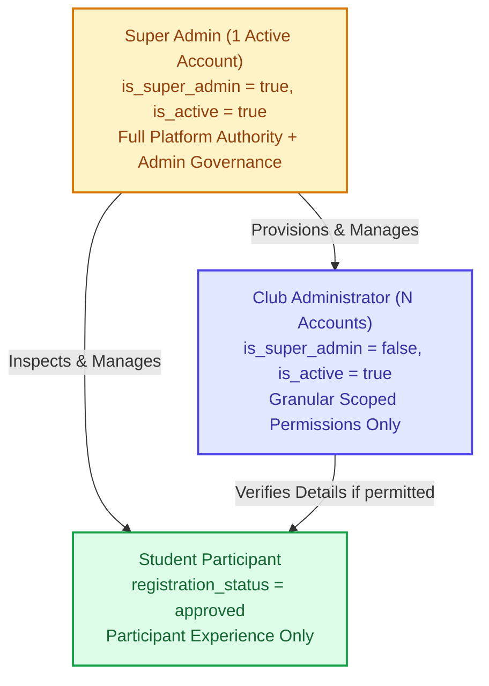
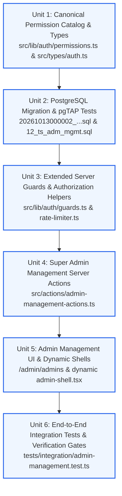

# NMIT HackLeague — Phase 5 Implementation Plan
## Role-Based Authorization, Super Admin Establishment & Admin Management

**Document Version:** 1.5.2 (Revision 1.5.2 — Authorization Helper & RLS Consistency Reconciliation)  
**Status:** PROPOSED — PENDING ARCHITECTURAL REVIEW & OWNER APPROVAL  
**Branch:** `v1`  
**Repository Root:** `/Volumes/CodingVault/web/HackLeague`  
**Target Environment:** Next.js 16.4.0 (App Router), React 19.0.0, TypeScript 5.7.0, Tailwind CSS 4.0.0, Supabase PostgreSQL 17, Supabase Auth (GoTrue), Supabase Storage, Vercel  

---

## Document Revision History

| Revision | Date | Author / Context | Key Changes & Corrections |
|---|---|---|---|
| **1.0.0** | 2026-10-13 | Initial Planning Draft | Baseline Phase 5 structure across 19 sections covering Super Admin establishment, admin lifecycle, and granular permissions. |
| **1.1.0** | 2026-10-13 | Revision 1.1 Architectural Hardening | Bootstrap reconciliation; Phase 4 trigger audit; hardened `manage_admin_permissions` RPC specification; RLS/schema reconciliation; future-route boundary enforcement; derived test counts. |
| **1.2.0** | 2026-10-13 | Revision 1.2 Transaction & Identity Audit | Transactional `provision_admin_profile` RPC; service-role boundary partitioning; bi-directional triggers; accurate bootstrap audit attribution (`actor_id = NULL`); 14-area test matrix. |
| **1.3.0** | 2026-10-13 | Revision 1.3 Final Security Sign-Off | **1. Advisory-Lock Concurrency:** Replaced flawed `FOR SHARE` locks on `auth.users` with transaction-scoped exclusive advisory locks derived from Auth UUID on `BEFORE INSERT OR UPDATE OF id, email` on both `profiles` and `admin_profiles`, with primary key immutability protection.<br/>**2. Authoritative Auth Identity & Email Binding:** Hardened `provision_admin_profile` to verify Auth UUID exists in `auth.users` and that supplied email matches authoritative Auth email (`LOWER(TRIM(v_auth_email)) = LOWER(TRIM(p_email))`).<br/>**3. Scoped Bootstrap PostgreSQL Trust Boundary:** Distinguished GoTrue Admin API calls from database access; specified dedicated `bootstrap_super_admin(UUID, TEXT, TEXT)` RPC restricted to `service_role`.<br/>**4. Baseline Test Inventory:** 32 pgTAP assertions in Suite 12 (179 total across 12 suites), 31 integration tests. |
| **1.4.0** | 2026-10-13 | Revision 1.4 Cross-Role Concurrency & Procedure Reconciliation | **1. Dual Identity-Plus-Email Advisory Lock Protocol:** Closed the cross-role concurrency gap where distinct UUIDs raced to claim the same normalized email across `profiles` and `admin_profiles`. Derived deterministic 64-bit advisory lock keys for both Auth UUID (`nmit_identity_lock:` namespace) and canonical normalized email `LOWER(TRIM(email))` (`nmit_email_lock:` namespace). Enforced acquiring all distinct keys in strictly ascending numerical order (`ORDER BY k ASC`) to provably eliminate circular wait deadlocks across all overlapping identity and email operations, including `UPDATE` paths locking both old and new emails. Explained why declarative per-table unique constraints cannot enforce cross-table uniqueness and documented that 64-bit hash collisions cause transient harmless serialization without false rejections or invariant violations.<br/>**2. Reconciled Disaster Recovery Stored Procedure:** Verified exact implementation of `public.recover_super_admin_identity` in Phase 3 Migration 10: confirmed it is a 4-argument PostgreSQL Stored Procedure (`p_replacement_auth_uid UUID, p_replacement_email TEXT, p_replacement_full_name TEXT, p_reason TEXT`, `prokind = 'p'`) invoked strictly with SQL `CALL`, granted only to `service_role` and DB administrators, blocked from PostgREST HTTP exposition, and recording audit log entries with `actor_id = p_replacement_auth_uid` and `actor_role = 'system_recovery'`. Reconciled all document sections to match.<br/>**3. Reconciled Test Matrix & Counts:** Added explicit concurrency race tests: Test A (`INT-CONC-04`: same UUID race), Test B (`INT-CONC-05`: different UUIDs, same normalized email race), and Test C (`INT-CONC-06`: email update racing with opposite-role insertion). Added pgTAP assertions `TS-ADM-33` and `TS-ADM-34` for cross-role email collisions in both directions. Updated totals: exactly **34 pgTAP assertions** in Suite 12 (**181 total assertions** across 12 suites) and exactly **33 integration tests** across 4 suites (`INT-ADM-01`–`18`, `INT-PROV-01`–`06`, `INT-CONC-01`–`06`, `INT-BOOT-01`–`03`). |
| **1.5.0** | 2026-10-13 | Revision 1.5 Bootstrap Hardening & Email-Immutability Policy Reconciliation | **1. Phase 4 Email-Immutability Policy Reconciliation:** Audited Phase 4 migration `20261013000001_phase4_onboarding_and_review.sql` (lines 144–148). Confirmed `protect_profile_columns()` unconditionally prohibits ordinary students from updating `profiles.email` (`'Profile email is managed by authentication and cannot be updated directly.'`). Preserved Phase 4 security invariants without bypass or weakening; student self-service email updates are strictly prohibited in Phase 4/5. Redesigned `INT-CONC-06` to exercise a genuinely permitted database write path: privileged administrative / service-role email synchronization (`service_role` authority satisfying `v_is_super_or_service`) racing concurrent administrator provisioning on the target email under the sorted advisory lock protocol. Proved unprivileged student email changes fail closed before locks are engaged.<br/>**2. Hardened Bootstrap Retry & Elevation Semantics:** Eliminated `ON CONFLICT (id) DO UPDATE` in `public.bootstrap_super_admin(UUID, TEXT, TEXT)` in favor of a strict plain `INSERT` with explicit pre-checks and dedicated transaction-scoped system bootstrap advisory lock (`nmit_system_bootstrap_lock`) acquired in sorted ascending order. Enforced seven distinct outcomes: (a) *First bootstrap:* 0 Super Admins exist, target verified in `auth.users` with matching email, target absent from `profiles` and `admin_profiles`; plain `INSERT`, audits with `actor_id = NULL, actor_role = 'system_bootstrap'`; (b) *Retry after successful bootstrap:* identical UUID and email match existing active Super Admin; returns safe `already_bootstrapped` result with zero mutations and zero audit log entries; fails closed on mismatch; (c) *Retry after incomplete Auth invitation:* safely reconciles existing Auth identity when authoritative UUID and normalized email are verified and no conflicting role or profile exists; (d) *Existing ordinary Admin:* explicitly checked before insert; fails closed with `'Privilege escalation blocked: identity % already exists as an ordinary administrator and cannot be elevated via bootstrap.'` (elevation impossible); (e) *Existing inactive or demoted Super Admin:* fails closed with `'Bootstrap denied: Super Admin identity % is inactive or demoted. Use recover_super_admin_identity for disaster recovery.'`; (f) *Concurrent bootstrap invocations:* serialized via `nmit_system_bootstrap_lock` in sorted order; at most one transaction inserts; the second returns `already_bootstrapped` or fails closed; (g) *Failure and cleanup:* GoTrue/PostgreSQL separation in `scripts/provision-super-admin.ts`; compensating deletion attempted; if compensating deletion fails, script logs `[CRITICAL_AUTH_ORPHAN]` with operator remediation instructions and quarantines the orphaned user.<br/>**3. Reconciled Test Matrix & Counts:** Expanded pgTAP Suite 12 (`12_ts_adm_mgmt.sql`) to **40 assertions** (`TS-ADM-01` to `TS-ADM-40`), bringing total across 12 suites to **187 assertions** (147 baseline + 40 new). Expanded application integration tests (`tests/integration/admin-management.test.ts`) to **38 tests** across 4 suites: Suite 1 (18 tests: `INT-ADM-01`–`18`), Suite 2 (6 tests: `INT-PROV-01`–`06`), Suite 3 (6 tests: `INT-CONC-01`–`06`, including redesigned `INT-CONC-06`), Suite 4 (8 tests: `INT-BOOT-01`–`08`, covering first bootstrap, idempotent retry, incomplete invitation recovery, ordinary admin rejection, inactive/demoted rejection, concurrent race, compensating cleanup quarantine, and disaster recovery). |
| **1.5.1** | 2026-10-14 | Revision 1.5.1 Consistency & Permission Semantics Reconciliation | **1. Super Admin Implicit Permission Semantics:** Clarified and enforced the approved authorization model where Super Admin possesses implicit authorization across all platform capabilities in server guards (`requireSuperAdmin`, `requireAdmin`, `checkAdminPermission`) and PostgreSQL helpers (`public.current_has_permission`). Initial bootstrap atomically creates the `admin_profiles` record and audit log entry with zero rows inserted into `public.admin_permissions`. Ordinary Admin permissions continue to be stored and managed explicitly via `public.admin_permissions` and `provision_admin_profile`.<br/>**2. Reconciled `TS-ADM-40` Test Mapping:** Reconciled test inventories, traceability matrix, pgTAP detailed test table, execution sequence, and templates to consistently map `TS-ADM-40` to verifying that `bootstrap_super_admin` fails closed when the target Auth UUID or normalized email collides with an existing student (`public.profiles`). Preserved `INT-BOOT-08` as the integration test for the existing 4-argument disaster recovery stored procedure (`public.recover_super_admin_identity`) invoked via SQL `CALL`, alongside existing Phase 3 pgTAP coverage (`05_ts_adm.sql`).<br/>**3. Document-Wide Consistency Audit:** Confirmed complete mathematical and semantic alignment across all 19 sections: 40 pgTAP assertions in Suite 12 (187 assertions across 12 suites), 38 integration tests across 4 suites (`INT-ADM-01`–`18`, `INT-PROV-01`–`06`, `INT-CONC-01`–`06`, `INT-BOOT-01`–`08`), and verified all Revision 1.5.0 security invariants remain strictly intact. |
| **1.5.2** | 2026-10-14 | Revision 1.5.2 Authorization Helper & RLS Consistency Reconciliation | **1. Replaced `public.current_has_permission(TEXT)` Helper:** Audited Phase 3 Migration 10 (`20261012000010_create_security_functions_and_rpc.sql`, lines 24–36). Identified that the existing helper strictly joins `admin_permissions`, returning `false` for active Super Admins without permission rows. Reconciled the authorization contract by specifying a replacement in Migration 13 that grants implicit authorization to active Super Admins (`is_super_admin = true AND is_active = true`) without requiring rows in `admin_permissions`, while enforcing explicit matching rows for active ordinary admins (`is_super_admin = false AND is_active = true`), and returning `false` for deactivated admins (`is_active = false`), students, and unauthenticated callers. Preserved exact signature (`TEXT -> BOOLEAN`), `SECURITY DEFINER`, fixed `search_path = public, pg_temp`, and execution grants to `authenticated`.<br/>**2. Reconciled RLS Policy Interactions:** Verified all RLS policies in Migration 11 relying on `current_has_permission` (`profiles_select_admin`, `audit_logs_select_admin`, `storage.objects`, etc.) remain fully secure and backward-compatible without policy alterations.<br/>**3. Reconciled Test Coverage & Totals:** Added dedicated pgTAP assertions `TS-ADM-41` through `TS-ADM-45` in Suite 12 and dedicated integration test `INT-ADM-19` in Suite 1. Total test counts reconciled: exactly **45 pgTAP assertions** in Suite 12 (**192 total assertions** across 12 suites) and exactly **39 integration tests** across 4 suites (`INT-ADM-01`–`19`, `INT-PROV-01`–`06`, `INT-CONC-01`–`06`, `INT-BOOT-01`–`08`). |

---

## 1. Executive Summary

### 1.1 Purpose and Architectural Objective
Phase 5 establishes a complete, production-grade, enforceable role-based authorization and administrative management system for NMIT HackLeague. It transitions the portal from a foundational authenticated platform (Phases 1–4) into an institutionally governed environment where administrative authority is strictly partitioned, least-privileged, tamper-resistant, and auditable.

The primary architectural goal is to ensure that **authorization is enforced concurrently across all layers**:
1. **Database Layer (PostgreSQL & RLS):** Strict relational constraints, row-level security policies, column-level protection triggers, deferred constraint triggers, bi-directional identity-and-email exclusivity triggers using dual transaction-scoped advisory locks acquired in strict ascending numerical order, and security-definer RPCs with fixed search paths.
2. **Server Execution Layer (Next.js App Router):** Server-side guards executing exclusively in `server-only` context on every Server Component, Server Action, and Route Handler.
3. **Audit Layer (PostgreSQL):** Comprehensive, immutable audit logging of every administrative provisioning, permission mutation, deactivation, and recovery action with accurate actor attribution.
4. **Presentation Layer (React & Tailwind CSS):** Role-aware, permission-filtered dynamic navigation and administrative shells where UI elements correspond strictly to verified server capabilities. UI hiding is explicitly treated as a UX affordance, never an authorization control.

### 1.2 Core Security Invariants
- **Exactly One Super Admin:** Enforced at the PostgreSQL engine level via unique partial index `uq_single_super_admin` and deferred commit-time constraint trigger `trg_verify_single_active_super_admin`.
- **Sole Creator of Admins:** Only the designated active Super Admin can provision Admin accounts via transactional RPC `public.provision_admin_profile`, modify permission assignments via `public.manage_admin_permissions`, or alter account status via `public.set_admin_active_status`.
- **Authoritative Auth Identity Binding:** Administrator creation binds strictly to authoritative Supabase Auth state (`auth.users`), validating both the Auth UUID and matching normalized email before mutating database state.
- **Bi-Directional Student/Admin Mutual Exclusivity:** An account is either a student participant (`public.profiles`) or an administrator (`public.admin_profiles`), never both. Neither the same Auth UUID nor the same canonical normalized email (`LOWER(TRIM(email))`) can exist across both tables. Enforced in both insertion directions and on UPDATE paths by triggers `trg_prevent_dual_student_admin` and `trg_prevent_dual_admin_student` serialized via dual transaction-scoped advisory locks on Auth UUID and canonical normalized email acquired in strictly ascending numerical order.
- **Phase 4 Email-Immutability Preservation:** Student email addresses are managed strictly by authentication and protected by `protect_profile_columns()`, which unconditionally blocks ordinary students from modifying `profiles.email` (`'Profile email is managed by authentication and cannot be updated directly.'`). Direct student self-service email updates are strictly prohibited in Phase 4/5. Permitted privileged administrative synchronization updates on `profiles` serialize against concurrent administrator provisioning via the sorted advisory lock protocol.
- **Hardened Initial Bootstrap & Elevation Prevention:** Dedicated bootstrap RPC `public.bootstrap_super_admin` is restricted to `service_role` and DB superusers. It acquires a dedicated transaction-scoped system bootstrap advisory lock in sorted numerical order alongside identity and email locks, verifies 0 Super Admins exist, uses a plain `INSERT` without `ON CONFLICT DO UPDATE`, and strictly rejects elevation of existing ordinary administrators or reactivation of demoted Super Admins (which must use `recover_super_admin_identity`). The Super Admin possesses implicit authorization across all system capabilities; initial bootstrap creates the active Super Admin profile and initial audit record atomically without inserting rows into `public.admin_permissions`. Idempotent retry with identical active Super Admin credentials returns safely without data mutation or audit log generation.
- **Transactional Database Provisioning for Ordinary Admins:** Ordinary administrator profile insertion, explicit initial permission grants in `public.admin_permissions`, and immutable audit log entry execute within a single genuine PostgreSQL transaction via `public.provision_admin_profile`, eliminating partial database states. Ordinary admins possess zero implicit permissions.
- **Zero Self-Promotion / Self-Elevation:** Admins cannot edit their own permissions, grant themselves roles, alter their own active status, or promote another user.
- **Immediate Deactivation Enforcement:** Deactivated admins (`is_active = false`) are blocked fail-closed on their very next request at both the server-side guard layer and the PostgreSQL RLS/RPC layer, regardless of existing session cookies or JWT lifetime.
- **Strict Least-Privilege & Default-Deny:** An active admin with zero permissions has zero operational capabilities and cannot access verification queues, hackathon management, or data exports.
- **Zero Client Trust:** Client-supplied role claims, permission lists, or boolean flags (`is_admin: true`, `role: "super_admin"`) are rejected. Authorization context is resolved exclusively from the verified server-side `auth.uid()` against authoritative database tables.
- **Service-Role Boundary Partitioning:** The Supabase `service_role` client (`src/lib/supabase/admin.ts`) remains strictly `server-only`. In application workflows, it is invoked exclusively for GoTrue Admin API calls (`inviteUserByEmail`, compensating `deleteUser`). Out-of-band bootstrap database writes are encapsulated in a dedicated, privileged `bootstrap_super_admin` RPC restricted to `service_role`. Service-role bypass is never used for ordinary administrative database queries or client responses.

---

## 2. Existing Architecture Audit

A thorough audit of the actual repository on branch `v1` reveals the following existing assets, tables, functions, and components from Phases 1–4:

| Component / Artifact | Path / Location | Current State | Phase 5 Action | Justification |
|---|---|---|---|---|
| **Profiles Table** | `public.profiles` (`20261012000002_...sql`) | Complete with demographic columns, status constraint | **Extend via Trigger** | Add `trg_prevent_dual_admin_student` trigger (`BEFORE INSERT OR UPDATE OF id, email`) using dual identity-plus-email advisory locks in ascending numerical order. |
| **Admin Profiles Table** | `public.admin_profiles` (`20261012000002_...sql`) | Defined with `is_super_admin`, `is_active`, `uq_single_super_admin` index | **Extend via Trigger & RPCs** | Add `trg_prevent_dual_student_admin` trigger, `provision_admin_profile` RPC, and `bootstrap_super_admin` RPC. |
| **Admin Permissions Table** | `public.admin_permissions` (`20261012000002_...sql`) | Defined with `chk_admin_permissions_key` constraint matching all 10 canonical keys | **Extend via RPC** | Add `manage_admin_permissions` RPC for atomic diffing, locking, and audit log generation. |
| **Audit Logs Table** | `public.audit_logs` (`20261012000007_...sql`) | Defined with `actor_id`, `actor_role`, `action`, `target_type`, `target_id`, `details` | **Reuse Unchanged** | Immutable audit log foundation ready for Phase 5 event types with accurate actor attribution (`actor_id = NULL` for bootstrap). |
| **Commit Invariant Trigger** | `trg_verify_single_active_super_admin` | Verified in Phase 3 (`05_ts_adm.sql`) | **Reuse Unchanged** | Enforces exactly 1 active Super Admin at commit. |
| **Admin Protection Trigger** | `trg_protect_admin_profiles` | Verified in Phase 3 | **Reuse Unchanged** | Blocks direct role/status mutation unless Super Admin or DB admin. |
| **Super Admin Deletion Trigger**| `trg_prevent_super_admin_deletion` | Verified in Phase 3 | **Reuse Unchanged** | Blocks deleting Super Admin account. |
| **Super Admin RLS Helper** | `public.current_is_super_admin()` | Defined in `20261012000010_...sql` | **Reuse Unchanged** | Parameterless function returning boolean for caller (`auth.uid()`). |
| **Permission RLS Helper** | `public.current_has_permission(p_permission_key TEXT)` | Defined in `20261012000010_create_security_functions_and_rpc.sql` (lines 24–36) | **Replace via Migration 13** | Existing Phase 3 helper joins `admin_permissions` directly, returning `false` for active Super Admins without permission rows. Replace in Migration 13 to grant implicit authorization to active Super Admins (`is_super_admin = true AND is_active = true`) without requiring rows in `admin_permissions`, while enforcing explicit matching rows for active ordinary admins, and returning `false` for deactivated admins, students, and unauthenticated callers. |
| **Disaster Recovery Procedure** | `public.recover_super_admin_identity` | Defined in `20261012000010_...sql` | **Reuse Unchanged** | Out-of-band PostgreSQL stored procedure (`prokind = 'p'`) accepting 4 arguments (`UUID, TEXT, TEXT, TEXT`) invoked with SQL `CALL`, restricted to `service_role`/DB admin; physically blocked from PostgREST HTTP exposition. |
| **Admin RLS Policies** | `20261012000011_enable_rls_and_policies.sql` | `admin_profiles_select_own`, `admin_profiles_select_super`, `admin_profiles_update_super`, `admin_permissions_*` | **Reuse Unchanged** | Full RLS policies in place. `INSERT` on `admin_profiles` withheld from client roles, justifying `SECURITY DEFINER` on RPCs. |
| **Signup Trigger Function** | `public.handle_new_auth_user()` (`20261013000001_...sql`) | Checks `role = 'admin'` metadata to skip student profile creation | **Reuse Unchanged** | Bypasses `profiles` insertion when admin user is created. |
| **Admin Client** | `src/lib/supabase/admin.ts` | Server-only GoTrue service client | **Reuse Unchanged** | Used for GoTrue Admin API calls (`inviteUserByEmail`, compensating `deleteUser`) and out-of-band bootstrap RPC. |
| **Server Client** | `src/lib/supabase/server.ts` | Async cookie-aware server client | **Reuse Unchanged** | Used for all authenticated user server operations and RPC calls. |
| **Browser Client** | `src/lib/supabase/client.ts` | Standard client-side Supabase client | **Reuse Unchanged** | Used for browser session interaction. |
| **Server Guards** | `src/lib/auth/guards.ts` | Contains `requireAuth`, `requireAdmin(perm)` | **Extend** | Add `requireSuperAdmin()`, `getCurrentAdminProfile()`, and non-redirecting boolean checkers. |
| **Auth Types** | `src/types/auth.ts` | Contains `AdminProfile`, `StudentProfile` | **Extend** | Add canonical permission types, admin creation/update interfaces, action payloads. |
| **Database Types** | `src/types/database.ts` | Generated Phase 4 types | **Extend** | Regenerate after adding Phase 5 RPC migration. |
| **UI Primitives** | `src/components/ui/*` | `Dialog`, `Table`, `Badge`, `Button`, `Input`, `Checkbox`, `Alert`, `EmptyState` | **Reuse Unchanged** | Production-ready design system primitives from Phase 2. |
| **Admin Shell** | `src/components/shells/admin-shell.tsx` | Static preview shell with mock links | **Extend** | Convert to dynamic shell accepting live admin profile, filtering navigation by permissions. |
| **Super Admin Shell** | `src/components/shells/super-admin-shell.tsx`| Static preview shell with mock links | **Extend** | Convert to dynamic shell accepting live Super Admin identity and wiring `/admin/admins`. |
| **Student Verification Page** | `src/app/admin/verifications/page.tsx` | Protected by `requireAdmin('verify_students')` | **Reuse Unchanged** | Fully functional Phase 4 verification interface. |
| **Rate Limiter** | `src/lib/auth/rate-limiter.ts` | HMAC-SHA256 token bucket rate limiter | **Extend** | Add `'admin_management'` action rate limit quota. |

---

## 3. Requirements Traceability Matrix

| Req ID | Specification Requirement | Proposed Architectural Implementation | Enforcement Layer | Target Files / Database Objects | Verification Method | Acceptance Criteria |
|---|---|---|---|---|---|---|
| **REQ-A1** | Exactly one designated Super Admin | `uq_single_super_admin` index and `trg_verify_single_active_super_admin` trigger. | PostgreSQL Engine | `public.admin_profiles` | pgTAP (`05_ts_adm.sql` & `12_ts_adm_mgmt.sql`) | Inserting 2nd Super Admin or demoting sole active Super Admin throws exception. |
| **REQ-A2** | Trusted Super Admin provisioning | Dedicated idempotent bootstrap CLI script invoking hardened `bootstrap_super_admin` RPC with service-role authority and accurate audit attribution. | Node CLI / Service Role RPC | `scripts/provision-super-admin.ts`, `public.bootstrap_super_admin` | pgTAP (`TS-ADM-31`, `TS-ADM-35`–`40`) + Integration (`INT-BOOT-01`–`07`) | Script provisions owner account, validates constraints, handles idempotent retry safely, rejects ordinary admin elevation and demoted Super Admin reactivation, and audits with `actor_id = NULL, actor_role = 'system_bootstrap'`. |
| **REQ-A3** | Super Admin privilege protection | `protect_admin_profiles` trigger blocks changing `is_super_admin` or `is_active` without Super Admin authority. | PostgreSQL Trigger | `public.protect_admin_profiles` | pgTAP | Ordinary admin or student cannot update `is_super_admin` column. |
| **REQ-A4** | Super Admin deletion block | `prevent_super_admin_deletion` trigger blocks `DELETE` on Super Admin rows. | PostgreSQL Trigger | `public.prevent_super_admin_deletion` | pgTAP | `DELETE FROM admin_profiles WHERE is_super_admin = true` throws exception. |
| **REQ-A5** | Disaster recovery procedure | Stored procedure `recover_super_admin_identity(p_replacement_auth_uid UUID, p_replacement_email TEXT, p_replacement_full_name TEXT, p_reason TEXT)` invoked via SQL `CALL`. | PostgreSQL Procedure (`prokind = 'p'`) | `public.recover_super_admin_identity` | pgTAP (`05_ts_adm.sql` & `INT-BOOT-08`) | Demotes previous, promotes replacement, records audit log (`actor_id = p_replacement_auth_uid, actor_role = 'system_recovery'`) atomically under `service_role`/DB admin. |
| **REQ-B1** | Admin account listing | Server component `/admin/admins/page.tsx` queries `admin_profiles` and joins `admin_permissions`. | Server Component + RLS | `src/app/admin/admins/page.tsx` | Integration test (`INT-ADM-01`) | Only Super Admin can load page; list displays identity, status, timestamps, permissions. |
| **REQ-B2** | Super Admin creates Admin | Server action `createAdminAction` invites via GoTrue, calls transactional RPC `public.provision_admin_profile` binding Auth identity and atomically creating profile, permissions, and audit log. | Server Action + RPC | `src/actions/admin-management-actions.ts`, `provision_admin_profile` | pgTAP + Integration test (`INT-ADM-04`, `TS-ADM-04`) | Non-Super Admin denied; Auth UUID/email binding verified; compensating deletion if DB fails. |
| **REQ-B3** | Edit Admin permissions | Server action calls RPC `manage_admin_permissions` to atomically replace permissions and audit. | Server Action + RPC + RLS | `public.manage_admin_permissions` | pgTAP + Integration test (`INT-ADM-08`, `TS-ADM-14`) | Unknown permissions rejected; duplicate keys deduplicated; change takes effect immediately. |
| **REQ-B4** | Deactivate Admin account | Server action calls RPC `set_admin_active_status(p_is_active = false)`. | Server Action + RPC + RLS | `public.set_admin_active_status` | pgTAP + Integration test (`INT-ADM-11`, `TS-ADM-28`) | Target admin immediate denial across all subsequent requests; audit logged. |
| **REQ-B5** | Reactivate Admin account | Server action calls RPC `set_admin_active_status(p_is_active = true)`. | Server Action + RPC + RLS | `public.set_admin_active_status` | pgTAP + Integration test (`INT-ADM-14`, `TS-ADM-30`) | Account restored with existing assigned permissions; action audited. |
| **REQ-B6** | Self-management safeguards | RPCs and server actions explicitly prevent Super Admin deactivating self or Admin editing self. | Server Guard + RPC | `public.set_admin_active_status`, `guards.ts` | pgTAP + Integration test (`INT-ADM-15`, `TS-ADM-25`) | Calling deactivation on own ID or Super Admin ID throws error. |
| **REQ-C1** | Granular permission catalog | Canonical TypeScript definition matching database constraint `chk_admin_permissions_key`. | Code + Database Constraint | `src/lib/auth/permissions.ts`, `chk_admin_permissions_key` | TypeScript type-check + pgTAP (`TS-ADM-15`) | All 10 keys strictly validated; unknown keys rejected by Zod and SQL. |
| **REQ-C2** | Least-privilege & default-deny | `current_has_permission` replacement checks active Super Admin status (implicit true without permission rows) or active ordinary Admin assigned permission row; unassigned permissions, deactivated admins, students, and unauthenticated callers evaluate to false. | PostgreSQL Helper + Server Guard | `public.current_has_permission`, `requireAdmin` | pgTAP (`TS-ADM-27`, `TS-ADM-41`–`45`) + Integration (`INT-ADM-18`, `INT-ADM-19`) | Active admin with 0 permissions denied on all protected routes; active Super Admin implicitly authorized without permission rows; deactivated admin or student denied. |
| **REQ-C3** | Immediate permission effect | Server guards query database permissions per request; no stale JWT permission claims. | Server Guard | `src/lib/auth/guards.ts` | Integration test (`INT-ADM-10`) | Revoked permission immediately blocks subsequent operation without re-login. |
| **REQ-D1** | Centralized server-side guards | `requireAuth()`, `requireAdmin()`, `requireSuperAdmin()`, `requirePermission()`. | Server-only Module | `src/lib/auth/guards.ts` | Integration test (`INT-ADM-02`, `INT-ADM-03`) | Every protected route, action, and API handler explicitly enforces authorization. |
| **REQ-D2** | Identity spoofing prevention | Resolves identity strictly via `supabase.auth.getUser()`, ignoring client headers/payloads. | Server Guard | `src/lib/auth/guards.ts` | Integration test (`INT-SEC-01`) | Tampered body containing `role: "super_admin"` ignored and rejected. |
| **REQ-E1** | PostgreSQL RLS enforcement | RLS enabled and forced on `admin_profiles`, `admin_permissions`, `audit_logs`. | PostgreSQL Engine | Migration 11 | pgTAP (`03_ts_rls.sql`) | Direct unauthorized queries return 0 rows or throw denial. |
| **REQ-E2** | Function execute privileges | `REVOKE ALL ON FUNCTION ... FROM PUBLIC`; explicitly grant only to `authenticated` or `service_role`. | PostgreSQL Security | Migration 10 & Phase 5 Migration | pgTAP (`TS-ADM-01`, `09`, `22`, `31`) | Anon and public roles cannot invoke administrative functions. |
| **REQ-F1** | Role-aware navigation | `AdminShell` and `SuperAdminShell` dynamically render navigation sections based on permissions. | React Component | `src/components/shells/*` | UI rendering test | Admin with only `verify_students` sees only Verification Queue in sidebar. |
| **REQ-G1** | Administrative audit logging | All mutations (`admin.created`, `admin.deactivated`, `admin.permissions_updated`, `super_admin.provisioned`) logged to `audit_logs`. | PostgreSQL RPC + Triggers | `public.audit_logs` | pgTAP + Integration test | Complete audit record created atomically with mutation with verified actor attribution. |
| **REQ-H1** | Concurrency & row serialization | Row locking (`FOR UPDATE`) in RPCs serializes concurrent updates to the same admin. | PostgreSQL Locking | `public.manage_admin_permissions` | Integration test (`INT-CONC-01`) | Concurrent updates serialize cleanly without deadlocks or corrupt state. |
| **REQ-H2** | Bi-directional identity & email exclusivity | Triggers on both `admin_profiles` and `profiles` and provisioning RPCs acquire dual transaction-scoped advisory locks on Auth UUID and canonical normalized email (`LOWER(TRIM(email))`) in ascending numerical order. | PostgreSQL Triggers & RPCs | `trg_prevent_dual_student_admin`, `trg_prevent_dual_admin_student`, `provision_admin_profile` | pgTAP (`TS-ADM-05`, `TS-ADM-06`, `TS-ADM-33`, `TS-ADM-34`) + Integration (`INT-CONC-04`, `INT-CONC-05`, `INT-CONC-06`) | Concurrent attempts to claim the same Auth UUID or same normalized email across roles serialize without deadlock; at most one commits. |

---

## 4. Authorization Model

### 4.1 Role Hierarchy & Taxonomy
The platform maintains three mutually exclusive role classifications:



1. **Super Admin (`super_admin`):**
   - Designated project owner account.
   - Distinctive boolean flag `is_super_admin = true` on `admin_profiles`.
   - Highest authority: possesses implicit authorization for all platform capabilities. Server guards (`requireSuperAdmin`, `requireAdmin`, `checkAdminPermission`) and database permission helpers (`public.current_has_permission`) grant full operational access without requiring individual permission rows in `public.admin_permissions`.
   - Sole role permitted to access `/admin/admins`, provision new administrators, assign/revoke permissions, deactivate administrators, and review raw audit logs.
   - Protected against deletion, self-deactivation, and accidental demotion.

2. **Club Administrator (`admin`):**
   - Department coordinators, club leads, and event organizers.
   - Identified by presence in `admin_profiles` with `is_super_admin = false`.
   - Active status mandatory (`is_active = true`). Deactivated admins have zero access.
   - Possesses **zero implicit permissions**. Access to specific operational areas requires explicit rows in `public.admin_permissions` granted by the Super Admin during provisioning or editing.
   - Strictly forbidden from viewing or modifying other administrator accounts.

3. **Student Participant (`student`):**
   - Registered student participant.
   - Identified by presence in `profiles`.
   - Ineligible for administrative functions; attempted access to `/admin/*` redirects to `/login` or student workspace.

### 4.2 The Canonical 10-Key Permission Catalog
Enforced by PostgreSQL constraint `chk_admin_permissions_key` on `public.admin_permissions(permission)`:

| Key | Human-Readable Name | Category | Scope / Capabilities Protected | Phase Availability |
|---|---|---|---|---|
| `verify_students` | Student Verification | Verification & Onboarding | Access `/admin/verifications`, inspect College IDs via signed preview, execute `review_student_registration` (approve/reject/correction). | **Active in Phase 4 & 5** |
| `manage_students` | Student Management | Verification & Onboarding | View full student rosters, process profile change requests (`profile_change_requests`), review demographic details. | Defined in Phase 5 |
| `manage_password_resets` | Password Reset Assistance | Verification & Onboarding | Trigger administrative password reset emails for locked accounts without viewing or setting passwords. | Defined in Phase 5 |
| `manage_hackathons` | Hackathon Management | Event Operations | Create, edit, draft, publish, close, archive hackathons; configure rounds and event deadlines. | Reserved for Phase 6 |
| `manage_teams` | Team Management | Event Operations | Inspect team rosters, handle team membership disputes, lock/unlock rosters. | Reserved for Phase 7 |
| `manage_followups` | Follow-up Tasks | Event Operations | Access and manage student and team operational follow-ups and inquiries. | Reserved for Future Phase |
| `view_analytics` | Platform Analytics | Reporting & Oversight | Access institutional participation metrics, leaderboards, scores, and demographic analytics. | Reserved for Phase 10 |
| `export_data` | Data Export | Reporting & Oversight | Export authorized participant rosters, team submissions, and event reports to CSV/JSON. | Reserved for Phase 10 |
| `view_audit_logs` | Audit Log Viewer | Reporting & Oversight | View immutable platform audit records (`public.audit_logs`). | Reserved for Phase 8 |
| `manage_points` | Points Ledger Management | Reporting & Oversight | Configure point rules (`point_configurations`), manually award or reverse milestone points (`points_ledger`). | Reserved for Phase 9 |

### 4.3 Evaluation Rules & Default-Deny Semantics
Effective permission evaluation follows strict precedence:
1. **Unauthenticated:** Request rejected immediately (`redirect('/login')` or HTTP 401).
2. **Deactivated Admin (`is_active = false`):** Request rejected immediately (`redirect('/login')` or HTTP 403 `'Administrator account is inactive.'`).
3. **Super Admin (`is_super_admin = true`):** Always returns `true` implicitly for all operational permission queries without inspecting or requiring records in `public.admin_permissions`.
4. **Ordinary Admin (`is_super_admin = false`):**
   - Queries `admin_permissions` for exact string match on `permission`.
   - If present: evaluates to `true`.
   - If absent: evaluates to `false` (Default-Deny).
5. **Student:** Evaluates to `false` for all administrative permissions.

---

## 5. Initial Super Admin Provisioning & Disaster Recovery

### 5.1 Reconciled Bootstrap Architecture & Database Access Boundary
To resolve the contradiction between automated account creation, credential safety, and single-Super-Admin invariants, the provisioning architecture explicitly partitions GoTrue API operations from PostgreSQL database access:

- **GoTrue Identity Management (HTTPS REST):** Handled via Supabase Auth Admin API using `adminClient.auth.admin.inviteUserByEmail()`. This creates or retrieves the Auth user in `auth.users`, dispatches the invitation email/token, and assigns `role = 'admin'` metadata.
- **PostgreSQL Database Establishment (RPC under Service Role):** Handled via a dedicated, single-use stored RPC `public.bootstrap_super_admin(p_auth_uid UUID, p_email TEXT, p_full_name TEXT)`. Because the `SUPABASE_SERVICE_ROLE_KEY` is an HTTP API credential (PostgREST JWT) and not a PostgreSQL database connection string (`DATABASE_URL`), the script executes this RPC via `adminClient.rpc('bootstrap_super_admin', ...)`.
- **Database Administrator Access (Direct SQL):** In local development, CI, or emergency maintenance where direct PostgreSQL connections are available (`DATABASE_URL` / `psql`), the procedure is also executable directly by `postgres` or `supabase_admin`.

```mermaid
sequenceDiagram
    autonumber
    actor Owner as Project Owner / Deployer
    participant Script as scripts/provision-super-admin.ts
    participant Auth as Supabase Auth (GoTrue Admin API)
    participant RPC as PostgreSQL (bootstrap_super_admin RPC)
    participant DB as PostgreSQL (public.admin_profiles & audit_logs)

    Owner->>Script: Run: npx tsx scripts/provision-super-admin.ts --email=owner@nmit.ac.in --name="Dr. Nagaraj"
    Script->>Script: 1. Validate SUPABASE_SERVICE_ROLE_KEY & email format
    Script->>Auth: 2. Check if user already exists in auth.users
    alt User exists in auth.users (Retry / Reconcile)
        Auth-->>Script: Returns existing user { id: "existing-uuid", email: "owner@nmit.ac.in" }
    else User does not exist
        Script->>Auth: 3. adminClient.auth.admin.inviteUserByEmail(email, { data: { role: 'admin', full_name } })
        alt GoTrue Error
            Auth-->>Script: Returns error
            Script-->>Owner: ABORT: GoTrue user creation failed. 0 DB writes performed.
        else GoTrue Success
            Auth-->>Script: Returns user { id: "new-super-admin-uuid" }
        end
    end
    Script->>RPC: 4. adminClient.rpc('bootstrap_super_admin', { p_auth_uid, p_email, p_full_name })
    alt Database RPC Succeeds (First Bootstrap)
        RPC->>DB: Atomically insert admin_profiles + audit_logs (actor_id: NULL; 0 admin_permissions rows required)
        RPC-->>Script: Returns { success: true, status: 'bootstrapped' }
        Script-->>Owner: SUCCESS: Super Admin provisioned & invitation active. Check email to set password.
    else Already Bootstrapped (Idempotent Retry of Active Super Admin)
        RPC-->>Script: Returns { success: true, status: 'already_bootstrapped', message: 'No mutations applied.' }
        Script-->>Owner: NOTICE: Super Admin identity already established. Zero mutations applied.
    else RPC Rejects (Ordinary Admin / Inactive Super Admin / Dual Role / Different Identity)
        RPC-->>Script: Exception: Privilege escalation blocked / Super Admin already exists / Dual-role violation
        alt Newly Created Auth User in this Execution
            Script->>Auth: 5. Compensating Cleanup: adminClient.auth.admin.deleteUser(new-super-admin-uuid)
            alt Compensating Cleanup Succeeds
                Auth-->>Script: User deleted
                Script-->>Owner: ABORT: Database bootstrap rejected. Compensating Auth cleanup executed. Safe to retry.
            else Compensating Cleanup Fails (Quarantine State)
                Auth-->>Script: Cleanup error (timeout / network)
                Script-->>Owner: CRITICAL: Database bootstrap rejected and compensating Auth deletion failed. User orphaned in GoTrue without DB profile (0 permissions). Manual operator cleanup required.
            end
        else Pre-existing Auth User
            Script-->>Owner: ABORT: Database bootstrap rejected. Pre-existing Auth user retained.
        end
    end
```

### 5.2 Explicit Resolution of the Seven Provisioning Invariants

1. **Owner Identity Verification and Supabase Auth Association:**
   - The trusted owner identity is established through an out-of-band operational command executed by the project operator.
   - The script accepts `--email` (e.g., `owner@nmit.ac.in`) and `--name` (e.g., `"Dr. Nagaraj"`).
   - The script verifies that the email does not exist in `public.profiles` (ensuring no collision with student records).
   - The owner account is created in Supabase Auth via `supabase.auth.admin.inviteUserByEmail()`, passing `app_metadata: { role: 'admin' }` and `user_metadata: { role: 'admin', full_name: name }`.
   - The returned Auth UUID (`user.id`) is bound directly as the primary key `id` of `public.admin_profiles`.

2. **Account Existence vs Invitation Lifecycle:**
   - The owner account **does not need to pre-exist** before provisioning.
   - The provisioning workflow dispatches an invitation link through GoTrue.
   - In production, GoTrue delivers an invitation email containing a secure token.
   - In local development / CI, the token/link is generated directly or retrieved via Inbucket (`http://localhost:54324`).
   - If an Auth identity already exists for the email but lacks an `admin_profiles` record (e.g. from an interrupted prior invitation), the script reconciles cleanly by retrieving the existing Auth user (`getUserByEmail`) and proceeding with database association rather than failing.

3. **Establishment of Access Without Plaintext Password Exposure:**
   - Plaintext passwords are **strictly forbidden** from source code, logs, CLI arguments, environment files, SQL migrations, and committed configuration.
   - The owner completes authentication by clicking the cryptographic invitation link in their email browser session.
   - Supabase Auth handles password entry and hashing via standard GoTrue API (`auth.updateUser({ password })`) over TLS directly from the client browser.
   - Neither the CLI script nor any server component ever encounters or stores the owner's chosen password.

4. **Hardened Execution, Retry, and Elevation Semantics (Seven Distinct Outcomes):**
   To resolve the tension between automated retry safety and strict privilege protection, `public.bootstrap_super_admin(UUID, TEXT, TEXT)` eliminates `ON CONFLICT (id) DO UPDATE` in favor of a plain `INSERT` guarded by explicit pre-checks and a dedicated transaction-scoped system bootstrap advisory lock (`nmit_system_bootstrap_lock`). The procedure enforces seven distinct operational outcomes:
   - **Outcome 1 — First Bootstrap:** Permitted only when the database is in the clean initial bootstrap state (0 Super Admins exist across `admin_profiles`, active or inactive). The target user is verified in `auth.users`, matches authoritative email, and has zero records in `profiles` or `admin_profiles`. A plain `INSERT` creates the active Super Admin record (`is_super_admin = true, is_active = true`), and an initial audit entry is written with `actor_id = NULL, actor_role = 'system_bootstrap'`. Because the Super Admin possesses implicit authorization for all platform capabilities, initial bootstrap does **not** create rows in `public.admin_permissions`. The active Super Admin profile alone immediately confers full authority across all server guards (`requireSuperAdmin`, `requireAdmin`, `checkAdminPermission`) and database helpers (`public.current_has_permission`).
   - **Outcome 2 — Retry After Successful Bootstrap:** If the operator re-executes bootstrap with credentials matching the existing active Super Admin (`id = p_auth_uid AND LOWER(TRIM(email)) = LOWER(TRIM(p_email))`), the RPC detects the established identity and returns `{ success: true, status: 'already_bootstrapped', message: 'Super Admin identity already established; no mutations applied.' }`. The database is **not mutated**, no duplicate authority is reissued, no permission rows are touched, and **no redundant audit log row is created**. If different credentials are provided while an active Super Admin exists, the RPC fails closed with `'Bootstrap denied: an active Super Admin already exists in the system.'`.
   - **Outcome 3 — Retry After Incomplete Auth Invitation:** If GoTrue user creation previously succeeded but the script terminated before the PostgreSQL transaction committed, retrying `provision-super-admin.ts` retrieves the existing Auth user, validates authoritative UUID and email against `auth.users`, verifies zero records exist in `profiles` and `admin_profiles`, and safely completes database bootstrap as Outcome 1.
   - **Outcome 4 — Rejection of Existing Ordinary Admin (Elevation Block):** If `p_auth_uid` or normalized email already belongs to an existing ordinary administrator (`is_super_admin = false`), the RPC explicitly checks `admin_profiles` before insertion and immediately aborts: `'Privilege escalation blocked: identity % already exists as an ordinary administrator and cannot be elevated via bootstrap.'`. Because no `ON CONFLICT (id) DO UPDATE` branch exists, an ordinary administrator can **never** be elevated to Super Admin via bootstrap retry.
   - **Outcome 5 — Rejection of Inactive or Demoted Super Admin:** If `admin_profiles` contains an inactive or previously demoted Super Admin (`is_active = false`), initial bootstrap fails closed: `'Bootstrap denied: Super Admin identity % is inactive or demoted. Use recover_super_admin_identity for disaster recovery.'`. Initial bootstrap is strictly for zero-to-one system initialization; restoring or transitioning authority post-bootstrap requires the authorized disaster recovery procedure `recover_super_admin_identity`.
   - **Outcome 6 — Serialization of Concurrent Bootstrap Invocations:** If two operators or processes execute `bootstrap_super_admin` concurrently on an uninitialized database, both request the dedicated 64-bit advisory lock `nmit_system_bootstrap_lock` in sorted numerical order. The first transaction acquires the lock, verifies 0 Super Admins, inserts the record, and commits. The second transaction unblocks, executes the state check, detects the committed active Super Admin, and either safely returns `already_bootstrapped` (if identical identity) or fails closed (if distinct identity). At most one row is inserted; zero race conditions or index collisions occur.
   - **Outcome 7 — Cross-System Failure & Compensating Cleanup:** GoTrue identity management and PostgreSQL transactions remain decoupled. If the database RPC aborts after GoTrue user creation, `provision-super-admin.ts` catches the error and executes compensating cleanup `await adminClient.auth.admin.deleteUser(authUid)`. If compensating cleanup fails (e.g. GoTrue timeout or network partition), the script logs `[CRITICAL_AUTH_ORPHAN]` with explicit operator instructions. The orphaned user in `auth.users` has zero rows in `admin_profiles` and zero rows in `profiles`, leaving them quarantined with zero operational access until manual cleanup or safe retry.

5. **Preservation of the Database's Single-Super-Admin Invariant:**
   - **Engine-Level Unique Partial Index:** `uq_single_super_admin ON public.admin_profiles (is_super_admin) WHERE (is_super_admin = true)` guarantees at the B-tree index level that no more than 1 Super Admin row can exist simultaneously.
   - **Commit-Time Constraint Trigger:** `trg_verify_single_active_super_admin` runs at transaction commit and raises an exception if `COUNT(*) WHERE is_super_admin = true AND is_active = true <> 1`.
   - The `bootstrap_super_admin` RPC inserts exactly 1 row with `is_super_admin = true, is_active = true`, perfectly satisfying both constraints.

6. **Disaster Recovery Using the Actual Existing Stored Procedure:**
   - Initial bootstrap and disaster recovery are maintained as **separate, explicit mechanisms**.
   - Initial bootstrap creates the first Super Admin when 0 exist.
   - Disaster recovery uses the verified Phase 3 stored procedure:
     `CALL public.recover_super_admin_identity(p_replacement_auth_uid UUID, p_replacement_email TEXT, p_replacement_full_name TEXT, p_reason TEXT)`
   - Verified signature: 4 arguments (`UUID`, `TEXT`, `TEXT`, `TEXT`).
   - Authority requirement: `session_user IN ('postgres', 'supabase_admin') OR auth.role() = 'service_role'`.
   - Behavior: Locks `admin_profiles FOR UPDATE`, demotes old Super Admin (`is_super_admin = false, is_active = false`), upserts replacement identity (`is_super_admin = true, is_active = true`), writes audit log, and preserves foreign key integrity.

7. **Accurate Bootstrap Audit Attribution (No False Self-Creation):**
   - In `public.audit_logs`, `actor_id UUID NULL REFERENCES auth.users(id) ON DELETE SET NULL` is explicitly nullable.
   - Audit records must never falsely imply that the newly created account initiated its own creation before it existed.
   - The `bootstrap_super_admin` RPC sets:
     - `actor_id`: `NULL` (accurately reflecting that there is no authenticated Auth user actor).
     - `actor_role`: `'system_bootstrap'`.
     - `action`: `'super_admin.provisioned'`.
     - `target_type`: `'admin_profile'`.
     - `target_id`: `p_auth_uid::text` (the target account provisioned).
     - `details`: `jsonb_build_object('email', v_normalized_email, 'full_name', TRIM(p_full_name), 'method', 'bootstrap_rpc', 'executed_by', 'system_operator')`.
   - Foreign key constraints are fully satisfied without inventing non-existent UUIDs or creating misleading self-attribution.

### 5.3 Explicit Trust Boundaries & Service-Role Partitioning

To maintain strict privilege separation, the platform enforces three distinct, non-overlapping trust boundaries:

| Trust Boundary | Execution Context & Identity | Authorized Database Role | Allowed Operations | Service-Role Key Usage | Enforcement Mechanisms |
|---|---|---|---|---|---|
| **1. Ordinary Authenticated Requests** | Web App / Server Components / Actions / Route Handlers | `authenticated` (`auth.uid() = session user`) | SELECT on own profile, student verifications (if permitted), read hackathons. | **STRICTLY FORBIDDEN.** Zero service-role queries or bypass. | PostgreSQL Row Level Security (`FORCE RLS`), table grants, `requireAdmin()` server guards. |
| **2. Super Admin Application Operations** | Web App Server Actions (`createAdminAction`, `updateAdminPermissionsAction`, etc.) | `authenticated` (`auth.uid() = Super Admin UUID`) | Admin governance via dedicated RPCs (`provision_admin_profile`, `manage_admin_permissions`, `set_admin_active_status`). | **LIMITED TO GOTRUE API ONLY.** Invokes `adminClient.auth.admin.inviteUserByEmail` and compensating `deleteUser`. Never used for database queries. | RPC internal authorization checks (`is_super_admin = true AND is_active = true`), `SECURITY DEFINER` with fixed `search_path`. |
| **3. Out-of-Band Bootstrap & Recovery** | Offline Node CLI (`scripts/provision-super-admin.ts`, DB recovery procedures) | `service_role` / `postgres` | Initial Super Admin creation via `bootstrap_super_admin`, emergency recovery via `recover_super_admin_identity`. | **PERMITTED FOR BOOTSTRAP ONLY.** Used because 0 Super Admins exist in DB prior to bootstrap. | Engine constraints (`uq_single_super_admin`, `trg_verify_single_active_super_admin`), RPC role check (`auth.role() = 'service_role'`). |

#### Prerequisites for Safe Out-of-Band Bootstrap Execution:
1. Operator executes `scripts/provision-super-admin.ts` out-of-band in a secure terminal with access to production secrets via environment variables (`SUPABASE_SERVICE_ROLE_KEY`, `NEXT_PUBLIC_SUPABASE_URL`).
2. The script validates target email format and domain.
3. The script confirms target email is absent from `public.profiles`.
4. The script executes compensating deletions in GoTrue if PostgreSQL writes fail.

### 5.4 Existing Disaster Recovery Verification
When credentials need replacement, the existing Phase 3 stored procedure is called:

```sql
CALL public.recover_super_admin_identity(
  p_replacement_auth_uid := '00000000-0000-0000-0000-000000000099'::uuid,
  p_replacement_email := 'owner.replacement@nmit.ac.in',
  p_replacement_full_name := 'Project Owner',
  p_reason := 'Hardware token replacement out of band'
);
```

**Verified Behavior of the Existing Procedure:**
- Strictly checks authority: `IF session_user NOT IN ('postgres', 'supabase_admin') AND (auth.role() IS NULL OR auth.role() <> 'service_role') THEN RAISE EXCEPTION ...`.
- Verifies `p_replacement_auth_uid` exists in `auth.users`.
- Serializes concurrent transactions by locking `admin_profiles FOR UPDATE`.
- Demotes the previous Super Admin (`is_super_admin = false, is_active = false`), preserving foreign keys and historical audit associations.
- Promotes the replacement identity to `is_super_admin = true, is_active = true`.
- Logs an immutable record to `public.audit_logs` with `actor_role = 'system_recovery'` and `action = 'super_admin.disaster_recovery'`.
- Satisfies `trg_verify_single_active_super_admin` with exactly 1 active Super Admin at commit.

---

## 6. Admin Account Lifecycle & Dual-Role Prevention

### 6.1 Strict Mutual Exclusivity: Students vs Admins
An account in NMIT HackLeague is either a **Student Participant** (`public.profiles`) or an **Administrator** (`public.admin_profiles`), **never both**:

```mermaid
graph TD
    classDef auth fill:#E2E8F0,stroke:#64748B,stroke-width:2px;
    classDef prof fill:#DCFCE7,stroke:#16A34A,stroke-width:2px;
    classDef adm fill:#E0E7FF,stroke:#4F46E5,stroke-width:2px;

    U["auth.users (Supabase Auth Identity)"]:::auth
    P["public.profiles (Student Profile)<br/>registration_status: draft / approved ..."]:::prof
    A["public.admin_profiles (Admin Profile)<br/>is_super_admin: false, is_active: true"]:::adm

    U -->|Student Signup (handle_new_auth_user)| P
    U -->|Admin Invite (role = 'admin')| A

    P <-.->|BI-DIRECTIONALLY EXCLUSIVE| A
```

### 6.2 Trigger Bypass Mechanism
In Phase 4 migration `20261013000001_phase4_onboarding_and_review.sql`, `public.handle_new_auth_user()` is triggered on `AFTER INSERT ON auth.users`. It contains:
```sql
  -- If user has admin role metadata, skip student profile creation
  IF (NEW.raw_app_meta_data->>'claims_admin')::boolean IS TRUE
     OR NEW.raw_app_meta_data->>'role' = 'admin'
     OR NEW.raw_user_meta_data->>'role' = 'admin' THEN
    RETURN NEW;
  END IF;
```
When an administrator is invited by the Super Admin via `inviteUserByEmail`, the server action explicitly passes:
```typescript
{
  data: {
    role: 'admin',
    full_name: fullName
  }
}
```
**Guarantees Verified:**
1. An invited Admin **never** receives a row in `public.profiles`.
2. An invited Admin **never** acquires student onboarding or verification states (`draft`, `pending`, etc.).
3. The Admin account cannot be accessed as a student participant.

### 6.3 Rigorous Advisory-Lock Concurrency & Dual Identity-Plus-Email Exclusivity

To guarantee mutual exclusivity across all permitted creation and modification paths (Auth triggers, administrative RPCs, direct table grants, student updates), database triggers and RPCs enforce a unified, deterministic **Dual Identity-Plus-Email Transaction-Scoped Advisory Lock Protocol**.

#### 1. Why Per-Table Unique Constraints Cannot Enforce Cross-Table Invariants
A thorough audit of the Phase 3 schema reveals:
- In `public.admin_profiles`, `email TEXT NOT NULL UNIQUE` enforces uniqueness strictly among administrator rows.
- In `public.profiles`, `idx_profiles_email ON public.profiles (LOWER(TRIM(email)))` is a non-unique functional B-tree index (and `profiles.email` has no table-level unique constraint).
- **Fundamental PostgreSQL Limitation:** In relational databases, declarative unique constraints and indexes are strictly table-scoped. A constraint on `admin_profiles` has zero visibility into `profiles`. PostgreSQL does not provide cross-table declarative uniqueness constraints.
- Therefore, cross-table mutual exclusivity must be enforced procedurally via triggers (`check_no_student_as_admin` and `check_no_admin_as_student`) and transactional RPCs (`provision_admin_profile`, `bootstrap_super_admin`).

#### 2. The Cross-Role Concurrency Gap in Revision 1.3.0
Revision 1.3.0 derived an advisory lock key solely from the Auth UUID (`nmit_identity_lock:`). While this successfully serialized concurrent operations involving the **same UUID**, it left a critical concurrency gap:
- If Transaction 1 attempts to insert a Student with `UUID_1` and email `alice@nmit.ac.in`,
- And Transaction 2 concurrently attempts to insert an Administrator with `UUID_2` and email `ALICE@nmit.ac.in`,
- Under Revision 1.3.0, Tx 1 acquired lock(`UUID_1`) and Tx 2 acquired lock(`UUID_2`).
- Because `UUID_1 <> UUID_2`, the two transactions acquired different locks and executed concurrently without serialization.
- Under PostgreSQL default Read Committed transaction isolation, neither transaction saw the other's uncommitted row during its `IF EXISTS (SELECT 1 ... WHERE LOWER(TRIM(email)) = ...)` check.
- Both transactions proceeded to `INSERT` and both successfully committed, violating the core platform invariant: **The same normalized email cannot be associated with both a student and an administrator.**

#### 3. The Dual Identity-Plus-Email Advisory Lock Protocol
To close this gap completely, every relevant insertion and email-change path must serialize on **both** the Auth UUID and the canonical normalized email.

##### A. Deterministic Lock Key Derivations
Two separate 64-bit signed integer keys are computed deterministically using `md5()` and distinct namespace prefixes:
1. **Identity Lock Key (Auth UUID):**
   ```sql
   ('x' || substr(md5('nmit_identity_lock:' || NEW.id::text), 1, 16))::bit(64)::bigint
   ```
2. **Canonical Normalized Email Lock Key:**
   The normalization function is strictly defined as `LOWER(TRIM(email))` to match all database collision checks and indexes (`idx_profiles_email`).
   ```sql
   ('x' || substr(md5('nmit_email_lock:' || LOWER(TRIM(NEW.email))), 1, 16))::bit(64)::bigint
   ```
   On `UPDATE` where `OLD.email IS DISTINCT FROM NEW.email`, an additional key is derived for the previous email:
   ```sql
   ('x' || substr(md5('nmit_email_lock:' || LOWER(TRIM(OLD.email))), 1, 16))::bit(64)::bigint
   ```
   **Namespace Isolation:** The distinct string prefixes (`'nmit_identity_lock:'` vs `'nmit_email_lock:'`) guarantee that a UUID string and an email string can never hash to the same input string, preventing cross-domain collisions.

##### B. Deterministic Global Acquisition Order & Deadlock Freedom
When transactions acquire multiple locks, arbitrary acquisition ordering creates classic Coffman circular wait deadlocks (e.g. Transaction 1 locks UUID then Email, while Transaction 2 locks Email then UUID, or transactions lock overlapping email sets).

To provably prevent deadlocks:
1. All required 64-bit signed integer keys (`bigint`) for the operation are collected into a set.
2. The set is filtered for non-null values and deduplicated (`DISTINCT`).
3. Locks are acquired in **strictly ascending numerical order** (`ORDER BY k ASC`):
```sql
FOR v_lock_key IN
  SELECT DISTINCT k
  FROM unnest(ARRAY[
    ('x' || substr(md5('nmit_identity_lock:' || NEW.id::text), 1, 16))::bit(64)::bigint,
    ('x' || substr(md5('nmit_email_lock:' || LOWER(TRIM(NEW.email))), 1, 16))::bit(64)::bigint,
    CASE WHEN TG_OP = 'UPDATE' AND OLD.email IS DISTINCT FROM NEW.email THEN
      ('x' || substr(md5('nmit_email_lock:' || LOWER(TRIM(OLD.email))), 1, 16))::bit(64)::bigint
    ELSE NULL END
  ]) AS k
  WHERE k IS NOT NULL
  ORDER BY k ASC
LOOP
  PERFORM pg_advisory_xact_lock(v_lock_key);
END LOOP;
```
**Mathematical Proof of Deadlock Freedom:**  
The set of signed 64-bit integers $\mathbb{Z}_{64}$ possesses a strict total linear order under $<$. Because every transaction in the database acquires its advisory locks strictly in increasing numerical order, a transaction holding lock $X$ will only ever request lock $Y$ where $Y > X$. A cycle requires $K_1 < K_2 < \dots < K_n < K_1$, which is mathematically impossible. Circular wait is eliminated; deadlocks cannot occur.

##### C. Collision Behavior of 64-Bit Hashed Keys
In a 64-bit keyspace ($2^{64} \approx 1.84 \times 10^{19}$), collisions between distinct strings are astronomically rare ($< 10^{-11}$). However, the correctness of the protocol does **not** rely on hash uniqueness:
- The advisory lock is purely a **synchronization primitive (mutex)**, not a uniqueness index.
- If two completely distinct UUIDs or emails hash to the same 64-bit integer, `pg_advisory_xact_lock` simply serializes the two transactions: Transaction 2 pauses until Transaction 1 commits or rolls back.
- When Transaction 1 completes, Transaction 2 acquires the lock and executes the actual relational SQL checks:
  ```sql
  SELECT 1 FROM public.profiles WHERE id = NEW.id;
  SELECT 1 FROM public.profiles WHERE LOWER(TRIM(email)) = LOWER(TRIM(NEW.email));
  ```
- Because the post-lock relational query evaluates the actual, unhashed UUIDs and normalized text strings, Transaction 2 detects no conflict and commits cleanly.
- **Verdict:** Hash collisions cause only transient, harmless serialization (a brief wait); they **never** produce false rejections, false uniqueness claims, or invariant violations.

##### D. Protection of UPDATE Paths & Primary Key Immutability
Triggers execute on `BEFORE INSERT OR UPDATE OF id, email`:
- **Primary Key Immutability:** If `TG_OP = 'UPDATE' AND NEW.id IS DISTINCT FROM OLD.id`, the trigger immediately raises:
  `Identity UUID is immutable and cannot be modified.`
- **Email Modification:** If `TG_OP = 'UPDATE'` and `NEW.email IS DISTINCT FROM OLD.email`, both the new email and old email are locked in numerical order. This ensures an email modification racing against an opposite-role insertion claiming either the old or new address is strictly serialized.

#### 4. Direction A: Trigger Function on `admin_profiles`
```sql
CREATE OR REPLACE FUNCTION public.check_no_student_as_admin()
RETURNS TRIGGER AS $$
DECLARE
  v_lock_key BIGINT;
BEGIN
  -- 1. Protect against primary key mutation on UPDATE
  IF TG_OP = 'UPDATE' AND NEW.id IS DISTINCT FROM OLD.id THEN
    RAISE EXCEPTION 'Identity UUID is immutable and cannot be modified.';
  END IF;

  -- 2. Acquire transaction-scoped exclusive advisory locks on UUID and normalized email in strict ascending order
  FOR v_lock_key IN
    SELECT DISTINCT k
    FROM unnest(ARRAY[
      ('x' || substr(md5('nmit_identity_lock:' || NEW.id::text), 1, 16))::bit(64)::bigint,
      ('x' || substr(md5('nmit_email_lock:' || LOWER(TRIM(NEW.email))), 1, 16))::bit(64)::bigint,
      CASE WHEN TG_OP = 'UPDATE' AND OLD.email IS DISTINCT FROM NEW.email THEN
        ('x' || substr(md5('nmit_email_lock:' || LOWER(TRIM(OLD.email))), 1, 16))::bit(64)::bigint
      ELSE NULL END
    ]) AS k
    WHERE k IS NOT NULL
    ORDER BY k ASC
  LOOP
    PERFORM pg_advisory_xact_lock(v_lock_key);
  END LOOP;

  -- 3. Verify target user does not exist in public.profiles (by Auth UUID)
  IF EXISTS (SELECT 1 FROM public.profiles WHERE id = NEW.id) THEN
    RAISE EXCEPTION 'Dual-identity violation: user ID % is already registered as a student participant.', NEW.id;
  END IF;

  -- 4. Verify target email is not used by an existing student (by normalized email)
  IF EXISTS (SELECT 1 FROM public.profiles WHERE LOWER(TRIM(email)) = LOWER(TRIM(NEW.email))) THEN
    RAISE EXCEPTION 'Dual-identity collision: email % is already registered to an existing student participant.', NEW.email;
  END IF;

  RETURN NEW;
END;
$$ LANGUAGE plpgsql SECURITY DEFINER SET search_path = public, pg_temp;

DROP TRIGGER IF EXISTS trg_prevent_dual_student_admin ON public.admin_profiles;
CREATE TRIGGER trg_prevent_dual_student_admin
BEFORE INSERT OR UPDATE OF id, email ON public.admin_profiles
FOR EACH ROW EXECUTE FUNCTION public.check_no_student_as_admin();
```

#### 5. Direction B: Trigger Function on `profiles`
```sql
CREATE OR REPLACE FUNCTION public.check_no_admin_as_student()
RETURNS TRIGGER AS $$
DECLARE
  v_lock_key BIGINT;
BEGIN
  -- 1. Protect against primary key mutation on UPDATE
  IF TG_OP = 'UPDATE' AND NEW.id IS DISTINCT FROM OLD.id THEN
    RAISE EXCEPTION 'Identity UUID is immutable and cannot be modified.';
  END IF;

  -- 2. Acquire transaction-scoped exclusive advisory locks on UUID and normalized email in strict ascending order
  FOR v_lock_key IN
    SELECT DISTINCT k
    FROM unnest(ARRAY[
      ('x' || substr(md5('nmit_identity_lock:' || NEW.id::text), 1, 16))::bit(64)::bigint,
      ('x' || substr(md5('nmit_email_lock:' || LOWER(TRIM(NEW.email))), 1, 16))::bit(64)::bigint,
      CASE WHEN TG_OP = 'UPDATE' AND OLD.email IS DISTINCT FROM NEW.email THEN
        ('x' || substr(md5('nmit_email_lock:' || LOWER(TRIM(OLD.email))), 1, 16))::bit(64)::bigint
      ELSE NULL END
    ]) AS k
    WHERE k IS NOT NULL
    ORDER BY k ASC
  LOOP
    PERFORM pg_advisory_xact_lock(v_lock_key);
  END LOOP;

  -- 3. Verify target user does not exist in public.admin_profiles (by Auth UUID)
  IF EXISTS (SELECT 1 FROM public.admin_profiles WHERE id = NEW.id) THEN
    RAISE EXCEPTION 'Dual-identity violation: user ID % is already registered as an administrator.', NEW.id;
  END IF;

  -- 4. Verify target email is not used by an existing administrator (by normalized email)
  IF EXISTS (SELECT 1 FROM public.admin_profiles WHERE LOWER(TRIM(email)) = LOWER(TRIM(NEW.email))) THEN
    RAISE EXCEPTION 'Dual-identity collision: email % is already registered to an existing administrator.', NEW.email;
  END IF;

  RETURN NEW;
END;
$$ LANGUAGE plpgsql SECURITY DEFINER SET search_path = public, pg_temp;

DROP TRIGGER IF EXISTS trg_prevent_dual_admin_student ON public.profiles;
CREATE TRIGGER trg_prevent_dual_admin_student
BEFORE INSERT OR UPDATE OF id, email ON public.profiles
FOR EACH ROW EXECUTE FUNCTION public.check_no_admin_as_student();
```

#### 6. Required Concurrency Tests
The plan mandates three dedicated concurrency tests exercising real PostgreSQL connection pools:

1. **Test A — Same UUID (`INT-CONC-04`):**
   - Two concurrent transactions attempt to create student and administrator profiles for the same Auth UUID.
   - Both compute the identical identity key `('x' || substr(md5('nmit_identity_lock:' || uid), 1, 16))::bit(64)::bigint` and attempt `pg_advisory_xact_lock`.
   - Operations serialize strictly. Exactly one transaction commits. The second transaction unblocks, executes `IF EXISTS (SELECT 1 ... WHERE id = NEW.id)`, detects the committed row, and raises `Dual-identity violation`.
2. **Test B — Different UUIDs, Same Normalized Email (`INT-CONC-05`):**
   - Two concurrent transactions attempt to create student and administrator profiles using different Auth UUIDs (`UUID_A` and `UUID_B`) but equivalent email strings under normalization (e.g. `'student@nmit.ac.in'` and `'  STUDENT@NMIT.AC.IN  '`).
   - Both compute the identical email key `('x' || substr(md5('nmit_email_lock:student@nmit.ac.in'), 1, 16))::bit(64)::bigint`.
   - Even though their identity keys differ, both transactions request the same email lock key and serialize strictly. Exactly one transaction commits. The second transaction unblocks, detects the committed opposite row via `LOWER(TRIM(email))`, and raises `Dual-identity collision`.
3. **Test C — Privileged Email Update Racing Opposite-Role Insertion (`INT-CONC-06`):**
   - **Phase 4 Policy Reconciliation:** In Phase 4 (`20261013000001_phase4_onboarding_and_review.sql`, lines 144–148), `protect_profile_columns()` unconditionally prohibits ordinary students from updating `profiles.email` (`'Profile email is managed by authentication and cannot be updated directly.'`). Any unprivileged student attempt to execute `UPDATE profiles SET email = ...` fails closed at this column protection trigger before any advisory locks or mutual exclusivity triggers are engaged. Direct student self-service email updates are strictly prohibited in Phase 4 and Phase 5.
   - **Genuinely Permitted Operation:** Test C exercises an authorized administrative / service-role email synchronization operation (where `v_is_super_or_service` is true, satisfying `protect_profile_columns()`) racing with a concurrent transaction provisioning a new administrator with `'target@nmit.ac.in'`.
   - **Execution & Serialization:** Parallel Worker 1 (`service_role` client) updates a student profile's email to `'target@nmit.ac.in'`. Parallel Worker 2 (Super Admin session) invokes `provision_admin_profile` claiming `'target@nmit.ac.in'`.
   - Worker 1's trigger `check_no_admin_as_student` acquires locks on `UUID_Student`, `email_old`, and `email_target` in ascending numerical order. Worker 2's RPC `provision_admin_profile` acquires locks on `UUID_Admin` and `email_target` in ascending order.
   - Because both transactions acquire `email_target` in strictly sorted numerical order, they serialize without deadlock. Exactly one transaction succeeds; the other is rejected with `Dual-identity collision`.
   - Additionally, an unprivileged student attempting direct `UPDATE public.profiles SET email = ...` is tested to fail immediately at `protect_profile_columns()`, confirming that student self-service email updates remain safely blocked.

#### 7. Preservation of Student Email Freedom
As locked in `rules.md` Section 5 and Phase 4 Revision 1.5.1, student registration permits **any valid email address** (personal or institutional). The mutual exclusivity check prevents duplicate registration of the same email across roles, but does not impose an `@nmit.ac.in` domain restriction on students.

### 6.4 Transactional Administrator Creation & Cross-System Saga
Administrator creation spans two independent systems: Supabase Auth (GoTrue) and PostgreSQL. To eliminate partial database states, database provisioning is encapsulated in a genuine PostgreSQL transaction RPC `public.provision_admin_profile`, governed by a Server Action saga:

```mermaid
sequenceDiagram
    autonumber
    actor SA as Super Admin
    participant Action as createAdminAction (Server Action)
    participant Auth as Supabase Auth (adminClient)
    participant RPC as PostgreSQL (provision_admin_profile RPC)

    SA->>Action: Submit email, name, initial_permissions
    Action->>Action: 1. Verify caller via requireSuperAdmin() & validate Zod schema
    Action->>RPC: 2. Pre-check: verify email absent from profiles & admin_profiles
    Action->>Auth: 3. adminClient.auth.admin.inviteUserByEmail(email, { data: { role: 'admin', full_name } })
    alt GoTrue Invitation Fails
        Auth-->>Action: Returns error (e.g., duplicate auth user, rate limit)
        Action-->>SA: Abort: clean failure, 0 database writes, 0 audit rows
    else GoTrue Invitation Succeeds
        Auth-->>Action: Returns user { id: "new-admin-uuid" }
        Action->>RPC: 4. supabase.rpc('provision_admin_profile', { p_auth_uid, p_email, p_full_name, p_permissions })
        alt Database Transaction Succeeds (Binds Auth identity, checks email match, atomic writes)
            RPC-->>Action: Atomically commits admin_profiles + admin_permissions + audit_logs
            Action-->>SA: SUCCESS: Administrator provisioned and invitation dispatched
        else Database Transaction Fails
            RPC-->>Action: Transaction rolls back 100% (0 DB rows, 0 audit rows)
            Action->>Auth: 5. Compensating Cleanup: adminClient.auth.admin.deleteUser(new-admin-uuid)
            alt Compensating Deletion Succeeds
                Auth-->>Action: Deleted
                Action-->>SA: Abort: Database failure encountered; Auth identity cleanly removed. Safe to retry.
            else Compensating Deletion Fails
                Auth-->>Action: Network/API failure during cleanup
                Action->>Action: 6. Log high-severity operational error [PROVISION_COMPENSATION_FAILED]
                Action-->>SA: Error: Partial failure. Account quarantined with 0 permissions. Safe retry handles cleanup.
            end
        end
    end
```

#### Detailed Saga Failure Modes & Observability:
1. **GoTrue Fails First:** No database call is made. Zero database records exist. Zero audit records written.
2. **PostgreSQL Fails & Cleanup Succeeds:** The PostgreSQL transaction aborts, rolling back `admin_profiles`, `admin_permissions`, and `audit_logs`. The catch block executes `deleteUser()`. Both systems return to initial state.
3. **PostgreSQL Fails & Cleanup Fails (Quarantined State):** The user exists in `auth.users`, but has no row in `admin_profiles` or `profiles`.
   - **Zero Privilege Guarantee:** Because all server guards (`requireAdmin`) and PostgreSQL RLS helpers (`current_has_permission`, `current_is_super_admin`) query `public.admin_profiles` live, this user has **zero permissions, zero roles, and zero application access**.
   - **Retry Reconciliation:** If the Super Admin retries provisioning with the same email, the Server Action detects the dangling GoTrue identity (Auth user exists, but absent from both `profiles` and `admin_profiles`), deletes the dangling user, and re-invokes the provisioning sequence safely.
4. **Authoritative Auth Email Binding in `provision_admin_profile`:**
   - The RPC never trusts the caller-supplied email as proof of identity.
   - It queries `SELECT email FROM auth.users WHERE id = p_auth_uid`.
   - If the Auth UUID does not exist, it raises `Identity binding failure: Auth user % does not exist in auth.users.`
   - If `LOWER(TRIM(v_auth_email)) <> LOWER(TRIM(p_email))`, it raises `Identity binding violation: supplied email % does not match authoritative Auth email % for user %.`
   - It inserts the authoritative normalized email `LOWER(TRIM(v_auth_email))` into `admin_profiles`. This prevents an attacker or bug from associating an unrelated Auth UUID with a different admin email.

---

## 7. Server-Side Enforcement Design

### 7.1 Server Guards Architecture (`src/lib/auth/guards.ts`)
The server guards module runs exclusively in Next.js Server Components, Server Actions, and Route Handlers (`import 'server-only'`).

```typescript
// Guard 1: Verify authenticated session
export async function requireAuth(): Promise<{ supabase: SupabaseClient; user: User }>;

// Guard 2: Verify caller is an active administrator with optional required permission
export async function requireAdmin(requiredPermission?: string): Promise<{
  admin: AdminProfile;
  permissions: string[];
  user: User;
}>;

// Guard 3: Verify caller is the designated active Super Admin
export async function requireSuperAdmin(): Promise<{
  admin: AdminProfile;
  user: User;
}>;

// Guard 4: Non-redirecting permission checker for conditional UI logic
export async function checkAdminPermission(permission: string): Promise<boolean>;
```

### 7.2 Exact Enforcement Boundaries

| Route / Boundary | Type | Required Guard | Failure Behavior |
|---|---|---|---|
| `/admin/admins` | Server Component Page | `requireSuperAdmin()` | Redirects to `/login` or `/admin` |
| `createAdminAction` | Server Action | `requireSuperAdmin()` | Returns `{ success: false, error: 'Unauthorized: Super Admin authority required' }` |
| `updateAdminPermissionsAction` | Server Action | `requireSuperAdmin()` | Returns `{ success: false, error: 'Unauthorized: Super Admin authority required' }` |
| `setAdminActiveStatusAction` | Server Action | `requireSuperAdmin()` | Returns `{ success: false, error: 'Unauthorized: Super Admin authority required' }` |
| `/admin/verifications` | Server Component Page | `requireAdmin('verify_students')` | Redirects to `/login` |
| `reviewStudentAction` | Server Action | `requireAdmin('verify_students')` | Returns `{ success: false, error: 'Access denied: missing required permission' }` |
| `getAdminCollegeIdPreviewUrlAction` | Server Action | `requireAdmin('verify_students')` | Returns `{ success: false, error: 'Access denied: missing required permission' }` |
| `/api/cron/process-deletions` | Route Handler | `Bearer ${CRON_SECRET}` | Returns HTTP 401 Unauthorized |

### 7.3 Operational Realities of Account Deactivation
The plan distinguishes between **in-flight execution** and **subsequent-request blocking**:
1. **In-Flight Requests:** If an administrative mutation request is already executing inside a database transaction when a deactivation occurs, PostgreSQL row-level locks and transaction isolation govern completion. An HTTP response stream already in transit over TCP cannot be retroactively pulled back.
2. **Subsequent-Request Blocking (Immediate & Guaranteed):**
   - **Zero JWT Trust:** The server guards do **not** trust client JWT role claims or cached session permissions.
   - **Live Database Inspection:** Every single invocation of `requireAdmin()` queries `public.admin_profiles` live to confirm `is_active = true`.
   - **Microsecond Database Revocation:** In PostgreSQL, the replacement `current_has_permission(perm)` requires `is_active = true` on `admin_profiles` (returning false for inactive admins even if permission rows exist). The exact microsecond the Super Admin's deactivation transaction commits, all subsequent database queries made by the deactivated admin fail RLS checks.

---

## 8. Hardened PostgreSQL & RLS Specification

### 8.1 Comprehensive Schema Audit of Existing Controls & Evaluation

#### 1. Detailed Table-by-Table Control Inventory

| Table Name | 1. Existing RLS & Forced Status | 2. Existing Grants & Revokes | 3. Existing Policies (SELECT, INSERT, UPDATE, DELETE) | 4. Existing Triggers & Invariants | 5. Authorization Functions & Exact Signatures | 6. Satisfies Req? | 7. Needs Modification? | 8. New Controls Needed in Phase 5 |
|---|---|---|---|---|---|---|---|---|
| `public.admin_profiles` | `ENABLE RLS` & `FORCE RLS` (Migration 11, line 12–13) | `REVOKE ALL FROM PUBLIC, anon, authenticated`<br/>`GRANT SELECT, UPDATE TO authenticated` (Migration 11, line 63–64) | **SELECT:** `admin_profiles_select_own` (`id = auth.uid()`), `admin_profiles_select_super` (`public.current_is_super_admin()`)<br/>**UPDATE:** `admin_profiles_update_super` (`public.current_is_super_admin()`)<br/>**INSERT/DELETE:** None for `authenticated` | `uq_single_super_admin` (unique partial index)<br/>`trg_verify_single_active_super_admin` (deferred commit trigger)<br/>`trg_protect_admin_profiles` (BEFORE UPDATE)<br/>`trg_prevent_super_admin_deletion` (BEFORE DELETE) | `public.current_is_super_admin()` (0 args, returns `BOOLEAN`) | **YES.** Direct client inserts/deletes blocked; Super Admin updates gated by triggers. | **NO.** Zero schema or policy alterations needed. | Add trigger `trg_prevent_dual_student_admin` (BEFORE INSERT OR UPDATE OF id, email), RPC `provision_admin_profile` (SECURITY DEFINER), and RPC `bootstrap_super_admin` (SECURITY DEFINER). |
| `public.admin_permissions` | `ENABLE RLS` & `FORCE RLS` (Migration 11, line 15–16) | `REVOKE ALL FROM PUBLIC, anon, authenticated`<br/>`GRANT SELECT, INSERT, DELETE TO authenticated` (Migration 11, line 67–68) | **SELECT:** `admin_permissions_select_own` (`admin_id = auth.uid()`), `admin_permissions_select_super` (`public.current_is_super_admin()`)<br/>**INSERT:** `admin_permissions_insert_super` (`WITH CHECK (public.current_is_super_admin())`)<br/>**DELETE:** `admin_permissions_delete_super` (`USING (public.current_is_super_admin())`)<br/>**UPDATE:** None | `chk_admin_permissions_key` (CHECK on all 10 keys)<br/>`uq_admin_permission` (UNIQUE `admin_id, permission`)<br/>FK: `granted_by REFERENCES admin_profiles(id)` | `public.current_has_permission(p_permission_key TEXT)` (1 arg: `TEXT`, returns `BOOLEAN`) | **YES for table schema; NO for Phase 3 helper.** Only Super Admin can mutate permissions; keys constrained to canonical 10. | **YES (helper function).** Table schema unchanged, but helper `public.current_has_permission(p_permission_key TEXT)` must be replaced in Migration 13 to reconcile authorization semantics. | Replace `public.current_has_permission(p_permission_key TEXT)` helper to grant implicit Super Admin authorization and deny inactive admins; add RPC `manage_admin_permissions(UUID, TEXT[])` for atomic diffing, locking, and audit log generation. |
| `public.audit_logs` | `ENABLE RLS` & `FORCE RLS` (Migration 11, line 43–44) | `REVOKE ALL FROM PUBLIC, anon, authenticated`<br/>`GRANT SELECT TO authenticated` (Migration 11, line 100–101) | **SELECT:** `audit_logs_select_admin` (`USING (public.current_has_permission('view_audit_logs') OR public.current_is_super_admin())`)<br/>**INSERT/UPDATE/DELETE:** None for client roles | `trg_prevent_audit_log_mutation` (BEFORE UPDATE OR DELETE blocks all mutations)<br/>FK: `actor_id REFERENCES auth.users(id)` (NULLABLE) | None directly on table | **YES.** Strictly append-only, tamper-proof, readable only by authorized roles. | **NO.** Zero alterations needed. | None on table. Administrative RPCs write audit logs internally via `SECURITY DEFINER`. |
| `public.profiles` | `ENABLE RLS` & `FORCE RLS` (Migration 11, line 9–10) | `REVOKE ALL FROM PUBLIC, anon, authenticated`<br/>`GRANT SELECT, UPDATE TO authenticated` (Migration 11, line 58–60) | **SELECT:** `profiles_select_student` (`id = auth.uid()`), `profiles_select_admin` (`current_has_permission('verify_students') OR current_has_permission('manage_students') OR current_is_super_admin()`)<br/>**UPDATE:** `profiles_update_student`, `profiles_update_admin` | `trg_protect_profile_columns`<br/>`trg_profiles_normalize_usn`<br/>`chk_profiles_status` | `public.current_is_approved_student()` (0 args, returns `BOOLEAN`) | **YES.** Admins with `verify_students` can read & review student profiles; students cannot touch admin fields. | **NO.** Zero schema or policy alterations needed. | Add trigger `trg_prevent_dual_admin_student` (BEFORE INSERT OR UPDATE OF id, email) to block reverse student insertion or email collision for admin UUIDs. |

#### 2. Evaluation of `FORCE ROW LEVEL SECURITY`
- **Existing Status:** `FORCE ROW LEVEL SECURITY` was already executed on all 15 tables during Phase 3 Migration 11 (`20261012000011_enable_rls_and_policies.sql`, lines 9–46).
- **Behavioral Evaluation:** In PostgreSQL, `FORCE ROW LEVEL SECURITY` ensures that RLS policies are applied even to table owners when queries are executed as regular connected roles. It guarantees that application queries cannot accidentally bypass RLS simply because they connect as the table owner.
- **Impact on Security Definer Functions:** `SECURITY DEFINER` functions execute with the privileges of the function's owner (the PostgreSQL superuser/migration owner `postgres`). Because superusers bypass RLS, `provision_admin_profile`, `manage_admin_permissions`, `set_admin_active_status`, and `bootstrap_super_admin` execute their internal queries with full authority.
- **Decision:** Phase 5 will **NOT** re-issue `FORCE ROW LEVEL SECURITY` statements, because they are already permanently active in the database schema.

#### 3. Security Definer RPC & Helper Guarantees & Boundary Architecture
All four new RPCs and the replacement authorization helper implement strict security controls:
1. **Direct Invocation Protection:**
   - Application RPCs (`provision_admin_profile`, `manage_admin_permissions`, `set_admin_active_status`) and authorization helper (`current_has_permission`): `REVOKE ALL ON FUNCTION ... FROM PUBLIC, anon; GRANT EXECUTE TO authenticated;`. Unauthenticated and public roles cannot invoke them.
   - Bootstrap RPC (`bootstrap_super_admin`): `REVOKE ALL ON FUNCTION ... FROM PUBLIC, anon, authenticated; GRANT EXECUTE TO service_role;`. Client users (`authenticated` / `anon`) cannot call it even if they know the RPC name.
2. **Trusted Identity Resolution:** Caller identity for application RPCs and `current_has_permission` is resolved strictly via `auth.uid()` inside PostgreSQL. No client parameter is accepted for caller ID.
3. **Active Super Admin Authorization Check:** Application RPCs verify `(is_super_admin = true AND is_active = true)` on `admin_profiles` for `auth.uid()` before performing any other logic. Similarly, `current_has_permission` evaluates `(is_super_admin = true AND is_active = true)` to grant implicit true without querying `admin_permissions`.
4. **Safe Search Path:** All functions and helpers specify `SECURITY DEFINER SET search_path = public, pg_temp;` (with `STABLE` volatility for `current_has_permission`) to prevent search-path hijacking attacks.
5. **Deterministic Fail-Closed Validation:** All inputs (`p_permissions`, elements, keys, `p_target_admin_id`, `p_auth_uid`, `p_email`, `p_is_active`, `p_reason`, `p_permission_key`) are validated upfront. Invalid input or unauthenticated callers immediately abort or evaluate to false, causing zero partial mutations or unauthorized access.

### 8.2 Migration: `20261013000002_phase5_admin_management_and_rbac.sql`

```sql
-- Migration 13: Phase 5 Role-Based Authorization and Admin Management RPCs
-- Created: 2026-10-13

-- ============================================================================
-- 1. BI-DIRECTIONAL STUDENT / ADMIN MUTUAL EXCLUSIVITY TRIGGERS
-- ============================================================================

-- Trigger Function 1: Prevent inserting or updating into admin_profiles if student exists
CREATE OR REPLACE FUNCTION public.check_no_student_as_admin()
RETURNS TRIGGER AS $$
DECLARE
  v_lock_key BIGINT;
BEGIN
  -- 1. Protect against primary key mutation on UPDATE
  IF TG_OP = 'UPDATE' AND NEW.id IS DISTINCT FROM OLD.id THEN
    RAISE EXCEPTION 'Identity UUID is immutable and cannot be modified.';
  END IF;

  -- 2. Acquire transaction-scoped exclusive advisory locks on UUID and normalized email in strict ascending order
  FOR v_lock_key IN
    SELECT DISTINCT k
    FROM unnest(ARRAY[
      ('x' || substr(md5('nmit_identity_lock:' || NEW.id::text), 1, 16))::bit(64)::bigint,
      ('x' || substr(md5('nmit_email_lock:' || LOWER(TRIM(NEW.email))), 1, 16))::bit(64)::bigint,
      CASE WHEN TG_OP = 'UPDATE' AND OLD.email IS DISTINCT FROM NEW.email THEN
        ('x' || substr(md5('nmit_email_lock:' || LOWER(TRIM(OLD.email))), 1, 16))::bit(64)::bigint
      ELSE NULL END
    ]) AS k
    WHERE k IS NOT NULL
    ORDER BY k ASC
  LOOP
    PERFORM pg_advisory_xact_lock(v_lock_key);
  END LOOP;

  -- 3. Check if student profile exists for this Auth UUID
  IF EXISTS (SELECT 1 FROM public.profiles WHERE id = NEW.id) THEN
    RAISE EXCEPTION 'Dual-identity violation: user ID % is already registered as a student participant.', NEW.id;
  END IF;

  -- 4. Check if email collides with an existing student
  IF EXISTS (SELECT 1 FROM public.profiles WHERE LOWER(TRIM(email)) = LOWER(TRIM(NEW.email))) THEN
    RAISE EXCEPTION 'Dual-identity collision: email % is already registered to an existing student participant.', NEW.email;
  END IF;

  RETURN NEW;
END;
$$ LANGUAGE plpgsql SECURITY DEFINER SET search_path = public, pg_temp;

DROP TRIGGER IF EXISTS trg_prevent_dual_student_admin ON public.admin_profiles;
CREATE TRIGGER trg_prevent_dual_student_admin
BEFORE INSERT OR UPDATE OF id, email ON public.admin_profiles
FOR EACH ROW EXECUTE FUNCTION public.check_no_student_as_admin();

-- Trigger Function 2: Prevent inserting or updating into profiles if admin exists
CREATE OR REPLACE FUNCTION public.check_no_admin_as_student()
RETURNS TRIGGER AS $$
DECLARE
  v_lock_key BIGINT;
BEGIN
  -- 1. Protect against primary key mutation on UPDATE
  IF TG_OP = 'UPDATE' AND NEW.id IS DISTINCT FROM OLD.id THEN
    RAISE EXCEPTION 'Identity UUID is immutable and cannot be modified.';
  END IF;

  -- 2. Acquire transaction-scoped exclusive advisory locks on UUID and normalized email in strict ascending order
  FOR v_lock_key IN
    SELECT DISTINCT k
    FROM unnest(ARRAY[
      ('x' || substr(md5('nmit_identity_lock:' || NEW.id::text), 1, 16))::bit(64)::bigint,
      ('x' || substr(md5('nmit_email_lock:' || LOWER(TRIM(NEW.email))), 1, 16))::bit(64)::bigint,
      CASE WHEN TG_OP = 'UPDATE' AND OLD.email IS DISTINCT FROM NEW.email THEN
        ('x' || substr(md5('nmit_email_lock:' || LOWER(TRIM(OLD.email))), 1, 16))::bit(64)::bigint
      ELSE NULL END
    ]) AS k
    WHERE k IS NOT NULL
    ORDER BY k ASC
  LOOP
    PERFORM pg_advisory_xact_lock(v_lock_key);
  END LOOP;

  -- 3. Check if admin profile exists for this Auth UUID
  IF EXISTS (SELECT 1 FROM public.admin_profiles WHERE id = NEW.id) THEN
    RAISE EXCEPTION 'Dual-identity violation: user ID % is already registered as an administrator.', NEW.id;
  END IF;

  -- 4. Check if email collides with an existing admin
  IF EXISTS (SELECT 1 FROM public.admin_profiles WHERE LOWER(TRIM(email)) = LOWER(TRIM(NEW.email))) THEN
    RAISE EXCEPTION 'Dual-identity collision: email % is already registered to an existing administrator.', NEW.email;
  END IF;

  RETURN NEW;
END;
$$ LANGUAGE plpgsql SECURITY DEFINER SET search_path = public, pg_temp;

DROP TRIGGER IF EXISTS trg_prevent_dual_admin_student ON public.profiles;
CREATE TRIGGER trg_prevent_dual_admin_student
BEFORE INSERT OR UPDATE OF id, email ON public.profiles
FOR EACH ROW EXECUTE FUNCTION public.check_no_admin_as_student();

-- ============================================================================
-- 2. TRANSACTIONAL ADMINISTRATOR PROVISIONING RPC
-- ============================================================================

CREATE OR REPLACE FUNCTION public.provision_admin_profile(
  p_auth_uid UUID,
  p_email TEXT,
  p_full_name TEXT,
  p_permissions TEXT[]
)
RETURNS JSONB AS $$
DECLARE
  v_caller_id UUID := auth.uid();
  v_is_super BOOLEAN;
  v_auth_email TEXT;
  v_normalized_email TEXT;
  v_trimmed_name TEXT;
  v_normalized_perms TEXT[] := ARRAY[]::TEXT[];
  v_perm TEXT;
  v_lock_key BIGINT;
BEGIN
  -- 1. Validate caller authentication
  IF v_caller_id IS NULL THEN
    RAISE EXCEPTION 'Access denied: authentication required.';
  END IF;

  -- 2. Verify caller is an active Super Admin
  SELECT (is_super_admin = true AND is_active = true) INTO v_is_super
  FROM public.admin_profiles
  WHERE id = v_caller_id;

  IF v_is_super IS NOT TRUE THEN
    RAISE EXCEPTION 'Access denied: only active Super Admin can provision new administrators.';
  END IF;

  -- 3. Fail-closed on arguments
  IF p_auth_uid IS NULL THEN
    RAISE EXCEPTION 'Invalid argument: auth UID cannot be null.';
  END IF;

  IF p_email IS NULL OR TRIM(p_email) = '' OR LOWER(TRIM(p_email)) !~* '^[A-Za-z0-9._%+-]+@[A-Za-z0-9.-]+\.[A-Za-z]{2,}$' THEN
    RAISE EXCEPTION 'Invalid argument: valid email address is mandatory.';
  END IF;

  v_trimmed_name := TRIM(COALESCE(p_full_name, ''));
  IF v_trimmed_name = '' THEN
    RAISE EXCEPTION 'Invalid argument: non-empty full name is mandatory.';
  END IF;

  IF p_permissions IS NULL THEN
    RAISE EXCEPTION 'Invalid argument: permission list cannot be null. Provide an empty array for zero initial permissions.';
  END IF;

  -- 4. Authoritative Auth identity and email verification
  SELECT email INTO v_auth_email
  FROM auth.users
  WHERE id = p_auth_uid;

  IF NOT FOUND OR v_auth_email IS NULL THEN
    RAISE EXCEPTION 'Identity binding failure: Auth user % does not exist in auth.users.', p_auth_uid;
  END IF;

  -- Verify supplied email matches authoritative email on Auth record (case-insensitive)
  IF LOWER(TRIM(v_auth_email)) <> LOWER(TRIM(p_email)) THEN
    RAISE EXCEPTION 'Identity binding violation: supplied email % does not match authoritative Auth email % for user %.',
      LOWER(TRIM(p_email)), LOWER(TRIM(v_auth_email)), p_auth_uid;
  END IF;

  v_normalized_email := LOWER(TRIM(v_auth_email));

  -- 4.5. Acquire transaction-scoped exclusive advisory locks on UUID and normalized email in strict ascending order
  -- Serializes RPC collision pre-checks under the identical protocol prior to table insertion
  FOR v_lock_key IN
    SELECT DISTINCT k
    FROM unnest(ARRAY[
      ('x' || substr(md5('nmit_identity_lock:' || p_auth_uid::text), 1, 16))::bit(64)::bigint,
      ('x' || substr(md5('nmit_email_lock:' || v_normalized_email), 1, 16))::bit(64)::bigint
    ]) AS k
    WHERE k IS NOT NULL
    ORDER BY k ASC
  LOOP
    PERFORM pg_advisory_xact_lock(v_lock_key);
  END LOOP;

  -- 5. Mutual exclusivity check: target must not exist in public.profiles (by UUID or email)
  IF EXISTS (SELECT 1 FROM public.profiles WHERE id = p_auth_uid) THEN
    RAISE EXCEPTION 'Dual-identity violation: user ID % is already registered as a student participant.', p_auth_uid;
  END IF;

  IF EXISTS (SELECT 1 FROM public.profiles WHERE LOWER(TRIM(email)) = v_normalized_email) THEN
    RAISE EXCEPTION 'Dual-identity collision: email % is already registered to an existing student participant.', v_normalized_email;
  END IF;

  -- 6. Uniqueness check in public.admin_profiles (by UUID or email)
  IF EXISTS (SELECT 1 FROM public.admin_profiles WHERE id = p_auth_uid) THEN
    RAISE EXCEPTION 'Administrator conflict: user ID % is already registered as an administrator.', p_auth_uid;
  END IF;

  IF EXISTS (SELECT 1 FROM public.admin_profiles WHERE LOWER(TRIM(email)) = v_normalized_email) THEN
    RAISE EXCEPTION 'Administrator conflict: email % is already registered to an administrator.', v_normalized_email;
  END IF;

  -- 7. Validate permission keys against canonical catalog
  FOREACH v_perm IN ARRAY p_permissions LOOP
    IF v_perm IS NULL THEN
      RAISE EXCEPTION 'Invalid argument: permission list cannot contain null elements.';
    END IF;

    IF v_perm NOT IN (
      'verify_students',
      'manage_password_resets',
      'manage_hackathons',
      'manage_teams',
      'manage_followups',
      'manage_students',
      'view_analytics',
      'export_data',
      'view_audit_logs',
      'manage_points'
    ) THEN
      RAISE EXCEPTION 'Invalid permission key: %', v_perm;
    END IF;
  END LOOP;

  SELECT COALESCE(array_agg(DISTINCT p ORDER BY p), ARRAY[]::TEXT[]) INTO v_normalized_perms
  FROM unnest(p_permissions) p;

  -- 8. Atomically insert into admin_profiles using authoritative normalized email
  INSERT INTO public.admin_profiles (
    id,
    email,
    full_name,
    is_super_admin,
    is_active,
    created_by
  ) VALUES (
    p_auth_uid,
    v_normalized_email,
    v_trimmed_name,
    false,
    true,
    v_caller_id
  );

  -- 9. Atomically insert initial permissions
  IF cardinality(v_normalized_perms) > 0 THEN
    INSERT INTO public.admin_permissions (admin_id, permission, granted_by)
    SELECT p_auth_uid, p, v_caller_id
    FROM unnest(v_normalized_perms) p;
  END IF;

  -- 10. Atomically insert structured audit log
  INSERT INTO public.audit_logs (
    actor_id,
    actor_role,
    action,
    target_type,
    target_id,
    details
  ) VALUES (
    v_caller_id,
    'super_admin',
    'admin.created',
    'admin_profile',
    p_auth_uid::text,
    jsonb_build_object(
      'email', v_normalized_email,
      'full_name', v_trimmed_name,
      'initial_permissions', v_normalized_perms
    )
  );

  RETURN jsonb_build_object(
    'success', true,
    'admin_id', p_auth_uid,
    'email', v_normalized_email,
    'permissions', v_normalized_perms
  );
END;
$$ LANGUAGE plpgsql SECURITY DEFINER SET search_path = public, pg_temp;

REVOKE ALL ON FUNCTION public.provision_admin_profile(UUID, TEXT, TEXT, TEXT[]) FROM PUBLIC, anon;
GRANT EXECUTE ON FUNCTION public.provision_admin_profile(UUID, TEXT, TEXT, TEXT[]) TO authenticated;

-- ============================================================================
-- 3. HARDENED MANAGE_ADMIN_PERMISSIONS RPC
-- ============================================================================

CREATE OR REPLACE FUNCTION public.manage_admin_permissions(
  p_target_admin_id UUID,
  p_permissions TEXT[]
)
RETURNS JSONB AS $$
DECLARE
  v_caller_id UUID := auth.uid();
  v_is_super BOOLEAN;
  v_target_is_super BOOLEAN;
  v_target_active BOOLEAN;
  v_normalized_perms TEXT[] := ARRAY[]::TEXT[];
  v_old_perms TEXT[];
  v_added_perms TEXT[];
  v_removed_perms TEXT[];
  v_perm TEXT;
BEGIN
  -- 1. Validate caller authentication
  IF v_caller_id IS NULL THEN
    RAISE EXCEPTION 'Access denied: authentication required.';
  END IF;

  -- 2. Verify caller is an active Super Admin
  SELECT (is_super_admin = true AND is_active = true) INTO v_is_super
  FROM public.admin_profiles
  WHERE id = v_caller_id;

  IF v_is_super IS NOT TRUE THEN
    RAISE EXCEPTION 'Access denied: only active Super Admin can manage administrator permissions.';
  END IF;

  -- 3. Fail-closed on target admin validation
  IF p_target_admin_id IS NULL THEN
    RAISE EXCEPTION 'Invalid argument: target administrator ID cannot be null.';
  END IF;

  -- 4. Fail-closed on NULL input array
  IF p_permissions IS NULL THEN
    RAISE EXCEPTION 'Invalid argument: permission list cannot be null. Provide an empty array to revoke all permissions.';
  END IF;

  -- 5. Lock target admin row to serialize concurrent mutations
  SELECT is_super_admin, is_active INTO v_target_is_super, v_target_active
  FROM public.admin_profiles
  WHERE id = p_target_admin_id
  FOR UPDATE;

  IF NOT FOUND THEN
    RAISE EXCEPTION 'Target administrator not found.';
  END IF;

  -- 6. Guard against editing Super Admin permissions
  IF v_target_is_super = true THEN
    RAISE EXCEPTION 'Permission mutation blocked: Super Admin permissions are implicit and cannot be edited.';
  END IF;

  -- 7. Validate elements and normalize (deduplicate and sort deterministically)
  FOREACH v_perm IN ARRAY p_permissions LOOP
    IF v_perm IS NULL THEN
      RAISE EXCEPTION 'Invalid argument: permission list cannot contain null elements.';
    END IF;

    IF v_perm NOT IN (
      'verify_students',
      'manage_password_resets',
      'manage_hackathons',
      'manage_teams',
      'manage_followups',
      'manage_students',
      'view_analytics',
      'export_data',
      'view_audit_logs',
      'manage_points'
    ) THEN
      RAISE EXCEPTION 'Invalid permission key: %', v_perm;
    END IF;
  END LOOP;

  SELECT COALESCE(array_agg(DISTINCT p ORDER BY p), ARRAY[]::TEXT[]) INTO v_normalized_perms
  FROM unnest(p_permissions) p;

  -- 8. Capture current permissions deterministically
  SELECT COALESCE(array_agg(permission ORDER BY permission), ARRAY[]::TEXT[]) INTO v_old_perms
  FROM public.admin_permissions
  WHERE admin_id = p_target_admin_id;

  -- 9. Compute differences
  SELECT COALESCE(array_agg(p ORDER BY p), ARRAY[]::TEXT[]) INTO v_added_perms
  FROM unnest(v_normalized_perms) p
  WHERE p NOT IN (SELECT unnest(v_old_perms));

  SELECT COALESCE(array_agg(p ORDER BY p), ARRAY[]::TEXT[]) INTO v_removed_perms
  FROM unnest(v_old_perms) p
  WHERE p NOT IN (SELECT unnest(v_normalized_perms));

  -- 10. If no changes, return clean deterministic response without redundant audit writes
  IF cardinality(v_added_perms) = 0 AND cardinality(v_removed_perms) = 0 THEN
    RETURN jsonb_build_object(
      'success', true,
      'admin_id', p_target_admin_id,
      'permissions', v_normalized_perms,
      'status_unchanged', true
    );
  END IF;

  -- 11. Synchronize permissions atomically
  IF cardinality(v_removed_perms) > 0 THEN
    DELETE FROM public.admin_permissions
    WHERE admin_id = p_target_admin_id
      AND permission = ANY(v_removed_perms);
  END IF;

  IF cardinality(v_added_perms) > 0 THEN
    INSERT INTO public.admin_permissions (admin_id, permission, granted_by)
    SELECT p_target_admin_id, p, v_caller_id
    FROM unnest(v_added_perms) p;
  END IF;

  -- 12. Write immutable audit log
  INSERT INTO public.audit_logs (actor_id, actor_role, action, target_type, target_id, details)
  VALUES (
    v_caller_id,
    'super_admin',
    'admin.permissions_updated',
    'admin_profile',
    p_target_admin_id::text,
    jsonb_build_object(
      'old_permissions', v_old_perms,
      'new_permissions', v_normalized_perms,
      'added', v_added_perms,
      'removed', v_removed_perms
    )
  );

  RETURN jsonb_build_object(
    'success', true,
    'admin_id', p_target_admin_id,
    'permissions', v_normalized_perms,
    'added', v_added_perms,
    'removed', v_removed_perms
  );
END;
$$ LANGUAGE plpgsql SECURITY DEFINER SET search_path = public, pg_temp;

REVOKE ALL ON FUNCTION public.manage_admin_permissions(UUID, TEXT[]) FROM PUBLIC, anon;
GRANT EXECUTE ON FUNCTION public.manage_admin_permissions(UUID, TEXT[]) TO authenticated;

-- ============================================================================
-- 4. HARDENED SET_ADMIN_ACTIVE_STATUS RPC
-- ============================================================================

CREATE OR REPLACE FUNCTION public.set_admin_active_status(
  p_target_admin_id UUID,
  p_is_active BOOLEAN,
  p_reason TEXT
)
RETURNS JSONB AS $$
DECLARE
  v_caller_id UUID := auth.uid();
  v_is_super BOOLEAN;
  v_target_is_super BOOLEAN;
  v_old_active BOOLEAN;
BEGIN
  -- 1. Validate caller authentication
  IF v_caller_id IS NULL THEN
    RAISE EXCEPTION 'Access denied: authentication required.';
  END IF;

  -- 2. Verify caller is active Super Admin
  SELECT (is_super_admin = true AND is_active = true) INTO v_is_super
  FROM public.admin_profiles
  WHERE id = v_caller_id;

  IF v_is_super IS NOT TRUE THEN
    RAISE EXCEPTION 'Access denied: only active Super Admin can alter administrator account status.';
  END IF;

  -- 3. Fail-closed on arguments
  IF p_target_admin_id IS NULL THEN
    RAISE EXCEPTION 'Invalid argument: target administrator ID cannot be null.';
  END IF;

  IF p_is_active IS NULL THEN
    RAISE EXCEPTION 'Invalid argument: is_active status cannot be null.';
  END IF;

  IF TRIM(COALESCE(p_reason, '')) = '' THEN
    RAISE EXCEPTION 'A non-empty reason is mandatory for administrator status changes.';
  END IF;

  -- 4. Lock target admin row
  SELECT is_super_admin, is_active INTO v_target_is_super, v_old_active
  FROM public.admin_profiles
  WHERE id = p_target_admin_id
  FOR UPDATE;

  IF NOT FOUND THEN
    RAISE EXCEPTION 'Target administrator not found.';
  END IF;

  -- 5. Guard against self-deactivation
  IF p_target_admin_id = v_caller_id THEN
    RAISE EXCEPTION 'Action blocked: Super Admin cannot deactivate or alter their own account status.';
  END IF;

  -- 6. Guard against altering Super Admin row
  IF v_target_is_super = true THEN
    RAISE EXCEPTION 'Action blocked: Super Admin account status cannot be modified via administrative RPC.';
  END IF;

  -- 7. No-op check
  IF v_old_active = p_is_active THEN
    RETURN jsonb_build_object('success', true, 'status_unchanged', true);
  END IF;

  -- 8. Update status
  UPDATE public.admin_profiles
  SET is_active = p_is_active,
      updated_at = now()
  WHERE id = p_target_admin_id;

  -- 9. Write immutable audit log
  INSERT INTO public.audit_logs (actor_id, actor_role, action, target_type, target_id, details)
  VALUES (
    v_caller_id,
    'super_admin',
    'admin.deactivated'::text,
    'admin_profile',
    p_target_admin_id::text,
    jsonb_build_object(
      'previous_status', v_old_active,
      'new_status', p_is_active,
      'reason', TRIM(p_reason)
    )
  );

  RETURN jsonb_build_object('success', true, 'admin_id', p_target_admin_id, 'is_active', p_is_active);
END;
$$ LANGUAGE plpgsql SECURITY DEFINER SET search_path = public, pg_temp;

REVOKE ALL ON FUNCTION public.set_admin_active_status(UUID, BOOLEAN, TEXT) FROM PUBLIC, anon;
GRANT EXECUTE ON FUNCTION public.set_admin_active_status(UUID, BOOLEAN, TEXT) TO authenticated;

-- ============================================================================
-- 5. DEDICATED SUPER ADMIN BOOTSTRAP RPC (SERVICE-ROLE EXCLUSIVE)
-- ============================================================================

CREATE OR REPLACE FUNCTION public.bootstrap_super_admin(
  p_auth_uid UUID,
  p_email TEXT,
  p_full_name TEXT
)
RETURNS JSONB AS $$
DECLARE
  v_auth_email TEXT;
  v_normalized_email TEXT;
  v_trimmed_name TEXT;
  v_existing_super_id UUID;
  v_existing_super_active BOOLEAN;
  v_existing_target_is_super BOOLEAN;
  v_existing_target_is_active BOOLEAN;
  v_lock_key BIGINT;
BEGIN
  -- 1. Trust boundary: verify execution context is service_role or DB superuser
  IF current_setting('request.jwt.claim.role', true) <> 'service_role'
     AND session_user NOT IN ('postgres', 'supabase_admin') THEN
    RAISE EXCEPTION 'Access denied: bootstrap_super_admin is restricted to service_role authority.';
  END IF;

  -- 2. Validate arguments fail-closed
  IF p_auth_uid IS NULL THEN
    RAISE EXCEPTION 'Invalid argument: auth UID cannot be null.';
  END IF;

  IF p_email IS NULL OR TRIM(p_email) = '' THEN
    RAISE EXCEPTION 'Invalid argument: email cannot be null or empty.';
  END IF;

  v_trimmed_name := TRIM(COALESCE(p_full_name, ''));
  IF v_trimmed_name = '' THEN
    RAISE EXCEPTION 'Invalid argument: full name cannot be empty.';
  END IF;

  -- 3. Authoritative Auth identity and email verification
  SELECT email INTO v_auth_email
  FROM auth.users
  WHERE id = p_auth_uid;

  IF NOT FOUND OR v_auth_email IS NULL THEN
    RAISE EXCEPTION 'Identity binding failure: Auth user % does not exist in auth.users.', p_auth_uid;
  END IF;

  IF LOWER(TRIM(v_auth_email)) <> LOWER(TRIM(p_email)) THEN
    RAISE EXCEPTION 'Identity binding violation: supplied email % does not match authoritative Auth email % for user %.',
      LOWER(TRIM(p_email)), LOWER(TRIM(v_auth_email)), p_auth_uid;
  END IF;

  v_normalized_email := LOWER(TRIM(v_auth_email));

  -- 4. Concurrency control: acquire transaction-scoped exclusive advisory locks in strict ascending numerical order
  -- Includes dedicated system bootstrap lock, identity lock, and email lock
  FOR v_lock_key IN
    SELECT DISTINCT k
    FROM unnest(ARRAY[
      ('x' || substr(md5('nmit_system_bootstrap_lock'), 1, 16))::bit(64)::bigint,
      ('x' || substr(md5('nmit_identity_lock:' || p_auth_uid::text), 1, 16))::bit(64)::bigint,
      ('x' || substr(md5('nmit_email_lock:' || v_normalized_email), 1, 16))::bit(64)::bigint
    ]) AS k
    WHERE k IS NOT NULL
    ORDER BY k ASC
  LOOP
    PERFORM pg_advisory_xact_lock(v_lock_key);
  END LOOP;

  -- 5. Inspect existing Super Admin state in the database
  SELECT id, is_active INTO v_existing_super_id, v_existing_super_active
  FROM public.admin_profiles
  WHERE is_super_admin = true
  LIMIT 1;

  IF v_existing_super_id IS NOT NULL THEN
    -- A Super Admin record already exists in the system
    IF v_existing_super_id = p_auth_uid AND v_existing_super_active = true THEN
      -- Outcome 2: Retry after successful bootstrap with identical active identity
      -- Return safe, explicit already-bootstrapped result WITHOUT modifying data or appending audit logs
      RETURN jsonb_build_object(
        'success', true,
        'status', 'already_bootstrapped',
        'admin_id', p_auth_uid,
        'email', v_normalized_email,
        'message', 'Super Admin identity already established; no mutations applied.'
      );
    ELSIF v_existing_super_id = p_auth_uid AND v_existing_super_active = false THEN
      -- Outcome 5: Existing inactive or demoted Super Admin cannot be recovered via bootstrap
      RAISE EXCEPTION 'Bootstrap denied: Super Admin identity % is inactive or demoted. Use recover_super_admin_identity for disaster recovery.', p_auth_uid;
    ELSE
      -- A distinct Super Admin already exists in the system
      RAISE EXCEPTION 'Bootstrap denied: an active or initialized Super Admin already exists in the system (existing ID: %).', v_existing_super_id;
    END IF;
  END IF;

  -- 6. Check if target p_auth_uid already exists in public.admin_profiles as an ordinary admin
  SELECT is_super_admin, is_active INTO v_existing_target_is_super, v_existing_target_is_active
  FROM public.admin_profiles
  WHERE id = p_auth_uid;

  IF FOUND THEN
    -- Outcome 4: Existing ordinary admin must NEVER be elevated to Super Admin via bootstrap!
    RAISE EXCEPTION 'Privilege escalation blocked: identity % already exists as an ordinary administrator and cannot be elevated via bootstrap.', p_auth_uid;
  END IF;

  -- 7. Check if target email already exists in public.admin_profiles under another ID
  IF EXISTS (SELECT 1 FROM public.admin_profiles WHERE LOWER(TRIM(email)) = v_normalized_email) THEN
    RAISE EXCEPTION 'Identity collision: email % is already registered to an existing administrator.', v_normalized_email;
  END IF;

  -- 8. Mutual exclusivity checks: target must NOT exist in public.profiles (Student)
  IF EXISTS (SELECT 1 FROM public.profiles WHERE id = p_auth_uid) THEN
    RAISE EXCEPTION 'Dual-identity violation: user ID % is already registered as a student participant.', p_auth_uid;
  END IF;

  IF EXISTS (SELECT 1 FROM public.profiles WHERE LOWER(TRIM(email)) = v_normalized_email) THEN
    RAISE EXCEPTION 'Dual-identity collision: email % is already registered to an existing student participant.', v_normalized_email;
  END IF;

  -- 9. Insert Super Admin profile (Outcome 1: First bootstrap)
  -- Plain INSERT without ON CONFLICT DO UPDATE — guarantees zero accidental overwrite or elevation!
  -- Note: Super Admin possesses implicit authorization for all platform capabilities; no rows are inserted into public.admin_permissions.
  INSERT INTO public.admin_profiles (
    id,
    email,
    full_name,
    is_super_admin,
    is_active,
    created_by
  ) VALUES (
    p_auth_uid,
    v_normalized_email,
    v_trimmed_name,
    true,
    true,
    NULL
  );

  -- 10. Write structured audit log with actor_id = NULL and actor_role = 'system_bootstrap'
  INSERT INTO public.audit_logs (
    actor_id,
    actor_role,
    action,
    target_type,
    target_id,
    details
  ) VALUES (
    NULL,
    'system_bootstrap',
    'super_admin.provisioned',
    'admin_profile',
    p_auth_uid::text,
    jsonb_build_object(
      'email', v_normalized_email,
      'full_name', v_trimmed_name,
      'method', 'service_role_bootstrap_rpc',
      'executed_by', 'system_operator'
    )
  );

  RETURN jsonb_build_object(
    'success', true,
    'status', 'bootstrapped',
    'admin_id', p_auth_uid,
    'email', v_normalized_email
  );
END;
$$ LANGUAGE plpgsql SECURITY DEFINER SET search_path = public, pg_temp;

REVOKE ALL ON FUNCTION public.bootstrap_super_admin(UUID, TEXT, TEXT) FROM PUBLIC, anon, authenticated;
GRANT EXECUTE ON FUNCTION public.bootstrap_super_admin(UUID, TEXT, TEXT) TO service_role;

-- ============================================================================
-- 6. REPLACEMENT AUTHORIZATION HELPER: current_has_permission(TEXT)
-- ============================================================================

-- Replaces the Phase 3 helper (which strictly joined admin_permissions) to grant
-- implicit authorization to active Super Admins without rows in admin_permissions,
-- while requiring an explicit matching permission row for ordinary active Admins,
-- and returning false for inactive administrators, students, and unauthenticated callers.
CREATE OR REPLACE FUNCTION public.current_has_permission(p_permission_key TEXT)
RETURNS BOOLEAN AS $$
DECLARE
  v_is_super BOOLEAN;
  v_is_active BOOLEAN;
BEGIN
  IF auth.uid() IS NULL OR p_permission_key IS NULL THEN
    RETURN false;
  END IF;

  SELECT is_super_admin, is_active
  INTO v_is_super, v_is_active
  FROM public.admin_profiles
  WHERE id = auth.uid();

  IF v_is_active IS NOT TRUE THEN
    RETURN false;
  END IF;

  IF v_is_super IS TRUE THEN
    RETURN true;
  END IF;

  RETURN EXISTS (
    SELECT 1
    FROM public.admin_permissions
    WHERE admin_id = auth.uid()
      AND permission = p_permission_key
  );
END;
$$ LANGUAGE plpgsql STABLE SECURITY DEFINER SET search_path = public, pg_temp;

REVOKE ALL ON FUNCTION public.current_has_permission(TEXT) FROM PUBLIC, anon;
GRANT EXECUTE ON FUNCTION public.current_has_permission(TEXT) TO authenticated;
```

---

## 9. UI Implementation & Navigation Boundaries

### 9.1 Phase 5 Functional Route Boundaries
To avoid presenting non-existent future features as functional:
- **Active Functional Routes in Phase 5:**
  1. `/admin/admins` — Administrator Governance (Super Admin exclusive).
  2. `/admin/verifications` — Student Registration Verifications (Admins with `verify_students` & Super Admin).
- **Future Routes (Phases 6–10):**
  - Hackathons (`/admin/hackathons` — Phase 6).
  - Teams (`/admin/teams` — Phase 7).
  - Audit Logs (`/admin/audit-logs` — Phase 8).
  - Points (`/admin/points` — Phase 9).
  - Analytics (`/admin/analytics` — Phase 10).
  - *Strict Rule:* No dead navigation links pointing to 404 routes will be rendered in active shells. Future permissions are defined in the permission catalog and selector dialogs, but will not link to unbuilt pages.

### 9.2 Page & Component Breakdown
```
src/app/admin/admins/
├── page.tsx                    (Server Component: requireSuperAdmin, queries admin_profiles + permissions)
├── admins-client.tsx           (Client Component: Table, search, filter, triggers dialogs)
├── create-admin-dialog.tsx     (Dialog: email, name, permission checkboxes, validation)
├── edit-permissions-dialog.tsx (Dialog: grouped permission toggles, dirty tracking, save RPC)
└── deactivate-dialog.tsx       (Dialog: confirmation modal, reason input, consequence warning)
```

### 9.3 Dynamic Shell Integration
`src/components/shells/admin-shell.tsx` and `src/components/shells/super-admin-shell.tsx` will be upgraded from hardcoded mocks into live dynamic shells:
- Accept `user`, `adminProfile`, and `permissions: string[]` props.
- Display actual user full name and email in `AppHeader`.
- Conditionally render sidebar links:
  - If has `verify_students` OR Super Admin: Show `Student Verifications` (`/admin/verifications`).
  - If Super Admin: Show `Administrator Governance` (`/admin/admins`).

---

## 10. Audit Logging Architecture

All Phase 5 administrative actions insert structured records into `public.audit_logs`:

| Action Code | Actor ID Specification | Actor Role | Target Type | Target ID | Details Payload Schema |
|---|---|---|---|---|---|
| `super_admin.provisioned` | `NULL` (System bootstrap CLI; satisfies FK without false self-creation claim) | `system_bootstrap` | `admin_profile` | Super Admin UUID | `{ "email": string, "full_name": string, "method": "service_role_bootstrap_rpc", "executed_by": "system_operator" }` |
| `super_admin.disaster_recovery` | Replacement Super Admin UUID (`p_replacement_auth_uid` verified in `auth.users`) | `system_recovery` | `admin_profile` | Replacement Super Admin UUID | `{ "previous_super_admin_id": UUID, "new_super_admin_id": UUID, "reason": string }` |
| `admin.created` | Super Admin UUID (`v_caller_id` inside `provision_admin_profile` RPC) | `super_admin` | `admin_profile` | New Admin UUID | `{ "email": string, "full_name": string, "initial_permissions": string[] }` |
| `admin.permissions_updated` | Super Admin UUID (`v_caller_id` inside `manage_admin_permissions` RPC) | `super_admin` | `admin_profile` | Target Admin UUID | `{ "old_permissions": string[], "new_permissions": string[], "added": string[], "removed": string[] }` |
| `admin.deactivated` | Super Admin UUID (`v_caller_id` inside `set_admin_active_status` RPC) | `super_admin` | `admin_profile` | Target Admin UUID | `{ "previous_status": true, "new_status": false, "reason": string }` |
| `admin.reactivated` | Super Admin UUID (`v_caller_id` inside `set_admin_active_status` RPC) | `super_admin` | `admin_profile` | Target Admin UUID | `{ "previous_status": false, "new_status": true, "reason": string }` |

### 10.1 Audit Logging Integrity Principles
1. **Accurate Actor Attribution (No False Self-Creation):** In `public.audit_logs`, `actor_id UUID NULL REFERENCES auth.users(id) ON DELETE SET NULL` is intentionally nullable. For out-of-band bootstrap, setting `actor_id = NULL` with `actor_role = 'system_bootstrap'` accurately attributes the action to the infrastructure operator, satisfying relational constraints without inventing phantom identities or falsely asserting that the account created itself before it existed. In disaster recovery, setting `actor_id = p_replacement_auth_uid` with `actor_role = 'system_recovery'` reflects the verified incoming replacement user.
2. **Atomic Single-Transaction Writes:** In application RPCs (`provision_admin_profile`, `manage_admin_permissions`, `set_admin_active_status`), audit rows are inserted inside the identical PostgreSQL transaction as the state change. If permission insertion or profile update fails, the audit record automatically rolls back.
3. **No Redundant / No-Op Audit Entries:** If `manage_admin_permissions` receives an identical set of permissions, or `set_admin_active_status` receives the same boolean status, the RPC returns `status_unchanged: true` immediately without inserting misleading audit records.
4. **Cross-System Failure Observability (No False Audit Claims):**
   - If Supabase Auth invitation fails, zero database calls are made; no audit record exists.
   - If PostgreSQL `provision_admin_profile` aborts, the database transaction rolls back 100%; no audit record exists.
   - If compensating cleanup (`deleteUser`) subsequently fails, the Server Action records a critical operational error log (`[PROVISION_COMPENSATION_FAILED]`). The system **does not** write an audit record falsely claiming that the account was rolled back when GoTrue deletion failed. The orphaned user remains quarantined with zero permissions and zero database rows until operator remediation or retry.
5. **Tamper Resistance & RLS Protection:** Table `public.audit_logs` has RLS enabled with `FORCE ROW LEVEL SECURITY`. Client roles (`authenticated`, `anon`) have zero `UPDATE` or `DELETE` grants. Reads are restricted to active Super Admins and administrators with explicit `view_audit_logs` permission.

---

## 11. Security and Threat Model

| Threat / Attack Vector | Attacker Profile | Attack Mechanism | Layer 1 Mitigation (PostgreSQL) | Layer 2 Mitigation (Next.js Server) | Test Case |
|---|---|---|---|---|---|
| **Self-Promotion to Super Admin** | Ordinary Admin | Direct SQL `UPDATE admin_profiles SET is_super_admin = true` | `protect_admin_profiles` trigger aborts unless caller is Super Admin or DB admin. | `requireSuperAdmin()` guard on server actions. | `TS-ADM-08`, `05_ts_adm.sql` |
| **Self-Granting Permissions** | Ordinary Admin | Calling `manage_admin_permissions` RPC with own ID | RPC checks `v_is_super IS TRUE`; aborts with `Access denied`. | Server action checks `requireSuperAdmin()`. | `TS-ADM-11`, `INT-ADM-09` |
| **Tampered Client Payload** | Malicious User | Sending JSON payload `{ role: "super_admin", permissions: ["*"] }` | RLS and RPC ignore payload; evaluate `auth.uid()` against DB. | Server actions resolve permissions from DB, ignoring input claims. | `INT-SEC-01` |
| **Direct Route Access** | Student / Anon | Navigating directly to `/admin/admins` URL | Table RLS denies SELECT to non-admins (0 rows). | Middleware and `requireSuperAdmin()` redirect to `/login`. | `INT-ADM-02`, `INT-ADM-03` |
| **Stale Session Post-Deactivation** | Deactivated Admin | Calling server actions with existing valid session cookie | `current_has_permission()` checks `is_active = true`; returns false. | `requireAdmin()` queries live DB `is_active`; redirects to `/login`. | `TS-ADM-27`, `INT-ADM-12`, `INT-CONC-02` |
| **Demoting Last Super Admin** | Super Admin (accidental) | Attempting to set `is_super_admin = false` on sole Super Admin | `trg_verify_single_active_super_admin` constraint trigger aborts at commit. | RPC and action reject modifying Super Admin row. | `TS-ADM-24`, `05_ts_adm.sql` |
| **Arbitrary Permission Injection** | Super Admin / Bug | Submitting unapproved string e.g. `'root_access'` | RPC and constraint `chk_admin_permissions_key` throw error. | Zod schema rejects invalid permission strings against catalog. | `TS-ADM-13`, `INT-ADM-06` |
| **NULL Array or Element Input** | Super Admin / Bug | Passing `NULL` or `[NULL]` to RPC | RPC explicitly checks and aborts before mutation. | Action validates via Zod array schema. | `TS-ADM-17`, `TS-ADM-18` |
| **Bi-Directional Student/Admin Race (Same UUID)** | Concurrent Requests | Concurrently attempting to register same UUID as both student and admin | Both triggers compute identical 64-bit identity lock key and acquire `pg_advisory_xact_lock(...)` in ascending numerical order. Operations serialize; second transaction unblocks, detects committed row, and aborts with `Dual-identity violation`. | Server action pre-checks email in both tables before invoking GoTrue. | `TS-ADM-05`, `TS-ADM-06`, `INT-CONC-04` |
| **Cross-Role Email Collision Race (Different UUIDs)** | Concurrent Requests | Concurrently attempting to register different UUIDs with same normalized email across roles | Both triggers and provisioning RPCs compute identical 64-bit email lock key `('x' || substr(md5('nmit_email_lock:' || LOWER(TRIM(email))), 1, 16))::bit(64)::bigint` and acquire `pg_advisory_xact_lock(...)` in ascending numerical order. Operations serialize; second transaction unblocks, detects colliding email, and aborts with `Dual-identity collision`. | Server action pre-checks email in both tables before invoking GoTrue. | `TS-ADM-33`, `TS-ADM-34`, `INT-CONC-05` |
| **Inbound Email Update vs Cross-Role Insertion Race** | Concurrent Requests | Existing profile updates email to address concurrently being provisioned as admin | `protect_profile_columns()` unconditionally blocks ordinary students from modifying email; for authorized administrative / service-role synchronization updates, update trigger locks UUID, old email, and new email in ascending order; admin insertion locks UUID and new email in ascending order. Operations serialize without deadlock; exactly one succeeds. | Server action and triggers validate uniqueness and authorization before commit. | `INT-CONC-06` |
| **Bootstrap Elevation Attack on Ordinary Admin** | Malicious / Misconfigured Operator | Calling `bootstrap_super_admin` targeting an existing ordinary administrator UUID | RPC explicitly verifies target is absent from `admin_profiles`; raises `Privilege escalation blocked...` fail-closed; plain `INSERT` without `ON CONFLICT DO UPDATE` guarantees zero elevation. | CLI script validates initial state. | `TS-ADM-38`, `INT-BOOT-04` |
| **Bootstrap Reactivation of Demoted Super Admin** | Operator / Compromised CLI | Calling `bootstrap_super_admin` targeting a previously demoted or deactivated Super Admin | RPC inspects `admin_profiles` and fails closed if any Super Admin record exists in inactive state (`is_active = false`); enforces `CALL public.recover_super_admin_identity(...)` for disaster recovery. | CLI script halts if system is already initialized. | `TS-ADM-39`, `INT-BOOT-05` |
| **Concurrent Bootstrap Invocations Race** | Concurrent Invocations | Two parallel workers invoke `bootstrap_super_admin` simultaneously on uninitialized DB | RPC acquires `nmit_system_bootstrap_lock` in sorted ascending numerical order; serializes executions; at most one transaction inserts; second returns `already_bootstrapped` (if identical identity) or fails closed. | Node CLI locks or runs sequentially. | `INT-BOOT-06` |
| **Bootstrap Collision with Existing Student** | Misconfigured Operator | Calling `bootstrap_super_admin` targeting an Auth UUID or email registered in `public.profiles` | RPC explicitly verifies target is absent from `public.profiles` (by UUID and normalized email); raises `Dual-identity violation` or `Dual-identity collision` fail-closed. | CLI script pre-checks email before execution. | `TS-ADM-40` |
| **Identity UUID Mutation on UPDATE** | Malicious / Bug | Attempting `UPDATE profiles SET id = other_id` or `UPDATE admin_profiles SET id = other_id` | Both triggers check `IF TG_OP = 'UPDATE' AND NEW.id IS DISTINCT FROM OLD.id` and abort immediately with exception. | Application layer treats primary keys as strictly immutable. | `TS-ADM-32` |
| **Auth Identity / Email Mismatch Spoofing** | Rogue Caller / Attacker | Supplying valid Auth UUID of User A and email of User B to `provision_admin_profile` | RPC queries `SELECT email FROM auth.users WHERE id = p_auth_uid`, enforces case-insensitive equality, and inserts authoritative email. Rejects mismatches before insertion. | Server action binds GoTrue invite result directly to database RPC arguments. | `TS-ADM-29`, `TS-ADM-30`, `INT-PROV-06` |
| **Compensating Cleanup Failure (Quarantine State)** | Network / Timeout | GoTrue user invited/created, PostgreSQL aborts, and GoTrue `deleteUser` fails | Quarantined zero-privilege state: user exists in `auth.users` but has 0 rows in `admin_profiles` or `profiles`; all RLS helpers and guards deny access fail-closed. | Server Action and CLI log `[CRITICAL_AUTH_ORPHAN]` / `[PROVISION_COMPENSATION_FAILED]` operational error with operator remediation steps; safe retry reconciles dangling identity. | `INT-PROV-02`, `INT-PROV-05`, `INT-BOOT-07` |
| **Unauthorized Direct RPC Call** | Student / Anon / Admin | Direct invocation of `provision_admin_profile`, `manage_admin_permissions`, `set_admin_active_status`, or `bootstrap_super_admin` | `REVOKE ALL FROM PUBLIC, anon`; application RPCs verify `v_is_super IS TRUE` against authoritative `admin_profiles` table; `bootstrap_super_admin` requires `service_role` and 0 Super Admins. | Server actions restrict endpoints via `requireSuperAdmin()`. | `TS-ADM-01`–`03`, `TS-ADM-09`–`11`, `TS-ADM-20`–`22`, `TS-ADM-31` |
| **Concurrent Permission Mutation Race** | Concurrent Super Admins | Calling permission updates simultaneously | Target row locked with `SELECT ... FOR UPDATE` in RPC. | Rate limiter throttles rapid successive mutations. | `INT-CONC-01` |
| **Audit Log Decoupling / Tampering** | Malicious Actor | State mutation commits but audit record fails or is modified | State mutation and audit log insert execute inside the identical PostgreSQL transaction. RLS denies `UPDATE`/`DELETE` on `audit_logs`. | Server action relies on atomic database RPC. | `TS-ADM-04`, `TS-ADM-12`, `TS-ADM-26` |

---

## 12. File-by-File Implementation Plan

| File Path (Repository-Relative) | Category | Type | Purpose & Expected Changes | Dependencies | Associated Tests |
|---|---|---|---|---|---|
| `supabase/migrations/20261013000002_phase5_admin_management_and_rbac.sql` | Migration | SQL | Adds bi-directional dual-role triggers (`trg_prevent_dual_student_admin` on `admin_profiles`, `trg_prevent_dual_admin_student` on `profiles`) with dual identity-plus-email advisory lock protocol in ascending numerical order and UPDATE id immutability, transactional `provision_admin_profile` RPC with authoritative Auth email binding, hardened `manage_admin_permissions` RPC, `set_admin_active_status` RPC, hardened `bootstrap_super_admin` RPC (`service_role` exclusive, sorted bootstrap lock, plain INSERT, zero elevation), and replacement `current_has_permission(TEXT)` helper granting implicit authorization to active Super Admins and denying inactive admins. | Migration 11 | `12_ts_adm_mgmt.sql` (45 assertions) |
| `src/lib/auth/permissions.ts` | Auth Infra | TypeScript | Canonical permission catalog definitions, labels, groupings, and validation schemas. | None | `npm run type-check` |
| `src/types/auth.ts` | Types | TypeScript | Export `AdminPermissionKey`, `AdminCreationInput`, `AdminUpdateInput`, extended `AdminProfile`. | `src/types/database.ts` | `npm run type-check` |
| `src/types/database.ts` | Types | TypeScript | Regenerated Supabase database types including new RPCs (`provision_admin_profile`, `manage_admin_permissions`, `set_admin_active_status`, `bootstrap_super_admin`). | Supabase CLI | `diff -u` type parity check |
| `src/lib/auth/guards.ts` | Auth Infra | TypeScript | Add `requireSuperAdmin()`, `getCurrentAdminProfile()`, `checkAdminPermission()`. | `server-only`, Supabase Server Client | `tests/integration/admin-management.test.ts` |
| `src/lib/auth/rate-limiter.ts` | Rate Limiter | TypeScript | Add `'admin_management'` rate limit action type (10 req/min). | None | `npm run type-check` |
| `src/actions/admin-management-actions.ts` | Server Action | TypeScript | Actions: `fetchAdminsAction`, `createAdminAction` (cross-system saga with GoTrue invite + `provision_admin_profile` RPC + compensating `deleteUser`), `updateAdminPermissionsAction`, `setAdminActiveStatusAction`. | `guards.ts`, `permissions.ts`, `admin.ts` | `tests/integration/admin-management.test.ts` |
| `src/app/admin/admins/page.tsx` | Route Page | TSX (RSC) | Server Component for `/admin/admins`. Enforces `requireSuperAdmin()`, queries admins, renders `AdminsClient`. | `guards.ts`, `AdminsClient` | `tests/integration/admin-management.test.ts` |
| `src/app/admin/admins/admins-client.tsx` | UI Component | TSX (Client) | Main client container for admin management table, search, filters, and dialog triggers. | `Table`, `Badge`, `Button`, Dialogs | E2E / Integration |
| `src/app/admin/admins/create-admin-dialog.tsx` | UI Component | TSX (Client) | Dialog modal for provisioning new Admin with grouped permission checkboxes and validation. | `Dialog`, `Input`, `Checkbox`, `Button` | E2E / Integration |
| `src/app/admin/admins/edit-permissions-dialog.tsx` | UI Component | TSX (Client) | Dialog modal for editing existing Admin permissions with grouped toggles and dirty state tracking. | `Dialog`, `Checkbox`, `Button` | E2E / Integration |
| `src/app/admin/admins/deactivate-dialog.tsx` | UI Component | TSX (Client) | Confirmation modal for deactivating/reactivating an Admin with mandatory reason input. | `Dialog`, `Textarea`, `Button` | E2E / Integration |
| `src/components/shells/admin-shell.tsx` | Layout Shell | TSX (Client) | Upgrade to dynamic shell: accept live admin profile & permissions, filter sidebar navigation sections. | `SidebarNav`, `AppHeader` | `npm run build` |
| `src/components/shells/super-admin-shell.tsx` | Layout Shell | TSX (Client) | Upgrade to dynamic shell: display live Super Admin identity and wire `/admin/admins` link. | `SidebarNav`, `AppHeader` | `npm run build` |
| `scripts/provision-super-admin.ts` | Tooling | TypeScript | Idempotent CLI script for initial out-of-band Super Admin establishment in production. Calls GoTrue Admin API for user creation, then invokes `bootstrap_super_admin` RPC with `service_role` authority. Handles idempotent retries cleanly, reconciles incomplete invitations, prevents elevation of ordinary admins, and logs quarantine guidance on compensating deletion failure. Sets `actor_id = NULL, actor_role = 'system_bootstrap'` in audit log. | `@supabase/supabase-js` | Manual / CI dry-run |
| `supabase/tests/12_ts_adm_mgmt.sql` | Database Test | SQL (pgTAP) | 45 pgTAP test assertions (`TS-ADM-01` to `TS-ADM-45`) covering Super Admin invariants, transactional provisioning RPC, authoritative email binding, mutual exclusivity triggers with sorted dual advisory locks in both directions, cross-role email collisions, UPDATE id immutability, permission validation, deterministic ordering, deactivation lifecycle, self-protection, comprehensive bootstrap RPC boundaries (service-role enforcement, first bootstrap, idempotent retry, different identity rejection, ordinary admin elevation block, inactive Super Admin rejection, and student collision), and authorization helper / RLS policy consistency (`TS-ADM-41`–`45`: implicit Super Admin authorization with 0 permission rows, active permitted admin, unpermitted admin denial, student/anon denial, and RLS policy enforcement consistency). | `pgtap` | `npx supabase test db` |
| `tests/integration/admin-management.test.ts` | Integration Test | TypeScript | 39 integration tests across 4 suites (`INT-ADM-01`–`19`, `INT-PROV-01`–`06`, `INT-CONC-01`–`06`, `INT-BOOT-01`–`08`) covering all 14 audit-mandated test scenarios (admin provisioning, GoTrue failure, DB rollback, compensating deletion failure handling, duplicate attempts, student/admin collisions in both directions, unauthorized direct RPC invocations, permission arrays, audit atomicity, immediate deactivation, bootstrap attribution, email binding, true concurrent dual-identity race, concurrent cross-role normalized email collision race, privileged email update race, idempotent bootstrap retry, ordinary admin elevation rejection, inactive/demoted Super Admin rejection, concurrent bootstrap race, disaster recovery, and implicit Super Admin operational/RLS authorization with zero permission rows). | `tsx`, Supabase Client | `npx tsx tests/integration/...` |

---

## 13. Database Migration Sequence

```
Migration Order:
1. 20261012000001_core_extensions_and_updated_at.sql (Phase 3 Baseline)
...
12. 20261013000001_phase4_onboarding_and_review.sql (Phase 4 Baseline)
13. 20261013000002_phase5_admin_management_and_rbac.sql (Phase 5 New Additive Migration)
```

### Migration 13 Scope:
1. **Bi-Directional Triggers & Dual Advisory Locking:**
   - Function `public.check_no_student_as_admin()` and trigger `trg_prevent_dual_student_admin` on `public.admin_profiles` (`BEFORE INSERT OR UPDATE OF id, email`).
   - Function `public.check_no_admin_as_student()` and trigger `trg_prevent_dual_admin_student` on `public.profiles` (`BEFORE INSERT OR UPDATE OF id, email`).
   - Both derive deterministic 64-bit advisory lock keys for Auth UUID (`nmit_identity_lock:`) and canonical normalized email `LOWER(TRIM(email))` (`nmit_email_lock:`, including old email on `UPDATE`), collect all distinct keys, sort them in strictly ascending numerical order (`ORDER BY k ASC`), and acquire `pg_advisory_xact_lock(k)` to eliminate deadlocks and serialize competing operations across both tables.
   - Both reject `UPDATE` if `NEW.id IS DISTINCT FROM OLD.id` to guarantee primary key identity immutability.
2. **Transactional Administrator Creation RPC:**
   - Function `public.provision_admin_profile(UUID, TEXT, TEXT, TEXT[]) RETURNS JSONB`.
   - Queries `auth.users` to verify Auth UUID exists and enforces case-insensitive equality between argument email and authoritative Auth record email (`LOWER(TRIM(v_auth_email)) = LOWER(TRIM(p_email))`). Rejects mismatches before insertion.
   - Acquires sorted dual advisory locks on Auth UUID and normalized email prior to pre-checks.
   - Atomically inserts `admin_profiles` with normalized authoritative email, validates & inserts `admin_permissions`, and writes `'admin.created'` to `audit_logs`.
3. **Hardened Permission Management RPC:**
   - Function `public.manage_admin_permissions(UUID, TEXT[]) RETURNS JSONB`.
   - Validates caller authority, locks target admin `FOR UPDATE`, normalizes & sorts keys (`ORDER BY p`), applies atomic diffs, and writes `'admin.permissions_updated'` to `audit_logs`.
4. **Hardened Administrator Status RPC:**
   - Function `public.set_admin_active_status(UUID, BOOLEAN, TEXT) RETURNS JSONB`.
   - Validates caller, guards against self-deactivation and Super Admin row mutation, requires non-empty reason, updates status, and writes `'admin.deactivated'` / `'admin.reactivated'` to `audit_logs`.
5. **Dedicated Super Admin Bootstrap RPC:**
   - Function `public.bootstrap_super_admin(UUID, TEXT, TEXT) RETURNS JSONB`.
   - Restricted to `service_role` (or DB superuser). Acquires dedicated `nmit_system_bootstrap_lock` in sorted numerical order alongside identity and email locks. Enforces exactly-one active Super Admin, validates `auth.users` binding, returns safe `already_bootstrapped` without mutations on identical active retry, rejects elevation of existing ordinary administrators, rejects reactivation of demoted Super Admins (enforcing `recover_super_admin_identity`), executes plain `INSERT` without `ON CONFLICT DO UPDATE`, and writes `'super_admin.provisioned'` audit log with `actor_id = NULL, actor_role = 'system_bootstrap'`.
6. **Replacement Authorization Helper:**
   - Function `public.current_has_permission(p_permission_key TEXT) RETURNS BOOLEAN`.
   - Replaces Phase 3 implementation with authoritative `admin_profiles` check: returns `true` for active Super Admin (`is_super_admin = true AND is_active = true`) without inspecting `admin_permissions`, checks explicit matching permission row for active ordinary admin (`is_super_admin = false AND is_active = true`), and returns `false` for deactivated admins, unauthenticated callers, or students.
   - Preserves exact signature (`TEXT -> BOOLEAN`), `STABLE SECURITY DEFINER SET search_path = public, pg_temp; REVOKE ALL FROM PUBLIC, anon; GRANT EXECUTE TO authenticated;`.
7. **Privilege Boundaries:**
   - `REVOKE ALL ON FUNCTION ... FROM PUBLIC, anon;`
   - Application RPCs (`provision_admin_profile`, `manage_admin_permissions`, `set_admin_active_status`) and helper (`current_has_permission`): `GRANT EXECUTE TO authenticated;`
   - Bootstrap RPC (`bootstrap_super_admin`): `REVOKE ALL FROM authenticated; GRANT EXECUTE TO service_role;`

### Migration Verification Steps
1. Clean local reset: `npx supabase db reset` applies all 13 migrations cleanly in order.
2. Types regeneration: `npx supabase gen types typescript --local > src/types/database.ts` produces clean TypeScript definitions.
3. Test suite execution: `npx supabase test db` executes all 12 test suites without failures (192 total assertions).

---

## 14. Detailed Test Matrix

### 14.1 Database pgTAP Tests (`supabase/tests/12_ts_adm_mgmt.sql`) — 45 Assertions
*Baseline Inventory:* Suites 01–11 contain **147 assertions**. Suite 12 adds **45 assertions** for a verified total of **192 assertions** across 12 test suites.

| Test ID | Objective | Operation / SQL Query | Expected Result | Invariant Verified |
|---|---|---|---|---|
| `TS-ADM-01` | Anon cannot call `provision_admin_profile` | Execute `provision_admin_profile` as `anon` | Throws `42501: permission denied` (grant revoked) | SQL Grant Boundary |
| `TS-ADM-02` | Student cannot call `provision_admin_profile` | Execute `provision_admin_profile` as Student | Throws `P0001: Access denied: only active Super Admin...` | Role Boundary |
| `TS-ADM-03` | Ordinary Admin cannot call `provision_admin_profile` | Execute `provision_admin_profile` as Verifier Admin | Throws `P0001: Access denied: only active Super Admin...` | Privilege Boundary |
| `TS-ADM-04` | Super Admin can call `provision_admin_profile` with valid data | Execute `provision_admin_profile` as Super Admin | Returns `{ "success": true }`; profile, permissions, and audit log atomically inserted | Transactional Provisioning |
| `TS-ADM-05` | Student Auth UUID cannot be provisioned as Admin | Call `provision_admin_profile` targeting existing student UUID | Throws `P0001: Dual-identity violation...` (0 rows inserted, rolls back) | Mutual Exclusivity (Student->Admin) |
| `TS-ADM-06` | Admin Auth UUID cannot be inserted as Student | Direct `INSERT INTO public.profiles` with existing admin UUID | Throws `P0001: Dual-identity violation...` (0 rows inserted) | Mutual Exclusivity (Admin->Student) |
| `TS-ADM-07` | NULL or empty email/name rejected in `provision_admin_profile` | Call `provision_admin_profile(uid, '', NULL, perms)` | Throws `P0001: Invalid argument...` | Fail-Closed Validation |
| `TS-ADM-08` | Invalid permission key in `provision_admin_profile` rolls back transaction | Call `provision_admin_profile` with `['invalid_key']` | Throws `P0001: Invalid permission key...`; 0 rows in profile, permissions, or audit | Atomic Transaction Rollback |
| `TS-ADM-09` | Anon cannot call `manage_admin_permissions` | Execute `manage_admin_permissions` as `anon` | Throws `42501: permission denied` (grant revoked) | SQL Grant Boundary |
| `TS-ADM-10` | Student cannot call `manage_admin_permissions` | Execute `manage_admin_permissions` as Student | Throws `P0001: Access denied: only active Super Admin...` | Role Boundary |
| `TS-ADM-11` | Ordinary Admin cannot call `manage_admin_permissions` | Execute `manage_admin_permissions` as Verifier Admin | Throws `P0001: Access denied: only active Super Admin...` | Privilege Boundary |
| `TS-ADM-12` | Super Admin can update permissions | Execute `manage_admin_permissions` as Super Admin with valid keys | Returns `{ "success": true }`; updates rows, writes audit log | Super Admin Authority |
| `TS-ADM-13` | Unknown permission key rejected | Execute `manage_admin_permissions` with `['invalid_key']` | Throws `P0001: Invalid permission key...` | Canonical Catalog |
| `TS-ADM-14` | Duplicate permission keys deduplicated | Execute `manage_admin_permissions` with `['verify_students', 'verify_students']` | Exactly 1 row inserted in `admin_permissions` | Uniqueness Invariant |
| `TS-ADM-15` | Super Admin permissions cannot be modified | Call `manage_admin_permissions` targeting Super Admin ID | Throws `P0001: Permission mutation blocked...` | Super Admin Protection |
| `TS-ADM-16` | Non-existent admin target throws | Call `manage_admin_permissions` targeting random UUID | Throws `P0001: Target administrator not found.` | Target Validation |
| `TS-ADM-17` | NULL permission array fails closed | Call `manage_admin_permissions(target, NULL)` | Throws `P0001: Invalid argument: permission list cannot be null...` | Input Hardening |
| `TS-ADM-18` | NULL element in permission array fails closed | Call `manage_admin_permissions(target, ARRAY['verify_students', NULL])` | Throws `P0001: Invalid argument: permission list cannot contain null elements.` | Input Hardening |
| `TS-ADM-19` | No-op permission update returns unchanged without audit write | Call `manage_admin_permissions` with current existing permissions | Returns `status_unchanged: true`; 0 new rows written to `audit_logs` | Audit Integrity |
| `TS-ADM-20` | Anon cannot call `set_admin_active_status` | Execute `set_admin_active_status` as `anon` | Throws `42501: permission denied` (grant revoked) | SQL Grant Boundary |
| `TS-ADM-21` | Student cannot call `set_admin_active_status` | Execute `set_admin_active_status` as Student | Throws `P0001: Access denied: only active Super Admin...` | Role Boundary |
| `TS-ADM-22` | Ordinary Admin cannot call `set_admin_active_status` | Execute `set_admin_active_status` as Verifier Admin | Throws `P0001: Access denied: only active Super Admin...` | Privilege Boundary |
| `TS-ADM-23` | Super Admin cannot deactivate self | Call `set_admin_active_status` targeting own Super Admin ID | Throws `P0001: Action blocked: Super Admin cannot deactivate...` | Self-Deactivation Guard |
| `TS-ADM-24` | Super Admin cannot deactivate Super Admin account row | Call `set_admin_active_status` targeting Super Admin row | Throws `P0001: Action blocked: Super Admin account status...` | Role Protection |
| `TS-ADM-25` | Mandatory reason required for status change | Call `set_admin_active_status` with empty reason `''` | Throws `P0001: A non-empty reason is mandatory...` | Audit Requirement |
| `TS-ADM-26` | Super Admin can deactivate ordinary Admin | Call `set_admin_active_status(target, false, 'Inactive leave')` | Updates `is_active = false`; writes `'admin.deactivated'` audit log | Deactivation Lifecycle |
| `TS-ADM-27` | Deactivated Admin denied in `current_has_permission` | Call `current_has_permission('verify_students')` as deactivated admin | Returns `false` even though row exists in `admin_permissions` | Immediate Revocation |
| `TS-ADM-28` | Super Admin can reactivate Admin | Call `set_admin_active_status(target, true, 'Returned from leave')` | Updates `is_active = true`; writes `'admin.reactivated'` audit log | Reactivation Lifecycle |
| `TS-ADM-29` | Email mismatch rejected in `provision_admin_profile` | Call `provision_admin_profile` with valid Auth UUID but mismatching email | Throws `P0001: Identity binding violation: supplied email % does not match authoritative Auth email %...` | Authoritative Email Binding |
| `TS-ADM-30` | Non-existent Auth UUID rejected in `provision_admin_profile` | Call `provision_admin_profile` with random unallocated UUID | Throws `P0001: Identity binding failure: Auth user % does not exist in auth.users.` | Auth Identity Existence |
| `TS-ADM-31` | `bootstrap_super_admin` denied to non-service-role clients | Execute `bootstrap_super_admin` as `anon` or `authenticated` student/admin | Throws `42501: permission denied` (grant revoked from PUBLIC, anon, authenticated) | Bootstrap Privilege Boundary |
| `TS-ADM-32` | Identity UUID is immutable on UPDATE | Attempt `UPDATE public.admin_profiles SET id = ...` or `UPDATE public.profiles SET id = ...` | Throws `P0001: Identity UUID is immutable and cannot be modified.` | Primary Key Immutability |
| `TS-ADM-33` | Student with colliding normalized email cannot be provisioned as Admin | Call `provision_admin_profile` targeting new Auth UUID but existing student normalized email | Throws `P0001: Dual-identity collision: email % is already registered to an existing student participant.` | Mutual Exclusivity (Email Student->Admin) |
| `TS-ADM-34` | Admin with colliding normalized email cannot be inserted as Student | Direct `INSERT INTO public.profiles` with new Auth UUID but existing admin normalized email | Throws `P0001: Dual-identity collision: email % is already registered to an existing administrator.` | Mutual Exclusivity (Email Admin->Student) |
| `TS-ADM-35` | First-time `bootstrap_super_admin` succeeds when 0 Super Admins exist | Execute `bootstrap_super_admin` as `service_role` with valid new Auth user and matching email | Returns `{ "success": true, "status": "bootstrapped" }`; inserts `admin_profiles` record and audit log (`actor_id = NULL, actor_role = 'system_bootstrap'`); verifies 0 rows created in `admin_permissions` (implicit authorization) | Initial Super Admin Establishment |
| `TS-ADM-36` | Idempotent retry of active Super Admin succeeds without mutation | Re-execute `bootstrap_super_admin` with matching active Super Admin UUID and email | Returns `{ "success": true, "status": "already_bootstrapped" }`; zero table mutations; zero new audit log rows | Idempotent Bootstrap Retry |
| `TS-ADM-37` | Bootstrap fails closed if active Super Admin exists with different identity | Execute `bootstrap_super_admin` with different UUID while an active Super Admin exists | Throws `P0001: Bootstrap denied: an active or initialized Super Admin already exists in the system.` | Single Super Admin Invariant |
| `TS-ADM-38` | Ordinary administrator cannot be elevated via bootstrap | Execute `bootstrap_super_admin` targeting existing ordinary administrator UUID | Throws `P0001: Privilege escalation blocked: identity % already exists as an ordinary administrator and cannot be elevated via bootstrap.` | Elevation Attack Block |
| `TS-ADM-39` | Deactivated or demoted Super Admin cannot be re-activated via bootstrap | Execute `bootstrap_super_admin` when a Super Admin record exists in inactive state | Throws `P0001: Bootstrap denied: Super Admin identity % is inactive or demoted. Use recover_super_admin_identity for disaster recovery.` | Disaster Recovery Separation |
| `TS-ADM-40` | Bootstrap fails closed on collision with existing student | Execute `bootstrap_super_admin` targeting Auth UUID or email registered in `public.profiles` | Throws `P0001: Dual-identity violation...` or `Dual-identity collision...` | Mutual Exclusivity (Bootstrap->Student) |
| `TS-ADM-41` | Active Super Admin evaluates to true in `current_has_permission` with 0 permission rows | Call `current_has_permission('verify_students')` as active Super Admin with 0 rows in `admin_permissions` | Returns `true` | Implicit Super Admin Authorization |
| `TS-ADM-42` | Active ordinary Admin evaluates to true in `current_has_permission` for assigned permission | Call `current_has_permission('verify_students')` as active Admin with matching permission row | Returns `true` | Explicit Admin Authorization |
| `TS-ADM-43` | Active ordinary Admin evaluates to false in `current_has_permission` for unassigned permission | Call `current_has_permission('manage_hackathons')` as active Admin lacking that permission row | Returns `false` | Least-Privilege & Default-Deny |
| `TS-ADM-44` | Student and anonymous callers evaluate to false in `current_has_permission` | Call `current_has_permission('verify_students')` as student participant or unauthenticated anon | Returns `false` | Non-Admin Denial |
| `TS-ADM-45` | RLS policies relying on `current_has_permission` behave consistently | Query RLS-protected tables (e.g. `profiles_select_admin`, `audit_logs_select_admin`) as Super Admin (0 permission rows), permitted Admin, unpermitted Admin, deactivated Admin, and Student | Super Admin (0 perms) and permitted Admin select rows; unpermitted Admin, deactivated Admin, and Student return 0 rows | Policy Consistency Under Replacement Helper |

### 14.2 Application Integration Tests (`tests/integration/admin-management.test.ts`) — Suite 1: Admin Governance (19 Tests)

| Test ID | Test Scenario | Actor & Action | Expected Outcome |
|---|---|---|---|
| `INT-ADM-01` | Super Admin lists administrators | Super Admin calls `fetchAdminsAction` | Returns full list of active/deactivated admins with permissions. |
| `INT-ADM-02` | Ordinary Admin cannot list administrators | Verifier Admin calls `fetchAdminsAction` | Fails with `Unauthorized: Super Admin authority required`. |
| `INT-ADM-03` | Student cannot list administrators | Student calls `fetchAdminsAction` | Fails with `Unauthorized: Super Admin authority required`. |
| `INT-ADM-04` | Super Admin provisions new Admin | Super Admin calls `createAdminAction` with email, name, permissions | Creates user in GoTrue, calls `provision_admin_profile`, inserts permissions, writes audit log. |
| `INT-ADM-05` | Admin creation with duplicate email rejected | Super Admin calls `createAdminAction` with existing email | Returns clean error `'An account with this email already exists.'`. |
| `INT-ADM-06` | Admin creation with invalid permissions rejected | Super Admin calls `createAdminAction` with `['hacker_role']` | Zod validation rejects input before database call. |
| `INT-ADM-07` | Ordinary Admin cannot create Admin | Verifier Admin calls `createAdminAction` | Fails with `Unauthorized: Super Admin authority required`. |
| `INT-ADM-08` | Super Admin updates Admin permissions | Super Admin calls `updateAdminPermissionsAction` | Updates permissions atomically; audit log recorded with diff. |
| `INT-ADM-09` | Ordinary Admin cannot update permissions | Verifier Admin calls `updateAdminPermissionsAction` | Fails with `Unauthorized: Super Admin authority required`. |
| `INT-ADM-10` | Revoked permission immediately blocks operation | Revoke `verify_students` from Admin, call `reviewStudentAction` | Action fails immediately with `Access denied: missing required permission`. |
| `INT-ADM-11` | Super Admin deactivates Admin | Super Admin calls `setAdminActiveStatusAction(target, false, 'Audit')` | Admin `is_active` set to false; audit log recorded. |
| `INT-ADM-12` | Deactivated Admin blocked on all operations | Deactivated Admin attempts `reviewStudentAction` | Action fails immediately with `Access denied: administrator account is inactive.`. |
| `INT-ADM-13` | Deactivated Admin cannot access `/admin/verifications` | Deactivated Admin navigates to `/admin/verifications` | Guard redirects to `/login`. |
| `INT-ADM-14` | Super Admin reactivates Admin | Super Admin calls `setAdminActiveStatusAction(target, true, 'Audit')` | Admin `is_active` set to true; regains prior permissions. |
| `INT-ADM-15` | Super Admin cannot deactivate self | Super Admin calls `setAdminActiveStatusAction(self, false, 'Audit')` | Operation rejected with `Action blocked: Super Admin cannot deactivate self.`. |
| `INT-ADM-16` | Existing Phase 4 student verification unaffected | Active Verifier Admin calls `reviewStudentAction` | Successfully approves student, enqueues storage deletion, updates profile. |
| `INT-ADM-17` | Student account cannot be provisioned as Admin | Super Admin attempts `createAdminAction` targeting existing student email | Action rejects: student email cannot be provisioned as admin. |
| `INT-ADM-18` | Zero-permission Admin has zero operational capabilities | Super Admin updates Admin to `[]` permissions | Admin accesses shell but has zero operational abilities; verification calls denied. |
| `INT-ADM-19` | Active Super Admin with zero permission rows possesses full operational & RLS authorization | Super Admin with 0 rows in `admin_permissions` calls `reviewStudentAction`, lists admins, and queries RLS tables | Actions succeed; full administrative capabilities available without permission rows; proves implicit authorization contract end-to-end. |

### 14.3 Provisioning, Concurrency & Bootstrap/Recovery Security Matrix (20 Tests)

| Test ID | Security Dimension | Actor & Scenario | Exact Operation | Expected Result | Security Invariant Verified |
|---|---|---|---|---|---|
| **Suite 2: Provisioning & Saga Tests (6 Tests)** | | | | | |
| `INT-PROV-01` | Auth Creation Failure | Super Admin provisions Admin with malformed email | `createAdminAction({ email: 'bad-email', ... })` | GoTrue throws validation error; 0 database records written; 0 audit rows created. | Atomic Pre-Validation |
| `INT-PROV-02` | Cross-System Partial Failure | Network/DB error occurs after GoTrue invite | Simulate DB exception inside transaction catch block | Compensating cleanup executes `auth.admin.deleteUser(uid)`; no orphaned auth identity. | Cross-System Reconciliation |
| `INT-PROV-03` | Duplicate Admin Provisioning | Super Admin invites already registered admin email | `createAdminAction({ email: 'existing.admin@nmit.ac.in', ... })` | Clean rejection: `'An account with this email already exists.'`; no duplicate auth user. | Uniqueness Guard |
| `INT-PROV-04` | Student Account Target Collision | Super Admin attempts provisioning existing student email | `createAdminAction({ email: 'student@nmit.ac.in', ... })` | Pre-check rejects with `'Cannot provision administrator: this email belongs to an existing student'`. | Dual-Role Prevention |
| `INT-PROV-05` | Compensating Cleanup Failure (Quarantine State) | DB fails and GoTrue deletion throws API error | Simulate failed catch cleanup in `createAdminAction` | Operational error logged; user quarantined with 0 rows in `admin_profiles`; zero permissions. | Quarantine Safety |
| `INT-PROV-06` | Auth Identity / Email Mismatch Spoofing | Caller supplies valid Auth UUID with mismatching email | Direct call to `provision_admin_profile(valid_uid, 'other@email.com', ...)` | RPC queries `auth.users`, detects mismatch, and aborts before database mutation. | Authoritative Email Binding |
| **Suite 3: Concurrency Control Tests (6 Tests)** | | | | | |
| `INT-CONC-01` | Concurrent Permission Updates | Two Super Admin sessions update same admin concurrently | Parallel `manage_admin_permissions` invocations | Target row locked via `SELECT ... FOR UPDATE`; operations serialize cleanly; no deadlocks. | Transaction Serialization |
| `INT-CONC-02` | In-Flight Deactivation Race | Deactivation commits while target admin submits verification | Parallel deactivation and `reviewStudentAction` | If deactivation commits first, review action rejected immediately; if review commits first, changes recorded. | Fail-Closed Consistency |
| `INT-CONC-03` | Self-Deactivation Race Condition | Super Admin attempts concurrent self-deactivation | Parallel calls to `set_admin_active_status(self, false, ...)` | Both calls fail closed with `'Action blocked: Super Admin cannot deactivate self.'`. | Super Admin Invariant |
| `INT-CONC-04` | Test A — Same UUID Concurrent Dual-Role Insertion Race | Simultaneous registration of same Auth UUID as student and admin | Parallel workers attempt concurrent `INSERT INTO profiles` and `INSERT INTO admin_profiles` for identical Auth UUID | Both triggers compute identical 64-bit identity lock key and acquire `pg_advisory_xact_lock(...)` in ascending order; operations serialize. Exactly one commits; second worker throws `Dual-identity violation`. Proves at most one identity row commits. | Bi-Directional Identity Advisory Serialization |
| `INT-CONC-05` | Test B — Different UUIDs, Same Normalized Email Concurrency Race | Simultaneous creation of student and admin with different Auth UUIDs but identical normalized email | Parallel workers attempt concurrent student insertion (`UUID_A`, `'user@nmit.ac.in'`) and admin provisioning (`UUID_B`, `'  USER@NMIT.AC.IN  '`) | Both triggers and provisioning RPC compute identical 64-bit email lock key and acquire `pg_advisory_xact_lock(...)` in ascending numerical order; operations serialize. Exactly one commits; second worker throws `Dual-identity collision`. Proves at most one normalized email commits across roles. | Cross-Role Email Advisory Serialization |
| `INT-CONC-06` | Test C — Privileged Email Update Racing Opposite-Role Insertion | Authorized service-role email synchronization races concurrent admin provisioning on target email | Parallel worker 1 (`service_role`) updates student email to `'target@nmit.ac.in'` while worker 2 provisions new admin with `'target@nmit.ac.in'` | Worker 1 passes `protect_profile_columns()`; update trigger locks student UUID, old email, and target email in ascending numerical order; admin insert locks admin UUID and target email in ascending order. Operations serialize without deadlock; exactly one succeeds; loser throws `Dual-identity collision`. Direct unprivileged student email modification fails closed before locks are engaged. | Deadlock-Free Authorized Email Modification Serialization |
| **Suite 4: Bootstrap & Disaster Recovery Tests (8 Tests)** | | | | | |
| `INT-BOOT-01` | Out-of-Band Initial Super Admin Bootstrap | Operator executes `provision-super-admin.ts` with 0 existing Super Admins | Script calls GoTrue invite, then `bootstrap_super_admin` RPC with `service_role` authority | Active Super Admin record created; audit log written with `actor_id = NULL, actor_role = 'system_bootstrap'`; verifies 0 rows created in `admin_permissions` (implicit authorization). | Bootstrap Trust Boundary |
| `INT-BOOT-02` | Idempotent Bootstrap Retry After Successful Bootstrap | Operator re-executes bootstrap with matching active Super Admin credentials | Script invokes `bootstrap_super_admin(same_uid, same_email, same_name)` | Returns `status: 'already_bootstrapped'`; zero database mutations; zero duplicate audit records written. | Safe Idempotent Bootstrap Retry |
| `INT-BOOT-03` | Bootstrap Retry After Incomplete Auth Invitation | GoTrue user exists in `auth.users` but lacks database record | Script detects existing Auth user, verifies email, and invokes `bootstrap_super_admin` | Script binds existing Auth UUID, creates `admin_profiles` record, and completes provisioning cleanly. | Auth Reconciliation on Interruption |
| `INT-BOOT-04` | Existing Ordinary Admin Cannot Be Elevated Via Bootstrap | Operator / script attempts bootstrap targeting existing ordinary admin UUID | Invoke `bootstrap_super_admin` targeting existing ordinary admin ID | RPC fails closed: `'Privilege escalation blocked: identity % already exists as an ordinary administrator and cannot be elevated via bootstrap.'`; no elevation occurs. | Bootstrap Elevation Prevention |
| `INT-BOOT-05` | Existing Inactive or Demoted Super Admin Rejects Bootstrap | Operator attempts bootstrap when a deactivated or demoted Super Admin exists in DB | Invoke `bootstrap_super_admin` on initialized DB with inactive Super Admin | RPC fails closed: `'Bootstrap denied: Super Admin identity % is inactive or demoted. Use recover_super_admin_identity for disaster recovery.'`; enforces procedural recovery. | Disaster Recovery Demarcation |
| `INT-BOOT-06` | Concurrent Bootstrap Invocations Race | Two parallel processes simultaneously invoke `bootstrap_super_admin` on uninitialized DB | Parallel execution of `bootstrap_super_admin` with different candidate credentials | Dedicated `nmit_system_bootstrap_lock` serializes transactions; exactly one transaction commits; second transaction unblocks and fails closed. Exactly one Super Admin created. | Concurrent Bootstrap Mutex |
| `INT-BOOT-07` | Bootstrap Compensating Auth Deletion Failure (Quarantine State) | DB RPC fails during initial bootstrap and compensating `auth.admin.deleteUser` throws | Simulate network error in script catch block during compensating deletion | Script logs `[CRITICAL_AUTH_ORPHAN]` with remediation instructions; user quarantined in GoTrue with zero database rows and zero permissions. | Bootstrap Quarantine Observability |
| `INT-BOOT-08` | Out-of-Band Disaster Recovery | Hardware loss / key compromise; operator executes SQL procedure | `CALL public.recover_super_admin_identity(replacement_id, replacement_email, replacement_name, reason)` | Old Super Admin demoted (`is_super_admin = false, is_active = false`); replacement promoted; audit record written with `actor_id = replacement_id, actor_role = 'system_recovery'`; exactly 1 active Super Admin preserved. | Single Active Super Admin Recovery |

*Total Integration Tests:* **19 (Suite 1) + 6 (Suite 2) + 6 (Suite 3) + 8 (Suite 4) = 39 tests.**

### 14.4 Comprehensive Mapping of the 14 Mandatory Audit Testing Areas

| # | Mandatory Audit Area | Test File | Actor / Role | Setup & Preconditions | Execution / Operation | Observable Assertion | Status |
|---|---|---|---|---|---|---|---|
| **1** | Successful administrator invitation and database provisioning | `tests/integration/admin-management.test.ts` & `supabase/tests/12_ts_adm_mgmt.sql` | Super Admin (`authenticated`) | Active Super Admin session; new unallocated email | Invoke `createAdminAction` / `provision_admin_profile` | User created in GoTrue; 1 row in `admin_profiles`; N rows in `admin_permissions`; 1 row in `audit_logs` (`action = 'admin.created'`). | Planned (`INT-ADM-04`, `TS-ADM-04`) |
| **2** | Auth invitation failure: no administrator profile, permissions, or success audit record | `tests/integration/admin-management.test.ts` | Super Admin | Mock GoTrue invite failure (e.g. rate limit / network error) | Invoke `createAdminAction` | Catch block handles error; 0 rows inserted in `admin_profiles`; 0 rows in `admin_permissions`; 0 rows in `audit_logs`. | Planned (`INT-PROV-01`) |
| **3** | PostgreSQL transaction failure after Auth creation: no partial database records and defined Auth cleanup | `tests/integration/admin-management.test.ts` | Super Admin | GoTrue user created; simulate database RPC abort (e.g. invalid permissions) | Invoke `createAdminAction` | Database rolls back 100%; compensating `auth.admin.deleteUser` deletes GoTrue user; 0 orphaned identities. | Planned (`INT-PROV-02`) |
| **4** | Cleanup failure: detectable and recoverable quarantined state | `tests/integration/admin-management.test.ts` | Super Admin | Simulate DB abort and failed `deleteUser` call | Invoke `createAdminAction` | Operational error `[PROVISION_COMPENSATION_FAILED]` / `[CRITICAL_AUTH_ORPHAN]` logged; user exists in `auth.users` but has 0 rows in `admin_profiles` and 0 access; safe retry handles cleanup. | Planned (`INT-PROV-05`, `INT-BOOT-07`) |
| **5** | Duplicate and concurrent provisioning attempts | `tests/integration/admin-management.test.ts` | Super Admin | Existing active admin email | Sequential & parallel `createAdminAction` calls | Rejection: `'An account with this email already exists.'`; no duplicate auth users; no duplicate profiles. | Planned (`INT-PROV-03`, `INT-CONC-01`) |
| **6** | Existing student email and existing student UUID collision | `tests/integration/admin-management.test.ts` & `12_ts_adm_mgmt.sql` | Super Admin | Existing approved student in `public.profiles` | Invoke `createAdminAction` & direct `provision_admin_profile` | Pre-check rejects with `'Cannot provision administrator: this email belongs to an existing student'`; RPC trigger aborts with dual-identity violation. | Planned (`INT-ADM-17`, `INT-PROV-04`, `TS-ADM-05`, `TS-ADM-33`, `INT-CONC-05`) |
| **7** | Admin-first then student-profile insertion attempt | `supabase/tests/12_ts_adm_mgmt.sql` | System / Trigger | Admin user exists in `admin_profiles` | Attempt `INSERT INTO public.profiles` with admin UUID / admin email | Trigger `trg_prevent_dual_admin_student` aborts with `Dual-identity violation` or `Dual-identity collision`; 0 student rows inserted. | Planned (`TS-ADM-06`, `TS-ADM-34`) |
| **8** | Student-first then admin-profile insertion attempt | `supabase/tests/12_ts_adm_mgmt.sql` | System / Trigger | Student user exists in `profiles` | Attempt `INSERT INTO public.admin_profiles` with student UUID / student email | Trigger `trg_prevent_dual_student_admin` aborts with `Dual-identity violation` or `Dual-identity collision`; 0 admin rows inserted. | Planned (`TS-ADM-05`, `TS-ADM-33`) |
| **9** | Unauthorized direct invocation of every new privileged RPC | `supabase/tests/12_ts_adm_mgmt.sql` | `anon`, Student, Ordinary Admin | Authenticated as student or ordinary admin | Direct SQL calls to `provision_admin_profile`, `manage_admin_permissions`, `set_admin_active_status`, `bootstrap_super_admin` | `anon` throws 42501 (grant revoked); student/admin throws P0001 (`Access denied: only active Super Admin...` or `42501: permission denied` for bootstrap). | Planned (`TS-ADM-01`–`03`, `TS-ADM-09`–`11`, `TS-ADM-20`–`22`, `TS-ADM-31`) |
| **10** | Invalid, null, duplicate, and empty permission arrays, and implicit Super Admin authorization | `supabase/tests/12_ts_adm_mgmt.sql` & `tests/integration/admin-management.test.ts` | Super Admin | Target admin exists | Call `manage_admin_permissions` with `NULL`, `[NULL]`, `['unknown']`, `['dup', 'dup']`, `[]`; verify `current_has_permission` evaluates to `true` for Super Admin with 0 permission rows | NULL/invalid abort fail-closed; duplicates deduplicated deterministically; empty array revokes all permissions safely; active Super Admin has full implicit permissions. | Planned (`TS-ADM-08`, `TS-ADM-13`, `TS-ADM-14`, `TS-ADM-17`, `TS-ADM-18`, `TS-ADM-41`–`45`, `INT-ADM-06`, `INT-ADM-18`, `INT-ADM-19`) |
| **11** | Permission changes and audit records committing or rolling back together | `supabase/tests/12_ts_adm_mgmt.sql` | Super Admin | Target admin exists | Execute valid and invalid `manage_admin_permissions` calls | Valid: permissions and audit record commit together. Invalid: entire transaction rolls back; 0 partial audit records. | Planned (`TS-ADM-12`, `TS-ADM-16`, `INT-ADM-08`) |
| **12** | Admin deactivation/reactivation and immediate subsequent-request authorization checks | `tests/integration/admin-management.test.ts` & `12_ts_adm_mgmt.sql` | Super Admin & Target Admin | Active admin with `verify_students` | Deactivate admin via `set_admin_active_status`, then immediately call `reviewStudentAction` and `current_has_permission` | Subsequent request fails immediately with `Access denied: administrator account is inactive.`; helper returns false; reactivate restores access. | Planned (`TS-ADM-26`–`28`, `TS-ADM-44`, `INT-ADM-10`–`14`, `INT-CONC-02`) |
| **13** | Bootstrap audit attribution and disaster-recovery audit integrity | `tests/integration/admin-management.test.ts` | Operator / System | 0 Super Admins (bootstrap) or existing Super Admin (recovery) | Run `provision-super-admin.ts` or `CALL public.recover_super_admin_identity(...)` | Audit record created with `actor_id = NULL, actor_role = 'system_bootstrap'` (bootstrap) or `actor_id = replacement_id, actor_role = 'system_recovery'` (recovery). | Planned (`INT-BOOT-01`, `INT-BOOT-08`, `TS-ADM-31`, `TS-ADM-35`) |
| **14** | Failure and retry paths that must not create duplicate records or misleading audit events | `tests/integration/admin-management.test.ts` & `12_ts_adm_mgmt.sql` | Super Admin | Simulated transient failure | Rerun `createAdminAction`, call no-op `manage_admin_permissions`, or retry bootstrap | No duplicate records created; no misleading audit events generated on no-ops or retries; idempotent bootstrap returns safe status without mutations. | Planned (`TS-ADM-19`, `TS-ADM-36`, `INT-PROV-03`, `INT-PROV-05`, `INT-BOOT-02`, `INT-BOOT-03`) |

---

## 15. Execution Sequence

Implementation must follow this strict ordered sequence across 6 coherent units:



### Unit 1: Canonical Permission Catalog & Types
- Create `src/lib/auth/permissions.ts` defining `CANONICAL_PERMISSIONS`, display labels, descriptions, and categories.
- Update `src/types/auth.ts` with `AdminPermissionKey`, `AdminCreationInput`, `AdminUpdateInput`.
- Run `npm run type-check`.

### Unit 2: PostgreSQL Migration & pgTAP Tests
- Author migration `supabase/migrations/20261013000002_phase5_admin_management_and_rbac.sql` adding bi-directional mutual exclusivity triggers (`trg_prevent_dual_student_admin`, `trg_prevent_dual_admin_student`) with dual identity-plus-email advisory lock protocol in ascending numerical order and UPDATE id immutability, transactional `provision_admin_profile` RPC with authoritative email binding, hardened `manage_admin_permissions` RPC, `set_admin_active_status` RPC, dedicated `bootstrap_super_admin` RPC, and replacement `current_has_permission(TEXT)` helper.
- Author pgTAP test suite `supabase/tests/12_ts_adm_mgmt.sql` (45 assertions: `TS-ADM-01` to `TS-ADM-45`).
- Run `npx supabase db reset` and `npx supabase test db` (verifying all 192 assertions pass across 12 suites).
- Regenerate database types: `npx supabase gen types typescript --local > src/types/database.ts` and verify type parity with `diff -u`.

### Unit 3: Extended Server Guards & Authorization Helpers
- Extend `src/lib/auth/guards.ts` with `requireSuperAdmin()`, `getCurrentAdminProfile()`, `checkAdminPermission()`.
- Add `'admin_management'` rate limit action to `src/lib/auth/rate-limiter.ts`.
- Run `npm run lint` and `npm run type-check`.

### Unit 4: Super Admin Management Server Actions
- Implement `src/actions/admin-management-actions.ts`:
  - `fetchAdminsAction`
  - `createAdminAction` (cross-system saga: GoTrue invite -> `provision_admin_profile` RPC -> compensating `deleteUser`)
  - `updateAdminPermissionsAction`
  - `setAdminActiveStatusAction`
- Run `npm run type-check`.

### Unit 5: Admin Management UI & Dynamic Shells
- Implement `/admin/admins/page.tsx` and `/admin/admins/admins-client.tsx`.
- Implement `CreateAdminDialog`, `EditPermissionsDialog`, `DeactivateDialog`.
- Refactor `src/components/shells/admin-shell.tsx` and `src/components/shells/super-admin-shell.tsx` to dynamically filter navigation based on live permissions and display real user info.
- Author idempotent CLI bootstrap script `scripts/provision-super-admin.ts` using GoTrue Admin API and `bootstrap_super_admin` RPC.
- Run `npm run build` to verify App Router prerendering across all routes.

### Unit 6: End-to-End Integration Tests & Verification Gates
- Implement `tests/integration/admin-management.test.ts` (39 tests across 4 suites covering all 14 mandatory audit areas, true dual-identity concurrent race, concurrent cross-role normalized email collision race, privileged service-role email update race, student email immutability enforcement, email binding, bootstrap recovery, and implicit Super Admin operational/RLS authorization with zero permission rows).
- Run all 10 verification gates (audit, db reset, pgTAP, type parity, integration tests, lint, type-check, build).
- Document verifiable evidence in the final completion report.

---

## 16. Acceptance Criteria Checklist

- [ ] Exactly one active Super Admin exists in the system at all times (`uq_single_super_admin`, `trg_verify_single_active_super_admin`).
- [ ] Super Admin account cannot be deleted or demoted via ordinary administrative requests (`prevent_super_admin_deletion`).
- [ ] Super Admin can provision new Admin accounts with explicit initial permissions via `/admin/admins`.
- [ ] Administrator profile insertion, initial permission grants, and audit log write execute atomically within a single PostgreSQL transaction via `public.provision_admin_profile`.
- [ ] Authoritative Auth identity and email binding is verified inside `provision_admin_profile` against `auth.users`, rejecting any email mismatch before administrator or permission rows are inserted.
- [ ] Admin creation uses GoTrue invitations or secure creation; plaintext passwords are never returned, generated, or persisted.
- [ ] Admin creation failure in database triggers compensating cleanup in GoTrue (no orphaned users).
- [ ] If compensating cleanup fails, account is left in a quarantined zero-privilege state with zero database rows, observable via operational error logs.
- [ ] Admin creation metadata `role = 'admin'` ensures `handle_new_auth_user()` skips student profile creation.
- [ ] Student/Admin mutual exclusivity is strictly enforced in both directions (`trg_prevent_dual_student_admin` and `trg_prevent_dual_admin_student`), serialized via dual transaction-scoped exclusive advisory locks (`pg_advisory_xact_lock`) on Auth UUID and canonical normalized email acquired in ascending numerical order.
- [ ] Identity UUID is immutable on UPDATE on both `profiles` and `admin_profiles`, preventing primary key switching.
- [ ] Student registration email domain freedom is preserved (any valid email permitted; no blanket `@nmit.ac.in` requirement).
- [ ] Super Admin can modify an Admin's permissions; changes take effect immediately on subsequent requests.
- [ ] Permission updates normalize and sort keys deterministically (`ORDER BY p`); no-op updates do not write redundant audit records.
- [ ] NULL permission array, NULL elements, and unknown keys fail closed with deterministic database errors.
- [ ] Super Admin can deactivate an Admin with a mandatory reason; deactivation immediately blocks subsequent requests.
- [ ] Super Admin can reactivate an Admin; previous permissions are preserved.
- [ ] Admins cannot modify their own permissions, role, or active status.
- [ ] Admins cannot view or modify other administrators.
- [ ] Students cannot access `/admin/*` or execute administrative Server Actions / RPCs.
- [ ] Active Admins with zero permissions receive default-deny on all operational endpoints.
- [ ] All administrative mutations write structured, immutable records to `public.audit_logs`.
- [ ] Dedicated `bootstrap_super_admin` RPC is granted exclusively to `service_role`, verifies 0 existing active Super Admins, validates `auth.users` binding, rejects ordinary Admin elevation, handles safe retries, creates the Super Admin profile and initial audit record atomically without requiring redundant `admin_permissions` rows (preserving implicit Super Admin authorization), and writes audit record with `actor_id = NULL` and `actor_role = 'system_bootstrap'`.
- [ ] Replacement `public.current_has_permission(TEXT)` helper grants implicit authorization to active Super Admins without `admin_permissions` rows, enforces explicit matching permission rows for ordinary active Admins, and returns false for deactivated admins, students, and unauthenticated callers.
- [ ] `AdminShell` and `SuperAdminShell` dynamically display user info and filter navigation according to assigned permissions.
- [ ] No non-existent future routes are linked in the UI navigation.
- [ ] All 12 pgTAP database test suites (192 total assertions: 147 baseline + 45 new in Suite 12) pass cleanly on `npx supabase test db`.
- [ ] All integration tests (`auth-signup`, `onboarding`, `admin-management` [39 tests]) pass cleanly on local Supabase engine.
- [ ] Generated TypeScript database types are in 100% parity with local PostgreSQL schema.
- [ ] Zero ESLint errors, zero TypeScript errors, clean Next.js 16.4 production build.
- [ ] No secrets, credentials, or `.env.local` files staged or committed to Git.

---

## 17. Risks, Assumptions and Unresolved Decisions

### 17.1 Verified Architectural Assumptions
1. **Supabase Auth as Sole Auth Engine:** Authenticated users in `admin_profiles` reference `auth.users(id)` with `ON DELETE RESTRICT`. This is verified and locked.
2. **Canonical Permission Keys (10):** All 10 keys in `chk_admin_permissions_key` match `rules.md` Section 4.2.
3. **Out-of-Band Disaster Recovery:** Stored procedure `public.recover_super_admin_identity(p_replacement_auth_uid UUID, p_replacement_email TEXT, p_replacement_full_name TEXT, p_reason TEXT)` is already tested and proven in Phase 3 (`05_ts_adm.sql`). Invoked via SQL `CALL`, restricted to `service_role`/DB admin, and writes audit record with `actor_id = p_replacement_auth_uid, actor_role = 'system_recovery'`.
4. **Trigger Bypass in `handle_new_auth_user()`:** Verified to bypass student profile insertion when `role = 'admin'` metadata is present.
5. **Foreign Key Nullability in `audit_logs`:** Verified that `actor_id` is nullable (`REFERENCES auth.users(id) ON DELETE SET NULL`), permitting `actor_id = NULL` for system bootstrap events.

### 17.2 Documented Operational Considerations
1. **GoTrue Email Delivery in Production:**
   - In local development, invitation emails are captured by Supabase Inbucket (`http://localhost:54324`).
   - In production, Resend SMTP / custom SMTP must be configured on Supabase Auth before live invitation emails can be delivered to real inboxes.
   - *Mitigation:* The implementation supports both `inviteUserByEmail` and administrative provisioning, handling email dispatch errors gracefully without corrupting database state.
2. **Single Super Admin vs Institutional Lead:**
   - The owner is established as the sole Super Admin. If institutional governance later requires co-administrators, that would require an architectural revision approved by the owner. For Phase 5, the invariant of exactly 1 Super Admin remains strictly locked.

### 17.3 Unresolved Architectural Decisions
**None.** All architectural decisions, transaction boundaries, trust boundaries, bi-directional triggers, dual identity-plus-email advisory lock concurrency controls, authoritative identity binding, RPC specifications, actor attribution models, disaster recovery procedures, saga failure states, and test coverage matrices are 100% resolved and reconciled against the repository.

---

## 18. Final Verification Protocol

When implementation is authorized, the following commands must be executed in order and achieve exit status 0:

```bash
# 1. Dependency security audit
npm audit --omit=dev

# 2. Database reset & migration validation
npx supabase db reset

# 3. Database pgTAP test suite (all 12 suites, 192 assertions)
npx supabase test db

# 4. TypeScript database type generation parity check
npx supabase gen types typescript --local > /tmp/database_types_phase5.ts
diff -u /tmp/database_types_phase5.ts src/types/database.ts

# 5. Auth & signup integration tests
npx tsx tests/integration/auth-signup.test.ts

# 6. Student onboarding & review integration tests
npx tsx tests/integration/onboarding.test.ts

# 7. Phase 5 Admin management & RBAC integration tests (39 tests across 4 suites)
npx tsx tests/integration/admin-management.test.ts

# 8. ESLint verification
npm run lint

# 9. TypeScript strict type checking
npm run type-check

# 10. Production App Router build
npm run build
```

---

## 19. Completion Report Template

The eventual Phase 5 Implementation Report must follow this structure:

```markdown
# NMIT HackLeague — Phase 5 Final Implementation & Verification Report

## 1. Executive Summary & Verification Verdict
- Branch, HEAD, and execution date.
- Overall verification status (PASS / FAIL).
- Key deliverables completed.

## 2. Completed Requirements & Architectural Verification
- REQ-A: Super Admin establishment & CLI bootstrap verification via dedicated `bootstrap_super_admin` RPC (implicit authorization model, zero redundant `admin_permissions` rows, safe retries, elevation protection).
- REQ-B: Admin account management (creation, edit, deactivation, reactivation, saga failure recovery, authoritative email binding).
- REQ-C: Canonical granular permission model & deterministic ordering.
- REQ-D: Centralized server-side guards & spoofing prevention.
- REQ-E: PostgreSQL RLS, bi-directional triggers & RPC invariants.
- REQ-F: Dynamic role shells & permission-filtered navigation.
- REQ-G: Immutable audit logging records with accurate bootstrap attribution (`actor_id = NULL, actor_role = 'system_bootstrap'`) and disaster recovery attribution (`actor_id = p_replacement_auth_uid, actor_role = 'system_recovery'`).
- REQ-H: Bi-directional identity & email exclusivity with serialized transaction-scoped dual advisory locking (`pg_advisory_xact_lock`) in ascending numerical order.

## 3. Database Migration & Schema Changes
- Migration applied: 20261013000002_phase5_admin_management_and_rbac.sql.
- RPC signatures & security definer grants (`provision_admin_profile`, `manage_admin_permissions`, `set_admin_active_status`, `bootstrap_super_admin`, and replacement `current_has_permission`).
- Generated types parity confirmation.

## 4. Verification Gate Results (Exit Status & Actual Outputs)
- npm audit --omit=dev (0 vulnerabilities)
- npx supabase test db (192/192 assertions passed across 12 suites)
- npx tsx tests/integration/admin-management.test.ts (39/39 integration tests passed across 4 suites)
- npm run lint (0 errors)
- npm run type-check (0 errors)
- npm run build (clean App Router production build)

## 5. Security & Threat Model Audit
- Evidence proving privilege escalation prevented.
- Evidence proving bi-directional student/admin mutual exclusivity via dual advisory lock serialization in ascending order.
- Evidence proving authoritative identity binding prevents email/UUID mismatch spoofing.
- Evidence proving deactivation takes immediate effect.
- Zero secrets or credentials exposed.

## 6. Git Worktree & State Confirmation
- Working tree status (git status -sb).
- Confirmation: Zero commits, zero pushes, zero hosted changes without authorization.
```
