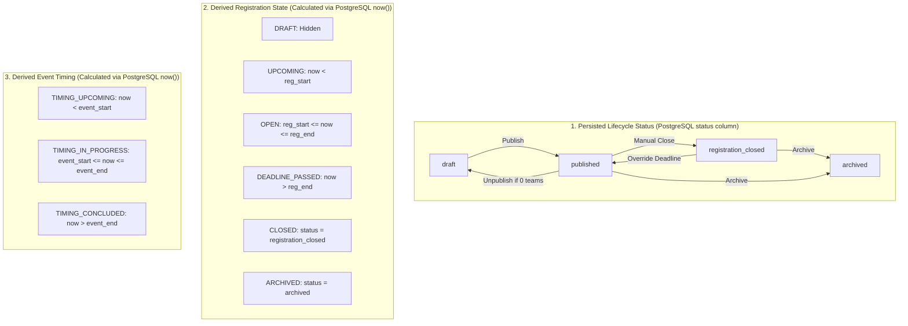
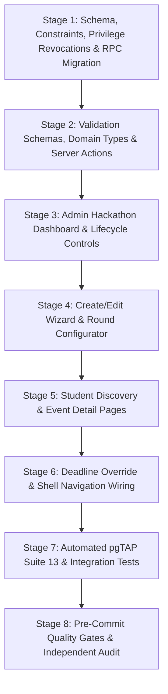

# NMIT HackLeague — Phase 6 Implementation Plan
## Hackathon Management: Architecture, Database, Lifecycle, Authorization & Implementation Specification

**Document Version:** 1.2.5 (Revision 1.2.5 — Deadline Override Audit Edge Case & Idempotency Reconciliation)  
**Status:** APPROVED FOR INDEPENDENT REVIEW — PLANNING CORRECTION COMPLETE  
**Branch:** `v1`  
**Repository Root:** `/Volumes/CodingVault/web/HackLeague`  
**Latest Phase 5 Git Commit Baseline:** `49dd59d29b31c49de95fabe9bd4366e7adb283de`  
**Target Environment:** Next.js 16.4.0 (App Router), React 19.0.0, TypeScript 5.7.0, Tailwind CSS 4.0.0, Supabase PostgreSQL 17, Supabase Auth (GoTrue), Supabase Storage, Resend, Vercel  

---

## Document Revision History

| Revision | Date | Author / Context | Key Changes & Architectural Decisions |
|---|---|---|---|
| **1.0.0** | 2026-10-14 | Initial Master Plan | Comprehensive Phase 6 implementation plan across 26 sections covering hackathon CRUD, lifecycle state machine, round configuration, deadline enforcement, authorized overrides, student discovery, registration-state computation, pgTAP test suite 13, and integration test suite. |
| **1.1.0** | 2026-10-14 | Revision 1.1 Consolidated Reconciliation | Decoupled persisted lifecycle statuses from derived registration states; revoked direct table writes on `public.hackathons` and `public.hackathon_rounds` in favor of least-privilege `SECURITY DEFINER` RPCs; hardened deadline override and round configuration workflows; reconciled seed compatibility for venue validation. |
| **1.2.0** | 2026-10-14 | Revision 1.2 Final Lifecycle, Round Integrity & RLS Reconciliation | Specified source/target validation matrix in `transition_hackathon_lifecycle`. Hardened `override_hackathon_deadline` to strictly permit source states `published` and `registration_closed`. Downstream reference checks and collision-safe deferred constraint for rounds. |
| **1.2.1** | 2026-10-14 | Revision 1.2.1 Final Blocking Defect Fixes | Corrected `compute_registration_state` volatility to `STABLE`. Rejected duplicate round IDs in configuration payload. Made Student Discovery Policy (Variant A vs B) and Deadline Policy (Option A vs B) genuinely blocking with Stage 1 stopping gates. Reconciled premature archival authorization and mandatory reason. Aligned test totals to 51 pgTAP assertions and 42 integration tests. |
| **1.2.2** | 2026-10-14 | Revision 1.2.2 Final Migration Preflight Correction | Hardened Migration 14 preflight verification to query PostgreSQL catalog metadata with rigorous exactness for `uq_hackathon_round_number`: table ownership, unique constraint type, exact key columns and ordering `(hackathon_id, round_number)`, deferrable status, foreign key dependencies, and row duplicates. |
| **1.2.3** | 2026-10-14 | Revision 1.2.3 Owner Approvals Recorded & Final Specification | **Record Owner Approvals & Finalize Phase 6 Specification:**<br/>**1. Student Discovery Policy:** Recorded explicit owner approval for **Variant A — Public Discovery**. Non-draft hackathons and rounds are readable by `anon` and `authenticated`. Drafts remain strictly isolated (`status <> 'draft'`). Student portal `/student/hackathons` remains protected by `requireApprovedStudent()`.<br/>**2. Deadline Override Policy:** Recorded explicit owner approval for **Option A — Flexible Override**. Authorized admins can extend or shorten the deadline to any valid future timestamp before event end (`now() < p_new_deadline <= event_end_at`). Mandatory justification (`>= 5` chars) and detailed audit logging (`change_type: 'extension' \| 'shortening'`). Reopening closed events transitions status from `registration_closed` to `published`.<br/>**3. Removed Temporary Stopping Gates:** Removed the Stage 1 stopping gates that existed solely because these two decisions were pending. Retained all security, migration-safety, and verification gates.<br/>**4. DDL & RPC Alignment:** Activated Variant A DDL grants and RLS policies in Migration 14. Activated Option A predicate in `override_hackathon_deadline`. Maintained exact catalog preflight verification for `uq_hackathon_round_number`. Preserved test counts (51 pgTAP assertions, 42 integration tests). |
| **1.2.4** | 2026-10-14 | Revision 1.2.4 Public Data Exposure & Final Security Reconciliation | **Public Discovery Architecture & Column Privacy Hardening:**<br/>**1. Least-Privilege Public Projections:** Replaced broad base-table `SELECT` grants (`GRANT SELECT ON TABLE public.hackathons TO anon, authenticated`) with dedicated, column-restricted views: `public.hackathons_public_view` and `public.hackathon_rounds_public_view`.<br/>**2. Base-Table Privilege Revocation:** Revoked table-level `SELECT` on base tables `public.hackathons` and `public.hackathon_rounds` from `anon` and `PUBLIC`. Base-table `SELECT` is retained for `authenticated` strictly subject to RLS policy `hackathons_admin_manage` (accessible only to authorized admins and Super Admin). Dropped pre-existing broad policies `hackathons_select_published` and `hackathon_rounds_select_visible` from Migration 11.<br/>**3. Comprehensive Schema Column Audit:** Audited all 25 columns of `public.hackathons` (22 exposed public fields, 3 omitted private fields: `created_by`, `created_at`, `updated_at`) and all 11 columns of `public.hackathon_rounds` (9 exposed public fields, 2 omitted private fields: `created_at`, `updated_at`). Confirmed omitted fields cannot be retrieved through views, RPCs, or alternate query paths.<br/>**4. PostgreSQL View Security Semantics:** Specified views with `WITH (security_invoker = false)` owned by `postgres`, decoupling public query execution from base-table permissions while enforcing fixed non-draft filtering in the view SQL (`WHERE status IN ('published', 'registration_closed', 'ongoing', 'completed', 'archived')`).<br/>**5. Reconciled 5-Role Access Matrix:** Formally documented effective access across `anon`, authenticated unapproved students, authenticated approved students, authorized admins, and Super Admin.<br/>**6. Safeguard Preservation:** Preserved approved Variant A (Public Discovery), approved Option A (Flexible Deadline Override), lifecycle state machine, premature archival constraints, duplicate round ID validation, `STABLE` volatility on `compute_registration_state`, and exact catalog preflight for `uq_hackathon_round_number`.<br/>**7. Expanded Test Suites:** Aligned automated test matrices to 57 distinct pgTAP assertions (Suite 13) and 46 integration tests. |
| **1.2.5** | 2026-10-14 | Revision 1.2.5 Deadline Override Audit Edge Case Reconciliation | **Hardened Deadline Override Edge Case & Audit Precision:**<br/>**1. Unchanged Deadline Rejection:** In `override_hackathon_deadline`, explicitly reject `p_new_deadline = v_old_deadline` fail-closed with `RAISE EXCEPTION 'Invalid deadline: new deadline is identical to the current deadline.'` before updating the hackathon or inserting an audit record.<br/>**2. Audit Integrity (`change_type`):** Eliminates the false `'shortening'` audit entry when a deadline is unchanged. Confirmed `change_type` is strictly `'extension'` when `p_new_deadline > v_old_deadline` and strictly `'shortening'` when `p_new_deadline < v_old_deadline`.<br/>**3. Form & Action Validation:** Reconciled client-side dialog and server action (`overrideDeadlineAction`) to check for unchanged deadline and prevent redundant submissions.<br/>**4. Automated Test Matrix Expansion:** Added pgTAP assertion `TS-HCK-58` and integration test `INT-HCK-47` verifying that attempting to override with an identical timestamp fails closed with zero table mutations and zero duplicate/false audit logs. Updated test counts to 58 pgTAP assertions and 47 integration tests. |

---

## 1. Document Metadata & Revision

- **Document Identifier:** `PHASE_06_IMPLEMENTATION_PLAN.md`
- **Current Revision:** 1.2.5
- **Governing Rules:** `rules.md` (canonical project context)
- **Governing Roadmap:** `NMIT_HackLeague_Development_Phases.md` (Phase 6 scope)
- **Approved Phase 5 Baseline:** `PHASE_05_IMPLEMENTATION_PLAN.md` (Revision 1.5.2)
- **Operating Constraint:** Planning only. Zero code, migration, or schema modifications until explicit review and sign-off.
- **Git Invariant:** Active branch strictly `v1`; HEAD commit strictly `49dd59d29b31c49de95fabe9bd4366e7adb283de`.

---

## 2. Phase 6 Objective & Authoritative Scope

### 2.1 Authoritative Roadmap Scope (Quote from `NMIT_HackLeague_Development_Phases.md`)

> ### Phase 6 — Hackathon management
> **Scope:**
> - Build create, edit, draft, publish, close, and archive workflows.
> - Store event descriptions, organizer, mode/venue, dates, deadlines, eligibility, official links, team-size rules, and prizes.
> - Support solo participation where enabled.
> - Configure event-specific round structures.
> - Enforce registration deadlines server-side and audit authorized overrides.
>
> **Completion criteria:**
> - Authorized admins can manage the event lifecycle.
> - Students see published events and accurate registration states.
> - Event-specific rules are validated server-side.

### 2.2 Core Security & Business Invariants for Phase 6

1. **Encapsulated Multi-Layer Authorization (Zero Direct-Write Bypass):** Every administrative hackathon mutation is encapsulated inside dedicated `SECURITY DEFINER` RPCs with fixed `search_path = public, pg_temp`. Direct `INSERT`, `UPDATE`, and `DELETE` on `public.hackathons` and `public.hackathon_rounds` are revoked from client roles (`authenticated`, `anon`). Only active Super Admins (implicit authority) and active Admins with the canonical `manage_hackathons` permission can execute management RPCs.
2. **Draft Isolation:** Events in `draft` status are strictly invisible to students and anonymous users at the PostgreSQL RLS layer (`status <> 'draft'`). Drafts can only be read by authorized administrators.
3. **Publication Prerequisites (Fail-Closed Invariants):** A hackathon cannot transition from `draft` to `published` unless all mandatory fields are verified, dates are chronologically consistent (`registration_start_at < registration_end_at <= event_end_at`), venue is populated if mode is `offline` or `hybrid`, solo participation rules are consistent (`is_solo_allowed = true ==> min_team_size = 1`), and **at least one round** has been configured within the event window.
4. **Authoritative Registration Deadlines:** The registration deadline is an immutable server/database invariant evaluated against PostgreSQL `now()`. UI countdown timers are strictly cosmetic presentation elements. Any deadline extension or override requires an explicit, audited operation with a mandatory administrative reason.
5. **Configurable Round Architecture & Downstream Protection:** Hackathons support arbitrary, configurable multi-round structures stored relationally in `public.hackathon_rounds`. Rounds maintain strict chronological consistency with the parent event and sequential numbering (`1, 2, ..., N`). Deleting rounds with linked downstream records (`submissions`, `verified_results`, `points_ledger`) is strictly prohibited.
6. **Authoritative Registration State Engine:** Registration status displayed to students is a purely derived calculation based on the event's lifecycle status, authoritative PostgreSQL timestamp, and deadline timestamps (`UPCOMING`, `OPEN`, `DEADLINE_PASSED`, `CLOSED`, `ARCHIVED`).
7. **Strict Scope Boundary:** Phase 6 models and displays hackathons, rounds, and registration eligibility. Phase 6 **does NOT** implement team creation, team joining, invite codes, membership management, or project submissions (reserved strictly for Phases 7 & 8).

---

## 3. Repository Inspection Findings (with Actual File Paths)

A comprehensive audit of the active repository on branch `v1` at commit `49dd59d29b31c49de95fabe9bd4366e7adb283de` confirms the following real file paths, database objects, and application state:

### 3.1 Migration Sequence & Database State

The repository contains exactly 13 applied migrations in `supabase/migrations/`:

1. `supabase/migrations/20261012000001_core_extensions_and_updated_at.sql` — Extensions (`pgcrypto`, `citext`), `handle_updated_at` trigger function.
2. `supabase/migrations/20261012000002_create_profiles_and_admin_tables.sql` — `profiles`, `admin_profiles`, `admin_permissions`.
3. `supabase/migrations/20261012000003_create_hackathons_and_rounds_tables.sql` — Baseline `public.hackathons` (22 columns) and `public.hackathon_rounds` (11 columns).
4. `supabase/migrations/20261012000004_create_teams_and_members_tables.sql` — `teams`, `team_members`.
5. `supabase/migrations/20261012000005_create_submissions_and_reviews_tables.sql` — `submissions`, `reviews`.
6. `supabase/migrations/20261012000006_create_results_and_points_tables.sql` — `verified_results`, `points_ledger`, `point_configurations`.
7. `supabase/migrations/20261012000007_create_audit_logs_and_change_requests.sql` — `audit_logs` (tamper-resistant), `profile_change_requests`.
8. `supabase/migrations/20261012000008_create_storage_deletion_queue_table.sql` — `storage_deletion_queue`.
9. `supabase/migrations/20261012000009_configure_storage_buckets.sql` — Storage bucket configuration (`college-ids`, `evidence`).
10. `supabase/migrations/20261012000010_create_security_functions_and_rpc.sql` — Baseline security RPCs (`create_team_secure`, `join_team_by_code`, `current_is_super_admin`, `recover_super_admin_identity`).
11. `supabase/migrations/20261012000011_enable_rls_and_policies.sql` — RLS policies on all 12 baseline tables including `hackathons_select_published` and `hackathons_admin_manage`.
12. `supabase/migrations/20261013000001_phase4_onboarding_and_review.sql` — Phase 4 onboarding, review RPC, column protection triggers.
13. `supabase/migrations/20261013000002_phase5_admin_management_and_rbac.sql` — Phase 5 RBAC, `provision_admin_profile`, `manage_admin_permissions`, `set_admin_active_status`, `bootstrap_super_admin`, and replacement `current_has_permission(TEXT)` with implicit Super Admin authority.

**Conclusion:** The exact next migration filename for Phase 6 must be:  
`supabase/migrations/20261013000003_phase6_hackathon_management.sql` (Migration 14 in total sequence).

### 3.2 Downstream Dependent Tables Audited

Audit of migrations 05 and 06 confirms the following exact foreign keys referencing `public.hackathon_rounds`:

- `public.submissions`:
  `CONSTRAINT fk_submissions_round_composite FOREIGN KEY (round_id, hackathon_id) REFERENCES public.hackathon_rounds(id, hackathon_id) ON DELETE RESTRICT`
- `public.verified_results`:
  `CONSTRAINT fk_results_round_composite FOREIGN KEY (round_id, hackathon_id) REFERENCES public.hackathon_rounds(id, hackathon_id) ON DELETE RESTRICT`
- `public.points_ledger`:
  `CONSTRAINT fk_points_round_composite FOREIGN KEY (round_id, hackathon_id) REFERENCES public.hackathon_rounds(id, hackathon_id) ON DELETE RESTRICT`

All downstream foreign keys specify `ON DELETE RESTRICT`. Round deletion in `configure_hackathon_rounds` must explicitly verify that no rows exist in any of these tables before attempting deletion, providing friendly operational feedback rather than raw database constraint exceptions.

### 3.3 Historical Seed & Test Compatibility Inspection

Inspection of `supabase/seed.sql` (lines 222–247) and `supabase/tests/02_ts_int.sql` (lines 32–40) reveals that:
- `seed.sql` defines `NMIT Hacks 2026` with `mode = 'offline'`, `venue = 'Main Auditorium, NMIT Campus'`, `min_team_size = 1`, `is_solo_allowed = true`, `status = 'published'`.
- `02_ts_int.sql` defines `NMIT Hacks II` with `mode = 'offline'`, but `venue` is omitted (`NULL`).
- **Resolution:** The database check constraint is specified as `CHECK ((mode = 'online') OR (venue IS NULL) OR (trim(venue) <> ''))` (preventing whitespace-only venues), while mandatory venue validation for offline/hybrid events is enforced strictly at publication time (`transition_hackathon_lifecycle`) and in form/server-action validation (`hackathonFormSchema`). This guarantees zero regression in existing test suites while maintaining strict production validation.

---

## 4. Existing Schema & Application Components to Reuse

### 4.1 Existing Database Objects to Reuse Unchanged

1. **`public.admin_profiles` & `public.admin_permissions`:**
   - Provides foreign key target for `created_by UUID REFERENCES public.admin_profiles(id)`.
   - Enforces canonical permission key `manage_hackathons`.
2. **`public.audit_logs`:**
   - Tamper-resistant append-only table (`id`, `actor_id`, `actor_role`, `action`, `target_type`, `target_id`, `details`, `created_at`).
   - Trigger `trg_prevent_audit_log_mutation` strictly blocks `UPDATE` or `DELETE`.
3. **`public.current_is_super_admin()`:**
   - Parameterless `SECURITY DEFINER` function returning `boolean` for `auth.uid()`.
4. **`public.current_has_permission('manage_hackathons')`:**
   - Replaced in Migration 13 to return `true` for active Super Admin and `true` for active Admin possessing `manage_hackathons` in `admin_permissions`.
5. **Existing RLS on `public.hackathons` (Migration 11 Baseline):**
   - `hackathons_select_published`: Permissive `SELECT` policy (`status IN ('published', 'registration_closed', 'ongoing', 'completed')`). Explicitly dropped in Migration 14 in favor of `public.hackathons_public_view` to prevent whole-table column leakage.
   - `hackathons_admin_manage`: Permissive `ALL TO authenticated` policy requiring `manage_hackathons` or Super Admin. Re-verified and retained in Migration 14 for administrator management.
6. **Existing RLS on `public.hackathon_rounds` (Migration 11 Baseline):**
   - `hackathon_rounds_select_visible`: Permissive `SELECT` policy (`status <> 'draft'`). Explicitly dropped in Migration 14 in favor of `public.hackathon_rounds_public_view` to prevent whole-table column leakage.
   - `hackathon_rounds_admin_manage`: Permissive `ALL TO authenticated` policy requiring `manage_hackathons` or Super Admin. Re-verified and retained in Migration 14 for administrator round configuration.

### 4.2 Existing Application Components to Reuse

- **Layout Shells:** `AdminShell`, `SuperAdminShell`, `StudentShell`, `AppHeader`, `SidebarNav`, `PageHeader`.
- **UI Primitives (`src/components/ui/*`):**
  - `Button`, `ButtonLink` (variants: `primary`, `secondary`, `danger`, `outline`, `ghost`).
  - `Input`, `Textarea`, `Select`, `Checkbox`.
  - `Card`, `CardHeader`, `CardTitle`, `CardDescription`, `CardContent`, `CardFooter`.
  - `Badge` (variants: `neutral`, `success`, `warning`, `error`, `info`, with optional `dot`).
  - `Table`, `TableHeader`, `TableBody`, `TableRow`, `TableHead`, `TableCell`.
  - `Dialog`, `DialogTrigger`, `DialogContent`, `DialogHeader`, `DialogFooter`, `DialogTitle`, `DialogDescription`.
  - `Alert` (variants: `info`, `success`, `warning`, `error`).
  - `EmptyState` (title, description, icon, action slot).
  - `Skeleton` (loading placeholders).
- **Supabase Clients:**
  - `src/lib/supabase/server.ts` (async cookie-aware client for Server Actions and Server Components).
  - `src/lib/supabase/client.ts` (browser client for interactive components).
  - `src/lib/supabase/admin.ts` (service-role client for background audit logging / system tasks).

---

## 5. Confirmed Gaps & Proposed Changes

### 5.1 Database Schema Gaps in `public.hackathons`

| Requirement Area | Existing Migration 03 Column | Confirmed Gap | Proposed Phase 6 Migration Action |
|---|---|---|---|
| **Eligibility (Section 6.2 D)** | *None* | Table has no column to store event eligibility criteria. | `ALTER TABLE public.hackathons ADD COLUMN eligibility TEXT NOT NULL DEFAULT 'Open to all registered NMIT students';` |
| **Short Summary (Section 6.2 A)** | `description TEXT` only | Table has no short summary / tagline for event cards and search previews. | `ALTER TABLE public.hackathons ADD COLUMN tagline TEXT NULL;` |
| **Structured Prizes (Section 6.2 F)** | `prizes_summary TEXT` only | Summary is free text; cannot store structured placement tiers (`placement`, `reward`, `description`). | `ALTER TABLE public.hackathons ADD COLUMN prizes_detail JSONB NOT NULL DEFAULT '[]'::jsonb;` |
| **Solo Consistency Invariant (Section 6.2 E)** | `chk_hackathons_team_size` only | Database allows contradictory state: `is_solo_allowed = true` with `min_team_size = 2`. | Add check constraint: `CONSTRAINT chk_hackathons_solo_consistency CHECK (NOT is_solo_allowed OR min_team_size = 1)` |
| **Whitespace Venue Invariant** | `chk_hackathons_mode` only | Allows whitespace-only venue string. | Add check constraint: `CONSTRAINT chk_hackathons_mode_venue CHECK ((mode = 'online') OR (venue IS NULL) OR (trim(venue) <> ''))` |
| **Registration Deadline vs Event End (Section 6.2 C)** | `chk_hackathons_chronology` | Only checks `event_start_at >= registration_start_at`. Does not prevent registration deadline falling after event end. | Add check constraint: `CONSTRAINT chk_hackathons_reg_deadline_event_end CHECK (registration_end_at <= event_end_at)` |
| **URL Protocol Safety (Section 6.2 G)** | Free text columns | Malformed or malicious URI schemes (e.g. `javascript:`) could be stored in URLs. | Add check constraints: `CONSTRAINT chk_hackathons_external_url CHECK (external_registration_url IS NULL OR external_registration_url ~* '^https?://')`, `CONSTRAINT chk_hackathons_community_url CHECK (community_url IS NULL OR community_url ~* '^https?://')` |
| **Slug Formatting** | `slug TEXT NOT NULL UNIQUE` | No regex constraint on slug format. | Add check constraint: `CONSTRAINT chk_hackathons_slug_format CHECK (slug ~* '^[a-z0-9]+(-[a-z0-9]+)*$')` |

### 5.2 Direct-Write and Read Access Security Gaps Closed in Phase 6

- **Direct-Write Vulnerability Closed:** In Migration 11, `GRANT INSERT, UPDATE, DELETE ON TABLE public.hackathons TO authenticated;` allowed direct PostgREST table writes that bypassed audit logging, round count validation, and mandatory deadline override justifications.
- **Direct-Read / Column Exposure Vulnerability Closed:** In Migration 11, `GRANT SELECT ON TABLE public.hackathons TO anon, authenticated;` combined with row-level security allowed any client to query all columns (`SELECT *` or `SELECT created_by`) on non-draft rows. Row-level security (RLS) is strictly a row-filtering mechanism, not a column-level privacy control. This allowed anonymous callers and unapproved users to harvest internal administrative metadata (`created_by` linking to `admin_profiles(id)`), database mutation timestamps (`created_at`, `updated_at`), and internal operational fields.
- **Architectural Solution in Migration 14:**
  1. **Strict Mutation Revocation:**
     ```sql
     REVOKE INSERT, UPDATE, DELETE ON TABLE public.hackathons FROM authenticated, anon, PUBLIC;
     REVOKE INSERT, UPDATE, DELETE ON TABLE public.hackathon_rounds FROM authenticated, anon, PUBLIC;
     ```
     All mutations on `public.hackathons` and `public.hackathon_rounds` must strictly traverse dedicated, audited `SECURITY DEFINER` RPCs (`create_hackathon_draft`, `update_hackathon_metadata`, `transition_hackathon_lifecycle`, `override_hackathon_deadline`, `configure_hackathon_rounds`). Direct client POST/PATCH/DELETE requests are rejected fail-closed at the PostgreSQL grant level (`ERROR 42501`).
  2. **Base-Table SELECT Revocation for Anonymous Visitors:**
     ```sql
     REVOKE SELECT ON TABLE public.hackathons FROM anon, PUBLIC;
     REVOKE SELECT ON TABLE public.hackathon_rounds FROM anon, PUBLIC;
     ```
     Direct base-table queries by anonymous visitors are rejected fail-closed with permission denied (`ERROR 42501`).
  3. **Obsolete Broad Policy Removal & Base-Table Admin Isolation:**
     ```sql
     DROP POLICY IF EXISTS hackathons_select_published ON public.hackathons;
     DROP POLICY IF EXISTS hackathon_rounds_select_visible ON public.hackathon_rounds;
     DROP POLICY IF EXISTS hackathon_rounds_select_published ON public.hackathon_rounds;
     ```
     The only RLS policies remaining on the base tables are `hackathons_admin_manage` and `hackathon_rounds_admin_manage`. Non-admin authenticated students querying base tables receive 0 rows, completely preventing any base-table bypass or column leakage.
  4. **Least-Privilege Public Projections (`hackathons_public_view` & `hackathon_rounds_public_view`):**
     Public discovery is mediated entirely through dedicated views defined with `WITH (security_invoker = false)` and owned by `postgres`. These views project an explicit allowlist of public fields (22 hackathon fields, 9 round fields), enforce hardcoded non-draft filtering, and omit all private/administrative columns (`created_by`, `created_at`, `updated_at`). Public clients do not require any base-table permissions to read from these views.

---

## 6. Functional Requirements & Acceptance Criteria

| Requirement ID | Requirement Specification | Proposed Implementation | Enforcement Layer | Target File(s) / Object(s) | Verification Method | Acceptance Criteria |
|---|---|---|---|---|---|---|
| **REQ-HCK-01** | Admin Hackathon Dashboard | Dedicated server component querying hackathons with count metrics, search, and status filter. | Server Component + RLS | `src/app/admin/hackathons/page.tsx` | Integration test (`INT-HCK-01`) | Renders all events matching permissions; shows name, status badge, dates, team size, rounds count. |
| **REQ-HCK-02** | Dashboard Role Protection | Strictly restrict dashboard to active Super Admin or active Admin with `manage_hackathons`. | Server Guard + RLS | `src/lib/auth/guards.ts` (`requireAdmin('manage_hackathons')`) | Integration test (`INT-HCK-02`) | Unauthorized admins (e.g. only `verify_students`) and unauthenticated users are redirected to `/login`. |
| **REQ-HCK-03** | Inactive Admin Denial | Inactive admins cannot access hackathon dashboard or trigger any hackathon action. | Server Guard + RLS + RPC | `src/lib/auth/guards.ts`, `current_has_permission` | Integration test (`INT-HCK-03`) | Calling route or action with deactivated session fails closed immediately. |
| **REQ-HCK-04** | Create Hackathon as Draft | Server action invoking RPC `create_hackathon_draft` to create draft event. | RPC + DB | `create_hackathon_draft`, `public.hackathons` | pgTAP (`TS-HCK-01`), Integration (`INT-HCK-04`) | Draft created with valid fields; `created_by` set to authenticated admin; audited as `'hackathon.created'`. |
| **REQ-HCK-05** | Direct Write Prohibition | Direct PostgREST or SQL INSERT/UPDATE/DELETE on hackathons table is rejected. | Table Privileges | `REVOKE INSERT, UPDATE, DELETE` | pgTAP (`TS-HCK-18`) | Direct client table write throws permission denied error (`42501`). |
| **REQ-HCK-06** | Edit Hackathon Metadata | RPC `update_hackathon_metadata` updates non-lifecycle metadata fields and verifies round bounds. | RPC + DB | `update_hackathon_metadata` | Integration (`INT-HCK-06`) | Authorized admin can update details; verifies round dates fit new event dates; audited as `'hackathon.updated'`. |
| **REQ-HCK-07** | Venue Validation at Publication | Offline/hybrid events require non-empty venue before transitioning to published. | RPC / Zod | `transition_hackathon_lifecycle`, Zod schema | pgTAP (`TS-HCK-05`), Integration (`INT-HCK-07`) | Attempting to publish offline/hybrid event without venue fails closed with descriptive error. |
| **REQ-HCK-08** | Solo Consistency Invariant | If `is_solo_allowed = true`, `min_team_size` must equal 1. | DB Check + Zod | `chk_hackathons_solo_consistency` | pgTAP (`TS-HCK-02`), Integration (`INT-HCK-08`) | Attempting to save `is_solo_allowed = true` with `min_team_size = 2` throws constraint violation. |
| **REQ-HCK-09** | Safe URL Validation | External links must start with `http://` or `https://`. Malformed or `javascript:` links rejected. | DB Check + Zod | `chk_hackathons_external_url`, Zod `.url()` | pgTAP (`TS-HCK-04`), Integration (`INT-HCK-09`) | Unsafe URL schemes fail validation before touching database. |
| **REQ-HCK-10** | Round Structure Configuration | Admin configures sequential rounds (`1, 2, ..., N`) with name, dates, description, final flag. Reject duplicate round IDs in payload. | RPC + Server Action | `configure_hackathon_rounds`, `configureRoundsAction` | pgTAP (`TS-HCK-07`, `TS-HCK-49`), Integration (`INT-HCK-10`, `INT-HCK-41`) | Upserts rounds; rejects duplicate payload round IDs before mutation; enforces sequential check and downstream reference protection; audited as `'hackathon.rounds_configured'`. |
| **REQ-HCK-11** | Publish Transition Invariants | Transitioning `draft -> published` requires all required fields and >= 1 round. | RPC | `transition_hackathon_lifecycle` | pgTAP (`TS-HCK-09`), Integration (`INT-HCK-11`) | Attempting to publish an event with 0 rounds fails closed with error: `'Cannot publish: at least one round must be configured.'` |
| **REQ-HCK-12** | Event Publication Effect | Once published, event becomes visible in public projection view and eligible for registration. | Public View + DB | `public.hackathons_public_view` | pgTAP (`TS-HCK-10`, `TS-HCK-24`), Integration (`INT-HCK-12`) | Published event appears in `hackathons_public_view`; draft events return 0 rows. |
| **REQ-HCK-13** | Manual Registration Closure | Admin can manually close registration before deadline (`published -> registration_closed`). | RPC | `transition_hackathon_lifecycle` | pgTAP (`TS-HCK-11`), Integration (`INT-HCK-13`) | Status changes to `registration_closed`; audited as `'hackathon.registration_closed'`. |
| **REQ-HCK-14** | Reopen Registration Workflow | Reopening closed registration strictly requires invoking `override_hackathon_deadline`. | RPC | `override_hackathon_deadline` | pgTAP (`TS-HCK-12`), Integration (`INT-HCK-14`) | Reopening via lifecycle RPC blocked; deadline RPC restores status to `published` with new future deadline; audited. |
| **REQ-HCK-15** | Archive Event | Transition concluded event to `archived`. Active events require Super Admin override with >= 5 char justification. Archived events cannot be reactivated or edited. | RPC | `transition_hackathon_lifecycle` | pgTAP (`TS-HCK-44`, `TS-HCK-50`), Integration (`INT-HCK-27`, `INT-HCK-42`) | Status becomes `archived`; audited as `'hackathon.archived'`; premature archival requires Super Admin and mandatory reason; edit/reopen attempts rejected. |
| **REQ-HCK-16** | Registration Deadline Enforcement | Authoritative database time `now()` determines registration eligibility. | Database / RPC | PostgreSQL `now()` check in RPCs | pgTAP (`TS-HCK-14`), Integration (`INT-HCK-16`) | Requests received at `now() > registration_end_at` are rejected regardless of client clock. |
| **REQ-HCK-17** | Authorized Deadline Override | Privileged operation to extend or shorten registration deadline with mandatory reason and unchanged deadline rejection. | RPC + Server Action | `override_hackathon_deadline`, `overrideDeadlineAction` | pgTAP (`TS-HCK-15`, `TS-HCK-58`), Integration (`INT-HCK-17`, `INT-HCK-47`) | Validates `now() < p_new_deadline <= event_end_at` and `p_new_deadline <> old_deadline`; updates deadline; records single atomic audit log with accurate `change_type`. Unchanged deadline rejected fail-closed with zero table updates and zero false audit logs. |
| **REQ-HCK-18** | Mandatory Override Reason | Mandatory non-empty reason of at least 5 characters for deadline override. | RPC + Zod | `override_hackathon_deadline`, `deadlineOverrideSchema` | pgTAP (`TS-HCK-16`), Integration (`INT-HCK-18`) | Omission of reason or whitespace-only reason rejected with validation error. |
| **REQ-HCK-19** | Student Event Catalog | Student portal page browsing published, closed, and archived hackathons via safe public view with search. | Server Component + Public View | `src/app/student/hackathons/page.tsx`, `hackathons_public_view` | Integration (`INT-HCK-19`) | Students see cards with title, organizer, mode, dates, status badge, tagline; zero private columns exposed. |
| **REQ-HCK-20** | Student Event Details | Full event view querying safe public projection views: schedule timeline, rounds, eligibility, prizes, team rules, registration card. | Server Component + Public Views | `src/app/student/hackathons/[slug]/page.tsx`, `hackathons_public_view` | Integration (`INT-HCK-20`) | Comprehensive display; accurate registration state computed server-side; private columns excluded. |
| **REQ-HCK-21** | Registration State Computation | Derive registration state (`UPCOMING`, `OPEN`, `DEADLINE_PASSED`, `CLOSED`, `ARCHIVED`) via STABLE PostgreSQL function. | Database Function | `public.compute_registration_state` | pgTAP (`TS-HCK-28` to `TS-HCK-34`, `TS-HCK-51`), Integration (`INT-HCK-33` to `INT-HCK-36`) | Correct state rendered based on PostgreSQL `now()` and lifecycle status; exact inclusive deadline boundary enforced; declared STABLE. |
| **REQ-HCK-22** | Draft Isolation & Column Protection | Students and anonymous users cannot query draft events or private columns (`created_by`). Base tables return 0 rows or 42501; public views filter drafts and omit private columns. | Public View + Base Table RLS | `public.hackathons_public_view`, `hackathons_admin_manage` | pgTAP (`TS-HCK-22` to `TS-HCK-27`, `TS-HCK-52` to `TS-HCK-57`), Integration (`INT-HCK-22`, `INT-HCK-31`, `INT-HCK-43`, `INT-HCK-44`) | SELECT on views for draft returns 0 rows; base table queries by non-admins return 0 rows or 42501; private columns cannot be selected. |
| **REQ-HCK-23** | Student Mutation Prohibition | Students cannot invoke any hackathon management RPCs. | RPC Security Check | `current_has_permission('manage_hackathons')` | pgTAP (`TS-HCK-19`), Integration (`INT-HCK-23`) | Any write attempt by student role throws access denied exception. |
| **REQ-HCK-24** | Audit Logging Completeness | Every lifecycle transition and deadline override creates an immutable audit record. | PostgreSQL RPCs | `public.audit_logs` | pgTAP (`TS-HCK-20`), Integration (`INT-HCK-24`) | Audit entry contains exact `actor_id`, `actor_role`, `action`, `target_id`, and `details`. |
| **REQ-HCK-25** | Unpublishing Protection | Published hackathons with registered teams cannot be reverted to `draft`. | RPC | `transition_hackathon_lifecycle` | Integration (`INT-HCK-25`) | If teams exist in `public.teams`, unpublishing throws data integrity error. |

---

## 7. Admin Dashboard & Event-Form Behavior

### 7.1 Admin Hackathon Management Dashboard (`/admin/hackathons`)

The dashboard is the central command center for event organizers and the Super Admin.

#### A. Header & Key Performance Indicators (KPIs)
- **Title:** "Hackathon Management"
- **Description:** "Configure institutional competitions, manage lifecycles, configure round structures, and enforce registration deadlines."
- **Action Button:** `+ Create Hackathon` (ButtonLink to `/admin/hackathons/new`).
- **Metric Cards (4 Grid):**
  1. **Total Events:** Count of all non-archived hackathons (`status <> 'archived'`).
  2. **Active Registrations:** Count of events with `status = 'published'` and `now() <= registration_end_at`.
  3. **Upcoming Events:** Count of events where `event_start_at > now()`.
  4. **Drafts in Progress:** Count of events with `status = 'draft'`.

#### B. Filter & Search Controls
- **Search Input:** Debounced text search matching `title`, `slug`, or `organizer`.
- **Status Filter Tabs:** `All`, `Drafts`, `Published`, `Registration Closed`, `Archived`.
- **Mode Filter Select:** `All Modes`, `Offline`, `Online`, `Hybrid`.

#### C. Hackathons Table Columns
1. **Event Name & Slug:** Title in semibold charcoal; slug underneath in monospace soft grey.
2. **Organizer:** Department or club name (e.g. "ISE Department", "Turing Club").
3. **Mode & Venue:** Mode badge (`Offline`, `Online`, `Hybrid`) + Venue name if physical.
4. **Registration Window:** Formatted date range + countdown or "Closed" indicator.
5. **Event Dates:** Start and end dates.
6. **Rounds Count:** Number of configured rounds (e.g. "3 Rounds").
7. **Lifecycle Status:** Color-coded status badge (`Draft` [neutral], `Published` [success], `Closed` [warning], `Archived` [neutral]).
8. **Actions Menu:**
   - `Edit Details` (navigates to `/admin/hackathons/[id]/edit`).
   - `Configure Rounds` (navigates to `/admin/hackathons/[id]/rounds`).
   - `Override Deadline` (opens `DeadlineOverrideDialog`).
   - `Publish Event` (opens `LifecycleConfirmDialog` — available for valid drafts).
   - `Close Registration` (opens `LifecycleConfirmDialog` — available for published events).
   - `Archive Event` (opens `LifecycleConfirmDialog`):
     - *Concluded events (`now() > event_end_at`):* Available to authorized Admins and Super Admin; confirmation dialog with optional notes.
     - *Active events (`now() <= event_end_at`):* Disabled for ordinary Admins (with tooltip: "Event has not concluded. Only Super Admin can archive active events prematurely."); enabled for Super Admin with a mandatory warning banner and required justification textarea (minimum 5 characters).

### 7.2 Unified Creation & Publishing Workflow

To eliminate inconsistency between direct publishing and round configuration requirements, Phase 6 provides a unified creation flow:
1. **Standard Workflow (Recommended):**
   - Step 1: Admin fills core event metadata and clicks `Save as Draft`.
   - Step 2: System redirects to `/admin/hackathons/[id]/rounds` to configure rounds.
   - Step 3: Once rounds are configured, admin clicks `Publish Event`.
2. **Atomic Create & Publish Workflow (For API / Scripted Operations):**
   - If an admin invokes `createAndPublishHackathonAction`, the payload must supply **both** the complete event metadata and the rounds array.
   - The server action executes a single atomic transaction: inserts the event, configures rounds via `configure_hackathon_rounds`, validates prerequisites, sets `status = 'published'`, and audits `'hackathon.created'` and `'hackathon.published'` atomically.
   - If rounds are omitted, the action fails closed before creating any database records.

---

## 8. Lifecycle State Machine & Complete Transition Specification

### 8.1 Distinct State Dimensions

To eliminate ambiguity, Phase 6 formally decouples three distinct conceptual dimensions:



1. **Persisted Lifecycle Status (`public.hackathons.status`):**
   - `draft`: Private administrative draft.
   - `published`: Publicly active hackathon.
   - `registration_closed`: Registration officially closed by deadline or administrative action.
   - `archived`: Permanent historical archive.
   - *(Dormant values `ongoing` and `completed` exist in Migration 03 check constraints for Phase 8/9 execution and results verification; Phase 6 strictly blocks transitions into or out of these states).*
2. **Derived Registration State (`public.compute_registration_state`):**
   - `DRAFT`: Invisible to students.
   - `UPCOMING`: Registration window has not opened yet (`now() < registration_start_at`).
   - `OPEN`: Registration window is currently active (`registration_start_at <= now() <= registration_end_at`).
   - `DEADLINE_PASSED`: Deadline has passed without manual closure (`now() > registration_end_at`).
   - `CLOSED`: Explicitly closed by admin (`status = 'registration_closed'`).
   - `ARCHIVED`: Concluded and archived (`status = 'archived'`).
3. **Derived Event Timing:**
   - `TIMING_UPCOMING`: `now() < event_start_at`.
   - `TIMING_IN_PROGRESS`: `event_start_at <= now() <= event_end_at`.
   - `TIMING_CONCLUDED`: `now() > event_end_at`.

### 8.2 Complete Lifecycle Transition Matrix (Source × Target)

| Source Status | Target Status | Permitted? | Required Role / Authority | Enforcement Mechanism | Pre-conditions & Invariant Checks | Audit Event Recorded | Student-Facing Effect | Error on Violation |
|---|---|---|---|---|---|---|---|---|
| **`[None]`** | `draft` | **YES** | `manage_hackathons` or Super Admin | RPC `create_hackathon_draft` | Valid title, slug, organizer, chronology. | `hackathon.created` | None (draft is invisible). | Validation error. |
| **`draft`** | `published` | **YES** | `manage_hackathons` or Super Admin | RPC `transition_hackathon_lifecycle` | 1. Venue non-empty if offline/hybrid.<br/>2. **COUNT(rounds) >= 1**.<br/>3. Chronology: `reg_start < reg_end <= event_end`.<br/>4. Solo rule consistent.<br/>5. All rounds fall within event dates. | `hackathon.published` | Appears in student catalog. Registration state derived. | `'Cannot publish: at least one round must be configured.'` |
| **`draft`** | `registration_closed`| **NO** | Blocked | RPC `transition_hackathon_lifecycle` | Cannot close an event that was never published. | None | N/A | `'Cannot close registration for a draft event. Publish the event first.'` |
| **`draft`** | `archived` | **NO** | Blocked | RPC `transition_hackathon_lifecycle` | Cannot archive an unexecuted draft. | None | N/A | `'Cannot archive a draft event. Discard or delete the draft instead.'` |
| **`published`** | `draft` | **CONDITIONAL** | Super Admin ONLY | RPC `transition_hackathon_lifecycle` | **ZERO teams exist in `public.teams`** for this event. | `hackathon.unpublished` | Disappears from student catalog. | `'Cannot unpublish: active student teams are registered.'` |
| **`published`** | `registration_closed`| **YES** | `manage_hackathons` or Super Admin | RPC `transition_hackathon_lifecycle` | Admin closes registration early. | `hackathon.registration_closed` | Registration badge becomes "Closed". | None. |
| **`published`** | `archived` | **CONDITIONAL** | Authorized Admin (`manage_hackathons`) if concluded (`now() > event_end_at`); **Super Admin ONLY** if active (`now() <= event_end_at`). | RPC `transition_hackathon_lifecycle` | Concluded event (`now() > event_end_at`): reason optional. Premature archival (`now() <= event_end_at`): strictly requires Super Admin authority AND mandatory justification (`length(trim(p_reason)) >= 5`). | `hackathon.archived` | Moved to "Past Events" tab; registration closed. | Ordinary admin on active event: `'Cannot archive: event has not concluded yet (ends %). Only Super Admin can archive an active event prematurely.'`<br/>Super Admin on active event with short reason: `'Cannot archive: a meaningful justification of at least 5 characters is mandatory for premature archival of an active event.'` |
| **`registration_closed`**| `published` | **VIA OVERRIDE ONLY** | `manage_hackathons` or Super Admin | RPC `override_hackathon_deadline` | Must supply new future deadline (`p_new_deadline > now()`) and mandatory reason (`>= 5` chars). Reopening via lifecycle RPC is blocked. | `hackathon.deadline_overridden` | Registration badge returns to "Open". | `'Cannot reopen closed registration via lifecycle RPC. Use override_hackathon_deadline.'` |
| **`registration_closed`**| `draft` | **NO** | Blocked | RPC `transition_hackathon_lifecycle` | Closed event cannot be reverted to draft. | None | N/A | `'Cannot revert a closed hackathon to draft.'` |
| **`registration_closed`**| `archived` | **CONDITIONAL** | Authorized Admin (`manage_hackathons`) if concluded (`now() > event_end_at`); **Super Admin ONLY** if active (`now() <= event_end_at`). | RPC `transition_hackathon_lifecycle` | Concluded event (`now() > event_end_at`): reason optional. Premature archival (`now() <= event_end_at`): strictly requires Super Admin authority AND mandatory justification (`length(trim(p_reason)) >= 5`). | `hackathon.archived` | Moved to "Past Events" tab; registration closed. | Ordinary admin on active event: `'Cannot archive: event has not concluded yet (ends %). Only Super Admin can archive an active event prematurely.'`<br/>Super Admin on active event with short reason: `'Cannot archive: a meaningful justification of at least 5 characters is mandatory for premature archival of an active event.'` |
| **`archived`** | `*` (Any) | **NO** | Blocked | RPC `transition_hackathon_lifecycle` | Archived is an immutable terminal state. | None | N/A | `'Archived hackathons are immutable and cannot be transitioned to any other state.'` |
| **`ongoing` / `completed`** | `*` (Any) | **NO** | Blocked | RPC `transition_hackathon_lifecycle` | Reserved for competition execution phases. | None | N/A | `'Events in status "%" are managed by competition execution and cannot be mutated by Phase 6.'` |
| **`*` (Any)** | `ongoing` / `completed` | **NO** | Blocked | RPC `transition_hackathon_lifecycle` | Phase 6 does not set competition execution statuses. | None | N/A | `'Target status "%" is reserved for competition execution phases.'` |
| **`*` (Any)** | Unknown / NULL | **NO** | Blocked | RPC `transition_hackathon_lifecycle` | Invalid target status. | None | N/A | `'Invalid target status: %.'` |
| **`X`** | `X` (Identical) | **IDEMPOTENT** | `manage_hackathons` or Super Admin | RPC `transition_hackathon_lifecycle` | Target status equals current status. | **None (No-op)** | None | Returns `{ "success": true, "message": "Status unchanged." }`. |

---

## 9. Authoritative Registration-State & Deadline Contract

### 9.1 Database-Evaluated Registration State Function

To ensure that the registration state is evaluated with absolute time synchronization across server components, API responses, and database triggers, Phase 6 deploys a database-level calculation function:

```sql
CREATE OR REPLACE FUNCTION public.compute_registration_state(
  p_status TEXT,
  p_reg_start TIMESTAMPTZ,
  p_reg_end TIMESTAMPTZ,
  p_now TIMESTAMPTZ DEFAULT now()
)
RETURNS TEXT AS $$
BEGIN
  -- 1. Lifecycle status precedence
  IF p_status = 'draft' THEN
    RETURN 'DRAFT';
  END IF;

  IF p_status = 'archived' THEN
    RETURN 'ARCHIVED';
  END IF;

  IF p_status = 'registration_closed' THEN
    RETURN 'CLOSED';
  END IF;

  -- 2. Authoritative timeline precedence
  IF p_now < p_reg_start THEN
    RETURN 'UPCOMING';
  END IF;

  -- Exact inclusive boundary: now() <= registration_end_at
  IF p_now <= p_reg_end THEN
    RETURN 'OPEN';
  END IF;

  -- Deadline has passed
  RETURN 'DEADLINE_PASSED';
END;
$$ LANGUAGE plpgsql STABLE;
```

> [!NOTE]
> **PostgreSQL Function Volatility Declaration: `STABLE` vs `IMMUTABLE`**
> 
> In PostgreSQL, an `IMMUTABLE` function promises that for identical argument values, it will always return identical results forever without reading database tables or transaction environment state. This permits the PostgreSQL query planner to pre-evaluate (constant-fold) the function at plan/parse time.
> 
> However, `compute_registration_state` defines a dynamic default argument `p_now TIMESTAMPTZ DEFAULT now()`. Because PostgreSQL `now()` returns the current transaction/statement timestamp, calling `compute_registration_state(status, reg_start, reg_end)` without an explicit fourth parameter produces a result that inherently depends on the passage of time. Declaring a function with a time-dependent default as `IMMUTABLE` violates PostgreSQL's volatility contract and can cause the query planner to cache stale evaluations across prepared statements or long-lived query plans.
> 
> Declaring `compute_registration_state` as **`STABLE`** correctly signals to PostgreSQL that:
> 1. The function does not modify database state (`VOLATILE` mutations are prohibited).
> 2. Its result depends on the current transaction/statement timestamp (`now()`) and remains stable within a single table scan or statement execution.
> 3. The query planner will not incorrectly constant-fold the function at plan time, guaranteeing accurate, real-time deadline evaluations across all queries and views.
> 4. When an explicit timestamp is passed to `p_now` (e.g. in test fixtures or historical evaluations), `STABLE` behaves completely deterministically for that argument.
> 
> **Exact Deadline-Boundary Contract:** Registration is open when `now() <= registration_end_at`, unless lifecycle status (`draft`, `archived`, `registration_closed`) takes precedence. If `now() > registration_end_at`, the registration state becomes `'DEADLINE_PASSED'`.

### 9.2 TypeScript Shared Contract (`src/types/hackathon.ts`)

```typescript
export type PersistedHackathonStatus =
  | 'draft'
  | 'published'
  | 'registration_closed'
  | 'archived';

export type RegistrationState =
  | 'DRAFT'
  | 'UPCOMING'
  | 'OPEN'
  | 'DEADLINE_PASSED'
  | 'CLOSED'
  | 'ARCHIVED';

export type EventTimingState =
  | 'TIMING_UPCOMING'
  | 'TIMING_IN_PROGRESS'
  | 'TIMING_CONCLUDED';

export interface RegistrationStateDisplay {
  state: RegistrationState;
  badgeLabel: string;
  badgeVariant: 'neutral' | 'success' | 'warning' | 'error' | 'info';
  description: string;
  isActionable: boolean;
}

export const REGISTRATION_STATE_CONFIG: Record<RegistrationState, Omit<RegistrationStateDisplay, 'state'>> = {
  DRAFT: {
    badgeLabel: 'Draft',
    badgeVariant: 'neutral',
    description: 'Private draft under administrative preparation.',
    isActionable: false,
  },
  UPCOMING: {
    badgeLabel: 'Registration Upcoming',
    badgeVariant: 'info',
    description: 'Registration opens soon.',
    isActionable: false,
  },
  OPEN: {
    badgeLabel: 'Registration Open',
    badgeVariant: 'success',
    description: 'Team registrations are currently being accepted.',
    isActionable: true,
  },
  DEADLINE_PASSED: {
    badgeLabel: 'Registration Closed',
    badgeVariant: 'error',
    description: 'The registration deadline for this competition has passed.',
    isActionable: false,
  },
  CLOSED: {
    badgeLabel: 'Registration Closed',
    badgeVariant: 'error',
    description: 'Registration has been officially closed by event organizers.',
    isActionable: false,
  },
  ARCHIVED: {
    badgeLabel: 'Archived',
    badgeVariant: 'neutral',
    description: 'This competition has concluded and is archived for institutional records.',
    isActionable: false,
  },
};
```

---

## 10. Deadline Enforcement & Authorized Override Workflow

### 10.1 Allowed Source States & Reopening Rules

- **Strictly Permitted Source States:**
  - `published`: Extending or adjusting an active registration deadline.
  - `registration_closed`: Reopening closed registration with a new deadline.
- **Explicitly Rejected Source States:**
  - `draft`: Rejects with `'Cannot override deadline for a draft event. Edit draft dates directly.'`
  - `archived`: Rejects with `'Cannot override deadline for an archived event.'`
  - `ongoing` / `completed`: Rejects with `'Cannot override deadline for an event in status "%".'`
- **Mandatory Justification:** PostgreSQL strictly enforces `length(trim(COALESCE(p_reason, ''))) >= 5`.
- **Upper Bound Invariant:** `p_new_deadline <= v_hackathon.event_end_at`.
- **Lower Bound Invariant:** `p_new_deadline > now()`.
- **Start Bound Invariant:** `p_new_deadline > v_hackathon.registration_start_at`.
- **Row Locking:** Locked via `SELECT ... FOR UPDATE` before validation and mutation.

### 10.2 Approved Policy: Option A — Flexible Override [OWNER APPROVED]

> [!NOTE]
> **[OWNER APPROVED: Deadline Override Policy — Option A: Flexible Override]**
> 
> The project owner has explicitly approved **Option A (Flexible Override)**:
> - **Operational Scope:** An authorized administrator with `manage_hackathons` or Super Admin authority may extend or shorten the registration deadline to any valid future timestamp before the event concludes (`now() < p_new_deadline <= event_end_at`).
> - **Opening Boundary Invariant:** The new deadline must be strictly after the event's registration opening time (`p_new_deadline > v_hackathon.registration_start_at`).
> - **Mandatory Justification:** PostgreSQL strictly enforces `length(trim(COALESCE(p_reason, ''))) >= 5`.
> - **Reopening Workflow:** If the event was in `registration_closed` status, the override procedure automatically transitions its lifecycle status to `published`, reopening registration for student teams.
> - **Comprehensive Audit Logging:** Every override records a detailed entry in `public.audit_logs`:
>   `jsonb_build_object('hackathon_title', v_hackathon.title, 'old_deadline', v_old_deadline, 'new_deadline', p_new_deadline, 'previous_status', v_hackathon.status, 'new_status', v_new_status, 'change_type', CASE WHEN p_new_deadline > v_old_deadline THEN 'extension' WHEN p_new_deadline < v_old_deadline THEN 'shortening' ELSE 'unchanged' END, 'reason', v_trimmed_reason)`
> - **Unchanged Deadline Prohibition (Idempotency & False-Audit Guard):** If `p_new_deadline = v_old_deadline`, the operation is rejected fail-closed before any mutation:
>   `RAISE EXCEPTION 'Invalid deadline: new deadline is identical to the current deadline.';`
>   This prevents unnecessary table mutations, avoids touching `updated_at`, and prevents writing false `'shortening'` audit entries.
> - **UI Implementation:**
>   - Modal Title: "Override Registration Deadline"
>   - Helper Text: "Set a new registration deadline. You may extend or adjust the registration deadline to any valid date prior to event conclusion. A mandatory justification is required."
>   - Field Label: "New Registration Deadline"
>   - Submit Button: "Apply Deadline Override"
>   - Client-Side Validation: Form disables submission or displays validation error if the selected timestamp matches the existing deadline.
> - **Negative Tests:** Setting deadline in the past fails with `'new deadline must be strictly in the future'`; setting deadline earlier than `registration_start_at` fails with `'deadline must be after registration opening time'`; setting deadline identical to current deadline fails with `'new deadline is identical to the current deadline'` with zero mutations and zero audit logs; shortening deadline to a valid future timestamp succeeds with `change_type: 'shortening'`; extending succeeds with `change_type: 'extension'`.
> *(Alternative Option B: Strict Extension Only was analyzed and rejected by owner decision).*

### 10.3 Procedure Implementation (`override_hackathon_deadline`)

```sql
CREATE OR REPLACE FUNCTION public.override_hackathon_deadline(
  p_hackathon_id UUID,
  p_new_deadline TIMESTAMPTZ,
  p_reason TEXT
)
RETURNS JSONB AS $$
DECLARE
  v_caller_id UUID := auth.uid();
  v_is_authorized BOOLEAN;
  v_caller_is_super BOOLEAN;
  v_hackathon RECORD;
  v_trimmed_reason TEXT;
  v_old_deadline TIMESTAMPTZ;
  v_new_status TEXT;
BEGIN
  -- 1. Caller authentication
  IF v_caller_id IS NULL THEN
    RAISE EXCEPTION 'Access denied: authentication required.';
  END IF;

  -- 2. Caller authorization check
  SELECT public.current_has_permission('manage_hackathons') INTO v_is_authorized;
  IF v_is_authorized IS NOT TRUE THEN
    RAISE EXCEPTION 'Access denied: manage_hackathons permission required.';
  END IF;

  SELECT is_super_admin INTO v_caller_is_super
  FROM public.admin_profiles
  WHERE id = v_caller_id;

  -- 3. Validate arguments
  IF p_hackathon_id IS NULL THEN
    RAISE EXCEPTION 'Invalid argument: hackathon ID cannot be null.';
  END IF;

  v_trimmed_reason := TRIM(COALESCE(p_reason, ''));
  IF length(v_trimmed_reason) < 5 THEN
    RAISE EXCEPTION 'Invalid argument: a meaningful justification of at least 5 characters is mandatory.';
  END IF;

  -- 4. Lock row FOR UPDATE to serialize concurrent mutations
  SELECT * INTO v_hackathon
  FROM public.hackathons
  WHERE id = p_hackathon_id
  FOR UPDATE;

  IF NOT FOUND THEN
    RAISE EXCEPTION 'Hackathon not found.';
  END IF;

  -- Explicit source state enforcement
  IF v_hackathon.status NOT IN ('published', 'registration_closed') THEN
    IF v_hackathon.status = 'draft' THEN
      RAISE EXCEPTION 'Cannot override deadline for a draft event. Edit draft dates directly.';
    ELSIF v_hackathon.status = 'archived' THEN
      RAISE EXCEPTION 'Cannot override deadline for an archived event.';
    ELSE
      RAISE EXCEPTION 'Cannot override deadline for an event in status "%".', v_hackathon.status;
    END IF;
  END IF;

  -- ============================================================================
  -- DEADLINE OVERRIDE POLICY: OPTION A — FLEXIBLE OVERRIDE [OWNER APPROVED]
  -- ============================================================================

  IF p_new_deadline <= now() THEN
    RAISE EXCEPTION 'Invalid deadline: new deadline must be strictly in the future.';
  END IF;

  IF p_new_deadline <= v_hackathon.registration_start_at THEN
    RAISE EXCEPTION 'Invalid deadline: deadline must be after registration opening time.';
  END IF;

  IF p_new_deadline > v_hackathon.event_end_at THEN
    RAISE EXCEPTION 'Invalid deadline: registration deadline cannot exceed event end time (%).', v_hackathon.event_end_at;
  END IF;

  v_old_deadline := v_hackathon.registration_end_at;

  -- 5. Reject unchanged deadline fail-closed before mutation or audit logging
  IF p_new_deadline = v_old_deadline THEN
    RAISE EXCEPTION 'Invalid deadline: new deadline is identical to the current deadline.';
  END IF;

  -- 6. Reopening logic: if closed, transition to published
  v_new_status := v_hackathon.status;
  IF v_hackathon.status = 'registration_closed' THEN
    v_new_status := 'published';
  END IF;

  -- 7. Atomic update
  UPDATE public.hackathons
  SET registration_end_at = p_new_deadline,
      status = v_new_status,
      updated_at = now()
  WHERE id = p_hackathon_id;

  -- 8. Single atomic audit log entry
  INSERT INTO public.audit_logs (
    actor_id,
    actor_role,
    action,
    target_type,
    target_id,
    details
  ) VALUES (
    v_caller_id,
    CASE WHEN v_caller_is_super IS TRUE THEN 'super_admin' ELSE 'admin' END,
    'hackathon.deadline_overridden',
    'hackathon',
    p_hackathon_id::text,
    jsonb_build_object(
      'hackathon_title', v_hackathon.title,
      'old_deadline', v_old_deadline,
      'new_deadline', p_new_deadline,
      'previous_status', v_hackathon.status,
      'new_status', v_new_status,
      'change_type', CASE 
        WHEN p_new_deadline > v_old_deadline THEN 'extension' 
        WHEN p_new_deadline < v_old_deadline THEN 'shortening'
        ELSE 'unchanged' -- Defensive fallback (unreachable due to pre-check)
      END,
      'reason', v_trimmed_reason
    )
  );

  RETURN jsonb_build_object(
    'success', true,
    'hackathon_id', p_hackathon_id,
    'old_deadline', v_old_deadline,
    'new_deadline', p_new_deadline,
    'status', v_new_status
  );
END;
$$ LANGUAGE plpgsql SECURITY DEFINER SET search_path = public, pg_temp;

REVOKE ALL ON FUNCTION public.override_hackathon_deadline(UUID, TIMESTAMPTZ, TEXT) FROM PUBLIC, anon;
GRANT EXECUTE ON FUNCTION public.override_hackathon_deadline(UUID, TIMESTAMPTZ, TEXT) TO authenticated;
```

---

## 11. Round Configuration Model & Invariant Review

### 11.1 Reconciled Invariants & Security Guarantees

1. **Zero Rounds in Drafts:** Permitted. Organizers often prepare initial event details, rules, and posters before finalizing specific evaluation rounds.
2. **Minimum 1 Round for Publication:** **Recommended and justified.** An institutional hackathon cannot operate without an evaluation structure. Requiring at least one round before `published` ensures students understand the milestones required.
3. **Final Round Designation:** Optional boolean flag `is_final_round`. At most one round can have `is_final_round = true`. If omitted, the round with the highest `round_number` is implicitly the concluding round.
4. **Round Numbering:** Strictly sequential positive integers (`1, 2, ..., N`).
5. **Round Windows:** `round.start_at <= round.end_at`, strictly bounded by `event_start_at` and `event_end_at`.
6. **Round Identity & Ownership Validation:** Every supplied round ID in the payload is verified to exist in `public.hackathon_rounds` and belong to `p_hackathon_id`. Supplying a foreign or nonexistent round ID fails closed immediately.
7. **Downstream Reference Protection:** If a round has linked records in `public.submissions`, `public.verified_results`, or `public.points_ledger`, deleting or modifying its `round_number` is blocked fail-closed with an informative error.
8. **Collision-Safe Renumbering:** `uq_hackathon_round_number` is altered to `DEFERRABLE INITIALLY DEFERRED` in Migration 14, enabling atomic renumbering without transient uniqueness collisions.
9. **Payload Duplicate Round ID Rejection:** The incoming JSON payload is validated prior to any mutation to guarantee that no non-null round ID is duplicated within `p_rounds`. Each existing round can be represented at most once in the payload. Submitting duplicate IDs is rejected fail-closed before any deletions or upserts occur, ensuring atomic consistency.

### 11.2 Transactional Round Configuration Procedure (`configure_hackathon_rounds`)

```sql
CREATE OR REPLACE FUNCTION public.configure_hackathon_rounds(
  p_hackathon_id UUID,
  p_rounds JSONB
)
RETURNS JSONB AS $$
DECLARE
  v_caller_id UUID := auth.uid();
  v_is_authorized BOOLEAN;
  v_caller_is_super BOOLEAN;
  v_hackathon RECORD;
  v_round RECORD;
  v_round_idx INTEGER := 0;
  v_final_count INTEGER := 0;
  v_existing_round_ids UUID[];
  v_incoming_round_ids UUID[] := ARRAY[]::UUID[];
  v_del_id UUID;
  v_dup_id UUID;
  v_ref_count INTEGER;
  v_len INTEGER;
  v_returned_rounds JSONB;
BEGIN
  -- 1. Authentication & authorization
  IF v_caller_id IS NULL THEN
    RAISE EXCEPTION 'Access denied: authentication required.';
  END IF;

  SELECT public.current_has_permission('manage_hackathons') INTO v_is_authorized;
  IF v_is_authorized IS NOT TRUE THEN
    RAISE EXCEPTION 'Access denied: manage_hackathons permission required.';
  END IF;

  SELECT is_super_admin INTO v_caller_is_super
  FROM public.admin_profiles
  WHERE id = v_caller_id;

  -- 2. Lock hackathon FOR UPDATE
  SELECT * INTO v_hackathon
  FROM public.hackathons
  WHERE id = p_hackathon_id
  FOR UPDATE;

  IF NOT FOUND THEN
    RAISE EXCEPTION 'Hackathon not found.';
  END IF;

  IF v_hackathon.status = 'archived' THEN
    RAISE EXCEPTION 'Cannot modify rounds for an archived hackathon.';
  END IF;

  -- 3. Validate rounds payload
  IF p_rounds IS NULL OR jsonb_typeof(p_rounds) <> 'array' THEN
    RAISE EXCEPTION 'Invalid argument: rounds must be a JSON array.';
  END IF;

  v_len := jsonb_array_length(p_rounds);
  IF v_len = 0 AND v_hackathon.status = 'published' THEN
    RAISE EXCEPTION 'Cannot remove all rounds from a published hackathon.';
  END IF;

  -- Reject duplicate non-null round IDs in payload before any mutations
  SELECT id INTO v_dup_id
  FROM jsonb_to_recordset(p_rounds) AS x(id UUID)
  WHERE id IS NOT NULL
  GROUP BY id
  HAVING COUNT(*) > 1
  LIMIT 1;

  IF v_dup_id IS NOT NULL THEN
    RAISE EXCEPTION 'Invalid round configuration: round ID % appears multiple times in payload.', v_dup_id;
  END IF;

  -- Gather existing round IDs
  SELECT array_agg(id) INTO v_existing_round_ids
  FROM public.hackathon_rounds
  WHERE hackathon_id = p_hackathon_id;

  -- 4. Validate all incoming rounds before mutating
  FOR v_round IN SELECT * FROM jsonb_to_recordset(p_rounds) AS x(
    id UUID,
    round_number INTEGER,
    name TEXT,
    description TEXT,
    start_at TIMESTAMPTZ,
    end_at TIMESTAMPTZ,
    is_final_round BOOLEAN
  )
  LOOP
    v_round_idx := v_round_idx + 1;

    -- Verify ownership if ID supplied
    IF v_round.id IS NOT NULL THEN
      IF NOT EXISTS (
        SELECT 1 FROM public.hackathon_rounds
        WHERE id = v_round.id AND hackathon_id = p_hackathon_id
      ) THEN
        RAISE EXCEPTION 'Invalid round ID %: round does not exist or does not belong to this hackathon.', v_round.id;
      END IF;
    END IF;

    IF v_round.round_number <> v_round_idx THEN
      RAISE EXCEPTION 'Invalid round sequence: expected round number %, got %.', v_round_idx, v_round.round_number;
    END IF;

    IF v_round.name IS NULL OR trim(v_round.name) = '' THEN
      RAISE EXCEPTION 'Invalid round %: name cannot be empty.', v_round_idx;
    END IF;

    IF v_round.end_at < v_round.start_at THEN
      RAISE EXCEPTION 'Invalid round % (%): end time cannot precede start time.', v_round_idx, v_round.name;
    END IF;

    -- Validate round window against hackathon event window
    IF v_round.start_at < v_hackathon.event_start_at OR v_round.end_at > v_hackathon.event_end_at THEN
      RAISE EXCEPTION 'Invalid round % (%): window [% to %] must fall within event window [% to %].',
        v_round_idx, v_round.name, v_round.start_at, v_round.end_at, v_hackathon.event_start_at, v_hackathon.event_end_at;
    END IF;

    IF v_round.is_final_round IS TRUE THEN
      v_final_count := v_final_count + 1;
    END IF;
  END LOOP;

  IF v_final_count > 1 THEN
    RAISE EXCEPTION 'Invalid round configuration: at most one round can be designated as the final round (found %).', v_final_count;
  END IF;

  -- 5. Safe deletion of removed rounds with downstream checks
  FOR v_round IN SELECT * FROM jsonb_to_recordset(p_rounds) AS x(id UUID)
  LOOP
    IF v_round.id IS NOT NULL THEN
      v_incoming_round_ids := array_append(v_incoming_round_ids, v_round.id);
    END IF;
  END LOOP;

  IF v_existing_round_ids IS NOT NULL THEN
    FOREACH v_del_id IN ARRAY v_existing_round_ids
    LOOP
      IF NOT (v_del_id = ANY(v_incoming_round_ids)) THEN
        -- Check submissions
        SELECT COUNT(*) INTO v_ref_count FROM public.submissions WHERE round_id = v_del_id;
        IF v_ref_count > 0 THEN
          RAISE EXCEPTION 'Cannot delete round %: % active submissions exist.', v_del_id, v_ref_count;
        END IF;

        -- Check verified results
        SELECT COUNT(*) INTO v_ref_count FROM public.verified_results WHERE round_id = v_del_id;
        IF v_ref_count > 0 THEN
          RAISE EXCEPTION 'Cannot delete round %: verified results exist.', v_del_id;
        END IF;

        -- Check points ledger
        SELECT COUNT(*) INTO v_ref_count FROM public.points_ledger WHERE round_id = v_del_id;
        IF v_ref_count > 0 THEN
          RAISE EXCEPTION 'Cannot delete round %: points ledger records exist.', v_del_id;
        END IF;

        DELETE FROM public.hackathon_rounds WHERE id = v_del_id;
      END IF;
    END LOOP;
  END IF;

  -- 6. Upsert rounds
  v_round_idx := 0;
  FOR v_round IN SELECT * FROM jsonb_to_recordset(p_rounds) AS x(
    id UUID,
    round_number INTEGER,
    name TEXT,
    description TEXT,
    start_at TIMESTAMPTZ,
    end_at TIMESTAMPTZ,
    is_final_round BOOLEAN
  )
  LOOP
    v_round_idx := v_round_idx + 1;

    IF v_round.id IS NOT NULL THEN
      UPDATE public.hackathon_rounds
      SET round_number = v_round.round_number,
          name = trim(v_round.name),
          description = NULLIF(trim(v_round.description), ''),
          start_at = v_round.start_at,
          end_at = v_round.end_at,
          is_final_round = COALESCE(v_round.is_final_round, false),
          updated_at = now()
      WHERE id = v_round.id AND hackathon_id = p_hackathon_id;
    ELSE
      INSERT INTO public.hackathon_rounds (
        hackathon_id,
        round_number,
        name,
        description,
        start_at,
        end_at,
        is_final_round,
        status
      ) VALUES (
        p_hackathon_id,
        v_round.round_number,
        trim(v_round.name),
        NULLIF(trim(v_round.description), ''),
        v_round.start_at,
        v_round.end_at,
        COALESCE(v_round.is_final_round, false),
        'scheduled'
      );
    END IF;
  END LOOP;

  -- 7. Audit log
  INSERT INTO public.audit_logs (
    actor_id,
    actor_role,
    action,
    target_type,
    target_id,
    details
  ) VALUES (
    v_caller_id,
    CASE WHEN v_caller_is_super IS TRUE THEN 'super_admin' ELSE 'admin' END,
    'hackathon.rounds_configured',
    'hackathon',
    p_hackathon_id::text,
    jsonb_build_object(
      'hackathon_title', v_hackathon.title,
      'round_count', v_round_idx
    )
  );

  -- Return actual persisted configuration
  SELECT jsonb_agg(
    jsonb_build_object(
      'id', id,
      'round_number', round_number,
      'name', name,
      'start_at', start_at,
      'end_at', end_at,
      'is_final_round', is_final_round
    ) ORDER BY round_number ASC
  ) INTO v_returned_rounds
  FROM public.hackathon_rounds
  WHERE hackathon_id = p_hackathon_id;

  RETURN jsonb_build_object(
    'success', true,
    'hackathon_id', p_hackathon_id,
    'rounds', v_returned_rounds
  );
END;
$$ LANGUAGE plpgsql SECURITY DEFINER SET search_path = public, pg_temp;

REVOKE ALL ON FUNCTION public.configure_hackathon_rounds(UUID, JSONB) FROM PUBLIC, anon;
GRANT EXECUTE ON FUNCTION public.configure_hackathon_rounds(UUID, JSONB) TO authenticated;
```

---

## 12. PostgreSQL Schema Changes & Exact Next Migration Filename

### 12.1 Exact Next Migration Filename
`supabase/migrations/20261013000003_phase6_hackathon_management.sql`

### 12.2 DDL Specification for Migration 14

```sql
-- Migration 14: Phase 6 Hackathon Management & Lifecycle
-- Created: 2026-10-14
-- Schema: public

-- ============================================================================
-- 1. EXTEND public.hackathons WITH ATTRIBUTES & CHECK CONSTRAINTS
-- ============================================================================

ALTER TABLE public.hackathons
ADD COLUMN IF NOT EXISTS eligibility TEXT NOT NULL DEFAULT 'Open to all registered NMIT students';

ALTER TABLE public.hackathons
ADD COLUMN IF NOT EXISTS tagline TEXT NULL;

ALTER TABLE public.hackathons
ADD COLUMN IF NOT EXISTS prizes_detail JSONB NOT NULL DEFAULT '[]'::jsonb;

-- Solo consistency constraint
ALTER TABLE public.hackathons
DROP CONSTRAINT IF EXISTS chk_hackathons_solo_consistency;

ALTER TABLE public.hackathons
ADD CONSTRAINT chk_hackathons_solo_consistency
CHECK (NOT is_solo_allowed OR min_team_size = 1);

-- Mode & venue whitespace prevention constraint (compatible with existing test seeds)
ALTER TABLE public.hackathons
DROP CONSTRAINT IF EXISTS chk_hackathons_mode_venue;

ALTER TABLE public.hackathons
ADD CONSTRAINT chk_hackathons_mode_venue
CHECK (
  (mode = 'online') OR
  (venue IS NULL) OR
  (trim(venue) <> '')
);

-- Registration deadline cannot exceed event end
ALTER TABLE public.hackathons
DROP CONSTRAINT IF EXISTS chk_hackathons_reg_deadline_event_end;

ALTER TABLE public.hackathons
ADD CONSTRAINT chk_hackathons_reg_deadline_event_end
CHECK (registration_end_at <= event_end_at);

-- URL protocol safety
ALTER TABLE public.hackathons
DROP CONSTRAINT IF EXISTS chk_hackathons_external_url;

ALTER TABLE public.hackathons
ADD CONSTRAINT chk_hackathons_external_url
CHECK (external_registration_url IS NULL OR external_registration_url ~* '^https?://');

ALTER TABLE public.hackathons
DROP CONSTRAINT IF EXISTS chk_hackathons_community_url;

ALTER TABLE public.hackathons
ADD CONSTRAINT chk_hackathons_community_url
CHECK (community_url IS NULL OR community_url ~* '^https?://');

-- Slug regex format
ALTER TABLE public.hackathons
DROP CONSTRAINT IF EXISTS chk_hackathons_slug_format;

ALTER TABLE public.hackathons
ADD CONSTRAINT chk_hackathons_slug_format
CHECK (slug ~* '^[a-z0-9]+(-[a-z0-9]+)*$');

-- ============================================================================
-- PREFLIGHT VERIFICATION & EXACT DEFERRED ROUND UNIQUENESS CONSTRAINT
-- Inspects catalog metadata: table ownership, constraint type, exact key columns,
-- key order, deferrable status, foreign key dependencies, and row duplicates.
-- Fails closed atomically if unexpected definitions are detected.
-- ============================================================================

DO $$
DECLARE
  v_dup_count INTEGER;
  v_constraint RECORD;
  v_key_columns TEXT[];
  v_referencing_fk_count INTEGER;
  v_already_deferred BOOLEAN := false;
BEGIN
  -- 1. Check for existing duplicate (hackathon_id, round_number) pairs before altering or creating
  SELECT COUNT(*) INTO v_dup_count
  FROM (
    SELECT hackathon_id, round_number
    FROM public.hackathon_rounds
    GROUP BY hackathon_id, round_number
    HAVING COUNT(*) > 1
  ) dups;

  IF v_dup_count > 0 THEN
    RAISE EXCEPTION 'Preflight verification failed: % duplicate (hackathon_id, round_number) sets found in public.hackathon_rounds. Resolve duplicates before applying unique constraint.', v_dup_count;
  END IF;

  -- 2. Inspect existing constraint metadata from pg_constraint
  SELECT c.conname, c.contype, c.condeferrable, c.condeferred, c.conkey
  INTO v_constraint
  FROM pg_constraint c
  WHERE c.conrelid = 'public.hackathon_rounds'::regclass
    AND c.conname = 'uq_hackathon_round_number';

  IF FOUND THEN
    -- Verify constraint type is strictly UNIQUE ('u')
    IF v_constraint.contype <> 'u' THEN
      RAISE EXCEPTION 'Preflight verification failed: constraint uq_hackathon_round_number exists on public.hackathon_rounds but is not a UNIQUE constraint (type: %). Manual intervention required.', v_constraint.contype;
    END IF;

    -- Verify exact key columns and their order using PostgreSQL catalog metadata
    SELECT array_agg(a.attname ORDER BY array_position(v_constraint.conkey, a.attnum))
    INTO v_key_columns
    FROM pg_attribute a
    WHERE a.attrelid = 'public.hackathon_rounds'::regclass
      AND a.attnum = ANY(v_constraint.conkey);

    IF v_key_columns IS NULL OR v_key_columns <> ARRAY['hackathon_id', 'round_number']::TEXT[] THEN
      RAISE EXCEPTION 'Preflight verification failed: constraint uq_hackathon_round_number exists on public.hackathon_rounds with unexpected key columns % (expected [hackathon_id, round_number]). Aborting without dropping unexpected constraint.', v_key_columns;
    END IF;

    -- Inspect deferrable status: avoid redundant drop/add if already correctly configured
    IF v_constraint.condeferrable IS TRUE AND v_constraint.condeferred IS TRUE THEN
      RAISE NOTICE 'Constraint uq_hackathon_round_number is already DEFERRABLE INITIALLY DEFERRED on public.hackathon_rounds; skipping recreation.';
      v_already_deferred := true;
    ELSE
      -- Verify no dependent foreign keys reference this unique constraint before dropping
      SELECT COUNT(*) INTO v_referencing_fk_count
      FROM pg_constraint fk
      WHERE fk.confrelid = 'public.hackathon_rounds'::regclass
        AND fk.confkey = v_constraint.conkey;

      IF v_referencing_fk_count > 0 THEN
        RAISE EXCEPTION 'Preflight verification failed: % foreign key constraint(s) reference uq_hackathon_round_number. Cannot safely alter constraint without cascade analysis.', v_referencing_fk_count;
      END IF;

      -- Safe to drop only after verifying exact ownership, type, key columns, order, and zero dependents
      ALTER TABLE public.hackathon_rounds DROP CONSTRAINT uq_hackathon_round_number;
    END IF;
  ELSE
    -- Constraint is absent: verify target columns exist on public.hackathon_rounds before creating
    IF NOT EXISTS (
      SELECT 1 FROM pg_attribute WHERE attrelid = 'public.hackathon_rounds'::regclass AND attname = 'hackathon_id'
    ) OR NOT EXISTS (
      SELECT 1 FROM pg_attribute WHERE attrelid = 'public.hackathon_rounds'::regclass AND attname = 'round_number'
    ) THEN
      RAISE EXCEPTION 'Preflight verification failed: public.hackathon_rounds is missing required columns (hackathon_id, round_number). Cannot create constraint.';
    END IF;

    RAISE NOTICE 'Constraint uq_hackathon_round_number does not exist; proceeding to create deferred constraint.';
  END IF;

  -- 3. Create constraint as DEFERRABLE INITIALLY DEFERRED if not already in that state
  IF NOT v_already_deferred THEN
    ALTER TABLE public.hackathon_rounds
    ADD CONSTRAINT uq_hackathon_round_number
    UNIQUE (hackathon_id, round_number)
    DEFERRABLE INITIALLY DEFERRED;
  END IF;
END $$;

-- Round constraints
ALTER TABLE public.hackathon_rounds
DROP CONSTRAINT IF EXISTS chk_hackathon_rounds_number_positive;

ALTER TABLE public.hackathon_rounds
ADD CONSTRAINT chk_hackathon_rounds_number_positive
CHECK (round_number >= 1);

ALTER TABLE public.hackathon_rounds
DROP CONSTRAINT IF EXISTS chk_hackathon_rounds_name_not_empty;

ALTER TABLE public.hackathon_rounds
ADD CONSTRAINT chk_hackathon_rounds_name_not_empty
CHECK (trim(name) <> '');

-- ============================================================================
-- 2. CLOSE DIRECT-WRITE PRIVILEGES & FORCE RPC ENCAPSULATION
-- ============================================================================

-- Revoke direct mutation rights from all client roles
REVOKE INSERT, UPDATE, DELETE ON TABLE public.hackathons FROM authenticated, anon, PUBLIC;
REVOKE INSERT, UPDATE, DELETE ON TABLE public.hackathon_rounds FROM authenticated, anon, PUBLIC;

-- ============================================================================
-- 3. RECONCILE BASE-TABLE SELECT PRIVILEGES & DROP OBSOLETE BROAD POLICIES
-- Revoke base-table SELECT from anon to eliminate whole-table exposure.
-- Base-table SELECT on hackathons/hackathon_rounds is retained for authenticated,
-- but strictly governed by admin RLS policies (hackathons_admin_manage).
-- Drop pre-existing broad SELECT policies that allowed students to read base tables.
-- ============================================================================

REVOKE SELECT ON TABLE public.hackathons FROM anon, PUBLIC;
REVOKE SELECT ON TABLE public.hackathon_rounds FROM anon, PUBLIC;

DROP POLICY IF EXISTS hackathons_select_published ON public.hackathons;
DROP POLICY IF EXISTS hackathon_rounds_select_visible ON public.hackathon_rounds;
DROP POLICY IF EXISTS hackathon_rounds_select_published ON public.hackathon_rounds;

-- Retain & re-verify admin management RLS policies on base tables
DROP POLICY IF EXISTS hackathons_admin_manage ON public.hackathons;
CREATE POLICY hackathons_admin_manage ON public.hackathons
FOR ALL TO authenticated
USING (
  public.current_has_permission('manage_hackathons') OR
  public.current_is_super_admin()
)
WITH CHECK (
  public.current_has_permission('manage_hackathons') OR
  public.current_is_super_admin()
);

DROP POLICY IF EXISTS hackathon_rounds_admin_manage ON public.hackathon_rounds;
CREATE POLICY hackathon_rounds_admin_manage ON public.hackathon_rounds
FOR ALL TO authenticated
USING (
  public.current_has_permission('manage_hackathons') OR
  public.current_is_super_admin()
)
WITH CHECK (
  public.current_has_permission('manage_hackathons') OR
  public.current_is_super_admin()
);

-- ============================================================================
-- 4. PUBLIC DISCOVERY PROJECTIONS: LEAST-PRIVILEGE SAFE VIEWS
-- Variant A — Public Discovery Architecture [OWNER APPROVED]
-- Explicit allowlist of 22 public hackathon fields and 9 public round fields.
-- Private columns (created_by, created_at, updated_at) are strictly excluded.
-- Fixed non-draft filtering ensures draft events and rounds are never exposed.
-- Defined with security_invoker = false (owned by postgres) so anon and
-- authenticated callers can query views without requiring base-table privileges.
-- ============================================================================

CREATE OR REPLACE VIEW public.hackathons_public_view
WITH (security_invoker = false) AS
SELECT
  id,
  title,
  slug,
  tagline,
  description,
  organizer,
  mode,
  venue,
  registration_start_at,
  registration_end_at,
  event_start_at,
  event_end_at,
  timezone,
  min_team_size,
  max_team_size,
  is_solo_allowed,
  eligibility,
  prizes_summary,
  prizes_detail,
  external_registration_url,
  community_url,
  status
FROM public.hackathons
WHERE status IN ('published', 'registration_closed', 'ongoing', 'completed', 'archived');

ALTER VIEW public.hackathons_public_view OWNER TO postgres;

CREATE OR REPLACE VIEW public.hackathon_rounds_public_view
WITH (security_invoker = false) AS
SELECT
  r.id,
  r.hackathon_id,
  r.round_number,
  r.name,
  r.description,
  r.start_at,
  r.end_at,
  r.is_final_round,
  r.status
FROM public.hackathon_rounds r
WHERE EXISTS (
  SELECT 1 FROM public.hackathons h
  WHERE h.id = r.hackathon_id
    AND h.status IN ('published', 'registration_closed', 'ongoing', 'completed', 'archived')
);

ALTER VIEW public.hackathon_rounds_public_view OWNER TO postgres;

-- Grant read access on public views to anonymous visitors and authenticated users
GRANT SELECT ON public.hackathons_public_view TO anon, authenticated;
GRANT SELECT ON public.hackathon_rounds_public_view TO anon, authenticated;

-- Explicitly revoke write privileges on views to ensure read-only safety
REVOKE INSERT, UPDATE, DELETE ON public.hackathons_public_view FROM authenticated, anon, PUBLIC;
REVOKE INSERT, UPDATE, DELETE ON public.hackathon_rounds_public_view FROM authenticated, anon, PUBLIC;

-- ============================================================================
-- 5. INDEXES FOR QUERY OPTIMIZATION
-- ============================================================================

CREATE INDEX IF NOT EXISTS idx_hackathons_status_dates
ON public.hackathons (status, event_start_at ASC);

CREATE INDEX IF NOT EXISTS idx_hackathon_rounds_ordered
ON public.hackathon_rounds (hackathon_id, round_number ASC);

-- ============================================================================
-- 6. SECURITY DEFINER RPCS
-- ============================================================================

-- Procedure compute_registration_state (Section 9.1)
-- Procedure override_hackathon_deadline (Section 10.3)
-- Procedure configure_hackathon_rounds (Section 11.2)
-- Procedure transition_hackathon_lifecycle (Section 12.3)
-- Procedure create_hackathon_draft (Section 12.4)
-- Procedure update_hackathon_metadata (Section 12.5)
```

### 12.3 Transactional Lifecycle Transition Procedure (`transition_hackathon_lifecycle`)

```sql
CREATE OR REPLACE FUNCTION public.transition_hackathon_lifecycle(
  p_hackathon_id UUID,
  p_target_status TEXT,
  p_reason TEXT DEFAULT NULL
)
RETURNS JSONB AS $$
DECLARE
  v_caller_id UUID := auth.uid();
  v_is_authorized BOOLEAN;
  v_caller_is_super BOOLEAN;
  v_hackathon RECORD;
  v_round_count INTEGER;
  v_team_count INTEGER := 0;
  v_invalid_round_count INTEGER;
  v_old_status TEXT;
  v_trimmed_reason TEXT;
BEGIN
  -- 1. Caller authentication
  IF v_caller_id IS NULL THEN
    RAISE EXCEPTION 'Access denied: authentication required.';
  END IF;

  SELECT public.current_has_permission('manage_hackathons') INTO v_is_authorized;
  IF v_is_authorized IS NOT TRUE THEN
    RAISE EXCEPTION 'Access denied: manage_hackathons permission required.';
  END IF;

  SELECT is_super_admin INTO v_caller_is_super
  FROM public.admin_profiles
  WHERE id = v_caller_id;

  -- 2. Lock hackathon FOR UPDATE
  SELECT * INTO v_hackathon
  FROM public.hackathons
  WHERE id = p_hackathon_id
  FOR UPDATE;

  IF NOT FOUND THEN
    RAISE EXCEPTION 'Hackathon not found.';
  END IF;

  v_old_status := v_hackathon.status;
  v_trimmed_reason := NULLIF(TRIM(COALESCE(p_reason, '')), '');

  -- Idempotent check: return clean no-op with zero duplicate audit log
  IF v_old_status = p_target_status THEN
    RETURN jsonb_build_object('success', true, 'status', v_old_status, 'message', 'Status unchanged.');
  END IF;

  -- Reject transitions involving competition execution statuses
  IF v_old_status IN ('ongoing', 'completed') THEN
    RAISE EXCEPTION 'Events in status "%" are managed by competition execution and cannot be mutated by Phase 6.', v_old_status;
  END IF;

  IF p_target_status IN ('ongoing', 'completed') THEN
    RAISE EXCEPTION 'Target status "%" is reserved for competition execution phases.', p_target_status;
  END IF;

  -- 3. Strict Source x Target State Machine Validation
  IF v_old_status = 'draft' AND p_target_status = 'published' THEN
    -- Mandatory fields check
    IF trim(v_hackathon.title) = '' OR trim(v_hackathon.description) = '' OR trim(v_hackathon.organizer) = '' THEN
      RAISE EXCEPTION 'Cannot publish: title, description, and organizer are mandatory.';
    END IF;

    IF v_hackathon.mode IN ('offline', 'hybrid') AND (v_hackathon.venue IS NULL OR trim(v_hackathon.venue) = '') THEN
      RAISE EXCEPTION 'Cannot publish: venue is mandatory for offline and hybrid events.';
    END IF;

    -- Mandatory round prerequisite check
    SELECT COUNT(*) INTO v_round_count
    FROM public.hackathon_rounds
    WHERE hackathon_id = p_hackathon_id;

    IF v_round_count < 1 THEN
      RAISE EXCEPTION 'Cannot publish hackathon: at least one round must be configured (found 0).';
    END IF;

    -- Verify all rounds fall within event dates
    SELECT COUNT(*) INTO v_invalid_round_count
    FROM public.hackathon_rounds
    WHERE hackathon_id = p_hackathon_id
      AND (start_at < v_hackathon.event_start_at OR end_at > v_hackathon.event_end_at);

    IF v_invalid_round_count > 0 THEN
      RAISE EXCEPTION 'Cannot publish: % configured round(s) fall outside event window [% to %].',
        v_invalid_round_count, v_hackathon.event_start_at, v_hackathon.event_end_at;
    END IF;

  ELSIF v_old_status = 'published' AND p_target_status = 'draft' THEN
    IF v_caller_is_super IS NOT TRUE THEN
      RAISE EXCEPTION 'Access denied: only Super Admin can unpublish an event to draft.';
    END IF;

    SELECT COUNT(*) INTO v_team_count
    FROM public.teams
    WHERE hackathon_id = p_hackathon_id;

    IF v_team_count > 0 THEN
      RAISE EXCEPTION 'Cannot revert to draft: % registered teams exist for this hackathon.', v_team_count;
    END IF;

  ELSIF v_old_status = 'published' AND p_target_status = 'registration_closed' THEN
    -- Allowed manual early closure
    NULL;

  ELSIF v_old_status = 'registration_closed' AND p_target_status = 'published' THEN
    RAISE EXCEPTION 'Cannot reopen closed registration via lifecycle RPC. Use override_hackathon_deadline with a valid future deadline and mandatory justification.';

  ELSIF v_old_status IN ('published', 'registration_closed') AND p_target_status = 'archived' THEN
    -- Archive check: event concluded or Super Admin override with mandatory justification
    IF now() <= v_hackathon.event_end_at THEN
      IF v_caller_is_super IS NOT TRUE THEN
        RAISE EXCEPTION 'Cannot archive: event has not concluded yet (ends %). Only Super Admin can archive an active event prematurely.', v_hackathon.event_end_at;
      END IF;

      IF v_trimmed_reason IS NULL OR length(v_trimmed_reason) < 5 THEN
        RAISE EXCEPTION 'Cannot archive: a meaningful justification of at least 5 characters is mandatory for premature archival of an active event.';
      END IF;
    END IF;

  ELSIF v_old_status = 'draft' AND p_target_status = 'registration_closed' THEN
    RAISE EXCEPTION 'Cannot close registration for a draft event. Publish the event first.';

  ELSIF v_old_status = 'draft' AND p_target_status = 'archived' THEN
    RAISE EXCEPTION 'Cannot archive a draft event. Discard or delete the draft instead.';

  ELSIF v_old_status = 'registration_closed' AND p_target_status = 'draft' THEN
    RAISE EXCEPTION 'Cannot revert a closed hackathon to draft.';

  ELSIF v_old_status = 'archived' THEN
    RAISE EXCEPTION 'Archived hackathons are immutable and cannot be transitioned to any other state.';

  ELSE
    RAISE EXCEPTION 'Invalid lifecycle transition from "%" to "%".', v_old_status, p_target_status;
  END IF;

  -- 4. Update status
  UPDATE public.hackathons
  SET status = p_target_status,
      updated_at = now()
  WHERE id = p_hackathon_id;

  -- 5. Audit log
  INSERT INTO public.audit_logs (
    actor_id,
    actor_role,
    action,
    target_type,
    target_id,
    details
  ) VALUES (
    v_caller_id,
    CASE WHEN v_caller_is_super IS TRUE THEN 'super_admin' ELSE 'admin' END,
    'hackathon.' || p_target_status,
    'hackathon',
    p_hackathon_id::text,
    jsonb_build_object(
      'hackathon_title', v_hackathon.title,
      'previous_status', v_old_status,
      'new_status', p_target_status,
      'reason', v_trimmed_reason,
      'premature_archival', (p_target_status = 'archived' AND now() <= v_hackathon.event_end_at)
    )
  );

  RETURN jsonb_build_object(
    'success', true,
    'hackathon_id', p_hackathon_id,
    'previous_status', v_old_status,
    'new_status', p_target_status
  );
END;
$$ LANGUAGE plpgsql SECURITY DEFINER SET search_path = public, pg_temp;

REVOKE ALL ON FUNCTION public.transition_hackathon_lifecycle(UUID, TEXT, TEXT) FROM PUBLIC, anon;
GRANT EXECUTE ON FUNCTION public.transition_hackathon_lifecycle(UUID, TEXT, TEXT) TO authenticated;
```

### 12.4 Draft Creation Procedure (`create_hackathon_draft`)

```sql
CREATE OR REPLACE FUNCTION public.create_hackathon_draft(
  p_title TEXT,
  p_slug TEXT,
  p_description TEXT,
  p_organizer TEXT,
  p_mode TEXT,
  p_venue TEXT,
  p_registration_start_at TIMESTAMPTZ,
  p_registration_end_at TIMESTAMPTZ,
  p_event_start_at TIMESTAMPTZ,
  p_event_end_at TIMESTAMPTZ,
  p_min_team_size INTEGER DEFAULT 1,
  p_max_team_size INTEGER DEFAULT 4,
  p_is_solo_allowed BOOLEAN DEFAULT false,
  p_eligibility TEXT DEFAULT 'Open to all registered NMIT students',
  p_tagline TEXT DEFAULT NULL,
  p_prizes_summary TEXT DEFAULT NULL,
  p_prizes_detail JSONB DEFAULT '[]'::jsonb,
  p_external_registration_url TEXT DEFAULT NULL,
  p_community_url TEXT DEFAULT NULL
)
RETURNS JSONB AS $$
DECLARE
  v_caller_id UUID := auth.uid();
  v_is_authorized BOOLEAN;
  v_caller_is_super BOOLEAN;
  v_new_id UUID;
BEGIN
  IF v_caller_id IS NULL THEN
    RAISE EXCEPTION 'Access denied: authentication required.';
  END IF;

  SELECT public.current_has_permission('manage_hackathons') INTO v_is_authorized;
  IF v_is_authorized IS NOT TRUE THEN
    RAISE EXCEPTION 'Access denied: manage_hackathons permission required.';
  END IF;

  SELECT is_super_admin INTO v_caller_is_super
  FROM public.admin_profiles
  WHERE id = v_caller_id;

  INSERT INTO public.hackathons (
    title, slug, description, organizer, mode, venue,
    registration_start_at, registration_end_at, event_start_at, event_end_at,
    min_team_size, max_team_size, is_solo_allowed, eligibility, tagline,
    prizes_summary, prizes_detail, external_registration_url, community_url,
    status, created_by
  ) VALUES (
    trim(p_title), lower(trim(p_slug)), trim(p_description), trim(p_organizer),
    p_mode, NULLIF(trim(p_venue), ''),
    p_registration_start_at, p_registration_end_at, p_event_start_at, p_event_end_at,
    p_min_team_size, p_max_team_size, p_is_solo_allowed, trim(p_eligibility), NULLIF(trim(p_tagline), ''),
    NULLIF(trim(p_prizes_summary), ''), COALESCE(p_prizes_detail, '[]'::jsonb),
    NULLIF(trim(p_external_registration_url), ''), NULLIF(trim(p_community_url), ''),
    'draft', v_caller_id
  )
  RETURNING id INTO v_new_id;

  INSERT INTO public.audit_logs (actor_id, actor_role, action, target_type, target_id, details)
  VALUES (
    v_caller_id,
    CASE WHEN v_caller_is_super IS TRUE THEN 'super_admin' ELSE 'admin' END,
    'hackathon.created',
    'hackathon',
    v_new_id::text,
    jsonb_build_object('title', trim(p_title), 'slug', lower(trim(p_slug)), 'status', 'draft')
  );

  RETURN jsonb_build_object('success', true, 'hackathon_id', v_new_id);
END;
$$ LANGUAGE plpgsql SECURITY DEFINER SET search_path = public, pg_temp;

REVOKE ALL ON FUNCTION public.create_hackathon_draft FROM PUBLIC, anon;
GRANT EXECUTE ON FUNCTION public.create_hackathon_draft TO authenticated;
```

### 12.5 Metadata Update Procedure with Round Boundary Protection (`update_hackathon_metadata`)

```sql
CREATE OR REPLACE FUNCTION public.update_hackathon_metadata(
  p_hackathon_id UUID,
  p_title TEXT,
  p_slug TEXT,
  p_description TEXT,
  p_organizer TEXT,
  p_mode TEXT,
  p_venue TEXT,
  p_registration_start_at TIMESTAMPTZ,
  p_event_start_at TIMESTAMPTZ,
  p_event_end_at TIMESTAMPTZ,
  p_min_team_size INTEGER,
  p_max_team_size INTEGER,
  p_is_solo_allowed BOOLEAN,
  p_eligibility TEXT,
  p_tagline TEXT,
  p_prizes_summary TEXT,
  p_prizes_detail JSONB,
  p_external_registration_url TEXT,
  p_community_url TEXT
)
RETURNS JSONB AS $$
DECLARE
  v_caller_id UUID := auth.uid();
  v_is_authorized BOOLEAN;
  v_caller_is_super BOOLEAN;
  v_hackathon RECORD;
  v_violating_round RECORD;
BEGIN
  IF v_caller_id IS NULL THEN
    RAISE EXCEPTION 'Access denied: authentication required.';
  END IF;

  SELECT public.current_has_permission('manage_hackathons') INTO v_is_authorized;
  IF v_is_authorized IS NOT TRUE THEN
    RAISE EXCEPTION 'Access denied: manage_hackathons permission required.';
  END IF;

  SELECT is_super_admin INTO v_caller_is_super
  FROM public.admin_profiles
  WHERE id = v_caller_id;

  SELECT * INTO v_hackathon
  FROM public.hackathons
  WHERE id = p_hackathon_id
  FOR UPDATE;

  IF NOT FOUND THEN
    RAISE EXCEPTION 'Hackathon not found.';
  END IF;

  IF v_hackathon.status = 'archived' THEN
    RAISE EXCEPTION 'Cannot edit metadata of an archived hackathon.';
  END IF;

  -- Chronology validation
  IF p_registration_start_at >= v_hackathon.registration_end_at THEN
    RAISE EXCEPTION 'Registration start time must precede existing registration deadline (%).', v_hackathon.registration_end_at;
  END IF;

  IF v_hackathon.registration_end_at > p_event_end_at THEN
    RAISE EXCEPTION 'Event end time cannot precede existing registration deadline (%).', v_hackathon.registration_end_at;
  END IF;

  IF p_event_start_at > p_event_end_at THEN
    RAISE EXCEPTION 'Event start time cannot exceed event end time.';
  END IF;

  -- Round Boundary Protection Invariant:
  -- Verify that changing event dates does not leave any existing round outside new window
  SELECT * INTO v_violating_round
  FROM public.hackathon_rounds
  WHERE hackathon_id = p_hackathon_id
    AND (start_at < p_event_start_at OR end_at > p_event_end_at)
  LIMIT 1;

  IF FOUND THEN
    RAISE EXCEPTION 'Cannot update event dates: existing round "%" (Round %) with window [% to %] falls outside the new event window [% to %]. Update round dates first.',
      v_violating_round.name, v_violating_round.round_number, v_violating_round.start_at, v_violating_round.end_at, p_event_start_at, p_event_end_at;
  END IF;

  -- Update metadata
  UPDATE public.hackathons
  SET title = trim(p_title),
      slug = lower(trim(p_slug)),
      description = trim(p_description),
      organizer = trim(p_organizer),
      mode = p_mode,
      venue = NULLIF(trim(p_venue), ''),
      registration_start_at = p_registration_start_at,
      event_start_at = p_event_start_at,
      event_end_at = p_event_end_at,
      min_team_size = p_min_team_size,
      max_team_size = p_max_team_size,
      is_solo_allowed = p_is_solo_allowed,
      eligibility = trim(p_eligibility),
      tagline = NULLIF(trim(p_tagline), ''),
      prizes_summary = NULLIF(trim(p_prizes_summary), ''),
      prizes_detail = COALESCE(p_prizes_detail, '[]'::jsonb),
      external_registration_url = NULLIF(trim(p_external_registration_url), ''),
      community_url = NULLIF(trim(p_community_url), ''),
      updated_at = now()
  WHERE id = p_hackathon_id;

  INSERT INTO public.audit_logs (actor_id, actor_role, action, target_type, target_id, details)
  VALUES (
    v_caller_id,
    CASE WHEN v_caller_is_super IS TRUE THEN 'super_admin' ELSE 'admin' END,
    'hackathon.updated',
    'hackathon',
    p_hackathon_id::text,
    jsonb_build_object('title', trim(p_title))
  );

  RETURN jsonb_build_object('success', true, 'hackathon_id', p_hackathon_id);
END;
$$ LANGUAGE plpgsql SECURITY DEFINER SET search_path = public, pg_temp;

REVOKE ALL ON FUNCTION public.update_hackathon_metadata FROM PUBLIC, anon;
GRANT EXECUTE ON FUNCTION public.update_hackathon_metadata TO authenticated;
```

---

## 13. Least-Privilege Public Discovery Architecture, Column Privacy & Access Reconciliation

### 13.1 Architectural Principles: Why RLS Alone Was Insufficient & The Public Projection Model

In PostgreSQL, Row-Level Security (RLS) is strictly a **row-filtering mechanism**, not a column-level privacy boundary. When `GRANT SELECT ON TABLE public.hackathons TO anon, authenticated;` was previously proposed, any caller permitted by the row filter (`status <> 'draft'`) could execute:
```sql
SELECT * FROM public.hackathons;
-- OR targeting private administrative provenance:
SELECT id, title, created_by, created_at, updated_at FROM public.hackathons;
```
This directly leaked:
1. `created_by`: The internal UUID of the administrator who authored the draft event, referencing `public.admin_profiles(id)`. This links event creation directly to administrative user accounts, creating an attack vector for targeted social engineering or administrative reconnaissance.
2. `created_at` / `updated_at`: Internal database mutation timestamps reflecting back-office administrative edits.
3. Future administrative fields: Any future column added to `public.hackathons` (such as internal reviewer notes or operational flags) would automatically be exposed to `SELECT *` queries from anonymous clients.

Furthermore, relying on frontend field selection (`supabase.from('hackathons').select('title, slug')`) or hidden UI elements provides zero security against direct PostgREST API requests, where a client can issue arbitrary `?select=*` queries.

#### The Approved Least-Privilege Solution: Dedicated Public Discovery Projections

To enforce airtight data privacy and zero exposure of administrative metadata, Phase 6 introduces **dedicated public discovery views**:
- `public.hackathons_public_view`
- `public.hackathon_rounds_public_view`

These views establish an immutable architectural boundary:
1. **Explicit Allowlist Projection:** Only explicitly enumerated, public event attributes are selected. Private columns (`created_by`, `created_at`, `updated_at`) are physically absent from the view relation (`ERROR 42703: column "created_by" does not exist in hackathons_public_view`).
2. **Fixed Non-Draft Filtering:** The view definition hardcodes `WHERE status IN ('published', 'registration_closed', 'ongoing', 'completed', 'archived')`. Draft events are physically excluded from the projection relation at query compilation time.
3. **Decoupled Security Semantics (`security_invoker = false`):** Views are created with `WITH (security_invoker = false)` and owned by `postgres`. Under PostgreSQL security semantics, the view executes with the privileges of its superuser owner. This allows `anon` and regular `authenticated` callers to query the public views without needing any `SELECT` permissions on the underlying base tables.
4. **Base-Table Privilege Revocation:** `SELECT` on base tables `public.hackathons` and `public.hackathon_rounds` is revoked from `anon` (`REVOKE SELECT ... FROM anon, PUBLIC`). For `authenticated` users, direct base-table `SELECT` is restricted exclusively to authorized administrators via RLS policy `hackathons_admin_manage`. Any non-admin student attempting to query `public.hackathons` directly receives **0 rows**.

---

### 13.2 PostgreSQL View Security Semantics & Enforcement

PostgreSQL 15+ supports the `security_invoker` view parameter:
- **`security_invoker = true`:** The view executes with the permissions of the calling user. Any underlying table RLS and table privileges are evaluated against the caller. (If the caller lacks base-table `SELECT`, the view query fails).
- **`security_invoker = false` (Standard PostgreSQL Behavior, Explicitly Declared):** The view executes with the permissions of the **view owner** (`postgres`). Access to the underlying base tables is validated against `postgres`, while access to the view itself is validated against the caller.

By configuring `WITH (security_invoker = false)` and setting `OWNER TO postgres`:
1. Anonymous visitors (`anon`) and authenticated students have `GRANT SELECT ON public.hackathons_public_view TO anon, authenticated;`. They can query the view seamlessly.
2. Base-table access is completely severed for anonymous users (`42501 permission denied`) and returns 0 rows for non-admin authenticated users (`hackathons_admin_manage` filter).
3. Draft hackathons and draft rounds cannot be retrieved through the views, even if an attacker specifies the exact UUID in a `WHERE id = '...'` clause, because the hardcoded view predicate `WHERE status IN ('published', 'registration_closed', 'ongoing', 'completed', 'archived')` eliminates draft rows before returning results.
4. Rounds view enforces parent status integrity: `public.hackathon_rounds_public_view` joins with `public.hackathons` to ensure rounds belonging to draft hackathons are never exposed, even if a round's status is `'scheduled'`.

---

### 13.3 Reconciled 5-Role Effective Access Matrix

The following matrix documents the exact permissions and capabilities for all 5 caller classifications across base tables, public projections, privileged RPCs, and UI routes:

| Caller Classification | Base Tables Direct `SELECT` | Base Tables Direct Writes (`INSERT, UPDATE, DELETE`) | Public Views Direct `SELECT` (`hackathons_public_view`, `rounds_public_view`) | Public Views Direct Writes | Privileged Management RPCs | UI Route `/student/hackathons` | Public Showcase & Landing (`/`, `/preview/*`) | Private Fields (`created_by`, timestamps) | Draft Events & Draft Rounds Visibility |
|---|---|---|---|---|---|---|---|---|---|
| **1. Anonymous Visitors (`anon`)** | **DENIED** (`ERROR 42501`: Permission Denied) | **DENIED** (`ERROR 42501`) | **PERMITTED** (Reads 22 event & 9 round public fields) | **DENIED** (`ERROR 42501`) | **DENIED** (Revoked from `anon`) | **REDIRECTED** (307 to `/login` by `requireApprovedStudent`) | **PERMITTED** (Event cards, details, schedules) | **ZERO ACCESS** (Excluded from view; base table blocked) | **ZERO ACCESS** (Excluded by view `WHERE` clause) |
| **2. Authenticated Unapproved Students** (`pending`, `under_review`, `rejected`, `suspended`) | **ZERO ROWS** (Passes grant; blocked by base RLS `hackathons_admin_manage`) | **DENIED** (`ERROR 42501`) | **PERMITTED** (Reads 22 event & 9 round public fields) | **DENIED** (`ERROR 42501`) | **DENIED** (`Access denied: manage_hackathons required`) | **BLOCKED** (Redirected to `/onboarding` status by `requireApprovedStudent`) | **PERMITTED** (Event cards, details, prompts to complete profile) | **ZERO ACCESS** (Excluded from view; base table returns 0 rows) | **ZERO ACCESS** (Excluded by view `WHERE` clause) |
| **3. Authenticated Approved Students** (`approved`) | **ZERO ROWS** (Passes grant; blocked by base RLS `hackathons_admin_manage`) | **DENIED** (`ERROR 42501`) | **PERMITTED** (Reads 22 event & 9 round public fields) | **DENIED** (`ERROR 42501`) | **DENIED** (`Access denied: manage_hackathons required`) | **PERMITTED** (Full student catalog & event details) | **PERMITTED** (Full event showcase & registration flows) | **ZERO ACCESS** (Excluded from view; base table returns 0 rows) | **ZERO ACCESS** (Excluded by view `WHERE` clause) |
| **4. Authorized Admins** (Active profile with `manage_hackathons`) | **FULL READ** (Reads ALL rows including drafts, ALL 25+11 columns via RLS) | **DENIED** (`ERROR 42501`; must use audited RPCs) | **PERMITTED** (Can query views if needed) | **DENIED** (`ERROR 42501`) | **FULL EXECUTION** (`create_draft`, `update_metadata`, `lifecycle`, `deadline`, `rounds`) | **PERMITTED** (Can view student portal or admin dashboard) | **PERMITTED** (Full view) | **PERMITTED** (Available via base table reads in admin UI) | **FULL VISIBILITY** (Drafts visible in admin dashboard & edit wizard) |
| **5. Super Admin** (Active profile with `role = 'super_admin'`) | **FULL READ** (Reads ALL rows including drafts, ALL 25+11 columns via RLS) | **DENIED** (`ERROR 42501`; must use audited RPCs) | **PERMITTED** | **DENIED** (`ERROR 42501`) | **FULL SUPREME EXECUTION** (Including premature archival & unpublishing) | **FULL ACCESS** | **PERMITTED** | **FULL ACCESS** (Available via base table reads) | **FULL VISIBILITY** (All events across all lifecycles) |

---

### 13.4 Comprehensive Schema Audit & Field-by-Field Privacy Justification

An exhaustive inspection of the actual repository database schema reveals exactly **25 columns on `public.hackathons`** (22 from Migration 03 + 3 added in Migration 14) and **11 columns on `public.hackathon_rounds`** (all from Migration 03).

#### Table 1: `public.hackathons` Schema Field Audit (25 Total Columns)

| Column Name | Data Type | Classification | Public Projection Status | Justification / Privacy Confirmation |
|---|---|---|---|---|
| `id` | `UUID` | Identifier | **EXPOSED** | Competition primary key. Required for entity identification, routing parameters, and client-side list keys. Exposes no private user data. |
| `slug` | `TEXT` | Routing Key | **EXPOSED** | URL-safe slug (e.g. `'nmit-hacks-2026'`) used for public routing (`/student/hackathons/[slug]`). Exposes no private user data. |
| `title` | `TEXT` | Metadata | **EXPOSED** | Official public title of the competition. Displayed on event cards, headers, and previews. Fully public. |
| `tagline` | `TEXT` | Metadata | **EXPOSED** | Short one-line summary displayed on catalog cards and search snippets. Fully public. |
| `description` | `TEXT` | Content | **EXPOSED** | Comprehensive public overview, theme details, and competition background. Fully public markdown content. |
| `organizer` | `TEXT` | Attribution | **EXPOSED** | Sponsoring department, club, or corporate entity (e.g. `'Dept of ISE & CSI'`). Required for student attribution. |
| `mode` | `TEXT` | Operational | **EXPOSED** | Competition format (`'online'`, `'offline'`, `'hybrid'`). Critical for student attendance planning. Fully public. |
| `venue` | `TEXT` | Operational | **EXPOSED** | Physical room/hall location for offline/hybrid events (e.g. `'ISE Seminar Hall'`). Fully public operational data. |
| `registration_start_at` | `TIMESTAMPTZ` | Schedule | **EXPOSED** | Public timestamp when registrations open. Required for derived registration state calculation. |
| `registration_end_at` | `TIMESTAMPTZ` | Schedule | **EXPOSED** | Public registration deadline. Authoritative timestamp for countdowns and deadline derivation. Fully public. |
| `event_start_at` | `TIMESTAMPTZ` | Schedule | **EXPOSED** | Public timestamp when the competition commences. Required for calendar and timeline views. |
| `event_end_at` | `TIMESTAMPTZ` | Schedule | **EXPOSED** | Public timestamp when the competition concludes. Required for event timeline. |
| `timezone` | `TEXT` | Localization | **EXPOSED** | Canonical timezone identifier (`'Asia/Kolkata'`). Ensures correct client timestamp localization. Fully public. |
| `min_team_size` | `INTEGER` | Rules | **EXPOSED** | Minimum allowed team size (>= 1). Core public competition rule for team formation. |
| `max_team_size` | `INTEGER` | Rules | **EXPOSED** | Maximum allowed team size. Core public competition rule for team formation. |
| `is_solo_allowed` | `BOOLEAN` | Rules | **EXPOSED** | Indicates whether individual participation is permitted. Core public competition rule. |
| `eligibility` | `TEXT` | Rules | **EXPOSED** | Academic eligibility requirements (e.g. `'Open to all 5th & 7th semester students'`). Fully public competition rule. |
| `prizes_summary` | `TEXT` | Awards | **EXPOSED** | High-level prize pool summary (e.g. `'₹75,000 Cash Pool'`). Displayed on public event cards. Fully public. |
| `prizes_detail` | `JSONB` | Awards | **EXPOSED** | Structured placement tier breakdown (`placement`, `reward`, `description`). Fully public award information. |
| `external_registration_url` | `TEXT` | External Links | **EXPOSED** | Optional redirect link to external platform (e.g. Devpost/Unstop). Validated URL scheme; fully public. |
| `community_url` | `TEXT` | External Links | **EXPOSED** | Optional link to official Discord/WhatsApp community. Validated URL scheme; fully public. |
| `status` | `TEXT` | Lifecycle | **EXPOSED** | Public lifecycle state (`'published'`, `'registration_closed'`, `'ongoing'`, `'completed'`, `'archived'`). (Note: `'draft'` rows are filtered out entirely by the view definition). |
| `created_by` | `UUID` | Administrative | **OMITTED (PRIVATE)** | **Internal Admin Foreign Key:** References `public.admin_profiles(id)`. Identifies the individual administrator who drafted the event. Exposing this column would leak administrative identity, enable correlation across audit logs, and expose administrative accounts to targeted attacks. **Enforcement:** Excluded from `hackathons_public_view` column list; direct base-table reads revoked from `anon` and blocked by RLS for students. Cannot be retrieved via any public query. |
| `created_at` | `TIMESTAMPTZ` | Audit | **OMITTED (INTERNAL)** | **Database Audit Timestamp:** Internal timestamp when the draft row was inserted. Not relevant to event participants. Excluded from view projection. |
| `updated_at` | `TIMESTAMPTZ` | Audit | **OMITTED (INTERNAL)** | **Database Audit Timestamp:** Internal timestamp when the row was last modified by an administrator. Excluded from view projection. |

#### Table 2: `public.hackathon_rounds` Schema Field Audit (11 Total Columns)

| Column Name | Data Type | Classification | Public Projection Status | Justification / Privacy Confirmation |
|---|---|---|---|---|
| `id` | `UUID` | Identifier | **EXPOSED** | Round primary key. Required for client list keys and round timeline mapping. Contains no private data. |
| `hackathon_id` | `UUID` | Relationship | **EXPOSED** | Foreign key referencing parent hackathon. Required to associate rounds with events in client state. |
| `round_number` | `INTEGER` | Structure | **EXPOSED** | Sequential round index (1, 2, ..., N). Core public timeline structure. |
| `name` | `TEXT` | Metadata | **EXPOSED** | Public round title (e.g. `'Abstract Submission'`, `'Final Pitch'`). Fully public. |
| `description` | `TEXT` | Content | **EXPOSED** | Public guidelines, deliverables, and instructions for the round. Fully public. |
| `start_at` | `TIMESTAMPTZ` | Schedule | **EXPOSED** | Public round start timestamp. Required for student round schedules. |
| `end_at` | `TIMESTAMPTZ` | Schedule | **EXPOSED** | Public round deadline/end timestamp. Required for student submission countdowns. |
| `is_final_round` | `BOOLEAN` | Structure | **EXPOSED** | Public indicator whether this round concludes the competition. Fully public. |
| `status` | `TEXT` | Operational | **EXPOSED** | Public round execution state (`'scheduled'`, `'open'`, `'evaluation'`, `'completed'`). Required for progress display. |
| `created_at` | `TIMESTAMPTZ` | Audit | **OMITTED (INTERNAL)** | **Database Audit Timestamp:** Internal insertion timestamp. Excluded from `hackathon_rounds_public_view`. |
| `updated_at` | `TIMESTAMPTZ` | Audit | **OMITTED (INTERNAL)** | **Database Audit Timestamp:** Internal modification timestamp. Excluded from `hackathon_rounds_public_view`. |

---

### 13.5 Route Guard & Server Authorization Reconciliation

Public discovery does not grant unrestricted access to student workspace routes or privileged student data. The application enforces strict two-layer isolation:

1. **Student Portal Route Guard (`/student/hackathons` and `/student/hackathons/[slug]`):**
   - The route remains strictly protected by `requireApprovedStudent()`.
   - Anonymous visitors attempting to access `/student/hackathons` are intercepted by the server guard and redirected (`HTTP 307`) to `/login`.
   - Authenticated unapproved students (`pending_verification`, `under_review`, `rejected`, `suspended`) are intercepted by the server guard and redirected (`HTTP 307`) to their respective onboarding or correction status screens.
   - Only active students with `profiles.registration_status = 'approved'` can render `/student/hackathons`.
   - When the student portal page renders, its Server Component queries `public.hackathons_public_view` and `public.hackathon_rounds_public_view`, ensuring even approved students do not receive private administrative columns (`created_by`).
2. **Public Discovery Routes (Landing `/` and Public Previews `/preview/showcase`):**
   - Open to anonymous prospective students and unapproved users.
   - Server Components query `public.hackathons_public_view` and `public.hackathon_rounds_public_view`.
   - Renders event cards, dates, prizes, and eligibility criteria with clear calls-to-action prompting visitors to log in or complete institutional onboarding.
3. **Admin Dashboard Routes (`/admin/hackathons`, `/admin/hackathons/[id]/*`):**
   - Strictly protected by `requireAdmin('manage_hackathons')`.
   - Queries the base table `public.hackathons` directly. Because the session has `manage_hackathons` or Super Admin status, PostgreSQL evaluates RLS policy `hackathons_admin_manage` to `true`, returning all rows (including drafts) and all columns (including `created_by` for author attribution).

---

### 13.6 Preservation of Approved Decisions & Safety Invariants

This public projection architecture fully preserves all previously approved owner decisions and security safeguards:
1. **Student Discovery Policy: Variant A (Public Discovery) [OWNER APPROVED]:**
   - Preserved: Anonymous visitors and authenticated users can freely discover non-draft events and their round structures via the public projection views.
   - Hardened: Replaced broad base-table grants with explicit column-allowlist views, eliminating all risk of `created_by` or audit column exposure.
2. **Deadline Override Policy: Option A (Flexible Override) [OWNER APPROVED]:**
   - Preserved: Authorized admins can set any valid future timestamp (`now() < p_new_deadline <= event_end_at`). Mandatory justification (>= 5 chars) is enforced and logged in `public.audit_logs` with `change_type: 'extension' | 'shortening'`. Reopening closed events transitions status from `registration_closed` to `published`.
   - Hardened: If `p_new_deadline = v_old_deadline`, the RPC rejects the operation fail-closed with `'Invalid deadline: new deadline is identical to the current deadline.'`, eliminating false `'shortening'` audit entries and no-op table mutations.
3. **Lifecycle State Machine Invariants:**
   - Preserved: Only validated transitions permitted (`draft -> published`, `published -> registration_closed`, etc.).
   - Publication prerequisites strictly enforced: Chronological consistency, venue required for offline/hybrid events, solo rule consistency, and minimum 1 round configured.
4. **Premature Archival Safeguard:**
   - Preserved: Premature archival before `event_end_at` is restricted strictly to Super Admin and requires a mandatory justification of at least 5 characters.
5. **Round Configuration Safeguards:**
   - Preserved: `configure_hackathon_rounds` rejects duplicate round IDs in payload before executing mutations, verifies round sequentiality, and protects downstream submission references.
6. **Registration State Volatility & Catalog Preflight:**
   - Preserved: `public.compute_registration_state` declared with `STABLE` volatility.
   - Preserved: Migration 14 preflight rigorously verifies catalog metadata for `uq_hackathon_round_number` (table ownership, constraint type, exact key columns `(hackathon_id, round_number)`, deferrable status, foreign key dependencies, and row duplicates).

---

## 14. Permission Checks for Every Operation

| Operation | Route / Action / RPC | Server Guard Enforcement | PostgreSQL Helper / RPC Check | Denied Result (Unauthorized) |
|---|---|---|---|---|
| **View Admin Dashboard** | `/admin/hackathons` | `requireAdmin('manage_hackathons')` | RLS: `hackathons_admin_manage` | HTTP 307 Redirect to `/login` |
| **View Create Page** | `/admin/hackathons/new` | `requireAdmin('manage_hackathons')` | N/A | HTTP 307 Redirect to `/login` |
| **View Edit Page** | `/admin/hackathons/[id]/edit` | `requireAdmin('manage_hackathons')` | RLS: `hackathons_admin_manage` | HTTP 307 Redirect to `/login` |
| **View Rounds Page** | `/admin/hackathons/[id]/rounds` | `requireAdmin('manage_hackathons')` | RLS: `hackathon_rounds_admin_manage`| HTTP 307 Redirect to `/login` |
| **Create Draft Action** | `createHackathonDraftAction` | `requireAdmin('manage_hackathons')` | RPC: `create_hackathon_draft` | `{ success: false, error: 'Unauthorized' }` |
| **Update Metadata Action** | `updateHackathonMetadataAction` | `requireAdmin('manage_hackathons')` | RPC: `update_hackathon_metadata` | `{ success: false, error: 'Unauthorized' }` |
| **Transition Lifecycle Action**| `transitionLifecycleAction` | `requireAdmin('manage_hackathons')` | RPC: `transition_hackathon_lifecycle` | Exception: `'Access denied...'` |
| **Override Deadline Action** | `overrideDeadlineAction` | `requireAdmin('manage_hackathons')` | RPC: `override_hackathon_deadline` | Exception: `'Access denied...'` |
| **Configure Rounds Action** | `configureRoundsAction` | `requireAdmin('manage_hackathons')` | RPC: `configure_hackathon_rounds` | Exception: `'Access denied...'` |
| **Browse Student Events** | `/student/hackathons` | `requireApprovedStudent()` | View: `hackathons_public_view` | HTTP 307 Redirect to `/login` / `/onboarding` |
| **View Student Event Details** | `/student/hackathons/[slug]` | `requireApprovedStudent()` | Views: `hackathons_public_view`, `rounds_public_view` | 404 Not Found if draft (omitted from view) |
| **Browse Public Showcase** | `/`, `/preview/showcase` | Open (Public Discovery) | View: `hackathons_public_view` | N/A (Shows public event cards) |

---

## 15. Audit Event Matrix

All administrative hackathon operations write to `public.audit_logs`:

| Action Key | Triggering Workflow | Actor Attribution | Target Type | Target ID | Details Payload Contents |
|---|---|---|---|---|---|
| `hackathon.created` | New hackathon draft created | `auth.uid()`, role `'super_admin'` or `'admin'` | `'hackathon'` | Hackathon UUID | `{ "title": "NMIT Hacks", "slug": "nmit-hacks", "status": "draft" }` |
| `hackathon.updated` | Metadata updated via RPC | `auth.uid()`, role | `'hackathon'` | Hackathon UUID | `{ "title": "NMIT Hacks 2026" }` |
| `hackathon.published` | Event transitioned to published | `auth.uid()`, role | `'hackathon'` | Hackathon UUID | `{ "title": "NMIT Hacks", "previous_status": "draft", "new_status": "published" }` |
| `hackathon.registration_closed`| Manual early registration closure | `auth.uid()`, role | `'hackathon'` | Hackathon UUID | `{ "title": "NMIT Hacks", "previous_status": "published", "new_status": "registration_closed", "reason": "Capacity reached" }` |
| `hackathon.archived` | Concluded event archived | `auth.uid()`, role | `'hackathon'` | Hackathon UUID | `{ "title": "NMIT Hacks", "previous_status": "registration_closed", "new_status": "archived" }` |
| `hackathon.unpublished` | Super Admin reverts to draft | `auth.uid()`, role `'super_admin'` | `'hackathon'` | Hackathon UUID | `{ "title": "NMIT Hacks", "previous_status": "published", "new_status": "draft", "reason": "Corrections needed" }` |
| `hackathon.deadline_overridden`| Registration deadline extended or reopened | `auth.uid()`, role | `'hackathon'` | Hackathon UUID | `{ "old_deadline": "...", "new_deadline": "...", "previous_status": "registration_closed", "new_status": "published", "change_type": "extension" \| "shortening", "reason": "HOD approval" }` (Recorded only when deadline changes; unchanged deadline is rejected with zero audit logs). |
| `hackathon.rounds_configured` | Round structure saved | `auth.uid()`, role | `'hackathon'` | Hackathon UUID | `{ "title": "NMIT Hacks", "round_count": 3 }` |

---

## 16. Application File-by-File Implementation Plan

### 16.1 New Files to Create

```
src/
├── types/
│   └── hackathon.ts                         [NEW: Domain types for hackathons, rounds, lifecycle, registration state]
├── lib/
│   ├── validation/
│   │   └── hackathon-schemas.ts             [NEW: Zod validation schemas for forms, deadlines, rounds]
│   └── hackathons/
│       └── registration-state.ts            [NEW: Pure registration state calculation engine]
├── actions/
│   └── hackathon-management-actions.ts      [NEW: Server actions for CRUD, lifecycle, deadlines, rounds]
├── components/
│   └── hackathons/
│       ├── hackathon-form.tsx               [NEW: Reusable event creation/edit form component]
│       ├── round-config-form.tsx            [NEW: Dynamic round sequencing and configuration component]
│       ├── registration-state-badge.tsx     [NEW: Display badge for derived registration states]
│       ├── event-card.tsx                   [NEW: Polished card component for student/admin catalog]
│       ├── deadline-override-dialog.tsx     [NEW: Dialog for audited deadline extension]
│       └── lifecycle-confirm-dialog.tsx     [NEW: Dialog for publish, close, archive transitions]
└── app/
    ├── admin/
    │   └── hackathons/
    │       ├── page.tsx                     [NEW: Admin dashboard server component; queries base table hackathons]
    │       ├── hackathons-client.tsx        [NEW: Interactive dashboard table, search, filters]
    │       ├── new/
    │       │   └── page.tsx                 [NEW: Create hackathon page]
    │       └── [id]/
    │           ├── edit/
    │           │   └── page.tsx             [NEW: Edit hackathon page]
    │           └── rounds/
    │               └── page.tsx             [NEW: Round structure configurator page]
    └── student/
        └── hackathons/
            ├── page.tsx                     [NEW: Student browse hackathons server component; queries hackathons_public_view]
            ├── student-hackathons-client.tsx[NEW: Client catalog with search & tab filters]
            └── [slug]/
                └── page.tsx                 [NEW: Student event detail view; queries hackathons_public_view & hackathon_rounds_public_view]
```

### 16.2 Existing Files to Extend

1. `src/lib/auth/permissions.ts`:
   - Update `PERMISSION_DEFINITIONS.manage_hackathons.phaseAvailability` to `'Active in Phase 6'`.
2. `src/components/shells/admin-shell.tsx`:
   - Add `Hackathons` navigation link (`/admin/hackathons`) under `Operations` when `adminProfile?.is_super_admin || permissions.includes('manage_hackathons')`.
3. `src/components/shells/super-admin-shell.tsx`:
   - Add `Hackathons` navigation link (`/admin/hackathons`) under `Institutional Governance`.
4. `src/components/shells/student-shell.tsx`:
   - Update `Browse Events` item `href` from `'/preview/shells/student#browse'` to `'/student/hackathons'`.
5. `src/app/student/page.tsx`:
   - Replace static placeholder with dynamic query of upcoming/open hackathons via `public.hackathons_public_view` linking to `/student/hackathons`.
6. `src/types/database.ts`:
   - Update generated types with Phase 6 migration columns and RPC return types.

---

## 17. Validation Rules & Error Handling

### 17.1 Zod Validation Schemas (`src/lib/validation/hackathon-schemas.ts`)

```typescript
import { z } from 'zod';

export const hackathonModeSchema = z.enum(['offline', 'online', 'hybrid']);

export const prizeTierSchema = z.object({
  placement: z.string().trim().min(1, 'Placement title is required (e.g. 1st Place).'),
  reward: z.string().trim().min(1, 'Reward amount or prize is required.'),
  description: z.string().trim().optional(),
});

export const hackathonBaseSchema = z.object({
  title: z
    .string()
    .trim()
    .min(3, 'Event title must be at least 3 characters.')
    .max(120, 'Event title cannot exceed 120 characters.'),
  slug: z
    .string()
    .trim()
    .toLowerCase()
    .regex(/^[a-z0-9]+(-[a-z0-9]+)*$/, 'Slug must be URL-safe lowercase alphanumeric with hyphens (e.g. nmit-hacks-2026).'),
  tagline: z
    .string()
    .trim()
    .max(160, 'Tagline cannot exceed 160 characters.')
    .optional(),
  description: z
    .string()
    .trim()
    .min(10, 'Full description must be at least 10 characters.'),
  organizer: z
    .string()
    .trim()
    .min(2, 'Organizer name is required.'),
  mode: hackathonModeSchema,
  venue: z.string().trim().optional(),
  registrationStartAt: z.string().datetime({ message: 'Invalid registration opening date.' }),
  registrationEndAt: z.string().datetime({ message: 'Invalid registration deadline date.' }),
  eventStartAt: z.string().datetime({ message: 'Invalid event start date.' }),
  eventEndAt: z.string().datetime({ message: 'Invalid event end date.' }),
  timezone: z.string().default('Asia/Kolkata'),
  minTeamSize: z.coerce.number().int().min(1, 'Minimum team size must be at least 1.').max(10),
  maxTeamSize: z.coerce.number().int().min(1).max(10),
  isSoloAllowed: z.boolean().default(false),
  eligibility: z
    .string()
    .trim()
    .min(3, 'Eligibility criteria must be at least 3 characters.'),
  prizesSummary: z.string().trim().optional(),
  prizesDetail: z.array(prizeTierSchema).default([]),
  externalRegistrationUrl: z
    .string()
    .trim()
    .url('Must be a valid URL starting with http:// or https://')
    .optional()
    .or(z.literal('')),
  communityUrl: z
    .string()
    .trim()
    .url('Must be a valid URL starting with http:// or https://')
    .optional()
    .or(z.literal('')),
});

// Refined schema for full validation
export const hackathonFormSchema = hackathonBaseSchema
  .refine(
    (data) => new Date(data.registrationEndAt) > new Date(data.registrationStartAt),
    {
      message: 'Registration deadline must be after registration opening date.',
      path: ['registrationEndAt'],
    }
  )
  .refine(
    (data) => new Date(data.eventEndAt) >= new Date(data.eventStartAt),
    {
      message: 'Event end date must be on or after event start date.',
      path: ['eventEndAt'],
    }
  )
  .refine(
    (data) => new Date(data.registrationEndAt) <= new Date(data.eventEndAt),
    {
      message: 'Registration deadline cannot extend beyond event conclusion.',
      path: ['registrationEndAt'],
    }
  )
  .refine(
    (data) => data.maxTeamSize >= data.minTeamSize,
    {
      message: 'Maximum team size must be greater than or equal to minimum team size.',
      path: ['maxTeamSize'],
    }
  )
  .refine(
    (data) => !data.isSoloAllowed || data.minTeamSize === 1,
    {
      message: 'When solo participation is enabled, minimum team size must be 1.',
      path: ['minTeamSize'],
    }
  )
  .refine(
    (data) => data.mode === 'online' || (data.venue && data.venue.trim().length > 0),
    {
      message: 'Venue details are mandatory for offline and hybrid events.',
      path: ['venue'],
    }
  );

export const deadlineOverrideSchema = z.object({
  hackathonId: z.string().uuid('Invalid hackathon UUID format.'),
  newDeadline: z.string().datetime({ message: 'Invalid deadline date format.' }),
  reason: z
    .string()
    .trim()
    .min(5, 'A meaningful justification of at least 5 characters is mandatory.')
    .max(500, 'Reason cannot exceed 500 characters.'),
});

export const roundItemSchema = z.object({
  id: z.string().uuid().optional(),
  roundNumber: z.coerce.number().int().min(1),
  name: z.string().trim().min(2, 'Round name must be at least 2 characters.'),
  description: z.string().trim().optional(),
  startAt: z.string().datetime({ message: 'Invalid round start time.' }),
  endAt: z.string().datetime({ message: 'Invalid round end time.' }),
  isFinalRound: z.boolean().default(false),
});

export const roundConfigArraySchema = z
  .array(roundItemSchema)
  .refine(
    (rounds) => {
      const ids = rounds.map((r) => r.id).filter((id): id is string => Boolean(id));
      return new Set(ids).size === ids.length;
    },
    { message: 'Payload cannot contain duplicate round IDs.' }
  )
  .refine(
    (rounds) => {
      const finalCount = rounds.filter((r) => r.isFinalRound).length;
      return finalCount <= 1;
    },
    { message: 'At most one round can be designated as the final round.' }
  )
  .refine(
    (rounds) => {
      return rounds.every((r, idx) => r.roundNumber === idx + 1);
    },
    { message: 'Round numbers must be strictly sequential (1, 2, ..., N).' }
  );
```

---

## 18. PostgreSQL / pgTAP Test Matrix (Suite 13: `13_ts_hck_mgmt.sql`)

Suite 13 will be created in `supabase/tests/13_ts_hck_mgmt.sql` with **58 distinct assertions**:

| Assertion ID | Test Name / Focus | Assertion SQL / Action | Expected Result |
|---|---|---|---|
| `TS-HCK-01` | Table columns existence | `has_column('public', 'hackathons', 'eligibility')`, `tagline`, `prizes_detail` | Columns present with expected defaults. |
| `TS-HCK-02` | Solo consistency invariant | `SELECT public.create_hackathon_draft(..., p_min_team_size := 2, p_is_solo_allowed := true)` | Throws `chk_hackathons_solo_consistency` error. |
| `TS-HCK-03` | Solo consistency valid | `SELECT public.create_hackathon_draft(..., p_min_team_size := 1, p_is_solo_allowed := true)` | Succeeds. |
| `TS-HCK-04` | Mode/venue online null venue | `SELECT public.create_hackathon_draft(..., p_mode := 'online', p_venue := NULL)` | Succeeds. |
| `TS-HCK-05` | Mode/venue offline publish rejection | `SELECT public.transition_hackathon_lifecycle(offline_null_venue_id, 'published')` | Throws `'venue is mandatory for offline and hybrid events'`. |
| `TS-HCK-06` | Reg deadline vs event end | `SELECT public.create_hackathon_draft(..., p_reg_end := now() + interval '10 days', p_event_end := now() + interval '5 days')` | Throws `chk_hackathons_reg_deadline_event_end`. |
| `TS-HCK-07` | Round config RPC sequential checks | `SELECT public.configure_hackathon_rounds(h_id, '[{"round_number": 2, ...}]'::jsonb)` | Throws sequence error. |
| `TS-HCK-08` | Malformed external URL | `SELECT public.create_hackathon_draft(..., p_ext_url := 'javascript:alert(1)')` | Throws `chk_hackathons_external_url`. |
| `TS-HCK-09` | Valid external URL | `SELECT public.create_hackathon_draft(..., p_ext_url := 'https://unstop.com')` | Succeeds. |
| `TS-HCK-10` | Transition published with >= 1 round | `SELECT public.transition_hackathon_lifecycle(draft_with_round_id, 'published')` | Status becomes `'published'`. |
| `TS-HCK-11` | Transition published with 0 rounds fails | `SELECT public.transition_hackathon_lifecycle(draft_zero_rounds_id, 'published')` | Throws `'at least one round must be configured'`. |
| `TS-HCK-12` | Transition closed sets status | `SELECT public.transition_hackathon_lifecycle(published_id, 'registration_closed')` | Status becomes `'registration_closed'`. |
| `TS-HCK-13` | Reopening via lifecycle RPC blocked | `SELECT public.transition_hackathon_lifecycle(closed_id, 'published')` | Throws `'Use override_hackathon_deadline'`. |
| `TS-HCK-14` | Reopening via deadline RPC succeeds | `SELECT public.override_hackathon_deadline(closed_id, now() + interval '5 days', 'Dean approval')` | Status becomes `'published'`; deadline updated. |
| `TS-HCK-15` | Deadline override fails with past date | `SELECT public.override_hackathon_deadline(published_id, now() - interval '1 hour', 'Reason')` | Throws `'must be strictly in the future'`. |
| `TS-HCK-16` | Deadline override fails with short reason | `SELECT public.override_hackathon_deadline(published_id, now() + interval '2 days', 'ok')` | Throws `'at least 5 characters'`. |
| `TS-HCK-17` | Deadline override on draft blocked | `SELECT public.override_hackathon_deadline(draft_id, now() + interval '2 days', 'Valid reason')` | Throws `'Cannot override deadline for a draft event'`. |
| `TS-HCK-18` | Direct table write blocked | Direct `INSERT INTO public.hackathons` as `authenticated` | Throws permission denied (`42501`). |
| `TS-HCK-19` | Student cannot call management RPCs | Call `create_hackathon_draft` as student | Throws `'Access denied: manage_hackathons permission required'`. |
| `TS-HCK-20` | Audit log created on publish | Check `public.audit_logs` for `hackathon.published` | Entry verified. |
| `TS-HCK-21` | Audit log created on deadline override | Check `public.audit_logs` for `hackathon.deadline_overridden` | Old/new deadlines & reason verified. |
| `TS-HCK-22` | Anon direct base table SELECT denied | SELECT from `public.hackathons` as role `anon` | Throws permission denied error (`42501`). |
| `TS-HCK-23` | Anon direct rounds base table SELECT denied | SELECT from `public.hackathon_rounds` as role `anon` | Throws permission denied error (`42501`). |
| `TS-HCK-24` | Anon SELECT on public hackathons view | SELECT from `public.hackathons_public_view` as role `anon` | Succeeds; returns non-draft rows with 22 public columns only. |
| `TS-HCK-25` | Anon SELECT on public view excludes draft | SELECT from `public.hackathons_public_view` where `id = draft_id` as `anon` | Returns 0 rows (drafts strictly excluded). |
| `TS-HCK-26` | Anon SELECT on public rounds view excludes draft rounds | SELECT from `public.hackathon_rounds_public_view` for draft hackathon as `anon` | Returns 0 rows (draft rounds strictly excluded). |
| `TS-HCK-27` | Anon SELECT on public rounds view permits published | SELECT from `public.hackathon_rounds_public_view` for published hackathon as `anon` | Returns round rows with 9 public fields only. |
| `TS-HCK-28` | Registration state function DRAFT | `SELECT public.compute_registration_state('draft', now(), now() + interval '1 day')` | Returns `'DRAFT'`. |
| `TS-HCK-29` | Registration state function ARCHIVED | `SELECT public.compute_registration_state('archived', now(), now() + interval '1 day')` | Returns `'ARCHIVED'`. |
| `TS-HCK-30` | Registration state function CLOSED | `SELECT public.compute_registration_state('registration_closed', now(), now() + interval '1 day')` | Returns `'CLOSED'`. |
| `TS-HCK-31` | Registration state function UPCOMING | `SELECT public.compute_registration_state('published', now() + interval '1 day', now() + interval '2 days')` | Returns `'UPCOMING'`. |
| `TS-HCK-32` | Registration state function OPEN | `SELECT public.compute_registration_state('published', now() - interval '1 day', now() + interval '1 day')` | Returns `'OPEN'`. |
| `TS-HCK-33` | Registration state boundary EXACT | `SELECT public.compute_registration_state('published', now() - interval '1 day', now(), now())` | Returns `'OPEN'` (exact boundary inclusive). |
| `TS-HCK-34` | Registration state function PASSED | `SELECT public.compute_registration_state('published', now() - interval '2 days', now() - interval '1 second')` | Returns `'DEADLINE_PASSED'`. |
| `TS-HCK-35` | Revert to draft Super Admin only | Call `transition_hackathon_lifecycle(..., 'draft')` as ordinary admin | Throws `'only Super Admin can unpublish'`. |
| `TS-HCK-36` | Revert to draft blocked if teams exist | Call `transition_hackathon_lifecycle(..., 'draft')` when teams exist | Throws `'registered teams exist'`. |
| `TS-HCK-37` | Inactive admin denied | Call management RPC as deactivated admin | Throws access denied. |
| `TS-HCK-38` | Round deletion blocked if submission exists | Delete round with linked submission via `configure_hackathon_rounds` | Throws `'active submissions exist'`. |
| `TS-HCK-39` | Archived hackathon rejects round edit | Call `configure_hackathon_rounds` on archived event | Throws `'Cannot modify rounds for an archived hackathon'`. |
| `TS-HCK-40` | Super Admin implicit authority verified | Super Admin without permission rows creates draft and publishes | Both succeed. |
| `TS-HCK-41` | Draft cannot transition to closed | `SELECT public.transition_hackathon_lifecycle(draft_id, 'registration_closed')` | Throws `'Cannot close registration for a draft event'`. |
| `TS-HCK-42` | Draft cannot transition to archived | `SELECT public.transition_hackathon_lifecycle(draft_id, 'archived')` | Throws `'Cannot archive a draft event'`. |
| `TS-HCK-43` | Closed cannot revert to draft | `SELECT public.transition_hackathon_lifecycle(closed_id, 'draft')` | Throws `'Cannot revert a closed hackathon to draft'`. |
| `TS-HCK-44` | Archived cannot transition anywhere | `SELECT public.transition_hackathon_lifecycle(archived_id, 'published')` | Throws `'Archived hackathons are immutable'`. |
| `TS-HCK-45` | Idempotent transition produces no audit log | Call `transition_hackathon_lifecycle` with identical target status | Returns success, audit count unchanged. |
| `TS-HCK-46` | Foreign round ID rejected in round config | Supply round ID belonging to different hackathon in `configure_hackathon_rounds` | Throws `'does not belong to this hackathon'`. |
| `TS-HCK-47` | Event date update outside round window rejected | Update event dates in `update_hackathon_metadata` that cut off existing round | Throws `'falls outside the new event window'`. |
| `TS-HCK-48` | Deadline override on archived rejected | Call `override_hackathon_deadline` on archived event | Throws `'Cannot override deadline for an archived event'`. |
| `TS-HCK-49` | Round config rejects duplicate round IDs | Supply duplicate non-null round IDs in `p_rounds` payload to `configure_hackathon_rounds` | Throws `'appears multiple times in payload'`. |
| `TS-HCK-50` | Premature archival requires Super Admin and justification | Call `transition_hackathon_lifecycle(active_id, 'archived')` as ordinary admin or with reason < 5 chars | Ordinary admin throws `'Only Super Admin can archive an active event prematurely'`; Super Admin with short reason throws `'justification of at least 5 characters is mandatory'`; valid reason succeeds. |
| `TS-HCK-51` | compute_registration_state volatility STABLE | `SELECT provolatile FROM pg_proc WHERE proname = 'compute_registration_state'` | Returns `'s'` (STABLE, verifying dynamic now() default does not violate immutability). |
| `TS-HCK-52` | Authenticated student direct base table SELECT blocked | SELECT from `public.hackathons` as non-admin student | Returns 0 rows (RLS `hackathons_admin_manage` blocks base table read). |
| `TS-HCK-53` | Authenticated student direct rounds base table SELECT blocked | SELECT from `public.hackathon_rounds` as non-admin student | Returns 0 rows (RLS `hackathon_rounds_admin_manage` blocks base table read). |
| `TS-HCK-54` | Public view excludes private column created_by | SELECT `created_by` FROM `public.hackathons_public_view` | Throws undefined column error (`42703`). |
| `TS-HCK-55` | Public rounds view excludes private audit timestamps | SELECT `created_at`, `updated_at` FROM `public.hackathon_rounds_public_view` | Throws undefined column error (`42703`). |
| `TS-HCK-56` | Authorized admin base table SELECT includes drafts and created_by | SELECT `id`, `created_by`, `status` FROM `public.hackathons` as authorized admin | Returns all rows including drafts and private `created_by` UUID. |
| `TS-HCK-57` | Direct mutation on public views rejected | INSERT / UPDATE / DELETE on `public.hackathons_public_view` as `anon` or `authenticated` | Throws permission denied (`42501`) or cannot modify view. |
| `TS-HCK-58` | Deadline override rejects identical deadline | `SELECT public.override_hackathon_deadline(published_id, v_current_deadline, 'Extension request')` | Throws `'new deadline is identical to the current deadline'`; table is not mutated and zero audit logs are created. |

---

## 19. Integration & Regression Test Matrix (`tests/integration/hackathon-management.test.ts`)

A dedicated suite of **47 integration tests** will be created in `tests/integration/hackathon-management.test.ts`:

### Suite 1: Hackathon Creation, Editing & Direct-Write Security (10 Tests)
- `INT-HCK-01`: Super Admin can create a draft hackathon with complete valid fields via server action.
- `INT-HCK-02`: Admin with `manage_hackathons` can create a draft hackathon.
- `INT-HCK-03`: Direct PostgREST table write (`POST /rest/v1/hackathons`) is rejected fail-closed with 401/403.
- `INT-HCK-04`: Direct PostgREST table update (`PATCH /rest/v1/hackathons`) is rejected fail-closed.
- `INT-HCK-05`: Creation fails closed when `is_solo_allowed = true` and `min_team_size = 2`.
- `INT-HCK-06`: Creation succeeds with solo participation when `min_team_size = 1`.
- `INT-HCK-07`: Creation rejects invalid URL schemes (`javascript:...`).
- `INT-HCK-08`: Creation rejects registration deadline occurring after event end date.
- `INT-HCK-09`: Admin can update draft hackathon metadata and tagline via RPC.
- `INT-HCK-10`: Updating hackathon refreshes `updated_at` and records `hackathon.updated` audit log.

### Suite 2: Round Configuration & Downstream Integrity (11 Tests)
- `INT-HCK-11`: Configure multiple rounds with names, descriptions, and date boundaries via RPC.
- `INT-HCK-12`: Round configuration rejects non-sequential numbering (e.g. 1, 3).
- `INT-HCK-13`: Round configuration rejects multiple final rounds.
- `INT-HCK-14`: Publishing an event with zero rounds is rejected with a clear operational error.
- `INT-HCK-15`: Publishing an event with >= 1 round succeeds and updates status to `published`.
- `INT-HCK-16`: Publishing an event writes `hackathon.published` audit entry with actor attribution.
- `INT-HCK-17`: Supplying a foreign round ID in `configure_hackathon_rounds` fails closed immediately.
- `INT-HCK-18`: Deleting a round linked to an existing submission fails closed with informative error.
- `INT-HCK-19`: Unpublishing to draft is rejected for ordinary admins (Super Admin only).
- `INT-HCK-20`: Unpublishing to draft is rejected if student teams exist for the event.
- `INT-HCK-41`: `configureRoundsAction` rejects payloads containing duplicate round IDs before applying any mutations.

### Suite 3: Registration Lifecycle, Deadline Overrides & Invariant Matrix (12 Tests)
- `INT-HCK-21`: Authorized admin can manually close registration before deadline.
- `INT-HCK-22`: Closing registration records `hackathon.registration_closed` in audit logs.
- `INT-HCK-23`: Reopening via lifecycle RPC is strictly blocked (`registration_closed -> published`).
- `INT-HCK-24`: Reopening via deadline override RPC updates status to `published` with new future deadline.
- `INT-HCK-25`: Reverting closed event to draft is strictly blocked (`registration_closed -> draft`).
- `INT-HCK-26`: Transitioning draft directly to closed or archived is strictly blocked.
- `INT-HCK-27`: Transitioning archived hackathon to any other state is strictly blocked.
- `INT-HCK-28`: Deadline override is rejected if reason is empty or under 5 characters.
- `INT-HCK-29`: Deadline override on draft or archived events is strictly rejected.
- `INT-HCK-30`: Updating event dates that would leave existing rounds outside event window is rejected.
- `INT-HCK-42`: Premature archival before `event_end_at` is rejected for ordinary admins and requires >= 5 character justification for Super Admin.
- `INT-HCK-47`: Submitting deadline override with unchanged timestamp is rejected fail-closed; verifies record is untouched and no audit log is created.

### Suite 4: Public Discovery, Student Visibility, Privacy Projections & Quality Gates (14 Tests)
- `INT-HCK-31`: Query for draft hackathon via `hackathons_public_view` returns zero results (fixed view filter).
- `INT-HCK-32`: Anonymous visitors and students can browse published and archived hackathons via `hackathons_public_view`.
- `INT-HCK-33`: Derived registration state returns `UPCOMING` when current time is before registration start.
- `INT-HCK-34`: Derived registration state returns `OPEN` when current time is within registration window.
- `INT-HCK-35`: Derived registration state returns `DEADLINE_PASSED` when current time exceeds deadline.
- `INT-HCK-36`: Derived registration state returns `CLOSED` when status is `registration_closed`.
- `INT-HCK-37`: Student or anonymous user cannot directly mutate hackathons or rounds table via PostgREST (401/403).
- `INT-HCK-38`: Unauthorized or inactive admin RPC invocations fail closed.
- `INT-HCK-39`: Idempotent lifecycle transitions produce zero duplicate audit entries.
- `INT-HCK-40`: Regression: Phase 4 onboarding and Phase 5 RBAC tests continue to pass without error.
- `INT-HCK-43`: Anonymous query on `hackathons_public_view` and `hackathon_rounds_public_view` returns only approved public fields and strictly omits `created_by`.
- `INT-HCK-44`: Direct PostgREST query on base table `public.hackathons` by unapproved or approved student returns 0 rows, preventing column bypass.
- `INT-HCK-45`: Authorized admin can directly query `public.hackathons` base table to retrieve all fields including `created_by` and draft events.
- `INT-HCK-46`: Anonymous user cannot access `/student/hackathons` (intercepted and redirected to `/login` by `requireApprovedStudent()`).

---

## 20. UI & Browser Verification Plan

### 20.1 Visual Inspection Checklists

#### Admin Dashboard (`/admin/hackathons`)
- [ ] Header renders title, description, and `+ Create Hackathon` button.
- [ ] 4 metric cards display correct live counts.
- [ ] Search input filters list in real-time.
- [ ] Status tabs filter rows correctly (`All`, `Drafts`, `Published`, `Closed`, `Archived`).
- [ ] Badges use approved tokens (Draft: neutral grey, Published: light green `#E3F1E6`, Closed: light red `#F8E8E6`, Archived: neutral grey).
- [ ] Action menu dropdown opens smoothly without clipping.

#### Create / Edit Form (`/admin/hackathons/new`, `/admin/hackathons/[id]/edit`)
- [ ] Clean white/off-white card layout with charcoal typography.
- [ ] Conditional venue field displays validation error if empty when Offline/Hybrid selected at publish time.
- [ ] Min team size automatically locks to 1 or displays error if solo allowed is checked.
- [ ] Interactive prize tier list allows adding and removing placement rewards.
- [ ] Form submission displays loading spinner on button.
- [ ] Validation errors appear cleanly underneath invalid inputs with red border.

#### Round Configurator (`/admin/hackathons/[id]/rounds`)
- [ ] Ordered cards representing Round 1, Round 2, etc.
- [ ] Add Round button appends next sequential round.
- [ ] Radio button selects at most one final round.
- [ ] Saving updates state and displays success toast.

#### Student Browse & Details (`/student/hackathons`, `/student/hackathons/[slug]`)
- [ ] Catalog renders clean event cards with title, organizer, dates, mode badge, and tagline.
- [ ] Draft events do NOT appear in student catalog.
- [ ] Event detail view renders full markdown description, eligibility callout, prize cards, and rounds timeline.
- [ ] Registration status card clearly shows derived state (`Open`, `Upcoming`, `Closed`) and Phase 7 placeholder notice.

### 20.2 Responsive Viewport Verification
- **Desktop (1440px):** Full multi-column dashboard, sidebar expanded, full tables with all metadata.
- **Tablet (768px):** Collapsible sidebar, responsive card grid (2 columns), scrollable tables.
- **Mobile (375px):** Off-canvas drawer navigation, single-column stacked forms, mobile-optimized event cards.

---

## 21. Migration & Data Safety Discipline

### 21.1 Preflight Verification & Data Safety
- **Safe Defaults:** `eligibility DEFAULT 'Open to all registered NMIT students'` and `prizes_detail DEFAULT '[]'::jsonb` ensure zero disruption to pre-existing seed hackathons.
- **Venue Check Compatibility:** Constraint `chk_hackathons_mode_venue` allows NULL venue on insert to maintain full compatibility with Phase 3 test seeds (`02_ts_int.sql`), while publication validation requires venue for offline/hybrid events.
- **Safe Deferred Uniqueness Migration (`uq_hackathon_round_number`):**
  - **Exact Table Ownership Verification:** Verifies that the constraint belongs specifically to `public.hackathon_rounds` via catalog lookup on `conrelid = 'public.hackathon_rounds'::regclass`.
  - **Constraint Type Verification:** Verifies that `c.contype = 'u'` (`UNIQUE`). If the named constraint has any other type (e.g. check or foreign key), preflight aborts immediately.
  - **Exact Key Columns & Order Verification:** Queries `pg_attribute` joined with `pg_constraint` to resolve `array_agg(a.attname ORDER BY array_position(c.conkey, a.attnum))` and verifies it strictly equals `ARRAY['hackathon_id', 'round_number']::TEXT[]`. If the constraint exists with different columns or in inverted order, preflight aborts fail-closed without dropping the unexpected constraint.
  - **Deferrable Status Inspection:** Inspects `condeferrable` and `condeferred`. If already `DEFERRABLE INITIALLY DEFERRED`, recreation is cleanly skipped with an informative notice.
  - **Dependency / Foreign Key Analysis:** Before dropping an immediate constraint, queries `pg_constraint` for any referencing foreign keys (`confrelid` matching `public.hackathon_rounds` and `confkey` matching `conkey`). If referencing foreign keys are detected, the migration aborts.
  - **Safe Creation When Absent:** If the constraint is absent, preflight verifies that target columns `hackathon_id` and `round_number` exist on `public.hackathon_rounds` and checks for duplicate rows before attempting creation.
  - **Pre-Alteration Duplicate Row Detection:** Checks `public.hackathon_rounds` for duplicate `(hackathon_id, round_number)` pairs before attempting constraint drop or creation, raising an informative exception with the exact count if duplicates are found.
  - **Atomic Transaction Rollback:** The entire preflight block, drop, and recreate execute within the single atomic transaction of Migration 14. Any preflight assertion failure raises a PostgreSQL exception, completely rolling back the transaction and leaving the database and existing constraints untouched.
  - **Invariant Preservation:** Preserves the sequential-numbering invariant (`round_number = 1, 2, ..., N`) while permitting collision-safe intermediate renumbering during `configure_hackathon_rounds` execution.

### 21.2 Production Environments vs Local Reset
- **Local Test Environment:** Disposable local database resets are performed using `npx supabase db reset`.
- **Persistent / Staging / Production Environments:** Dropping columns or destructive rollbacks are strictly forbidden. If an issue arises after migration, a **forward-fix migration** (`20261013000004_fix_...sql`) must be authored and applied.

---

## 22. Dependencies & Cross-Phase Contracts

Phase 6 produces foundational data and contracts consumed by subsequent phases:

1. **Contract with Phase 7 (Team Formation & Registration):**
   - Phase 7 reads `min_team_size`, `max_team_size`, `is_solo_allowed`, `registration_start_at`, `registration_end_at`, and `status`.
   - Phase 7 enforces `hackathons.status = 'published'` and `now() <= registration_end_at` in `create_team_secure`.
2. **Contract with Phase 8 (Round Tracking & Evidence Review):**
   - Phase 8 associates team milestone submissions with `public.hackathon_rounds(id)` and relies on sequential `round_number`.
3. **Contract with Phase 9 (Points & Leaderboard):**
   - Points awards link to `public.hackathons(id)` and milestone types configured per event.

---

## 23. Explicit Non-Goals (Strictly Out of Scope for Phase 6)

To prevent scope creep and maintain strict development boundaries, the following capabilities are **explicitly excluded** from Phase 6:

1. **NO Student Team Creation or Joining:** No team creation forms, no invitation code generation, no team roster modifications (reserved for Phase 7).
2. **NO Student Enrollment / Direct Registration Mutations:** No database rows inserted into `public.teams` or `public.team_members` for student entries.
3. **NO Submission or Evidence Uploads:** No file uploads to object storage for round submissions, no GitHub URL submissions (reserved for Phase 8).
4. **NO Judging, Evaluation, or Scoring:** No judge assignment, no scoring rubrics, no reviewer dashboards (reserved for Phase 8).
5. **NO Leaderboards or Points Ledger Operations:** No points awarded, no leaderboard queries (reserved for Phase 9).
6. **NO External Webhook Integrations:** No syncing with Devpost, Unstop, or external Google Sheets.
7. **NO New Email Notification Infrastructure:** No automated mass emails for event announcements.

---

## 24. Ordered Implementation Stages with Completion Gates

Implementation will execute in 8 structured, sequential stages:



### Stage 1: Schema, Privilege Revocations & RPC Migration
- Deliverable: Create `supabase/migrations/20261013000003_phase6_hackathon_management.sql`.
- Contents: Columns `eligibility`, `tagline`, `prizes_detail`; constraints; safe catalog preflight inspection and deferred round uniqueness constraint; direct table write revocations (`REVOKE INSERT, UPDATE, DELETE`); base-table `SELECT` revocation from `anon, PUBLIC`; public discovery projection views `hackathons_public_view` and `hackathon_rounds_public_view` with `WITH (security_invoker = false)` owned by `postgres`; base-table RLS restricted to authorized admins; RPCs `create_hackathon_draft`, `update_hackathon_metadata`, `override_hackathon_deadline` (Option A with unchanged deadline rejection), `configure_hackathon_rounds`, `transition_hackathon_lifecycle`, and `compute_registration_state` (STABLE).
- **Approved Architectural Baselines:**
  - Student Discovery Policy: Variant A (Public Discovery) [OWNER APPROVED].
  - Deadline Override Policy: Option A (Flexible Override) [OWNER APPROVED].
- Gate: Migration applies cleanly on local database; catalog preflight verifies constraint definition and zero dependencies; direct table writes verified as blocked.

### Stage 2: Validation Schemas, Domain Types & Server Actions
- Deliverable: Create `src/types/hackathon.ts`, `src/lib/validation/hackathon-schemas.ts`, and `src/actions/hackathon-management-actions.ts`. Regenerate `src/types/database.ts`.
- Contents: Zod validation schemas, strongly-typed server actions with `requireAdmin('manage_hackathons')`.
- Gate: `npm run type-check` and `npm run lint` pass with zero errors.

### Stage 3: Admin Hackathon Dashboard & Lifecycle Controls
- Deliverable: Create `src/app/admin/hackathons/page.tsx`, `hackathons-client.tsx`, and `lifecycle-confirm-dialog.tsx`.
- Contents: Filterable dashboard table, KPI metrics, lifecycle action triggers (Publish, Close, Archive).
- Gate: Dashboard loads; role protection redirects unauthorized users; filter controls work.

### Stage 4: Create/Edit Wizard & Round Configurator
- Deliverable: Create `src/app/admin/hackathons/new/page.tsx`, `[id]/edit/page.tsx`, `[id]/rounds/page.tsx`, and supporting form components.
- Contents: Comprehensive event form, round sequencer, client and server-side validation.
- Gate: Event drafts can be created, edited, and rounds configured; validation errors display cleanly.

### Stage 5: Student Discovery & Event Detail Pages
- Deliverable: Create `src/app/student/hackathons/page.tsx`, `student-hackathons-client.tsx`, `[slug]/page.tsx`, and `event-card.tsx`.
- Contents: Responsive event catalog querying `public.hackathons_public_view` and `public.hackathon_rounds_public_view`, detailed event showcase, server-derived registration state badge; zero private column exposure (`created_by`).
- Gate: Students can view published events via public view; draft events return 404/empty; accurate registration state computed; base tables protected.

### Stage 6: Deadline Override & Shell Navigation Wiring
- Deliverable: Create `src/components/hackathons/deadline-override-dialog.tsx`. Update `admin-shell.tsx`, `super-admin-shell.tsx`, `student-shell.tsx`, `permissions.ts`, and `student/page.tsx`.
- Contents: Audited deadline override modal, live navigation links in all role shells.
- Gate: Navigation items display conditionally based on role; deadline override updates date and logs audit entry.

### Stage 7: Automated pgTAP Suite 13 & Integration Tests
- Deliverable: Create `supabase/tests/13_ts_hck_mgmt.sql` (58 assertions) and `tests/integration/hackathon-management.test.ts` (47 tests).
- Contents: Comprehensive automated test coverage for all constraints, RLS policies, RPCs, negative paths (including duplicate round IDs, premature archival reason requirements, and STABLE volatility), and regressions.
- Gate: All 58 pgTAP assertions pass; all 47 integration tests pass; Phase 3–5 tests pass without regression.

### Stage 8: Pre-Commit Quality Gates & Independent Audit
- Deliverable: Execute full verification suite (`pgTAP`, integration tests, `tsc --noEmit`, `eslint .`, `npm run build`, `npm audit --omit=dev`).
- Gate: Zero errors, zero warnings, zero regression. Document ready for commit approval.

---

## 25. Risks, Assumptions & Decisions Requiring Approval

| Item | Chosen Specification | Rationale | Repository Evidence | Status |
|---|---|---|---|---|
| **1. Admin Permission Scope** | Retain global `manage_hackathons` permission. Any authorized admin can manage all hackathons. | Avoids overengineering complex per-event ACL tables before requirements demand them. `created_by` maintains author attribution. | `rules.md` Section 4.2 states event-scoped access is an open decision. | **[OWNER APPROVED]** |
| **2. Student Discovery Policy (Public Projection Architecture)** | **Variant A (Public Discovery via Dedicated Projections):** Anonymous visitors & authenticated students view non-draft events exclusively through `public.hackathons_public_view` and `public.hackathon_rounds_public_view` (`WITH (security_invoker = false)` owned by `postgres`). Base-table `SELECT` revoked from `anon`; base-table RLS restricted to admins. Exposes 22/9 public fields; strictly omits `created_by` and timestamps. Student portal `/student/hackathons` protected by `requireApprovedStudent()`. | Drives prospective student discovery while eliminating base-table whole-table exposure, preventing `created_by` administrative leakage, isolating drafts at the SQL engine level, and protecting student workspace routes. | Approved Owner Decision; Migration 14 specification. | **[OWNER APPROVED]** |
| **3. Deadline Shortening vs Strict Extension** | **Option A (Flexible Override):** Allow setting any valid future timestamp (`now() < p_new_deadline <= event_end_at` and `> registration_start_at`) with mandatory justification. Permits extensions and corrections. | Permits administrative correction of accidental long deadlines while enforcing mandatory justification and audit logging with `change_type`. | Prompt Section 2 & 10. | **[OWNER APPROVED]** |
| **4. Minimum 1 Round for Publication** | Require at least 1 configured round before publishing a hackathon. | An institutional hackathon without rounds cannot evaluate submissions or track student progress in subsequent phases. | Roadmap Phase 6 Completion Criteria. | **[OWNER APPROVED]** |
| **5. Solo Participation Constraint** | Strictly enforce `is_solo_allowed = true ==> min_team_size = 1`. | Prevents logical contradiction where an event permits solo entries but requires minimum team of 2. | Prompt Section 6.2 E explicitly demands resolving this invariant. | **[OWNER APPROVED]** |
| **6. Mode/Venue Compatibility Constraint** | Enforce non-empty venue check at database level, while checking presence at publication time. | Reconciles Phase 3 test seed compatibility (`02_ts_int.sql` inserts offline event without venue) while preventing publication of physical events without venues. | Inspected `02_ts_int.sql` and `seed.sql`. | **[OWNER APPROVED]** |

---

## 26. Final Acceptance Checklist

Before Phase 6 implementation can be marked complete, all criteria below must be verified:

- [ ] Next migration `20261013000003_phase6_hackathon_management.sql` created and applied cleanly.
- [ ] Added columns (`eligibility`, `tagline`, `prizes_detail`) and constraints verified in PostgreSQL.
- [ ] Direct `INSERT`, `UPDATE`, `DELETE` on `public.hackathons` and `public.hackathon_rounds` revoked from client roles.
- [ ] Base-table `SELECT` on `public.hackathons` and `public.hackathon_rounds` revoked from `anon, PUBLIC`; base-table RLS restricted exclusively to authorized admins (`hackathons_admin_manage`).
- [ ] Dedicated public projection views `public.hackathons_public_view` and `public.hackathon_rounds_public_view` created with `WITH (security_invoker = false)` owned by `postgres`, granting `SELECT` to `anon, authenticated`.
- [ ] Explicit allowlist verification: Public views expose only approved 22 event and 9 round public fields; private columns (`created_by`, `created_at`, `updated_at`) strictly omitted and inaccessible through public discovery.
- [ ] RPCs `create_hackathon_draft`, `update_hackathon_metadata`, `override_hackathon_deadline`, `configure_hackathon_rounds`, and `transition_hackathon_lifecycle` created with `SECURITY DEFINER` and fixed search paths.
- [ ] Admin dashboard (`/admin/hackathons`) operational with stats, search, and status filters querying base tables.
- [ ] Creation and edit wizards fully functional with client and server-side Zod validation.
- [ ] Round configurator enforces sequential ordering (`1, 2, ..., N`), safe renumbering, and single final round.
- [ ] Student catalog (`/student/hackathons`) renders published events via `public.hackathons_public_view`; draft events strictly isolated.
- [ ] Student event detail page (`/student/hackathons/[slug]`) displays accurate derived registration state via safe public views.
- [ ] Deadline overrides require mandatory administrative reason, reject unchanged deadlines without recording audit logs, and log to `public.audit_logs` with accurate `change_type`.
- [ ] Shells (`AdminShell`, `SuperAdminShell`, `StudentShell`) updated with live role-based navigation.
- [ ] All 58 pgTAP assertions in Suite 13 (`13_ts_hck_mgmt.sql`) pass.
- [ ] All 47 integration tests in `hackathon-management.test.ts` pass.
- [ ] Phase 3–5 regression tests pass with zero regressions.
- [ ] `npm run type-check` (`tsc --noEmit`) passes with zero errors.
- [ ] `npm run lint` (`eslint .`) passes with zero warnings or errors.
- [ ] `npm run build` succeeds and compiles all production routes.
- [ ] Working tree clean; only approved files staged.
