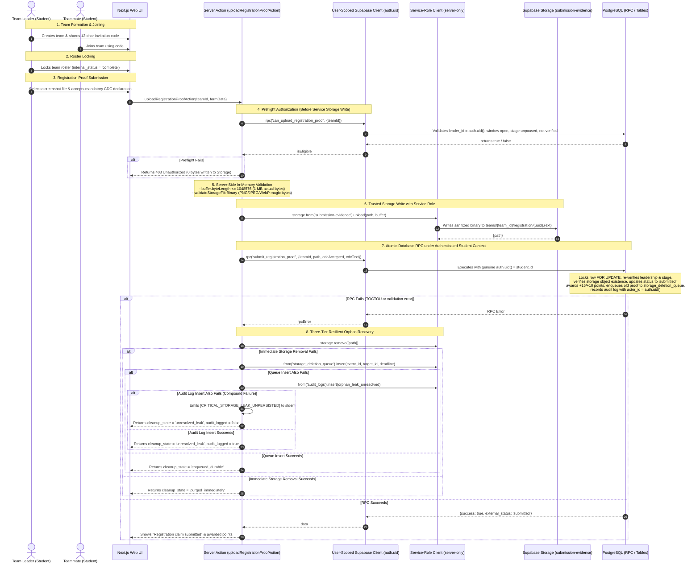
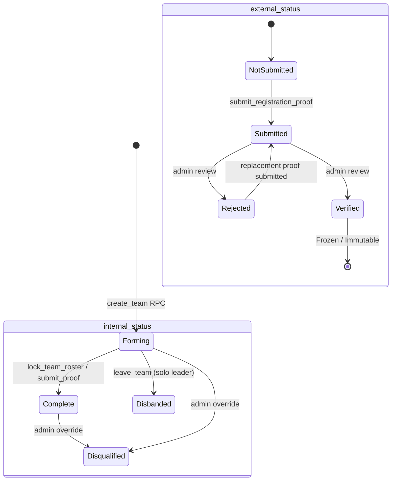
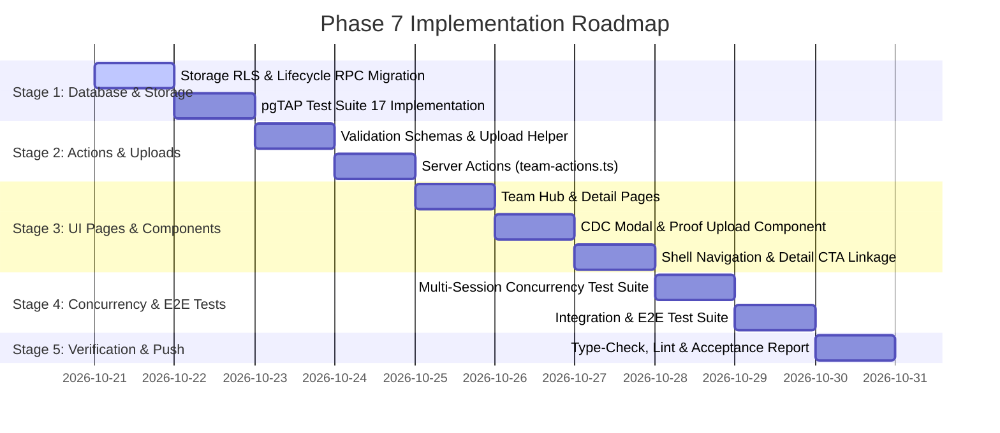

# NMIT HackLeague — Phase 7 Implementation Plan
## Team Formation and Registration: Architecture, Database, Lifecycle, Storage Security & UI Specification

**Document Version:** 1.6.0 (Final Recovery Boundary Check — Compound Persistence Failure, Unpersisted Leak Reporting & Residual Risk Specification)  
**Status:** DRAFT SPECIFICATION — PLANNING ONLY (IMPLEMENTATION UNSTARTED)  
**Branch:** `v1`  
**Repository Root:** `/Volumes/CodingVault/web/HackLeague`  
**Verified Git Commit Baseline:** `a105b81799aa6bead85006dc7b4cc7f7419d84a5`  
**Target Environment:** Next.js 16.4.0 (App Router), React 19.0.0, TypeScript 5.7.0, Tailwind CSS 4.0.0, Supabase PostgreSQL 17, Supabase Auth (GoTrue), Supabase Storage, Vercel  

---

## Document Revision History & Change Log

| Revision | Date | Context / Trigger | Summary of Corrections & Architectural Decisions |
| :--- | :--- | :--- | :--- |
| **1.0.0** | 2026-10-20 | Initial Phase 7 Master Plan | Initial roadmap covering student team creation, joining, roster locking, leadership transfer, registration proof with CDC declaration, and additive storage policies. |
| **1.1.0** | 2026-10-20 | Plan Review Corrections (Part 1) | Hardened storage policy with safe regex UUID parsing; scoped admin read permissions via `can_admin_manage_hackathon`; added solo leader disbanding via deferred circular FKs; enqueued superseded proofs into `storage_deletion_queue`. |
| **1.2.0** | 2026-10-20 | Deep Review Corrections | Hardened storage folder array depth validation (`array_length = 3`); enforced hackathon-scoped leader authorization; integrated paused-stage check (`round_number = 1` not paused/expired); documented schema invariants (`fk_points_ledger_team_member ON DELETE RESTRICT`, `trg_points_ledger_immutable`); expanded 11 explicit acceptance test cases. |
| **1.3.0** | 2026-10-20 | Final Authorization Review Corrections | Removed standalone `current_has_permission('export_data')` from `can_view_registration_proof()`. Eliminated direct client storage `INSERT` policy on `storage.objects` for registration proofs, establishing a server-mediated upload boundary. |
| **1.4.0** | 2026-10-20 | Upload Authorization Consistency & Client Separation | Separated Supabase client responsibilities: `userClient` preserves student `auth.uid()` for database RPC `submit_registration_proof`, while `adminClient` is restricted to Storage write and orphan purge. Enforced preflight authorization before storage write. |
| **1.5.0** | 2026-10-20 | Final Orphan-Recovery & Queue Schema Review | **1. Deletion Queue Schema & Dispatch Verification:** Verified that `public.storage_deletion_queue` uses `event_id` (not `hackathon_id`), `retention_deadline_at` (not `scheduled_purge_at`), and requires `target_id` to be castable to UUID for worker queries (`claim_storage_deletion_batch`). Confirmed that `target_type TEXT NOT NULL` supports `'orphaned_registration_proof'` and `'superseded_registration_proof'` without check constraint collisions, and is processed deterministically via Branch C of `complete_storage_deletion_job`.<br/>**2. Three-Tier Durable Failure Handling:** Formulated strict handling for when both immediate storage deletion and queue insertion fail. Prohibited falsely claiming recovery. Defined structured return `{ cleanup_state: 'unresolved_leak', unresolved_artifact: { ... } }`, emergency append-only audit logging (`action = 'storage.orphan_leak_unresolved'`), and UI operator escalation.<br/>**3. Preservation of Client Separation & Invariants:** Retained authenticated student `userClient` RPC execution, preflight authorization, and binary validation boundary.<br/>**4. Acceptance Test Expansion:** Added explicit test case `TEST-RECOV-01C` verifying that the system truthfully surfaces an unresolved cleanup state when both deletion and queue insertion fail.<br/>**5. Operator Intervention & Verified Existing Path:** Documented the verified operator remediation route leveraging existing infrastructure: querying `public.audit_logs`, safe re-enqueuing into `storage_deletion_queue`, worker processing via Branch C, and Super Admin resolution via existing `public.resolve_investigation_job`. |
| **1.6.0** | 2026-10-20 | Final Recovery Boundary Review | **1. Compound Persistence Failure Boundary:** Addressed the catastrophic case where immediate Storage removal, deletion queue insertion, AND emergency `audit_logs` insertion all fail. Specified that the system sets `audit_logged: false` in `unresolved_artifact` and NEVER claims the orphan was durably recorded or recovered.<br/>**2. Verified Process Logging Mechanism:** Documented that standard process logging (`console.error` to `stderr` stream) is the only verified alerting mechanism present in the repository (no external monitoring SDKs exist). Emits `[CRITICAL_STORAGE_LEAK_UNPERSISTED]` to `stderr` for runtime log-drain capture.<br/>**3. Explicit Residual Risk & Operational Limitation:** Formally documented that unpersisted leaks cannot be discovered via SQL queries (`SELECT FROM audit_logs`). Required operational handling dictates monitoring hosting runtime log streams for `[CRITICAL_STORAGE_LEAK_UNPERSISTED]` and manually re-injecting into `public.storage_deletion_queue` once database connectivity is restored.<br/>**4. Dedicated Acceptance Test (`TEST-RECOV-01D`):** Added explicit test verifying all three failure stages, non-durability reporting (`audit_logged = false`), runtime `stderr` alert emission, and UI operator banner. |

---

## 1. Purpose, Scope, and Completion Criteria

### 1.1 Purpose
This document establishes the authoritative, end-to-end implementation plan for **Phase 7 — Team Formation and Registration** of the NMIT HackLeague platform. It reconciles the verified architectural baseline, the readiness audit findings, and governing project rules (`rules.md`, `rules_updated.md`, and `hackleague_plan_updated.md`) into an executable, zero-regression roadmap.

### 1.2 Authoritative Roadmap Scope (from `hackleague_plan_updated.md` lines 190–227)
1. **Student Team Creation & Joining:**
   - Allow verified, approved students to create a team for a specific published hackathon within the open registration window.
   - Generate cryptographically secure, 12-character Crockford Base32 invitation codes.
   - Allow approved students to join an existing team using a valid, unexpired invitation code.
   - Enforce team capacity, eligibility, deadlines, and duplicate-membership constraints.
2. **One Team Per Student Per Hackathon:**
   - Strictly guarantee that a student belongs to at most one team per hackathon at the database engine level.
   - Support participation in different teams across different hackathons.
3. **Invitation Code Lifecycle & Team Management:**
   - Provide team hub at `/student/teams` and management console at `/student/teams/[id]`.
   - Allow authorized team leaders to lock rosters (`lock_team_roster`), transfer leadership (`transfer_team_leadership`), and regenerate invitation codes while forming.
   - Allow students to leave a team and leaders to remove members while in `forming` status before proof submission.
4. **Registration Proof Workflow & Mandatory CDC Declaration:**
   - Display official external registration URL configured for the hackathon.
   - Allow team leader to submit external registration screenshot and accept mandatory CDC disclaimer text.
   - Implement the approved no-mandatory-manual-review workflow for initial registration proof.
   - Truthfully present status as **“Registration claim submitted”** without false claims of external verification.
   - Idempotently award initial participation points (+15 leader, +10 member) via `public.points_ledger`.
   - Prevent resubmissions from overwriting or downgrading an already verified team.
5. **Storage Security & Retention Integration:**
   - Enforce an unbypassable, server-mediated upload boundary ensuring that every accepted screenshot undergoes actual byte-size validation and binary magic byte inspection.
   - Revoke direct client `INSERT` permissions on `storage.objects` for registration proofs, forcing uploads through the server action.
   - Authorize caller before writing to storage with service credentials; invoke downstream RPC through the authenticated user client preserving `auth.uid()`.
   - Support dedicated path `teams/{team_id}/registration/{uuid}.{ext}` with 1MB actual byte cap, binary inspection, and private signed preview URLs.
   - Integrate with `storage_deletion_queue` using verified schema fields (`event_id`, `retention_deadline_at`, UUID `target_id`) and resilient three-tier orphan recovery.
   - Schedule evidence retention and deletion at `hackathon_end_at + 7 days` via the existing Phase 6 deletion worker.

### 1.3 Completion Criteria
- **Invariants:** Database constraints strictly prevent double-joining or team capacity overflow under high concurrency.
- **Security:** RLS and RPCs strictly prevent unapproved students, non-leaders, unassigned admins, or expired/paused stages from mutating team rosters, accessing private evidence, or submitting claims.
- **Storage & Binary Integrity:** Registration screenshots upload through the server-mediated boundary, undergo genuine magic byte header validation and actual byte-length checks ($\le$ 1MB), and remain strictly private to authorized teammates and assigned in-charge administrators. Direct client Storage API uploads are rejected fail-closed.
- **Workflow:** End-to-end flow from hackathon discovery to team formation, roster lock, external link display, CDC declaration acceptance, screenshot upload, superseded file cleanup, and ledger point award operates seamlessly.
- **Quality Gates:** Zero TypeScript errors (`npm run type-check`), zero lint warnings (`npm run lint`), passing pgTAP suite (`17_ts_team_formation.sql`), passing integration tests (`tests/integration/team-formation-registration.test.ts`), and passing multi-session concurrency tests (`tests/concurrency/team-membership-concurrency.test.ts`).

---

## 2. Verified Repository Facts vs. Proposed Phase 7 Behavior

### 2.1 Confirmed Repository Facts (Current Baseline)
1. **Database Schema & Constraints:**
   - `public.teams` table exists (Migration 04) with `internal_status IN ('forming', 'complete', 'locked', 'disqualified')` and `external_status IN ('not_submitted', 'submitted', 'verified', 'rejected')`.
   - `public.team_members` table exists (Migration 04) with constraints:
     - `uq_team_members_one_team_per_hackathon UNIQUE (hackathon_id, student_id)` — strictly prevents double-joining in the same hackathon.
     - `uq_team_single_leader UNIQUE (team_id) WHERE (role = 'leader')` — guarantees exactly one leader per team.
     - `fk_team_members_team_composite FOREIGN KEY (team_id, hackathon_id) REFERENCES public.teams(id, hackathon_id) ON DELETE RESTRICT`.
   - Circular deferred foreign key `fk_teams_leader_member` (Migration 04) connects `teams(id, leader_id)` to `team_members(team_id, student_id)` as `DEFERRABLE INITIALLY DEFERRED`.
   - `public.points_ledger` table exists (Migration 06) with:
     - `CONSTRAINT fk_points_ledger_team_member FOREIGN KEY (team_id, student_id, hackathon_id) REFERENCES public.team_members(team_id, student_id, hackathon_id) ON DELETE RESTRICT`.
     - `CONSTRAINT chk_points_ledger_points CHECK (points <> 0)`.
     - `UNIQUE INDEX uq_points_ledger_participation ON public.points_ledger (student_id, hackathon_id) WHERE (milestone_type = 'participation')`.
     - Trigger `trg_points_ledger_immutable BEFORE UPDATE OR DELETE` strictly rejects any updates or deletions of ledger entries.
2. **Existing RPCs & Core Logic:**
   - Migration 10 provides `create_team`, `join_team_with_code`, `lock_team_roster`, and `transfer_team_leadership`.
   - Migration 18 provides `submit_registration_proof(p_team_id, p_proof_path, p_cdc_declaration_accepted, p_cdc_declaration_text)`. It uses `v_caller_id UUID := auth.uid();`, verifies `v_team.leader_id = v_caller_id`, locks the team row `FOR UPDATE`, validates CDC text, updates `external_status = 'submitted'`, and idempotently awards participation points (+15/+10).
   - Migration 18 grants execution `TO authenticated`. It explicitly expects an authenticated session context with `auth.uid()` populated.
   - Migration 18 provides `auto_pause_expired_rounds` and dynamic public view `hackathon_rounds_public_view` where expired rounds dynamically evaluate to `'paused'`.
   - Migration 18 provides `can_admin_manage_hackathon(p_hackathon_id, p_permission)` enforcing scoped admin authorization.
3. **Storage Engine & Retention Architecture Facts:**
   - Bucket `submission-evidence` is configured as private (Migration 09).
   - `storage.objects` table in PostgreSQL stores only file metadata (`name`, `bucket_id`, `metadata` JSONB); it does **not** store raw binary blobs in PostgreSQL. Consequently, database RLS policies cannot read file bytes to inspect magic byte signatures or verify true byte size independent of client-sent HTTP headers.
   - In Migration 15 (`20261015000001_phase4_revisions_and_push_gate.sql`), policy `submission_evidence_insert_member` explicitly permits only two path formats: `evidence/{hackathon_id}/{submission_id}/...` and `teams/{team_id}/rounds/{round_id}/...`. Direct uploads to `teams/{team_id}/registration/...` fail with 403 Forbidden.
   - Storage upload validator `validateStorageFileBinary()` exists in `src/lib/storage/paths.ts` and inspects genuine PNG/JPEG/WebP headers in Node.js buffers.
   - **`storage_deletion_queue` Schema Verification (Migrations 08 & 15):**
     - Table columns: `id`, `event_id` (UUID references `hackathons(id)` ON DELETE CASCADE; **there is no `hackathon_id` column**), `bucket_id` (TEXT), `object_path` (TEXT), `target_type` (TEXT), `target_id` (TEXT), `retention_deadline_at` (TIMESTAMPTZ; **there is no `scheduled_purge_at` column**), `status` (TEXT), `retry_count` (INT default 0), `max_retries` (INT default 5), `next_retry_at` (TIMESTAMPTZ default now()).
     - Target Type constraints: `target_type TEXT NOT NULL` has no restrictive check constraint. The queue already accepts types such as `'submission_evidence'`, `'profile_college_id'`, and `'registration_screenshot'` (Migration 17).
     - Worker casting requirement: `claim_storage_deletion_batch` casts `u.target_id::uuid`. Therefore, `target_id` must always be a valid UUID string (e.g. `teamId`).
     - Partial Unique Index: `uq_storage_queue_active_job ON (bucket_id, object_path) WHERE (status IN ('pending', 'claimed', 'dispatching', 'cooldown', 'reconciling', 'investigation_required'))`. Handled safely with `ON CONFLICT (bucket_id, object_path) WHERE (...) DO NOTHING`.
     - Worker dispatch logic (Migration 15 `complete_storage_deletion_job`): Branch C handles all target types other than `submission_evidence` and `profile_college_id`. When the worker dispatches HTTP DELETE to Storage, a 200/204 response completes the job (`PURGED_WORKER_CONFIRMED`). A failure marks the job as `investigation_required` (`UNCERTAIN_DISPATCH_FAILURE`), preserving an auditable trail.
     - Operator Investigation Resolution (Migration 15 `resolve_investigation_job`): Super Admins can replay stuck/failed jobs (`'REPLAY_PENDING'`) or resolve them (`'MARK_COMPLETED_CONFIRMED_ABSENT'`, `'MARK_FAILED_UNRECOVERABLE'`) with mandatory audit justification.

### 2.2 Proposed Phase 7 Behavior (Reconciled Architecture)
1. **Client Responsibility Separation & Preservation of Authenticated Identity:**
   - **`userClient` (`createClient()` from `@/lib/supabase/server`):**
     - Bound to student session cookies.
     - Carries the student's authenticated JWT; `auth.uid()` evaluates to the student's ID.
     - Executes the preflight authorization check (`can_upload_registration_proof`).
     - Invokes the database RPC `submit_registration_proof` so PostgreSQL's native `auth.uid()` checks and audit log tracking represent the genuine student.
   - **`adminClient` (`createAdminClient()` from `@/lib/supabase/admin`):**
     - Uses `SUPABASE_SERVICE_ROLE_KEY` in server-only code.
     - Strictly restricted to writing validated binaries to the private storage bucket where direct client `INSERT` is revoked.
     - Performs immediate orphan removal or enqueues failed cleanups into `storage_deletion_queue`.
     - **Never** used to invoke `submit_registration_proof` or bypass student authentication.
2. **Preflight Authorization Before Service Storage Writes:**
   - Before uploading any file to storage using service credentials, the Server Action invokes `can_upload_registration_proof(teamId)` using `userClient`.
   - Rejects immediately fail-closed if the caller is not the team leader, if the registration window is closed, if Round 1 is paused, or if the team is verified. Zero bytes are written to storage.
   - Defense-in-depth: `submit_registration_proof` retains its own strict `FOR UPDATE` transactional row lock and re-validates all rules to eliminate TOCTOU race conditions.
3. **Enforceable Binary Validation & Three-Tier Resilient Orphan Recovery:**
   - Client roles (`authenticated`, `anon`) have zero direct `INSERT` permissions on `storage.objects` for `teams/{team_id}/registration/` paths.
   - In-memory actual byte length ($\le$ 1MB) and binary magic byte inspection (PNG, JPEG, WebP) are enforced on the server before upload.
   - **Three-Tier Orphan Cleanup:**
     - *Tier 1 (Immediate Storage Purge):* Attempts `adminClient.storage.from('submission-evidence').remove([objectPath])`.
     - *Tier 2 (Durable Queue Fallback):* If immediate purge fails, inserts an active cleanup job into `public.storage_deletion_queue` using schema-verified fields (`event_id: hackathonId, target_id: teamId, target_type: 'orphaned_registration_proof', retention_deadline_at: now()`).
     - *Tier 3 (Incident Escalation for Unresolved Leaks & Compound Failure Boundary):* If both Tier 1 and Tier 2 fail, the action does **not** claim recovery. It attempts an emergency append-only audit log (`action = 'storage.orphan_leak_unresolved'`). If audit log insertion also fails (compound infrastructure outage), the action sets `audit_logged: false`, emits structured alert `[CRITICAL_STORAGE_LEAK_UNPERSISTED]` to the server `stderr` stream (the only verified runtime logging channel in the repo), and surfaces the unpersisted leak to the caller. The plan explicitly acknowledges that unpersisted leaks cannot be recovered via database audit queries and require operational log-drain inspection.
4. **Private Evidence Authorization Hardening:**
   - Helper function `can_view_registration_proof(p_team_id_text TEXT)` limits private screenshot access exclusively to enrolled team members (`current_is_team_member`) and assigned in-charge administrators / Super Admins (`can_admin_manage_hackathon(t.hackathon_id, 'manage_teams')`).
   - The standalone `export_data` allowance is removed.
5. **Lifecycle RPCs with Historical Integrity:**
   - Add `leave_team` supporting safe non-leader departure and atomic solo leader disbanding via deferred circular constraints.
   - Add `remove_team_member` and `regenerate_team_invitation_code`.
   - Strictly block member leave/remove operations once registration proof has been submitted (`external_status != 'not_submitted'`), preserving `fk_points_ledger_team_member ON DELETE RESTRICT`.

---

## 3. Requirements Traceability Matrix

| Requirement | Governing Rule | Existing Code (Baseline) | Planned Phase 7 Implementation | Planned Verification Test |
| :--- | :--- | :--- | :--- | :--- |
| **One team per hackathon** | `rules_updated.md` L281 | `uq_team_members_one_team_per_hackathon` | Reuse existing constraint | `TEST-CONC-02` Multi-session race test |
| **Cross-hackathon teams** | `rules_updated.md` L282 | `team_members(hackathon_id)` | Allow team creation in separate events | `TEST-LIFE-05` Student in Hackathons A & B |
| **Unguessable invitation codes** | `rules_updated.md` L287 | `gen_random_bytes(12)` in `create_team` | Reuse Crockford Base32 generator | `TS-TEAM-01` Entropy & uniqueness test |
| **Code regeneration while forming** | `hackleague_plan_updated.md` L195 | None | Add `regenerate_team_invitation_code` RPC | `TEST-LIFE-06` Old code fails, new code succeeds |
| **Member leave & removal** | Phase 7 Requirement 2 | None | Add `leave_team` & `remove_team_member` RPCs | `TEST-LIFE-01` Blocked after proof; allowed while forming |
| **Solo leader disbanding** | Phase 7 Requirement 2 | None | Atomic disband in `leave_team` with deferred FK | `TEST-LIFE-04` Solo leader disbands team cleanly |
| **Solo participation support** | `rules_updated.md` L212 | `chk_hackathons_team_size`, RPC size checks | Enforce `min_team_size = 1` for solo | `TEST-LIFE-07` Solo team creates, locks, submits |
| **External registration URL** | `hackleague_plan_updated.md` L203 | `hackathons_public_view.external_registration_url` | Render in detail page & team console | `TEST-UI-01` UI render test & link target check |
| **Mandatory CDC declaration** | `rules_updated.md` L318 | `submit_registration_proof` | Render exact text & required checkbox in UI | `TEST-PROOF-01` Rejection test if modified/unchecked |
| **No mandatory manual review** | `rules_updated.md` L326 | `submit_registration_proof` sets `submitted` | UI displays "Registration claim submitted" | `TEST-PROOF-02` Status verified as submitted |
| **Idempotent points award** | `rules_updated.md` L417 | `points_ledger` idempotency key | Reuse key `participation_{h_id}_{s_id}` | `TEST-CONC-01` Concurrent proof race test |
| **Verified status freeze** | Phase 7 Requirement 3 | Defective in Migration 18 | Add check rejecting resubmission if status is `verified` | `TEST-SEC-03` Verified replacement fails |
| **Superseded evidence cleanup** | Phase 7 Requirement 3 | `storage_deletion_queue` | Enqueue old path to retention queue (`event_id`, `retention_deadline_at`) | `TEST-RECOV-02` Queue insertion assertion |
| **Preflight Upload Authorization** | Review Requirement 2 | None | Validate eligibility with `userClient` before storage write | `TEST-AUTH-01` Preflight rejects unauthorized write |
| **Preserve Authenticated Identity** | Review Requirement 1 | Defective in v1.3.0 | Invoke RPC via `userClient`; preserve `auth.uid()` | `TEST-AUTH-02` Authenticated student identity assertion |
| **Three-Tier Resilient Orphan Recovery** | Final Orphan Review | Partial | Immediate purge, durable queue fallback, emergency leak escalation | `TEST-RECOV-01A`, `01B`, `01C` Recovery tests |
| **Compound Persistence Failure Handling** | Final Recovery Boundary Review | None | Report unpersisted leak (`audit_logged: false`), emit `stderr` alert, document residual risk | `TEST-RECOV-01D` Compound failure test |
| **Enforceable Binary Validation** | Finding 2 | Defective in v1.2.0 | Server upload boundary; no client INSERT; buffer inspection | `TEST-BIN-01` to `TEST-BIN-05` Binary tests |
| **Scoped Admin evidence access** | Finding 1 (`rules_updated.md` L120) | Standalone export_data allowance | `can_view_registration_proof` without `export_data` | `TEST-SEC-01B` Unassigned admin with export_data denied |
| **Student team console UI** | Phase 7 Requirement 4 | None | Create `/student/teams` and `/student/teams/[id]` | `TEST-UI-02` E2E browser & component test |

---

## 4. Current Architecture and End-to-End Target Flow

### 4.1 Target User Journey Flow



---

## 5. Database, RPC, RLS, and Storage Design

### 5.1 Additive SQL Migration
**File:** `supabase/migrations/20261020000001_phase7_team_formation_and_registration.sql` (Migration 19).

#### A. Helper Function: `can_upload_registration_proof(p_team_id_text TEXT)`
- **Purpose:** Centralizes path validation, safe regex UUID parsing, leader authorization, hackathon status checks, deadline verification, paused-stage enforcement, and verified-freeze checking.
- **Execution Context:** Invoked via `userClient.rpc('can_upload_registration_proof', ...)` by the server action as the preflight authorization gate before invoking service storage credentials.
- **Security:** `SECURITY DEFINER STABLE SET search_path = public, pg_temp`.
- **Implementation:**
  ```sql
  CREATE OR REPLACE FUNCTION public.can_upload_registration_proof(p_team_id_text TEXT)
  RETURNS BOOLEAN AS $$
  DECLARE
    v_team_id UUID;
  BEGIN
    -- Safe regex UUID check prevents runtime 22P02 syntax cast crashes on malformed paths
    IF p_team_id_text IS NULL OR p_team_id_text !~* '^[0-9a-f]{8}-[0-9a-f]{4}-[0-9a-f]{4}-[0-9a-f]{4}-[0-9a-f]{12}$' THEN
      RETURN false;
    END IF;
    v_team_id := p_team_id_text::uuid;

    RETURN EXISTS (
      SELECT 1 FROM public.teams t
      JOIN public.hackathons h ON h.id = t.hackathon_id
      WHERE t.id = v_team_id
        AND t.leader_id = auth.uid()
        AND h.status IN ('published', 'ongoing')
        AND now() >= h.registration_start_at
        AND now() <= h.registration_end_at
        AND t.external_status <> 'verified'
        -- Lifecycle consistency: block uploads if Round 1 / registration stage is paused or expired
        AND NOT EXISTS (
          SELECT 1 FROM public.hackathon_rounds r
          WHERE r.hackathon_id = h.id
            AND r.round_number = 1
            AND (r.status = 'paused' OR (r.status = 'open' AND r.end_at <= now()))
        )
    );
  END;
  $$ LANGUAGE plpgsql STABLE SECURITY DEFINER SET search_path = public, pg_temp;

  REVOKE ALL ON FUNCTION public.can_upload_registration_proof(TEXT) FROM PUBLIC, anon;
  GRANT EXECUTE ON FUNCTION public.can_upload_registration_proof(TEXT) TO authenticated;
  ```

#### B. Helper Function: `can_view_registration_proof(p_team_id_text TEXT)`
- **Purpose:** Enforces scoped private reading of registration evidence for authorized teammates, assigned in-charge administrators, and Super Admins.
- **Security:** `SECURITY DEFINER STABLE SET search_path = public, pg_temp`.
- **Implementation:**
  ```sql
  CREATE OR REPLACE FUNCTION public.can_view_registration_proof(p_team_id_text TEXT)
  RETURNS BOOLEAN AS $$
  DECLARE
    v_team_id UUID;
  BEGIN
    IF p_team_id_text IS NULL OR p_team_id_text !~* '^[0-9a-f]{8}-[0-9a-f]{4}-[0-9a-f]{4}-[0-9a-f]{4}-[0-9a-f]{12}$' THEN
      RETURN false;
    END IF;
    v_team_id := p_team_id_text::uuid;

    RETURN (
      -- 1. Enrolled team members of this specific team
      public.current_is_team_member(v_team_id) OR
      -- 2. Super Admin or Assigned In-Charge Admin for this specific hackathon
      EXISTS (
        SELECT 1 FROM public.teams t
        WHERE t.id = v_team_id
          AND public.can_admin_manage_hackathon(t.hackathon_id, 'manage_teams')
      )
    );
  END;
  $$ LANGUAGE plpgsql STABLE SECURITY DEFINER SET search_path = public, pg_temp;

  REVOKE ALL ON FUNCTION public.can_view_registration_proof(TEXT) FROM PUBLIC, anon;
  GRANT EXECUTE ON FUNCTION public.can_view_registration_proof(TEXT) TO authenticated;
  ```

#### C. Storage RLS Policies on `storage.objects` for `submission-evidence`
- **Zero Direct Client `INSERT` Policy:**
  - Client roles (`authenticated`, `anon`) have zero direct `INSERT` permissions on `teams/{team_id}/registration/` paths. Direct client Storage API uploads are rejected with `403 Forbidden`.
  - All uploads must be mediated by the server action using the server-only service-role client.
- **SELECT Policy (Private Read):**
  - Enables enrolled teammates and assigned administrators to generate short-lived signed URLs:
  ```sql
  DROP POLICY IF EXISTS "submission_evidence_select_registration_proof" ON storage.objects;
  CREATE POLICY "submission_evidence_select_registration_proof" ON storage.objects
  FOR SELECT TO authenticated
  USING (
    bucket_id = 'submission-evidence' AND
    array_length(storage.foldername(name), 1) = 3 AND
    (storage.foldername(name))[1] = 'teams' AND
    (storage.foldername(name))[3] = 'registration' AND
    public.can_view_registration_proof((storage.foldername(name))[2])
  );
  ```
- **UPDATE & DELETE Policies:** Strictly revoked from client roles.

#### D. New RPC: `leave_team(p_team_id UUID)`
- **Purpose:** Allows a non-leader member to leave a forming team, or a solo leader to disband a forming team cleanly.
- **Security:** `SECURITY DEFINER SET search_path = public, pg_temp`.
- **Invariants Enforced:**
  1. Caller must be an enrolled member in `public.team_members`.
  2. Team must be in `internal_status = 'forming'` and `external_status = 'not_submitted'`. If proof has been submitted, **rejects fail-closed** to protect points ledger integrity (`fk_points_ledger_team_member ON DELETE RESTRICT`).
  3. Hackathon must be active (`status IN ('published', 'ongoing')` and `now() <= registration_end_at`).
  4. If caller is leader and other members exist: **Rejects fail-closed** (`'Team leader cannot leave a multi-member team without transferring leadership first.'`).
  5. If caller is solo leader (member count = 1): Disbands team atomically using deferred foreign key constraint:
     ```sql
     SET CONSTRAINTS fk_teams_leader_member DEFERRED;
     DELETE FROM public.team_members WHERE team_id = p_team_id;
     DELETE FROM public.teams WHERE id = p_team_id;
     ```
     Logs audit entry: `action = 'team.disbanded'`.
  6. If caller is non-leader member: Deletes membership from `public.team_members`. Logs audit entry: `action = 'team.member_left'`.

#### E. New RPC: `remove_team_member(p_team_id UUID, p_student_id UUID)`
- **Purpose:** Allows a team leader to remove an unconfirmed member before the team roster is finalized.
- **Security:** `SECURITY DEFINER SET search_path = public, pg_temp`.
- **Invariants Enforced:**
  1. Caller must be the team leader (`teams.leader_id = auth.uid()`).
  2. Target student must be an enrolled member with `role = 'member'`.
  3. Team must be in `internal_status = 'forming'` and `external_status = 'not_submitted'`.
  4. Target student cannot have awarded points in `public.points_ledger`.
  5. Deletes row from `public.team_members`. Logs audit entry: `action = 'team.member_removed'`.

#### F. New RPC: `regenerate_team_invitation_code(p_team_id UUID)`
- **Purpose:** Generates a new 12-character Crockford Base32 invitation code, immediately invalidating the previous code.
- **Security:** `SECURITY DEFINER SET search_path = public, pg_temp`.
- **Invariants Enforced:**
  1. Caller must be the team leader or Super Admin.
  2. Team must be in `internal_status = 'forming'` and `external_status = 'not_submitted'`.
  3. Generates new code using `extensions.gen_random_bytes(12)` in a collision-retry loop.
  4. Resets `invitation_code_expires_at = now() + interval '7 days'`.
  5. Updates `public.teams` and logs audit entry: `action = 'team.invitation_code_regenerated'`.
  6. Returns new code.

#### G. Hardened RPC: `submit_registration_proof`
- **Execution Context & Authorization:**
  - Must be called via the **user-scoped client** (`userClient.rpc(...)`), ensuring `auth.uid()` evaluates to the student's ID.
  - Verification: `IF v_team.leader_id <> v_caller_id THEN RAISE EXCEPTION 'Access denied: only the team leader can submit registration proof.'; END IF;`.
  - Audit logging: records `actor_id = v_caller_id` (`auth.uid()`) and `actor_role = 'student'`.
- **Amendments to Migration 18 Implementation:**
  1. **Storage Object Existence Check:** Verifies that `p_proof_path` strictly matches `^teams/' || p_team_id::text || '/registration/[0-9a-f]{8}-[0-9a-f]{4}-[0-9a-f]{4}-[0-9a-f]{4}-[0-9a-f]{12}\.(jpg|jpeg|png|webp)$'` AND actually exists in `storage.objects` for bucket `'submission-evidence'`.
  2. **Verified Status Protection:** Rejects resubmission if `v_team.external_status = 'verified'` fail-closed:
     ```sql
     IF v_team.external_status = 'verified' THEN
       RAISE EXCEPTION 'Cannot modify registration proof: team has already been verified by an administrator.';
     END IF;
     ```
  3. **Paused Stage Check:** Rejects submission if Round 1 / registration stage is paused or expired:
     ```sql
     IF EXISTS (
       SELECT 1 FROM public.hackathon_rounds r
       WHERE r.hackathon_id = v_team.hackathon_id
         AND r.round_number = 1
         AND (r.status = 'paused' OR (r.status = 'open' AND r.end_at <= now()))
     ) THEN
       RAISE EXCEPTION 'Cannot submit registration proof: registration stage is currently paused.';
     END IF;
     ```
  4. **Cleanup Superseded Evidence (Using Verified Schema Fields):** If `v_team.external_proof_path IS NOT NULL` and differs from `trim(p_proof_path)`, automatically enqueues the superseded proof path into `public.storage_deletion_queue` using verified columns (`event_id`, `retention_deadline_at`, and UUID `target_id`):
     ```sql
     IF v_team.external_proof_path IS NOT NULL AND v_team.external_proof_path <> trim(p_proof_path) THEN
       INSERT INTO public.storage_deletion_queue (
         event_id,
         bucket_id,
         object_path,
         target_type,
         target_id,
         status,
         retention_deadline_at
       ) VALUES (
         v_team.hackathon_id,
         'submission-evidence',
         v_team.external_proof_path,
         'superseded_registration_proof',
         v_team.id::text,
         'pending',
         now() + interval '1 day'
       )
       ON CONFLICT (bucket_id, object_path)
       WHERE (status IN ('pending', 'claimed', 'dispatching', 'cooldown', 'reconciling', 'investigation_required'))
       DO NOTHING;
     END IF;
     ```
  5. **Strict Row Locking:** Preserves `FOR UPDATE` row lock on `public.teams` to serialize concurrent submissions and eliminate TOCTOU race conditions.
  6. **Idempotent Points Ledger Insertion:** Preserves `ON CONFLICT (idempotency_key) DO NOTHING;` to ensure duplicate submissions do not award excess points.

#### H. Hardened RPC: `lock_team_roster`
- **Amendments to Migration 10 Implementation:**
  1. Enforces registration window: `IF v_hackathon.status NOT IN ('published', 'ongoing') OR now() > v_hackathon.registration_end_at THEN RAISE EXCEPTION 'Registration window is closed.'; END IF;`.
  2. Enforces paused-stage check: Rejects roster locking if Round 1 / registration stage is paused.

---

## 6. Server Action and Validation Design

### 6.1 Validation Schemas (`src/lib/validation/team-schemas.ts`)
```typescript
import { z } from 'zod';

export const createTeamSchema = z.object({
  hackathonId: z.string().uuid('Invalid hackathon ID format'),
  teamName: z
    .string()
    .trim()
    .min(2, 'Team name must be at least 2 characters')
    .max(50, 'Team name cannot exceed 50 characters')
    .regex(/^[a-zA-Z0-9\s._-]+$/, 'Team name contains invalid characters'),
});

export const joinTeamSchema = z.object({
  invitationCode: z
    .string()
    .trim()
    .length(12, 'Invitation code must be exactly 12 characters')
    .regex(/^[23456789ABCDEFGHJKLMNPQRSTUVWXYZ]+$/i, 'Invalid invitation code characters'),
});

export const transferLeadershipSchema = z.object({
  teamId: z.string().uuid(),
  newLeaderId: z.string().uuid(),
});

export const memberActionSchema = z.object({
  teamId: z.string().uuid(),
  studentId: z.string().uuid().optional(),
});

export const submitRegistrationProofSchema = z.object({
  teamId: z.string().uuid(),
  cdcAccepted: z.literal(true, {
    errorMap: () => ({ message: 'You must accept the mandatory CDC declaration' }),
  }),
});
```

### 6.2 Server Actions (`src/actions/team-actions.ts`)
All actions run in `'use server'`, execute `await requireApprovedStudent()`, validate payloads against Zod schemas, invoke Supabase RPCs via authenticated server client, trigger path revalidation, and return structured union results:

1. `createTeamAction(formData: FormData)` -> creates team, redirects to `/student/teams/[id]`.
2. `joinTeamAction(invitationCode: string)` -> joins team, revalidates `/student/teams`.
3. `lockTeamRosterAction(teamId: string)` -> locks roster, transitions status to `complete`.
4. `transferTeamLeadershipAction(teamId: string, newLeaderId: string)` -> swaps roles atomically.
5. `leaveTeamAction(teamId: string)` -> removes member or disbands team if solo.
6. `removeTeamMemberAction(teamId: string, studentId: string)` -> leader removes unconfirmed member.
7. `regenerateInvitationCodeAction(teamId: string)` -> generates new code.
8. `getMyTeamsAction()` -> queries active teams with hackathon metadata and member roles.
9. `getTeamDetailsAction(teamId: string)` -> fetches complete team roster, leader status, CDC state.
10. `uploadRegistrationProofAction(teamId: string, formData: FormData)` -> coordinates preflight authorization, binary inspection, service storage write, authenticated RPC execution, and three-tier orphan recovery.

### 6.3 Dual-Client Separation & Three-Tier Orphan Recovery (`src/lib/storage/upload-service.ts`)
The server-mediated upload boundary strictly separates client responsibilities:
- `userClient` (`createClient()` from `@/lib/supabase/server`): executes preflight checks and the database RPC preserving `auth.uid()`.
- `adminClient` (`createAdminClient()` from `@/lib/supabase/admin`): restricted to the Storage bucket write and orphan recovery operations.

```typescript
import { createClient } from '@/lib/supabase/server';
import { createAdminClient } from '@/lib/supabase/admin';
import { validateStorageFileBinary } from '@/lib/storage/paths';
import { requireApprovedStudent } from '@/lib/auth/session';

export type UploadRegistrationProofResult =
  | { success: true; external_status: string; path: string }
  | {
      success: false;
      error: string;
      cleanup_state: 'purged_immediately' | 'enqueued_durable' | 'unresolved_leak';
      unresolved_artifact?: {
        bucket: string;
        path: string;
        team_id: string;
        event_id?: string;
        storage_error?: string;
        queue_error?: string;
        audit_logged: boolean;
        audit_error?: string;
      };
    };

export async function uploadRegistrationProofScreenshot(
  teamId: string,
  file: File,
  cdcAccepted: boolean,
  cdcDeclarationText: string
): Promise<UploadRegistrationProofResult> {
  // 1. Authenticate caller session
  const student = await requireApprovedStudent();

  // 2. Validate payload types
  if (!file || !(file instanceof File)) {
    return { success: false, error: 'A valid screenshot file is required.', cleanup_state: 'purged_immediately' };
  }

  // 3. User-Scoped Client: Preflight Authorization Gate
  // Executes under the authenticated student's session (auth.uid() = student.id)
  const userClient = await createClient();

  // Checks: leader_id = auth.uid(), hackathon open, stage unpaused, team unverified
  const { data: isEligible, error: authCheckErr } = await userClient.rpc('can_upload_registration_proof', {
    p_team_id_text: teamId,
  });

  if (authCheckErr || !isEligible) {
    return {
      success: false,
      error: 'Unauthorized: caller is not the team leader, registration is closed or paused, or team is already verified.',
      cleanup_state: 'purged_immediately',
    };
  }

  // Fetch event_id (hackathon_id) under userClient for deletion queue foreign key linkage
  const { data: teamData } = await userClient
    .from('teams')
    .select('hackathon_id')
    .eq('id', teamId)
    .single();

  const hackathonId = teamData?.hackathon_id;

  // 4. In-Memory Byte Length Validation (1 MB = 1,048,576 bytes)
  const arrayBuffer = await file.arrayBuffer();
  const buffer = Buffer.from(arrayBuffer);

  if (buffer.byteLength > 1048576) {
    return {
      success: false,
      error: 'File size exceeds the 1 MB limit (actual: ' + buffer.byteLength + ' bytes).',
      cleanup_state: 'purged_immediately',
    };
  }

  // 5. In-Memory Binary Magic Byte Validation
  // Rejects SVG, executables, scripts, polyglots, and corrupted binaries
  const binaryCheck = validateStorageFileBinary(buffer, 'submission-evidence');
  if (!binaryCheck.valid) {
    return {
      success: false,
      error: 'Invalid file format: contents do not match genuine PNG, JPEG, or WebP binary signatures.',
      cleanup_state: 'purged_immediately',
    };
  }

  const ext = binaryCheck.detectedExtension || 'png';
  const objectPath = `teams/${teamId}/registration/${crypto.randomUUID()}.${ext}`;

  // 6. Service-Role Storage Write (Restricted strictly to Storage)
  // Direct client Storage INSERT is revoked, making this server boundary unbypassable.
  const adminClient = createAdminClient();
  const { error: uploadError } = await adminClient.storage
    .from('submission-evidence')
    .upload(objectPath, buffer, {
      contentType: binaryCheck.detectedMime,
      upsert: false,
    });

  if (uploadError) {
    return { success: false, error: 'Storage upload failed: ' + uploadError.message, cleanup_state: 'purged_immediately' };
  }

  // 7. Atomic Database RPC under Authenticated Student Context
  // Invoked via userClient so auth.uid() in PostgreSQL represents the genuine student,
  // validating leadership, acquiring FOR UPDATE row lock, and auditing actor_id = student.id.
  try {
    const { data, error: rpcError } = await userClient.rpc('submit_registration_proof', {
      p_team_id: teamId,
      p_proof_path: objectPath,
      p_cdc_declaration_accepted: cdcAccepted,
      p_cdc_declaration_text: cdcDeclarationText,
    });

    if (rpcError) {
      // 8. Three-Tier Resilient Orphan Recovery
      const cleanupResult = await executeThreeTierOrphanRecovery(
        adminClient,
        student.id,
        hackathonId,
        teamId,
        objectPath
      );

      return {
        success: false,
        error: rpcError.message,
        cleanup_state: cleanupResult.cleanup_state,
        unresolved_artifact: cleanupResult.unresolved_artifact,
      };
    }

    return { success: true, external_status: data?.external_status || 'submitted', path: objectPath };
  } catch (err: any) {
    // Purge on unexpected throw
    const cleanupResult = await executeThreeTierOrphanRecovery(
      adminClient,
      student.id,
      hackathonId,
      teamId,
      objectPath
    );

    return {
      success: false,
      error: err.message || 'An unexpected error occurred during submission.',
      cleanup_state: cleanupResult.cleanup_state,
      unresolved_artifact: cleanupResult.unresolved_artifact,
    };
  }
}

/**
 * Three-Tier Resilient Orphan Recovery:
 * Tier 1: Immediate Storage Purge via adminClient.storage.remove().
 * Tier 2: Durable Queue Fallback via public.storage_deletion_queue insert.
 * Tier 3: Emergency Incident Escalation: immutable audit log, structured critical alert,
 *         and structured return preventing silent failure masking.
 */
async function executeThreeTierOrphanRecovery(
  adminClient: ReturnType<typeof createAdminClient>,
  studentId: string,
  hackathonId: string | undefined,
  teamId: string,
  objectPath: string
): Promise<{
  cleanup_state: 'purged_immediately' | 'enqueued_durable' | 'unresolved_leak';
  unresolved_artifact?: {
    bucket: string;
    path: string;
    team_id: string;
    event_id?: string;
    storage_error?: string;
    queue_error?: string;
    audit_logged: boolean;
    audit_error?: string;
  };
}> {
  let storageErrMessage: string | undefined;
  let queueErrMessage: string | undefined;

  // Tier 1: Immediate storage removal
  try {
    const { error: removeErr } = await adminClient.storage
      .from('submission-evidence')
      .remove([objectPath]);

    if (!removeErr) {
      return { cleanup_state: 'purged_immediately' };
    }
    storageErrMessage = removeErr.message;
  } catch (err: any) {
    storageErrMessage = err.message || 'Storage removal call threw';
  }

  // Tier 2: Durable queue fallback (using verified schema columns: event_id, retention_deadline_at)
  try {
    const { error: queueErr } = await adminClient.from('storage_deletion_queue').insert({
      event_id: hackathonId,
      bucket_id: 'submission-evidence',
      object_path: objectPath,
      target_type: 'orphaned_registration_proof',
      target_id: teamId, // Valid UUID string required by worker casting
      status: 'pending',
      retention_deadline_at: new Date().toISOString(),
      next_retry_at: new Date().toISOString(),
    });

    if (!queueErr) {
      return { cleanup_state: 'enqueued_durable' };
    }
    queueErrMessage = queueErr.message;
  } catch (err: any) {
    queueErrMessage = err.message || 'Queue insertion threw';
  }

  // Tier 3: Emergency incident escalation for unresolved leak
  console.error('[CRITICAL_STORAGE_LEAK_UNRESOLVED]', {
    bucket: 'submission-evidence',
    object_path: objectPath,
    team_id: teamId,
    event_id: hackathonId,
    storage_error: storageErrMessage,
    queue_error: queueErrMessage,
  });

  // Attempt emergency append-only audit log entry
  let auditLogged = false;
  let auditErrMessage: string | undefined;
  try {
    const { error: auditErr } = await adminClient.from('audit_logs').insert({
      actor_id: studentId,
      actor_role: 'system_recovery',
      action: 'storage.orphan_leak_unresolved',
      target_type: 'storage_object',
      target_id: teamId,
      details: {
        bucket_id: 'submission-evidence',
        object_path: objectPath,
        team_id: teamId,
        event_id: hackathonId,
        storage_error: storageErrMessage,
        queue_error: queueErrMessage,
        alert_level: 'CRITICAL',
        timestamp: new Date().toISOString(),
      },
    });

    if (!auditErr) {
      auditLogged = true;
    } else {
      auditErrMessage = auditErr.message;
      // Compound Persistence Failure: Storage removal, deletion queue, AND audit log all failed.
      // Emit structured unpersisted alert to stderr (the verified runtime process logging channel).
      console.error('[CRITICAL_STORAGE_LEAK_UNPERSISTED] Emergency audit log insert failed:', {
        object_path: objectPath,
        team_id: teamId,
        storage_error: storageErrMessage,
        queue_error: queueErrMessage,
        audit_error: auditErrMessage,
      });
    }
  } catch (auditErr: any) {
    auditErrMessage = auditErr.message || 'Audit insert threw';
    console.error('[CRITICAL_STORAGE_LEAK_UNPERSISTED] Emergency audit log insert threw:', {
      object_path: objectPath,
      team_id: teamId,
      storage_error: storageErrMessage,
      queue_error: queueErrMessage,
      audit_error: auditErrMessage,
    });
  }

  // Return explicit unresolved leak state so caller and UI never mask failure
  // or claim that the orphan was durably recorded when database writes failed
  return {
    cleanup_state: 'unresolved_leak',
    unresolved_artifact: {
      bucket: 'submission-evidence',
      path: objectPath,
      team_id: teamId,
      event_id: hackathonId,
      storage_error: storageErrMessage,
      queue_error: queueErrMessage,
      audit_logged: auditLogged,
      audit_error: auditErrMessage,
    },
  };
}
```

### 6.4 Operator Intervention and Recovery Workflow for Unresolved Leaks (Verified Existing Mechanisms)
When both immediate deletion (Tier 1) and queue insertion (Tier 2) fail, the system must never claim cleanup succeeded. The failure is handled through an auditable, durable path leveraging existing platform infrastructure:

1. **Surfacing the Unresolved Object:**
   - **User / Action Boundary:** `uploadRegistrationProofScreenshot` immediately returns `{ success: false, error: rpcError.message, cleanup_state: 'unresolved_leak', unresolved_artifact: { bucket, path, team_id, event_id, storage_error, queue_error } }`.
   - **UI Feedback:** The client component surfaces an explicit alert banner informing the team leader that proof submission failed and cleanup could not be confirmed, displaying the incident artifact reference ID without claiming recovery.
   - **Observability:** Logs a high-priority structured error `[CRITICAL_STORAGE_LEAK_UNRESOLVED]` containing all artifact coordinates.
   - **Immutable Audit Trail:** An append-only audit log entry is written to `public.audit_logs`:
     ```typescript
     await adminClient.from('audit_logs').insert({
       actor_id: studentId,
       actor_role: 'system_recovery',
       action: 'storage.orphan_leak_unresolved',
       target_type: 'storage_object',
       target_id: teamId,
       details: {
         bucket_id: 'submission-evidence',
         object_path: objectPath,
         team_id: teamId,
         event_id: hackathonId,
         storage_error: storageErrMessage,
         queue_error: queueErrMessage,
         alert_level: 'CRITICAL',
         timestamp: new Date().toISOString(),
       },
     });
     ```

2. **Operator Remediation via Existing Queue Worker:**
   - Platform operators or Super Admins query unresolved storage leaks:
     ```sql
     SELECT id, created_at, actor_id, details
     FROM public.audit_logs
     WHERE action = 'storage.orphan_leak_unresolved'
     ORDER BY created_at DESC;
     ```
   - **Safe Durable Re-enqueueing:** The operator (or an automated reconciliation script) re-enqueues the leaked object into `public.storage_deletion_queue` using verified schema columns:
     ```sql
     INSERT INTO public.storage_deletion_queue (
       event_id,
       bucket_id,
       object_path,
       target_type,
       target_id,
       status,
       retention_deadline_at
     ) VALUES (
       (audit_record.details->>'event_id')::uuid,
       'submission-evidence',
       audit_record.details->>'object_path',
       'orphaned_registration_proof',
       audit_record.details->>'team_id',
       'pending',
       now()
     )
     ON CONFLICT (bucket_id, object_path)
     WHERE (status IN ('pending', 'claimed', 'dispatching', 'cooldown', 'reconciling', 'investigation_required'))
     DO NOTHING;
     ```
   - **Existing Worker Dispatch (Branch C):** The existing Phase 6 deletion worker automatically leases the job via `claim_storage_deletion_batch` and dispatches HTTP DELETE to Storage. On HTTP 200/204, `complete_storage_deletion_job` marks the job as `completed` (`PURGED_WORKER_CONFIRMED`).
   - **Super Admin Audited Override:** If the worker encounters repeated HTTP dispatch failures, Migration 15 automatically transitions the job to `status = 'investigation_required'`. A Super Admin can then invoke the existing `public.resolve_investigation_job(p_job_id, 'REPLAY_PENDING', justification, ticket_reference)` or `'MARK_COMPLETED_CONFIRMED_ABSENT'` to complete the lifecycle with mandatory justification.

3. **Compound Persistence Failure Boundary (All Three Persistence Attempts Fail):**
   When immediate Storage removal fails, queue insertion fails, AND emergency audit log insertion fails (e.g. during a severe network partition or total PostgreSQL outage):
   - **Never Claim Recovery or Durable Recording:** The server action explicitly sets `audit_logged: false` and includes `audit_error`. The system never claims that the orphan was cleaned up, enqueued, or durably recorded in any database table.
   - **Verified Existing Operational Alerting Mechanism:** As verified across `package.json` and the repository, no third-party APM or error tracking SDKs (e.g. Sentry, Datadog, OpenTelemetry) exist in this repository. The **only** verified mechanism for alerting when database persistence fails is standard Node.js process logging to `stderr` via `console.error('[CRITICAL_STORAGE_LEAK_UNPERSISTED]', ...)`. In production (Next.js on Vercel or containerized deployments), runtime log drains capture standard error streams.
   - **Explicit Residual Risk & Database Limitation:** Because neither `public.storage_deletion_queue` nor `public.audit_logs` received a row, **operators cannot discover or recover this incident through SQL queries**. Querying `SELECT FROM public.audit_logs WHERE action = 'storage.orphan_leak_unresolved'` will yield zero results for this failure. This absence of database persistence is formally acknowledged as an unavoidable residual risk during total database write failure.
   - **Required Operational Handling:** Platform operators must monitor hosting runtime log drains (e.g. Vercel runtime logs or cloud log sinks) for the pattern `[CRITICAL_STORAGE_LEAK_UNPERSISTED]`. When an alert fires, the operator manually extracts the artifact coordinates (`bucket`, `path`, `team_id`, `event_id`) from the log payload and injects the job into `public.storage_deletion_queue` once database connectivity is restored.

---

## 7. UI Routes, Components, and States

### 7.1 New & Updated Routes

```
src/app/student/
├── hackathons/
│   ├── page.tsx               [Updated: links to team actions]
│   └── [slug]/
│       └── page.tsx           [Updated: wire CTA button to Create/Join Modal]
├── teams/
│   ├── page.tsx               [NEW: Student Team Hub / My Teams]
│   ├── teams-client.tsx       [NEW: Client component with Create/Join dialogs]
│   └── [id]/
│       ├── page.tsx           [NEW: Team Management Console]
│       └── team-manage-client.tsx [NEW: Roster management, proof upload, CDC modal]
```

### 7.2 UI Components & Modals

1. **`CreateTeamDialog` (`src/components/teams/create-team-dialog.tsx`):**
   - Modal launched from hackathon detail page or `/student/teams`.
   - Displays event name, team size limits (`min_team_size` to `max_team_size`), and solo rules.
   - Team name input with live character counter (2–50 chars) and unique validation error handling.
2. **`JoinTeamDialog` (`src/components/teams/join-team-dialog.tsx`):**
   - Clean 12-box or formatted input for Crockford Base32 invitation code.
   - Clear feedback for expired code, full roster, or cross-hackathon duplicate membership.
3. **`TeamRosterCard` (`src/components/teams/team-roster-card.tsx`):**
   - Renders teammates with institutional USN, branch, year, joined date, and Leader badge.
   - Leader actions: "Make Leader" transfer dialog, "Remove Member" confirm button (disabled once locked/submitted).
   - Member action: "Leave Team" confirm button (with warning about roster locking).
4. **`InvitationCodeCard` (`src/components/teams/invitation-code-card.tsx`):**
   - Displays 12-char code with one-click copy button.
   - Shows expiry countdown.
   - Leader button: "Regenerate Code" with confirmation dialog warning that old code will stop working.
   - Hidden or disabled once `internal_status = 'complete'`.
5. **`RegistrationProofCard` (`src/components/teams/registration-proof-card.tsx`):**
   - Displays external hackathon registration link (`external_registration_url`) with external arrow indicator (`↗`).
   - File selector with drag-and-drop for proof screenshot (PNG, JPEG, WebP, max 1MB).
   - Mandatory CDC Declaration Modal:
     - Displays full verbatim CDC disciplinary warning in a prominent legal alert box.
     - Checkbox: *"I understand and accept the mandatory CDC declaration"*.
     - Button: *"Submit Registration Claim"*.
   - Once submitted: displays **“Registration claim submitted”** badge, timestamp, preview of uploaded screenshot via short-lived signed URL, and awarded participation points (+15 / +10).
   - If cleanup fails with `unresolved_leak`: displays an incident recovery alert banner with the artifact reference ID and contact administrator action.

### 7.3 Student Shell Navigation Update
- Update `src/components/shells/student-shell.tsx`:
  - Change "My Teams" href from `/preview/shells/student#teams` to `/student/teams`.
  - Replace hardcoded `"Aarav Sharma"` with dynamic authenticated student profile name and USN from session context.

---

## 8. Security, Concurrency, Idempotency, and Lifecycle Consistency Strategy

### 8.1 Detailed Lifecycle State Machine & Allowed Transitions



| Current Status | Target Status | Trigger Operation | Actor | Constraints & Invariants |
| :--- | :--- | :--- | :--- | :--- |
| `internal: forming`<br>`external: not_submitted` | `internal: forming`<br>`external: not_submitted` | `join_team_with_code` | Student | Capacity `< max_team_size`, registration open, unexpired code. |
| `internal: forming`<br>`external: not_submitted` | `internal: forming`<br>`external: not_submitted` | `leave_team` / `remove_team_member` | Member / Leader | Permitted strictly before proof submission. Leader cannot leave multi-member team without transfer. |
| `internal: forming`<br>`external: not_submitted` | Team deleted (`disbanded`) | `leave_team` | Solo Leader | Allowed strictly when member count = 1. Circular FK handled via deferred constraints. |
| `internal: forming` | `internal: complete` | `lock_team_roster` | Leader / Admin | Capacity `>= min_team_size` (and `>= 2` if not solo allowed). Freezes roster. |
| `external: not_submitted` | `external: submitted`<br>`internal: complete` | `submit_registration_proof` | Leader | Registration open, CDC accepted, valid proof path. Awards points (+15/+10). Auto-promotes `forming` to `complete`. |
| `external: submitted` | `external: submitted` (replacement) | `submit_registration_proof` | Leader | Permitted if registration open. Replaces proof path; enqueues old path to `storage_deletion_queue`; zero duplicate points. |
| `external: submitted` | `external: rejected` | Admin review (Phase 6/8) | In-Charge Admin | Administrator rejects invalid/blurry proof. Team can resubmit replacement. |
| `external: rejected` | `external: submitted` | `submit_registration_proof` | Leader | Permitted if registration open. Updates path, enqueues old path to deletion queue. |
| `external: submitted` | `external: verified` | Admin review (Phase 6/8) | In-Charge Admin | Administrator verifies external claim. Freezes evidence. |
| `external: verified` | ANY | Any submission | Leader | **BLOCKED FAIL-CLOSED:** Once verified, proof and status are immutable. Storage uploads and RPC calls rejected. |

### 8.2 Registration Pause & Deadline Enforcement
- All team operations (`create_team`, `join_team_with_code`, `leave_team`, `remove_team_member`, `regenerate_team_invitation_code`, `lock_team_roster`, `submit_registration_proof`, storage upload) execute strict server-side deadline and stage checks:
  ```sql
  IF now() < v_hackathon.registration_start_at OR now() > v_hackathon.registration_end_at THEN
    RAISE EXCEPTION 'Registration window is closed for this hackathon.';
  END IF;
  ```
- **Paused Stage Fail-Closed Rule:**
  If the hackathon status is `registration_closed`, `ongoing` (past registration deadline), `completed`, or `archived`, OR if Round 1 / registration stage is in `status = 'paused'` (or dynamic view evaluates to `'paused'`), all registration mutations and storage uploads are rejected fail-closed, even if the current timestamp is prior to the configured deadline. This reuses the existing Phase 6 lifecycle mechanism.

---

## 9. Ordered Implementation Phases



### Stage 1: Database Migration & Storage RLS (Deliverables)
1. Write `supabase/migrations/20261020000001_phase7_team_formation_and_registration.sql`:
   - Implement `can_upload_registration_proof` and `can_view_registration_proof` (without `export_data`).
   - Implement `leave_team`, `remove_team_member`, `regenerate_team_invitation_code`.
   - Patch `submit_registration_proof` with storage object existence check, verified-freeze check, paused-stage check, and superseded proof deletion queue insertion using verified schema columns (`event_id`, `retention_deadline_at`).
   - Patch `lock_team_roster` with registration window and paused-stage checks.
   - Add Storage RLS SELECT policy `submission_evidence_select_registration_proof` on `submission-evidence`. Ensure zero client INSERT policies exist for registration paths.
2. Apply migration cleanly via `npx supabase migration up`.
3. Regenerate TypeScript types: `npx supabase gen types typescript --local > src/types/database.ts`.
4. Implement and run pgTAP Suite `supabase/tests/17_ts_team_formation.sql`.

### Stage 2: Server Actions & Validation Layer
1. Create `src/lib/validation/team-schemas.ts` with Zod schemas.
2. Implement `uploadRegistrationProofScreenshot` in `src/lib/storage/upload-service.ts` enforcing preflight authorization, actual byte length ($\le$ 1MB), binary magic bytes, dual-client separation, authenticated RPC execution, and three-tier resilient orphan recovery.
3. Create `src/actions/team-actions.ts` exporting all team CRUD, member lifecycle, and proof actions.

### Stage 3: User Interface & Shell Navigation
1. Build `/student/teams/page.tsx` and `teams-client.tsx` (hub with active teams, create/join dialogs).
2. Build `/student/teams/[id]/page.tsx` and `team-manage-client.tsx` (console with roster, code card, lock button, CDC disclaimer modal).
3. Update `src/app/student/hackathons/[slug]/page.tsx` to wire the "Register Team" CTA button.
4. Update `src/components/shells/student-shell.tsx` navigation and dynamic user profile display.

### Stage 4: Concurrency & Integration Testing
1. Implement `tests/concurrency/team-membership-concurrency.test.ts` using multi-session Postgres connections.
2. Implement `tests/integration/team-formation-registration.test.ts` covering complete student lifecycle.

### Stage 5: Verification & Quality Gates
1. Run `npm run type-check` (must pass 0 errors).
2. Run `npm run lint` (must pass 0 warnings/errors).
3. Run all test suites: pgTAP (Suites 06, 07, 16, 17) and integration suites.

---

## 10. Comprehensive Acceptance Test Plan

This expanded test plan defines explicit, behavior-based test cases satisfying all Phase 7 review requirements.

### 10.1 Storage & Private Evidence Security Test Suite (`tests/integration/storage-evidence-security.test.ts`)
- [ ] **TEST-SEC-01A (Unassigned Admin Read Denied):**
  - **Setup:** Admin user created with no assignment to Hackathon A (`can_admin_manage_hackathon = false`, not super admin).
  - **Action:** Admin attempts to download/view private proof at `teams/{team_id}/registration/{uuid}.png`.
  - **Assertion:** Storage RLS denies request with 403 / null data. Assigned Admin and Super Admin succeed.
- [ ] **TEST-SEC-01B (Unassigned Admin with export_data Denied Private Evidence):**
  - **Setup:** Admin has platform-wide permission `export_data = true`, but is **not** assigned as `in_charge_admin_id` to Hackathon A (`can_admin_manage_hackathon(hackathon_a_id, 'manage_teams') = false`) and `is_super_admin = false`.
  - **Action:** Admin attempts to query or generate signed URL for `teams/{team_id}/registration/{uuid}.png`.
  - **Assertion:** `can_view_registration_proof` evaluates to `false`. Storage SELECT policy rejects request with 403 / null data fail-closed.
- [ ] **TEST-SEC-02 (Cross-Team Access Denied & Malformed Path Safety):**
  - **Setup:** Student A is leader of Team A. Team B exists in same hackathon.
  - **Action 1:** Student A attempts to read private evidence of Team B.
  - **Assertion 1:** RLS rejects access with 403 / null data.
  - **Action 2:** Request sent with malformed UUID path `teams/not-a-valid-uuid/registration/test.png`.
  - **Assertion 2:** Safely rejected without PostgreSQL `22P02: invalid input syntax for type uuid` runtime exception.
- [ ] **TEST-SEC-03 (Verified Evidence Replacement Blocked):**
  - **Setup:** Team has `external_status = 'verified'`.
  - **Action:** Leader attempts to upload replacement proof or invoke `submit_registration_proof`.
  - **Assertion:** Preflight check rejects before storage write; RPC rejects fail-closed with `'already been verified'`.

### 10.2 Enforceable Binary Validation & Upload Authorization Test Suite (`tests/integration/binary-validation-boundary.test.ts`)
- [ ] **TEST-BIN-01 (Direct Storage API Upload Bypass Blocked):**
  - **Setup:** Authenticated student client session with valid JWT token.
  - **Action:** Client directly invokes `supabase.storage.from('submission-evidence').upload('teams/{team_id}/registration/bypass.png', fileBytes)` bypassing the Server Action.
  - **Assertion:** Storage RLS rejects direct insert with 403 Forbidden / row-level security policy violation. Zero bytes stored in bucket.
- [ ] **TEST-AUTH-01 (Preflight Authorization Blocks Service Storage Write):**
  - **Setup:** Non-leader teammate, or leader in a paused/closed hackathon, attempts to upload a screenshot.
  - **Action:** Invokes `uploadRegistrationProofScreenshot`.
  - **Assertion:** Action preflight check calls `userClient.rpc('can_upload_registration_proof')` and returns `false`. Request rejected with 403 Unauthorized before `adminClient` is called; query to `storage.objects` confirms 0 files written to storage.
- [ ] **TEST-AUTH-02 (Authenticated Student RPC Identity Preserved):**
  - **Setup:** Approved team leader calls upload action with valid proof image.
  - **Action:** Action executes preflight, uploads buffer via `adminClient`, then invokes `submit_registration_proof` through `userClient`.
  - **Assertion:** Inside PostgreSQL, `auth.uid()` evaluates to `student.id`; team leadership check (`v_team.leader_id = auth.uid()`) succeeds; `audit_logs` records `actor_id = student.id` and `actor_role = 'student'`. If client tries to spoof another student ID, `auth.uid()` remains unaffected.
- [ ] **TEST-BIN-02 (Forged MIME Metadata & Disguised Executable Blocked):**
  - **Setup:** Client submits an executable binary (`payload.exe`, starting with `MZ` header `4D 5A`) disguised with filename `screenshot.png` and HTTP header `Content-Type: image/png` to `uploadRegistrationProofScreenshot`.
  - **Action:** Server Action executes `validateStorageFileBinary(buffer, 'submission-evidence')`.
  - **Assertion:** Magic byte inspection detects non-image signature. Rejected with error: `'Invalid file format: contents do not match genuine PNG, JPEG, or WebP binary signatures'`. Zero bytes uploaded to storage; database unchanged.
- [ ] **TEST-BIN-03 (Corrupted / Non-Image Bytes Blocked):**
  - **Setup:** Client submits random text/corrupted bytes with `.jpg` extension.
  - **Action:** Upload service inspects first 16 bytes for JPEG SOI (`FF D8 FF`).
  - **Assertion:** Rejected fail-closed; zero bytes stored.
- [ ] **TEST-BIN-04 (Oversized File Rejected on Actual Byte Length):**
  - **Setup:** Client submits a genuine JPEG image with `buffer.byteLength = 1,100,000` (1.1 MB).
  - **Action:** Upload service validates `buffer.byteLength <= 1048576`.
  - **Assertion:** Rejected with error: `'File size exceeds the 1 MB limit'`. Zero bytes stored.
- [ ] **TEST-BIN-05 (Valid Upload End-to-End Success):**
  - **Setup:** Valid 450 KB WebP screenshot submitted via Server Action.
  - **Action:** Server validates preflight, verifies magic bytes (`RIFF...WEBP`), verifies byte length, uploads via service client, and invokes `submit_registration_proof` via `userClient`.
  - **Assertion:** File exists in `storage.objects`, `external_status = 'submitted'`, points awarded (+15/+10), and teammate can generate signed preview URL.

### 10.3 Team Lifecycle & Historical Integrity Test Suite (`supabase/tests/17_ts_team_formation.sql`)
- [ ] **TEST-LIFE-01 (Membership Removal Blocked with Points Ledger References):**
  - **Setup:** Team has submitted registration proof; participation points (+15/+10) awarded in `public.points_ledger`.
  - **Action 1:** Member attempts `leave_team`.
  - **Assertion 1:** RPC rejects fail-closed with `'Cannot modify roster: registration proof has already been submitted.'`.
  - **Action 2:** Direct SQL delete `DELETE FROM team_members` attempted.
  - **Assertion 2:** Blocked by database constraint violation `fk_points_ledger_team_member ON DELETE RESTRICT`. Points ledger records remain intact.
- [ ] **TEST-LIFE-02 (Paused-Stage Rejection Before Configured Deadline):**
  - **Setup:** Hackathon registration window is open (`now() < registration_end_at`), but Round 1 / registration stage is manually paused by admin (`status = 'paused'`).
  - **Action:** Student attempts `create_team`, `join_team_with_code`, or `submit_registration_proof`.
  - **Assertion:** Every mutation is rejected fail-closed with `'Registration stage is currently paused.'`.
- [ ] **TEST-LIFE-03 (Lifecycle Transitions Matrix Verification):**
  - **Action:** Transition team through forming -> locked (`internal_status = 'complete'`) -> proof submitted (`external_status = 'submitted'`) -> rejected (`external_status = 'rejected'`) -> resubmitted (`external_status = 'submitted'`) -> verified (`external_status = 'verified'`).
  - **Assertion:** All status transitions obey Section 8.1 matrix; invalid transitions are rejected.
- [ ] **TEST-LIFE-04 (Solo Leader Disbanding vs Multi-Member Leader Departure):**
  - **Action 1:** Leader of 3-person team attempts `leave_team`.
  - **Assertion 1:** Rejected fail-closed (`'cannot leave a multi-member team without transferring leadership first'`).
  - **Action 2:** Solo leader (1 member) calls `leave_team`.
  - **Assertion 2:** Team and membership cleanly deleted via deferred constraint `SET CONSTRAINTS fk_teams_leader_member DEFERRED;`. Audit log written.

### 10.4 Concurrency & Idempotency Test Suite (`tests/concurrency/team-membership-concurrency.test.ts`)
- [ ] **TEST-CONC-01 (Concurrent Proof Submissions & Points Idempotency):**
  - **Setup:** Team roster locked with leader and 2 members.
  - **Action:** 5 concurrent client sessions simultaneously invoke `submit_registration_proof` with valid CDC texts.
  - **Assertion:** `SELECT ... FOR UPDATE` serializes execution. Final `external_status = 'submitted'`. Points ledger contains exactly 1 leader record (+15) and 2 member records (+10 each) with 0 duplicate awards.
- [ ] **TEST-CONC-02 (Capacity Race & One Team Per Hackathon):**
  - **Action 1:** 5 students concurrently attempt to join a team with 1 slot remaining. Exactly 1 succeeds; 4 receive capacity errors.
  - **Action 2:** Student concurrently attempts to join two teams in the same hackathon. Exactly 1 succeeds; 1 fails with `uq_team_members_one_team_per_hackathon`.

### 10.5 Resilient Three-Tier Recovery & Retention Test Suite (`tests/integration/evidence-retention-recovery.test.ts`)
- [ ] **TEST-RECOV-01A (Immediate Storage Purge on Downstream RPC Failure):**
  - **Setup:** Valid screenshot uploaded to Supabase Storage via `adminClient`.
  - **Action:** Downstream `submit_registration_proof` via `userClient` fails (simulated invalid CDC payload or TOCTOU deadline closure).
  - **Assertion:** Action catches exception and immediately executes `adminClient.storage.from('submission-evidence').remove([objectPath])`. Storage object is deleted; returns `cleanup_state = 'purged_immediately'`; zero orphaned files remain in bucket.
- [ ] **TEST-RECOV-01B (Fallback Deletion Queue Insertion on Storage Purge Failure):**
  - **Setup:** Upload succeeds; downstream RPC fails; immediate `storage.remove()` fails (simulated storage timeout or network outage).
  - **Action:** `executeThreeTierOrphanRecovery` catches error and triggers Tier 2 fallback insert into `public.storage_deletion_queue` using verified columns (`event_id`, `target_id`, `retention_deadline_at`).
  - **Assertion:** Job row created in `public.storage_deletion_queue` with `target_type = 'orphaned_registration_proof'`, `bucket_id = 'submission-evidence'`, `object_path = objectPath`, and `status = 'pending'`. Returns `cleanup_state = 'enqueued_durable'`. Background retention worker will purge object.
- [ ] **TEST-RECOV-01C (Unresolved Cleanup Reported When Immediate Delete and Queue Insert Fail):**
  - **Setup:** Upload succeeds; downstream RPC fails; immediate `storage.remove()` throws, AND queue insertion throws (simulated database partition).
  - **Action:** Server Action executes Tier 3 emergency escalation.
  - **Assertion:**
    1. System does NOT claim cleanup succeeded or was recovered.
    2. Server Action returns `cleanup_state = 'unresolved_leak'` with populated `unresolved_artifact` metadata (`bucket`, `path`, `team_id`, `storage_error`, `queue_error`, `audit_logged = true`).
    3. Emergency audit log record is written with `action = 'storage.orphan_leak_unresolved'` and `alert_level = 'CRITICAL'`.
    4. Structured high-severity alert is logged to console; UI surfaces an explicit operator intervention banner.
    5. Verified recovery path: Operator queries `audit_logs` for `action = 'storage.orphan_leak_unresolved'`, re-enqueues object into `public.storage_deletion_queue` using verified schema (`event_id`, `target_id`, `retention_deadline_at`), and existing worker cleans up the object via Branch C without inventing new mechanisms.
- [ ] **TEST-RECOV-01D (Compound Failure: Storage Remove, Queue Insert, and Audit Log Insert All Fail):**
  - **Setup:** Upload succeeds; downstream RPC fails; immediate `storage.remove()` throws; queue insertion throws; emergency `audit_logs` insertion also throws (simulated complete database / network partition).
  - **Action:** Server Action executes recovery cascade and catches all three failures.
  - **Assertion:**
    1. System does NOT claim cleanup succeeded, was recovered, or was durably recorded in any database table.
    2. Server Action returns `cleanup_state = 'unresolved_leak'` with populated `unresolved_artifact` metadata (`bucket`, `path`, `team_id`, `storage_error`, `queue_error`, `audit_logged = false`, `audit_error = expect.any(String)`).
    3. Process logging emits `[CRITICAL_STORAGE_LEAK_UNPERSISTED]` to `stderr` with full artifact coordinates (`bucket`, `path`, `team_id`, `event_id`, `storage_error`, `queue_error`, `audit_error`).
    4. UI surfaces an urgent operator escalation banner containing raw artifact coordinates for manual support intervention.
    5. Residual Risk Verification: `SELECT * FROM public.audit_logs WHERE action = 'storage.orphan_leak_unresolved'` returns 0 records for this incident. Operators must retrieve coordinates from hosting runtime `stderr` log streams and manually re-inject into `public.storage_deletion_queue` once database connectivity is restored.
- [ ] **TEST-RECOV-02 (Database Success & Cleanup of Superseded Evidence):**
  - **Setup:** Team has existing proof at `teams/{id}/registration/proof_v1.png`.
  - **Action:** Leader uploads `proof_v2.png` and successfully submits replacement.
  - **Assertion:** `public.teams.external_proof_path` points to `proof_v2.png`. Row exists in `public.storage_deletion_queue` for `proof_v1.png` with `event_id = hackathon_id`, `target_id = team_id::text`, `target_type = 'superseded_registration_proof'`, and status `'pending'`.
- [ ] **TEST-RET-01 (Evidence Retention Purge at Hackathon End + 7 Days):**
  - **Action:** When hackathon concludes and mature retention lease expires, deletion queue worker dispatches and purges evidence object from bucket cleanly.

---

## 11. Migration Ordering, Rollback, and Data Preservation

### 11.1 Migration Numbering
- **Current latest migration:** `supabase/migrations/20261019000001_phase6_updates_1_to_6.sql` (Migration 18).
- **Phase 7 migration:** `supabase/migrations/20261020000001_phase7_team_formation_and_registration.sql` (Migration 19).

### 11.2 Additive Principles & Safety
- **No Table Drops:** Zero destructive table drops, column drops, or foreign key removals.
- **Data Preservation:** Existing teams created during Phase 3 tests or Phase 6 updates remain completely unaffected.
- **Rollback Safety:** All new RPCs are created with `CREATE OR REPLACE FUNCTION`. Storage policies use `DROP POLICY IF EXISTS ... CREATE POLICY`. If rolled back, existing Phase 4–6 operations remain fully intact.

---

## 12. Risks and Reconciled Decisions

| Risk / Decision | Severity | Architectural Impact | Reconciled Decision & Mitigation |
| :--- | :--- | :--- | :--- |
| **Leaving/Removing After Proof** | High | Foreign key `fk_points_ledger_team_member` restricts deleting members who have points. | **Reconciled Rule:** Strictly disallow leaving or member removal once `external_status != 'not_submitted'`. Roster is final after proof submission. |
| **Direct Storage API Bypass** | High | Direct client upload bypasses server magic byte checks. | **Reconciled Rule:** Do NOT grant client `INSERT` on `storage.objects` for registration proofs. Enforce upload strictly through authenticated Server Action with in-memory byte validation. |
| **Global Exporter Screenshot Leak** | Medium | Admin with `export_data` could view private evidence of unassigned hackathons. | **Reconciled Rule:** Removed `export_data` from `can_view_registration_proof()`. Only assigned in-charge admins and Super Admins can view screenshots. |
| **Service Role Identity Erasure in RPCs** | High | Invoking RPCs with adminClient sets `auth.uid()` to null, breaking leader checks. | **Reconciled Rule:** Separate clients. Use `adminClient` strictly for Storage write and orphan cleanup. Invoke `submit_registration_proof` strictly via `userClient` preserving true student `auth.uid()`. |
| **TOCTOU Preflight vs Database Race** | Medium | Hackathon state or deadline could change between preflight and submission. | **Reconciled Rule:** Preflight check gates the service storage write; database RPC row lock (`FOR UPDATE`) re-validates all rules at transaction time. |
| **Storage Purge Failure on RPC Error** | Medium | If immediate storage remove fails during error handling, orphaned file leaks. | **Reconciled Rule:** Three-tier recovery: attempt immediate purge, fallback to inserting active job into `public.storage_deletion_queue`, and if both fail, report `unresolved_leak` with emergency audit trail. |
| **Compound Persistence Failure (Storage, Queue & Audit Outage)** | High | When storage remove fails, queue insert fails, AND audit log insert fails, the orphan is not recorded in the database. | **Reconciled Decision & Operational Limitation:** Explicitly document this residual risk. Never claim durable recovery. System sets `audit_logged = false`, emits `[CRITICAL_STORAGE_LEAK_UNPERSISTED]` to runtime `stderr` (the only verified logging channel), and requires operators to inspect log drains and manually seed `storage_deletion_queue` once database connectivity is restored. |

---

## 13. Explicit Scope Exclusions (Preventing Scope Creep)

To ensure delivery within Phase 7 boundaries, the following work is **strictly excluded**:
- **NO Round 2+ Milestone Reviews:** Round advancement claims and reviews belong strictly to **Phase 8**.
- **NO Leaderboard or Points Gamification UI:** Points display on leaderboards and profile badges belongs to **Phase 9 & 10**.
- **NO Redesign of Onboarding:** Student verification and approval guards from Phase 4 must be reused as-is.
- **NO Redesign of Deletion Workers:** Phase 6 retention queue handles all evidence purging; do not write duplicate deletion crons.
- **NO Public Registration Forms:** Anonymous users cannot register; all mutations require approved student authentication.

---

## 14. Final Verification Checklist

Prior to requesting final authorization to implement Phase 7:
- [x] Read and reconciled `rules.md`, `rules_updated.md`, and `hackleague_plan_updated.md`.
- [x] Reconciled all findings from the Phase 7 readiness audit against the actual code.
- [x] Confirmed zero existing user files modified or destroyed.
- [x] Verified working tree is clean on branch `v1` at commit `a105b81`.
- [x] Full requirements traceability matrix mapped to exact code paths and tests.
- [x] Private evidence authorization tightened: removed standalone `export_data` permission.
- [x] Enforceable server-mediated upload boundary designed: direct client storage INSERT revoked; actual byte length and magic byte inspection guaranteed on server.
- [x] Preflight authorization enforced before service credentials write to storage.
- [x] Dual-client separation established: `userClient` preserves student `auth.uid()` for RPC; `adminClient` restricted to Storage upload and orphan cleanup.
- [x] Deletion queue schema verified: uses `event_id`, `retention_deadline_at`, and castable UUID `target_id`.
- [x] Three-tier orphan recovery specified: immediate purge, durable queue fallback, emergency incident escalation for unresolved leaks.
- [x] Compound persistence failure boundary defined: truthful non-persisted reporting (`audit_logged: false`), process `stderr` alerting, residual risk acknowledged, and manual queue seeding documented.
- [x] Complete test plan covering unit, integration, storage, binary validation, preflight authorization, and multi-session concurrency defined.

---
*End of Phase 7 Implementation Plan. Implementation will begin only upon explicit user authorization.*
