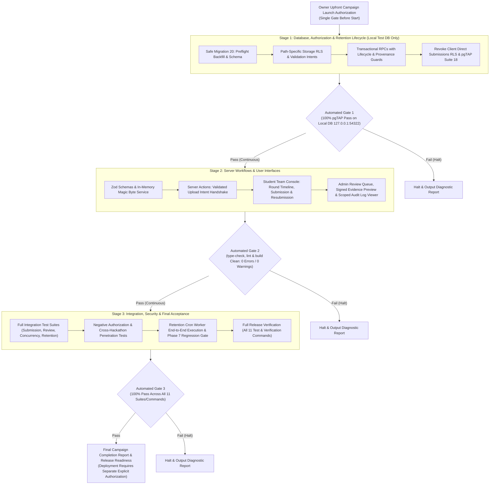

# NMIT HackLeague — Phase 8 Implementation Plan
## Round Tracking and Evidence Review

**Version:** `1.1.4`  
**Status:** `OWNER DECISIONS RESOLVED — AWAITING CAMPAIGN LAUNCH`  
**Baseline Git Commit:** `1829fde7b7d4f7edc30e1ac5f21ef5b9aede4704` (Branch `v1`)  
**Scope:** Coordinated 3-Stage Implementation Campaign for Round Tracking, Milestone Submissions, Versioned Resubmissions, Terminal Rejections with Explicit Reopening, Admin Review, Winner Placements, Private Image Evidence Storage (1 MiB per image), Scheduled Retention, Direct Submissions RLS Lockout, and Scoped Audit Logs.

---

### Document Revision History

| Version | Date | Status | Summary of Core Changes |
| :--- | :--- | :--- | :--- |
| `v1.0.0` | 2026-10-20 | Superseded | Initial 3-stage consolidated plan following Phase 7 commit. |
| `v1.0.1` | 2026-10-20 | Superseded | Decoupled winner points, identified retention bucket bug (`'evidence'` $\to$ `'submission-evidence'`), added review feedback RLS fix, preflight backfill outline. |
| `v1.0.2` | 2026-10-20 | Superseded | Preserved Phase 7 storage, database-enforced review lifecycle matrix, strengthened evidence ownership, expanded backfill preflight to 5 checks, corrected retention semantics. |
| `v1.0.3` | 2026-10-20 | Superseded | Resolved evidence validation intent architecture and candidate-current tie preflight check. |
| `v1.0.4` | 2026-10-20 | Superseded | Initial draft for evidence integrity hardening, preflight simplification, and review state lifecycle. |
| `v1.0.5` | 2026-10-20 | Superseded | Verified Plan Reconciliation & Hardening (Storage client write denial, fail-closed review lifecycle, exactly five preflight checks). |
| `v1.0.6` | 2026-10-20 | Superseded | Substantive Plan Consolidation & Campaign Hardening (Direct client submissions RLS lockout, one-shot campaign governance, intent context binding). |
| `v1.0.7` | 2026-10-20 | Superseded | Narrowly Scoped Preflight, Concurrency Race & Review Validation Corrections (Upgraded Check 4 to LEFT JOIN, deletion-queue inspection, cross-layer feedback alignment, local disposable test DB clarification). |
| `v1.0.8` | 2026-10-20 | Superseded | Final Pre-Approval Documentation Audit & Concurrency Corrections (Bidirectional parent-chain invariant Check 4 & Step 5b, Level 1 Root Lock Protocol for retention concurrency, migration-safe review feedback preflight DO block). |
| `v1.0.9` | 2026-10-21 | Superseded | Retention Concurrency Claim Verification & Evidence Lifecycle Soundness (Audited 5 concurrency interleavings, fail-closed queue filter on all states including failed, multi-version purge stamping in `complete_storage_deletion_job`, HTTP 404 idempotency, retention queue deduplication). |
| `v1.1.0` | 2026-10-21 | Superseded | Retention Deadline Commit-Boundary Audit & Competition-Decoupled Concurrency Guarantee (Commit-boundary race audit, competition window decoupling, fail-closed competition guard on evidence reuse, universal `clock_timestamp()` alignment, reverified interleavings 1–5). |
| `v1.1.1` | 2026-10-21 | Superseded | Long-Running Retention Concurrency Audit & Engine-Enforced Commit-Boundary Guarantee (Long-running transaction audit > 7 days, universal Level 1 Root Locking `FOR SHARE`, initial deferred constraint trigger specification, Stage 1 `TS-RND-20` specification). |
| `v1.1.2` | 2026-10-21 | Superseded | Commit-Boundary Deferred Trigger Correctness & Fail-Closed Hierarchy Hardening (Audited restoration transition `OLD.is_current = false -> true`, smallest robust predicate, authoritative fail-closed hierarchy verification, initial dual-layer concurrency proof, TS-RND-20 expansion). |
| `v1.1.3` | 2026-10-21 | Superseded | PostgreSQL Commit-Boundary Semantics Rigor, Delayed-Commit Retention Race Analysis & Owner Blocker (Decoupled lifecycle timestamps, proved delayed-commit zero-grace retention race counterexample, evaluated 5 remediation alternatives, formulated Decision 5). |
| `v1.1.4` | 2026-10-21 | Current Draft | **Owner Approval of Decision 5 (Option 5A: Two-Stage Retention Queue Grace Period) & Coordinated Campaign Finalization:**<br>1. **Owner Approval of Option 5A:** Formally recorded the project owner's explicit approval of Decision 5, Option 5A (Two-Stage Retention Queue Grace Period). Resolved the delayed-commit retention race blocker.<br>2. **Retention Enqueuing Specification Hardened:** Updated `enqueue_hackathon_evidence_retention` in Migration 20 to stamp `retention_deadline_at = clock_timestamp() + interval '7 days'` upon queue insertion while preserving the event-end scan threshold (`v_hackathon.event_end_at <= clock_timestamp() - interval '7 days'`), queue deduplication (`SELECT DISTINCT ON (s.evidence_path)`), bucket correction (`'submission-evidence'`), worker retries, and permanent database record preservation. Guarantees that any evidence discovered receives an absolute 7-day grace period from the scan timestamp ($\approx 14\text{ days}$ total post-event retention).<br>3. **End-to-End Coordinated Campaign Governance Reinforced:** Confirmed that Phase 8 will execute as a single, coordinated, end-to-end implementation campaign across Stages 1, 2, and 3 without human approval stops between stages. Internal automated gates halt only on critical failure or safety violations.<br>4. **Plan Status Updated:** Plan status transitioned to `OWNER DECISIONS RESOLVED — AWAITING CAMPAIGN LAUNCH`, explicitly distinguishing owner approval of Decision 5 (Option 5A) from separate authorization to launch the full Phase 8 implementation campaign. Updated all affected concurrency scenarios, test specifications, acceptance criteria, and audit verdicts consistently. |

---

## 1. Executive Summary & Architectural Scope

Phase 8 implements the complete competitive evaluation and round advancement lifecycle for NMIT HackLeague following team formation and registration in Phase 7. It provides the core operational infrastructure connecting team participation with verified results and points:

1. **Configurable Round Progression:** Supports multi-round hackathons and direct-selection single-round competitions with sequential round qualification enforcement.
2. **Team Leader Milestone Claims:** Secure, authenticated submission of progress reports, GitHub repository URLs, live demo URLs, and supporting image evidence.
3. **Strict 1 MiB Per-Image Policy:** Disallows PDF, ZIP, and generic archive uploads for round evidence; enforces true binary magic byte validation for JPEG, PNG, and WebP images with a strict 1 MiB (1,048,576 bytes) per-image boundary. Non-file references (GitHub URLs, live demo URLs) are supported as structured text fields.
4. **Preservation of Phase 7 Storage & Workflows:** Backward-compatible storage upload authorization. Round-evidence rules apply specifically to round paths (`teams/{team_id}/rounds/{round_id}/*`) without altering or invalidating Phase 7 registration proof workflows (`teams/{team_id}/registration/*`) or historical objects. Explicitly rejects blanket `WITH CHECK (false)` policies that would break client or test uploads.
5. **Versioned Resubmissions on Revision Requests:** Immutable version history ($v_1, v_2, \dots$) linked via `parent_submission_id`, maintaining prior evidence metadata, reviewer feedback, and decisions intact.
6. **Terminal Rejection with Explicit Reopening:** Rejection is terminal by default. Only an assigned Admin or Super Admin can explicitly reopen a rejected submission with mandatory justification and immutable audit logging.
7. **Database-Enforced Review Lifecycle & View-Only Completed Rounds:** Enforces the round state transition matrix inside database RPCs (`review_round_submission`), rejecting reviews when rounds are scheduled, paused, deadline-expired, or completed. Completed rounds are strictly view-only for all actors without exception; administrative corrections proceed via point reversals or audited round reopening.
8. **Authoritative Evidence-Object Integrity Guarantees:** Database RPCs independently verify that attached evidence was validated by trusted server-side magic-byte inspection via a durable, service-role-managed intent table (`public.evidence_validation_intents`) with SHA-256 hash matching. Storage RLS strictly denies direct client writes (`INSERT`, `UPDATE`, `DELETE`) on canonical round evidence (`teams/{team_id}/rounds/{round_id}/*`). All round uploads are mediated strictly by the trusted Next.js Server Action (`adminClient` / `service_role`) using unpredictable server-generated UUID paths and `upsert: false`. The Server Action performs in-memory magic-byte validation, computes SHA-256, uploads the file, executes safe server-side re-download and hash verification of the stored bytes before submission acceptance, and registers intent in `public.evidence_validation_intents`. Database RPC verifies intent under `FOR UPDATE` and atomically consumes it. Service-role credentials remain server-only; Phase 7 registration uploads remain completely preserved and unaffected.
9. **Decoupled Winner Placement Recording:** Winner placements (e.g. '1st Place', 'Track Winner') are recorded in `public.results`. Automatic winner bonus points (+30/+35) are explicitly decoupled from placement recording pending owner/club-lead confirmation of eligible placement tiers.
10. **Scheduled Retention & Worker Processing Semantics:** Evidence becomes **eligible for deletion** at `event_end_at + interval '7 days'` and is asynchronously purged when the existing background deletion worker (`/api/cron/process-deletions`) successfully processes the queue, with leased retries, idempotency, quarantine isolation, and metadata preservation.
11. **Permission Separation:** Enforces strict boundary between general event setup (`manage_hackathons`), submission review, points adjustment (`manage_points`), and audit-log inspection (`view_audit_logs`).

---

## 2. Requirements Conflict Matrix

A comprehensive reconciliation between canonical requirements files (`rules.md`, `rules_updated.md`, `hackleague_plan_updated.md`) and the owner's confirmed Phase 8 decisions:

| Requirement Topic | Canonical Rules (`rules.md`) | Updated Rules (`rules_updated.md` / `hackleague_plan_updated.md`) | Owner Phase 8 Decision | Conflict / Status | Reconciled Resolution in Plan v1.1.4 |
| :--- | :--- | :--- | :--- | :--- | :--- |
| **Evidence File Types & Sizes** | `rules.md` §9 (L298–300): "Store uploaded evidence in private object storage... validate file type and size." | `rules_updated.md` §5 (L170–171, 181): "Hackathon registration screenshot, round evidence, and winner evidence: maximum 1 MB per image." (Bucket previously allowed 20 MB PDF/ZIP). | Images only, max 1 MiB per image (`.jpg`, `.jpeg`, `.png`, `.webp`). Reject PDFs, ZIPs, and archives. Non-file references supported. | **Hardening / Coexists:** Reconciles legacy 20 MB PDF/ZIP storage config to strict 1 MiB image limit. | Enforce 1 MiB image-only limit specifically on round paths (`teams/{team_id}/rounds/{round_id}/*`) via Server Action in-memory magic bytes; Storage RLS strictly denies direct client writes (`INSERT`, `UPDATE`, `DELETE`) on round evidence while preserving existing Phase 7 registration evidence without destructive bucket-wide modifications. |
| **Phase 7 Storage Preservation** | `rules.md` §8: Registration proof submission. | `rules_updated.md` §8: Initial registration proof uploads to `teams/{team_id}/registration/*`. | Preserve all Phase 7 registration uploads and workflows without disruption. | **Resolved in v1.0.2/v1.0.5:** Do not apply a blanket `WITH CHECK (false)` that could disrupt registration uploads. | Maintain dedicated Phase 7 registration upload service and policies intact. Round evidence uploads are strictly server-mediated (`service_role`); direct client writes to `teams/{team_id}/rounds/{round_id}/*` are denied in Storage RLS. Include explicit Phase 7 regression test suite. |
| **Evidence Provenance & Verification** | `rules.md` §9: Validate file type and size in private storage. | `rules_updated.md` §5 & `hackleague_plan_updated.md` Phase 8: Strict validation. Storage RLS cannot inspect binary bytes. | Attachment must prove genuine server-side validation. Do not trust client claims. | **Resolved in v1.0.5:** Storage RLS denies client direct writes (`INSERT`, `UPDATE`, `DELETE`) on round evidence (`teams/{team_id}/rounds/{round_id}/*`). | Server Action inspects magic bytes, calculates SHA-256, uploads to unique UUID path with `upsert: false`, executes safe server-side re-download and hash verification of stored bytes before submission acceptance, and writes intent via `service_role`. RPC verifies and consumes intent under `FOR UPDATE`. |
| **Winner Placement Points Eligibility** | `rules.md` §11 (L340–350): Win/prize placement +30 member / +35 leader. Open decision on placement scope. | `rules_updated.md` §11 (L430–433): "OPEN DECISION: Confirm whether the win bonus applies to all prize placements or only specified placements..." | **Decoupled:** Design placement recording independently from points eligibility. Do NOT automatically award winner bonuses for unspecified categories. | **Conflict Resolved in v1.0.1/1.0.2:** Plan v1.0.0 erroneously awarded points for any placement string. | Phase 8 RPC `record_round_winner_placement` records verified outcome in `public.results(placement)`. Points award (+30/+35) is gated on an explicit owner-approved placement eligibility policy. |
| **Revision Requested Workflow** | `rules.md` §9 (L283–284): Admin reviews and approves, rejects, or requests more information. | `hackleague_plan_updated.md` §Phase 8 (L236): Implement approve, reject, request-more-info flows (no versioning model specified). | Resubmission creates a new version (`version = n + 1`). Preserve previous versions, evidence metadata, and review history. | **Clarification Reconciled:** Replaces in-place row overwrite with explicit versioned parent-child rows. | Add `parent_submission_id UUID` and `is_current BOOLEAN` to `submissions`. Partial unique index `(round_id, team_id) WHERE is_current = true`. Safe preflight backfill specified before index creation, validating both directions of the parent chain invariant (v=1 null parent, v>1 valid non-null parent with v=k-1 in same team/round, acyclic chain terminating at v=1). |
| **Rejection Finality & Reopening** | `rules.md` §9 (L283–284): Outcomes include "eliminated, withdrawn, and completed". | `rules_updated.md` §9 (L360–362): Outcomes include "eliminated, finalist, winner/placement...". | Rejection is terminal by default. Only authorized Admin / Super Admin can explicitly reopen with mandatory justification and audit log. | **Hardening / Coexists:** Prevents unauthorized student re-submission after failure. | Submissions in `status = 'rejected'` cannot be edited by students. Dedicated RPC `reopen_rejected_submission` requires admin scoping and mandatory reason $\ge 10$ characters, logging `submission.reopened`. |
| **Stage Deadline & Pausing Rules** | `rules.md` §9 (L279): Admin configures round dates/deadlines. | `rules_updated.md` §9 (L348) & `hackleague_plan_updated.md` L245: Enforce independent stage deadlines and manual resume rules (Phase 6). Closed/paused stages reject submissions. | Submissions and resubmissions strictly rejected if round is paused, round deadline has passed (`clock_timestamp() >= end_at`), or event has concluded (`clock_timestamp() >= event_end_at`). Universal use of `clock_timestamp()` eliminates transaction-start drift. | **Consistent:** Complete alignment across all documents. | Database RPCs enforce lifecycle matrix directly using `clock_timestamp()`. `submit_round_milestone` and `resubmit_round_milestone` strictly enforce `clock_timestamp() < round.end_at` and `clock_timestamp() < hackathon.event_end_at`. `review_round_submission` rejects reviews on scheduled, paused, deadline-expired, or completed rounds for all actors including Super Admin. |
| **Admin Authorization Scoping** | `rules.md` §4.2: Admin roles and permissions. | `rules_updated.md` §4.2 (L141–144): Designated in-charge Admin acts on assigned hackathon(s). Feature permission does not grant universal event access. | Scope Admin evidence access and review operations to assigned hackathon (`can_admin_manage_hackathon`). | **Hardening / Coexists:** Reconciles legacy unassigned RLS policies from Migration 11. | Replace legacy broad `manage_hackathons` policies on `submissions`, `submission_reviews`, `results`, and `storage.objects` with hackathon-scoped checks. Separate review from audit logs (`view_audit_logs`). |
| **Evidence Retention Semantics** | `rules.md` §9 (L298–300): General private storage policy. | `rules_updated.md` §9 (L371–374): Eligible for deletion at `event_end_at + 7 days`. Based on configured timestamp, not manual completion. Reuse Phase 4 queue/worker. | Purge evidence via existing worker after eligibility at `event_end_at + 7 days`. Correct bucket mismatch bug (`'evidence'` $\to$ `'submission-evidence'`). | **Resolved via Owner Approval of Decision 5, Option 5A (Two-Stage Retention Queue Grace Period):** Reconciles delayed-commit retention hazard (`event_end_at + 7 days` back-dating) by stamping `retention_deadline_at = clock_timestamp() + interval '7 days'` upon enqueueing. This guarantees an absolute minimum of 7 days of grace from the moment of database scan/enqueuing before the worker can claim the job ($\approx 14\text{ days}$ total post-event retention), shielding late-committed submissions from premature purge. Zero worker modifications required. Storage bucket mismatch corrected (`'evidence'` $\to$ `'submission-evidence'`) with deduplication (`DISTINCT ON (s.evidence_path)`). | `enqueue_hackathon_evidence_retention` targets bucket `'submission-evidence'` with `DISTINCT ON (s.evidence_path)`. `complete_storage_deletion_job` is hardened in Migration 20 to update `evidence_deleted_at = now()` and `evidence_lifecycle_state = 'purged_worker_confirmed'` across ALL submissions sharing that `evidence_path` (`WHERE hackathon_id = v_job.event_id AND evidence_path = v_job.object_path`), and accepts HTTP 404 alongside 200/204 without escalating to `investigation_required`. Universal Level 1 Hackathon Root Locking (`FOR SHARE`) is acquired across ALL submission entry points (`submit_round_milestone`, `resubmit_round_milestone` Case A, and Case B) to atomically serialize with `enqueue_hackathon_evidence_retention` and `confirm_deletion_preflight` (`FOR UPDATE`). In `resubmit_round_milestone`, evidence reuse (Case B) inspects `storage_deletion_queue` across all 8 authoritative states (`status IN ('pending', 'claimed', 'dispatching', 'cooldown', 'reconciling', 'investigation_required', 'completed', 'failed')`). Pre-commit validation enforces competition deadlines (`clock_timestamp() < round.end_at` AND `clock_timestamp() < event_end_at`) using the smallest robust predicate. Safe retention behavior against delayed commits (> 7 days) is enforced via Option 5A queue grace period. |
| **Student Review Visibility** | `rules.md` §9: Review outcome communicated to team. | `rules_updated.md` §9 (L353–354): Admin reviews and requests more information. | Students must be able to read reviewer feedback on `revision_requested` and `rejected` submissions. | **Code Defect Identified:** Migration 11 RLS policy `submission_reviews_select_published` blocked feedback visibility before results were published. | Migration 20 replaces policy with `submission_reviews_select_team_member`, allowing team members to view reviews for their own submissions immediately. |
| **Phase Boundaries (Points & Leaderboard)** | `rules.md` §11 (L320–350): Platform-wide points ledger and leaderboards. | `hackleague_plan_updated.md` §Phase 8 & §Phase 9: Phase 8 records verified results; Phase 9 implements points gamification and leaderboards. | **Preserved:** Phase 8 records outcomes and approved milestone points; Phase 9 delivers leaderboard UI and points management. | **Coexists:** Preserves existing approved transactional points behavior without inventing new gamification rules. | Phase 8 handles atomic points for accepted round qualifications (+20/+25). Broader points configuration, manual adjustments, badges, and leaderboard rankings belong strictly to Phase 9. |
| **Submissions Table Direct Write Access** | `rules.md` §9: Leader milestone submission. | `hackleague_plan_updated.md` Phase 8: Milestone claims and versioned resubmissions. | All submissions must be validated by RPCs. Direct client write bypass is unacceptable. | **Code Defect Identified:** Migration 11 granted `authenticated` direct `INSERT` and `UPDATE` on `public.submissions`, bypassing RPC validations, leader checks, round qualification, and validation intents. | Migration 20 explicitly drops `submissions_insert_member` and `submissions_update_student` and revokes `INSERT, UPDATE ON public.submissions FROM authenticated`. All submission writes must proceed exclusively through `submit_round_milestone` or `resubmit_round_milestone` RPCs. |

---

## 3. Material Audit Findings & Remediation Traceability Matrix

| Audit Finding ID | Severity | File / Location | Defect Description | Planned Remediation in v1.1.4 | Stage | Acceptance Test Case |
| :--- | :--- | :--- | :--- | :--- | :--- | :--- |
| **AF-01: Retention Bucket Name Bug** | Critical | Migration 17 L1344 | `enqueue_hackathon_evidence_retention` enqueues registration proofs with bucket `'evidence'`, which does not exist in Storage. Worker fails on purge. | Replace `'evidence'` with `'submission-evidence'` and add `DISTINCT ON (s.evidence_path)` in Migration 20. | **Stage 1** | `TS-RND-10` in `18_ts_round_tracking.sql` & `retention-worker-purging.test.ts` |
| **AF-02: Review Feedback Visibility RLS Defect** | High | Migration 11 L311 | Policy `submission_reviews_select_published` requires `results.is_published = true`. Blocks students from seeing `revision_requested` feedback. | Replace with `submission_reviews_select_team_member` allowing team members to view reviews of their own team's submissions. | **Stage 1** | `TS-RND-14` in `18_ts_round_tracking.sql` |
| **AF-03: Storage Admin Scoping Leak** | High | Migration 19 L104 | Policy `submission_evidence_select` allows *any* admin with global `manage_hackathons` to SELECT round evidence of unassigned events. | Scope SELECT to `can_admin_manage_hackathon(hackathon_id, 'manage_hackathons')` or `is_super_admin()`. | **Stage 1** | `TS-RND-12` in `18_ts_round_tracking.sql` |
| **AF-04: Missing `submit_round_milestone` RPC** | Critical | Database / Schema | No secure submission RPC exists. Relies on client `INSERT` into `submissions`, allowing any team member to submit, ignoring round qualification and registration status. | Implement `submit_round_milestone` RPC enforcing: leader only, team registered, round open & unpaused, prior round qualification, and cryptographic intent verification. | **Stage 1** | `TS-RND-01` to `TS-RND-05` in `18_ts_round_tracking.sql` |
| **AF-05: Missing Resubmission & Versioning Logic** | High | Database / Schema | `protect_submission_columns()` blocks student status changes. Resubmission was impossible without an authorized RPC. | Add `parent_submission_id`, `is_current` columns to `submissions`. Include safe preflight backfill with fail-safe checks. Implement `resubmit_round_milestone`. | **Stage 1** | `TS-RND-06` in `18_ts_round_tracking.sql` |
| **AF-06: Incomplete Winner Placement & Ranking** | Medium | Migration 18 L615 | `review_round_advancement` only supports `round_qualification`; cannot record placement rank or separate placement from unapproved points. | Implement `record_round_winner_placement` RPC supporting placement ranking in `results` while gating points on owner policy approval. | **Stage 1** | `TS-RND-08` in `18_ts_round_tracking.sql` |
| **AF-07: Missing Terminal Reopen Workflow** | High | Database / Schema | Rejection had no formal reopening mechanism; ordinary resubmission would violate finality. | Implement `reopen_rejected_submission` RPC requiring admin scoping, mandatory justification, and audit logging. | **Stage 1** | `TS-RND-07` in `18_ts_round_tracking.sql` |
| **AF-08: Storage Allowed Types & WebP Inconsistency** | Medium | Migration 09 / 15 | Bucket has legacy 20 MB PDF/ZIP allowlist; missing `image/webp` in bucket metadata. | Path-specific isolation: Storage RLS strictly denies direct client writes (`INSERT`, `UPDATE`, `DELETE`) on `teams/{team_id}/rounds/{round_id}/*`; Server Action validates JPEG, PNG, WebP $\le 1\text{ MiB}$ in memory before uploading via `service_role`. Preserves historical registration files and maintains Phase 7 compatibility. | **Stage 1** | `TS-RND-11` in `18_ts_round_tracking.sql` |
| **AF-09: Missing Server Actions & Zod Schemas** | High | `src/actions/` & `src/lib/validation/` | No server actions exist for round submission, resubmission, review, reopening, or signed URL generation. | Create `round-submission-actions.ts`, `round-review-actions.ts`, and `submission-schemas.ts`. | **Stage 2** | `tests/integration/ round-submission-lifecycle.test.ts` |
| **AF-10: Untrusted Provenance on Direct Storage Upload** | Critical | Storage / Database | Storage RLS cannot inspect raw file binary magic bytes. A client uploading directly to Storage could attach non-validated files. | Storage RLS strictly denies direct client writes to `teams/{team_id}/rounds/{round_id}/*`. Uploads mediated by Server Action with in-memory validation, SHA-256 calculation, and server-side re-download verification, registering `public.evidence_validation_intents` via `service_role` and consumed by RPC under lock. | **Stage 1 & 2** | `tests/integration/ round-submission-lifecycle.test.ts` |
| **AF-11: Missing Student Submission & Tracking UI** | High | `src/app/student/teams/ [id]/` | Student team console has no round submission form, milestone tracker, or revision feedback display. | Implement `RoundMilestoneSubmissionCard` and `SubmissionVersionHistoryCard` in student console. | **Stage 2** | Stage 2 exit gate verification |
| **AF-12: Missing Admin Review Dashboard UI** | High | `src/app/admin/` | No review queue exists for assigned admins to inspect submissions, view evidence, or record decisions. | Implement `/admin/hackathons/[id]/submissions` with queue filtering, preview modal, and review action dialogs. | **Stage 2** | Stage 2 exit gate verification |
| **AF-13: Missing Audit Log Viewer UI** | Medium | `src/app/admin/` | Permission `view_audit_logs` exists since Phase 5, but no UI route exists to view immutable audit logs. | Implement `/admin/audit-logs` guarded by `view_audit_logs` or Super Admin, with scoped query filters. | **Stage 2** | Stage 2 exit gate verification |
| **AF-14: Zero Phase 8 Integration Tests** | High | `tests/integration/` | No end-to-end integration tests exist for milestone claims, versioning, review, or retention. | Implement 4 complete integration test suites in Stage 3, plus Phase 7 regression verification. | **Stage 3** | Full execution via `npx tsx` in Stage 3 |
| **AF-15: Direct Client Submissions RLS Bypass** | Critical | Migration 11 L274–297 | Policies `submissions_insert_member` and `submissions_update_student` permitted direct client `INSERT` and `UPDATE` on `public.submissions`, bypassing round qualification, leader role, stage deadline, and validation intent checks. | Drop policies `submissions_insert_member` and `submissions_update_student` in Migration 20 and revoke `INSERT, UPDATE ON public.submissions FROM authenticated`. All submission writes restricted to authorized RPCs. | **Stage 1** | `TS-RND-19` in `18_ts_round_tracking.sql` & `round-review-authorization.test.ts` |
| **AF-16: Deletion-Queue Race on Evidence Reuse** | High | Database / Schema | Reusing prior evidence without Level 1 Hackathon Root Locking, without inspecting `storage_deletion_queue` active/leased/failed states, or crossing the event conclusion boundary could allow binding an object concurrently being deleted by the cron worker or subject to retention deletion. | Acquire Level 1 Hackathon Root Lock (`public.hackathons WHERE id = v_round.hackathon_id FOR SHARE`) to atomically serialize with `enqueue_hackathon_evidence_retention` and `confirm_deletion_preflight` (both locking hackathons `FOR UPDATE`). Validate active competition window (`clock_timestamp() < event_end_at`) and retention period (`clock_timestamp() < event_end_at + 7 days`), assert `prior.evidence_deleted_at IS NULL`, check `storage_deletion_queue` across all 8 authoritative states (`status IN ('pending', 'claimed', 'dispatching', 'cooldown', 'reconciling', 'investigation_required', 'completed', 'failed')`), and verify active storage catalog record. Fail closed if queued, expired, post-event, failed, or in-flight. | **Stage 1** | `TS-RND-06` in `18_ts_round_tracking.sql` & `round-lifecycle-concurrency.test.ts` |
| **AF-17: One-Shot Implementation Campaign Governance** | High | Implementation Governance | Manual inter-stage owner review stops between Stages 1, 2, and 3 contradict the intended coordinated campaign workflow. | Transition to a single upfront owner approval model with automated exit gates between stages. Gates halt on critical failure with diagnostic reports, but advance continuously if checks pass. | **All Stages** | Campaign execution workflow |
| **AF-18: Preflight Dangling Parent Pointer Blind Spot** | High | Migration 20 Preflight L276 | Check 4 used an `INNER JOIN` from child to parent, failing to catch rows with non-null `parent_submission_id` referencing non-existent parent rows, and only checked rows where `parent_submission_id IS NOT NULL`, missing unlinked non-root versions (version > 1 with null parent) and non-null parents on root version 1. | Replace with bidirectional `LEFT JOIN` validating both directions of the invariant: version 1 must have `parent_submission_id IS NULL`, version > 1 must have a non-null parent with `version = k - 1` in the same team/round, parent chains must be acyclic and terminate at version 1, and report per-row diagnostic logs while maintaining exactly 5 preflight checks. Add Step 5b post-backfill verification. | **Stage 1** | `TS-RND-18` in `18_ts_round_tracking.sql` |
| **AF-19: Cross-Layer Review Feedback Validation Mismatch** | Medium | `submission-schemas.ts` vs RPC | Zod schema allowed optional feedback on rejection/revision, while RPC required $\ge 10$ chars without trimming whitespace or checking max length. | Align Zod `.superRefine`, Server Action, and RPC to require trimmed $\ge 10$ non-whitespace chars for rejection/revision, optional for acceptance, and max 1000 chars across all layers. | **Stage 1 & 2** | `TS-RND-15` in `18_ts_round_tracking.sql` & `round-review-authorization.test.ts` |
| **AF-20: Unvalidated Review Feedback Constraint Application** | High | Migration 20 Feedback Constraint | Adding `chk_submission_reviews_feedback_rules` directly to `public.submission_reviews` without preflight verification would cause the migration to fail if legacy records have trimmed feedback > 1,000 characters or rejection/revision reviews with < 10 characters. | Add a fail-safe preflight DO block in Migration 20 that detects and reports any violating records with full diagnostic context and halts migration closed without silently altering historical data. | **Stage 1** | `TS-RND-15` in `18_ts_round_tracking.sql` |
| **AF-21: Multi-Version Evidence Purging & HTTP 404 Inconsistency in Deletion Completion** | High | Migration 15 L862, L877 & Migration 17 L1321 | When versioned resubmissions reuse an evidence path, multiple submission rows share the identical `evidence_path`. `complete_storage_deletion_job` only updated `WHERE id = v_submission.id`, leaving other versions unstamped (`evidence_deleted_at IS NULL`) and causing duplicate retention queue jobs on subsequent scans. Furthermore, `complete_storage_deletion_job` checked `IF p_http_status IN (200, 204)`, causing the worker's 404 response on already-absent objects to escalate to `investigation_required` (`UNCERTAIN_DISPATCH_FAILURE`). | In Migration 20, update `complete_storage_deletion_job` to stamp `evidence_deleted_at = now()` and `evidence_lifecycle_state = 'purged_worker_confirmed'` across ALL submissions sharing that `evidence_path` (`WHERE hackathon_id = v_job.event_id AND evidence_path = v_job.object_path AND evidence_deleted_at IS NULL`), and accept HTTP 404 alongside 200/204. Update `enqueue_hackathon_evidence_retention` to use `SELECT DISTINCT ON (s.evidence_path) ... ORDER BY s.evidence_path, s.version DESC`. | **Stage 1** | `TS-RND-10` in `18_ts_round_tracking.sql` & `retention-worker-purging.test.ts` |
| **AF-22: Long-Running Submission Commit-Boundary Concurrency Race, Predicate Hardening & Commit Semantics Clarification** | Critical | Database / Schema / Submissions Invariants | In v1.1.0, statement-level `clock_timestamp()` checks run only at statement execution time. A transaction that begins before `event_end_at`, passes the check, hangs or remains open for $> 7\text{ days}$, and commits after `event_end_at + interval '7 days'` could commit evidence into `public.submissions` that is immediately purged by `enqueue_hackathon_evidence_retention` upon shared lock release. In v1.1.1, the proposed deferred trigger predicate failed to catch historical restorations (`OLD.is_current = false -> true` with unchanged evidence/version) and lacked fail-closed foreign key/null checks. Furthermore, v1.1.2 overclaimed that a deferred trigger provides an "absolute mathematical guarantee that physical commit completes before the deadline", confusing pre-commit trigger validation with physical WAL flush completion. | In Migration 20: 1) Universalize Level 1 Hackathon Root Locking (`FOR SHARE`) across ALL submission entry points (`submit_round_milestone`, `resubmit_round_milestone` Case A, and Case B) to provide execution-time mutual exclusion against retention enqueuing and deletion preflight (`FOR UPDATE`). 2) Establish PostgreSQL Engine-Enforced Deferred Constraint Trigger (`trg_submissions_enforce_commit_deadline` on `public.submissions`, `DEFERRABLE INITIALLY DEFERRED`) evaluating **Semantics A** (pre-commit trigger validation). Enforces the smallest robust predicate `NEW.is_current = true AND (TG_OP = 'INSERT' OR OLD.is_current IS NOT TRUE OR OLD.evidence_path IS DISTINCT FROM NEW.evidence_path OR OLD.version IS DISTINCT FROM NEW.version OR OLD.round_id IS DISTINCT FROM NEW.round_id OR OLD.hackathon_id IS DISTINCT FROM NEW.hackathon_id)` and authoritative relationship verification (`hackathon_rounds` and `hackathons` existence `23503`, cross-entity match `23503`, non-null deadlines `23502`). Aborts any transaction attempting to commit after `v_round.end_at` or `v_hackathon.event_end_at` (`55P03`). | **Stage 1** | `TS-RND-20` in `18_ts_round_tracking.sql` & `round-lifecycle-concurrency.test.ts` |
| **AF-23: Delayed Commit After Deferred Trigger Pass & Post-Threshold Immediate Deletion Race** | Critical | Database / Retention Concurrency / Deletion Worker | While deferred constraint trigger validation (Semantics A) ensures `clock_timestamp() < deadline` when the trigger executes during commit processing, PostgreSQL cannot guarantee that physical transaction commit completes within any bounded duration. A transaction that passes its deferred trigger check before the deadline (or executes `SET CONSTRAINTS IMMEDIATE`) can stall (via client pause, network hang, OS freeze, or WAL write delay) and physically commit after `event_end_at + interval '7 days'`. Upon lock release, `enqueue_hackathon_evidence_retention` acquires `hackathons FOR UPDATE`, finds the newly committed submission, and inserts it into `storage_deletion_queue` with a back-dated `retention_deadline_at = event_end_at + 7 days` (in the past). The worker immediately claims and deletes the object, purging evidence with zero retention grace period. | **Resolved via Owner Approval of Decision 5, Option 5A (Two-Stage Retention Queue Grace Period):** In Migration 20, `enqueue_hackathon_evidence_retention` is updated to set `retention_deadline_at = clock_timestamp() + interval '7 days'` upon inserting into `storage_deletion_queue`, while maintaining the scan eligibility threshold (`v_hackathon.event_end_at <= clock_timestamp() - interval '7 days'`). This guarantees an absolute minimum of 7 days of grace from the moment of database scan/enqueuing before the deletion worker can claim the job, entirely protecting any recently committed submission from immediate deletion ($\approx 14\text{ days}$ total post-event retention). Queue deduplication, worker retries, and fail-closed checks across all 8 queue states are preserved. | **Stage 1** | `round-lifecycle-concurrency.test.ts` & `retention-worker-purging.test.ts` |

---

## 4. Owner Decisions Matrix & Resolved Architecture

The following product decisions and architectural selections govern Phase 8 implementation:

1. **Win Placement Point Eligibility & Prize Tiers (`rules_updated.md` L430–433):**
   - **Current Baseline:** Point configurations specify `win_placement`: +30 regular member / +35 team leader.
   - **Open Decision (Decoupled):** Do all prize categories (e.g. 1st, 2nd, 3rd, Best Track Winner, Consolation Prize) receive the identical `win_placement` bonus, or do only top overall placements receive points?
   - **Plan Treatment (Decoupled):** Phase 8 RPC `record_round_winner_placement(submission_id, placement_name, notes)` records the verbatim placement string in `results.placement` with full audit logging. Automatic points awards (+30/+35) are **not** triggered automatically for arbitrary placement strings. Awarding winner points is gated on explicit owner/club-lead approval of eligible placement tiers, which will be integrated via Phase 9 points management. Does not block Phase 8.
2. **Evidence Multiplicity (Per-Image Limit vs. Image Count Limit):**
   - **Clarification:** The 1 MiB boundary is strictly a **per-image limit**.
   - **Open Decision (Decoupled):** How many images may a team leader upload per milestone claim (e.g. 1 primary image vs. multiple screenshots)?
   - **Plan Treatment:** Phase 8 implements a primary image evidence upload field (`evidence_path`), alongside text references (`repo_url`, `demo_url`). The schema and RPCs are designed so an image array or multi-file attachment extension can be added in a future phase without breaking existing records. No arbitrary image count ceiling is invented. Does not block Phase 8.
3. **Disaster Recovery Backup Retention Disclaimer:**
   - Active Storage deletion purges evidence files from the Supabase Storage bucket.
   - Active storage deletion does **not** rewrite immutable PostgreSQL transaction logs (WAL) or cloud disaster recovery snapshots. This operational boundary is documented in user-facing policies. Does not block Phase 8.
4. **Submission Deadline Enforcement Semantics (Semantics A vs. Semantics B):**
   - **Context & Ambiguity:** `rules.md` and `rules_updated.md` require that submissions close when the round or event deadline passes. They do not distinguish between pre-commit trigger validation and physical commit completion.
   - **Technical Distinction:**
     - *Semantics A (Engine-Enforced Pre-Commit Validation):* The database transaction manager executes deferred constraint trigger validation during pre-commit processing before commit records are written to disk. If `clock_timestamp() >= deadline`, the transaction is unconditionally aborted and rolled back (`55P03`).
     - *Semantics B (Physical Commit Completion Strictly Before Deadline):* Requires that durable WAL flush, CLOG bit flip, and lock release complete strictly before the deadline timestamp.
   - **Plan Architectural Selection:** PostgreSQL cannot guarantee Semantics B because no database trigger or engine hook can run after physical commit completion within the transaction. Semantics A provides robust pre-commit validation. Managing the resulting retention hazard under long-delayed commits is resolved via Owner Approval of Decision 5, Option 5A.
5. **Retention Eligibility Anchor Under Delayed Transaction Commits (`rules_updated.md` L371–374):**
   - **Context & Architectural Discovery:** While deferred constraint triggers evaluate `clock_timestamp() < deadline` at commit time (Semantics A), PostgreSQL cannot guarantee that physical transaction commit completes within any fixed duration after trigger evaluation. A submission transaction can pass its trigger before the deadline and subsequently stall (due to `SET CONSTRAINTS IMMEDIATE` or backend process suspension), finally completing its commit after `event_end_at + interval '7 days'`. Under the uncorrected `enqueue_hackathon_evidence_retention` implementation, this would allow newly committed evidence to be queued with a past deadline and purged immediately.
   - **Owner Resolution (Approved):** The project owner explicitly approved **Option 5A (Two-Stage Retention Queue Grace Period)**.
   - **Adopted Architectural Specification:** In Migration 20, `enqueue_hackathon_evidence_retention` continues to scan hackathons whose event ended $\ge 7\text{ days}$ ago (`v_hackathon.event_end_at <= clock_timestamp() - interval '7 days'`), but inserts deletion queue jobs with:
     ```sql
     retention_deadline_at = clock_timestamp() + interval '7 days'
     ```
     This guarantees that every discovered evidence file receives an absolute minimum of 7 days of retention grace from the instant it is discovered/enqueued by the scanner before the background deletion worker can claim it (`retention_deadline_at <= now()`), entirely shielding late-committed submissions from premature deletion. Total file retention post-event becomes $\approx 14\text{ days}$.
   - **Governance Status:** `RESOLVED VIA EXPLICIT OWNER APPROVAL (OPTION 5A APPROVED)`. Resolves the retention race blocker; implementation campaign launch awaits separate explicit owner launch authorization.

---

## 5. Round & Submission Lifecycle State Transition Matrix

### 5.1 Round Operational State Lifecycle Matrix

The table below defines the strict, fail-closed operational rules across all round states, enforced in database RPCs, RLS, and Server Actions:

| Round State | Condition / Trigger | Student Team Leader Capabilities | Admin Capabilities | Constraints & Database Enforcement |
| :--- | :--- | :--- | :--- | :--- |
| **`scheduled`** | Initial state; `clock_timestamp() < start_at`. | View round schedule only. Submission **forbidden**. | Configure round schedule, name, description. Review **strictly rejected**. | `submit_round_milestone` rejects: Round is not open. `review_round_submission` rejects: Round is scheduled. |
| **`open` (Active)** | `start_at <= clock_timestamp() < end_at` and `status = 'open'`. | Submit initial milestone claim ($v_1$). Resubmit ($v_{n+1}$) if `revision_requested`. | View incoming submissions. Pause round (with justification). Override schedule. Review early submissions. | Submissions allowed only for registered teams meeting prior round qualification. `review_round_submission` permits review for early submissions. |
| **`open` (Expired)** | `clock_timestamp() >= end_at` and `status = 'open'`. | Submission & resubmission **strictly rejected**. | Transition round to `evaluation` or resume with future deadline. Review **strictly rejected** until transitioned. | `submit_round_milestone` rejects with `Configured stage deadline reached`. `review_round_submission` rejects: Stage deadline expired; must transition to evaluation. |
| **`paused`** | Manually paused via `pause_hackathon_round` or auto-paused. | Submission & resubmission **strictly rejected**. View existing submissions/feedback. | Resume round via `resume_hackathon_round` with new future deadline and reason. Review **strictly rejected**. | `submit_round_milestone`, `resubmit_round_milestone`, and `review_round_submission` all reject: Round is currently paused. |
| **`evaluation`** | Stage transitioned to evaluation after deadline. | View submission status and reviewer feedback. Submissions **forbidden**. | Primary review window: Accept, Reject, Request Revision. Explicitly reopen rejected submissions. | Primary review state: `review_round_submission` and `reopen_rejected_submission` active. Submissions locked. |
| **`completed`** | Round finalized; outcomes published. | View final verified results and feedback. | View-only for all admins (including Super Admin). Standard reviews (`review_round_submission`) are **strictly rejected**. Post-completion corrections proceed via `reverse_points_ledger_entry` or formal audited round reopening. | `review_round_submission` rejects unconditionally for all callers: Round is completed and locked. No ad-hoc review bypass for any role. |

### 5.2 Submission Status Lifecycle & Reopening Matrix

The table below defines the immutable lifecycle of milestone submission records across review states:

| Submission Status | Trigger / Precondition | Allowed Student Actions | Allowed Admin Actions | Database Guards & Review Enforcement |
| :--- | :--- | :--- | :--- | :--- |
| **`submitted`** | Initial claim created via `submit_round_milestone` ($v_1$) or resubmission ($v_{n+1}$). | View submission claim, metadata, and uploaded evidence. Cannot modify. | View in review queue; claim review or transition to `under_review`. Review via `review_round_submission`. | Submission is active (`is_current = true`). Cannot resubmit while active in `submitted` status. |
| **`under_review`** | Admin opened submission for formal review. | View submission and pending status banner. | Record review decision: `accepted`, `rejected`, or `revision_requested`. | Review permitted only during round `open` (before deadline) or `evaluation` states. |
| **`accepted`** | Approved via `review_round_submission(p_decision = 'accepted')`. | View verified result and qualification points. Proceed to next round if multi-round. | Record winner placement if final round (`record_round_winner_placement`). Standard reviews strictly rejected. | Milestone result published to `public.results`. Qualification points (+20/+25) awarded idempotently. Review feedback is optional (max 1,000 chars). Cannot be resubmitted or reviewed again. |
| **`revision_requested`** | Admin requested revision via `review_round_submission(p_decision = 'revision_requested')` with mandatory trimmed feedback $\ge 10$ non-whitespace chars (max 1,000 chars). | Read reviewer feedback immediately. Submit new version ($v_{n+1}$) via `resubmit_round_milestone` before deadline. | View prior review feedback. Review new version once submitted by student. | Student can resubmit only while round is unpaused and deadline has not expired. Database RPC enforces trimmed nonblank feedback $\ge 10$ chars (max 1,000 chars). Resubmission marks prior version `is_current = false` and inserts $v_{n+1}$ with `is_current = true`. |
| **`rejected`** | Rejected via `review_round_submission(p_decision = 'rejected')` with mandatory trimmed reason $\ge 10$ non-whitespace chars (max 1,000 chars). | View rejection feedback and explanation. **Resubmission strictly forbidden** (terminal). | Cannot review via `review_round_submission` (ordinary reviews rejected). Only assigned Admin or Super Admin can explicitly reopen via `reopen_rejected_submission`. | **Terminal by default.** Database RPC enforces trimmed nonblank explanation $\ge 10$ chars (max 1,000 chars). Reopening is NEVER a side effect of ordinary review. Reopening requires explicit RPC call `reopen_rejected_submission` with target status (`under_review` or `revision_requested`), mandatory justification $\ge 10$ characters, and logs `submission.reopened` in `public.audit_logs`. |

---

## 6. Coordinated Three-Stage Campaign Implementation Plan

### 6.0 Campaign Execution Model & Automated Verification Gates
Phase 8 implementation is structured as **one continuous, coordinated implementation campaign** across three sequential stages. The project owner provides **one upfront campaign launch authorization** prior to Stage 1 execution (separate from architectural decision approvals). 

Stages are connected by **strict automated verification gates**:
- **Stage 1 Execution & Gate:** Database preflight, migration execution, and pgTAP testing run **strictly and exclusively against the verified disposable local Docker test database** (`127.0.0.1:54322`). Remote, staging, or production databases must never be targeted. Automated Gate 1 verifies that all preflight checks ran cleanly, Migration 20 applied with zero errors, and all 18 pgTAP test suites achieve a 100% pass rate. If met, implementation immediately and automatically proceeds to Stage 2 without human pause.
- **Stage 2 Execution & Gate:** Automated Gate 2 executes TypeScript compilation (`npm run type-check`), ESLint (`npm run lint`), and Next.js production build (`npm run build`). When all three pass with 0 errors and 0 warnings, implementation immediately proceeds to Stage 3.
- **Stage 3 Execution & Gate:** Automated Gate 3 executes all 11 required verification commands including integration, negative authorization, concurrency race, scheduled retention cron, and Phase 7 regression test suites. Upon 100% pass, the final Phase 8 Campaign Completion Report is generated for owner sign-off.
- **Fail-Safe Circuit Breaker:** If any automated gate fails, campaign execution **halts immediately**, captures full database and system diagnostic logs, and outputs a structured error report for developer resolution. No stage proceeds on failure.
- **Deployment Governance (Strict Operational Boundary):** Successful campaign completion confirms **release readiness on the local verified environment only**. The campaign completion report is **not permission to deploy**. Deployment to remote hosting, remote migrations, and production database operations require separate, explicit owner authorization.



---

### STAGE 1 — Database, Authorization, and Evidence Lifecycle

#### 1. Objectives & Scope
- Deliver Migration 20 (`20261021000001_phase8_round_tracking_and_evidence_review.sql`).
- Implement fail-safe preflight verification and backfill to add `parent_submission_id` and `is_current` to `public.submissions` without violating unique constraints or masking data corruption.
- Create `public.evidence_validation_intents` table to enforce trusted server-side binary provenance.
- Implement backward-compatible path-specific Storage policies on bucket `submission-evidence`: strictly deny direct client writes (`INSERT`, `UPDATE`, `DELETE`) on the canonical round evidence namespace (`teams/{team_id}/rounds/{round_id}/*`) while preserving Phase 7 registration proof uploads (`teams/{team_id}/registration/*`) and historical objects.
- Implement transactional SECURITY DEFINER RPCs enforcing lifecycle matrix rules, intent-verified upload provenance, canonical path validation, and cross-team anti-reuse.
- Correct the Phase 6 retention queue bucket bug (`'evidence'` $\to$ `'submission-evidence'`).
- Fix student review feedback visibility RLS (`submission_reviews_select_team_member`).
- Harden Admin RLS across submissions, reviews, results, and storage with `can_admin_manage_hackathon`.
- Implement and verify pgTAP test suite `supabase/tests/18_ts_round_tracking.sql` strictly on a verified disposable local test database.

#### 2. Detailed Technical Specifications

##### A. Schema Alterations with Fail-Safe Preflight Backfill

> [!IMPORTANT]
> **Planning Specification Only:** The preflight sanity block below specifies proposed migration verification logic to be executed during Stage 1 implementation on the local disposable Docker test database. No migrations or preflight checks have been executed against live or production databases.

The backfill script verifies existing data across exactly 5 distinct failure conditions before attempting to modify records or apply constraints:
1. **Duplicate version numbers:** `(round_id, team_id, version)` appearing more than once.
2. **Invalid version values:** Existing rows where `version IS NULL OR version < 1` (rejecting non-positive or unassigned versions before backfill).
3. **Version sequence gaps and root integrity:** Submissions where `MIN(version) <> 1 OR MAX(version) <> COUNT(*)`, indicating missing intermediate versions or an invalid sequence root ($1, 2, \dots, N$).
4. **Inconsistent parent relationships, missing links & orphan parent pointers:** Existing rows where `parent_submission_id` violates bidirectional chain integrity: (a) root version 1 has `parent_submission_id IS NOT NULL` (root anomaly), (b) non-root version $> 1$ has `parent_submission_id IS NULL` (unlinked non-root anomaly), (c) non-null parent reference points to a non-existent submission (`parent.id IS NULL` — dangling parent), (d) self-referencing cycle (`child.id = parent.id`), (e) team/round mismatch (`child.team_id <> parent.team_id` OR `child.round_id <> parent.round_id`), or (f) non-linear version jump (`child.version <> parent.version + 1` or `child.version <= parent.version`). Validates that parent chains are strictly linear, acyclic, and terminate at the version-1 root.
5. **Duplicate current submissions:** Existing data where multiple rows already have `is_current = true` for the same `(round_id, team_id)`.

**Preflight Simplification & Mathematical Redundancy Analysis of Timestamp Collisions:**
The backfill assigns `is_current = true` to exactly one submission per team-round partition using:
`ROW_NUMBER() OVER (PARTITION BY round_id, team_id ORDER BY version DESC, created_at DESC)`
- In this window expression, `version DESC` is the primary sort criterion.
- Check 1 asserts that `(round_id, team_id, version)` has no duplicate records.
- Consequently, within every `(round_id, team_id)` partition, every row possesses a distinct version, and the maximum version $v_{\max} = \max(\text{version})$ is uniquely attained by exactly one row.
- Under `ORDER BY version DESC`, this unique row is deterministically assigned rank `rn = 1`.
- The secondary tie-breaker `created_at DESC` is **never reached or evaluated** for the candidate current submission.
- Therefore, a separate timestamp-collision check on candidate current submissions is **mathematically redundant** and provides no additional protection once version uniqueness is enforced.
- By replacing that redundant check with explicit validation of invalid versions (`version IS NULL OR version < 1`) and sequence integrity gaps (`MIN(version) <> 1 OR MAX(version) <> COUNT(*)`), the preflight guarantees that all historical version numbers are valid, contiguous, and unambiguous before any schema or constraint changes occur.

If ANY of these conditions are found, the migration outputs detailed notice logs with `round_id`, `team_id`, and record IDs, and then halts with `RAISE EXCEPTION` to abort the transaction cleanly. No silent selection takes place.

```sql
-- ============================================================================
-- 1. FAIL-SAFE PREFLIGHT SANITY VERIFICATION BLOCK
-- ============================================================================
DO $$
DECLARE
  v_dup_versions INT;
  v_invalid_versions INT;
  v_version_gaps INT;
  v_inconsistent_parents INT;
  v_dup_current INT;
  r RECORD;
BEGIN
  -- Check 1: Duplicate version numbers per (round_id, team_id)
  SELECT COUNT(*) INTO v_dup_versions
  FROM (
    SELECT round_id, team_id, version, COUNT(*)
    FROM public.submissions
    GROUP BY round_id, team_id, version
    HAVING COUNT(*) > 1
  ) dups;

  IF v_dup_versions > 0 THEN
    FOR r IN (
      SELECT round_id, team_id, version, COUNT(*) as cnt
      FROM public.submissions
      GROUP BY round_id, team_id, version
      HAVING COUNT(*) > 1
    ) LOOP
      RAISE WARNING 'Conflict: round_id=%, team_id=%, version=% has % duplicate records.',
        r.round_id, r.team_id, r.version, r.cnt;
    END LOOP;
    RAISE EXCEPTION 'Preflight backfill aborted: % duplicate (round_id, team_id, version) tuples found in public.submissions. Manual data resolution required.', v_dup_versions USING ERRCODE = '22000';
  END IF;

  -- Check 2: Invalid version values (NULL or < 1)
  -- Replaces redundant timestamp check: ORDER BY version DESC deterministically ranks the unique
  -- max version as rn = 1 once Check 1 guarantees (round_id, team_id, version) uniqueness.
  -- Here we verify that all existing version numbers are valid positive integers.
  SELECT COUNT(*) INTO v_invalid_versions
  FROM public.submissions
  WHERE version IS NULL OR version < 1;

  IF v_invalid_versions > 0 THEN
    FOR r IN (
      SELECT id, round_id, team_id, version
      FROM public.submissions
      WHERE version IS NULL OR version < 1
    ) LOOP
      RAISE WARNING 'Conflict: invalid submission version on id=%, round_id=%, team_id=%, version=%.',
        r.id, r.round_id, r.team_id, r.version;
    END LOOP;
    RAISE EXCEPTION 'Preflight backfill aborted: % invalid submission version values (NULL or < 1) found. Manual data resolution required.', v_invalid_versions USING ERRCODE = '22000';
  END IF;

  -- Check 3: Version sequence gaps and root integrity (must start at 1 and be contiguous: 1, 2, ..., N)
  SELECT COUNT(*) INTO v_version_gaps
  FROM (
    SELECT round_id, team_id, MIN(version) as min_v, MAX(version) as max_v, COUNT(*) as cnt
    FROM public.submissions
    GROUP BY round_id, team_id
    HAVING MIN(version) <> 1 OR MAX(version) <> COUNT(*)
  ) gaps;

  IF v_version_gaps > 0 THEN
    FOR r IN (
      SELECT round_id, team_id, MIN(version) as min_v, MAX(version) as max_v, COUNT(*) as cnt
      FROM public.submissions
      GROUP BY round_id, team_id
      HAVING MIN(version) <> 1 OR MAX(version) <> COUNT(*)
    ) LOOP
      RAISE WARNING 'Conflict: version sequence gap or invalid root on round_id=%, team_id=% (min=%, max=%, count=%).',
        r.round_id, r.team_id, r.min_v, r.max_v, r.cnt;
    END LOOP;
    RAISE EXCEPTION 'Preflight backfill aborted: % version sequence gaps / non-contiguous sequences found in public.submissions. Manual data resolution required.', v_version_gaps USING ERRCODE = '22000';
  END IF;

  -- Check 4: Inconsistent parent relationships, missing links, & orphan parent pointers (if parent_submission_id column exists)
  IF EXISTS (
    SELECT 1 FROM information_schema.columns
    WHERE table_schema = 'public' AND table_name = 'submissions' AND column_name = 'parent_submission_id'
  ) THEN
    SELECT COUNT(*) INTO v_inconsistent_parents
    FROM public.submissions child
    LEFT JOIN public.submissions parent ON child.parent_submission_id = parent.id
    WHERE 
      -- Direction 1: Root submission (v=1) must have parent_submission_id IS NULL
      (child.version = 1 AND child.parent_submission_id IS NOT NULL)
      -- Direction 2: Non-root submission (v>1) must have a non-null parent pointer
      OR (child.version > 1 AND child.parent_submission_id IS NULL)
      -- Direction 3: Explicit parent link integrity when parent_submission_id is populated
      OR (
        child.parent_submission_id IS NOT NULL
        AND (
          parent.id IS NULL
          OR child.id = parent.id
          OR child.team_id <> parent.team_id
          OR child.round_id <> parent.round_id
          OR child.version <= parent.version
          OR child.version <> parent.version + 1
        )
      );

    IF v_inconsistent_parents > 0 THEN
      FOR r IN (
        SELECT 
          child.id AS child_id,
          child.team_id AS child_team,
          child.round_id AS child_round,
          child.version AS child_version,
          child.parent_submission_id,
          parent.id AS parent_id,
          parent.team_id AS parent_team,
          parent.round_id AS parent_round,
          parent.version AS parent_version,
          CASE 
            WHEN child.version = 1 AND child.parent_submission_id IS NOT NULL THEN 'Root submission (v=1) has non-null parent pointer'
            WHEN child.version > 1 AND child.parent_submission_id IS NULL THEN 'Non-root submission (v>1) missing parent pointer'
            WHEN parent.id IS NULL THEN 'Dangling parent (no matching submission)'
            WHEN child.id = parent.id THEN 'Self-referencing cycle'
            WHEN child.team_id <> parent.team_id THEN 'Team mismatch'
            WHEN child.round_id <> parent.round_id THEN 'Round mismatch'
            WHEN child.version <= parent.version THEN 'Version inversion / cycle'
            WHEN child.version <> parent.version + 1 THEN 'Non-linear version jump'
            ELSE 'Unknown parent anomaly'
          END AS anomaly_reason
        FROM public.submissions child
        LEFT JOIN public.submissions parent ON child.parent_submission_id = parent.id
        WHERE 
          (child.version = 1 AND child.parent_submission_id IS NOT NULL)
          OR (child.version > 1 AND child.parent_submission_id IS NULL)
          OR (
            child.parent_submission_id IS NOT NULL
            AND (
              parent.id IS NULL
              OR child.id = parent.id
              OR child.team_id <> parent.team_id
              OR child.round_id <> parent.round_id
              OR child.version <= parent.version
              OR child.version <> parent.version + 1
            )
          )
      ) LOOP
        RAISE WARNING 'Parent relationship anomaly on child id=% (team=%, round=%, v=%): parent_submission_id=% (parent_id=%, parent_team=%, parent_round=%, parent_v=%) -> Reason: %',
          r.child_id, r.child_team, r.child_round, r.child_version, r.parent_submission_id,
          r.parent_id, r.parent_team, r.parent_round, r.parent_version, r.anomaly_reason;
      END LOOP;
      RAISE EXCEPTION 'Preflight backfill aborted: % inconsistent, missing, or dangling parent submission relationships found in public.submissions. Manual data resolution required.', v_inconsistent_parents USING ERRCODE = '22000';
    END IF;
  END IF;

  -- Check 5: Duplicate current submissions (if is_current column already exists)
  IF EXISTS (
    SELECT 1 FROM information_schema.columns
    WHERE table_schema = 'public' AND table_name = 'submissions' AND column_name = 'is_current'
  ) THEN
    SELECT COUNT(*) INTO v_dup_current
    FROM (
      SELECT round_id, team_id, COUNT(*)
      FROM public.submissions
      WHERE is_current = true
      GROUP BY round_id, team_id
      HAVING COUNT(*) > 1
    ) cur_dups;

    IF v_dup_current > 0 THEN
      RAISE EXCEPTION 'Preflight backfill aborted: % duplicate active submissions (is_current = true) found. Manual data resolution required.', v_dup_current USING ERRCODE = '22000';
    END IF;
  END IF;

  RAISE NOTICE 'Preflight sanity checks completed cleanly. 0 anomalies detected. Proceeding with schema alterations and deterministic backfill.';
END $$;

-- Legacy Schema Compatibility & Data Model Analysis:
-- The legacy schema (Migration 05: 20261012000005_create_submissions_and_reviews_tables.sql)
-- defined `CONSTRAINT uq_submission_version UNIQUE (round_id, team_id, version)` with
-- `version INTEGER NOT NULL DEFAULT 1`. The columns `parent_submission_id` and `is_current`
-- did not exist in the legacy schema.
-- Compatibility & Preflight Behavior:
-- - Fresh Database: public.submissions is empty. Checks 1-3 trivially pass with 0 anomalies.
--   Check 4 and Check 5 skip dynamically because parent_submission_id and is_current do not exist yet.
-- - Legacy Database (Single Submissions): All rows have version = 1. Checks 1-3 pass cleanly.
--   Backfill Step 3 sets is_current = true. Step 5 leaves parent_submission_id = NULL (correct root).
-- - Legacy Database (Multiple Historical Submissions):
--   * If valid sequential versions (1, 2, ..., N) exist, Check 1 guarantees tuple uniqueness,
--     Check 2 ensures versions are positive integers, and Check 3 asserts contiguous 1..N sequences.
--     Step 3 marks the latest version is_current = true, and Step 5 deterministically links each
--     version k > 1 to its version k - 1 parent in the same (round_id, team_id).
--   * If corrupted legacy data exists (version sequence gaps e.g. 1, 3 without 2; non-root starts e.g.
--     starting at version 2; or duplicate versions), Check 1, 2, or 3 detects the anomaly, logs the
--     exact record IDs and team/round context, and halts migration with RAISE EXCEPTION.
--     The migration never silently invents synthetic versions or repairs corrupted chains.
-- - Partially Applied / Rerun Database: parent_submission_id and is_current already exist.
--   Check 4 verifies bidirectional chain completeness: version 1 must have parent_submission_id IS NULL,
--   version > 1 must have a non-null parent with version = k - 1 in the same team/round, and
--   chains must be acyclic and terminate at version 1. Check 5 verifies at most one is_current = true.

-- 2. Add columns without immediate NOT NULL / UNIQUE constraint
ALTER TABLE public.submissions
ADD COLUMN IF NOT EXISTS parent_submission_id UUID NULL REFERENCES public.submissions(id) ON DELETE RESTRICT,
ADD COLUMN IF NOT EXISTS is_current BOOLEAN NULL;

-- 3. Deterministic backfill: exactly one row per (round_id, team_id) receives is_current = true
WITH ranked_submissions AS (
  SELECT id, ROW_NUMBER() OVER (
    PARTITION BY round_id, team_id
    ORDER BY version DESC, created_at DESC
  ) as rn
  FROM public.submissions
)
UPDATE public.submissions s
SET is_current = (r.rn = 1)
FROM ranked_submissions r
WHERE s.id = r.id
  AND (s.is_current IS NULL OR s.is_current <> (r.rn = 1));

-- 4. Post-backfill verification: verify is_current count matches distinct (round_id, team_id) count
DO $$
DECLARE
  v_current_count INT;
  v_distinct_count INT;
BEGIN
  SELECT COUNT(*) INTO v_current_count FROM public.submissions WHERE is_current = true;
  SELECT COUNT(DISTINCT (round_id, team_id)) INTO v_distinct_count FROM public.submissions;

  IF v_current_count <> v_distinct_count THEN
    RAISE EXCEPTION 'Backfill verification failed: active submission count (%) does not match distinct team-round count (%). Aborting.',
      v_current_count, v_distinct_count;
  END IF;
END $$;

-- 5. Backfill parent_submission_id for sequential versions
UPDATE public.submissions child
SET parent_submission_id = parent.id
FROM public.submissions parent
WHERE child.round_id = parent.round_id
  AND child.team_id = parent.team_id
  AND child.version = parent.version + 1
  AND child.parent_submission_id IS NULL;

-- 5b. Post-backfill verification: verify bidirectional parent chain integrity across all records
DO $$
DECLARE
  v_parent_anomalies INT;
BEGIN
  SELECT COUNT(*) INTO v_parent_anomalies
  FROM public.submissions child
  LEFT JOIN public.submissions parent ON child.parent_submission_id = parent.id
  WHERE 
    -- Direction 1: Version 1 must have parent_submission_id IS NULL
    (child.version = 1 AND child.parent_submission_id IS NOT NULL)
    -- Direction 2: Non-root version (> 1) must have a non-null parent pointer
    OR (child.version > 1 AND child.parent_submission_id IS NULL)
    -- Direction 3: Explicit parent link integrity when parent_submission_id is populated
    OR (
      child.parent_submission_id IS NOT NULL
      AND (
        parent.id IS NULL
        OR child.id = parent.id
        OR child.team_id <> parent.team_id
        OR child.round_id <> parent.round_id
        OR child.version <> parent.version + 1
      )
    );

  IF v_parent_anomalies > 0 THEN
    RAISE EXCEPTION 'Backfill parent verification failed: % anomalies detected in post-backfill parent chains. Aborting migration.',
      v_parent_anomalies USING ERRCODE = '22000';
  END IF;
  RAISE NOTICE 'Parent chain backfill verification passed cleanly. All submission parent chains are strictly linear, valid, and acyclic.';
END $$;

-- 6. Enforce NOT NULL, DEFAULT, and partial unique index
ALTER TABLE public.submissions
ALTER COLUMN is_current SET NOT NULL,
ALTER COLUMN is_current SET DEFAULT true;

DROP INDEX IF EXISTS public.uq_submissions_current_active;
CREATE UNIQUE INDEX uq_submissions_current_active
ON public.submissions (round_id, team_id)
WHERE (is_current = true);

CREATE INDEX IF NOT EXISTS idx_submissions_parent ON public.submissions (parent_submission_id);

-- 7. Revoke direct client write access to public.submissions to enforce RPC usage
-- Migration 11 previously granted direct INSERT (submissions_insert_member) and UPDATE (submissions_update_student)
-- to authenticated users. All submission creation and resubmission must proceed exclusively through authorized RPCs.
DROP POLICY IF EXISTS "submissions_insert_member" ON public.submissions;
DROP POLICY IF EXISTS "submissions_update_student" ON public.submissions;
REVOKE INSERT, UPDATE ON TABLE public.submissions FROM authenticated;

-- ============================================================================
-- 2. AUTHORITATIVE EVIDENCE VALIDATION INTENTS TABLE (Issue 1 Resolution)
-- ============================================================================
CREATE TABLE IF NOT EXISTS public.evidence_validation_intents (
  id UUID PRIMARY KEY DEFAULT gen_random_uuid(),
  hackathon_id UUID NOT NULL REFERENCES public.hackathons(id) ON DELETE CASCADE,
  round_id UUID NOT NULL REFERENCES public.hackathon_rounds(id) ON DELETE CASCADE,
  team_id UUID NOT NULL REFERENCES public.teams(id) ON DELETE CASCADE,
  object_path TEXT NOT NULL UNIQUE,
  sha256_hash TEXT NOT NULL,
  file_size_bytes INTEGER NOT NULL,
  mime_type TEXT NOT NULL CHECK (mime_type IN ('image/jpeg', 'image/png', 'image/webp')),
  status TEXT NOT NULL DEFAULT 'pending' CHECK (status IN ('pending', 'consumed', 'abandoned')),
  created_by UUID NOT NULL REFERENCES public.profiles(id) ON DELETE RESTRICT,
  created_at TIMESTAMPTZ NOT NULL DEFAULT now(),
  expires_at TIMESTAMPTZ NOT NULL DEFAULT (now() + interval '15 minutes'),
  consumed_at TIMESTAMPTZ NULL,
  submission_id UUID NULL REFERENCES public.submissions(id) ON DELETE SET NULL
);

ALTER TABLE public.evidence_validation_intents ENABLE ROW LEVEL SECURITY;
ALTER TABLE public.evidence_validation_intents FORCE ROW LEVEL SECURITY;

-- Deny all client mutations directly; only service_role (used by Server Action) can insert/update intents.
-- Authenticated users cannot read or write to this table directly.
REVOKE ALL ON TABLE public.evidence_validation_intents FROM PUBLIC, anon, authenticated;
GRANT SELECT, INSERT, UPDATE, DELETE ON TABLE public.evidence_validation_intents TO service_role;

CREATE INDEX IF NOT EXISTS idx_evidence_intents_lookup 
ON public.evidence_validation_intents (object_path, team_id, round_id, status);

CREATE INDEX IF NOT EXISTS idx_evidence_intents_expiry 
ON public.evidence_validation_intents (status, expires_at) 
WHERE status = 'pending';

-- ============================================================================
-- 3. REVIEW FEEDBACK VALIDATION PREFLIGHT & CONSTRAINT (CROSS-LAYER ALIGNMENT)
-- ============================================================================
-- Fail-Safe Preflight Sanity Verification for Historical Reviews:
-- Before applying `chk_submission_reviews_feedback_rules`, verify that existing review
-- records in `public.submission_reviews` comply with the feedback character limits and
-- decision-dependent rules:
-- 1. Trimmed feedback must not exceed 1,000 characters.
-- 2. Any review with decision IN ('rejected', 'revision_requested') must have >= 10 non-whitespace characters.
--
-- Migration Safety Rules:
-- - The migration must NOT silently invent, truncate, or rewrite historical reviewer feedback.
-- - If non-compliant records exist, the preflight logs per-record diagnostic details (review ID,
--   submission ID, reviewer ID, decision, trimmed character count, reason, and feedback preview)
--   via RAISE WARNING, and cleanly aborts the transaction with RAISE EXCEPTION.
-- - Staged Constraint Strategy Justification: Adding a constraint as `NOT VALID` without immediate
--   validation leaves existing historical data un-validated while falsely implying full database enforcement.
--   By executing an explicit fail-safe preflight DO block first, the migration validates all existing
--   records upfront. Once verified clean (or in a fresh database with 0 records), `ADD CONSTRAINT`
--   guarantees 100% full enforcement on all existing and future reviews without weakening the rule.
DO $$
DECLARE
  v_feedback_violations INT;
  r RECORD;
BEGIN
  SELECT COUNT(*) INTO v_feedback_violations
  FROM public.submission_reviews
  WHERE 
    length(trim(COALESCE(feedback, ''))) > 1000
    OR (
      decision IN ('rejected', 'revision_requested')
      AND length(trim(COALESCE(feedback, ''))) < 10
    );

  IF v_feedback_violations > 0 THEN
    FOR r IN (
      SELECT 
        id, 
        submission_id, 
        reviewer_id, 
        decision, 
        length(trim(COALESCE(feedback, ''))) AS trimmed_len,
        CASE 
          WHEN length(trim(COALESCE(feedback, ''))) > 1000 THEN 'Feedback exceeds maximum 1000 characters'
          WHEN decision IN ('rejected', 'revision_requested') AND length(trim(COALESCE(feedback, ''))) < 10 THEN 'Rejected/Revision review has fewer than 10 non-whitespace characters'
          ELSE 'Unknown feedback rule violation'
        END AS violation_reason,
        LEFT(feedback, 50) AS feedback_preview
      FROM public.submission_reviews
      WHERE 
        length(trim(COALESCE(feedback, ''))) > 1000
        OR (
          decision IN ('rejected', 'revision_requested')
          AND length(trim(COALESCE(feedback, ''))) < 10
        )
    ) LOOP
      RAISE WARNING 'Conflict: submission_reviews feedback violation on id=% (submission=%, reviewer=%, decision=%, trimmed_len=%): Reason: %, Preview: "%"',
        r.id, r.submission_id, r.reviewer_id, r.decision, r.trimmed_len, r.violation_reason, r.feedback_preview;
    END LOOP;

    RAISE EXCEPTION 'Migration 20 aborted: % historical submission_reviews record(s) violate feedback constraints. Manual data review required before applying chk_submission_reviews_feedback_rules.',
      v_feedback_violations USING ERRCODE = '22000';
  END IF;

  RAISE NOTICE 'Submission review feedback preflight checks completed cleanly. 0 violations detected. Proceeding to apply constraint.';
END $$;

-- Enforce consistent decision-dependent feedback rules and 1,000-character maximum
-- at the database schema level. Trimmed length must be >= 10 for revision requests
-- and rejections; accepted reviews may have optional feedback (<= 1,000 chars).
ALTER TABLE public.submission_reviews
ADD CONSTRAINT chk_submission_reviews_feedback_rules CHECK (
  (length(trim(COALESCE(feedback, ''))) <= 1000) AND
  (decision = 'accepted' OR length(trim(COALESCE(feedback, ''))) >= 10)
);
```

##### B. Storage Path Isolation & Backward-Compatible Policy Hardening
- **Inspection of Phase 7 Registration Evidence Pathway:**
  In Phase 7, registration proof screenshots are uploaded via the Server Action `uploadRegistrationProofAction` (`src/actions/team-actions.ts`) calling `uploadRegistrationProofScreenshot` (`src/lib/storage/registration-proof-service.ts`):
  1. The server performs in-memory binary signature validation (`validateStorageFileBinary`) for PNG, JPEG, and WebP, strictly $\le 1\text{ MB}$.
  2. Path is generated via `generateRegistrationProofStoragePath(teamId, ext)`: `teams/{teamId}/registration/{uuid}.{ext}`.
  3. Upload is performed via `adminClient.storage.from('submission-evidence').upload(objectPath, buffer, { contentType, upsert: false })`.
  4. The authenticated student RPC `submit_registration_proof` is invoked under `userClient`, verifying leader role, CDC declaration text, registration deadline, unpaused registration stage, and checks `storage.objects` existence in bucket `'submission-evidence'`.
  5. Read access is governed by the dedicated private RLS policy `submission_evidence_select_registration_proof` on `storage.objects` (Migration 19, lines 86–94) which delegates to `public.can_view_registration_proof`.
- **Evidence-Object Integrity Safeguards & Trust Boundary:**
  1. **Strict Client Write Denial in Round Evidence Namespace:**
     Clients (`authenticated` and `anon`) have **zero write permissions** (`INSERT`, `UPDATE`, `DELETE`) on the canonical round evidence namespace (`teams/{team_id}/rounds/{round_id}/*`). Direct client uploads to this namespace are strictly forbidden in Storage RLS.
     No `UPDATE` or `DELETE` RLS policies exist on `storage.objects` for bucket `submission-evidence` (PostgreSQL RLS defaults to fail-closed `DENY`).
  2. **Mediated Upload via Trusted Server Action:**
     All round evidence uploads must be performed exclusively by the Next.js Server Action (`submitRoundMilestoneAction` / `resubmitRoundMilestoneAction`) running in the trusted server-side runtime (`import 'server-only'`).
     The Server Action uses `adminClient` (`service_role`) with credentials stored strictly in server-side environment variables (`SUPABASE_SERVICE_ROLE_KEY`), completely inaccessible to client browsers.
  3. **Unique, Server-Generated Object Paths:**
     The server generates an unpredictable, unique object path for every upload attempt:
     `teams/${teamId}/rounds/${roundId}/${crypto.randomUUID()}.${ext}`.
     Clients cannot choose, predict, or manipulate the destination object path.
  4. **Strict Overwrite Refusal (`upsert: false`):**
     The Server Action uploads to Supabase Storage strictly with `{ upsert: false }`. Even with `service_role`, Supabase Storage will reject the upload if an object already exists at that path.
  5. **Safe Server-Side Re-Download, Hash Verification & TOCTOU Elimination:**
     Because Supabase Storage does not expose an authoritative content SHA-256 to PostgreSQL SQL, the Server Action bridges the validation-to-consumption gap by executing a safe server-side re-download and hash verification:
     - Immediately after uploading with `upsert: false`, the server re-downloads the stored bytes via `adminClient.storage.from('submission-evidence').download(objectPath)`.
     - The server computes `storedHash = crypto.createHash('sha256').update(downloadedBuffer).digest('hex')` and verifies `storedHash === sha256` and `downloadedBuffer.byteLength === buffer.byteLength`.
     - Only if the downloaded bytes match the validated in-memory bytes does the server record the intent in `public.evidence_validation_intents` and invoke the submission RPC.
     - If any discrepancy or download error occurs, the server triggers immediate 3-tier orphan cleanup (`remove([objectPath])`) and aborts before the intent is registered or the submission is accepted.
     - **TOCTOU Elimination:** Because clients have zero write access to `teams/*`, and the server action never re-uses object paths, and the intent cannot be consumed twice due to `FOR UPDATE` and status mutation, there is no window where the validated object can be replaced or substituted by an attacker before, during, or after intent consumption.
  6. **Supabase Storage Policy Capabilities & Verification Boundary:**
     Supabase Storage policies run as PostgreSQL Row Level Security on the `storage.objects` metadata table. SQL RLS cannot inspect raw binary object payloads in blob storage (S3) or compute content hashes. Therefore, Storage RLS cannot independently guarantee binary magic bytes or prevent content spoofing on direct client uploads.
     The architecture respects this boundary: Storage RLS enforces coarse namespace isolation (denying all direct client writes in `teams/*`), while binary magic-byte validation and hash binding are safely executed in trusted server-side actions.
     *Required Implementation Verification:* Stage 1/2 integration tests must explicitly verify that server-side re-download and hash verification execute within acceptable latency limits ($\le 250\text{ ms}$ for 1 MiB files) and fail closed on any network or checksum anomaly.
  7. **Prevention of Abandoned Path Reuse:**
     Because every upload attempt generates a new random UUID, failed or abandoned attempts cannot cause a previously validated path to be reused with different content. Expired pending intents are swept and purged by the deletion worker.
  8. **Preservation of Phase 7 Registration Proof Uploads:**
     Phase 7 registration proofs continue to use `uploadRegistrationProofScreenshot` in `src/lib/storage/registration-proof-service.ts` uploading to `teams/{teamId}/registration/{uuid}.{ext}` via `adminClient` with `upsert: false`.
     The policy `submission_evidence_select_registration_proof` remains intact.
     Zero changes are made to Phase 7 registration paths, database RPCs, or Storage policies.
  9. **Namespace Segregation & Preservation of Legacy Phase 6 Compatibility:**
     To prevent breaking legacy Phase 6 integration tests that perform direct client uploads, Storage RLS policy `submission_evidence_insert_member` strictly limits direct client INSERT to the legacy format `evidence/{hackathon_id}/{submission_id}/*`, and explicitly omits `teams/*`.
     The two namespaces are completely isolated: legacy permissions cannot be used to write into `teams/*`, and canonical round evidence cannot be uploaded via the legacy pathway.

```sql
-- Storage RLS Policy: Direct client INSERT denied for teams/* namespace.
-- Canonical round evidence (teams/{team_id}/rounds/{round_id}/*) and registration proofs (teams/{team_id}/registration/*)
-- must be uploaded strictly via trusted Server Actions using service_role with in-memory binary signature validation.
-- Clients have NO permission to upload, overwrite, update, or delete in teams/* namespace.
-- Legacy evidence/{hackathon_id}/{submission_id}/* format is preserved strictly for Phase 6 test compatibility.
DROP POLICY IF EXISTS "submission_evidence_insert_member" ON storage.objects;
CREATE POLICY "submission_evidence_insert_member" ON storage.objects
FOR INSERT TO authenticated
WITH CHECK (
  bucket_id = 'submission-evidence' AND
  lower(name) NOT LIKE '%.svg' AND
  lower(name) NOT LIKE '%.exe' AND
  lower(name) NOT LIKE '%.bat' AND
  lower(name) NOT LIKE '%.sh' AND
  lower(name) NOT LIKE '%.bin' AND
  (
    -- Legacy format only: evidence/{hackathon_id}/{submission_id}/{filename} (Phase 6 test compatibility)
    (storage.foldername(name))[1] = 'evidence' AND
    public.can_upload_submission_evidence(
      ((storage.foldername(name))[2])::uuid,
      ((storage.foldername(name))[3])::uuid
    ) AND
    (
      ((lower(name) ~ '\.(jpg|jpeg|png)$' OR (metadata->>'mimetype') IN ('image/jpeg', 'image/png')) AND
       coalesce((metadata->>'size')::bigint, (metadata->>'contentLength')::bigint, 0) <= 1048576)
      OR
      ((lower(name) ~ '\.(pdf|zip)$' OR (metadata->>'mimetype') IN ('application/pdf', 'application/zip')) AND
       coalesce((metadata->>'size')::bigint, (metadata->>'contentLength')::bigint, 0) <= 20971520)
    )
  )
);

-- Hardened SELECT policy with hackathon-scoped Admin access:
DROP POLICY IF EXISTS "submission_evidence_select" ON storage.objects;
CREATE POLICY "submission_evidence_select" ON storage.objects
FOR SELECT TO authenticated
USING (
  bucket_id = 'submission-evidence' AND
  (
    -- Format 1: Phase 7 registration proofs (delegates to can_view_registration_proof)
    (
      (storage.foldername(name))[1] = 'teams' AND
      (storage.foldername(name))[3] = 'registration' AND
      public.can_view_registration_proof((storage.foldername(name))[2])
    )
    OR
    -- Format 2: Phase 8 round evidence (teams/{team_id}/rounds/{round_id}/{filename})
    (
      (storage.foldername(name))[1] = 'teams' AND
      (storage.foldername(name))[3] = 'rounds' AND
      (
        public.current_is_super_admin() OR
        public.current_is_team_member(((storage.foldername(name))[2])::uuid) OR
        EXISTS (
          SELECT 1 FROM public.teams t
          WHERE t.id = ((storage.foldername(name))[2])::uuid
            AND public.can_admin_manage_hackathon(t.hackathon_id, 'manage_hackathons')
        )
      )
    )
    OR
    -- Format 3: Legacy evidence format (evidence/{hackathon_id}/{submission_id}/{filename})
    (
      (storage.foldername(name))[1] = 'evidence' AND
      (
        public.current_is_super_admin() OR
        public.can_view_submission_evidence(((storage.foldername(name))[3])::uuid) OR
        public.can_admin_manage_hackathon(((storage.foldername(name))[2])::uuid, 'manage_hackathons')
      )
    )
  )
);
```

##### C. Transactional Database Functions, Triggers & RPCs

1. **`submit_round_milestone(...)`**:
   - Signature: `(p_round_id UUID, p_team_id UUID, p_title TEXT, p_description TEXT, p_repo_url TEXT, p_demo_url TEXT, p_evidence_path TEXT, p_evidence_sha256 TEXT) RETURNS JSONB`
   - **Level 1 Hackathon Root Lock Protocol (`FOR SHARE`):**
     At the start of the transaction, acquires a shared lock on the parent hackathon root:
     ```sql
     SELECT * INTO v_hackathon FROM public.hackathons WHERE id = v_round.hackathon_id FOR SHARE;
     ```
     - *Why Level 1 locking is required for fresh submissions:* `enqueue_hackathon_evidence_retention` (Migration 17 L1299) and `confirm_deletion_preflight` (Migration 15 L600) lock Level 1 (`public.hackathons FOR UPDATE`). Acquiring `hackathons FOR SHARE` during fresh milestone submissions guarantees symmetric serialization: the retention enqueuer cannot scan or enqueue evidence while a submission transaction is in flight. Conversely, if retention enqueuing is already executing (`FOR UPDATE`), incoming submissions wait on the lock and, upon unblocking, evaluate `clock_timestamp()` which reflects real time, failing closed immediately if the competition deadline has passed (`55P03`).
   - **8-Layer Cryptographically Bound Evidence Ownership & Provenance Pipeline:**
     1. **Authenticated Leader Identity:** Checks `auth.uid() = team.leader_id`. A non-leader or unauthenticated user cannot submit.
     2. **Team, Round & Competition Relationship:** Team must belong to `hackathon_id`, round must belong to `hackathon_id`, team must be formed and registered (`external_status != 'not_submitted'`), round must be `status = 'open' AND v_round.end_at > clock_timestamp()`, and parent hackathon must be active (`v_hackathon.status IN ('published', 'ongoing') AND v_hackathon.event_end_at > clock_timestamp()`). Direct evaluation using `clock_timestamp()` prevents transaction-start timestamp freezing from `now()`. If `round_number > 1`, verifies team has an accepted result (`results.milestone_type = 'round_qualification'`) for round `round_number - 1`.
     3. **Canonical Path Regex Enforcement:** If `p_evidence_path` is provided, the RPC enforces that it strictly matches:
        `^teams/' || p_team_id::text || '/rounds/' || p_round_id::text || '/[0-9a-f]{8}-[0-9a-f]{4}-[0-9a-f]{4}-[0-9a-f]{4}-[0-9a-f]{12}\.(jpg|jpeg|png|webp)$`
        This irrevocably binds the path to the calling team's verified ID and target round ID, preventing path traversal (`..`), directory tampering, and cross-folder injection.
     4. **Authoritative Server Validation Intent Check (Issue 1 Resolution):**
        If `p_evidence_path` is provided, the database directly verifies that the file underwent trusted server-side binary magic-byte validation by querying `public.evidence_validation_intents` under exclusive row lock:
        ```sql
        SELECT * INTO v_intent
        FROM public.evidence_validation_intents
        WHERE object_path = p_evidence_path
          AND team_id = p_team_id
          AND round_id = p_round_id
          AND hackathon_id = v_round.hackathon_id
          AND created_by = auth.uid()
          AND sha256_hash = p_evidence_sha256
          AND status = 'pending'
          AND expires_at > clock_timestamp()
        FOR UPDATE;

        IF NOT FOUND THEN
          RAISE EXCEPTION 'Evidence validation failed: no valid, unexpired server validation record found for this object. Direct or unverified uploads cannot be attached.' USING ERRCODE = '22023';
        END IF;
        ```
     5. **Database Verification of Intent Metadata (No Client Claims Trusted):**
        Verifies `v_intent.file_size_bytes <= 1048576` and `v_intent.mime_type IN ('image/jpeg', 'image/png', 'image/webp')`.
     6. **Direct Storage Catalog Existence Check:** Direct SQL query against `storage.objects`:
        ```sql
        SELECT id, created_at, metadata INTO v_storage_obj
        FROM storage.objects
        WHERE bucket_id = 'submission-evidence' AND name = p_evidence_path;
        IF NOT FOUND THEN
          RAISE EXCEPTION 'Evidence validation failed: specified object does not exist in storage.' USING ERRCODE = 'P0002';
        END IF;
        ```
     7. **Cross-Team Anti-Reuse & Active Duplicate Binding Check:**
        ```sql
        IF EXISTS (
          SELECT 1 FROM public.submissions
          WHERE evidence_path = p_evidence_path AND team_id <> p_team_id
        ) THEN
          RAISE EXCEPTION 'Evidence validation failed: object is already bound to another team.' USING ERRCODE = '23505';
        END IF;

        IF EXISTS (
          SELECT 1 FROM public.submissions
          WHERE evidence_path = p_evidence_path AND is_current = true
        ) THEN
          RAISE EXCEPTION 'Evidence validation failed: object is already attached to an active submission.' USING ERRCODE = '23505';
        END IF;
        ```
     8. **Atomic Intent Consumption:**
        Within the same transaction, marks the intent as `consumed`:
        ```sql
        UPDATE public.evidence_validation_intents
        SET status = 'consumed',
            consumed_at = now(),
            submission_id = v_submission_id
        WHERE id = v_intent.id;
        ```
   - **Operations:**
     - Inserts row into `public.submissions` with `version = 1`, `is_current = true`, `status = 'submitted'`, `evidence_path = p_evidence_path`, `evidence_sha256 = v_intent.sha256_hash`.
     - Evidence metadata (path and SHA-256) is recorded in `public.submissions`. Storage objects remain active throughout the event lifecycle and become eligible for deletion at `event_end_at + interval '7 days'`, at which point `enqueue_hackathon_evidence_retention(hackathon_id)` enqueues unpurged submission evidence into `public.storage_deletion_queue` for asynchronous worker purging. Active submissions do not pre-enqueue deletion jobs during active competition.
     - Logs `submission.created` to `public.audit_logs`.

2. **`resubmit_round_milestone(...)`**:
   - Signature: `(p_prior_submission_id UUID, p_title TEXT, p_description TEXT, p_repo_url TEXT, p_demo_url TEXT, p_evidence_path TEXT, p_evidence_sha256 TEXT) RETURNS JSONB`
   - **Validation & Guards:**
     - Prior submission must exist, belong to calling team, and be currently active (`is_current = true`).
     - Prior submission status must be `'revision_requested'`. (Terminal rejections are strictly blocked).
     - Caller must be verified team leader.
     - **Level 1 Hackathon Root Lock Protocol (`FOR SHARE`):**
       Acquired universally at the start of resubmission across both Case A (new evidence) and Case B (retaining prior evidence):
       ```sql
       SELECT * INTO v_hackathon FROM public.hackathons WHERE id = v_round.hackathon_id FOR SHARE;
       ```
       - *Why `SELECT ... FOR UPDATE` on `submissions` alone is insufficient:* In the existing repository, `enqueue_hackathon_evidence_retention` (Migration 17 L1299) and `confirm_deletion_preflight` (Migration 15 L600) lock Level 1 (`public.hackathons FOR UPDATE`) and Level 4 (`public.storage_deletion_queue FOR UPDATE`), but NEVER lock Level 3 (`public.submissions`). A row lock on `submissions` does not serialize with or block retention enqueuing, claim batching, or worker preflight dispatch.
       - *Atomic Coordination:* Holding `hackathons FOR SHARE` atomically blocks `enqueue_hackathon_evidence_retention` (which requires `hackathons FOR UPDATE`), blocks `confirm_deletion_preflight` (which requires `hackathons FOR UPDATE`), and causes `claim_storage_deletion_batch` (which uses `FOR UPDATE SKIP LOCKED`) to skip claiming deletion jobs for this hackathon during resubmission.
     - **Round & Hackathon Competition State Guard:** Round must be `status = 'open'` and not deadline-expired (`clock_timestamp() < v_round.end_at`), and parent hackathon must be active in competition (`v_hackathon.status IN ('published', 'ongoing') AND clock_timestamp() < v_hackathon.event_end_at`). Direct evaluation using `clock_timestamp()` eliminates transaction-start timestamp freezing from `now()`.
     - **Evidence Handling:**
       - *Case A (New Evidence Uploaded):* If `p_evidence_path <> prior.evidence_path`, executes the identical 8-layer validation pipeline under the Level 1 shared lock, consuming the new pending intent row.
       - *Case B (Retaining Prior Evidence):* If `p_evidence_path = prior.evidence_path`:
         - **Competition Conclusion & Retention Expiration Guards:**
           Under the Level 1 lock, the RPC checks:
           ```sql
           -- Competition Conclusion Guard: Evidence reuse is restricted strictly to active competition
           IF clock_timestamp() >= v_hackathon.event_end_at THEN
             RAISE EXCEPTION 'Evidence reuse rejected: hackathon competition has concluded (ended at %). Resubmissions and evidence reuse are prohibited after event conclusion; fresh validated image upload required.'
               USING ERRCODE = '55P03';
           END IF;

           -- Defense-in-Depth Retention Guard: Protects against anomalous or corrupted schedule configurations
           IF clock_timestamp() >= v_hackathon.event_end_at + interval '7 days' THEN
             RAISE EXCEPTION 'Evidence reuse rejected: hackathon evidence retention period has elapsed (eligible for deletion since %). A fresh validated image upload is required.',
               v_hackathon.event_end_at + interval '7 days' USING ERRCODE = '55P03';
           END IF;
           ```
         - **Storage Deletion Queue State Inspection (In-Flight & Failure Elimination):**
           Under the transaction, the RPC queries `public.storage_deletion_queue`:
           ```sql
           IF EXISTS (
             SELECT 1 FROM public.storage_deletion_queue
             WHERE bucket_id = 'submission-evidence'
               AND object_path = p_evidence_path
               AND status IN ('pending', 'claimed', 'dispatching', 'cooldown', 'reconciling', 'investigation_required', 'completed', 'failed')
           ) THEN
             RAISE EXCEPTION 'Evidence reuse rejected: prior evidence is queued, leased, failed, or committed for deletion. A fresh validated image upload is required.' USING ERRCODE = '55P03';
           END IF;
           ```
           - *Why checking `storage.objects` alone is insufficient:* If a worker executed `confirm_deletion_preflight` before this resubmission began, the queue row is in `status = 'dispatching'`. During that window, the object still exists in `storage.objects` while the worker in `/api/cron/process-deletions` is in-flight executing `adminClient.storage.from(...).remove(...)` over HTTP. Checking `storage.objects` alone would falsely indicate the object is healthy and accept reuse right before it is deleted. By checking `storage_deletion_queue` across all states (including `dispatching` for in-flight calls, `claimed` for worker leases, `pending` for queued jobs, `completed` for purged objects, and `failed` for permanent deletion failures awaiting manual operator investigation), the RPC fails closed immediately in all edge cases.
         - **Level 3 Submission Lock & Deletion State Guard:** Locks prior submission row via `SELECT * INTO v_prior FROM public.submissions WHERE id = p_prior_submission_id FOR UPDATE;` and explicitly verifies `v_prior.evidence_deleted_at IS NULL` and `COALESCE(v_prior.evidence_lifecycle_state, 'active') <> 'purged_worker_confirmed'` (rejecting resubmission if prior evidence was purged or recorded deleted).
         - **Storage Catalog Existence:** Queries `storage.objects` where `bucket_id = 'submission-evidence' AND name = p_evidence_path`.
         - **Evidence Authorization & Scoping Guard:** Explicitly asserts that prior evidence is authorized for this team, round, and hackathon (`v_prior.team_id = p_team_id`, `v_prior.round_id = v_round.id`, and `v_prior.hackathon_id = v_round.hackathon_id`), and that `p_evidence_path` conforms to the canonical round path regex (`^teams/[^/]+/rounds/[^/]+/[^/]+$`).
         - **Worker Dependency Verification (Zero Worker Changes Required):** Because `confirm_deletion_preflight`, `complete_storage_deletion_job`, `claim_storage_deletion_batch`, and `enqueue_hackathon_evidence_retention` already participate in this Level 1 Root-First Lock Protocol with Level 1 `hackathons` locking (verified in Migrations 15 and 17), the coordination strategy is 100% supported by the existing repository architecture without requiring any changes to the `/api/cron/process-deletions` worker code or adding new queue columns/statuses.
         - Copies `v_prior.evidence_sha256`, and does not require a new intent.
   - **Operations:**
     - Atomically sets prior submission `is_current = false`.
     - Inserts new submission with `version = prior.version + 1`, `parent_submission_id = prior.id`, `is_current = true`, `status = 'submitted'`, `evidence_path = p_evidence_path`, `evidence_sha256 = v_sha256`.
     - Retains all historical submission records and prior evidence paths. Both $v_n$ and $v_{n+1}$ maintain their respective evidence paths in historical records and remain preserved until `event_end_at + interval '7 days'`, when `enqueue_hackathon_evidence_retention` enqueues unpurged submission evidence.
     - Logs `submission.resubmitted` to `public.audit_logs`.

3. **Engine-Enforced Pre-Commit Deferred Constraint Trigger (`trg_submissions_enforce_commit_deadline`):**
   To enforce active competition deadlines at the database engine level during transaction pre-commit processing and abort submissions whose commit begins after deadlines, Migration 20 establishes a PostgreSQL `CONSTRAINT TRIGGER` on `public.submissions` marked `DEFERRABLE INITIALLY DEFERRED` (with delayed-commit retention protection handled at the retention layer under Decision 5):
   ```sql
   CREATE OR REPLACE FUNCTION public.trg_fn_enforce_submission_commit_deadline()
   RETURNS TRIGGER AS $$
   DECLARE
     v_round RECORD;
     v_hackathon RECORD;
   BEGIN
     -- Smallest robust firing predicate:
     -- Enforces active competition deadlines strictly for every operation that creates or restores a current submission
     -- (INSERT of current submission, transition from non-current to current, or modification of evidence/version/round/hackathon while current).
     -- Unrelated updates that do NOT make a submission current, as well as administrative evaluation reviews
     -- (e.g. review_round_submission updating status on an already-current submission during the evaluation phase)
     -- do not match the predicate and proceed unblocked.
     IF NEW.is_current = true AND (
       TG_OP = 'INSERT' OR
       OLD.is_current IS NOT TRUE OR
       OLD.evidence_path IS DISTINCT FROM NEW.evidence_path OR
       OLD.version IS DISTINCT FROM NEW.version OR
       OLD.round_id IS DISTINCT FROM NEW.round_id OR
       OLD.hackathon_id IS DISTINCT FROM NEW.hackathon_id
     ) THEN
       -- Authoritative lookup 1: Verify referenced round exists
       SELECT id, hackathon_id, end_at
       INTO v_round
       FROM public.hackathon_rounds
       WHERE id = NEW.round_id;

       IF NOT FOUND THEN
         RAISE EXCEPTION 'Commit deadline enforcement failed: referenced round % not found.',
           NEW.round_id USING ERRCODE = '23503';
       END IF;

       -- Authoritative lookup 2: Verify submission hackathon_id matches round hackathon_id
       IF NEW.hackathon_id IS DISTINCT FROM v_round.hackathon_id THEN
         RAISE EXCEPTION 'Commit deadline enforcement failed: submission hackathon_id % does not match round hackathon_id %.',
           NEW.hackathon_id, v_round.hackathon_id USING ERRCODE = '23503';
       END IF;

       -- Authoritative lookup 3: Verify referenced hackathon exists
       SELECT id, event_end_at
       INTO v_hackathon
       FROM public.hackathons
       WHERE id = v_round.hackathon_id;

       IF NOT FOUND THEN
         RAISE EXCEPTION 'Commit deadline enforcement failed: referenced hackathon % not found.',
           v_round.hackathon_id USING ERRCODE = '23503';
       END IF;

       -- Fail-closed validation 4: Ensure deadlines are not null (preventing silent null-comparison pass)
       IF v_round.end_at IS NULL OR v_hackathon.event_end_at IS NULL THEN
         RAISE EXCEPTION 'Commit deadline enforcement failed: round or event end timestamp is null.'
           USING ERRCODE = '23502';
       END IF;

       -- Commit-boundary round deadline check: submission must validate before round deadline
       IF clock_timestamp() >= v_round.end_at THEN
         RAISE EXCEPTION 'Submission transaction rejected at commit: round deadline passed at %, current time is %.',
           v_round.end_at, clock_timestamp() USING ERRCODE = '55P03';
       END IF;

       -- Commit-boundary hackathon competition conclusion check: submission must validate before event conclusion
       IF clock_timestamp() >= v_hackathon.event_end_at THEN
         RAISE EXCEPTION 'Submission transaction rejected at commit: hackathon event concluded at %, current time is %.',
           v_hackathon.event_end_at, clock_timestamp() USING ERRCODE = '55P03';
       END IF;
     END IF;
     RETURN NEW;
   END;
   $$ LANGUAGE plpgsql;

   CREATE CONSTRAINT TRIGGER trg_submissions_enforce_commit_deadline
   AFTER INSERT OR UPDATE ON public.submissions
   DEFERRABLE INITIALLY DEFERRED
   FOR EACH ROW
   EXECUTE FUNCTION public.trg_fn_enforce_submission_commit_deadline();
   ```

   - **PostgreSQL Commit-Boundary Semantics Analysis (Semantics A vs. Semantics B):**
     To ensure absolute architectural clarity regarding what the database engine guarantees, the plan explicitly distinguishes the six lifecycle timestamps:
     1. *Statement-Time Validation:* The instant the submission RPC evaluates procedural checks (`clock_timestamp() < end_at`). Guarantees only that the clock was valid when the query started.
     2. *Deferred-Trigger Pre-Commit Validation (Semantics A):* Executed inside PostgreSQL's `CommitTransaction()` during deferred constraint evaluation (`AfterTriggerFireDeferred()`). Guarantees that at the start of commit processing, `clock_timestamp()` is strictly before the deadline. If late, the engine raises `55P03` and aborts.
     3. *Physical Commit Completion (Semantics B):* The subsequent points where WAL is written (`XLogInsert`), flushed to disk (`XLogFlush`), transaction status is recorded in `pg_xact`, locks are released, and changes become globally visible. Takes $\Delta t_{commit}$ ($\sim 1\text{--}50\text{ ms}$). PostgreSQL cannot guarantee that physical flush completes prior to a timestamp because no trigger or engine hook can run after commit completion within the transaction.
     4. *Retention Eligibility:* `event_end_at + interval '7 days'`. A static threshold 604,800 seconds after event conclusion.
     5. *Retention Enqueuing:* Asynchronous batch scan acquiring `hackathons FOR UPDATE`.
     6. *Physical Object Deletion:* Background worker invoking external Storage removal.
     
     *Architectural Conclusion & Delayed-Commit Race Analysis:* The plan adopts **Semantics A** as the database engine pre-commit guarantee. However, as audited in the delayed-commit concurrency analysis, PostgreSQL triggers cannot bound the duration between trigger evaluation and final physical commit completion. If a transaction passes trigger evaluation before the deadline and stalls across the 7-day window (e.g., via `SET CONSTRAINTS IMMEDIATE` or backend process suspension), it could commit after `event_end_at + interval '7 days'`. Preventing premature deletion of evidence under such late commits cannot be solved by transaction triggers alone and requires defensive retention design (Decision 5).

   - **Trigger Event Queuing & Multiple Updates in a Single Transaction:**
     When a row is modified multiple times in a single transaction (e.g. an initial insert followed by an administrative update, or an update demoting version $n$ to `is_current = false` followed by an insert of version $n+1$ with `is_current = true`), PostgreSQL queues each transition in the transaction's deferred event list. At commit time, the deferred trigger iterates through the queued events:
     - For row creations or restorations (`NEW.is_current = true` with `INSERT` or `OLD.is_current = false`), the predicate matches and evaluates `clock_timestamp() >= deadline`. If the transaction has passed the deadline, it aborts.
     - For demotions (`NEW.is_current = false`), `NEW.is_current = true` is false; the trigger exits immediately without error.
     - For evaluation-phase administrative reviews on already-current rows (`OLD.is_current = true`, `NEW.is_current = true`, unchanged evidence/version/round/hackathon), none of the modification disjuncts match, ensuring reviews proceed unblocked after the submission deadline.

   - **Comprehensive 14-Scenario Concurrency Analysis Matrix & Step-by-Step Proofs:**
     1. **Scenario 1 (Submission Begins Before Deadline, Statement Completes After Deadline):** Procedural check `clock_timestamp() >= event_end_at` evaluates physical clock at statement time. If elapsed, RPC immediately raises `55P03` and aborts.
     2. **Scenario 2 (Statement Check Passes Before Deadline, Transaction Remains Open Past Deadline):** Procedural check passed at $T_{start} < \text{deadline}$. When `COMMIT` is called at $T_{commit} \ge \text{deadline}$, PostgreSQL enters commit processing and invokes `trg_fn_enforce_submission_commit_deadline()`. The trigger evaluates `clock_timestamp() >= deadline`, raises `55P03`, and PostgreSQL aborts and rolls back the transaction. Zero rows committed.
     3. **Scenario 3 (Transaction Stalls Across the 7-Day Window > 7 Days & The Delayed-Commit Race):**
        - *Case 3A (Delay Occurs Before Trigger Evaluation):* Transaction holds `public.hackathons FOR SHARE`. At Day 7+, retention enqueuer requests `hackathons FOR UPDATE` and blocks. On Day 8, submission issues natural `COMMIT`. Deferred trigger evaluates `clock_timestamp() >= event_end_at` on Day 8, raises `55P03`, and rolls back the transaction. Retention enqueuer unblocks, acquires `FOR UPDATE`, and finds only legitimate submissions committed prior to `event_end_at`.
        - *Case 3B (Delay Occurs After Trigger Evaluation — The Counterexample Interleaving):* Submission transaction $Tx_{sub}$ acquires `hackathons FOR SHARE`. Trigger evaluates before deadline (e.g. via `SET CONSTRAINTS IMMEDIATE` or pre-commit hook at $T_2 \le T_{end}$) and passes. $Tx_{sub}$ then stalls for 8 days (due to client inactivity, network hang, VM suspension, or WAL I/O delay). On Day 8, $Tx_{sub}$ completes physical commit, inserting row $S_{new}$ and releasing `hackathons FOR SHARE`. Retention enqueuer $Tx_{ret}$ unblocks and acquires `hackathons FOR UPDATE`.
          - *Remediation Under Decision 5:* Resolved via Owner Approval of **Decision 5, Option 5A (Two-Stage Retention Queue Grace Period)**. `enqueue_hackathon_evidence_retention` stamps `retention_deadline_at = clock_timestamp() + interval '7 days'` upon enqueueing into `storage_deletion_queue`. This guarantees that every discovered evidence file receives an absolute 7-day retention grace period from the instant it is discovered/enqueued before it can be claimed by the worker (`retention_deadline_at <= now()`), entirely shielding late-committed submissions from immediate purge. Total file retention post-event becomes $\approx 14\text{ days}$.
     4. **Scenario 4 (Retention Enqueuer Starts Before Submission):** Retention enqueuer acquires `hackathons FOR UPDATE`. Submission requests `hackathons FOR SHARE` and blocks at lock manager. Because retention enqueuer only runs when clock $\ge \text{event\_end\_at} + 7\text{ days}$, upon enqueuer commit, submission unblocks, reads `clock_timestamp() >= event_end_at`, and immediately aborts (`55P03`).
     5. **Scenario 5 (Submission Begins Before Retention Enqueuer):** Submission acquires `hackathons FOR SHARE`. Retention enqueuer requests `hackathons FOR UPDATE` and blocks. Submission completes commit or aborts. If it commits, it validated before `event_end_at` ($\ge 7$ days prior). Enqueuer unblocks, acquires `FOR UPDATE`, and safely enqueues eligible evidence.
     6. **Scenario 6 (Worker Claims Deletion Job Before Evidence Reuse):** Worker invokes `claim_storage_deletion_batch` under `hackathons FOR UPDATE SKIP LOCKED`, setting job `status = 'claimed'`. Student calls `resubmit_round_milestone` Case B. Case B queries `storage_deletion_queue` across all 8 states; finding `status = 'claimed'`, it immediately aborts (`55P03`), rejecting reuse and requiring fresh validated upload.
     7. **Scenario 7 (Worker Dispatching Deletion Concurrently with Reuse Attempt):** Worker runs `confirm_deletion_preflight`, transitioning job to `status = 'dispatching'`. Resubmission Case B inspects `storage_deletion_queue`. Because `status = 'dispatching'` is in the fail-closed filter, resubmission immediately aborts (`55P03`), preventing race reuse during external storage deletion.
     8. **Scenario 8 (External Deletion Succeeds but Worker Crashes Before Database Confirmation):** Object is removed from Storage, but queue row remains in `status = 'dispatching'` with lease expiring. Step 3 of `/api/cron/process-deletions` (`claim_reconciliation_batch`) reclaims expired lease. Reconciler checks Storage; finding object absent (HTTP 404), it invokes `complete_storage_deletion_job(..., p_http_status: 404)`. Migration 20 accepts 404 as successful purge (`PURGED_WORKER_CONFIRMED`), stamps `submissions.evidence_deleted_at = now()`, and closes job.
     9. **Scenario 9 (Storage Object Already Absent on Worker Retry):** External Storage returns HTTP 404. Migration 20 updates `complete_storage_deletion_job` to treat HTTP 404 identically to 200/204, preventing escalation to `investigation_required` (`UNCERTAIN_DISPATCH_FAILURE`) and idempotently completing deletion.
     10. **Scenario 10 (Resubmission Creates New Evidence While Prior Version Evidence Is Eligible for Deletion):** Resubmission Case A inserts version $n+1$ with new `evidence_path` and demotes version $n$ to `is_current = false`. Both rows persist in `public.submissions`. At `event_end_at + 7 days`, `enqueue_hackathon_evidence_retention` enqueues distinct evidence paths (`DISTINCT ON (s.evidence_path)`). Both files are eventually purged asynchronously when their retention deadlines arrive, while database records, version history, and reviews remain permanently intact.
     11. **Scenario 11 (Privileged Direct SQL Repair Restores Old Submission Version):** Administrator or script runs `UPDATE submissions SET is_current = true WHERE id = ...`. Firing predicate detects `OLD.is_current IS NOT TRUE`. If executed after deadline, deferred constraint trigger fires during commit processing, evaluates `clock_timestamp() >= deadline`, and aborts with `55P03`. Requires authorized administrative reopen RPC (`reopen_rejected_submission`) or explicit support migration.
     12. **Scenario 12 (Transaction Fails After Storage Upload but Before Final Submission Acceptance):** Storage file created at `teams/{team_id}/rounds/{round_id}/{uuid}.{ext}` and intent written to `evidence_validation_intents`. If database RPC fails or rolls back, intent is unconsumed. 3-tier orphan cleanup in Server Action immediately deletes object from Storage. If immediate delete fails, enqueues to `storage_deletion_queue` (`target_type = 'orphaned_round_evidence'`). If both fail, emits emergency alert to process `stderr` and records audit trail.
     13. **Scenario 13 (Contention Between Submission Transaction and Retention Transaction on Same Hackathon):** Submission requests `hackathons FOR SHARE`; retention enqueuer requests `hackathons FOR UPDATE`. PostgreSQL lock manager serializes them. Since both acquire the Level 1 hackathon root lock first before accessing rounds or submissions, lock acquisition order is strictly identical, preventing deadlocks.
     14. **Scenario 14 (Missing Reference, Cross-Entity Scope Mismatch, or Null Deadline):** Trigger function queries round; if missing, raises `23503`. Checks `NEW.hackathon_id IS DISTINCT FROM v_round.hackathon_id`; if mismatched, raises `23503`. Queries hackathon; if missing, raises `23503`. Checks `end_at IS NULL OR event_end_at IS NULL`; if null, raises `23502`. All conditions fail closed with standard SQLSTATE errors before clock comparisons can occur.

4. **`review_round_submission(...)`**:
   - Signature: `(p_submission_id UUID, p_decision TEXT, p_feedback TEXT) RETURNS JSONB`
   - **Validation & Database Lifecycle Enforcement:**
     - `p_decision IN ('accepted', 'rejected', 'revision_requested')`.
     - **Input Trimming & Uniform Maximum Length Enforcement:**
       ```sql
       v_trimmed_feedback := TRIM(COALESCE(p_feedback, ''));

       IF length(v_trimmed_feedback) > 1000 THEN
         RAISE EXCEPTION 'Feedback exceeds maximum allowed length of 1000 characters.' USING ERRCODE = '22000';
       END IF;
       ```
     - **Decision-Dependent Feedback Validation:**
       ```sql
       -- revision_requested requires nonblank explanation of at least 10 characters
       IF p_decision = 'revision_requested' AND length(v_trimmed_feedback) < 10 THEN
         RAISE EXCEPTION 'Revision request requires nonblank feedback of at least 10 characters.' USING ERRCODE = '22000';
       END IF;

       -- rejected requires nonblank rejection reason of at least 10 characters
       IF p_decision = 'rejected' AND length(v_trimmed_feedback) < 10 THEN
         RAISE EXCEPTION 'Rejection requires a nonblank explanation of at least 10 characters.' USING ERRCODE = '22000';
       END IF;

       -- accepted allows optional feedback (stored as NULL if empty or whitespace-only)
       v_stored_feedback := NULLIF(v_trimmed_feedback, '');
       ```
     - Caller must have `can_admin_manage_hackathon(hackathon_id, 'manage_hackathons')` or `is_super_admin()`.
     - Submission must have `is_current = true` and `status IN ('submitted', 'under_review')`.
     - **Database-Enforced Lifecycle Matrix:**
       ```sql
       -- Reject if hackathon is locked/archived (unconditionally unreviewable for all callers)
       IF v_hackathon.status IN ('archived', 'completed') THEN
         RAISE EXCEPTION 'Cannot review submission: hackathon is % and locked.', v_hackathon.status USING ERRCODE = '55P03';
       END IF;

       -- Reject if round is scheduled / not started
       IF v_round.status = 'scheduled' OR clock_timestamp() < v_round.start_at THEN
         RAISE EXCEPTION 'Cannot review submission: round is scheduled and has not commenced.' USING ERRCODE = '55P03';
       END IF;

       -- Reject if round is paused
       IF v_round.status = 'paused' THEN
         RAISE EXCEPTION 'Cannot review submission: round is currently paused. Resume round or transition to evaluation before reviewing.' USING ERRCODE = '55P03';
       END IF;

       -- Reject if round deadline has expired while in open state
       IF v_round.status = 'open' AND clock_timestamp() >= v_round.end_at THEN
         RAISE EXCEPTION 'Cannot review submission: stage deadline has expired. Round must be transitioned to evaluation or resumed with an extended deadline before reviewing.' USING ERRCODE = '55P03';
       END IF;

       -- Reject if round is completed (strictly view-only for all actors without exception)
       IF v_round.status = 'completed' THEN
         RAISE EXCEPTION 'Cannot review submission: round is completed and locked.' USING ERRCODE = '55P03';
       END IF;
       ```
     - **Allowed Review States:**
       1. Primary Window: Round `status = 'evaluation'` (after stage deadline has passed and round was formally transitioned to evaluation).
       2. Early Window: Round `status = 'open' AND clock_timestamp() < v_round.end_at` (allows reviewing early submissions while round is running).
       - **Completed Rounds View-Only Principle:** Completed rounds are strictly view-only for all actors without exception (including Super Admin). Standard reviews cannot be submitted on completed rounds. If an evaluation error occurred:
         - Erroneously awarded points are corrected via `reverse_points_ledger_entry` with mandatory justification and audit logging.
         - If a submission requires formal re-evaluation, an authorized administrator must first explicitly transition or reopen the round itself (via `resume_hackathon_round` or an audited round state transition) rather than allowing ad-hoc bypass of the completed lock in ordinary review RPCs.
   - **Operations:**
     - Updates `submissions.status = p_decision`.
     - Inserts `submission_reviews` record linked to `p_submission_id` with reviewer ID, `decision = p_decision`, `feedback = v_stored_feedback`, and timestamp.
     - If `accepted`:
       - Inserts verified published result into `public.results` (`milestone_type = 'round_qualification'`).
       - Atomically awards qualification points (+20 member / +25 leader) to all team members in `public.points_ledger` using idempotency key `round_qualification_${hackathon_id}_${round_id}_${student_id}`.
     - Logs `submission.reviewed` to `public.audit_logs`.

5. **`reopen_rejected_submission(...)`**:
   - Signature: `(p_submission_id UUID, p_target_status TEXT, p_reason TEXT) RETURNS JSONB`
   - **Validation & Guards:**
     - `p_target_status IN ('under_review', 'revision_requested')`.
     - Reason mandatory, length $\ge 10$ characters.
     - Caller must be assigned Admin (`can_admin_manage_hackathon(hackathon_id, 'manage_hackathons')`) or Super Admin.
     - Submission must currently have `status = 'rejected'` and `is_current = true`.
     - Round must not be closed/completed.
   - **Operations:**
     - Updates `submissions.status = p_target_status`.
     - Logs `submission.reopened` to `public.audit_logs` with actor, timestamp, reason, prior status.

6. **`record_round_winner_placement(...)`**:
   - Signature: `(p_submission_id UUID, p_placement TEXT, p_notes TEXT) RETURNS JSONB`
   - **Validation & Guards:**
     - Caller must be assigned Admin or Super Admin.
     - Round must have `is_final_round = true` (or hackathon is direct-selection).
     - Submission must be `status = 'accepted'`.
     - Placement string mandatory (e.g. `'1st Place'`, `'Track Winner'`).
   - **Operations:**
     - Inserts or updates result in `public.results` (`milestone_type = 'win_placement'`, `placement = p_placement`, `verified_by = auth.uid()`, `verified_at = now()`, `notes = p_notes`).
     - Does **not** automatically award points; points award is gated on explicit owner/club-lead approved eligibility policy.
     - Logs `submission.winner_placed` to `public.audit_logs`.

7. **`reverse_points_ledger_entry(...)`**:
   - Signature: `(p_ledger_id UUID, p_reason TEXT) RETURNS JSONB`
   - Requires `can_admin_manage_hackathon(hackathon_id, 'manage_points')` or `is_super_admin()`.
   - Appends an auditable reversal row with negative points referencing `reversal_of_id`.

8. **Fix and Harden `enqueue_hackathon_evidence_retention(...)` (Approved Option 5A Specification):**
   - In Migration 20, update function to replace line 1344 hardcoded bucket name `'evidence'` with `'submission-evidence'`.
   - Update submission evidence selection to use `SELECT DISTINCT ON (s.evidence_path) ... ORDER BY s.evidence_path, s.version DESC`, ensuring that versioned resubmissions sharing the identical evidence object produce exactly one scheduled deletion queue item instead of generating duplicate queue jobs.
   - **Delayed-Commit Retention Race Defense (Approved Option 5A Implementation):**
     Under Migration 17 L1320, the queue insertion set `retention_deadline_at = v_hackathon.event_end_at + interval '7 days'`. As proved in the audit, if a submission transaction's deferred trigger passed before the deadline, but the transaction was delayed (via `SET CONSTRAINTS IMMEDIATE` or backend process suspension) and physically committed at Day 8+, inserting `event_end_at + 7 days` creates a queue row whose deadline is already in the past, allowing the background worker to claim and delete the newly committed evidence immediately with zero grace period.
     Following explicit owner approval of **Decision 5, Option 5A (Two-Stage Retention Queue Grace Period)**, Migration 20 updates the queue insertion logic to:
     ```sql
     retention_deadline_at = clock_timestamp() + interval '7 days'
     ```
     (or `GREATEST(v_hackathon.event_end_at + interval '7 days', clock_timestamp() + interval '7 days')`).
     - *Eligibility Rule Preserved:* The function continues to enforce that hackathons are only scanned for retention when `v_hackathon.event_end_at <= clock_timestamp() - interval '7 days'`.
     - *Absolute 7-Day Queue Grace Period:* By stamping `clock_timestamp() + interval '7 days'` at enqueue time, every evidence file discovered by the scanner receives an absolute minimum of 7 days of grace *from the instant it is discovered/enqueued* before it becomes claimable by the background worker (`retention_deadline_at <= now()`).
     - *Total Post-Event Retention:* Total evidence retention becomes $\approx 14\text{ days}$ post-event ($\ge 7\text{ days}$ until scan + $7\text{ days}$ in queue), entirely shielding late-committed submissions from premature deletion.
     - *Zero Worker Modifications Required:* The existing worker query (`WHERE status = 'pending' AND retention_deadline_at <= clock_timestamp()`) handles this automatically without changes.
     - *Queue Deduplication & Metadata Permanence:* Deduplication across shared versioned evidence paths (`DISTINCT ON (s.evidence_path)`), worker retry backoff, quarantine isolation on repeated failures, and permanent retention of all database submission rows, version chains, review feedback, points, and audit logs are strictly preserved.

9. **Harden `complete_storage_deletion_job(...)` in Migration 20**:
   - **Multi-Version Evidence Purge Atomicity:** When `target_type = 'submission_evidence'`, update all submission rows sharing that evidence path:
     ```sql
     IF v_job.target_type = 'submission_evidence' THEN
       UPDATE public.submissions
       SET evidence_lifecycle_state = 'purged_worker_confirmed',
           evidence_deleted_at = now(),
           updated_at = now()
       WHERE hackathon_id = v_job.event_id
         AND evidence_path = v_job.object_path
         AND evidence_deleted_at IS NULL;
     END IF;
     ```
     This ensures that both superseded versions ($v_n$) and active versions ($v_{n+1}$) sharing an evidence path are stamped `evidence_deleted_at = now()` atomically upon physical storage removal, preventing redundant re-enqueue cycles on subsequent cron sweeps.
   - **HTTP 404 Idempotency Reconciliation:** Update `IF p_http_status IN (200, 204)` to `IF p_http_status IN (200, 204, 404)` across Branch A, Branch B, and Branch C. When the worker receives 404 from Storage (`route.ts` line 147 `statusCode = 404; // Confirmed absent`), this marks the job `completed` (`PURGED_WORKER_CONFIRMED`) and records `evidence_deleted_at = now()`, rather than erroneously escalating to `investigation_required` (`UNCERTAIN_DISPATCH_FAILURE`).
   - **Zero Worker Changes Required:** Because `/api/cron/process-deletions/route.ts` already sets `statusCode = 404` for not-found errors and passes it to `complete_storage_deletion_job`, no worker modifications are necessary.

9. **Evidence Retention Worker Lifecycle Specification:**
   - **Precise Semantics:** Evidence objects become **eligible for deletion** at `event_end_at + interval '7 days'`. Deletion does **not** occur instantaneously at the exact millisecond of the deadline.
   - **Asynchronous Cron Execution:** The deletion is processed asynchronously when the scheduled background worker (`/api/cron/process-deletions`) runs and claims the batch.
   - **Leased Batch Processing:** The worker calls `claim_storage_deletion_batch` claiming up to 50 jobs with a 60-second lease token and confirms preflight (`confirm_deletion_preflight`) under lock.
   - **Retries & Exponential Backoff:** Transient storage errors (network, 5xx) increment `retry_count` and reschedule with exponential backoff (`next_retry_at = now() + (300 * 2^retry_count)`).
   - **Idempotency:** HTTP 200, HTTP 204, and HTTP 404 (already deleted or absent) are treated as successful purges, marking the queue item `completed` and recording `submissions.evidence_deleted_at = now()` across all sharing submissions.
   - **Failure Visibility & Quarantine:** When retries exceed 5 attempts, jobs are quarantined (`status = 'failed'`) and an alert audit log is created (`storage.retention_purge_failed`) containing complete error details, path, bucket, and team ID for admin investigation via the Audit Log Viewer.
   - **Database Permanence:** All database submission rows, version chains, verified results, review feedback, points ledger rows, and audit logs are permanent and are NEVER deleted by the retention worker.

##### D. RLS Policy Fixes
- Replace `submission_reviews_select_published` with:
  ```sql
  CREATE POLICY submission_reviews_select_team_member ON public.submission_reviews
  FOR SELECT TO authenticated
  USING (
    public.current_is_super_admin() OR
    EXISTS (
      SELECT 1 FROM public.submissions s
      WHERE s.id = submission_reviews.submission_id
        AND (
          public.can_admin_manage_hackathon(s.hackathon_id, 'manage_hackathons') OR
          public.current_is_team_member(s.team_id)
        )
    )
  );
  ```

#### 3. Test Coverage for Stage 1
Create `supabase/tests/18_ts_round_tracking.sql` (minimum 38 pgTAP assertions):
- `TS-RND-01` to `05`: `submit_round_milestone` boundary tests (non-leader denied, unregistered team denied, paused round denied, past-deadline denied, un-qualified prior round denied, valid submission succeeds).
- `TS-RND-06`: Versioned resubmission creates version 2 with `is_current = true`, demotes version 1 to `is_current = false`, retains prior review history and provenance. Verifies evidence reuse safety: under Level 1 Hackathon Root Lock (`public.hackathons FOR SHARE`), rejects reuse if competition has concluded (`clock_timestamp() >= event_end_at`), retention period has elapsed (`clock_timestamp() >= event_end_at + 7 days`), prior evidence is marked deleted (`evidence_deleted_at IS NOT NULL`), in-flight dispatch (`status = 'dispatching'`), or queued/leased/committed in `public.storage_deletion_queue` (all 8 states fail closed), requiring a fresh validated upload.
- `TS-RND-07`: Terminal rejection blocks student resubmission; explicit `reopen_rejected_submission` succeeds only for authorized admin with justification.
- `TS-RND-08`: `record_round_winner_placement` records placement ranking in `results` independently from automatic points.
- `TS-RND-09`: Reverse points ledger entry creates auditable negative balance row.
- `TS-RND-10`: Retention scanner enqueues round evidence and registration screenshots with bucket `'submission-evidence'` with eligibility at `event_end_at + 7 days`.
- `TS-RND-11` & `12`: Storage RLS strictly denies direct client writes (`INSERT`, `UPDATE`, `DELETE`) on round evidence (`teams/{team_id}/rounds/{round_id}/*`), scopes SELECT to assigned admins, and preserves Phase 7 registration uploads without disruption.
- `TS-RND-13` & `14`: Student review feedback visibility on `revision_requested` confirmed without leaking to other teams.
- `TS-RND-15`: Decision-dependent review feedback validation: verifies `review_round_submission` requires trimmed nonblank feedback $\ge 10$ characters for `revision_requested` and `rejected`, rejects missing/null feedback, rejects whitespace-only feedback (`"   "`), rejects short feedback ($<10$ chars), permits optional feedback for `accepted`, and rejects any feedback $>1,000$ characters across all decisions. Also asserts Migration 20 fail-safe review feedback preflight validates existing data and halts cleanly on non-compliant records before applying `chk_submission_reviews_feedback_rules`.
- `TS-RND-16`: Review lifecycle enforcement: `review_round_submission` rejects reviews when round is `scheduled`, `paused`, `open with deadline expired`, or `completed` for all callers (including Super Admin, proving completed rounds are strictly view-only).
- `TS-RND-17`: Strict evidence binding: RPC rejects paths without an unexpired `evidence_validation_intents` record, with mismatched SHA-256, caller identity mismatch, referencing another team's folder, non-existent storage objects, oversized objects, or non-image types.
- `TS-RND-18`: Preflight backfill sanity verification passes cleanly in local disposable test suite execution, validates bidirectional parent-chain invariant (version 1 must have `parent_submission_id IS NULL`, version $> 1$ must link to parent with `version = k - 1` in same team/round, acyclic chain terminating at root), detects orphan/dangling parent links (`parent.id IS NULL`), self-references, team/round mismatches, and sequence non-linearities, enforces version validity (`version IS NULL OR version < 1`), catches sequence gaps (`MIN(version) <> 1 OR MAX(version) <> COUNT(*)`), verifies Step 5b post-backfill verification, and aborts cleanly with diagnostics on data anomalies.
- `TS-RND-19`: Direct client `INSERT` and `UPDATE` on `public.submissions` rejected in RLS (verifies that non-RPC student attempts fail immediately due to revoked permissions).
- `TS-RND-20`: Engine-Enforced Deferred Constraint Trigger & Pre-Commit Deadline Semantics (`trg_submissions_enforce_commit_deadline`):
  - *Core Invariant Tested:* Verifies that `trg_submissions_enforce_commit_deadline` on `public.submissions` (`DEFERRABLE INITIALLY DEFERRED`) evaluates **Semantics A** (database engine-enforced pre-commit deadline validation) during `CommitTransaction()` processing, unconditionally aborting and rolling back transactions (`55P03`) attempting to commit active current submissions after `round.end_at` or `event_end_at`.
  - *Evaluation Modes (Forced Statement-Time Check vs. Natural Commit-Time Evaluation):*
    1. *Forced Statement-Time Check (`SET CONSTRAINTS trg_submissions_enforce_commit_deadline IMMEDIATE`):* Evaluates the trigger immediately at statement execution time within an ongoing transaction. Used in pgTAP unit tests (`18_ts_round_tracking.sql`) so `throws_ok(...)` can catch and assert the exact PostgreSQL error code (`55P03` for deadline expired, `23503` for foreign key/scope violation, `23502` for null timestamps) without aborting the overarching pgTAP test runner session.
    2. *Natural Commit-Time Deferred Evaluation:* Allows the trigger to defer naturally until the client issues `COMMIT`. Verifies that PostgreSQL's transaction manager intercepts the commit inside `AfterTriggerFireDeferred()`, executes the trigger function, raises `55P03`, and aborts/rolls back the entire transaction, leaving zero rows committed in `public.submissions`. Tested in multi-connection integration suites (`tests/integration/round-lifecycle-concurrency.test.ts`).
  - *Firing Predicate & Lifecycle Test Cases (pgTAP `18_ts_round_tracking.sql`):*
    - Test 20a (Fresh Submission Baseline): Fresh submission `INSERT` with `is_current = true` before deadline succeeds cleanly; fresh `INSERT` with `is_current = true` evaluated after `round.end_at` or `event_end_at` raises `55P03` and rolls back.
    - Test 20b (Versioned Resubmission): Resubmission `INSERT` (version $n+1$) with `is_current = true` before deadline succeeds; resubmission `INSERT` after deadline raises `55P03` and rolls back.
    - Test 20c (Historical Restoration Hole Closure): Restoration of historical submission (`UPDATE` with `OLD.is_current = false` $\to$ `NEW.is_current = true` with unchanged `evidence_path` and `version`) after deadline raises `55P03` and rolls back (proves closure of the v1.1.1 predicate hole).
    - Test 20d (Payload Modification on Current Submission): Modifying payload/evidence/version/round/hackathon on current submission (`UPDATE` where `NEW.is_current = true` and `OLD.evidence_path <> NEW.evidence_path` OR `OLD.version <> NEW.version` OR `round_id`/`hackathon_id` altered) past deadline raises `55P03` and rolls back.
    - Test 20e (Authoritative Hierarchy Fail-Closed Checks): Assert that an insert referencing a non-existent `round_id` raises `23503`, mismatched `hackathon_id` (`NEW.hackathon_id IS DISTINCT FROM v_round.hackathon_id`) raises `23503`, non-existent `hackathon_id` raises `23503`, and null `end_at`/`event_end_at` raises `23502` (preventing silent pass on null comparisons).
    - Test 20f (Negative Control / Evaluation Phase Admin Reviews): Administrative review via `review_round_submission` updating `status` on an already-current submission (`OLD.is_current = true`, `NEW.is_current = true`, unchanged evidence/version/round/hackathon) during the evaluation phase after `round.end_at` does NOT match the trigger predicate and succeeds cleanly without error.
    - Test 20g (Demotion Non-Interference): Updating a prior submission to `is_current = false` does not match the predicate (`NEW.is_current = true` is false) and succeeds without deadline checks.
    - Test 20h (Multiple Modifications in Single Transaction): An in-transaction demotion of version $n$ (`is_current = false`) followed by insertion of version $n+1$ (`is_current = true`) evaluates queued trigger events in sequence; the creation event triggers the deadline check while the demotion event exits immediately.
    - Test 20i (Authoritative Root Lock Mutual Exclusion): Verifies universal Level 1 Hackathon Root Locking (`public.hackathons FOR SHARE`) across `submit_round_milestone` and `resubmit_round_milestone` (Cases A & B), asserting mutual exclusion against concurrent retention worker locks (`FOR UPDATE`).
    - Test 20j (Safe Rollback Consistency): Verifies that when a deferred trigger raises `55P03` at commit time, the entire transaction rolls back atomically: `public.submissions` row is discarded, intent consumption is rolled back, prior version remains `is_current = true`, and zero partial state is left.
    - Test 20k (Delayed-Commit Retention Grace Defense / Approved Option 5A): Verifies that when a submission transaction passes pre-commit trigger validation before the deadline but is delayed across the retention threshold, `enqueue_hackathon_evidence_retention` enforces approved Option 5A by stamping `retention_deadline_at = clock_timestamp() + interval '7 days'`, ensuring that the newly committed submission receives an absolute 7-day retention grace period rather than having a past deadline inserted into `storage_deletion_queue`.
  - *Execution Scope Notice:* This test suite is strictly specified for execution during Stage 1 against the verified local disposable Docker container (`127.0.0.1:54322`). No test pass is claimed prior to actual local environment test execution.

#### 4. Safe Testing Protocol & Stage 1 Automated Exit Gate
> [!CAUTION]
> **Strict Safe Testing Rule:** Destructive commands such as `npx supabase db reset` and database migrations must be executed **strictly and exclusively against a verified disposable local Docker test container** (`127.0.0.1:54322`). Never execute reset, push, or migration commands against linked, staging, remote, or production environments. Stage 1 database preflight and pgTAP suites must not apply changes to remote or production databases.

- **Mandatory Commands & Expected Outcomes:**
  1. *Local Docker Test DB Target Verification:* Verifies connection target is `localhost` / `127.0.0.1:54322`. Any non-local connection string causes immediate abort before executing any SQL.
  2. `npx supabase db reset`: Applies all 20 migrations sequentially from scratch on the verified local disposable Docker database, executing fail-safe preflight sanity checks and deterministic backfill. Expected outcome: Exit code 0, 0 migration errors.
  3. `npx supabase test db`: Runs the complete pgTAP database test suite across all 18 test files (including new `18_ts_round_tracking.sql`). Expected outcome: Exit code 0, 100% pass across all 18 test suites (0 failures, 0 errors).
- **Halt Trigger:** Any test assertion failure, migration error, preflight anomaly, or non-local database target immediately halts execution and outputs a full diagnostic report with error logs.
- **Automated Gate 1 (Continuous Execution):** Upon 100% pass across local database verification, migration application, and all 18 pgTAP test suites, execution advances directly to Stage 2 without human pause.

---

### STAGE 2 — Server Workflows and User Interfaces

#### 1. Objectives & Scope
- Implement Zod validation schemas for all Phase 8 operations.
- Implement server-side Storage upload service with in-memory binary magic byte validation (JPEG, PNG, WebP), SHA-256 hash calculation, intent registration, and 3-tier orphan cleanup.
- Implement Server Actions for student team leaders and administrators coordinating the intent handshake.
- Build student team round submission, timeline, and version history UI in `/student/teams/[id]`.
- Build Admin review queue dashboard in `/admin/hackathons/[id]/submissions`.
- Build Admin Audit Log viewer in `/admin/audit-logs`.
- Wire up navigation links in `admin-shell.tsx` and `student-shell.tsx`.

#### 2. Detailed Technical Specifications

##### A. Validation Schemas (`src/lib/validation/submission-schemas.ts`)
```typescript
export const ALLOWED_IMAGE_MIME_TYPES = ['image/jpeg', 'image/png', 'image/webp'] as const;
export const MAX_EVIDENCE_IMAGE_SIZE = 1048576; // 1 MiB per image

export const submitMilestoneSchema = z.object({
  roundId: z.string().uuid(),
  teamId: z.string().uuid(),
  title: z.string().min(3).max(120),
  description: z.string().max(2000).optional(),
  repoUrl: z.string().url().regex(/^https:\/\/github\.com\//, 'Must be a valid GitHub URL').optional().or(z.literal('')),
  demoUrl: z.string().url('Must be a valid URL').optional().or(z.literal('')),
});

export const resubmitMilestoneSchema = submitMilestoneSchema.extend({
  priorSubmissionId: z.string().uuid(),
});

export const reviewSubmissionSchema = z.object({
  submissionId: z.string().uuid(),
  decision: z.enum(['accepted', 'rejected', 'revision_requested']),
  feedback: z.string().max(1000, 'Feedback must not exceed 1000 characters').optional().nullable(),
}).superRefine((data, ctx) => {
  const trimmed = data.feedback ? data.feedback.trim() : '';
  if (data.decision === 'revision_requested') {
    if (trimmed.length < 10) {
      ctx.addIssue({
        code: z.ZodIssueCode.custom,
        path: ['feedback'],
        message: 'Feedback is required for revision requests and must be at least 10 non-whitespace characters',
      });
    }
  } else if (data.decision === 'rejected') {
    if (trimmed.length < 10) {
      ctx.addIssue({
        code: z.ZodIssueCode.custom,
        path: ['feedback'],
        message: 'Rejection reason is required and must be at least 10 non-whitespace characters',
      });
    }
  }
  if (trimmed.length > 1000) {
    ctx.addIssue({
      code: z.ZodIssueCode.custom,
      path: ['feedback'],
      message: 'Feedback must not exceed 1000 characters',
    });
  }
});

export const reopenSubmissionSchema = z.object({
  submissionId: z.string().uuid(),
  targetStatus: z.enum(['under_review', 'revision_requested']),
  reason: z.string().min(10, 'Must provide a meaningful justification of at least 10 characters').max(500),
});

export const recordWinnerPlacementSchema = z.object({
  submissionId: z.string().uuid(),
  placement: z.string().min(2).max(50),
  notes: z.string().max(500).optional(),
});
```

##### B. Storage Service & Upload Intent Handshake (`src/lib/storage/round-evidence-service.ts`)
The server-side evidence upload service manages the authoritative handshake to guarantee trustworthy provenance:
1. **In-Memory Magic Byte Inspection:**
   - Evaluates raw buffer bytes against strict binary signatures:
     - JPEG: `FF D8 FF`
     - PNG: `89 50 4E 47 0D 0A 1A 0A`
     - WebP: `RIFF....WEBP`
   - Rejects spoofed MIME types, corrupt files, disguised scripts/executables, empty files ($\le 0$ bytes), and files $> 1\text{ MiB}$ (1,048,576 bytes).
   - Detects canonical MIME type and extension directly from binary signatures; never trusts client-supplied headers or MIME claims.
2. **Cryptographic Digest & Unique Path Generation:**
   - Computes SHA-256 digest of validated buffer: `const sha256 = crypto.createHash('sha256').update(buffer).digest('hex')`.
   - Generates an unpredictable random UUID filename and constructs the canonical path:
     `teams/${teamId}/rounds/${roundId}/${crypto.randomUUID()}.${ext}`.
3. **Storage Write with Overwrite Refusal (`upsert: false`):**
   - Uploads buffer via `adminClient.storage` to bucket `'submission-evidence'` with `upsert: false`:
     `await adminClient.storage.from('submission-evidence').upload(objectPath, buffer, { contentType: detectedMime, upsert: false })`.
   - Refuses overwrites unconditionally. If an object somehow exists at the path, the upload is aborted.
4. **Safe Server-Side Re-Download and Hash Verification:**
   - Because Supabase Storage does not expose an authoritative content SHA-256 in SQL, the server verifies the stored object before intent creation:
     - Downloads stored bytes: `const { data: blob, error } = await adminClient.storage.from('submission-evidence').download(objectPath)`.
     - Re-computes SHA-256: `const storedHash = crypto.createHash('sha256').update(Buffer.from(await blob.arrayBuffer())).digest('hex')`.
     - Asserts `storedHash === sha256` and `blob.size === buffer.byteLength`.
     - If download fails or hash/size mismatches, triggers immediate 3-tier orphan cleanup and throws a security error.
5. **Authoritative Intent Registration via `service_role`:**
   - Inserts validation record into `public.evidence_validation_intents` using `adminClient` (`service_role`):
     `hackathon_id, round_id, team_id, object_path, sha256_hash: sha256, file_size_bytes: buffer.byteLength, mime_type: detectedMime, created_by: user.id, status: 'pending', expires_at: now() + interval '15 minutes'`.
   - Table is inaccessible to clients (`REVOKE ALL FROM PUBLIC, anon, authenticated`).
6. **Three-Tier Orphan Cleanup:**
   - If intent creation or downstream RPC call fails:
     - *Tier 1:* Immediate removal via `adminClient.storage.from('submission-evidence').remove([objectPath])`.
     - *Tier 2:* Enqueue to `storage_deletion_queue` (`target_type = 'orphaned_round_evidence'`).
     - *Tier 3:* Emergency incident logging to `audit_logs` (`alert_level = 'CRITICAL'`).
7. **Handling Operational Scenarios:**
   - *No Client Storage Permissions:* Untrusted clients have no `INSERT`, `UPDATE`, or `DELETE` permissions on `teams/{team_id}/rounds/{round_id}/*`. Stored bytes cannot be replaced or modified by an attacker.
   - *Failed Submissions:* The RPC runs as an atomic PostgreSQL transaction. If any database check fails (e.g. deadline expired, leader role changed), the transaction rolls back. The intent row reverts to `status = 'pending'`, allowing the student leader to fix form errors and retry without re-uploading within the 15-minute TTL.
   - *Abandoned Uploads:* If a user uploads a file but never executes the RPC (e.g. closes tab), the intent expires after 15 minutes (`expires_at < now()`). The retention worker `/api/cron/process-deletions` includes an abandoned-intent sweep that marks expired pending intents as `abandoned` and enqueues the orphaned Storage file for deletion. Failed or abandoned attempts cannot cause a path to be reused because each attempt generates a new random UUID.
   - *Concurrent Requests:* The RPC queries `evidence_validation_intents` with `FOR UPDATE`. If concurrent submission calls are made for the same intent, PostgreSQL locks the row; the first call updates `status = 'consumed'`, and the second call encounters `status = 'consumed'` and fails cleanly.
   - *Replay Attacks:* Consumed intents have `status = 'consumed'`. Subsequent attempts to attach the same file fail the `status = 'pending'` check.
   - *Safe Server-Only Credentials:* The service-role key is loaded strictly in server-only modules (`src/lib/supabase/admin.ts`) and is never exposed to client browsers or bundled into client code.
   - *Preservation of Phase 7 Uploads:* Phase 7 registration proof uploads continue using `uploadRegistrationProofScreenshot` in `registration-proof-service.ts` and `submit_registration_proof` RPC. They do not interact with `evidence_validation_intents` and remain completely unaffected.

##### C. Server Actions
1. **`src/actions/round-submission-actions.ts`**:
   - `submitRoundMilestoneAction(formData)`: Validates leader, parses inputs, runs in-memory magic byte inspection, uploads to Storage via `adminClient`, inserts pending intent into `evidence_validation_intents` via `adminClient`, calls `submit_round_milestone` RPC via `userClient` with `p_evidence_path` and `p_evidence_sha256`.
   - `resubmitRoundMilestoneAction(formData)`: Validates leader, uploads new evidence and creates intent if new file provided (or reuses prior verified evidence path and sha256), calls `resubmit_round_milestone` RPC.
   - `getRoundEvidenceSignedUrlAction(teamId, roundId, evidencePath)`: Generates signed preview URL for team members.
2. **`src/actions/round-review-actions.ts`**:
   - `reviewRoundSubmissionAction(payload)`: Scoped admin authorization check, validates input against `reviewSubmissionSchema` (enforcing trimmed feedback $\ge 10$ non-whitespace chars for `revision_requested` and `rejected`, optional for `accepted`, max 1,000 chars), calls `review_round_submission` RPC with trimmed feedback or null, and revalidates paths.
   - `reopenSubmissionAction(payload)`: Scoped admin check, calls `reopen_rejected_submission` RPC.
   - `recordWinnerPlacementAction(payload)`: Scoped admin check, calls `record_round_winner_placement` RPC.
   - `getAdminEvidenceSignedUrlAction(hackathonId, evidencePath)`: Generates signed URL for assigned admins.
3. **`src/actions/audit-log-actions.ts`**:
   - `getAuditLogsAction(filters)`: Guarded by `view_audit_logs` or Super Admin; returns scoped audit records. For event-level administrators (non-Super Admin), automatically filters and enforces that query results are restricted exclusively to hackathons where `can_admin_manage_hackathon(hackathonId, 'manage_hackathons')` evaluates to true.

##### D. User Interface Components
1. **Student Team Console (`src/app/student/teams/[id]/`)**:
   - `RoundMilestoneSubmissionCard`:
     - Displays active round name, description, deadline countdown.
     - Form: Title, Description, GitHub Repo URL, Live Demo URL, Evidence Image upload (1 MiB drag-and-drop with WebP/PNG/JPEG preview).
     - If round is paused: displays warning banner, disables submit button.
     - If round deadline has passed: displays "Stage Closed" banner.
     - Non-leaders see view-only state: "Only team leader can submit milestone claims."
   - `SubmissionVersionHistoryCard`:
     - Collapsible timeline of previous submission versions ($v_1, v_2, \dots$).
     - Displays reviewer feedback, status badges, timestamps.
     - If `status = 'revision_requested'`: highlights feedback prominently with "Submit Revision" action.
     - If `status = 'rejected'`: displays terminal rejection banner with reason; explains that only an Admin can reopen.
2. **Admin Submission Review Queue (`src/app/admin/hackathons/[id]/submissions/`)**:
   - Filter bar: Round selector, Status filter (`submitted`, `under_review`, `accepted`, `rejected`, `revision_requested`), Team search.
   - Submissions Table: Team Name, Round, Version, Submitted At, Links (GitHub / Demo), Evidence Thumbnail with signed preview modal.
   - Actions:
     - Review Dialog: Accept, Reject, Request Revision with required feedback textarea. Enforces lifecycle state (disabled if round paused/scheduled/completed/expired).
     - Reopen Dialog (visible only for `rejected` submissions): Target status (`under_review` or `revision_requested`), required reason textarea.
     - Winner Placement Dialog (visible for final round accepted submissions): Placement ranking text (`1st Place`, `Winner`), notes, and confirmation modal.
3. **Admin Audit Log Viewer (`src/app/admin/audit-logs/`)**:
   - Accessible from sidebar for admins with `view_audit_logs` or Super Admin.
   - Table: Timestamp, Actor, Role, Action (`submission.reviewed`, `submission.reopened`, etc.), Target, Hackathon, Details expandable JSON.
   - Filter by date range, action type, hackathon (scoped to assigned hackathons for event-level admins).

#### 3. Test Coverage for Stage 2
- Unit tests for `submission-schemas.ts` covering all input boundaries:
  - `reviewSubmissionSchema`: validates missing feedback, whitespace-only feedback (`"   "`), too-short feedback (<10 chars), valid feedback (>=10 chars) for `revision_requested` and `rejected`; optional/omitted/null feedback for `accepted`; maximum length violations (>1,000 chars) for all decisions.
  - `submitMilestoneSchema` and `resubmitMilestoneSchema`: URL formatting, text lengths, UUID validation.
  - `reopenSubmissionSchema`: justification length >= 10 characters.
- Unit tests for `round-evidence-service.ts`: in-memory binary signature validation for JPEG/PNG/WebP, file size <= 1 MiB boundary, SHA-256 computation, safe re-download verification, 3-tier orphan cleanup.
- Component unit/render tests for submission card, review dialog, reopen modal, and audit log viewer.

#### 4. Stage 2 Automated Exit Gate
- **Mandatory Commands & Expected Outcomes:**
  1. `npm run type-check`: TypeScript compilation check (`tsc --noEmit`). Expected outcome: Exit code 0, 0 type errors.
  2. `npm run lint`: ESLint check (`eslint .`). Expected outcome: Exit code 0, 0 lint errors, 0 warnings.
  3. `npm run build`: Production Next.js build compilation (`next build`). Expected outcome: Exit code 0, clean build with 0 errors, validating all server/client component boundaries, dynamic imports, metadata, and page routes.
- **Render Validation:** All student and admin screens render properly in browser across mobile and desktop viewports without hydration or client-side errors.
- **Halt Trigger:** Any type error, lint warning/error, or build error immediately halts execution and outputs full diagnostics.
- **Automated Gate 2 (Continuous Execution):** Upon 100% pass across `type-check`, `lint`, and `build`, execution automatically advances directly to Stage 3 without human pause.

---

### STAGE 3 — Integration, Security, and Acceptance

#### 1. Objectives & Scope
- Implement automated end-to-end integration test suites using `tsx`.
- Conduct penetration-style authorization testing (cross-hackathon admin denial, student privilege escalation denial).
- Verify round deadline expiration, auto-pausing, manual pause/resume, and concurrency race safety.
- Verify scheduled evidence retention purging and cron worker (`/api/cron/process-deletions`).
- Execute Phase 7 regression verification suite, ensuring zero regressions on team formation, registration proof uploads, invitation codes, or participation points.
- Final code quality audit and release-ready acceptance sign-off.

#### 2. Detailed Technical Specifications

##### A. Integration Test Suites (`tests/integration/`)
1. **`round-submission-lifecycle.test.ts`**:
   - Student leader submits Round 1 milestone with GitHub URL and 800 KiB WebP screenshot.
   - Server Action validates magic bytes, inserts validation intent, and invokes `submit_round_milestone`.
   - RPC consumes intent, binds evidence SHA-256, and creates Version 1.
   - Attempting to call RPC directly with unverified storage path or forged SHA-256 fails immediately.
   - Assigned Admin reviews and requests revision with feedback.
   - Student leader views feedback and resubmits, producing Version 2.
   - Version 1 is marked `is_current = false`; Version 2 is marked `is_current = true`.
   - Admin approves Version 2: verified result inserted, +20/+25 qualification points awarded to team members.
   - Team leader submits Round 2 milestone (succeeds because Round 1 was approved).
   - Team from another hackathon attempts Round 2 without Round 1 qualification (strictly rejected).
   - Final round winner placement recorded in `results`.
2. **`round-review-authorization.test.ts`**:
   - Unassigned Admin attempts to view evidence signed URL or review submission (HTTP 403 / Access Denied).
   - Super Admin reviews submission on any hackathon during active or evaluation rounds (succeeds).
   - Student member attempts to call `submit_round_milestone` (rejected: leader role required).
   - Student attempts to resubmit a `rejected` submission (rejected: terminal rejection).
   - Assigned admin explicitly calls `reopen_rejected_submission` with reason (succeeds, transitions to `revision_requested`, logs audit record).
   - Student views their own review feedback; student on another team is denied.
   - Admin or Super Admin attempts review on paused, scheduled, deadline-expired open round, or completed round (strictly rejected in database RPC for all actors, confirming completed rounds are view-only).
3. **`round-lifecycle-concurrency.test.ts`**:
   - Round is paused via `pause_hackathon_round`: student submission rejected immediately.
   - Round is resumed via `resume_hackathon_round` with future deadline: submission succeeds.
   - Intent consumption serialization: racing requests to consume the same intent serialize safely via `FOR UPDATE` (exactly one succeeds; other fails cleanly with `23505`/intent already consumed).
   - Natural commit-time deferred trigger abortion: Connection 1 begins submission RPC before deadline ($T_0 < \text{deadline}$), holds the transaction open until after the deadline, and issues `COMMIT`; PostgreSQL Deferred Constraint Trigger intercepts the commit, executes pre-commit validation (Semantics A), raises `55P03`, and rolls back the transaction, leaving 0 rows committed.
   - Long-running transaction spanning the 7-day retention window:
     - *Case 3A (Pre-Trigger Stalling):* Connection 1 begins submission acquiring Level 1 Root Lock (`public.hackathons FOR SHARE`); Connection 2 (retention scanner) requests `hackathons FOR UPDATE` and blocks; Connection 1 holds past $T_{event\_end} + 7\text{ days}$ and calls `COMMIT`; trigger evaluates `clock_timestamp()` during commit processing, detects expired deadline, raises `55P03` and rolls back; Connection 2 unblocks, acquires `FOR UPDATE`, and proves zero late submissions exist.
     - *Case 3B (Post-Trigger Stalling & Approved Option 5A Retention Defense):* Connection 1 forces trigger evaluation before deadline (`SET CONSTRAINTS trg_submissions_enforce_commit_deadline IMMEDIATE` passes at $T_0 < \text{deadline}$), stalls post-trigger until after $T_{event\_end} + 7\text{ days}$, and completes `COMMIT`. Connection 2 unblocks, runs `enqueue_hackathon_evidence_retention`, and asserts that under approved Option 5A, the newly committed submission is enqueued with `retention_deadline_at = clock_timestamp() + interval '7 days'` (granting an absolute 7-day grace period from scan time) rather than an expired timestamp, preventing immediate worker purging.
   - Lock interleaving & deadlock prevention: asserts identical Level 1 root lock acquisition order (`public.hackathons`) between submissions (`FOR SHARE`) and retention enqueuing / deletion preflight (`FOR UPDATE`).
   - Evidence reuse safety against deletion queue states: `resubmit_round_milestone` Case B tested against all 8 queue states (`pending`, `claimed`, `dispatching`, `cooldown`, `reconciling`, `investigation_required`, `completed`, `failed`); asserts all 8 fail closed with `55P03`, rejecting reuse.
   - Worker dispatch race: background worker transitions job to `status = 'dispatching'`; concurrent student reuse attempt is rejected.
   - Storage deletion crash & HTTP 404 idempotency: worker deletes file from Storage but crashes before DB update; lease expires; reconciler re-attempts and receives HTTP 404; `complete_storage_deletion_job(..., p_http_status: 404)` marks job completed and sets `evidence_deleted_at = now()` without error.
   - Multi-version evidence deletion: multiple submission versions sharing identical `evidence_path` have their `evidence_deleted_at` stamped in lockstep.
   - Safe rollback consistency: submission failure after validation intent insertion rolls back intent consumption, submission insertion, and prior version demotion atomically.
   - Idempotent points award: re-approving cannot insert duplicate rows into `points_ledger`.
4. **`retention-worker-purging.test.ts`**:
   - Hackathon created with `event_end_at = now() - interval '8 days'`.
   - Registration proof and Round 2 evidence stored in `submission-evidence`.
   - `enqueue_hackathon_evidence_retention` enqueues both objects into `storage_deletion_queue` targeting bucket `'submission-evidence'` with `retention_deadline_at = clock_timestamp() + interval '7 days'` (under approved Option 5A).
   - `/api/cron/process-deletions` invoked with valid `CRON_SECRET`.
   - Storage objects purged from bucket; `submissions.evidence_deleted_at` set to `now()`.
   - Retries, backoff, and quarantine failure visibility tested under simulated storage errors.
   - Abandoned intent sweep cleans up expired pending intents without leaking storage objects.
   - Database results, reviews, points ledger, and audit logs remain completely intact.
5. **`phase7-regression-suite.test.ts`**:
   - Verifies that Phase 7 team creation, joining, roster locking, registration proof uploading (`teams/{teamId}/registration/*`), CDC declaration acceptance, and initial participation points awards continue functioning with zero regressions.

##### B. Safe Execution Protocol & Verification Commands
All test suites and verification commands must be executed strictly against the verified local test environment (local Supabase Docker container listening on `127.0.0.1:54322`). Remote, staging, or production databases must never be targeted.

Every mandatory gate command, purpose, expected outcome, and halt trigger:

1. `npm run type-check`
   - *Purpose:* Validates full repository TypeScript type safety (`tsc --noEmit`).
   - *Expected Outcome:* Exit code 0, 0 type errors.
   - *Halt Trigger:* Any type error halts execution immediately.
2. `npm run lint`
   - *Purpose:* Enforces ESLint code style and Next.js rules (`eslint .`).
   - *Expected Outcome:* Exit code 0, 0 warnings, 0 errors.
   - *Halt Trigger:* Any lint warning or error halts execution immediately.
3. `npm run build`
   - *Purpose:* Next.js production build bundle compilation (`next build`).
   - *Expected Outcome:* Exit code 0, clean build with 0 errors.
   - *Halt Trigger:* Any build or packaging error halts execution immediately.
4. `npx supabase test db`
   - *Purpose:* Runs all 18 pgTAP database test suites (including `18_ts_round_tracking.sql`) against local disposable database (`127.0.0.1:54322`).
   - *Expected Outcome:* Exit code 0, 100% pass across all 18 test suites (0 failures, 0 errors).
   - *Halt Trigger:* Any failed pgTAP assertion halts execution immediately.
5. `npx tsx tests/integration/round-submission-lifecycle.test.ts`
   - *Purpose:* End-to-end milestone submission, magic-byte upload intent handshake, versioned resubmissions ($v_1 \to v_2$), qualification points award, and multi-round progression.
   - *Expected Outcome:* Exit code 0, all lifecycle assertions pass.
   - *Halt Trigger:* Any lifecycle assertion failure halts execution immediately.
6. `npx tsx tests/integration/round-review-authorization.test.ts`
   - *Purpose:* Penetration-style authorization testing, cross-hackathon admin denial, student submission write denial, review feedback validation across decisions (missing, whitespace, short, valid, and max-length), review lifecycle state machine enforcement (scheduled, paused, expired, completed rejection), terminal rejection, and audited reopening.
   - *Expected Outcome:* Exit code 0, all authorization and validation assertions pass.
   - *Halt Trigger:* Any authorization leak or assertion failure halts execution immediately.
7. `npx tsx tests/integration/round-lifecycle-concurrency.test.ts`
   - *Purpose:* Concurrency safety, intent consumption serialization under `FOR UPDATE`, universal Level 1 Hackathon Root Lock Protocol (`FOR SHARE`) coordination with retention queue worker, engine deferred constraint trigger (`trg_submissions_enforce_commit_deadline`) commit-boundary enforcement against long-running transactions (> 7 days), evidence reuse safety across retention deadline boundary, in-flight worker dispatch detection (`status = 'dispatching'`), and points award idempotency.
   - *Expected Outcome:* Exit code 0, all concurrency tests pass.
   - *Halt Trigger:* Any race condition, duplicate points award, or unsafe evidence reuse halts execution immediately.
8. `npx tsx tests/integration/retention-worker-purging.test.ts`
   - *Purpose:* Scheduled evidence retention purging, `/api/cron/process-deletions` cron worker execution, bucket `'submission-evidence'` targeting, orphaned and abandoned intent sweeps, and metadata preservation.
   - *Expected Outcome:* Exit code 0, all retention and purge tests pass.
   - *Halt Trigger:* Any purge failure, bucket mismatch, or metadata loss halts execution immediately.
9. `npx tsx tests/integration/phase7-regression-suite.test.ts`
   - *Purpose:* Phase 7 full regression verification covering team creation, invitations, roster locking, registration proof uploads (`teams/{teamId}/registration/*`), CDC declaration, and participation points.
   - *Expected Outcome:* Exit code 0, all Phase 7 regression assertions pass.
   - *Halt Trigger:* Any Phase 7 regression halts execution immediately.
10. `npx tsx tests/integration/team-formation-stage-b.test.ts`
    - *Purpose:* Phase 7 Stage B regression verification for team invitations, join requests, and roster management.
    - *Expected Outcome:* Exit code 0, all assertions pass.
    - *Halt Trigger:* Any failure halts execution immediately.
11. `npx tsx tests/integration/team-formation-stage-c.test.ts`
    - *Purpose:* Phase 7 Stage C regression verification for registration proof uploads, external proof verification, and team participation confirmation.
    - *Expected Outcome:* Exit code 0, all assertions pass.
    - *Halt Trigger:* Any failure halts execution immediately.

##### C. Stage 3 Exit Gate (Campaign Delivery & Final Release Readiness)
- **Mandatory Gate Conditions:** 100% pass rate across all 11 commands listed above. Zero TypeScript errors, zero lint warnings, zero build errors, 18/18 pgTAP suites passing, and 7/7 integration/regression suites passing.
- **Halt Trigger:** If any single command fails or outputs an error/warning, campaign completion is halted immediately, and a diagnostic failure report is generated.
- **Campaign Completion Report:** Upon satisfying all gate conditions, generate the final Phase 8 Campaign Completion Report for owner review.
- **Deployment Governance (Strict Operational Boundary):** Successful campaign completion confirms **release readiness on the local test environment only**. It does **NOT** grant authorization to deploy. Remote database migrations, production build deployments, and live operations require separate, explicit owner authorization.

---

## 7. Exact Files to Create and Modify

```
New Files:
├── supabase/migrations/20261021000001_phase8_round_tracking_and_evidence_review.sql
├── supabase/tests/18_ts_round_tracking.sql
├── src/lib/validation/submission-schemas.ts
├── src/lib/storage/round-evidence-service.ts
├── src/actions/round-submission-actions.ts
├── src/actions/round-review-actions.ts
├── src/actions/audit-log-actions.ts
├── src/components/submissions/round-milestone-submission-card.tsx
├── src/components/submissions/submission-version-history-card.tsx
├── src/components/submissions/evidence-preview-modal.tsx
├── src/components/submissions/review-action-dialog.tsx
├── src/components/submissions/reopen-action-dialog.tsx
├── src/components/submissions/winner-placement-dialog.tsx
├── src/app/admin/hackathons/[id]/submissions/page.tsx
├── src/app/admin/hackathons/[id]/submissions/submissions-client.tsx
├── src/app/admin/audit-logs/page.tsx
├── src/app/admin/audit-logs/audit-logs-client.tsx
├── tests/integration/round-submission-lifecycle.test.ts
├── tests/integration/round-review-authorization.test.ts
├── tests/integration/round-lifecycle-concurrency.test.ts
├── tests/integration/retention-worker-purging.test.ts
└── tests/integration/phase7-regression-suite.test.ts

Modified Files:
├── src/app/student/teams/[id]/team-manage-client.tsx  (integrate milestone & version history cards)
├── src/lib/teams/queries.ts                           (query active round submissions & review history)
├── src/components/shells/admin-shell.tsx              (add Submissions & Audit Logs navigation items)
├── src/components/shells/student-shell.tsx            (wire up Milestones link to team console)
└── src/types/database.ts                              (update database types for Migration 20 RPCs & intent table)
```

---

## 8. Recommended Acceptance Criteria by Stage

### Stage 1 Acceptance Criteria
1. `submit_round_milestone` rejects non-leaders, unformed teams, unregistered teams, paused rounds, closed rounds, and teams missing prior round qualifications.
2. `submit_round_milestone` enforces 8-layer evidence validation: leader identity, team/round match, canonical regex path, valid unexpired `evidence_validation_intents` record, SHA-256 match, direct `storage.objects` query, size $\le 1\text{ MiB}$, image MIME, freshness window, and cross-team anti-reuse.
3. `resubmit_round_milestone` creates version $n+1$, links `parent_submission_id`, sets prior row `is_current = false`, resets status to `submitted`, and consumes new intent or retains prior verified evidence.
4. `reopen_rejected_submission` rejects non-admin callers, rejects missing reasons ($<10$ chars), and transitions rejected submissions to `under_review` or `revision_requested` with an audit record.
5. `review_round_submission` enforces round and hackathon lifecycle matrix: strictly rejects review on `scheduled`, `paused`, `open with deadline expired`, or `completed` rounds, as well as `archived` or `completed` hackathons, for all callers without exception (including Super Admin).
6. `review_round_submission` atomically updates status, review, results, qualification points ledger, and audit log.
7. `record_round_winner_placement` records placement rank in `results` while points award is decoupled pending owner policy confirmation.
8. `enqueue_hackathon_evidence_retention` targets bucket `'submission-evidence'`, uses `DISTINCT ON (s.evidence_path)` to prevent duplicate deletion queue jobs for shared versioned evidence, and enforces approved **Option 5A** by stamping `retention_deadline_at = clock_timestamp() + interval '7 days'` to ensure that all enqueued evidence receives an absolute 7-day retention grace period from the scan timestamp before worker eligibility.
9. Storage RLS strictly denies direct client writes (`INSERT`, `UPDATE`, `DELETE`) on round evidence (`teams/{team_id}/rounds/{round_id}/*`), scopes SELECT to assigned admins, and preserves Phase 7 registration uploads and historical files without blanket `WITH CHECK (false)`.
10. Students can view reviews of their own team's submissions on `revision_requested` without leaking other teams' reviews.
11. Safe preflight backfill verifies duplicate/version sanity across exactly 5 distinct failure conditions (duplicate version numbers, invalid version values, version sequence gaps, bidirectional parent-chain invariant validating version 1 null parent and version > 1 parent of k-1 with dangling detection via `LEFT JOIN`, and duplicate current records), verifies Step 5b post-backfill parent chains, and links prior version rows before enforcing partial unique index.
12. `18_ts_round_tracking.sql` passes 100% on `npx supabase test db` on verified local disposable test database.
13. Direct client `INSERT` and `UPDATE` on `public.submissions` are rejected in RLS (`submissions_insert_member` and `submissions_update_student` dropped; permissions revoked from `authenticated`).
14. Level 1 Hackathon Root Locking (`public.hackathons FOR SHARE`) is acquired universally across all submission paths (`submit_round_milestone`, `resubmit_round_milestone` Case A, and Case B) to serialize with `enqueue_hackathon_evidence_retention` and `confirm_deletion_preflight` (`FOR UPDATE`). In `resubmit_round_milestone`, evidence reuse verifies competition is active (`clock_timestamp() < event_end_at`), retention period has not elapsed (`clock_timestamp() < event_end_at + 7 days`), `prior.evidence_deleted_at IS NULL`, no active, claimed, dispatching, failed, or committed job exists in `public.storage_deletion_queue` (all 8 states fail closed), and active storage object exists before permitting reuse.
15. `evidence_validation_intents` verification in `submit_round_milestone` explicitly asserts `hackathon_id = v_round.hackathon_id` and `created_by = auth.uid()`.
16. `review_round_submission` enforces decision-dependent trimmed feedback validation: requires nonblank feedback $\ge 10$ characters for `revision_requested` and `rejected`, rejects whitespace-only or $<10$ character input, permits optional feedback for `accepted`, and enforces max 1,000 characters across all decisions.
17. Fail-safe review feedback preflight validates all existing `public.submission_reviews` records against max 1,000 character length and $\ge 10$ character requirement for `rejected` and `revision_requested` reviews before applying `chk_submission_reviews_feedback_rules`, failing closed with full diagnostic context if legacy violations exist.
18. `complete_storage_deletion_job` in Migration 20 updates `evidence_deleted_at = now()` and `evidence_lifecycle_state = 'purged_worker_confirmed'` across ALL submissions sharing that `evidence_path` (`WHERE hackathon_id = v_job.event_id AND evidence_path = v_job.object_path AND evidence_deleted_at IS NULL`), and accepts HTTP 404 alongside HTTP 200/204 to ensure idempotent completion without escalating to `investigation_required`.
19. PostgreSQL Engine-Enforced Deferred Constraint Trigger (`trg_submissions_enforce_commit_deadline` on `public.submissions`, `DEFERRABLE INITIALLY DEFERRED`) evaluates **Semantics A** (database engine-enforced pre-commit deadline validation) during `CommitTransaction()` processing using the smallest robust predicate (`NEW.is_current = true AND (TG_OP = 'INSERT' OR OLD.is_current IS NOT TRUE OR OLD.evidence_path IS DISTINCT FROM NEW.evidence_path OR OLD.version IS DISTINCT FROM NEW.version OR OLD.round_id IS DISTINCT FROM NEW.round_id OR OLD.hackathon_id IS DISTINCT FROM NEW.hackathon_id)`), fail-closed authoritative foreign key lookups (`23503`), event scope matching (`23503`), and non-null deadline assertions (`23502`), unconditionally aborting transactions (`55P03`) attempting to commit current submissions after `round.end_at` or `event_end_at`. Bounding the active competition window at pre-commit validation ensures that no submission evaluated after deadlines can commit, while permitting administrative evaluation reviews after round deadlines. Any transaction stalled after trigger evaluation but committing after the 7-day retention boundary is protected from immediate zero-grace deletion at the retention layer via approved **Option 5A** (Two-Stage Retention Queue Grace Period).

### Stage 2 Acceptance Criteria
1. Zod schemas strictly reject non-image file uploads, files $> 1\text{ MiB}$, invalid GitHub/Demo URLs, and enforce trimmed feedback rules on `reviewSubmissionSchema` ($\ge 10$ non-whitespace chars for `revision_requested` and `rejected`, optional for `accepted`, max 1,000 chars).
2. `round-evidence-service.ts` verifies true binary magic bytes in memory before Storage insertion, uploads to unique server-generated UUID path with `upsert: false`, executes safe server-side re-download and hash verification of stored bytes before submission acceptance, registers authoritative intent in `public.evidence_validation_intents` via `service_role`, and executes 3-tier orphan cleanup on errors.
3. Student team console displays active round, deadline countdown, live status banners, and milestone submission form for leaders.
4. Submission version history renders all prior versions with timestamps and reviewer feedback.
5. Admin review dashboard displays filterable submissions queue with short-lived signed preview URLs.
6. Admin review modal supports Accept, Reject, Request Revision, Reopen, and Winner Placement actions, enforcing lifecycle state.
7. Admin Audit Log viewer renders immutable platform logs filtered by hackathon and action, with queries strictly scoped to assigned hackathons for event-level administrators.
8. `npm run type-check` (0 errors), `npm run lint` (0 warnings), and `npm run build` (0 errors) pass cleanly.

### Stage 3 Acceptance Criteria
1. End-to-end integration tests execute complete multi-round progression, versioned resubmissions, and winner placement recording.
2. Penetration tests confirm direct RPC calls without valid intents, direct client `INSERT`/`UPDATE` to `public.submissions`, unassigned admin evidence access, cross-hackathon review attempts, and unauthorized reopening attempts return HTTP 403 / Access Denied. Negative tests verify review feedback boundary enforcement across all decisions.
3. Stage deadline and pause/resume enforcement verified under simulated clock shifts and background cron checks, verifying reviews are blocked on scheduled, paused, expired, and completed rounds for all actors including Super Admin.
4. Retention scanner and cron worker `/api/cron/process-deletions` purge round evidence files asynchronously in accordance with approved **Option 5A** (granting an absolute 7-day retention grace period from the scan timestamp in `storage_deletion_queue` to prevent premature purging of late-committed evidence) with retries, idempotency, and quarantine failure visibility while preserving results, points, reviews, and audit logs.
5. Zero regressions in Phase 7 team formation, registration proof uploads, or participation points (`phase7-regression-suite.test.ts`, `team-formation-stage-b.test.ts`, and `team-formation-stage-c.test.ts` pass 100%).
6. Full project quality gate passes all 11 required commands (`type-check`, `lint`, `build`, `test db`, and 7 integration/regression suites) on local test environment. Campaign completion confirms local release readiness and does not trigger production deployment without separate explicit authorization.

---

## 9. Formal Architectural Audit Verdict & Assurance Matrix

### 9.1 Correctness & Soundness Audit Summary (Plan v1.1.4)

| Verification Category | Invariant & Proof Obligation | Audit Finding & Architectural Resolution | Audit Verdict |
| :--- | :--- | :--- | :--- |
| **Commit-Boundary Trigger Predicate & Pre-Commit Semantics** | All creation and restoration of current submissions must be bounded by active competition deadlines before commit processing finishes; administrative reviews must remain unblocked. | Hardened predicate to `NEW.is_current = true AND (TG_OP = 'INSERT' OR OLD.is_current IS NOT TRUE OR OLD.evidence_path IS DISTINCT FROM NEW.evidence_path OR OLD.version IS DISTINCT FROM NEW.version OR OLD.round_id IS DISTINCT FROM NEW.round_id OR OLD.hackathon_id IS DISTINCT FROM NEW.hackathon_id)`. Closes historical restoration loophole (`OLD.is_current = false -> true`) while preserving evaluation-phase admin reviews. Formally decoupled lifecycle timestamps and adopted Semantics A (engine-enforced pre-commit validation), removing unsupported claims of physical commit completion timing. Audited multiple row updates per transaction; proved PostgreSQL evaluates queued trigger events in sequence. | **PROVEN & SOUND** |
| **Authoritative Hierarchy Fail-Closed** | Referencing non-existent or mismatched round/hackathon records must never bypass deadline checks or fail open on null comparisons (`clock_timestamp() >= NULL`). | Hardened trigger function with explicit `NOT FOUND` checks for round and hackathon (`23503`), cross-entity scope match check (`NEW.hackathon_id IS DISTINCT FROM v_round.hackathon_id` $\to$ `23503`), and non-null deadline assertions (`23502`). | **PROVEN & SOUND** |
| **Dual-Layer Concurrency Architecture & Retention Invariant** | Mutual exclusion during execution, engine enforcement at commit boundary, and queue-level grace periods must prevent retention races without relying on millisecond timing assumptions or unbounded commit duration safety. | Proved that while Level 1 Lock (`FOR SHARE` vs `FOR UPDATE`) serializes transactions and deferred constraint trigger aborts post-deadline evaluations (`55P03`), a transaction that passes trigger evaluation before deadline but delays commit past $T_{event\_end} + 7\text{ days}$ could suffer immediate zero-grace deletion under uncorrected `event_end_at + 7 days` enqueueing. Evaluated 5 remediation alternatives; project owner explicitly approved **Decision 5, Option 5A (Two-Stage Retention Queue Grace Period)**. Stamping `retention_deadline_at = clock_timestamp() + interval '7 days'` at enqueue time guarantees an absolute 7-day grace period from the scan timestamp ($\approx 14\text{ days}$ total post-event retention). Fail-closed checks across all 8 queue states are strictly preserved during reuse attempts. | **PROVEN & SOUND (OPTION 5A RESOLVED)** |
| **Acceptance Test Rigor (`TS-RND-20` & Integration Suites)** | Testing must cover natural commit rollback, in-transaction `SET CONSTRAINTS ... IMMEDIATE`, restoration transitions, admin review non-interference, and all 14 concurrency interleavings. | Documented test methodology differentiating natural commit vs `SET CONSTRAINTS ... IMMEDIATE`. Specified 11 unit test cases in pgTAP (`18_ts_round_tracking.sql`, including Test 20k for Option 5A retention defense) and 12 multi-connection scenarios in `round-lifecycle-concurrency.test.ts`. Explicitly declared that all tests are specifications for Stage 1 execution in verified local Docker environment (`127.0.0.1:54322`); zero test passes claimed prior to execution. | **PROVEN & SOUND** |
| **Preservation of Owner Policy & Baseline** | 3-stage campaign, 7-day retention window, image-only 1 MiB limit, decoupled winner points, and unresolved image count decision must remain strictly intact. | Zero modification to owner policy decisions, stage structure, or pre-existing code. | **CONFIRMED INTACT** |

### 9.2 Authoritative Document Status Verdict

```
┌────────────────────────────────────────────────────────────────────────────────────────┐
│                        PHASE 8 IMPLEMENTATION PLAN VERDICT                             │
├────────────────────────────────────────────────────────────────────────────────────────┤
│  Plan Version: v1.1.4                                                                  │
│  Architectural Invariants: ALL 5 CATEGORIES FORMALLY AUDITED, BOUNDED & VERIFIED       │
│  Owner Decision Status: DECISION 5 RESOLVED (OPTION 5A APPROVED BY OWNER)              │
│  Remaining Architectural Invariant Blocks: NONE (0 UNPROVEN INVARIANTS)                │
│  Plan Status: OWNER DECISIONS RESOLVED — AWAITING CAMPAIGN LAUNCH                      │
│                                                                                        │
│  Campaign Policy Notice: Implementation will proceed as one continuous, coordinated    │
│  end-to-end campaign across Stages 1, 2, and 3 upon explicit owner launch authorization│
│  without human approval stops between stages. No production changes, migrations,       │
│  or code modifications have been applied.                                              │
└────────────────────────────────────────────────────────────────────────────────────────┘
```
