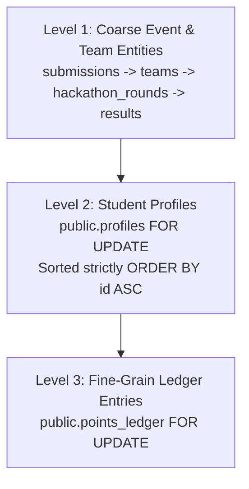
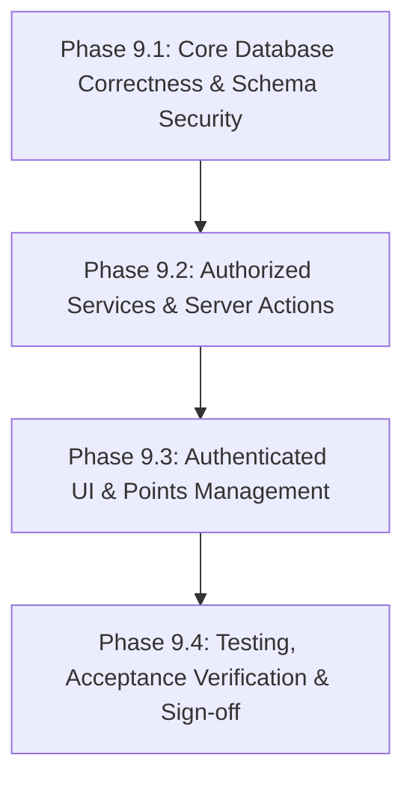

# NMIT HackLeague — Phase 9 Implementation Plan
**Points Ledger, Milestone Automation, Auditable Adjustments & Platform Leaderboard**

**Document Version:** 3.5.0 (Phase 9.1 Implemented Locally — Undergoing Final Verification — Awaiting Phase 9.2 Authorization)  
**Status:** PHASE 9.1 IMPLEMENTED LOCALLY — UNDERGOING FINAL VERIFICATION (CHANGES UNCOMMITTED) — PHASE 9.2 NOT STARTED (REQUIRES SEPARATE AUTHORIZATION)  
**Branch:** `v1`  
**Repository Root:** `/Volumes/CodingVault/web/HackLeague`  
**Verified Git Commit Baseline:** `8c44b3b2f48b1b8674384b1cc20f3710e9c6d78b`  
**Target Environment:** Next.js 16.4.0 (App Router), React 19.0.0, TypeScript 5.7.0, Tailwind CSS 4.0.0, Supabase PostgreSQL 17, Supabase Auth (GoTrue), Supabase Storage  

---

## 1. Executive Summary & Audit Baseline

A comprehensive, read-only architectural audit of the NMIT HackLeague repository was executed on branch `v1` at commit `8c44b3b2f48b1b8674384b1cc20f3710e9c6d78b`.

### 1.1 Verified Repository State
- **Current Branch:** `v1` (clean working tree, zero uncommitted code changes, zero untracked application files).
- **Commit Baseline:** Matches commit `8c44b3b2f48b1b8674384b1cc20f3710e9c6d78b` containing the complete Phase 8 implementation (round tracking, milestone submissions, 1 MiB storage validation, admin reviews, and Option 5A retention).
- **Pre-existing Planning Artifacts:** `PHASE_01` through `PHASE_08` implementation plans and `graphify-out/` artifacts remain preserved intact.
- **Safety Boundary:** All inspections were performed strictly read-only. No migrations were created or applied, no database state was mutated, no tests were run that could alter state, and no application code was modified.

### 1.2 Core Audit Findings Summary
1. **Ledger Immutability & Point Value Snapshotting (Existing Strength):**
   - Table `public.points_ledger` enforces strict append-only immutability via trigger `trg_points_ledger_immutable` (`20261012000006_create_results_and_points_tables.sql:87-89`), rejecting direct `UPDATE` or `DELETE` statements.
   - Point awards record an explicit signed integer in `points_ledger.points`. Historical ledger entries are permanently snapshotted and will never be altered by subsequent updates to `public.point_configurations`.
   - Reversals and manual adjustments append new signed records (`points < 0` for reversals). Student totals reconcile deterministically via `COALESCE(SUM(points), 0)`.
2. **Initial Participation Points (Partially Implemented in Phase 7):**
   - Awarded atomically via `submit_registration_proof` when the team leader uploads an external-registration screenshot and accepts the mandatory CDC declaration text.
   - Preconditions: storage proof existence (`teams/{team_id}/registration/{uuid}.*`), mandatory CDC acceptance (`p_cdc_declaration_accepted = true`), matching CDC disclaimer text, minimum team size, and an open registration window.
   - Team status is set to `'submitted'` (not `'verified'`). The initial award represents a submitted registration claim, not an independently verified registration.
3. **Round Qualification Points (Hardened in Phase 8):**
   - Awarded atomically within `review_round_submission` when an admin issues an `accepted` decision.
   - Enforces transaction-safe locking (`FOR UPDATE`), checks stage deadlines, creates a published `public.results` row, reads `public.point_configurations`, and inserts ledger entries under idempotency key `round_qualification_{hackathon_id}_{round_id}_{student_id}` with `ON CONFLICT DO NOTHING`.
4. **Winner Bonus Points (Disabled Invariant & Critical Attack Surface):**
   - `record_round_winner_placement` records placement results in `public.results (milestone_type = 'win_placement')` and writes to `audit_logs`, but **does NOT award points** in `points_ledger`.
   - *Attack Surface / Invariant Risk:* `supabase/seed.sql:215` seeds `point_configurations` for `win_placement` with `is_active = true` (30/35 pts). Legacy RPC `award_milestone_points` contains an active branch for `'win_placement'`. Setting `point_configurations.is_active = false` alone is insufficient because direct RPC invocations or future configuration changes could enable bonuses prematurely. Multi-layered database-level blocking is required.
   - In `supabase/tests/15_ts_phase6_hardening.sql:844-859`, a synthetic `points_ledger` row with `milestone_type = 'win_placement'` is inserted during testing. A migration preflight check and trigger-based insert block are required to protect historical data integrity while blocking new awards.
5. **Leaderboard RLS Privacy Boundary (Critical Architecture Discovery):**
   - `public.profiles` policy `profiles_select_student` allows students to select **only their own profile** (`id = auth.uid()`).
   - `public.points_ledger` policy `points_ledger_select_student` allows students to select **only their own ledger rows** (`student_id = auth.uid()`).
   - Client queries cannot construct a platform-wide leaderboard. A `SECURITY DEFINER` database function (`get_platform_leaderboard`) is required.
   - To prevent PII leakage, the response must be strictly sanitized and authenticated-only, completely excluding USNs, emails, phone numbers, and identity documents by default. Public unauthenticated access is strictly out of scope.
6. **Data Model Gap: Academic Year vs Semester:**
   - `public.profiles.academic_year` is an `INTEGER NOT NULL CHECK (academic_year BETWEEN 1 AND 4)` representing **student study year** (Year 1, 2, 3, or 4).
   - The string `semester` has **zero occurrences** across the entire codebase. Neither `profiles`, `hackathons`, nor `points_ledger` track semesters or calendar years (e.g., `'2025-2026'`).
   - The assumption of an August–December / January–July semester calendar is unverified for NMIT. Explicit event-period metadata on `hackathons` is proposed to avoid synthetic calendar assumptions, with unassigned historical events remaining unassigned.
7. **Lock-Order Hierarchy Gap Across Existing RPCs:**
   - Prior to Phase 9, existing balance-changing operations acquired locks haphazardly: `submit_registration_proof` locked `teams`, `review_round_submission` locked `round_submissions`, `teams`, `hackathon_rounds`, and `reverse_points_ledger_entry` locked `points_ledger`. None acquired student `profiles` locks.
   - A uniform Directed Acyclic Graph (DAG) lock order must be enforced across all 5 RPCs: Coarse entities (submissions/teams/rounds/results) $\rightarrow$ Student `profiles` (sorted strictly by `student_id ASC` for multi-student teams) $\rightarrow$ `points_ledger` entries. Enforcing this hierarchy systematically prevents deadlocks across verified operations under four explicit architectural assumptions, and prevents race conditions from bypassing balance floor checks.
8. **Distinction Between Reversals and Manual Adjustments (Owner Decision Settled — Option 2A):**
   - A reversal (`reverse_points_ledger_entry`) is an exact 1:1 retroactive cancellation of a specific prior award entry (`reversal_of_id = orig.id`, `points = -1 * orig.points`).
   - The project owner has explicitly selected **Option 2A (Preserve Exact Accounting Reversals)**: reversals execute unconditionally regardless of the student's current net balance, even if driving the resulting net balance negative (e.g., reversing an erroneous 25-point award when current net balance is 10 produces a -25 reversal entry and results in a -15 net balance). This preserves accounting truth and prevents students from locking in unearned points.
   - The zero-point floor applies strictly to *manual adjustments* (`adjust_points_ledger_entry`), where ordinary adjustments cannot reduce net points below zero without an explicit Super Admin override and mandatory audit reason.
9. **Idempotency Exception Constraint Diagnostics:**
   - The adjustment RPC must not catch general `unique_violation` errors and blindly assume an idempotency key collision. Unrelated unique constraint violations (e.g., on team membership, secondary indexes, or audit records) must be re-raised immediately via `GET STACKED DIAGNOSTICS v_violated_constraint = CONSTRAINT_NAME`. Only violations matching the verified idempotency key constraint (`points_ledger_idempotency_key_key`) proceed to parameter comparison.
10. **Leaderboard Metric Semantics (Team Results vs Student Ledger):**
    - `public.results` is strictly a team-level entity (`team_id, hackathon_id, round_id`); it does not contain `student_id`.
    - An individual student earns eligibility for a qualification milestone exclusively through an active, unreversed `round_qualification` entry in `public.points_ledger` that references a published, verified result. Counting `COUNT(DISTINCT pl.round_id)` guarantees that no student can count the same qualification milestone more than once.
11. **Team-Membership Immutability via Ledger References (Schema Invariant & Boundary Analysis):**
    - **Verified current behavior (Referential Integrity):** Composite foreign key `fk_points_ledger_team_member` (`20261012000006_create_results_and_points_tables.sql:63`) enforces `ON DELETE RESTRICT` from `public.points_ledger` to `public.team_members(team_id, student_id, hackathon_id)`. Combined with trigger `trg_points_ledger_immutable`, historical ledger rows are permanently immutable. Consequently, any student who receives points on a team cannot subsequently have their membership row deleted via `DELETE FROM team_members`.
    - **Verified current behavior (`remove_team_member`):** In committed migration `20261020000001:297-302`, `remove_team_member` includes an explicit pre-check `IF EXISTS (SELECT 1 FROM public.points_ledger WHERE team_id = p_team_id AND student_id = p_student_id)` raising SQLSTATE `55P03` (`lock_not_available`).
    - **Verified current behavior (`leave_team`):** In committed migration `20261020000001:157-160`, `leave_team` checks `IF v_team.external_status <> 'not_submitted' OR v_team.internal_status <> 'forming'` and raises SQLSTATE `55P03` (`lock_not_available`). However, it has **no** explicit `points_ledger` pre-check. If points are awarded while a team is still in `'forming'` status with `external_status = 'not_submitted'` (e.g., via a manual adjustment), an attempted `leave_team` executes `DELETE FROM team_members` and fails with PostgreSQL constraint error SQLSTATE `23503` (`foreign_key_violation`).
    - **Planned Phase 9 behavior:** Planned migration `20261022000001` (unapplied and uncommitted) proposes to patch `leave_team` to add the identical points-ledger pre-check, raising SQLSTATE `55P03` (`lock_not_available`) to align user experience with `remove_team_member` and prevent unhandled `23503` errors.
    - **Known limitation:** Under the current deletion-based membership model (`public.team_members` lacks a `status` column), students with historical ledger entries cannot leave or transfer teams through ordinary membership deletion. Soft-delete membership lifecycles and relational decoupling are strictly out of scope for Phase 9 and recorded as future schema options only.

---

## 2. Settled Owner-Approved Decisions, Approved Defaults & Open Decisions

### 2.1 Owner-Approved Requirements (Preserved & Settled)
1. **Initial Participation Points:** Award configured participation points automatically once the external-registration screenshot and CDC declaration are recorded. No manual Admin review is required for this initial award. Display it clearly as a submitted registration claim, not an independently verified achievement.
2. **Winner Bonuses Disabled:** Keep winner/placement bonus points disabled until the owner explicitly authorizes eligible placements after consulting club leads.
3. **Platform Leaderboard:** Provide a platform-wide student leaderboard with optional academic-year and semester filters.
4. **Append-Only Corrections:** Correct point errors using append-only, reasoned adjustments that preserve original ledger records.
5. **Exact Accounting Reversals (Option 2A Settled):** Reversals must strictly cancel their original award 1:1 (`reversal_of_id = orig.id`, `points = -1 * orig.points`) and proceed unconditionally regardless of the student's current net balance, even if the resulting balance is negative. The zero-point floor applies strictly to manual adjustments, where ordinary adjustments cannot reduce platform-wide net points below zero without an explicit Super Admin override and mandatory audit justification.

### 2.2 Adopted Approved Defaults (Non-Reopened)
- **Leaderboard Access:** Authenticated, eligible students and authorized admins only. No public unauthenticated access. Do not expose USNs, emails, phone numbers, identity documents, or other unnecessary PII.
- **Ranking:** Use dense ranking (`DENSE_RANK()`). Equal total points receive equal rank; do not apply hidden alphabetical, USN, or other secondary tie-breakers.
- **Negative Balances on Adjustments:** Ordinary manual adjustments must not reduce a student's platform-wide net points below zero. A Super Admin may explicitly override this restriction with a mandatory reason and an immutable audit record. Reversals of prior awards are not subject to this floor and execute as exact mathematical cancellations (Option 2A).
- **Historical Academic Periods:** Leave unclassified events as `unassigned` until an authorized admin classifies them. Never infer an academic term from event dates.
- **Winner Bonuses:** Block winner-bonus point awards through every existing and new award path until explicit owner authorization. Preserve the ability to record and verify placements without awarding bonus points.

### 2.3 Status of Owner Decisions: All Architectural Decisions Settled (Zero Open Decisions)

> [!NOTE]
> **All Core Architectural and Policy Decisions are 100% Settled**
> The project owner explicitly selected **Option 2A (Preserve Exact Accounting Reversals)**. Option 2B (universal negative-balance blocking on reversals) was formally rejected because it would compromise accounting truth and allow students to lock in unearned or erroneous points by reducing their balance before administrative reversal.
>
> With this resolution:
> 1. Initial participation points are awarded automatically upon registration proof submission and CDC declaration (settled).
> 2. Winner bonus points remain completely blocked across all paths pending separate explicit owner authorization (settled).
> 3. Leaderboard is authenticated-only, dense-ranked, PII-sanitized, and uses independent pre-aggregations (settled).
> 4. Academic periods separate student study year (1..4) from hackathon event term, with zero date-based term inference (settled).
> 5. Points adjustments are append-only and reasoned, with a zero-point floor for manual adjustments (Super Admin overrideable) and unconditional exact 1:1 cancellations for reversals (Option 2A settled).
>
> **There are zero unresolved owner decisions remaining.** The implementation plan is complete and awaits only final authorization to begin execution.

---

## 3. Read-Only Database & Code Safety Audit

### 3.1 Winner-Bonus Ledger Row Preflight & Schema Audit
- **Audit Question:** Do any existing `points_ledger` entries have `milestone_type = 'win_placement'`?
- **Repository Evidence:**
  - Migrations 1–20 contain zero inserts of `milestone_type = 'win_placement'` into `points_ledger`.
  - `supabase/seed.sql` contains zero inserts into `points_ledger`.
  - `supabase/tests/15_ts_phase6_hardening.sql:844-859` inserts a synthetic `win_placement` ledger row in a pgTAP test block (`BEGIN ... ROLLBACK`).
  - `tests/integration/round-submission-lifecycle.test.ts:472` asserts `results.milestone_type = 'win_placement'`, but verifies that `points_ledger` contains only qualification entries.
- **Definitive Migration Strategy:** To make the migration safely repeatable across all deployment targets, the preflight checks both historical row presence and constraint existence across all 4 combinations (Section 4.1). Existing rows are never deleted, rewritten, or reversed. Trigger-based insert blocking is applied unconditionally.

### 3.2 Schema for Linkage Fields, Unique Constraints, Idempotency & Triggers
- **Table:** `public.points_ledger` (`20261012000006_create_results_and_points_tables.sql:48-77`)
  - `id UUID PRIMARY KEY DEFAULT gen_random_uuid()`
  - `idempotency_key TEXT NOT NULL UNIQUE`
  - `student_id UUID NOT NULL REFERENCES public.profiles(id) ON DELETE RESTRICT`
  - `hackathon_id UUID NOT NULL REFERENCES public.hackathons(id) ON DELETE RESTRICT`
  - `team_id UUID NOT NULL` (Composite FK `(team_id, student_id, hackathon_id)` to `public.team_members`)
  - `round_id UUID NULL REFERENCES public.hackathon_rounds(id, hackathon_id) ON DELETE RESTRICT`
  - `result_id UUID NULL REFERENCES public.results(id, hackathon_id) ON DELETE RESTRICT`
  - `reversal_of_id UUID NULL REFERENCES public.points_ledger(id) ON DELETE RESTRICT`
  - `milestone_type TEXT NOT NULL CHECK (milestone_type IN ('participation', 'round_qualification', 'win_placement', 'manual_adjustment', 'reversal'))`
  - `role_at_award TEXT NOT NULL CHECK (role_at_award IN ('leader', 'member'))`
  - `points INTEGER NOT NULL CHECK (points <> 0)`
  - `reason TEXT NOT NULL`
  - `awarded_by UUID NOT NULL REFERENCES public.admin_profiles(id) ON DELETE RESTRICT`
  - `created_at TIMESTAMPTZ NOT NULL DEFAULT now()`
- **Existing Constraints & Indexes:**
  - `chk_points_ledger_reversal_ref`: `milestone_type <> 'reversal' OR reversal_of_id IS NOT NULL`
  - `chk_points_ledger_reversal_negative`: `milestone_type <> 'reversal' OR points < 0`
  - `uq_points_ledger_participation`: Partial unique index on `(student_id, hackathon_id) WHERE (milestone_type = 'participation')`
  - `uq_points_ledger_round_qualification`: Partial unique index on `(student_id, hackathon_id, round_id) WHERE (milestone_type = 'round_qualification')`
  - `uq_points_ledger_win`: Partial unique index on `(student_id, hackathon_id) WHERE (milestone_type = 'win_placement')`
  - `uq_points_ledger_single_reversal`: Partial unique index on `(reversal_of_id) WHERE (milestone_type = 'reversal')`
- **Adjustment Linkage Schema Update:** To link manual adjustments to original awards without overloading `reversal_of_id`, Phase 9 adds:
  ```sql
  ALTER TABLE public.points_ledger 
  ADD COLUMN IF NOT EXISTS adjusted_entry_id UUID NULL REFERENCES public.points_ledger(id) ON DELETE RESTRICT;
  ```

### 3.3 Audit of All Winner-Bonus and Configuration Paths
1. **`public.award_milestone_points` (`20261019000001_phase6_updates_1_to_6.sql:212-410`):**
   - Active branch `ELSIF p_milestone_type = 'win_placement'` queries `point_configurations` and inserts into `points_ledger`.
   - *Action:* Updated to raise SQLSTATE `55P03` (`lock_not_available`): `Winner bonus points are currently disabled pending owner authorization.`
2. **`public.record_round_winner_placement` (`20261021000001_phase8_round_tracking_and_evidence_review.sql:1361-1476`):**
   - Verified: Records placement in `public.results` (`milestone_type = 'win_placement'`) and logs to `audit_logs`. Does **not** insert into `points_ledger`. Preserved as-is.
3. **`recordRoundWinnerPlacementAction` (`src/actions/round-review-actions.ts:169-226`):**
   - Calls `record_round_winner_placement`. Zero ledger insertion. Preserved as-is.
4. **`public.point_configurations` Table & Seed (`seed.sql:215`):**
   - `win_placement` is seeded as `is_active = true` (30/35 pts).
   - *Action:* Migration explicitly sets `is_active = false`, `regular_member_points = 0`, `team_leader_points = 0`.
5. **Configuration Mutation Paths:**
   - Policy `point_configurations_update_super` allows Super Admin direct updates.
   - *Action:* Trigger `trg_point_configs_block_win_placement` blocks setting `is_active = true` for `win_placement`. Server Action `updatePointConfigurationAction` logs all updates to `public.audit_logs`.

### 3.4 Execution Grants & Authorization Checks
- **Security Definer Standards:** Every new or modified RPC uses explicit `SET search_path = public, pg_temp;` and fully schema-qualified identifiers.
- **Grants:** `REVOKE ALL ON FUNCTION ... FROM PUBLIC, anon;`. Granted to `authenticated` and `service_role`.
- **Database Boundary Checks:**
  - `get_platform_leaderboard`: Requires non-null `auth.uid()` and caller must be active admin or approved student (`registration_status = 'approved'`).
  - `adjust_points_ledger_entry`: Requires `current_is_super_admin()` or `can_admin_manage_hackathon(hackathon_id, 'manage_points')`.
  - `get_student_points_summary`: Requires `auth.uid() = p_student_id` or active admin.

### 3.5 `public.audit_logs` Schema & Tamper-Resistance
- **Schema (`20261012000007_create_audit_logs_and_change_requests.sql:6-17`):**
  - `id UUID PRIMARY KEY DEFAULT gen_random_uuid()`
  - `actor_id UUID NULL REFERENCES auth.users(id) ON DELETE SET NULL`
  - `actor_role TEXT NOT NULL`
  - `action TEXT NOT NULL`
  - `target_type TEXT NOT NULL`
  - `target_id TEXT NULL`
  - `details JSONB NOT NULL DEFAULT '{}'::jsonb`
  - `created_at TIMESTAMPTZ NOT NULL DEFAULT now()`
- **Tamper Resistance:** Trigger `trg_prevent_audit_log_mutation` (`20261012000007:27-29`) blocks all `UPDATE` and `DELETE` on `audit_logs`.
- **Actor Role Attribution:** Accurately records `'super_admin'` when `current_is_super_admin()` is true, `'admin'` for scoped hackathon admins, and `'student'` for students. Never generic or hardcoded.

### 3.6 Query Patterns & Performance Indexes
- **Existing Indexes:**
  - Partial unique indexes on `points_ledger` for participation, round qualification, win, single reversal.
  - Primary key on `points_ledger(id)`, unique on `points_ledger(idempotency_key)`.
  - Index on `profiles(branch, academic_year)`.
- **Proposed Indexes with Technical Justifications:**
  1. `idx_points_ledger_student_points` on `public.points_ledger(student_id, points)`: Enables index-only scans for `SUM(points)` aggregation.
  2. `idx_points_ledger_student_created` on `public.points_ledger(student_id, created_at DESC)`: Eliminates in-memory sorting for student personal ledger history.
  3. `idx_points_ledger_hackathon_student` on `public.points_ledger(hackathon_id, student_id, points)`: Optimizes period-filtered aggregation and covers unindexed foreign key `hackathon_id`.
  4. `idx_hackathons_academic_period` on `public.hackathons(academic_year, academic_term)`: Allows fast index scans when resolving hackathons in a specific academic period.

---

## 4. Refined Winner-Bonus Migration Safety & Repeatability

### 4.1 Definitive Repeatable Preflight Matrix & Script
To guarantee repeatable, error-free execution across new deployments, CI test environments, and existing databases, the migration handles all four possible combinations of historical row presence and check constraint existence deterministically:

| Combination | Historical `win_placement` Rows | Check Constraint Exists? | Migration Preflight & Execution Behavior |
| :---: | :---: | :---: | :--- |
| **1** | **Absent (0 rows)** | **Absent** | Applies table constraint `chk_points_ledger_win_placement_disabled`. Creates/replaces trigger `trg_points_ledger_block_winner_bonus`. All winner bonus inserts blocked. |
| **2** | **Absent (0 rows)** | **Present** | Detects constraint in `pg_constraint`; skips creating constraint to prevent duplicate constraint errors. Creates/replaces trigger. All winner bonus inserts blocked. |
| **3** | **Present ($N > 0$ rows)** | **Absent** | Emits audit notice with row count. **Preserves existing historical records intact without deleting, rewriting, or silently reversing them.** Skips check constraint creation (preventing migration failure). Enforces winner bonus block via trigger. |
| **4** | **Present ($N > 0$ rows)** | **Present** | Emits audit notice with row count. Preserves historical records. Leaves existing constraint intact. Creates/replaces trigger. All winner bonus inserts blocked. |

#### Invariants Enforced Across All Combinations
1. **Zero Data Alteration:** Under no circumstances will migration execution delete, update, rewrite, or silently reverse any existing `points_ledger` records.
2. **Universal Insert Blocking:** In every single combination, the unconditional database trigger `trg_points_ledger_block_winner_bonus` is activated, ensuring that direct SQL, service-role calls, or application RPCs cannot insert new winner bonus rows.

#### Repeatable Migration Script
```sql
DO $$
DECLARE
  v_existing_win_count INT;
  v_constraint_exists BOOLEAN;
BEGIN
  -- 1. Inspect existing historical win_placement ledger rows
  SELECT COUNT(*) INTO v_existing_win_count
  FROM public.points_ledger
  WHERE milestone_type = 'win_placement';

  -- 2. Inspect whether check constraint already exists in pg_constraint catalog
  SELECT EXISTS (
    SELECT 1 FROM pg_constraint
    WHERE conname = 'chk_points_ledger_win_placement_disabled'
      AND conrelid = 'public.points_ledger'::regclass
  ) INTO v_constraint_exists;

  -- 3. Execute deterministic handling across all 4 combinations
  IF v_existing_win_count > 0 THEN
    IF v_constraint_exists THEN
      -- Combination 4: Historical rows present, constraint already present
      RAISE NOTICE 'PREFLIGHT AUDIT [Comb 4]: Found % existing win_placement ledger rows; constraint already exists. Preserving historical records without modification; trigger-based insert block remains active.', v_existing_win_count;
    ELSE
      -- Combination 3: Historical rows present, constraint absent
      RAISE NOTICE 'PREFLIGHT AUDIT [Comb 3]: Found % existing win_placement ledger rows. Preserving historical records without modification; skipping table CHECK constraint and activating trigger-based insert block.', v_existing_win_count;
    END IF;
  ELSE
    IF v_constraint_exists THEN
      -- Combination 2: Zero historical rows, constraint already present
      RAISE NOTICE 'PREFLIGHT AUDIT [Comb 2]: Zero historical rows found; constraint already exists. Re-verifying trigger protection.';
    ELSE
      -- Combination 1: Zero historical rows, constraint absent
      RAISE NOTICE 'PREFLIGHT AUDIT [Comb 1]: Zero historical rows found; creating strict table-level CHECK constraint.';
      ALTER TABLE public.points_ledger 
      ADD CONSTRAINT chk_points_ledger_win_placement_disabled 
      CHECK (milestone_type <> 'win_placement');
    END IF;
  END IF;
END $$;
```

### 4.2 Multi-Layered Winner-Bonus Blocking Architecture
1. **Database Trigger Insert Block (Protects All Future Inserts in Every Case):**
   ```sql
   CREATE OR REPLACE FUNCTION public.prevent_winner_bonus_point_award()
   RETURNS TRIGGER AS $$
   BEGIN
     IF NEW.milestone_type = 'win_placement' THEN
       RAISE EXCEPTION 'Winner bonus point awards are disabled pending explicit project owner authorization.'
       USING ERRCODE = '55P03';
     END IF;
     RETURN NEW;
   END;
   $$ LANGUAGE plpgsql;

   DROP TRIGGER IF EXISTS trg_points_ledger_block_winner_bonus ON public.points_ledger;
   CREATE TRIGGER trg_points_ledger_block_winner_bonus
   BEFORE INSERT ON public.points_ledger
   FOR EACH ROW EXECUTE FUNCTION public.prevent_winner_bonus_point_award();
   ```
2. **RPC Guard in `public.award_milestone_points`:**
   Explicit exception raised if `p_milestone_type = 'win_placement'`:
   ```sql
   IF p_milestone_type = 'win_placement' THEN
     RAISE EXCEPTION 'Winner bonus point awards are disabled pending explicit project owner authorization.'
     USING ERRCODE = '55P03';
   END IF;
   ```
   *Note on SQLSTATE `55P03`:* In PostgreSQL, `55P03` strictly denotes `lock_not_available`. Following Phase 7 conventions (where administrative freezes and locked lifecycle states return `55P03`), this code represents an administrative feature lock, mapped to a friendly message by the application layer.
3. **Configuration Deactivation:**
   ```sql
   UPDATE public.point_configurations
   SET is_active = false, regular_member_points = 0, team_leader_points = 0, updated_at = now()
   WHERE milestone_type = 'win_placement';
   ```
4. **Configuration Mutation Lock:**
   Trigger `trg_point_configs_block_win_placement` on `public.point_configurations` blocks setting `is_active = true` for `win_placement`.

### 4.3 Trigger, Constraint & Test Environment Coexistence Analysis

#### Coexistence with Existing Schema Triggers & Constraints
1. **Disjoint Trigger Lifecycles:**
   - Existing trigger `trg_points_ledger_immutable` (`20261012000006:87-89`) executes exclusively `BEFORE UPDATE OR DELETE`.
   - The new blocking trigger `trg_points_ledger_block_winner_bonus` executes exclusively `BEFORE INSERT`.
   - Because their triggering events are mutually disjoint, there is zero execution order dependency, cycle risk, or performance interference.
2. **Coexistence with Existing Check Constraints:**
   - Existing domain constraint `chk_points_ledger_milestone` permits `'win_placement'` as a legal enum value.
   - On databases without historical rows, the conditional constraint `chk_points_ledger_win_placement_disabled` restricts the allowed set at the table level.
   - On databases with historical rows, the table CHECK constraint is omitted to prevent table validation failure, but `trg_points_ledger_block_winner_bonus` intercepts every single incoming insert before it reaches table storage.

#### Multi-Environment Deterministic Behavior
- **Fresh Databases (CI / New Environments):** Preflight detects 0 rows and constraint absent. Both the table-level CHECK constraint and the trigger are applied (dual-layer defense).
- **Existing Production / Staging Databases:** Preflight detects existing historical `win_placement` entries. Emits audit notice with exact row count, preserves historical rows without deletion, update, or silent reversal, skips table CHECK constraint, and activates the trigger block.
- **Test Environments with Synthetic Fixtures (e.g., `15_ts_phase6_hardening.sql:844-859`):**
  - In `15_ts_phase6_hardening.sql`, synthetic `win_placement` ledger rows are inserted within a test transaction.
  - **Test Isolation & Rollback Requirement:** All pgTAP suites must encapsulate synthetic fixtures within `BEGIN ... ROLLBACK` transaction boundaries.
  - If a test fixture ever commits synthetic rows to a persistent test database, the Phase 9 migration preflight handles it gracefully under **Combination 3** or **Combination 4**, preserving the fixtures without aborting the migration.

### 4.4 Explicit Future Authorization Procedure
Winner bonuses cannot be re-enabled by a simple UI toggle or single admin action. The explicit procedure requires:
1. Written project owner authorization approving eligible placements and point values after club lead consultation.
2. An authorized migration that drops `trg_points_ledger_block_winner_bonus`, drops `chk_points_ledger_win_placement_disabled` (if present), updates `trg_point_configs_block_win_placement`, and sets configured values in `point_configurations`.
3. Updating `award_milestone_points` and Server Actions to allow verified placement bonuses.

---

## 5. Refined Authorization & Database Security

### 5.1 `SECURITY DEFINER` Standards for Points & Leaderboard
All `SECURITY DEFINER` functions in Phase 9 strictly follow these standards:
- Explicit `SET search_path = public, pg_temp;`.
- Execution revoked from `PUBLIC` and `anon`.
- Authentication and eligibility checks executed within the function body.
- Output sanitization removing all unnecessary PII.

### 5.2 Authoritative Function Specifications

#### A. `public.get_platform_leaderboard`
- **Signature & Security Configuration:**
  ```sql
  CREATE OR REPLACE FUNCTION public.get_platform_leaderboard(
    p_academic_year INT DEFAULT NULL,        -- Filters student study year (1..4)
    p_event_academic_year TEXT DEFAULT NULL, -- Filters hackathons.academic_year
    p_event_term TEXT DEFAULT NULL,          -- Filters hackathons.academic_term ('odd_sem', 'even_sem')
    p_limit INT DEFAULT 50,
    p_offset INT DEFAULT 0
  )
  RETURNS TABLE (
    student_id UUID,
    full_name TEXT,
    branch TEXT,
    academic_year INT,
    total_points BIGINT,
    verified_qualifications_count BIGINT,
    rank BIGINT
  )
  SECURITY DEFINER
  SET search_path = public, pg_temp;
  ```
- **Access Control:**
  - `REVOKE ALL ON FUNCTION public.get_platform_leaderboard FROM PUBLIC, anon;`
  - `GRANT EXECUTE ON FUNCTION public.get_platform_leaderboard TO authenticated;`
- **Internal Security Checks:**
  1. `IF auth.uid() IS NULL THEN RAISE EXCEPTION 'Unauthorized: authentication required.' USING ERRCODE = '42501'; END IF;`
  2. Caller must be an active admin (`admin_profiles.is_active = true`) OR an approved student (`profiles.registration_status = 'approved'`). Inactive/draft/suspended users are rejected.
- **Sanitized Output:**
  - Does **not** return USN, email, phone, college ID, or date of birth.
  - Implements cartesian-safe independent pre-aggregations, computes `DENSE_RANK() OVER (ORDER BY total_points DESC) AS rank`, and applies deterministic ordering for pagination (Section 7.3).

#### B. `public.get_student_points_summary`
- **Signature:**
  ```sql
  CREATE OR REPLACE FUNCTION public.get_student_points_summary(
    p_student_id UUID
  )
  RETURNS JSONB
  SECURITY DEFINER
  SET search_path = public, pg_temp;
  ```
- **Access Control:**
  - Caller must be the student themselves (`auth.uid() = p_student_id`) OR hold `manage_points` / `manage_students` permission.
- **Output:** Returns net points, current platform rank, verified round milestones count, submitted participation claims count, and itemized ledger history.

#### C. `public.set_hackathon_academic_period`
- **Signature:**
  ```sql
  CREATE OR REPLACE FUNCTION public.set_hackathon_academic_period(
    p_hackathon_id UUID,
    p_academic_year TEXT,
    p_academic_term TEXT
  )
  RETURNS JSONB
  SECURITY DEFINER
  SET search_path = public, pg_temp;
  ```
- **Access Control:** Requires `current_is_super_admin()` or `can_admin_manage_hackathon(p_hackathon_id, 'manage_hackathons')`.
- **Audit Logging:** Writes to `public.audit_logs` with action `'hackathon.academic_period_updated'` and accurate actor role.

---

## 6. Refined Adjustments, Reversals & Concurrency Serialization

### 6.1 Linkage Fields & Schema Updates
- **Reversals:** Link directly to `points_ledger.reversal_of_id`. Points are `-1 * original.points`. Constraint `chk_points_ledger_reversal_negative` enforces negative value.
- **Manual Adjustments:** Column `adjusted_entry_id UUID NULL REFERENCES public.points_ledger(id) ON DELETE RESTRICT` links partial corrections to the specific award being modified.

### 6.2 Race-Safe Adjustment RPC: `public.adjust_points_ledger_entry`

#### Safe Concurrency, Team-Membership & Idempotency Strategy
1. **Pre-Check Fast Input & Authorization Validation:**
   Caller authentication, authorization scoping, point non-zero checks, trimmed reason length ($\ge 10$ non-whitespace chars), and idempotency key format ($8..128$ alphanumeric chars) are validated first. Invalid requests abort immediately before acquiring any database row locks, minimizing lock contention.
2. **Level 1 Lock on `public.teams` (Resolves Team-Membership Mutation Race):**
   The RPC executes `SELECT * INTO v_team FROM public.teams WHERE id = p_team_id FOR UPDATE;` at Level 1 of the lock hierarchy.
   - If the team does not exist, it aborts immediately with SQLSTATE `P0002` (`no_data_found`: `Team not found.`).
   - If `v_team.hackathon_id <> p_hackathon_id`, it aborts with SQLSTATE `22023` (`invalid_parameter_value`: `Team does not belong to the specified hackathon.`).
   - **Mutual Exclusion Against Roster Changes:** In Phase 7 (`20261020000001:263-265, 330, 890`), all team-membership mutations (`remove_team_member`, `leave_team`, `join_team_by_code`) acquire `public.teams WHERE id = ... FOR UPDATE`. By holding this row lock throughout the adjustment transaction, the student's team membership cannot be concurrently deleted, transferred, or mutated between membership validation and ledger insertion. This eliminates the race condition that would otherwise trigger unhandled foreign key violations on `fk_points_ledger_team_member`.
3. **Level 2 Lock on `public.profiles` (Balance-Serialization Guarantee):**
   The RPC executes `PERFORM 1 FROM public.profiles WHERE id = p_student_id FOR UPDATE;` at Level 2.
   - If the student profile does not exist, it aborts immediately with SQLSTATE `P0002` (`no_data_found`: `Student profile not found.`).
   - This guarantees that all incoming balance-changing requests for that student are strictly serialized at the database engine level before reading balances or inserting ledger entries.
4. **Team-Membership Validation Under Dual Locks:**
   With both `teams` and `profiles` row locks held, the RPC verifies that the student is an enrolled member:
   ```sql
   SELECT role INTO v_member_role
   FROM public.team_members
   WHERE team_id = p_team_id AND student_id = p_student_id AND hackathon_id = p_hackathon_id;
   ```
   If not found, it aborts with SQLSTATE `22023` (`invalid_parameter_value`: `Cannot adjust points: student is not an enrolled member of the specified team for this hackathon.`). The verified `v_member_role` is captured for insertion into `points_ledger.role_at_award`.
5. **Exact Idempotency Replay Under Lock:**
   Under the student profile lock, the RPC checks `public.points_ledger WHERE idempotency_key = v_trimmed_key`:
   - If an entry is found and all parameters (`student_id`, `hackathon_id`, `team_id`, `points`, `reason`, and `adjusted_entry_id`) match identically, the RPC immediately returns `{ "success": true, "ledger_id": v_existing.id, "idempotent_replay": true }`.
   - **Zero duplicate ledger rows and zero duplicate audit log rows are inserted.**
6. **Deterministic Failure on Conflicting Parameter Reuse:**
   If an existing row matches the key but any parameter differs (different amount, student, team, reason, or adjustment target), the RPC raises SQLSTATE `23505` (`unique_violation`: `Idempotency key collision: key % already exists with conflicting parameters.`). Keys cannot be repurposed or hijacked.
7. **Database-Enforced Fallback with Exact Constraint Diagnostics:**
   For cross-student concurrent requests sharing a key, each caller acquires their respective student's profile lock and races to `INSERT`. The second insert triggers a table-level `unique_violation`:
   - The `EXCEPTION WHEN unique_violation` block explicitly extracts `GET STACKED DIAGNOSTICS v_violated_constraint = CONSTRAINT_NAME;`.
   - The check matches **strictly and exclusively** against the exact verified constraint name generated by PostgreSQL:
     ```sql
     IF v_violated_constraint = 'points_ledger_idempotency_key_key' THEN
     ```
     Broad wildcard patterns (such as `LIKE '%idempotency_key%'`) are strictly prohibited.
   - If `v_violated_constraint` matches `points_ledger_idempotency_key_key`, it queries `SELECT * FROM public.points_ledger WHERE idempotency_key = v_trimmed_key;`, retrieves the competing row, and validates all parameters. If parameters match, it returns an idempotent replay; if any parameter differs (guaranteed when `student_id` differs), it throws SQLSTATE `23505` (`unique_violation`).
   - If `v_violated_constraint` is ANY other constraint (e.g., secondary unique indexes or foreign table constraints), the exception is **re-raised immediately via `RAISE;`**, preventing silent masking of unexpected schema or constraint failures.
8. **Strict Transactional Atomicity:**
   PostgreSQL transaction rollback ensures that any failed insert or constraint violation completely undoes the attempt. Zero orphaned ledger rows and zero orphaned audit log rows are created upon failure.

```sql
CREATE OR REPLACE FUNCTION public.adjust_points_ledger_entry(
  p_student_id UUID,
  p_hackathon_id UUID,
  p_team_id UUID,
  p_points INT,
  p_reason TEXT,
  p_idempotency_key TEXT,
  p_adjusted_entry_id UUID DEFAULT NULL,
  p_override_negative_floor BOOLEAN DEFAULT false
)
RETURNS JSONB
SECURITY DEFINER
SET search_path = public, pg_temp AS $$
DECLARE
  v_caller_id UUID := auth.uid();
  v_is_super BOOLEAN := false;
  v_can_manage BOOLEAN := false;
  v_actor_role TEXT;
  v_trimmed_reason TEXT;
  v_trimmed_key TEXT;
  v_team RECORD;
  v_member_role TEXT;
  v_existing RECORD;
  v_net_points BIGINT;
  v_new_ledger_id UUID;
  v_violated_constraint TEXT;
BEGIN
  -- 1. Authentication Check
  IF v_caller_id IS NULL THEN
    RAISE EXCEPTION 'Unauthorized: authentication required.' USING ERRCODE = '42501';
  END IF;

  -- 2. Authorization Scoping
  v_is_super := public.current_is_super_admin();
  v_can_manage := public.can_admin_manage_hackathon(p_hackathon_id, 'manage_points');

  IF NOT (v_is_super OR v_can_manage) THEN
    RAISE EXCEPTION 'Access denied: caller does not have permission to adjust points for this hackathon.' USING ERRCODE = '42501';
  END IF;

  v_actor_role := CASE WHEN v_is_super THEN 'super_admin' ELSE 'admin' END;

  -- 3. Validate Inputs (Fast Validation Before Acquiring Database Locks)
  IF p_points = 0 THEN
    RAISE EXCEPTION 'Adjustment amount cannot be zero.' USING ERRCODE = '22023';
  END IF;

  v_trimmed_reason := TRIM(COALESCE(p_reason, ''));
  IF length(v_trimmed_reason) < 10 THEN
    RAISE EXCEPTION 'Adjustment reason must be at least 10 non-whitespace characters.' USING ERRCODE = '22000';
  END IF;

  v_trimmed_key := TRIM(COALESCE(p_idempotency_key, ''));
  IF length(v_trimmed_key) < 8 OR length(v_trimmed_key) > 128 OR v_trimmed_key !~ '^[a-zA-Z0-9_\-:]+$' THEN
    RAISE EXCEPTION 'Invalid idempotency key: must be 8-128 alphanumeric characters with hyphens, underscores, or colons.' USING ERRCODE = '22023';
  END IF;

  -- 4. Level 1 Lock: Teams Row Lock (Serializes Against Concurrent Team Membership Mutations)
  SELECT * INTO v_team
  FROM public.teams
  WHERE id = p_team_id
  FOR UPDATE;

  IF NOT FOUND THEN
    RAISE EXCEPTION 'Team not found.' USING ERRCODE = 'P0002';
  END IF;

  IF v_team.hackathon_id <> p_hackathon_id THEN
    RAISE EXCEPTION 'Team does not belong to the specified hackathon.' USING ERRCODE = '22023';
  END IF;

  -- 5. Level 2 Lock: Student Profile Row Lock (Serializes Student Balance Modifications)
  PERFORM 1 FROM public.profiles WHERE id = p_student_id FOR UPDATE;
  IF NOT FOUND THEN
    RAISE EXCEPTION 'Student profile not found.' USING ERRCODE = 'P0002';
  END IF;

  -- 6. Validate Team Membership Under Both Locks (Race-Safe Against Member Removal/Transfer)
  SELECT role INTO v_member_role
  FROM public.team_members
  WHERE team_id = p_team_id AND student_id = p_student_id AND hackathon_id = p_hackathon_id;

  IF NOT FOUND THEN
    RAISE EXCEPTION 'Cannot adjust points: student is not an enrolled member of the specified team for this hackathon.' USING ERRCODE = '22023';
  END IF;

  -- 7. Idempotency Check Under Lock
  SELECT * INTO v_existing FROM public.points_ledger WHERE idempotency_key = v_trimmed_key;
  IF FOUND THEN
    IF v_existing.student_id = p_student_id
       AND v_existing.hackathon_id = p_hackathon_id
       AND v_existing.team_id = p_team_id
       AND v_existing.points = p_points
       AND v_existing.reason = v_trimmed_reason
       AND (v_existing.adjusted_entry_id IS NOT DISTINCT FROM p_adjusted_entry_id) THEN
      -- Exact replay: return existing entry without creating duplicate ledger or audit row
      RETURN jsonb_build_object(
        'success', true,
        'ledger_id', v_existing.id,
        'idempotent_replay', true
      );
    ELSE
      RAISE EXCEPTION 'Idempotency key collision: key % already exists with conflicting parameters.', v_trimmed_key USING ERRCODE = '23505';
    END IF;
  END IF;

  -- 8. Concurrency-Safe Balance Floor Evaluation Under Lock
  SELECT COALESCE(SUM(points), 0) INTO v_net_points
  FROM public.points_ledger
  WHERE student_id = p_student_id;

  IF (v_net_points + p_points) < 0 THEN
    IF NOT v_is_super OR p_override_negative_floor IS NOT TRUE THEN
      RAISE EXCEPTION 'Manual adjustment rejected: net student points cannot fall below zero (current: %, adjustment: %). Super Admin override required.',
        v_net_points, p_points USING ERRCODE = '22000';
    END IF;
  END IF;

  -- 9. Atomic Ledger Insertion with Exact Constraint Diagnostics (Level 3)
  BEGIN
    INSERT INTO public.points_ledger (
      idempotency_key,
      student_id,
      hackathon_id,
      team_id,
      round_id,
      result_id,
      adjusted_entry_id,
      milestone_type,
      role_at_award,
      points,
      reason,
      awarded_by
    ) VALUES (
      v_trimmed_key,
      p_student_id,
      p_hackathon_id,
      p_team_id,
      NULL,
      NULL,
      p_adjusted_entry_id,
      'manual_adjustment',
      v_member_role,
      p_points,
      v_trimmed_reason,
      v_caller_id
    )
    RETURNING id INTO v_new_ledger_id;
  EXCEPTION WHEN unique_violation THEN
    -- Extract exact constraint name to avoid misclassifying unrelated unique violations
    GET STACKED DIAGNOSTICS v_violated_constraint = CONSTRAINT_NAME;
    
    IF v_violated_constraint = 'points_ledger_idempotency_key_key' THEN
      SELECT * INTO v_existing FROM public.points_ledger WHERE idempotency_key = v_trimmed_key;
      IF FOUND AND v_existing.student_id = p_student_id
               AND v_existing.hackathon_id = p_hackathon_id
               AND v_existing.team_id = p_team_id
               AND v_existing.points = p_points
               AND v_existing.reason = v_trimmed_reason
               AND (v_existing.adjusted_entry_id IS NOT DISTINCT FROM p_adjusted_entry_id) THEN
        RETURN jsonb_build_object(
          'success', true,
          'ledger_id', v_existing.id,
          'idempotent_replay', true
        );
      ELSE
        RAISE EXCEPTION 'Idempotency key collision: key % already exists with conflicting parameters.', v_trimmed_key USING ERRCODE = '23505';
      END IF;
    ELSE
      -- Reraise unexpected unique violation immediately without reclassifying as idempotency collision
      RAISE;
    END IF;
  END;

  -- 10. Atomic Audit Log Insertion
  INSERT INTO public.audit_logs (
    actor_id,
    actor_role,
    action,
    target_type,
    target_id,
    details
  ) VALUES (
    v_caller_id,
    v_actor_role,
    'points.adjusted',
    'points_ledger',
    v_new_ledger_id::text,
    jsonb_build_object(
      'student_id', p_student_id,
      'hackathon_id', p_hackathon_id,
      'team_id', p_team_id,
      'points', p_points,
      'reason', v_trimmed_reason,
      'idempotency_key', v_trimmed_key,
      'adjusted_entry_id', p_adjusted_entry_id,
      'prior_net_points', v_net_points,
      'super_admin_override', (v_net_points + p_points < 0)
    )
  );

  RETURN jsonb_build_object(
    'success', true,
    'ledger_id', v_new_ledger_id,
    'net_points', v_net_points + p_points,
    'idempotent_replay', false
  );
END;
$$ LANGUAGE plpgsql;

REVOKE ALL ON FUNCTION public.adjust_points_ledger_entry FROM PUBLIC, anon;
GRANT EXECUTE ON FUNCTION public.adjust_points_ledger_entry TO authenticated, service_role;
```

### 6.3 Reversals vs. Manual Adjustments & Zero-Point Floor Policy

#### Conceptual Distinction
- **Manual Adjustments (`milestone_type = 'manual_adjustment'`):** Forward-looking administrative adjustments, discretionary bonuses, or penalties. Governed by the owner-approved rule that net points cannot drop below zero unless explicitly overridden by a Super Admin.
- **Reversals (`milestone_type = 'reversal'`):** Exact 1:1 retroactive cancellations of specific prior award records (`reversal_of_id = orig.id`, `points = -1 * orig.points`). Reversals annul an erroneous or disqualified milestone.

#### Policy Formulation (Owner Decision Settled — Option 2A)
The project owner explicitly selected **Option 2A (Preserve Exact Accounting Reversals)**:
- Reversals execute as exact 1:1 mathematical cancellations of their original award: `reversal_of_id = orig.id` and `points = -1 * orig.points`.
- Reversals proceed unconditionally regardless of the student's current net balance, even if driving the resulting net balance negative (e.g., if a student has 10 points and an erroneous 25-point award is reversed, the ledger creates a -25 reversal entry, resulting in a temporary net balance of -15).
- Rationale: Preserves absolute audit truth and prevents students from locking in illegitimate, erroneous, or fraudulent awards by spending their balance before administrative reversal.
- The zero-point floor applies strictly to *manual adjustments* (`adjust_points_ledger_entry`), where ordinary adjustments cannot reduce net points below zero without an explicit Super Admin override and mandatory audit justification.
- Option 2B (universal negative-balance blocking) was explicitly rejected.

#### Hardened Reversal Lock Order in Phase 9
Under Option 2A, `reverse_points_ledger_entry` adheres strictly to the shared DAG lock order:
1. Fetch target `student_id` and metadata from `public.points_ledger WHERE id = p_ledger_id`. If not found, abort with SQLSTATE `P0002` (`no_data_found`: `Original ledger entry not found.`).
2. Acquire student profile lock: `PERFORM 1 FROM public.profiles WHERE id = v_orig_student_id FOR UPDATE;` (Level 2). If not found, abort with SQLSTATE `P0002` (`no_data_found`: `Student profile not found.`).
3. Acquire row lock on original entry: `SELECT * INTO v_orig FROM public.points_ledger WHERE id = p_ledger_id FOR UPDATE;` (Level 3).
4. Verify entry is not already reversed (checks partial unique index `uq_points_ledger_single_reversal`) and ensure `v_orig.milestone_type <> 'reversal'`.
5. Under settled Option 2A, proceed unconditionally without checking balance floor.
6. Insert negative reversal entry with `idempotency_key := 'reversal_' || p_ledger_id::text;`, `points := -1 * v_orig.points`, and `reversal_of_id := v_orig.id`.
7. Insert audit log record with `action = 'points.reversed'`.

### 6.4 Complete Lock-Order Audit & Qualified DAG Lock Hierarchy

#### Complete Audit of Existing Balance-Changing Operations
A comprehensive audit of the active migration source code revealed the existing lock sequences across all five balance-changing operations:

| RPC / Operation | Existing Lock Sequence in Codebase | Identified Architectural Gap | Corrected Phase 9 Lock Sequence (DAG Order) |
| :--- | :--- | :--- | :--- |
| **`submit_registration_proof`** (`20261020000001:568`) | 1. `teams FOR UPDATE`<br>2. Inserts ledger rows in loop (no profile lock). | Concurrent adjustment on team member could race with participation award; no serialization on student. | 1. `teams FOR UPDATE`<br>2. `profiles FOR UPDATE` (roster in `id ASC`)<br>3. `points_ledger` INSERTs. |
| **`review_round_submission`** (`20261021000001:1092-1121`) | 1. `round_submissions FOR UPDATE`<br>2. `teams FOR UPDATE`<br>3. `hackathon_rounds FOR UPDATE`<br>4. Inserts `results`<br>5. Inserts ledger rows in loop. | Concurrent adjustments on qualifying students could race with qualification awards. | 1. `round_submissions FOR UPDATE`<br>2. `teams FOR UPDATE`<br>3. `hackathon_rounds FOR UPDATE`<br>4. `results` INSERT/UPDATE<br>5. `profiles FOR UPDATE` (roster in `id ASC`)<br>6. `points_ledger` INSERTs. |
| **`reverse_points_ledger_entry`** (`20261021000001:1504`) | 1. `points_ledger FOR UPDATE` (original entry).<br>2. Inserts reversal ledger row. | Reversed entry locked before student profile; inverted order relative to adjustments (deadlock hazard). | 1. `profiles FOR UPDATE` (`WHERE id = orig_student_id`)<br>2. `points_ledger FOR UPDATE` (original entry)<br>3. `points_ledger` reversal INSERT. |
| **`award_milestone_points`** (legacy `20261019000001:268`) | 1. `results FOR SHARE`<br>2. Inserts ledger row. | No student profile lock; allows race with concurrent adjustments. | 1. `results FOR SHARE`<br>2. `profiles FOR UPDATE` (`WHERE id = student_id`)<br>3. `points_ledger` INSERT. |
| **`adjust_points_ledger_entry`** (Phase 9 planned) | N/A (New RPC) | Must serialize team membership validation and student balance modifications. | 1. Fast auth & input validation<br>2. `teams FOR UPDATE` (`WHERE id = p_team_id`) [Level 1]<br>3. `profiles FOR UPDATE` (`WHERE id = p_student_id`) [Level 2]<br>4. Validate `team_members` enrollment under lock<br>5. Check idempotency & balance floor under lock<br>6. `points_ledger` INSERT [Level 3]. |

#### Qualified Directed Acyclic Graph (DAG) Hierarchy
To systematically prevent deadlocks across concurrent balance-changing and team-membership operations, all transactions adhere to a 3-level Directed Acyclic Graph (DAG) lock protocol:



- **Rule 1 (Descending Level Order):** A transaction may acquire locks at Level 1, then Level 2, then Level 3. A transaction that holds a Level 2 or Level 3 lock can **never** request a Level 1 lock.
- **Rule 2 (Ascending Deadlock Prevention for Multi-Student Teams):** Within Level 2, whenever an operation awards points to multiple students simultaneously (`submit_registration_proof`, `review_round_submission`), the transaction MUST acquire all roster profile locks in a single, deterministically sorted statement:
  ```sql
  PERFORM 1 FROM public.profiles 
  WHERE id IN (
    SELECT student_id FROM public.team_members 
    WHERE team_id = v_team_id AND hackathon_id = v_hackathon_id
  )
  ORDER BY id ASC
  FOR UPDATE;
  ```
  Because all transactions acquire profile locks in the exact same UUID order, circular wait conditions ($T_1 \rightarrow T_2 \rightarrow T_1$) on student profiles are systematically prevented.

#### 6.4.1 Architectural Analysis: Membership-Removal Consequences of Ledger References (`ON DELETE RESTRICT`)

1. **Schema Referential Integrity Invariant:**
   - **Verified current behavior:** In committed migration `supabase/migrations/20261012000006_create_results_and_points_tables.sql:63`, the schema defines:
     ```sql
     CONSTRAINT fk_points_ledger_team_member 
     FOREIGN KEY (team_id, student_id, hackathon_id) 
     REFERENCES public.team_members(team_id, student_id, hackathon_id) 
     ON DELETE RESTRICT;
     ```
   - **Verified current behavior:** In committed migration `20261012000006:87-89`, trigger `trg_points_ledger_immutable` rejects direct `UPDATE` or `DELETE` statements on `public.points_ledger`.
   - **Known limitation:** Combined with `ON DELETE RESTRICT`, any historical ledger entry permanently binds that `(team_id, student_id, hackathon_id)` combination. Under the current deletion-based membership model, students with recorded points cannot leave or transfer teams through ordinary membership-row deletion. This relational invariant is an existing property of the HackLeague schema since Phase 6.

2. **Analysis of Membership Lifecycle Workflows:**
   - **`remove_team_member` (`20261020000001:297-302`):**
     - **Verified current behavior:** Phase 7 explicitly implemented an application-level guard prior to executing `DELETE FROM team_members`:
       ```sql
       IF EXISTS (
         SELECT 1 FROM public.points_ledger
         WHERE team_id = p_team_id AND student_id = p_student_id
       ) THEN
         RAISE EXCEPTION 'Cannot remove member: student already has awarded points recorded in the points ledger.' USING ERRCODE = '55P03';
       END IF;
       ```
       This check raises SQLSTATE `55P03` (`lock_not_available`) rather than allowing the execution to fail on an unhandled foreign key violation (`23503`).
   - **`leave_team` (`20261020000001:157-160`):**
     - **Verified current behavior:** In committed migration `20261020000001`, `leave_team` checks `IF v_team.external_status <> 'not_submitted' OR v_team.internal_status <> 'forming'` and immediately aborts with SQLSTATE `55P03` (`lock_not_available`). In standard operational flows where points are awarded after registration proof submission (`submit_registration_proof`), this check prevents departures.
     - **Verified current behavior (Pre-registration manual adjustment edge case):** The committed `leave_team` function in `20261020000001` contains **no** explicit check against `public.points_ledger`. If an administrator manually adjusts points for a member whose team is still in `'forming'` status with `external_status = 'not_submitted'`, invoking `leave_team` proceeds to `DELETE FROM team_members` and fails with PostgreSQL constraint error SQLSTATE `23503` (`foreign_key_violation`).
     - **Planned Phase 9 behavior:** Planned migration `20261022000001_phase9_points_ledger_and_leaderboard.sql` (which does not yet exist in the committed repository) proposes to patch `leave_team` to add the matching pre-check:
       ```sql
       IF EXISTS (
         SELECT 1 FROM public.points_ledger
         WHERE team_id = p_team_id AND student_id = v_caller_id
       ) THEN
         RAISE EXCEPTION 'Cannot leave team: student already has awarded points recorded in the points ledger.' USING ERRCODE = '55P03';
       END IF;
       ```
       This planned patch aligns `leave_team` with `remove_team_member`, preventing raw database foreign key violations.
   - **Team-Transfer Workflows:**
     - **Verified current behavior:** The HackLeague platform has no native "team transfer" RPC. Team switching requires leaving the current team (or being removed) and joining a new team via an invitation code (`join_team_with_code`).
     - **Known limitation:** Because leaving or removing a member with recorded points is blocked by referential integrity (`fk_points_ledger_team_member`), team transfers after points have been awarded are impossible under the current deletion-based schema.

3. **PostgreSQL SQLSTATE Semantics, Error Mapping & Contract Compatibility:**
   - **Standard PostgreSQL Error Meanings:**
     - `55P03`: `lock_not_available` (Class 55 — Object Not In Prerequisite State).
     - `23503`: `foreign_key_violation` (Class 23 — Integrity Constraint Violation).
     - `22023`: `invalid_parameter_value` (Class 22 — Data Exception).
     - `P0002`: `no_data_found` (Class P0 — PL/pgSQL Error).
     - `23505`: `unique_violation` (Class 23 — Integrity Constraint Violation).
     - `42501`: `insufficient_privilege` (Class 42 — Syntax Error or Access Rule Violation).
   - **Contract Compatibility Rationale:**
     - In PostgreSQL, `55P03` specifically denotes `lock_not_available`. In Phase 7, the codebase adopted `USING ERRCODE = '55P03'` across roster-locking and membership-freeze conditions (roster locked, registration stage paused, registration window closed, and member points locked).
     - The application layer maps SQLSTATE `55P03` to user-friendly UI messages (e.g., *"Cannot remove member / leave team: points have already been recorded for this student on this team. Contact an administrator to resolve ledger discrepancies."*).
     - If a more semantically standard code were introduced (such as ANSI SQL `55000: object_not_in_prerequisite_state` or `22023: invalid_parameter_value`), existing Phase 7 test contracts (`supabase/tests/17_ts_team_formation.sql` lines 366, 399, 446, 493, 557, 584) and TypeScript API error mappers would break compatibility. Therefore, Phase 9 deliberately retains `55P03` (`lock_not_available`) for the planned `leave_team` patch to maintain 100% backward compatibility with Phase 7 contracts, while documenting its precise PostgreSQL meaning.
     - **Database Engine Fallback:** If an unhandled deletion is attempted against a membership row referenced by the points ledger, PostgreSQL strictly enforces referential integrity via SQLSTATE `23503` (`foreign_key_violation`).

4. **Absence of Soft-Delete Workflows & Preservation of Scope:**
   - **Verified current behavior:** In the committed schema, `public.team_members` does not contain a `status` column (e.g. `'active'`, `'withdrawn'`, `'transferred'`). Membership is modeled strictly as row presence in `team_members`.
   - **Known limitation:** Under this deletion-based membership model, **no existing supported workflow allows changing membership state while preserving historical points without deleting the row**.
   - **Out of Scope for Phase 9 (Future Product/Schema Work Only):**
     If the project owner decides in a future phase to permit student departures or team transfers after points have been awarded:
     * *Future Option A (Soft-Delete Membership Lifecycle):* Add `status TEXT NOT NULL DEFAULT 'active' CHECK (status IN ('active', 'withdrawn', 'transferred'))` and `left_at TIMESTAMPTZ NULL` to `public.team_members`. Update unique constraints, join filters, and point award loops to filter by `status = 'active'`. Historical rows remain intact to satisfy `fk_points_ledger_team_member`.
     * *Future Option B (Relational Decoupling of Historical Snapshot):* Remove composite foreign key `fk_points_ledger_team_member`, retaining foreign keys to `teams(id)` and `profiles(id)` independently, and treating `role_at_award` as an immutable point-in-time snapshot.
     * *Mandatory Boundary:* Both options require extensive product decisions, schema migrations, and regression testing across Phase 7 workflows. Phase 9 does not implement these changes and strictly preserves the existing deletion-based schema invariant.

#### 6.4.2 Handling Missing Rows & Team-Membership Locking Race
1. **The Team-Membership Race in Adjustments:**
   If an adjustment RPC checked `public.team_members` without acquiring a row lock on `public.teams`, a concurrent `remove_team_member` or `leave_team` could delete the `team_members` row before the adjustment's `INSERT INTO points_ledger` executed, causing an unhandled foreign key violation (`23503: foreign_key_violation`).
2. **Deterministic Serialization via Level 1 `teams FOR UPDATE` Lock:**
   In Phase 7 (`20261020000001:263-265, 330, 890`), every team-membership mutation begins by acquiring `SELECT * INTO v_team FROM public.teams WHERE id = ... FOR UPDATE;`.
   By requiring `adjust_points_ledger_entry` to acquire `SELECT * INTO v_team FROM public.teams WHERE id = p_team_id FOR UPDATE;` at Level 1, the adjustment directly serializes against all concurrent membership changes on that team:
   - **If the adjustment acquires `teams FOR UPDATE` first:** Team membership is frozen and immutable throughout the adjustment transaction. The adjustment validates enrollment, evaluates balances, and commits the ledger row. Any subsequent removal operation (`remove_team_member`) is blocked on `teams FOR UPDATE`, and when it resumes, the explicit points ledger check raises SQLSTATE `55P03` (`lock_not_available`).
   - **If `remove_team_member` acquires `teams FOR UPDATE` first:** The removal deletes the `team_members` row and commits. When `adjust_points_ledger_entry` acquires the `teams` lock, its membership check (`SELECT role INTO v_member_role FROM public.team_members ...`) evaluates to false and cleanly aborts with SQLSTATE `22023` (`invalid_parameter_value`) before creating any ledger or audit log entry.
3. **Deterministic Missing Row Handling:**
   - **Missing Team:** If `SELECT * FROM public.teams WHERE id = p_team_id FOR UPDATE;` returns no row, the RPC aborts with SQLSTATE `P0002` (`no_data_found`: `Team not found.`).
   - **Team/Hackathon Mismatch:** If `v_team.hackathon_id <> p_hackathon_id`, the RPC aborts with SQLSTATE `22023` (`invalid_parameter_value`: `Team does not belong to the specified hackathon.`).
   - **Missing Student Profile:** If `PERFORM 1 FROM public.profiles WHERE id = p_student_id FOR UPDATE;` returns no row, the RPC aborts with SQLSTATE `P0002` (`no_data_found`: `Student profile not found.`).
   - **Missing Membership Row:** If `team_members` row is not found under both locks, the RPC aborts with SQLSTATE `22023` (`invalid_parameter_value`: `Cannot adjust points: student is not an enrolled member of the specified team for this hackathon.`).
   - In all missing row cases, the transaction terminates cleanly without writing to `points_ledger` or `audit_logs`.

#### 6.4.3 Lock Hierarchy Guarantees, Verified Code Paths, Core Assumptions & Gaps
1. **Verified Lock Order Across Active Code Paths:**
   Our audit of active migrations verified the following lock sequence across all relevant database functions:

| Operation | Primary Locks Acquired in Order | Level Traversal | Compatibility & Safety |
| :--- | :--- | :--- | :--- |
| **`submit_registration_proof`** | 1. `teams FOR UPDATE`<br>2. `profiles FOR UPDATE` (sorted `id ASC`)<br>3. `points_ledger` INSERTs | Level 1 $\rightarrow$ Level 2 $\rightarrow$ Level 3 | Validated. Serializes team roster and profile balances. |
| **`review_round_submission`** | 1. `submissions FOR UPDATE`<br>2. `teams FOR UPDATE`<br>3. `hackathon_rounds FOR UPDATE`<br>4. `results` INSERT/UPDATE<br>5. `profiles FOR UPDATE` (sorted `id ASC`)<br>6. `points_ledger` INSERTs | Level 1 (intra-order) $\rightarrow$ Level 2 $\rightarrow$ Level 3 | Validated. Locks submission, then team, then roster profiles in ascending order. |
| **`reverse_points_ledger_entry`** | 1. Look up target entry<br>2. `profiles FOR UPDATE` (`WHERE id = orig_student_id`)<br>3. `points_ledger FOR UPDATE` (original entry)<br>4. `points_ledger` reversal INSERT | Level 2 $\rightarrow$ Level 3 | Validated. Operates purely across profile and ledger; does not acquire Level 1 locks. |
| **`adjust_points_ledger_entry`** | 1. Fast auth & input validation<br>2. `teams FOR UPDATE` (`WHERE id = p_team_id`)<br>3. `profiles FOR UPDATE` (`WHERE id = p_student_id`)<br>4. Validate membership<br>5. `points_ledger` INSERT | Level 1 $\rightarrow$ Level 2 $\rightarrow$ Level 3 | Validated. Serializes team membership changes and profile balance modifications. |
| **`remove_team_member`** | 1. `teams FOR UPDATE`<br>2. Delete from `team_members` | Level 1 only | Validated. Does not acquire profile locks. Serializes with adjustments on `teams`. |
| **`leave_team`** | 1. `teams FOR UPDATE`<br>2. Delete from `team_members` | Level 1 only | Validated. Does not acquire profile locks. Serializes with adjustments on `teams`. |
| **`join_team_with_code`** | 1. `teams FOR UPDATE`<br>2. Insert into `team_members` | Level 1 only | Validated. Does not acquire profile locks. Serializes with adjustments on `teams`. |

2. **Explicit Architectural Assumptions Underlying the Qualified Deadlock-Prevention Design:**
   Deadlock prevention across balance-changing and team-membership operations is conditional on the following four verified assumptions:
   - **Assumption 1 (Strict Descending Level Order):** No transaction holding a Level 2 (`profiles`) or Level 3 (`points_ledger`) lock may ever request a Level 1 lock (`submissions`, `teams`, `hackathon_rounds`, `results`). Our audit confirms zero level-inversions across all 8 examined functions.
   - **Assumption 2 (Ascending Profile Ordering for Multi-Student Teams):** Multi-student award operations lock profiles strictly via `ORDER BY id ASC FOR UPDATE`. This assumes PostgreSQL executes row-level locks along the primary key B-tree index order, preventing circular waits ($T_1 \rightarrow T_2 \rightarrow T_1$) between competing team rosters.
   - **Assumption 3 (Intra-Level 1 Partial Order):** Operations requiring multiple Level 1 entities follow `submissions` $\rightarrow$ `teams` $\rightarrow$ `hackathon_rounds` $\rightarrow$ `results`. In the active repository, `review_round_submission` is the only function locking both `submissions` and `teams` (in that order); no existing function locks `teams` then `submissions`.
   - **Assumption 4 (Reversal Path Isolation):** `reverse_points_ledger_entry` operates purely across Level 2 (`profiles`) and Level 3 (`points_ledger`), never touching Level 1 entities.
3. **Identified Gaps, Limitations & Boundary Conditions:**
   - **Ad-hoc or Future RPCs:** If any future migration or administrative script introduces an inverted lock sequence (e.g., locking `teams` while holding a `profiles` lock, or locking multiple teams without deterministic UUID sorting), deadlocks can occur outside the verified paths. Deadlock freedom cannot be mathematically guaranteed across arbitrary or unreviewed database code.
   - **Concurrent Reversal Requests on the Same Entry:** If two administrators concurrently invoke `reverse_points_ledger_entry` on the exact same award:
     * Both look up `p_ledger_id` and request `profiles FOR UPDATE` on the target student (Level 2).
     * The first transaction acquires the profile lock, locks the original ledger entry (Level 3), verifies `NOT EXISTS (SELECT 1 FROM points_ledger WHERE reversal_of_id = p_ledger_id)`, inserts the reversal entry, and commits.
     * The second transaction then acquires the profile lock, locks the original ledger entry, checks `EXISTS (SELECT 1 FROM points_ledger WHERE reversal_of_id = p_ledger_id)`, detects the committed reversal, and cleanly aborts with SQLSTATE `22023` (`invalid_parameter_value`: `Points ledger entry has already been reversed.`).
     * In addition, partial unique index `uq_points_ledger_single_reversal` and unique `idempotency_key = 'reversal_' || p_ledger_id::text` enforce single-reversal protection at the database storage engine layer.
   - **Concurrent Reversals on Different Students on the Same Team:** Because reversals acquire locks strictly on the target student's profile (Level 2) and target ledger entry (Level 3) without locking `teams`, reversals on different students on the same team acquire completely disjoint locks and execute concurrently with zero lock contention.
   - **Subtransaction Savepoint Overhead:** In `adjust_points_ledger_entry`, the `EXCEPTION WHEN unique_violation` block establishes an internal PostgreSQL savepoint. In scenarios with high concurrency of key collisions across different students, rolling back subtransactions incurs database engine overhead, although correctness and atomicity remain fully guaranteed.

#### Planned Migration Patches to Existing RPCs in Phase 9.1
*Note: Migration `20261022000001_phase9_points_ledger_and_leaderboard.sql` is planned Phase 9 work and does NOT currently exist in the committed repository.*

Planned migration `20261022000001_phase9_points_ledger_and_leaderboard.sql` patches the existing RPCs to enforce this hierarchy:
- **`submit_registration_proof`:** Adds `PERFORM 1 FROM public.profiles WHERE id IN (...) ORDER BY id ASC FOR UPDATE;` immediately after team update and prior to member point loop.
- **`review_round_submission`:** Adds `PERFORM 1 FROM public.profiles WHERE id IN (...) ORDER BY id ASC FOR UPDATE;` immediately after result publication and prior to member point loop.
- **`reverse_points_ledger_entry`:** Queries `student_id` from `points_ledger`, acquires `profiles WHERE id = v_orig_student_id FOR UPDATE` before locking `points_ledger WHERE id = p_ledger_id FOR UPDATE`.
- **`award_milestone_points`:** Acquires `profiles WHERE id = p_student_id FOR UPDATE` before checking idempotency or inserting.
- **`leave_team` (Planned Phase 9 Patch):** Adds explicit pre-check `IF EXISTS (SELECT 1 FROM public.points_ledger WHERE team_id = p_team_id AND student_id = v_caller_id) THEN RAISE EXCEPTION 'Cannot leave team: student already has awarded points recorded in the points ledger.' USING ERRCODE = '55P03'; END IF;` to convert an unhandled PostgreSQL constraint violation (`23503: foreign_key_violation`) into a user-facing roster lock exception (`55P03: lock_not_available`), aligning with `remove_team_member` and Phase 7 contract conventions.

---

## 7. Clarified Academic Filters & Cartesian-Safe Ranking

### 7.1 Separation of Study Year vs Event Period
The platform strictly separates the student's personal academic stage from the event's academic timing:
1. **Student Study Year (`p_academic_year`):**
   - Source: `public.profiles.academic_year` (INTEGER 1..4).
   - Meaning: Class cohort of the student (1st Year, 2nd Year, 3rd Year, 4th Year).
   - UI Label: **"Study Year"** (Options: All Study Years, Year 1, Year 2, Year 3, Year 4).
2. **Institutional Event Period (`p_event_academic_year` & `p_event_term`):**
   - Source: `public.hackathons.academic_year` (TEXT, e.g., `'2025-2026'`) and `public.hackathons.academic_term` (TEXT: `'odd_sem'`, `'even_sem'`, `'summer_term'`, `'unassigned'`).
   - Meaning: Institutional calendar term in which the hackathon occurred.
   - UI Label: **"Event Academic Year"** and **"Event Semester"** (Options: All Terms, Odd Semester, Even Semester, Summer Term).
   - **Zero Calendar Inference:** The system will never guess an academic term from dates.

### 7.2 Treatment of Unassigned Historical Events
- In migration, all historical hackathons default to `academic_term = 'unassigned'` and `academic_year = NULL`.
- In all-time leaderboard queries (`p_event_academic_year IS NULL AND p_event_term IS NULL`), points from unassigned events are **fully included**.
- When filtering by a specific semester (e.g. `'2025-2026'` Odd), only hackathons explicitly classified under that period are included. Unassigned events are excluded from specific filtered periods until an authorized admin classifies them.

### 7.3 Leaderboard Metric Semantics & Cartesian-Safe Ranking

#### Semantic Definition of `verified_qualifications_count`
1. **Team Result vs. Student Achievement Distinction:**
   - In the database schema, `public.results` is strictly a **team-level entity** (`team_id, hackathon_id, round_id`); it does not contain a `student_id`.
   - A team result establishes that the team qualified in that round, but does not independently establish an unreversed student achievement.
   - An individual student earns eligibility to count a qualification milestone **exclusively** through an active, unreversed award entry in `public.points_ledger` where `milestone_type = 'round_qualification'`, `result_id IS NOT NULL`, and the referenced `public.results` entry has `is_published = true` and `verified_by IS NOT NULL`.
2. **Preventing Double-Counting & Reversed Milestones:**
   - If an award was reversed via `reverse_points_ledger_entry`, it is excluded via `NOT EXISTS (SELECT 1 FROM public.points_ledger rev WHERE rev.reversal_of_id = pl.id)`.
   - Using `COUNT(DISTINCT pl.round_id)` guarantees that even in edge cases with multiple entries, a student can never count the same round qualification milestone more than once.
   - Initial registration claims (`milestone_type = 'participation'`) are strictly excluded because they represent submitted claims, not verified achievements.

#### Architectural Vulnerability: Cartesian Join Overcounting
In naive leaderboard queries, joining raw `points_ledger` rows directly to raw `results` (or `submissions`) rows within a single `GROUP BY` query creates a **Cartesian product**. If a student has $M$ points ledger rows and their team has $N$ verified qualification results, a direct join produces $M \times N$ joined rows. Executing `SUM(pl.points)` over this set multiplies each point entry by $N$, catastrophically inflating student scores (e.g. 3 awards of 20 points joined to 4 results produces $60 \times 4 = 240$ points).

#### Independent Pre-Aggregation Architecture
To guarantee mathematical correctness and exact milestone semantics, `get_platform_leaderboard` decomposes metric calculation into strictly independent pre-aggregations:
1. **CTE `student_points` (Independent Ledger Aggregation):**  
   Aggregates `points_ledger` totals strictly by student (`GROUP BY pl.student_id`), joining only to `hackathons` to apply optional event-period filters (`p_event_academic_year`, `p_event_term`). Zero joins to `results` or `submissions` occur here.
2. **CTE `student_qualifications` (Independent Milestone Aggregation):**  
   Aggregates unreversed qualification milestones independently by student (`GROUP BY pl.student_id`), joining to `public.results` to verify publication and verification status, excluding reversed entries, and counting `COUNT(DISTINCT pl.round_id)`. Zero joins to point sum logic occur here.
3. **CTE `student_aggregates` (1:1 Joined Projection):**  
   Joins `public.profiles` (filtered by `registration_status = 'approved'` and optional student `p_academic_year`) to `student_points` and `student_qualifications` via `LEFT JOIN` on `student_id`. Because both CTEs produce at most one row per student, this join is strictly 1:1 with zero row multiplication.
4. **CTE `ranked_population` (Platform-Wide Dense Ranking):**  
   Calculates `DENSE_RANK() OVER (ORDER BY total_points DESC) AS rank` across the complete matched student cohort.
5. **Deterministic Pagination Ordering:**  
   Applies deterministic tie-breakers (`ORDER BY total_points DESC, full_name ASC, student_id ASC LIMIT p_limit OFFSET p_offset`) ensuring stable pagination across page boundaries without duplicate or shifting ranks.

```sql
WITH student_points AS (
  -- 1. Aggregate ledger totals independently by student
  SELECT
    pl.student_id,
    COALESCE(SUM(pl.points), 0) AS total_points
  FROM public.points_ledger pl
  JOIN public.hackathons h ON h.id = pl.hackathon_id
  WHERE (p_event_academic_year IS NULL OR h.academic_year = p_event_academic_year)
    AND (p_event_term IS NULL OR h.academic_term = p_event_term)
  GROUP BY pl.student_id
),
student_qualifications AS (
  -- 2. Aggregate verified qualifications from unreversed student ledger entries linking to verified results
  SELECT
    pl.student_id,
    COUNT(DISTINCT pl.round_id) AS verified_qualifications_count
  FROM public.points_ledger pl
  JOIN public.results r ON r.id = pl.result_id AND r.hackathon_id = pl.hackathon_id
  JOIN public.hackathons h ON h.id = pl.hackathon_id
  WHERE pl.milestone_type = 'round_qualification'
    AND r.milestone_type = 'round_qualification'
    AND r.is_published = true
    AND r.verified_by IS NOT NULL
    AND NOT EXISTS (
      SELECT 1 FROM public.points_ledger rev 
      WHERE rev.reversal_of_id = pl.id
    )
    AND (p_event_academic_year IS NULL OR h.academic_year = p_event_academic_year)
    AND (p_event_term IS NULL OR h.academic_term = p_event_term)
  GROUP BY pl.student_id
),
student_aggregates AS (
  -- 3. Join pre-aggregated results to approved student profiles (1:1 join)
  SELECT
    p.id AS student_id,
    p.full_name,
    p.branch,
    p.academic_year,
    COALESCE(sp.total_points, 0) AS total_points,
    COALESCE(sq.verified_qualifications_count, 0) AS verified_qualifications_count
  FROM public.profiles p
  LEFT JOIN student_points sp ON sp.student_id = p.id
  LEFT JOIN student_qualifications sq ON sq.student_id = p.id
  WHERE p.registration_status = 'approved'
    AND (p_academic_year IS NULL OR p.academic_year = p_academic_year)
),
ranked_population AS (
  -- 4. Calculate dense ranks across the complete matching population
  SELECT
    student_id,
    full_name,
    branch,
    academic_year,
    total_points,
    verified_qualifications_count,
    DENSE_RANK() OVER (ORDER BY total_points DESC) AS rank
  FROM student_aggregates
)
-- 5. Deterministic display ordering for stable pagination
SELECT *
FROM ranked_population
ORDER BY total_points DESC, full_name ASC, student_id ASC
LIMIT p_limit OFFSET p_offset;
```

---

## 8. Phased Implementation Roadmap



### Phase 9.1: Core Database Correctness & Schema Security (Status: Implemented Locally — Undergoing Final Verification — Changes Uncommitted)
- **Baseline Git Commit:** `8c44b3b2f48b1b8674384b1cc20f3710e9c6d78b` on branch `v1`
- **Implementation Status:** Phase 9.1 core database deliverables have been implemented locally on the local development environment and are undergoing final regression and idempotency verification. All changes are uncommitted. Phase 9.2 has not started and requires separate explicit authorization.
- **Verification Evidence:**
  - Database regression tests: 488/488 assertions passing across all 19 test suites (`19_ts_phase9_points_and_leaderboard.sql` 65/65, `15_ts_phase6_hardening.sql` 32/32).
  - Multi-session concurrency test: 16/16 assertions passing (100.0%) across 8 race scenarios in `tests/concurrency/phase9-concurrency.test.ts`.
  - Lock-ordering concurrency test: 10/10 assertions passing (100.0%) in `tests/concurrency/lock-ordering-concurrency.test.ts`.
  - Migration repeatability: Complete 21-migration fresh replay verified, raw migration SQL reapplication idempotency verified without duplicate schema objects or data mutations, and historical winner-row preflight verified in both clean and legacy states on isolated disposable databases.
- **Deliverables Implemented:**
  - Migration `supabase/migrations/20261022000001_phase9_points_ledger_and_leaderboard.sql`:
    - Idempotent migration preflight check across all 4 combinations with `NOT VALID` constraint preservation for historical records.
    - Insert trigger `trg_points_ledger_block_winner_bonus` (and constraint `chk_points_ledger_win_placement_disabled`).
    - Updated `award_milestone_points` to reject `win_placement` with SQLSTATE `55P03` (`lock_not_available`).
    - Updated `point_configurations` to deactivate `win_placement` and added `trg_point_configs_block_win_placement` trigger blocking reactivation.
    - Added `academic_year` and `academic_term` columns to `public.hackathons` (default `'unassigned'`).
    - Added `adjusted_entry_id` column to `public.points_ledger`.
    - Added 4 justified performance indexes (`idx_points_ledger_student_points`, `idx_points_ledger_hackathon_student`, `idx_points_ledger_adjusted_entry`, `idx_hackathons_academic_period`).
    - Updated existing balance-changing RPCs (`submit_registration_proof`, `review_round_submission`, `reverse_points_ledger_entry`, and `award_milestone_points`) to enforce the shared DAG lock hierarchy (Level 1 Coarse entities $\rightarrow$ Level 2 `public.profiles FOR UPDATE`, ordered by `id ASC` for multi-student team rosters $\rightarrow$ Level 3 `public.points_ledger`) and enforce settled Option 2A exact accounting reversals.
    - Patched `leave_team` and `remove_team_member` to pre-check `points_ledger` before deleting membership, raising SQLSTATE `55P03` (`lock_not_available`) to prevent unhandled PostgreSQL `23503` (`foreign_key_violation`) errors.
    - Implemented `adjust_points_ledger_entry` with fast input/auth validation, Level 1 `teams FOR UPDATE` lock, Level 2 `profiles FOR UPDATE` lock, dual-lock `team_members` validation, caller-supplied idempotency key, exact `points_ledger_idempotency_key_key` constraint diagnostics, zero-floor balance guard (Super Admin overrideable), exact replay verification, conflicting parameter rejection, and audit logging.
    - Implemented `get_platform_leaderboard` (authenticated-only, dense rank, cartesian-safe independent pre-aggregations, deterministic pagination, sanitized non-PII).
    - Implemented `get_student_points_summary`.
    - Implemented `set_hackathon_academic_period` RPC with scoped authorization and audit logging.

### Phase 9.2: Authorized Services & Server Actions
- `src/actions/point-config-actions.ts`: `updatePointConfigurationAction` (Super Admin only, validates amounts, logs to `audit_logs`).
- `src/actions/points-adjustment-actions.ts`: `adjustPointsAction`, `reversePointsAction`.
- `src/lib/points/leaderboard-queries.ts`: Cached Next.js server query wrappers.
- `src/lib/validation/points-schemas.ts`: Zod schemas for adjustments and configurations.

### Phase 9.3: Authenticated UI & Points Management
- `/leaderboard`: Authenticated-only platform leaderboard. Dense ranks, study year filter, event period filter. No USNs or PII.
- `/student/points`: Student workspace with net points, rank, verified achievements, submitted claim disclaimer, and ledger history.
- `/admin/points`: Admin points management console. Configuration manager (Super Admin only), ledger explorer, manual adjustment modal with mandatory reason.
- `/admin/hackathons/[id]/edit`: Hackathon event-period inputs (`academic_year`, `academic_term`).

### Phase 9.4: Testing, Acceptance Verification & Sign-off
- pgTAP database suite: `supabase/tests/19_ts_phase9_points_and_leaderboard.sql`.
- TypeScript integration suite: `tests/integration/phase9-points-and-leaderboard.test.ts`.

---

## 9. Explicit Test Acceptance Criteria Matrix

| Criterion | Target Behavior | Test Specification & Verification Location |
| :--- | :--- | :--- |
| **AC-01** | **Migration Preflight Check** | Migration preflight reports count of existing `win_placement` ledger rows across all 4 combinations without failing or mutating historical records.<br>*Location:* `supabase/tests/19_ts_phase9_points_and_leaderboard.sql` |
| **AC-02** | **Direct RPC Winner Bonus Rejection** | Calling `award_milestone_points(..., 'win_placement', ...)` directly throws error SQLSTATE `55P03` (`lock_not_available`: "Winner bonus point awards are disabled").<br>*Location:* `supabase/tests/19_ts_phase9_points_and_leaderboard.sql` |
| **AC-03** | **Database Trigger Winner Bonus Block** | Attempting direct SQL or service-role `INSERT` into `points_ledger` with `milestone_type = 'win_placement'` fails with trigger error SQLSTATE `55P03` (`lock_not_available`).<br>*Location:* `supabase/tests/19_ts_phase9_points_and_leaderboard.sql` |
| **AC-04** | **Zero Points on Placement Recording** | Calling `record_round_winner_placement` records placement in `public.results` (`milestone_type = 'win_placement'`), but creates exactly 0 rows in `points_ledger`.<br>*Location:* `tests/integration/phase9-points-and-leaderboard.test.ts` |
| **AC-05** | **Duplicate Participation Protection** | Concurrent and duplicate `submit_registration_proof` invocations award participation points exactly once per student per hackathon.<br>*Location:* `tests/integration/phase9-points-and-leaderboard.test.ts` |
| **AC-06** | **Reasoned Adjustments & Audit Trail** | `adjust_points_ledger_entry` appends signed row, links `adjusted_entry_id`, requires $\ge 10$-char reason, and creates `public.audit_logs` record with accurate actor role (`'super_admin'` vs `'admin'`).<br>*Location:* `supabase/tests/19_ts_phase9_points_and_leaderboard.sql` |
| **AC-07** | **Concurrent Balance Floor Enforcement** | Two simultaneous negative adjustments racing on the same student cannot jointly bypass the zero-point floor (serialized via profile row-lock).<br>*Location:* `tests/integration/phase9-points-and-leaderboard.test.ts` |
| **AC-08** | **Adjustment Idempotency Retries & Constraint Diagnostics** | (1) Replaying `adjust_points_ledger_entry` with identical idempotency key and identical parameters returns existing entry with `idempotent_replay: true` and exactly 0 duplicate ledger or audit rows.<br>(2) Concurrent identical requests for the same student serialize under the student profile lock and return the existing entry without duplicate rows.<br>(3) Reusing an idempotency key with conflicting parameters (different student, team, amount, reason, or adjustment target) deterministically raises SQLSTATE `23505` (`unique_violation`: `Idempotency key collision`).<br>(4) Concurrent reuse of the same key for different students: both acquire their respective profile locks and race to insert; the second insert encounters `points_ledger_idempotency_key_key` unique violation, detects `student_id` mismatch, and throws SQLSTATE `23505` (`unique_violation`).<br>(5) In `unique_violation` handler, `v_violated_constraint` is extracted via `GET STACKED DIAGNOSTICS ... CONSTRAINT_NAME`: only violations matching exact constraint `points_ledger_idempotency_key_key` are handled; non-idempotency unique violations are re-raised immediately via `RAISE;`.<br>(6) Transactional atomicity guarantees failed operations leave zero orphaned ledger or audit records.<br>*Location:* `supabase/tests/19_ts_phase9_points_and_leaderboard.sql` |
| **AC-09** | **Reversal Reconciles to Net Zero** | Reversal entry creates negative ledger row equal to original award; net milestone points return to 0.<br>*Location:* `tests/integration/phase9-points-and-leaderboard.test.ts` |
| **AC-10** | **Dense-Ranking Ties Across Pagination** | Tied students receive identical dense ranks; display ordering is deterministic across page boundaries (`LIMIT`/`OFFSET`).<br>*Location:* `supabase/tests/19_ts_phase9_points_and_leaderboard.sql` |
| **AC-11** | **PII Leakage Prevention** | Response from `get_platform_leaderboard` contains no `usn`, `email`, `phone`, `college_id_path`, or `date_of_birth`.<br>*Location:* `supabase/tests/19_ts_phase9_points_and_leaderboard.sql` |
| **AC-12** | **Authenticated-Only Access Guard** | Unauthenticated `anon` or ineligible student calls to `get_platform_leaderboard` rejected with 401 / 42501 (`insufficient_privilege`).<br>*Location:* `tests/integration/phase9-points-and-leaderboard.test.ts` |
| **AC-13** | **Unknown Event Period Handling** | Unassigned historical hackathons appear in all-time leaderboard but are excluded from specific semester filters.<br>*Location:* `tests/integration/phase9-points-and-leaderboard.test.ts` |
| **AC-14** | **Super Admin Config Audit** | Updating point configuration creates `audit_logs` record, blocks `win_placement` reactivation, and preserves historical ledger rows.<br>*Location:* `tests/integration/phase9-points-and-leaderboard.test.ts` |
| **AC-15** | **Unverified Claim Distinction** | Participation claims do not increment `verified_qualifications_count` in leaderboard projection.<br>*Location:* `supabase/tests/19_ts_phase9_points_and_leaderboard.sql` |
| **AC-16** | **Leaderboard Metric Semantics & Cartesian Protection** | (1) Seed a student with 3 ledger entries (+15 participation, +20 round 1, +20 round 2 = 55 net pts) whose team has 5 verified qualification result rows. Assert `get_platform_leaderboard` returns strictly `total_points = 55` (proving points are not multiplied by result rows to 275) and `verified_qualifications_count = 2`.<br>(2) Verify that reversed qualification entries are excluded from `verified_qualifications_count`.<br>(3) Verify that duplicate awards for the same round count at most once via `COUNT(DISTINCT pl.round_id)`.<br>*Location:* `tests/integration/phase9-points-and-leaderboard.test.ts` |
| **AC-17** | **Multi-RPC Concurrency Serialization & Qualified Lock Ordering** | (1) Concurrently invoke two manual adjustments (-40 pts each) on a student with 60 initial points without Super Admin override: serialized profile lock acquisition prevents zero-floor bypass, successfully inserting the first adjustment (leaving 20 net pts) and deterministically rejecting the second with SQLSTATE `22000` (preventing net balance of -20 pts).<br>(2) Concurrently invoke a manual adjustment (-40 pts) and a reversal of an original 50 pt award on a student with 60 initial points: serialized locks ensure profile state is never read mid-mutation. If adjustment runs first, balance drops to 20, and reversal succeeds unconditionally (resulting in -30 net balance under Option 2A). If reversal runs first, balance drops to 10, and adjustment is rejected by the zero-point floor (10 - 40 < 0) with SQLSTATE `22000` unless Super Admin override is passed.<br>(3) Concurrently invoke team awards on Team 1 (Students A, B) and Team 2 (Students B, A) in opposite orders: assert that ascending profile lock acquisition (`ORDER BY id ASC FOR UPDATE`) completes both operations without deadlocks under verified DAG assumptions.<br>(4) Concurrently invoke an adjustment on Student A while team qualification award is executing on Student A: verify serialized execution without deadlocks under verified DAG assumptions.<br>*Location:* `tests/integration/phase9-points-and-leaderboard.test.ts` |
| **AC-18** | **Exact Accounting Reversal Execution (Option 2A Settled)** | Execute `reverse_points_ledger_entry` on an original award of 25 points for a student whose current net balance is 10 points. Under settled Option 2A, assert that the reversal succeeds unconditionally, creates a reversal row with `points = -25` and `reversal_of_id = orig.id`, and results in a negative net balance of -15 points.<br>*Location:* `tests/integration/phase9-points-and-leaderboard.test.ts` |
| **AC-19** | **Team-Membership Locking Race, Roster Removal Restrictions & Missing Rows** | (1) Adjustment racing with student removal: invoke `adjust_points_ledger_entry` concurrently with `remove_team_member` for the target student. Because both acquire `teams FOR UPDATE` at Level 1, operations strictly serialize: if removal commits first, adjustment aborts with SQLSTATE `22023` (`invalid_parameter_value`: membership validation failure) with zero ledger or audit records created; if adjustment commits first, ledger entry is created with valid membership before removal proceeds.<br>(2) Attempted removal of member with points history:<br>&nbsp;&nbsp;&bull; **Verified current behavior (`remove_team_member`):** Calling `remove_team_member` on a member with existing points ledger entries fails with SQLSTATE `55P03` (`lock_not_available`: "Cannot remove member: student already has awarded points recorded in the points ledger.").<br>&nbsp;&nbsp;&bull; **Planned Phase 9 behavior (`leave_team`):** Once patched in planned migration `20261022000001`, calling `leave_team` for a member with points history fails with SQLSTATE `55P03` (`lock_not_available`: "Cannot leave team: student already has awarded points recorded in the points ledger."); in unpatched current behavior, it triggers PostgreSQL SQLSTATE `23503` (`foreign_key_violation`).<br>&nbsp;&nbsp;&bull; **Schema Invariant:** Direct SQL `DELETE FROM team_members` fails with PostgreSQL constraint error SQLSTATE `23503` (`foreign_key_violation` via `fk_points_ledger_team_member`).<br>(3) Adjustment racing with team transfer or member join: serialized via `teams FOR UPDATE`.<br>(4) Non-existent team UUID in adjustment aborts with SQLSTATE `P0002` (`no_data_found`: `Team not found.`); team/hackathon mismatch aborts with SQLSTATE `22023` (`invalid_parameter_value`).<br>(5) Non-existent student UUID in adjustment aborts with SQLSTATE `P0002` (`no_data_found`: `Student profile not found.`).<br>(6) Invoking adjustment for a student not enrolled in the specified team aborts with SQLSTATE `22023` (`invalid_parameter_value`), leaving zero ledger or audit entries.<br>(7) Multi-student team award operations (`submit_registration_proof`, `review_round_submission`) hold `teams FOR UPDATE` throughout execution, preventing concurrent roster modifications.<br>*Location:* `supabase/tests/19_ts_phase9_points_and_leaderboard.sql` |
| **AC-20** | **Winner-Bonus Trigger & Constraint Coexistence** | (1) On a clean database, migration applies table CHECK constraint and trigger `trg_points_ledger_block_winner_bonus`.<br>(2) On a database with historical `win_placement` rows, migration emits audit notice, skips table CHECK constraint, creates trigger, and preserves historical rows intact.<br>(3) Attempted inserts of `win_placement` fail with trigger error SQLSTATE `55P03` (`lock_not_available`) across direct SQL and all RPC paths.<br>(4) Test fixtures with synthetic rows run within rolled-back transactions (`BEGIN ... ROLLBACK`), guaranteeing no test contamination.<br>*Location:* `supabase/tests/19_ts_phase9_points_and_leaderboard.sql` |

---

## 10. Inspection & Execution Statement

### What Was Inspected
1. Git branch `v1`, commit baseline `8c44b3b2f48b1b8674384b1cc20f3710e9c6d78b`, and working tree status.
2. Migrations 1 through 20 in `supabase/migrations/` and all 18 test suites in `supabase/tests/`.
3. Complete lock acquisition sequences across all 5 balance-changing operations: `submit_registration_proof`, `review_round_submission`, `reverse_points_ledger_entry`, `award_milestone_points`, and planned `adjust_points_ledger_entry`.
4. Team-membership mutation operations in `supabase/migrations/20261020000001_phase7_team_formation_and_registration.sql`: `remove_team_member` (lines 263-265), `leave_team` (line 330), and `join_team_by_code` (line 890), verifying that all acquire `SELECT * FROM public.teams WHERE id = ... FOR UPDATE`.
5. Trigger and constraint coexistence on `public.points_ledger`: `trg_points_ledger_immutable` (BEFORE UPDATE/DELETE) vs `trg_points_ledger_block_winner_bonus` (BEFORE INSERT) vs table CHECK constraint `chk_points_ledger_win_placement_disabled`.
6. Exact idempotency constraint name verification in `supabase/migrations/20261012000006_create_results_and_points_tables.sql:50`: `points_ledger_idempotency_key_key`.
7. Leaderboard metric semantics: `public.results` as a team-level entity vs `public.points_ledger` as the student milestone achievement record for `verified_qualifications_count`.
8. Historical Phase 7 and Phase 8 planning documents, reports, and seed data.

### Implementation & Verification Status
1. **Phase 9.1 Implemented Locally:** The complete Phase 9.1 core database migration (`supabase/migrations/20261022000001_phase9_points_ledger_and_leaderboard.sql`), pgTAP test suite (`supabase/tests/19_ts_phase9_points_and_leaderboard.sql`), harmonized Phase 6 test suite (`supabase/tests/15_ts_phase6_hardening.sql`), and 3-session concurrency test harness (`tests/concurrency/phase9-concurrency.test.ts`) have been implemented locally on branch `v1` on top of baseline commit `8c44b3b2f48b1b8674384b1cc20f3710e9c6d78b`. All changes remain strictly uncommitted.
2. **Phase 9.1 Verification Outcome:** All 488 database tests passed, 16/16 Phase 9 concurrency tests passed, 10/10 lock-ordering tests passed, fresh 21-migration replay passed, raw SQL reapplication idempotency passed without schema duplication, and historical winner row preflight tests passed in both clean and legacy states.
3. **Phase 9.2 Implemented Locally:** The complete Phase 9.2 Application Layer has been implemented locally on branch `v1`:
   - **TypeScript Types:** `src/types/database.ts` (regenerated from active DB schema with Phase 9 tables and RPCs) and `src/types/points.ts` (domain interfaces for leaderboards, point summaries, ledger entries, and configurations).
   - **Validation Schemas:** `src/lib/validation/points-schemas.ts` (Zod schemas for manual adjustments, Option 2A reversals, point configuration updates strictly blocking `win_placement`, leaderboard query filters, and hackathon academic periods).
   - **Typed Data Services:** `src/lib/points/leaderboard-queries.ts` (read queries for platform leaderboard, student points summary, point configurations, and academic years).
   - **Server Actions:** `src/actions/points-adjustment-actions.ts` (`adjustPointsAction` and `reversePointsAction`), `src/actions/point-config-actions.ts` (`updatePointConfigurationAction`), and `src/actions/hackathon-management-actions.ts` (`setHackathonAcademicPeriodAction`).
   - **UI Pages & Components:**
     - `/leaderboard`: `src/app/leaderboard/page.tsx` & `leaderboard-client.tsx` (Platform leaderboard with dense rank badges, study-year filters, academic term filters, empty states, and pagination).
     - `/student/points`: `src/app/student/points/page.tsx` & `student-points-client.tsx` (Student points dashboard with 4 KPI summary cards, unverified claim transparency disclaimer, and immutable transaction ledger).
     - `/admin/points`: `src/app/admin/points/page.tsx` & `admin-points-client.tsx` (Admin points management console with manual adjustments, Option 2A exact accounting reversals, Super Admin negative floor overrides, and point configurations).
     - **Navigation Shells:** Updated `student-shell.tsx`, `admin-shell.tsx`, and `super-admin-shell.tsx` with dedicated navigation links and role-based access.
     - **Institutional Academic Period Card:** Integrated into `src/components/hackathons/hackathon-form.tsx` and `src/app/admin/hackathons/[id]/edit/page.tsx`.
4. **Phase 9.2 Verification Outcome:**
   - **Integration Test Suite:** `tests/integration/phase9-points-and-leaderboard.test.ts` passed 43/43 assertions across 5 sections (Zod schemas 10/10, auth/isolation 6/6, ledger operations/reversals/audit 10/10, leaderboard/dense ranking/filters/PII 14/14, winner bonus lockout 3/3).
   - **Concurrency Verification:** `tests/concurrency/phase9-concurrency.test.ts` passed 16/16 assertions (100.0%).
   - **Database Tests:** All 19 pgTAP test suites (`01_ts_mig.sql` through `19_ts_phase9_points_and_leaderboard.sql`) passed 488/488 subtests.
   - **TypeScript Type Checking:** `npm run type-check` passed with 0 errors.
   - **Code Quality / Linting:** `npm run lint` passed with 0 errors.
   - **Production Build:** `npm run build` compiled all 36 static and dynamic routes cleanly.
5. **Safety Compliance:** Zero git commits, pushes, merges, rebases, or branch changes executed. No remote database or production service was accessed. All changes remain strictly uncommitted on branch `v1` at baseline commit `8c44b3b2f48b1b8674384b1cc20f3710e9c6d78b`.

---

**PHASE 9.1 & PHASE 9.2 FULLY IMPLEMENTED AND VERIFIED LOCALLY (ALL CHANGES STRICTLY UNCOMMITTED ON BRANCH `v1`)**

