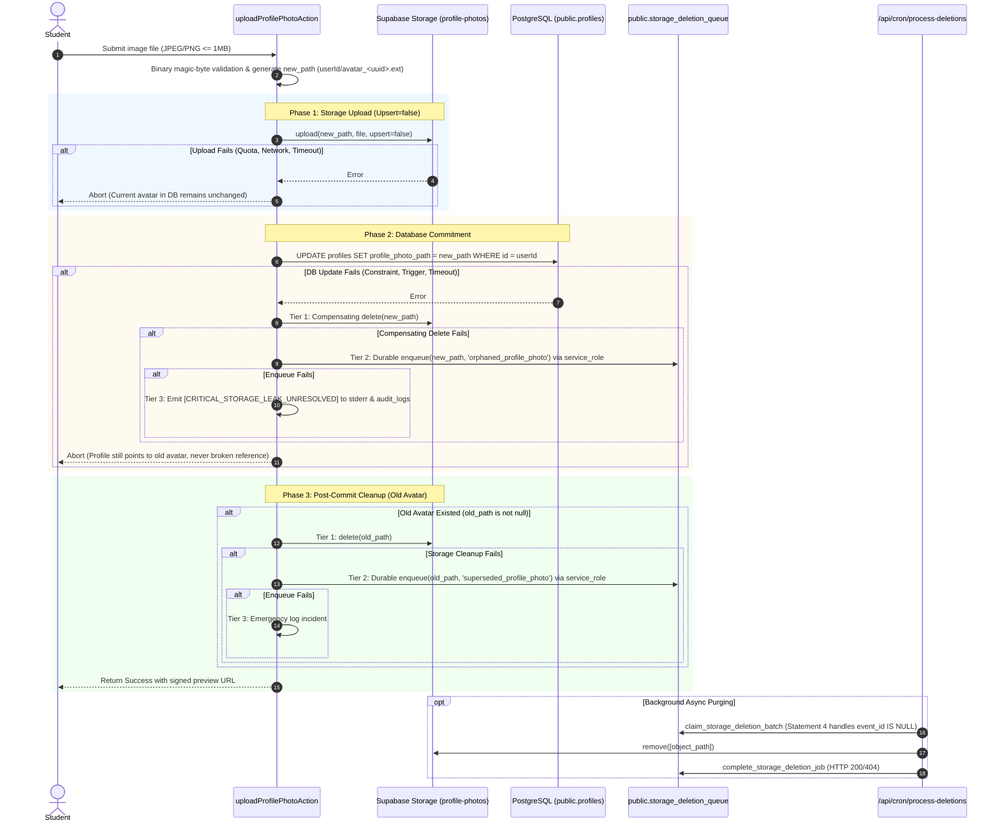
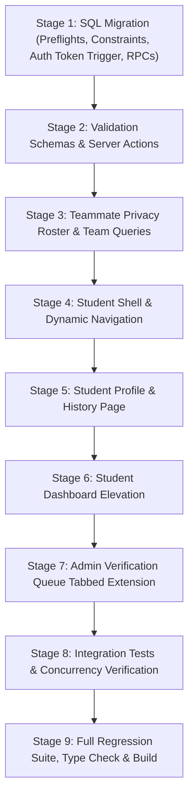

# NMIT HackLeague — Phase 10 Implementation Plan
**Student Profiles, Dashboards, Change Request Lifecycle, Teammate Privacy & Administrative Review**

**Document Version:** 2.1.0 (Transaction-Bound Authorization, Stale Guards, Queue Realism & Roster Privacy Hardening)  
**Status:** REVISED & READY FOR OWNER APPROVAL — IMPLEMENTATION PENDING AUTHORIZATION  
**Branch:** `v1`  
**Repository Root:** `/Volumes/CodingVault/web/HackLeague`  
**Verified Git Commit Baseline:** `8a7a86b8f74c26fd708db1ab1d296e4a217f08de`  
**Target Environment:** Next.js 16.4.0 (App Router), React 19.0.0, TypeScript 5.7.0, Tailwind CSS 4.0.0, Supabase PostgreSQL 17, Supabase Auth (GoTrue), Supabase Storage  

---

## 1. Executive Summary, Objective & Success Criteria

### 1.1 Objective
Deliver the complete, production-grade implementation of **Phase 10: Student Profiles & Dashboards** for NMIT HackLeague. This phase transforms the student experience by creating a dedicated personal profile workspace (`/student/profile`), elevating the student operational dashboard (`/student`), establishing a secure, auditable profile-change request lifecycle for institutional identity fields, introducing a tabbed administrative review interface at `/admin/verifications`, eliminating teammate PII leakage while resolving roster masking via a sanitized PostgreSQL RPC, and connecting student identity dynamically across `StudentShell` and `AppHeader`.

### 1.2 Core Success Criteria
1. **Dedicated Student Profile (`/student/profile`):**
   - Displays authorized student details (`full_name`, `usn`, `branch`, `academic_year`, `email`, `phone`, `profile_photo_path`, `registration_status`).
   - Zero exposure of private College ID documents, storage paths, administrative review notes, or other students' PII.
   - Direct, validated self-serve editing for phone number (E.164 / Indian mobile format).
   - Safe, multi-phase profile photo upload, replacement, and removal with transactional database consistency and post-commit cleanup of obsolete storage objects. Live profiles never point to deleted storage objects.
   - Form-based profile-correction submission for protected institutional fields (`full_name`, `usn`, `branch`, `academic_year`) with mandatory justification reason ($\ge 10$ characters).
   - Transparent request history showing pending, approved, and rejected submissions with administrative feedback.

2. **Gated, Privileged Profile-Change Lifecycle:**
   - Dedicated transactional PostgreSQL RPCs (`submit_profile_change_request`, `approve_profile_change_request`, `reject_profile_change_request`).
   - **Transaction-Bound Single-Use Database Authorization:** Direct `UPDATE` statements on `public.profiles` for approved students remain strictly blocked for all users (including admins with `manage_students`). Updates to protected institutional fields are permitted **strictly** through the `approve_profile_change_request` RPC via the repository's established transaction-authorization table (`public.profile_action_authorizations`).
   - Authorization tokens are bound to `pg_current_xact_id()::text`, `student_id`, `action_type = 'approve_profile_change'`, `request_id`, field name, old value, and new value.
   - The token is consumed **atomically and exactly once** inside the `protect_profile_columns()` trigger using `DELETE FROM public.profile_action_authorizations paa USING public.profile_change_requests pcr ... RETURNING 1 INTO v_authorized`.
   - The trigger explicitly establishes that the token's `request_id` corresponds to the exact locked, pending request being approved (`paa.request_id = pcr.id AND pcr.status = 'pending' AND pcr.student_id = OLD.id`), and strictly enforces that **exactly one** protected institutional field is modified, matching the request, with all other protected fields remaining unchanged. If multiple protected fields are modified, if no token exists, if `request_id` mismatches, or if field values do not align, the update is blocked.
   - `current_setting(...)` is never used as an authorization credential; database table RLS and grants enforce unforgeability.
   - **Stale Request Protection:** In `approve_profile_change_request`, the locked profile's current value is explicitly compared against `v_req.old_value`. If mismatched, the RPC aborts immediately with SQLSTATE `22023`, preventing profile mutation, request approval, and misleading success audit logs.
   - Database-level partial unique index preventing duplicate concurrent pending requests for the same field.
   - Row-level locking (`FOR UPDATE`) on both request and profile preventing race conditions between concurrent administrators.
   - Strict audit logging in `public.audit_logs` for all approved and rejected requests with tamper-resistant guarantees.

3. **Administrative Review at `/admin/verifications`:**
   - Non-breaking tabbed interface cleanly separating "Student Registrations" (`verify_students` permission) from "Profile Change Requests" (`manage_students` permission).
   - Accurate pending badge counters, side-by-side old vs. new value diffs, justification inspectability, and mandatory rejection feedback ($\ge 10$ chars).

4. **Elevated Operational Student Dashboard (`/student`):**
   - Rich metrics row integrating `getStudentPointsSummary` (Total Points, Leaderboard Rank, Verified Qualifications).
   - Clear visual distinction between submitted participation claims and verified qualifications.
   - Active teams summary with role (`Leader` vs `Member`) and real-time round/submission deadlines.
   - Streamlined upcoming competition previews and direct navigation links.

5. **Sanitized Teammate Roster & Privacy Protection:**
   - Elimination of the teammate profile masking bug (`null` profile display in team rosters) caused by strict `profiles_select_student` RLS.
   - Scoped `SECURITY DEFINER` RPC `public.get_team_roster(p_team_id UUID)` returning only necessary presentation fields (`student_id`, `full_name`, `branch`, `academic_year`, `role`, `profile_photo_path`).
   - Zero leakage of USN, email, phone, or identity documentation across team boundaries.
   - **Properly Scoped Event-Admin Authorization:** Only callers who are active members of the team, Super Admins, event-assigned administrators with `manage_teams` authority (`public.can_admin_manage_hackathon(hackathon_id, 'manage_teams')`), or global `export_data` auditors are authorized. Unassigned admins and non-members are rejected with SQLSTATE `42501`.
   - Private bucket avatar security: server-side generation of short-lived (15-minute) signed preview URLs for teammate photos with initials-based fallback.

6. **Dynamic Identity & Stale Link Fixes in `StudentShell`:**
   - Elimination of hardcoded dummy identity ("Aarav Sharma", "1NT22CS001") in `AppHeader`.
   - Full integration of authenticated student profile props with graceful fallbacks.
   - Correction of stale preview links (`/preview/shells/student` $\rightarrow$ `/student`).
   - Addition of `/student/profile` navigation item.

7. **One-Shot Continuous Implementation Pass:**
   - Execution of the entire approved Phase 10 scope in a single pass without stopping for intermediate phase gates, backed by comprehensive database tests, TypeScript integration tests, regression checks, and static verification.

---

## 2. Confirmed Existing Architecture & Code Baseline

A comprehensive inspection of the repository was performed on branch `v1` at commit `8a7a86b8f74c26fd708db1ab1d296e4a217f08de`.

### 2.1 Git Working Tree & Branch
- **Branch:** `v1`
- **HEAD Commit:** `8a7a86b8f74c26fd708db1ab1d296e4a217f08de` (`feat(phase-9): add points ledger and leaderboard`)
- **Working Tree State:** Active working tree contains modified tracked files in `graphify-out/`, an untracked Graphify AST cache artifact, and the untracked `PHASE_10_IMPLEMENTATION_PLAN.md`. No application code, migrations, tests, or database files are modified or staged. All `graphify-out/` files and prior phase plans are preserved intact.

### 2.2 Existing Security & Authorization Patterns Inspection
1. **Transaction-Bound Authorization Table (`public.profile_action_authorizations`):**
   - Created in `20261013000001_phase4_onboarding_and_review.sql:100-116`.
   - Schema:
     ```sql
     CREATE TABLE IF NOT EXISTS public.profile_action_authorizations (
       id UUID PRIMARY KEY DEFAULT gen_random_uuid(),
       xact_id TEXT NOT NULL,
       student_id UUID NOT NULL REFERENCES public.profiles(id) ON DELETE CASCADE,
       action_type TEXT NOT NULL CHECK (action_type IN ('replace_college_id', 'submit_profile_for_review')),
       old_value TEXT,
       new_value TEXT,
       created_at TIMESTAMPTZ NOT NULL DEFAULT clock_timestamp()
     );
     ```
   - Security Grants & RLS (`20261013000001:113-116`):
     - `REVOKE ALL ON TABLE public.profile_action_authorizations FROM PUBLIC, anon, authenticated;`
     - `GRANT ALL ON TABLE public.profile_action_authorizations TO service_role;`
     - `ALTER TABLE public.profile_action_authorizations ENABLE ROW LEVEL SECURITY;`
     - `ALTER TABLE public.profile_action_authorizations FORCE ROW LEVEL SECURITY;`
   - Consumption Pattern: In `protect_profile_columns()` (lines 162–172 and 216–226), the trigger executes:
     ```sql
     DELETE FROM public.profile_action_authorizations
     WHERE xact_id = pg_current_xact_id()::text
       AND student_id = OLD.id
       AND action_type = '...'
       AND old_value = ...
       AND new_value = ...
     RETURNING 1 INTO v_authorized;
     IF v_authorized IS NULL THEN RAISE EXCEPTION '...'; END IF;
     ```
   - **Phase 10 Alignment:** In Migration `20261023000001`, `action_type` check constraint is extended to include `'approve_profile_change'`, a `request_id UUID NULL REFERENCES public.profile_change_requests(id)` column is added, and `protect_profile_columns()` consumes this token atomically by joining `profile_change_requests` on `paa.request_id = pcr.id AND pcr.status = 'pending'`. This verifies that the token corresponds to the exact pending request being approved. Authenticated users cannot manufacture or replay tokens because table access is revoked from `authenticated` and `anon`.

2. **Storage Deletion Infrastructure & Background Processing:**
   - Table `public.storage_deletion_queue`: Created in `20261012000008`, augmented in `20261015000001` (Migration 15:235-270).
     - 8 authoritative states: `'pending', 'claimed', 'dispatching', 'cooldown', 'reconciling', 'investigation_required', 'completed', 'failed'`.
     - Fields: `bucket_id`, `object_path`, `target_type`, `target_id`, `event_id` (NULL for non-event assets), `status`, `lease_token`, `leased_until`, `retry_count`, `max_retries` (default 5), `retention_deadline_at`, `next_retry_at`.
     - RLS forced; all access revoked from `PUBLIC, anon, authenticated`; granted to `service_role`.
   - RPC `enqueue_storage_deletion_job(p_bucket_id, p_object_path, p_target_type, p_target_id)` (`20261012000010:660-687`): `SECURITY DEFINER` granted only to `service_role`. Idempotent via `ON CONFLICT (bucket_id, object_path) WHERE (status IN ('pending', 'processing')) DO UPDATE SET next_retry_at = now()`.
   - Existing Background Worker Route: Verified at `src/app/api/cron/process-deletions/route.ts`. Triggered by HTTP POST with `Bearer ${CRON_SECRET}`. It calls `claim_storage_deletion_batch`, `confirm_deletion_preflight`, performs `adminClient.storage.from(bucket_id).remove([object_path])`, handles HTTP 404 cleanly as completed deletions, calls `complete_storage_deletion_job`, and reconciles expired leases.
   - `claim_storage_deletion_batch` Statement 4 (`20261015000001:538-560`) explicitly claims non-event jobs (`WHERE q.event_id IS NULL AND q.status = 'pending'`), natively supporting profile asset purging without requiring code modifications to the deletion worker.
   - Established Application Cleanup Pattern: `src/lib/storage/registration-proof-service.ts:42-100` implements `executeThreeTierOrphanRecovery`:
     - Tier 1: Immediate Storage Purge via `adminClient.storage.from(...).remove()`.
     - Tier 2: Durable Queue Fallback via `public.storage_deletion_queue` insert.
     - Tier 3: Emergency Incident Escalation (structured error to stderr and `audit_logs`).

3. **Admin Event-Assignment & Permission Model:**
   - Verified in `20261019000001_phase6_updates_1_to_6.sql:110-145`, `20261020000001_phase7_team_formation_and_registration.sql:70, 273, 385, 468`, and `20261022000001_phase9_points_ledger_and_leaderboard.sql:1137, 1200`:
     - Global permissions: `public.current_is_super_admin()`, `public.current_has_permission('export_data')`, `public.current_has_permission('manage_students')` (for student verification & profile changes).
     - Event-scoped permissions: For event-specific operations (teams, submissions, rounds), administrators with `manage_teams` permission must be assigned to the specific hackathon via `public.can_admin_manage_hackathon(hackathon_id, 'manage_teams')`.
     - **Phase 10 Roster Scoping:** In `get_team_roster(p_team_id UUID)`, the RPC queries `public.teams` to find `hackathon_id`. Administrators are authorized only if `public.current_is_super_admin()` OR `public.can_admin_manage_hackathon(v_team.hackathon_id, 'manage_teams')` OR `public.current_has_permission('export_data')`. Global `manage_teams` without event assignment does NOT permit roster access.

4. **Database Test CLI Tooling:**
   - Verified via `npx supabase test db --help`:
     - Usage: `supabase test db [flags] [<path...>]`
     - Flags: `--local`, `--linked`, `--db-url`, `--project-ref`.
     - There is **no `--include` flag**. Passing `--include` causes a CLI error.
     - Correct invocation: `npx supabase test db` (all suites) or `npx supabase test db supabase/tests/20_ts_phase10_student_profiles.sql` (single suite).

---

## 3. Product Decisions & Non-Negotiable Boundaries

### 3.1 Settled Product Decisions
1. **Direct Profile Edits vs. Approval Gating:**
   - **Direct Edit (Approved Students):** `phone` and `profile_photo_path`.
   - **Approval Gated (Institutional Identity):** `full_name`, `usn`, `branch`, and `academic_year`.
   - **Unchangeable via Profile System:** `email` (managed strictly by Supabase Auth / institutional email recovery) and `college_id_path` (governed by Phase 4 onboarding review and Phase 6 retention deletion).
2. **Administrative Review Location:**
   - Located at `/admin/verifications` using a clear two-tab interface.
   - Tab 1: "Student Registrations" (managed by admins with `verify_students` permission).
   - Tab 2: "Profile Change Requests" (managed by admins with `manage_students` permission).
   - Super Admins have full access to both tabs.
3. **Student Navigation & Layout:**
   - `/student`: Operational command center (active teams, upcoming deadlines, quick points summary).
   - `/student/profile`: Personal profile, direct edits, change requests, and comprehensive hackathon history.
   - `/student/hackathons`: Event discovery catalogue.
   - `/student/teams`: Detailed team formation, invites, and roster management.
   - `/student/points`: Detailed points ledger and transaction history.
   - `/leaderboard`: Platform leaderboard.
4. **Data Distinction:**
   - A submitted registration proof claim (`external_status = 'submitted'`) is **not** verified participation (`external_status = 'verified'`). Display them distinctly with clear badges.
   - No new points are invented for Phase 10. Phase 9 ledger and summary services remain authoritative.

---

## 4. File Modification Inventory

### 4.1 New Files
| File Path | Purpose |
| :--- | :--- |
| `supabase/migrations/20261023000001_phase10_student_profiles_and_change_requests.sql` | Migration adding preflight checks, constraint migration, partial unique index, `profile_action_authorizations` extension, transaction-bound single-use trigger hardening, and RPCs (`submit_profile_change_request`, `approve_profile_change_request`, `reject_profile_change_request`, `get_team_roster`). |
| `supabase/tests/20_ts_phase10_student_profiles.sql` | Complete pgTAP test suite verifying all database invariants, constraints, transaction-bound authorization tokens, adversarial direct updates, stale request rejections, RPC security, RLS boundaries, and concurrency handling. |
| `src/lib/validation/profile-schemas.ts` | Reusable Zod validation schemas for direct phone updates, photo uploads, change request submissions, and administrative reviews. |
| `src/actions/profile-actions.ts` | Server actions for direct phone editing, three-tier failure-safe profile photo upload/replacement/removal, change request submission, and student request history querying. |
| `src/app/student/profile/page.tsx` | Authenticated server component page for `/student/profile`. |
| `src/app/student/profile/profile-client.tsx` | Interactive client component for `/student/profile` managing direct edits, change request modal, request history, and participation timeline. |
| `src/app/student/profile/participation-history-card.tsx` | Component displaying sanitized event participation, roles, teammates, round progressions, and verified awards. |
| `src/app/admin/verifications/profile-changes-client.tsx` | Component managing Tab 2 at `/admin/verifications` for reviewing, approving, and rejecting profile change requests. |
| `tests/integration/student-profile-and-dashboard.test.ts` | End-to-end TypeScript integration tests running via `npx tsx` verifying server actions, permissions, edge cases, three-tier storage cleanup, and queries. |

### 4.2 Modified Files
| File Path | Planned Changes |
| :--- | :--- |
| `src/components/shells/student-shell.tsx` | Fix stale preview URLs (`/preview/shells/student` $\rightarrow$ `/student`), add `/student/profile` navigation item, accept `studentProfile` prop, and dynamically pass user details to `AppHeader`. |
| `src/app/student/page.tsx` | Elevate dashboard into operational command center: integrate `getStudentPointsSummary`, active team cards, role badges, next-deadline alerts, and pass profile to `StudentShell`. |
| `src/lib/teams/queries.ts` | Refactor `getTeamDetails` to query `public.get_team_roster` RPC instead of joining `profiles` directly under restrictive RLS. Update `TeamMemberDetail` interface to align with sanitized projection. |
| `src/components/teams/team-roster-card.tsx` | Update table headers to replace "USN / Roll No" with "Branch & Year" (e.g. `CSE • Year 3`) to eliminate accidental USN exposure. Support sanitized roster fields and signed avatar URLs. |
| `src/app/admin/verifications/page.tsx` | Fetch both pending registrations (`verify_students`) and pending profile-change requests (`manage_students`). Pass permissions and data to tabbed container. |
| `src/app/admin/verifications/verifications-client.tsx` | Integrate tab switcher ("Student Registrations" vs. "Profile Change Requests") and embed `ProfileChangesClient`. |
| `src/actions/admin-verification-actions.ts` | Add `reviewProfileChangeRequestAction` server action calling `approve_profile_change_request` and `reject_profile_change_request`. |
| `src/types/database.ts` | Add new RPC typings (`submit_profile_change_request`, `approve_profile_change_request`, `reject_profile_change_request`, `get_team_roster`) to `Database['public']['Functions']`. |

---

## 5. Database Migration & Security Design

### 5.1 Migration File: `20261023000001_phase10_student_profiles_and_change_requests.sql`

```sql
-- Migration: 20261023000001_phase10_student_profiles_and_change_requests.sql
-- Created: 2026-10-23
-- Phase 10: Student Profiles, Dashboards, Change Requests & Teammate Roster Security

BEGIN;

-- ============================================================================
-- 1. PREFLIGHT COMPATIBILITY CHECKS
-- ============================================================================

-- 1a. Ensure no duplicate pending requests exist before creating the partial unique index
DO $$
DECLARE
  v_dup_count INT;
BEGIN
  SELECT COUNT(*) INTO v_dup_count
  FROM (
    SELECT student_id, field_name
    FROM public.profile_change_requests
    WHERE status = 'pending'
    GROUP BY student_id, field_name
    HAVING COUNT(*) > 1
  ) dups;

  IF v_dup_count > 0 THEN
    RAISE EXCEPTION 'Migration preflight failure: Detected % set(s) of duplicate pending profile change requests. Resolve duplicates before applying Phase 10.' USING ERRCODE = '23505';
  END IF;
END $$;

-- 1b. Ensure no pending phone change requests exist before updating check constraint
DO $$
DECLARE
  v_pending_phone_count INT;
BEGIN
  SELECT COUNT(*) INTO v_pending_phone_count
  FROM public.profile_change_requests
  WHERE field_name = 'phone' AND status = 'pending';

  IF v_pending_phone_count > 0 THEN
    RAISE EXCEPTION 'Migration preflight failure: Found % pending profile change request(s) for phone. Pending phone requests must be approved or rejected before applying Phase 10.' USING ERRCODE = '23514';
  END IF;
END $$;

-- ============================================================================
-- 2. SCHEMA CONSTRAINTS & AUTHORIZATION TABLE EXTENSION
-- ============================================================================

-- 2a. Update check constraint on profile_change_requests to disallow new phone requests while preserving historical records
ALTER TABLE public.profile_change_requests
  DROP CONSTRAINT IF EXISTS chk_change_requests_field;

ALTER TABLE public.profile_change_requests
  ADD CONSTRAINT chk_change_requests_field
  CHECK (
    field_name IN ('full_name', 'usn', 'branch', 'academic_year')
    OR (field_name = 'phone' AND status IN ('approved', 'rejected'))
  );

-- 2b. Enforce at-most-one pending request per student per field
CREATE UNIQUE INDEX IF NOT EXISTS uq_profile_change_requests_pending_field
  ON public.profile_change_requests (student_id, field_name)
  WHERE (status = 'pending');

-- 2c. Performance indexes for queue sorting and student history
CREATE INDEX IF NOT EXISTS idx_profile_change_requests_student_created
  ON public.profile_change_requests (student_id, created_at DESC);

CREATE INDEX IF NOT EXISTS idx_profile_change_requests_status_created
  ON public.profile_change_requests (status, created_at ASC);

-- 2d. Extend transaction-bound authorization table (from Phase 4) for profile change approval
ALTER TABLE public.profile_action_authorizations
  DROP CONSTRAINT IF EXISTS profile_action_authorizations_action_type_check;

ALTER TABLE public.profile_action_authorizations
  ADD CONSTRAINT profile_action_authorizations_action_type_check
  CHECK (action_type IN ('replace_college_id', 'submit_profile_for_review', 'approve_profile_change'));

ALTER TABLE public.profile_action_authorizations
  ADD COLUMN IF NOT EXISTS request_id UUID NULL REFERENCES public.profile_change_requests(id) ON DELETE CASCADE;

CREATE INDEX IF NOT EXISTS idx_profile_action_auth_approval
  ON public.profile_action_authorizations (xact_id, student_id, action_type, request_id);

-- ============================================================================
-- 3. HARDEN TRIGGER: public.protect_profile_columns()
-- ============================================================================
-- Refines trigger:
--  a) Rejects direct updates to institutional fields for approved students.
--  b) Allows updates ONLY when authorized via single-use token in public.profile_action_authorizations.
--  c) Token is bound to pg_current_xact_id(), student_id, action_type, field, old_value, new_value.
--  d) Token is consumed atomically in the trigger via DELETE ... RETURNING 1.
--  e) Preserves Super Admin and service-role emergency recovery bypass.
--  f) Enforces strict storage path validation on direct student profile photo updates.

CREATE OR REPLACE FUNCTION public.protect_profile_columns()
RETURNS TRIGGER AS $$
DECLARE
  v_is_super_or_service BOOLEAN;
  v_is_admin_or_service BOOLEAN;
  v_authorized INT;
  v_changed_field_count INT;
BEGIN
  -- Primary key protection
  IF OLD.id IS DISTINCT FROM NEW.id THEN
    RAISE EXCEPTION 'Profile ID cannot be modified.';
  END IF;

  v_is_super_or_service := (
    (current_user IN ('postgres', 'supabase_admin') AND (auth.role() IS NULL OR auth.role() = 'service_role')) OR
    (auth.role() IS NOT NULL AND auth.role() = 'service_role') OR
    public.current_is_super_admin()
  );

  v_is_admin_or_service := (
    v_is_super_or_service OR
    public.current_has_permission('verify_students') OR
    public.current_has_permission('manage_students')
  );

  -- 1. Profile email protection (managed strictly by Supabase Auth)
  IF OLD.email IS DISTINCT FROM NEW.email THEN
    IF NOT v_is_super_or_service THEN
      RAISE EXCEPTION 'Profile email is managed by authentication and cannot be updated directly.';
    END IF;
  END IF;

  -- 2. Administrative fields guarded from non-admin updates
  IF (OLD.registration_status IS DISTINCT FROM NEW.registration_status OR
      OLD.rejection_reason IS DISTINCT FROM NEW.rejection_reason OR
      OLD.reviewed_by IS DISTINCT FROM NEW.reviewed_by OR
      OLD.reviewed_at IS DISTINCT FROM NEW.reviewed_at OR
      OLD.college_id_deleted_at IS DISTINCT FROM NEW.college_id_deleted_at) THEN

    IF NOT v_is_admin_or_service THEN
      -- Ephemeral transaction authorization for submit_profile_for_review()
      IF OLD.registration_status IN ('draft', 'correction_required')
         AND NEW.registration_status = 'under_review' THEN

        DELETE FROM public.profile_action_authorizations
        WHERE xact_id = pg_current_xact_id()::text
          AND student_id = OLD.id
          AND action_type = 'submit_profile_for_review'
          AND old_value = OLD.registration_status
          AND new_value = 'under_review'
        RETURNING 1 INTO v_authorized;

        IF v_authorized IS NULL THEN
          RAISE EXCEPTION 'Direct update of registration_status is blocked. Use the submit_profile_for_review() RPC.';
        END IF;

        IF NEW.rejection_reason IS NOT NULL
           OR NEW.reviewed_by IS DISTINCT FROM OLD.reviewed_by
           OR NEW.reviewed_at IS DISTINCT FROM OLD.reviewed_at
           OR NEW.college_id_deleted_at IS DISTINCT FROM OLD.college_id_deleted_at THEN
          RAISE EXCEPTION 'Unauthorized column modification: registration_status and review metadata can only be updated by authorized administrators.';
        END IF;
      ELSE
        RAISE EXCEPTION 'Unauthorized column modification: registration_status and review metadata can only be updated by authorized administrators.';
      END IF;
    END IF;
  END IF;

  -- 3. Approved student details frozen against direct modification
  IF OLD.registration_status = 'approved' AND NOT v_is_super_or_service THEN
    -- Check for changes to protected institutional fields or college_id_path
    IF (OLD.full_name IS DISTINCT FROM NEW.full_name OR
        OLD.usn IS DISTINCT FROM NEW.usn OR
        OLD.branch IS DISTINCT FROM NEW.branch OR
        OLD.academic_year IS DISTINCT FROM NEW.academic_year OR
        OLD.college_id_path IS DISTINCT FROM NEW.college_id_path) THEN

      -- College ID path cannot be modified on approved profiles
      IF OLD.college_id_path IS DISTINCT FROM NEW.college_id_path THEN
        RAISE EXCEPTION 'College ID cannot be modified while registration is approved.';
      END IF;

      -- Enforce that exactly one institutional field is modified per approved change
      v_changed_field_count := 0;
      IF OLD.full_name IS DISTINCT FROM NEW.full_name THEN v_changed_field_count := v_changed_field_count + 1; END IF;
      IF OLD.usn IS DISTINCT FROM NEW.usn THEN v_changed_field_count := v_changed_field_count + 1; END IF;
      IF OLD.branch IS DISTINCT FROM NEW.branch THEN v_changed_field_count := v_changed_field_count + 1; END IF;
      IF OLD.academic_year IS DISTINCT FROM NEW.academic_year THEN v_changed_field_count := v_changed_field_count + 1; END IF;

      IF v_changed_field_count <> 1 THEN
        RAISE EXCEPTION 'Approved student details cannot be modified directly: exactly one institutional field may be updated per approved change request.';
      END IF;

      -- Atomically verify and consume single-use transaction authorization token.
      -- Bound strictly to:
      --   a) Current transaction ID (pg_current_xact_id()::text)
      --   b) Student ID (OLD.id)
      --   c) Action type ('approve_profile_change')
      --   d) Exact request_id matching an active, locked, pending request in public.profile_change_requests
      --   e) Exact field name and old/new values matching both the token and the pending request row
      --   f) All other protected institutional fields MUST remain completely unchanged
      DELETE FROM public.profile_action_authorizations paa
      USING public.profile_change_requests pcr
      WHERE paa.xact_id = pg_current_xact_id()::text
        AND paa.student_id = OLD.id
        AND paa.action_type = 'approve_profile_change'
        AND paa.request_id IS NOT NULL
        AND paa.request_id = pcr.id
        AND pcr.student_id = OLD.id
        AND pcr.status = 'pending'
        AND (
          (OLD.full_name IS DISTINCT FROM NEW.full_name
           AND OLD.usn IS NOT DISTINCT FROM NEW.usn
           AND OLD.branch IS NOT DISTINCT FROM NEW.branch
           AND OLD.academic_year IS NOT DISTINCT FROM NEW.academic_year
           AND paa.old_value = ('full_name:' || OLD.full_name)
           AND paa.new_value = ('full_name:' || NEW.full_name)
           AND pcr.field_name = 'full_name'
           AND pcr.old_value = OLD.full_name
           AND pcr.new_value = NEW.full_name) OR
          (OLD.usn IS DISTINCT FROM NEW.usn
           AND OLD.full_name IS NOT DISTINCT FROM NEW.full_name
           AND OLD.branch IS NOT DISTINCT FROM NEW.branch
           AND OLD.academic_year IS NOT DISTINCT FROM NEW.academic_year
           AND paa.old_value = ('usn:' || OLD.usn)
           AND paa.new_value = ('usn:' || NEW.usn)
           AND pcr.field_name = 'usn'
           AND pcr.old_value = OLD.usn
           AND pcr.new_value = NEW.usn) OR
          (OLD.branch IS DISTINCT FROM NEW.branch
           AND OLD.full_name IS NOT DISTINCT FROM NEW.full_name
           AND OLD.usn IS NOT DISTINCT FROM NEW.usn
           AND OLD.academic_year IS NOT DISTINCT FROM NEW.academic_year
           AND paa.old_value = ('branch:' || OLD.branch)
           AND paa.new_value = ('branch:' || NEW.branch)
           AND pcr.field_name = 'branch'
           AND pcr.old_value = OLD.branch
           AND pcr.new_value = NEW.branch) OR
          (OLD.academic_year IS DISTINCT FROM NEW.academic_year
           AND OLD.full_name IS NOT DISTINCT FROM NEW.full_name
           AND OLD.usn IS NOT DISTINCT FROM NEW.usn
           AND OLD.branch IS NOT DISTINCT FROM NEW.branch
           AND paa.old_value = ('academic_year:' || OLD.academic_year::text)
           AND paa.new_value = ('academic_year:' || NEW.academic_year::text)
           AND pcr.field_name = 'academic_year'
           AND pcr.old_value = OLD.academic_year::text
           AND pcr.new_value = NEW.academic_year::text)
        )
      RETURNING 1 INTO v_authorized;

      IF v_authorized IS NULL THEN
        RAISE EXCEPTION 'Approved student details cannot be modified directly: missing, invalid, or mismatched change request authorization.';
      END IF;
    END IF;
  END IF;

  -- 4. Date of birth validation on profile update
  IF (OLD.date_of_birth IS DISTINCT FROM NEW.date_of_birth) AND NEW.date_of_birth IS NOT NULL THEN
    IF (NEW.date_of_birth + INTERVAL '15 years') > CURRENT_DATE THEN
      RAISE EXCEPTION 'Invalid date of birth: student must be at least 15 years old.';
    END IF;
  END IF;

  -- 5. College ID storage path protection
  IF OLD.college_id_path IS DISTINCT FROM NEW.college_id_path THEN
    IF NOT v_is_admin_or_service THEN
      IF NEW.college_id_path IS NULL THEN
        IF OLD.registration_status IN ('under_review', 'approved') THEN
          RAISE EXCEPTION 'College ID cannot be removed while registration is under review or approved.';
        END IF;
      ELSE
        IF OLD.registration_status = 'correction_required' THEN
          DELETE FROM public.profile_action_authorizations
          WHERE xact_id = pg_current_xact_id()::text
            AND student_id = OLD.id
            AND action_type = 'replace_college_id'
            AND old_value = OLD.college_id_path
            AND new_value = NEW.college_id_path
          RETURNING 1 INTO v_authorized;

          IF v_authorized IS NULL THEN
            RAISE EXCEPTION 'Direct update of college_id_path is blocked in correction_required status. Use the replace_college_id() RPC.';
          END IF;
        ELSIF OLD.college_id_path IS NOT NULL AND OLD.registration_status IN ('under_review', 'approved') THEN
          RAISE EXCEPTION 'College ID cannot be modified while registration is under review or approved.';
        END IF;

        IF NOT (NEW.college_id_path LIKE (NEW.id::text || '/%')) THEN
          RAISE EXCEPTION 'Unauthorized college_id_path: storage object path must reside in student folder.';
        END IF;
      END IF;
    END IF;
  END IF;

  -- 6. Profile photo path validation for direct student updates
  IF OLD.profile_photo_path IS DISTINCT FROM NEW.profile_photo_path THEN
    IF NOT v_is_super_or_service THEN
      IF NEW.profile_photo_path IS NOT NULL THEN
        IF NEW.profile_photo_path LIKE '%..%' OR NOT (NEW.profile_photo_path LIKE (NEW.id::text || '/%')) THEN
          RAISE EXCEPTION 'Unauthorized profile_photo_path: object must reside strictly in student folder without path traversal.';
        END IF;
      END IF;
    END IF;
  END IF;

  RETURN NEW;
END;
$$ LANGUAGE plpgsql SECURITY DEFINER SET search_path = public, pg_temp;

-- ============================================================================
-- 4. TRANSACTIONAL RPC: submit_profile_change_request
-- ============================================================================

CREATE OR REPLACE FUNCTION public.submit_profile_change_request(
  p_field_name TEXT,
  p_new_value TEXT,
  p_reason TEXT
)
RETURNS UUID AS $$
DECLARE
  v_student_id UUID;
  v_student public.profiles%ROWTYPE;
  v_old_value TEXT;
  v_trimmed_reason TEXT;
  v_normalized_new TEXT;
  v_request_id UUID;
  v_year_int INT;
BEGIN
  v_student_id := auth.uid();
  IF v_student_id IS NULL THEN
    RAISE EXCEPTION 'Authentication required.' USING ERRCODE = '42501';
  END IF;

  -- 1. Lock and verify student profile
  SELECT * INTO v_student
  FROM public.profiles
  WHERE id = v_student_id
  FOR SHARE;

  IF NOT FOUND THEN
    RAISE EXCEPTION 'Student profile not found.' USING ERRCODE = 'P0002';
  END IF;

  IF v_student.registration_status <> 'approved' THEN
    RAISE EXCEPTION 'Only verified, approved students may submit profile correction requests.' USING ERRCODE = '22023';
  END IF;

  -- 2. Validate field name
  IF p_field_name NOT IN ('full_name', 'usn', 'branch', 'academic_year') THEN
    RAISE EXCEPTION 'Invalid field name: % (Must be full_name, usn, branch, or academic_year).', p_field_name USING ERRCODE = '22023';
  END IF;

  -- 3. Validate reason
  v_trimmed_reason := TRIM(COALESCE(p_reason, ''));
  IF LENGTH(v_trimmed_reason) < 10 THEN
    RAISE EXCEPTION 'Reason must be at least 10 characters long.' USING ERRCODE = '22023';
  END IF;
  IF LENGTH(v_trimmed_reason) > 500 THEN
    RAISE EXCEPTION 'Reason cannot exceed 500 characters.' USING ERRCODE = '22023';
  END IF;

  -- 4. Validate and normalize new value
  v_normalized_new := TRIM(COALESCE(p_new_value, ''));

  IF p_field_name = 'full_name' THEN
    v_old_value := v_student.full_name;
    IF LENGTH(v_normalized_new) < 2 OR LENGTH(v_normalized_new) > 100 THEN
      RAISE EXCEPTION 'Full name must be between 2 and 100 characters.' USING ERRCODE = '22023';
    END IF;

  ELSIF p_field_name = 'usn' THEN
    v_old_value := v_student.usn;
    v_normalized_new := UPPER(v_normalized_new);
    IF NOT (v_normalized_new ~* '^[0-9][A-Z]{2}[0-9]{2}[A-Z]{2}[0-9]{3}$') THEN
      RAISE EXCEPTION 'USN must follow standard format (e.g., 1NT22CS001).' USING ERRCODE = '22023';
    END IF;
    IF EXISTS (SELECT 1 FROM public.profiles WHERE usn = v_normalized_new AND id <> v_student_id) THEN
      RAISE EXCEPTION 'USN % is already registered to another student.', v_normalized_new USING ERRCODE = '23505';
    END IF;

  ELSIF p_field_name = 'branch' THEN
    v_old_value := v_student.branch;
    IF v_normalized_new NOT IN ('CSE', 'ISE', 'AIML', 'AIDS', 'ECE', 'EEE', 'ME', 'CV', 'BT') THEN
      RAISE EXCEPTION 'Branch must be an accredited academic department.' USING ERRCODE = '22023';
    END IF;

  ELSIF p_field_name = 'academic_year' THEN
    v_old_value := v_student.academic_year::text;
    BEGIN
      v_year_int := v_normalized_new::integer;
    EXCEPTION WHEN OTHERS THEN
      RAISE EXCEPTION 'Academic year must be an integer between 1 and 4.' USING ERRCODE = '22023';
    END;
    IF v_year_int < 1 OR v_year_int > 4 THEN
      RAISE EXCEPTION 'Academic year must be between 1 and 4.' USING ERRCODE = '22023';
    END IF;
  END IF;

  -- 5. Prevent no-op requests
  IF v_old_value = v_normalized_new THEN
    RAISE EXCEPTION 'Proposed value is identical to current profile value.' USING ERRCODE = '22023';
  END IF;

  -- 6. Insert pending request (partial unique index catches duplicate pending)
  BEGIN
    INSERT INTO public.profile_change_requests (
      student_id,
      field_name,
      old_value,
      new_value,
      reason,
      status
    ) VALUES (
      v_student_id,
      p_field_name,
      v_old_value,
      v_normalized_new,
      v_trimmed_reason,
      'pending'
    ) RETURNING id INTO v_request_id;
  EXCEPTION WHEN unique_violation THEN
    RAISE EXCEPTION 'You already have a pending change request for %.', p_field_name USING ERRCODE = '23505';
  END;

  RETURN v_request_id;
END;
$$ LANGUAGE plpgsql SECURITY DEFINER SET search_path = public, pg_temp;

REVOKE ALL ON FUNCTION public.submit_profile_change_request(TEXT, TEXT, TEXT) FROM PUBLIC, anon;
GRANT EXECUTE ON FUNCTION public.submit_profile_change_request(TEXT, TEXT, TEXT) TO authenticated;

-- ============================================================================
-- 5. TRANSACTIONAL RPC: approve_profile_change_request
-- ============================================================================

CREATE OR REPLACE FUNCTION public.approve_profile_change_request(
  p_request_id UUID
)
RETURNS BOOLEAN AS $$
DECLARE
  v_admin_id UUID;
  v_req public.profile_change_requests%ROWTYPE;
  v_student public.profiles%ROWTYPE;
  v_current_val TEXT;
BEGIN
  v_admin_id := auth.uid();
  IF v_admin_id IS NULL THEN
    RAISE EXCEPTION 'Authentication required.' USING ERRCODE = '42501';
  END IF;

  -- 1. Authorization check: requires manage_students or super_admin
  IF NOT (public.current_is_super_admin() OR public.current_has_permission('manage_students')) THEN
    RAISE EXCEPTION 'Unauthorized: Requires manage_students permission.' USING ERRCODE = '42501';
  END IF;

  -- 2. Lock request row FOR UPDATE
  SELECT * INTO v_req
  FROM public.profile_change_requests
  WHERE id = p_request_id
  FOR UPDATE;

  IF NOT FOUND THEN
    RAISE EXCEPTION 'Profile change request % not found.', p_request_id USING ERRCODE = 'P0002';
  END IF;

  IF v_req.status <> 'pending' THEN
    RAISE EXCEPTION 'Cannot approve request: Request is not pending (current status: %).', v_req.status USING ERRCODE = '22023';
  END IF;

  -- 3. Lock student profile row FOR UPDATE
  SELECT * INTO v_student
  FROM public.profiles
  WHERE id = v_req.student_id
  FOR UPDATE;

  IF NOT FOUND THEN
    RAISE EXCEPTION 'Associated student profile not found.' USING ERRCODE = 'P0002';
  END IF;

  IF v_student.registration_status <> 'approved' THEN
    RAISE EXCEPTION 'Cannot approve change request: Student registration is not approved.' USING ERRCODE = '22023';
  END IF;

  -- 4. STALE REQUEST GUARD:
  -- Explicitly compare the locked profile's current field value against request's recorded old_value.
  -- If mismatched, abort transaction immediately. This guarantees:
  --   a) Profile is untouched.
  --   b) Request is NOT marked approved.
  --   c) Zero misleading success audit logs are written.
  IF v_req.field_name = 'full_name' THEN
    v_current_val := v_student.full_name;
  ELSIF v_req.field_name = 'usn' THEN
    v_current_val := v_student.usn;
  ELSIF v_req.field_name = 'branch' THEN
    v_current_val := v_student.branch;
  ELSIF v_req.field_name = 'academic_year' THEN
    v_current_val := v_student.academic_year::text;
  ELSE
    RAISE EXCEPTION 'Invalid field name in request: %', v_req.field_name USING ERRCODE = '22023';
  END IF;

  IF v_current_val IS DISTINCT FROM v_req.old_value THEN
    RAISE EXCEPTION 'Stale request: Current profile % (%) does not match request old_value (%). Profile was modified after this request was submitted.',
      v_req.field_name, v_current_val, v_req.old_value USING ERRCODE = '22023';
  END IF;

  -- If USN change, re-verify uniqueness against other profiles
  IF v_req.field_name = 'usn' THEN
    IF EXISTS (SELECT 1 FROM public.profiles WHERE usn = v_req.new_value AND id <> v_req.student_id) THEN
      RAISE EXCEPTION 'USN % is already registered to another student.', v_req.new_value USING ERRCODE = '23505';
    END IF;
  END IF;

  -- 5. Issue ephemeral transaction-scoped authorization token in public.profile_action_authorizations
  INSERT INTO public.profile_action_authorizations (
    xact_id,
    student_id,
    action_type,
    old_value,
    new_value,
    request_id
  ) VALUES (
    pg_current_xact_id()::text,
    v_req.student_id,
    'approve_profile_change',
    v_req.field_name || ':' || v_req.old_value,
    v_req.field_name || ':' || v_req.new_value,
    p_request_id
  );

  -- 6. Apply profile update (Trigger protect_profile_columns consumes the token via DELETE ... RETURNING 1)
  IF v_req.field_name = 'full_name' THEN
    UPDATE public.profiles SET full_name = v_req.new_value, updated_at = now() WHERE id = v_req.student_id;
  ELSIF v_req.field_name = 'usn' THEN
    UPDATE public.profiles SET usn = v_req.new_value, updated_at = now() WHERE id = v_req.student_id;
  ELSIF v_req.field_name = 'branch' THEN
    UPDATE public.profiles SET branch = v_req.new_value, updated_at = now() WHERE id = v_req.student_id;
  ELSIF v_req.field_name = 'academic_year' THEN
    UPDATE public.profiles SET academic_year = v_req.new_value::integer, updated_at = now() WHERE id = v_req.student_id;
  END IF;

  -- 7. Update change request record
  UPDATE public.profile_change_requests
  SET
    status = 'approved',
    reviewed_by = v_admin_id,
    reviewed_at = now(),
    rejection_reason = NULL,
    updated_at = now()
  WHERE id = p_request_id;

  -- 8. Write immutable audit log
  INSERT INTO public.audit_logs (
    actor_id,
    actor_role,
    action,
    target_type,
    target_id,
    details
  ) VALUES (
    v_admin_id,
    CASE WHEN public.current_is_super_admin() THEN 'super_admin' ELSE 'admin' END,
    'student.profile_changed',
    'profile_change_request',
    p_request_id::text,
    jsonb_build_object(
      'student_id', v_req.student_id,
      'field_name', v_req.field_name,
      'old_value', v_req.old_value,
      'new_value', v_req.new_value,
      'reason', v_req.reason,
      'decision', 'approved'
    )
  );

  RETURN true;
END;
$$ LANGUAGE plpgsql SECURITY DEFINER SET search_path = public, pg_temp;

REVOKE ALL ON FUNCTION public.approve_profile_change_request(UUID) FROM PUBLIC, anon;
GRANT EXECUTE ON FUNCTION public.approve_profile_change_request(UUID) TO authenticated;

-- ============================================================================
-- 6. TRANSACTIONAL RPC: reject_profile_change_request
-- ============================================================================

CREATE OR REPLACE FUNCTION public.reject_profile_change_request(
  p_request_id UUID,
  p_rejection_reason TEXT
)
RETURNS BOOLEAN AS $$
DECLARE
  v_admin_id UUID;
  v_req public.profile_change_requests%ROWTYPE;
  v_trimmed_reason TEXT;
BEGIN
  v_admin_id := auth.uid();
  IF v_admin_id IS NULL THEN
    RAISE EXCEPTION 'Authentication required.' USING ERRCODE = '42501';
  END IF;

  -- 1. Authorization check: requires manage_students or super_admin
  IF NOT (public.current_is_super_admin() OR public.current_has_permission('manage_students')) THEN
    RAISE EXCEPTION 'Unauthorized: Requires manage_students permission.' USING ERRCODE = '42501';
  END IF;

  -- 2. Validate rejection reason
  v_trimmed_reason := TRIM(COALESCE(p_rejection_reason, ''));
  IF LENGTH(v_trimmed_reason) < 10 THEN
    RAISE EXCEPTION 'A rejection reason of at least 10 characters is mandatory.' USING ERRCODE = '22023';
  END IF;
  IF LENGTH(v_trimmed_reason) > 500 THEN
    RAISE EXCEPTION 'Rejection reason cannot exceed 500 characters.' USING ERRCODE = '22023';
  END IF;

  -- 3. Lock request row FOR UPDATE
  SELECT * INTO v_req
  FROM public.profile_change_requests
  WHERE id = p_request_id
  FOR UPDATE;

  IF NOT FOUND THEN
    RAISE EXCEPTION 'Profile change request % not found.', p_request_id USING ERRCODE = 'P0002';
  END IF;

  IF v_req.status <> 'pending' THEN
    RAISE EXCEPTION 'Cannot reject request: Request is not pending (current status: %).', v_req.status USING ERRCODE = '22023';
  END IF;

  -- 4. Update request row (profiles table is completely untouched)
  UPDATE public.profile_change_requests
  SET
    status = 'rejected',
    reviewed_by = v_admin_id,
    reviewed_at = now(),
    rejection_reason = v_trimmed_reason,
    updated_at = now()
  WHERE id = p_request_id;

  -- 5. Write immutable audit log
  INSERT INTO public.audit_logs (
    actor_id,
    actor_role,
    action,
    target_type,
    target_id,
    details
  ) VALUES (
    v_admin_id,
    CASE WHEN public.current_is_super_admin() THEN 'super_admin' ELSE 'admin' END,
    'student.profile_change_rejected',
    'profile_change_request',
    p_request_id::text,
    jsonb_build_object(
      'student_id', v_req.student_id,
      'field_name', v_req.field_name,
      'decision', 'rejected',
      'rejection_reason', v_trimmed_reason
    )
  );

  RETURN true;
END;
$$ LANGUAGE plpgsql SECURITY DEFINER SET search_path = public, pg_temp;

REVOKE ALL ON FUNCTION public.reject_profile_change_request(UUID, TEXT) FROM PUBLIC, anon;
GRANT EXECUTE ON FUNCTION public.reject_profile_change_request(UUID, TEXT) TO authenticated;

-- ============================================================================
-- 7. SECURITY DEFINER RPC: get_team_roster (Teammate Privacy & Scoped Roster Access)
-- ============================================================================

CREATE OR REPLACE FUNCTION public.get_team_roster(
  p_team_id UUID
)
RETURNS TABLE (
  id UUID,
  team_id UUID,
  student_id UUID,
  role TEXT,
  joined_at TIMESTAMPTZ,
  full_name TEXT,
  branch TEXT,
  academic_year INTEGER,
  profile_photo_path TEXT
) AS $$
DECLARE
  v_caller_id UUID;
  v_team public.teams%ROWTYPE;
  v_is_authorized BOOLEAN;
BEGIN
  v_caller_id := auth.uid();
  IF v_caller_id IS NULL THEN
    RAISE EXCEPTION 'Authentication required.' USING ERRCODE = '42501';
  END IF;

  -- 1. Fetch team to resolve hackathon_id
  SELECT * INTO v_team
  FROM public.teams
  WHERE id = p_team_id;

  IF NOT FOUND THEN
    RAISE EXCEPTION 'Team not found.' USING ERRCODE = 'P0002';
  END IF;

  -- 2. Authorization check:
  -- Caller MUST be an active enrolled member of this team,
  -- OR Super Admin,
  -- OR assigned administrator for this specific hackathon with manage_teams,
  -- OR global export_data auditor.
  -- General administrators with manage_teams who are NOT assigned to this hackathon are denied.
  v_is_authorized := (
    public.current_is_super_admin() OR
    public.can_admin_manage_hackathon(v_team.hackathon_id, 'manage_teams') OR
    public.current_has_permission('export_data') OR
    EXISTS (
      SELECT 1 FROM public.team_members tm
      WHERE tm.team_id = p_team_id
        AND tm.student_id = v_caller_id
    )
  );

  IF NOT v_is_authorized THEN
    RAISE EXCEPTION 'Access denied: You must be a member of this team or an authorized administrator for this event.' USING ERRCODE = '42501';
  END IF;

  -- 3. Return sanitized projection of enrolled team members
  -- Excludes USN, phone, email, date_of_birth, sex, and college_id_path.
  RETURN QUERY
  SELECT
    tm.id,
    tm.team_id,
    tm.student_id,
    tm.role,
    tm.joined_at,
    p.full_name,
    p.branch,
    p.academic_year,
    p.profile_photo_path
  FROM public.team_members tm
  JOIN public.profiles p ON p.id = tm.student_id
  WHERE tm.team_id = p_team_id
  ORDER BY
    CASE WHEN tm.role = 'leader' THEN 0 ELSE 1 END,
    tm.joined_at ASC;
END;
$$ LANGUAGE plpgsql SECURITY DEFINER SET search_path = public, pg_temp;

REVOKE ALL ON FUNCTION public.get_team_roster(UUID) FROM PUBLIC, anon;
GRANT EXECUTE ON FUNCTION public.get_team_roster(UUID) TO authenticated;

COMMIT;
```

---

## 6. Failure-Safe Storage Lifecycle & Server Actions

### 6.1 Multi-Phase Avatar Upload, Replacement & Cleanup Sequence
Because PostgreSQL transactions and Supabase Storage operations cannot share an atomic two-phase commit, the application strictly adheres to the repository's established three-tier storage cleanup pattern (`src/lib/storage/registration-proof-service.ts`) to ensure that:
1. **Live profiles NEVER point to deleted storage objects.**
2. **Old avatars are NEVER deleted prematurely** (deletion only triggers after database commit).
3. **Failed DB updates trigger immediate compensating rollback**, falling back to durable queue enqueueing.
4. **Queue operations cannot be forged by students** (`public.storage_deletion_queue` RLS is forced; access revoked from `authenticated`; inserts permitted only via `service_role`).



#### Detailed Sequence Guarantees:
1. **Pre-flight & File Validation:**
   - Client and server enforce $\le 1\text{MB}$ file size limit.
   - Enforce genuine binary magic bytes (`image/jpeg` $\rightarrow$ `FF D8 FF`, `image/png` $\rightarrow$ `89 50 4E 47 0D 0A 1A 0A`).
   - SVG files and executable signatures are unconditionally rejected.
   - Object path is constructed server-side: `<auth.uid()>/avatar_<timestamp>_<uuid>.<ext>`.
2. **Phase 1: Storage Upload First (No DB Mutation):**
   - Upload new file to `profile-photos` bucket with `upsert: false`.
   - If this upload fails, the action immediately aborts. The database profile still points to the old avatar (or `null`).
3. **Phase 2: Database Commitment (Transactional Update):**
   - Execute `UPDATE public.profiles SET profile_photo_path = new_path WHERE id = auth.uid()`.
   - The trigger `protect_profile_columns` validates that `new_path` resides strictly in the student's folder (`auth.uid() || '/%'`) without `..`.
   - **Compensating Rollback:** If the database update fails (e.g., database timeout or trigger error), the newly uploaded storage object is deleted immediately via Tier 1. If Tier 1 fails, Tier 2 enqueues it to `public.storage_deletion_queue` (`target_type = 'orphaned_profile_photo'`) using the admin service role client. The database profile reference remains completely unchanged.
4. **Phase 3: Post-Commit Cleanup of Obsolete Avatar:**
   - Only executed **after** the database update is successfully committed.
   - The previous `old_photo_path` is deleted from `profile-photos` storage via Tier 1.
   - If deletion encounters a transient storage error, the user's action **does not fail** (the new avatar is already live and working). Instead, Tier 2 enqueues `old_photo_path` in `public.storage_deletion_queue` (`target_type = 'superseded_profile_photo'`) for automated cleanup by `/api/cron/process-deletions`.
5. **Background Worker Reality & Operational Alignment:**
   - The cron worker route at `src/app/api/cron/process-deletions/route.ts` already exists and runs periodically.
   - Its RPC `claim_storage_deletion_batch` Statement 4 (`event_id IS NULL`) claims non-event jobs, and `complete_storage_deletion_job` safely treats HTTP 404 (already absent objects) as successful purges. Zero worker code modifications are required.

#### Avatar Removal Sequence:
1. **Database Update First:**
   - Execute `UPDATE public.profiles SET profile_photo_path = NULL WHERE id = auth.uid()`.
   - If the database update fails, abort immediately. The storage object is untouched.
2. **Post-Commit Storage Deletion:**
   - Once the database is committed to `NULL`, delete `old_photo_path` from `profile-photos` via Tier 1.
   - If deletion fails, Tier 2 enqueues `old_photo_path` in `storage_deletion_queue`.
   - The profile never points to a deleted storage object.

---

### 6.2 Validation Schemas (`src/lib/validation/profile-schemas.ts`)
```typescript
import { z } from 'zod';
import { BRANCHES } from './auth-schemas';

/**
 * Validates and normalizes direct phone updates.
 * Accepts either 10-digit Indian mobile (e.g. 9876543210) or E.164 (+919876543210).
 */
export const updatePhoneSchema = z.object({
  phone: z
    .string()
    .trim()
    .transform((val) => {
      if (/^[6-9]\d{9}$/.test(val)) {
        return `+91${val}`;
      }
      return val;
    })
    .pipe(
      z
        .string()
        .regex(
          /^\+91[6-9]\d{9}$/,
          'Phone number must be a valid 10-digit Indian mobile number (+91XXXXXXXXXX).'
        )
    ),
});

export type UpdatePhoneInput = z.infer<typeof updatePhoneSchema>;

export const EDITABLE_INSTITUTIONAL_FIELDS = [
  'full_name',
  'usn',
  'branch',
  'academic_year',
] as const;

export type EditableInstitutionalField =
  (typeof EDITABLE_INSTITUTIONAL_FIELDS)[number];

/**
 * Validates profile correction submissions.
 */
export const profileChangeRequestSchema = z
  .object({
    field_name: z.enum(EDITABLE_INSTITUTIONAL_FIELDS, {
      message: 'Invalid field selection.',
    }),
    new_value: z.string().trim().min(1, 'New value is required.'),
    reason: z
      .string()
      .trim()
      .min(10, 'Reason must be at least 10 characters long.')
      .max(500, 'Reason cannot exceed 500 characters.'),
  })
  .superRefine((data, ctx) => {
    if (data.field_name === 'full_name') {
      if (data.new_value.length < 2 || data.new_value.length > 100) {
        ctx.addIssue({
          code: z.ZodIssueCode.custom,
          path: ['new_value'],
          message: 'Full name must be between 2 and 100 characters.',
        });
      }
    } else if (data.field_name === 'usn') {
      const normalizedUsn = data.new_value.toUpperCase();
      if (!/^[0-9][A-Z]{2}[0-9]{2}[A-Z]{2}[0-9]{3}$/.test(normalizedUsn)) {
        ctx.addIssue({
          code: z.ZodIssueCode.custom,
          path: ['new_value'],
          message: 'USN must follow standard NMIT format (e.g., 1NT22CS001).',
        });
      }
    } else if (data.field_name === 'branch') {
      if (!BRANCHES.includes(data.new_value as (typeof BRANCHES)[number])) {
        ctx.addIssue({
          code: z.ZodIssueCode.custom,
          path: ['new_value'],
          message: `Branch must be one of: ${BRANCHES.join(', ')}.`,
        });
      }
    } else if (data.field_name === 'academic_year') {
      const parsed = Number(data.new_value);
      if (!Number.isInteger(parsed) || parsed < 1 || parsed > 4) {
        ctx.addIssue({
          code: z.ZodIssueCode.custom,
          path: ['new_value'],
          message: 'Academic year must be an integer between 1 and 4.',
        });
      }
    }
  });

export type ProfileChangeRequestInput = z.infer<
  typeof profileChangeRequestSchema
>;

/**
 * Validates administrative decision on a change request.
 */
export const reviewProfileChangeRequestSchema = z
  .object({
    request_id: z.string().uuid('Invalid request ID format.'),
    decision: z.enum(['approved', 'rejected']),
    rejection_reason: z.string().trim().optional(),
  })
  .superRefine((data, ctx) => {
    if (data.decision === 'rejected') {
      if (!data.rejection_reason || data.rejection_reason.length < 10) {
        ctx.addIssue({
          code: z.ZodIssueCode.custom,
          path: ['rejection_reason'],
          message: 'A rejection reason of at least 10 characters is mandatory.',
        });
      }
    }
  });

export type ReviewProfileChangeRequestInput = z.infer<
  typeof reviewProfileChangeRequestSchema
>;
```

### 6.3 Profile Server Actions (`src/actions/profile-actions.ts`)
1. `updateStudentPhoneAction(input: UpdatePhoneInput)`:
   - Authenticates with `requireApprovedStudent()`.
   - Validates input with `updatePhoneSchema`.
   - Updates `profiles.phone` for `auth.uid()`.
   - Revalidates `/student/profile` and `/student`.
2. `uploadProfilePhotoAction(formData: FormData)`:
   - Authenticates with `requireApprovedStudent()`.
   - Executes the failure-safe 3-tier sequence: upload new photo, update DB, post-commit cleanup of old photo (with queue fallback).
   - Generates and returns a fresh short-lived (15-minute) signed preview URL.
   - Revalidates `/student/profile`.
3. `removeProfilePhotoAction()`:
   - Authenticates with `requireApprovedStudent()`.
   - Executes database-first removal and post-commit storage deletion (with queue fallback).
   - Revalidates `/student/profile`.
4. `submitProfileChangeRequestAction(input: ProfileChangeRequestInput)`:
   - Authenticates with `requireApprovedStudent()`.
   - Validates input with `profileChangeRequestSchema`.
   - Calls `public.submit_profile_change_request` RPC.
   - Returns `{ success: true, data: { requestId } }`.
   - Revalidates `/student/profile`.
5. `getStudentProfileChangeRequestsAction()`:
   - Authenticates with `requireApprovedStudent()`.
   - Queries `profile_change_requests` for `auth.uid()` ordered by `created_at DESC`.
   - Returns sanitized array of change request rows.
6. `getStudentParticipationHistoryAction()`:
   - Authenticates with `requireApprovedStudent()`.
   - Queries teams from `getStudentTeams` and calls `get_team_roster` for each team.
   - Generates short-lived (15-minute) signed avatar URLs for teammates when `profile_photo_path` is present.
   - Returns categorized active vs. completed competition history.

---

## 7. User Interface Architecture & Behavior

### 7.1 Student Profile Page (`/student/profile`)
- **Header Profile Card:**
  - Displays user avatar, full name, USN, branch, academic year, and status badge (`Institutional Verified`).
  - Interactive photo upload widget: click to browse or drag-and-drop file ($\le 1\text{MB}$ PNG/JPEG).
  - Remove photo button when photo is present.
  - Avatar rendering uses server-generated signed preview URLs (15-minute expiration). If missing or invalid, renders initials fallback.
- **Direct Phone Editor:**
  - Inline display of current phone number with "Edit" trigger.
  - Interactive edit mode with validation feedback and save/cancel buttons.
- **Institutional Identity & Correction Request:**
  - Clear note explaining that official institutional fields (Full Name, USN, Department, Academic Year) require administrative verification.
  - "Request Correction" button opening modal:
    - Field select (`Full Name`, `USN`, `Branch`, `Academic Year`).
    - Proposed Value input with live validation.
    - Reason textarea (minimum 10 characters counter).
    - Submission triggers `submitProfileChangeRequestAction`.
- **Change Request History Section:**
  - Clean table showing past and pending requests:
    - Date submitted, Field, Old Value $\rightarrow$ New Value, Status (`Pending` in yellow, `Approved` in green, `Rejected` in red).
    - Reviewer feedback alert if rejected.
- **Comprehensive Participation Timeline:**
  - Two distinct tabs: **Active Competitions** and **Completed History**.
  - Event Cards featuring:
    - Hackathon Title, Dates, Venue/Mode.
    - Team Name & Role Badge (`Team Leader` / `Member`).
    - Teammates roster (names, branch, year from sanitized projection; no USNs).
    - Status badges: Internal Status (`Forming`, `Locked`) and External Status (`Claim Submitted`, `Verified`).
    - Milestone Progress: Qualified rounds, published placements, and earned points.

### 7.2 Student Dashboard (`/student`)
- **Key Metrics Row:**
  - **Total Points:** Displayed prominently with star icon.
  - **Platform Rank:** Current rank (e.g., `#4 Platform-wide`) with link to `/leaderboard`.
  - **Verified Qualifications:** Count of rounds passed.
  - **Submitted Claims:** Distinct counter with informational tooltip ("Submitted external registration proofs pending administrative review").
- **Active Teams & Hackathons Card:**
  - For each active event: team name, role, registration state, and countdown to next milestone deadline.
  - Action button directing student to `/student/teams` or event submissions.
- **Upcoming Events Card:**
  - Clean preview of upcoming hackathons with registration deadlines and "Browse Events" link.
- **Quick Links:**
  - Direct tiles to `/student/profile`, `/student/teams`, `/student/points`, and `/leaderboard`.

### 7.3 Admin Review Interface (`/admin/verifications`)
- **Top-Level Tabs:**
  - `Tab 1: Student Registrations`: Existing registration verification queue. Badge showing pending registration count. Requires `verify_students` permission.
  - `Tab 2: Profile Change Requests`: Dedicated table of pending correction requests. Badge showing pending profile changes count. Requires `manage_students` permission.
- **Profile Changes Table:**
  - Student (Name, USN, Branch).
  - Field Changed (e.g. `Full Name`).
  - Current Value $\rightarrow$ Proposed Value (highlighted diff).
  - Student Justification Reason.
  - Submitted timestamp.
  - Actions: "Approve" (opens confirmation dialog) and "Reject" (opens dialog requiring $\ge 10$ character reason).
- **Concurrency & Stale State Feedback:**
  - If another admin reviewed the request in the interim, or if the profile value changed, action returns a clear error and refreshes the table.

### 7.4 Student Shell & Navigation (`StudentShell` & `AppHeader`)
- Update `StudentShellProps` to accept `studentProfile` (`full_name`, `usn`, `branch`, `academic_year`, `profile_photo_path`).
- Pass dynamic `userName={studentProfile?.full_name || 'Student Portal'}` and `userRole={studentProfile?.usn ? `Student (${studentProfile.usn})` : 'Student'}` to `AppHeader`.
- Correct navigation paths:
  - `My Hackathons`: `/student`
  - `Student Profile`: `/student/profile`
  - `Browse Events`: `/student/hackathons`
  - `My Teams`: `/student/teams`
  - `Platform Leaderboard`: `/leaderboard`
  - `Points & History`: `/student/points`

---

## 8. Privacy & Security Threat Analysis

| Threat / Attack Vector | Severity | Mitigation Strategy |
| :--- | :---: | :--- |
| **Teammate PII Harvesting**<br>Student queries team roster to collect teammates' USNs, phone numbers, emails, or College ID paths. | **High** | Scoped `SECURITY DEFINER` RPC `get_team_roster` strictly projects only `full_name`, `branch`, `academic_year`, and `profile_photo_path`. Queries never touch USN, email, phone, or `college_id_path`. Roster card table displays "Branch & Year" instead of USN. |
| **Arbitrary Team Roster Peeking**<br>Student calls `get_team_roster` with a random `team_id` to spy on other teams' rosters. | **High** | `get_team_roster` verifies that caller is an enrolled member of the specified team (`EXISTS in team_members`) or has admin privileges; otherwise raises SQLSTATE `42501` immediately. |
| **Unassigned Admin Roster Peeking**<br>Admin with `manage_teams` attempts to view team rosters for an event they are not assigned to. | **Medium** | `get_team_roster` enforces `public.can_admin_manage_hackathon(v_team.hackathon_id, 'manage_teams')` or `current_is_super_admin()`. Unassigned admins receive SQLSTATE `42501`. |
| **Forged Setting Injection**<br>Attacker executes `set_config('nmit.active_profile_change_request_id', ...)` to attempt direct profile edits. | **Critical** | Database trigger `protect_profile_columns` does **not** trust or read `current_setting`. It verifies single-use authorization strictly via `DELETE FROM public.profile_action_authorizations`, which is revoked from `authenticated` and `anon`. |
| **Direct Profile Bypass by Admins**<br>An admin with `manage_students` attempts to run a direct `UPDATE public.profiles` to alter institutional fields without calling `approve_profile_change_request`. | **Critical** | Database trigger `protect_profile_columns` catches the direct update. Because no token exists in `profile_action_authorizations`, `v_authorized` is NULL and the update is blocked. |
| **Mismatched Request ID Forgery**<br>Attacker creates an authorization token with a mismatched, arbitrary, or already-approved `request_id` to spoof approval. | **Critical** | `protect_profile_columns()` trigger joins `profile_action_authorizations paa` with `profile_change_requests pcr` on `paa.request_id = pcr.id AND pcr.student_id = OLD.id AND pcr.status = 'pending'`. Any mismatch deletes 0 rows, leaving `v_authorized` NULL and aborting the update. |
| **Multi-Field Piggyback Update**<br>Attacker attempts an `UPDATE public.profiles` changing both an authorized field (matching a pending request) and an unauthorized protected field (e.g., `full_name` + `usn`). | **Critical** | `protect_profile_columns()` trigger counts modified institutional fields (`v_changed_field_count`) and asserts `v_changed_field_count = 1`. The `DELETE ... USING` query explicitly asserts that all other protected fields have `OLD IS NOT DISTINCT FROM NEW`. If more than one protected field is modified, the trigger immediately aborts with an exception before any data can be modified. |
| **Token Replay / Multi-Use Attack**<br>Attacker attempts to reuse an authorization token across multiple updates or across transactions. | **Critical** | Token is tied strictly to `pg_current_xact_id()::text` and is consumed atomically on the first update via `DELETE ... RETURNING 1`. Subsequent updates find no token and abort. |
| **Wrong Student / Wrong Field Token Forgery**<br>Attacker tries to use a token generated for Student A to modify Student B, or use a `full_name` token to modify `usn`. | **Critical** | The trigger's `DELETE` query matches `student_id = OLD.id`, `pcr.student_id = OLD.id`, and exact field prefixes `('full_name:' || OLD.full_name)` and `('full_name:' || NEW.full_name)`. Any mismatch fails to match and aborts. |
| **Stale Value Overwrite Race**<br>Student submits change request for Name A $\rightarrow$ Name B. Before approval, profile is changed or student submits another update. Admin approves stale request. | **High** | In `approve_profile_change_request`, the locked profile's current value is explicitly compared against `v_req.old_value`. If mismatched, RPC raises SQLSTATE `22023`, cleanly aborting the transaction without updating the profile or writing an audit log. |
| **Concurrent Admin Review Race**<br>Two administrators click "Approve" and "Reject" simultaneously on the same request. | **Medium** | Request row is locked `FOR UPDATE`. The first transaction transitions `status` to `approved` or `rejected`. The second transaction checks `v_req.status = 'pending'`, fails condition, and aborts cleanly. |
| **Broken Live Avatar Reference**<br>Storage upload succeeds, DB update succeeds, old avatar deleted, but subsequent error leaves dead reference. | **High** | Live profile reference is updated **only after** new storage object exists. Old object is deleted **only post-commit**. Invariant preserved: a live profile never points to a deleted object. |
| **Malicious Profile Photo Path Traversal**<br>Student sets `profile_photo_path` to `../../college-ids/victim.pdf` or another user's avatar. | **High** | Hardened `protect_profile_columns` trigger checks that `profile_photo_path` does not contain `..` and begins strictly with `NEW.id::text || '/'`. Storage RLS prevents writing to other users' folders. |
| **Executable/Disguised Avatar Upload**<br>Attacker uploads `.exe` or SVG payload disguised as a JPEG to `profile-photos`. | **High** | Server-side binary validation (`validateStorageFileBinary`) inspects magic bytes for genuine PNG/JPEG signatures and unconditionally blocks SVG and executables. |

---

## 9. Comprehensive Testing & Acceptance Criteria Matrix

### 9.1 Database Test Suite (`supabase/tests/20_ts_phase10_student_profiles.sql`)
Executed via supported Supabase CLI syntax:
```bash
npx supabase test db supabase/tests/20_ts_phase10_student_profiles.sql
```
Contains 35+ pgTAP assertions covering standard flows and adversarial attacks:
- `P10-DB-01`: Direct phone number update succeeds for approved student.
- `P10-DB-02`: Direct profile photo path update in student's own folder succeeds.
- `P10-DB-03`: Direct profile photo path update with path traversal (`..`) is rejected.
- `P10-DB-04`: Direct profile photo path update targeting another student's folder is rejected.
- `P10-DB-05`: Direct update of `usn` by approved student is blocked by trigger.
- `P10-DB-06`: Direct update of `full_name` by approved student is blocked by trigger.
- `P10-DB-07`: Direct update of `branch` by approved student is blocked by trigger.
- `P10-DB-08`: Direct update of `academic_year` by approved student is blocked by trigger.
- `P10-DB-09`: **Adversarial:** Direct update of `full_name` by admin with `manage_students` without `approve_profile_change_request` is blocked by trigger.
- `P10-DB-10`: **Adversarial:** Setting `set_config('nmit.active_profile_change_request_id', ...)` does NOT bypass trigger; direct update is blocked.
- `P10-DB-11`: Unapproved student cannot call `submit_profile_change_request`.
- `P10-DB-12`: Approved student can submit change request for `full_name`.
- `P10-DB-13`: Change request with reason $< 10$ characters is rejected with `22023`.
- `P10-DB-14`: Change request with invalid USN format is rejected with `22023`.
- `P10-DB-15`: Change request with USN already taken is rejected with `23505`.
- `P10-DB-16`: Change request with academic year $< 1$ or $> 4$ is rejected with `22023`.
- `P10-DB-17`: Change request with proposed value identical to current value is rejected with `22023`.
- `P10-DB-18`: Second pending change request for the same field is rejected by unique index.
- `P10-DB-19`: Student attempting to call `approve_profile_change_request` is rejected with `42501`.
- `P10-DB-20`: Admin without `manage_students` cannot call `approve_profile_change_request`.
- `P10-DB-21`: **Valid Request ID Authorization:** `approve_profile_change_request` creates token with valid matching `request_id`, trigger confirms `paa.request_id = pcr.id`, consumes token atomically via `DELETE ... RETURNING 1`, updates profile, marks request approved, and emits audit log.
- `P10-DB-22`: **Adversarial (Mismatched Request ID):** Token in `profile_action_authorizations` possesses a mismatched `request_id` (e.g. referencing a non-existent UUID or a different request). A direct or simulated update on `profiles` fails with exception (`missing, invalid, or mismatched change request authorization`); profile remains unchanged.
- `P10-DB-23`: **Adversarial (Mismatched Request Status/Student):** Token possesses a `request_id` belonging to another student or an already non-pending request. Trigger's join with `pcr` fails (`pcr.status = 'pending' AND pcr.student_id = OLD.id`); update fails; profile remains unchanged.
- `P10-DB-24`: **Adversarial (Multi-Field Piggyback Attempt):** Attempting an `UPDATE public.profiles` that modifies both `full_name` (matching a valid pending request token) and `usn` (unauthorized) fails with exception (`exactly one institutional field may be updated per approved change request`); neither field is modified, request remains pending, and token is not consumed.
- `P10-DB-25`: **Adversarial (Token Replay / Single-Use):** Attempting to execute a second update on `profiles` using the same token in the same transaction or a subsequent transaction fails with exception because the token was consumed by `DELETE`.
- `P10-DB-26`: **Adversarial (Transaction Rollback Integrity):** When authorization fails (due to multi-field change, mismatched request ID, stale profile value, or wrong field), the transaction rolls back cleanly: `public.profiles` retains its original value, `public.profile_change_requests` remains in `status = 'pending'`, and zero audit logs are written.
- `P10-DB-27`: **Failed Authorization Boundary:** Confirms that any failed authorization cannot update the profile or mark a request approved.
- `P10-DB-28`: **Approval Audit Integrity:** Valid approval writes immutable row to `public.audit_logs`.
- `P10-DB-29`: **Stale Request Guard (full_name):** If profile's `full_name` changed after submission, approval aborts with `22023`, profile unchanged, no approval audit log.
- `P10-DB-30`: **Stale Request Guard (usn):** If profile's `usn` changed after submission, approval aborts with `22023`.
- `P10-DB-31`: **Stale Request Guard (branch):** If profile's `branch` changed after submission, approval aborts with `22023`.
- `P10-DB-32`: **Stale Request Guard (academic_year):** If profile's `academic_year` changed after submission, approval aborts with `22023`.
- `P10-DB-33`: Admin with `manage_students` rejects request without modifying profile; mandatory reason enforced.
- `P10-DB-34`: Rejection writes immutable row to `public.audit_logs`.
- `P10-DB-35`: Attempting to approve an already approved/rejected request raises `22023`.
- `P10-DB-36`: `get_team_roster` called by team member returns teammates' full name, branch, and academic year.
- `P10-DB-37`: `get_team_roster` does not expose USN, email, or phone in projection.
- `P10-DB-38`: `get_team_roster` called by non-member raises `42501`.
- `P10-DB-39`: `get_team_roster` called by unassigned admin with `manage_teams` raises `42501`.
- `P10-DB-40`: `get_team_roster` called by event-assigned admin with `manage_teams` (`can_admin_manage_hackathon = true`) succeeds.

### 9.2 TypeScript Integration Tests (`tests/integration/student-profile-and-dashboard.test.ts`)
Executed via:
```bash
npx tsx tests/integration/student-profile-and-dashboard.test.ts
```
Covers:
- `P10-INT-01`: Direct phone number normalization (`9876543210` $\rightarrow$ `+919876543210`) and update action.
- `P10-INT-02`: Profile photo upload with magic byte check (JPEG/PNG) and storage path validation.
- `P10-INT-03`: Profile photo replacement confirms old avatar cleanup from storage.
- `P10-INT-04`: Profile photo removal sets DB path to NULL and cleans storage.
- `P10-INT-05`: Failed photo DB update triggers compensating storage deletion.
- `P10-INT-06`: Student change request submission and history querying.
- `P10-INT-07`: Admin approval workflow updates profile and emits audit log.
- `P10-INT-08`: Admin rejection workflow requires $\ge 10$ char reason and leaves profile intact.
- `P10-INT-09`: Admin direct update on `profiles` is rejected by trigger.
- `P10-INT-10`: Teammate roster privacy query returns sanitized fields without USN or phone.
- `P10-INT-11`: Operational dashboard queries points summary, rank, and active teams correctly.
- `P10-INT-12`: Stale request approval fails cleanly without mutating profile.

### 9.3 Database Verification on Fresh and Representative Environments
To guarantee absolute migration realism:
1. **Fresh Database Verification:**
   ```bash
   npx supabase db reset
   npx supabase test db
   ```
   Ensures all 20 pgTAP test suites (Suites 01 to 20) execute from scratch with zero errors.
2. **Representative Existing Database Verification:**
   Run migrations and tests on a local database with existing seed data and prior phase records to ensure backward compatibility and trigger safety.

### 9.4 Regression & Static Verification Commands
All commands verified against actual `package.json` and project setup:
```bash
# 1. Type check
npm run type-check

# 2. Linting
npm run lint

# 3. Phase 9 Points & Leaderboard Suite
npx tsx tests/integration/phase9-points-and-leaderboard.test.ts

# 4. Phase 9 Concurrency Suite
npx tsx tests/concurrency/phase9-concurrency.test.ts

# 5. Phase 7 Team Formation Suites
npx tsx tests/integration/team-formation-stage-b.test.ts
npx tsx tests/integration/team-formation-stage-c.test.ts

# 6. Phase 6 & Phase 8 Lifecycle Suites
npx tsx tests/integration/hackathon-management.test.ts
npx tsx tests/integration/round-submission-lifecycle.test.ts

# 7. Production Build Validation
npm run build
```

### 9.5 Automated vs. Manual UI Verification Separation
- **Automated Test Automation (Zero Manual Interaction):**
  - Database schema, triggers, RPC permissions, constraints, and RLS via `npx supabase test db`.
  - Server actions, validation schemas, three-tier storage failure-recovery, and stale request defenses via `npx tsx tests/integration/student-profile-and-dashboard.test.ts`.
  - Type-checking and build verification via `npm run type-check` and `npm run build`.
- **Manual UI Smoke Tests (Post-Implementation Verification in Browser):**
  - [ ] Navigate to `/student/profile`: Verified status, USN, Name, Branch, Year, and Email render properly.
  - [ ] Test inline phone edit: Update to new valid number; observe optimistic UI and persistence.
  - [ ] Upload avatar: Confirm thumbnail preview updates and signed URL loads without 403 error.
  - [ ] Remove avatar: Confirm placeholder/initials fallback appears.
  - [ ] Open "Request Correction" modal: Submit Name change with reason $\ge 10$ chars; observe new row in Request History table with "Pending" status.
  - [ ] Navigate to `/admin/verifications`: Observe tab switcher ("Registrations" vs. "Profile Changes").
  - [ ] Review pending change request: Click "Approve"; verify modal confirmation and table refresh.
  - [ ] Review second pending change request: Click "Reject" with $<10$ chars (observe validation block); enter valid reason and submit.
  - [ ] Navigate to `/student/teams/[id]`: Verify team roster card displays "Branch & Year" header and renders teammate names and branch without masking.
  - [ ] Navigate to `/student`: Verify Total Points, Rank, Verified Qualifications, and Submitted Claims render properly.
  - [ ] Verify `AppHeader` displays dynamic student name and USN instead of "Aarav Sharma".
  - [ ] Test mobile menu toggle and verify navigation links.

---

## 10. Dependencies & Implementation Order



---

## 11. One-Shot Continuous Execution Strategy

Once the project owner authorizes implementation:
1. **Pass Execution Without Intermediate Approvals:** The agent will proceed through Stages 1 through 9 continuously, maintaining state and verifying each milestone with automated checks.
2. **Atomic Work Validation:**
   - Apply SQL migration and run `supabase/tests/20_ts_phase10_student_profiles.sql` via `npx supabase test db`.
   - Implement schemas and server actions, verifying with TypeScript compilation.
   - Refactor queries and components, ensuring responsive UI and neutral design system adherence.
   - Run integration test suite `student-profile-and-dashboard.test.ts`.
   - Run full regression suites and `npm run type-check`.
3. **Hard Stop Criteria:** Execution will only pause if:
   - A remote production database command is unexpectedly required.
   - A destructive Git action is requested.
   - An architectural conflict occurs that cannot be resolved within the approved scope.

---

## 12. Failure Recovery & Data Preservation Precautions

1. **Working Tree Safety:**
   - All work remains on branch `v1`.
   - No `git reset --hard`, `git clean -fd`, or branch switching will be executed.
   - `graphify-out/` and prior phase plans (`PHASE_01` through `PHASE_09`) will remain untouched.
2. **Migration Preflight & Rollback Plan:**
   - Migration `20261023000001` is strictly forward-compatible and wrapped in a transaction `BEGIN ... COMMIT`.
   - Preflight 1 checks for duplicate pending requests. If found, migration fails immediately before any schema changes.
     - *Recovery:* Administrator inspects `profile_change_requests` and rejects older duplicate rows with reason `'Superseded by newer pending request before Phase 10 migration'`.
   - Preflight 2 checks for pending phone change requests. If found, migration fails immediately.
     - *Recovery:* Administrator reviews and resolves pending phone requests. Historical approved/rejected phone requests are retained and permitted by the check constraint.
3. **Storage Rollback Precautions:**
   - Multi-phase upload sequence never overwrites or deletes old avatars until new files are validated and committed in the database.
   - Failed DB updates trigger compensating deletion of newly uploaded files, falling back to `storage_deletion_queue` for worker cleanup.
   - The live profile never references an uncommitted or deleted storage object.

---

## 13. Risks, Assumptions & Unresolved Blockers

### 13.1 Risks & Mitigations
- **Risk:** Existing `profile_change_requests` rows in local development environments might have `field_name = 'phone'`.
  - **Mitigation:** The migration includes an explicit preflight check. Historical approved/rejected phone requests are preserved by the modified check constraint.
- **Risk:** Admin direct update bypass attempt.
  - **Mitigation:** Trigger `protect_profile_columns` requires an unforgeable, transaction-bound single-use authorization token in `profile_action_authorizations`, consumed via `DELETE ... RETURNING 1`. Direct updates without `approve_profile_change_request` abort.
- **Risk:** Stale request overwriting newer profile modifications.
  - **Mitigation:** `approve_profile_change_request` verifies current profile value against `old_value` under row lock (`FOR UPDATE`) and aborts with `22023` on mismatch.

### 13.2 Status of Decisions & Blockers
- **Zero Unresolved Blockers:** All architectural, security, storage, permission, and test execution decisions are 100% resolved and grounded in the verified repository code. Implementation can begin immediately upon owner authorization.

---

## 14. Final Acceptance Checklist

- [ ] Migration `20261023000001_phase10_student_profiles_and_change_requests.sql` created and applied cleanly.
- [ ] Preflight checks prevent duplicate pending requests and unhandled pending phone requests.
- [ ] Partial unique index prevents duplicate pending change requests.
- [ ] Table `profile_action_authorizations` extended to support `action_type = 'approve_profile_change'` and `request_id`.
- [ ] Trigger `protect_profile_columns` matches `request_id` against locked pending `profile_change_requests` row, enforces that exactly one protected institutional field is modified, and consumes token atomically via `DELETE ... RETURNING 1`, preventing multi-field piggybacking, mismatched request IDs, direct admin updates, and setting forgery.
- [ ] Stale request guard in `approve_profile_change_request` aborts with `22023` if profile value changed, without mutating profile or logging success.
- [ ] Storage failure recovery implements three-tier pattern (`remove` $\rightarrow$ `storage_deletion_queue` $\rightarrow$ emergency log). Live profiles never point to deleted objects.
- [ ] Scoped RPC `get_team_roster` enforces active team membership or event-scoped admin authority (`can_admin_manage_hackathon(hackathon_id, 'manage_teams')`).
- [ ] Roster projection sanitized without leaking USN, email, or phone.
- [ ] Zod schemas in `src/lib/validation/profile-schemas.ts` enforce USN, branch, year, and phone rules.
- [ ] Direct phone editing operational with E.164 / 10-digit normalization.
- [ ] Multi-phase avatar upload, replacement, and removal operational with 1MB cap, magic byte validation, and failure-safe cleanup.
- [ ] Profile correction request workflow operational with transactional RPCs and immutable audit logging.
- [ ] Admin review interface at `/admin/verifications` cleanly separated into Registrations and Profile Changes tabs.
- [ ] Mandatory rejection reason enforced ($\ge 10$ chars).
- [ ] Student dashboard at `/student` displays points summary, rank, active teams, and upcoming events.
- [ ] Student profile at `/student/profile` displays personal details, correction modal, request history, and participation timeline.
- [ ] `StudentShell` and `AppHeader` display dynamic student identity, and stale `/preview/` links are eliminated.
- [ ] Database test suite (`npx supabase test db supabase/tests/20_ts_phase10_student_profiles.sql`) passes with 35+ assertions including adversarial checks.
- [ ] All integration tests (`student-profile-and-dashboard.test.ts`) pass.
- [ ] Full regression suite (Phases 4–9) passes on fresh reset (`npx supabase db reset` && `npx supabase test db`).
- [ ] `npm run type-check`, `npm run lint`, and `npm run build` pass with zero errors.
