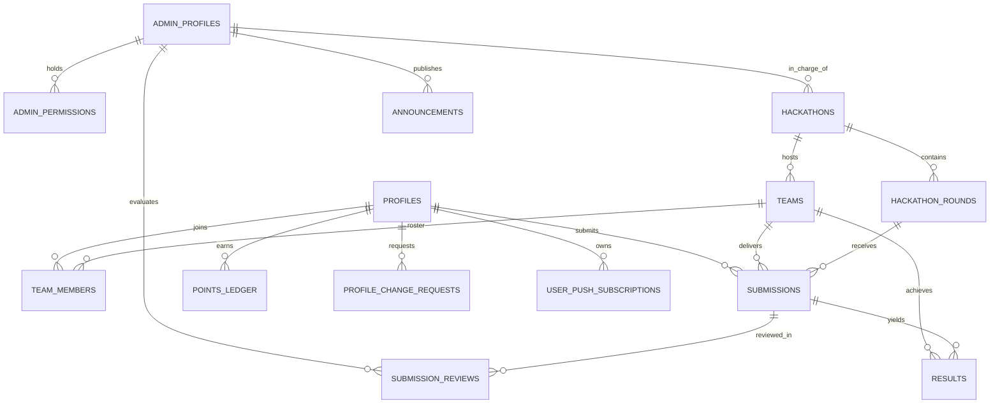
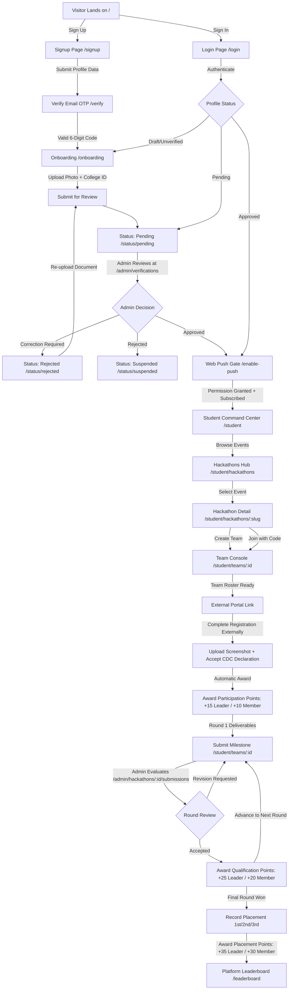

# NMIT HackLeague — Comprehensive Project & Architectural Context

> **Target Audience:** This document is the authoritative, end-to-end reference for **NMIT HackLeague**. It is specifically structured to feed into new ChatGPT/LLM sessions to provide 100% complete, unambiguous, production-grade context about the system's architecture, database schema, user roles, security model, and every single website flow from A to Z.

---

## 1. Executive Summary & Product Mission

**NMIT HackLeague** is the centralized, institutional hackathon management, team collaboration, and achievement tracking platform built specifically for **Nitte Meenakshi Institute of Technology (NMIT), Bengaluru**.

### The Core Problem It Solves
Historically, campus hackathon participation was fragmented across external registration links, unstructured Google Forms, WhatsApp groups, and lost email threads. College leadership and the Career Development Centre (CDC) lacked verified institutional data regarding:
- Which students actually participate vs. merely sign up.
- Team compositions across various academic years and departments.
- Milestone progression across multi-round hackathons.
- Verified prize winners vs. unsubstantiated claims.
- A standardized, cumulative institutional merit/points leaderboard.

### The 4 Distinct Participation Tiers
HackLeague explicitly distinguishes between four separate states:
1. **Tier 1 — Internal Team Formation:** Creating a team on HackLeague, managing invitations, and locking rosters.
2. **Tier 2 — External Organizer Registration:** Registering on external platforms (e.g., Devpost, Unstop, Devfolio, Google Forms). The team leader uploads a screenshot proof and accepts the mandatory **CDC Disciplinary Declaration**.
3. **Tier 3 — Verified Round Progression:** Delivering milestone deliverables (GitHub repos, live demos, evidence screenshots) for sequential competition rounds, evaluated and verified by authorized faculty/club administrators.
4. **Tier 4 — Verified Placement & Points:** Official recording of 1st/2nd/3rd prize winners, qualification bonuses, and cumulative ledger-backed points on the institution-wide leaderboard.

---

## 2. Locked Technical Architecture & Stack

| Layer | Technology | Version / Specification | Rationale & Configuration |
| :--- | :--- | :--- | :--- |
| **Framework** | Next.js (App Router) | `16.4.0` | React Server Components (RSC), Server Actions, Route Handlers, Turbopack. |
| **Language** | TypeScript | `^5.7.0` | Strict type-safety, zero `any` policy in core business paths. |
| **UI Library** | React | `19.0.0` | Latest concurrent features, Server Actions, modern hooks. |
| **Styling** | Tailwind CSS | `v4.0.0` | Pure utility-first styling with institutional color tokens; **NO decorative color gradients**. |
| **Database** | PostgreSQL | `15+` (Supabase) | Relational integrity, foreign keys, triggers, constraints, Security Definer RPCs. |
| **Auth** | Supabase Auth (GoTrue) | `@supabase/ssr ^0.12.7` | Cookie-based session management, PKCE, secure server-side user validation via `getUser()`. |
| **File Storage** | Supabase Storage | Private Buckets | Private buckets for `college-ids`, `profile-photos`, and `submission-evidence`. |
| **Email** | Resend | `^6.34.1` | Transactional emails with database-backed `idempotency_key` deduplication. |
| **Push Notifications** | Web Push API | RFC 8292 (VAPID) | Mandatory browser push notifications via Service Worker (`/sw.js`). |
| **Data Exports** | ExcelJS & JSZip | `exceljs ^4.4.0`, `jszip ^3.10.2` | Multi-tab `.xlsx` workbooks and multi-CSV `.zip` packages with formula injection defense. |
| **Validation** | Zod | `^4.6.7` | Authoritative server-side schema parsing and input sanitation. |
| **Hosting** | Vercel | Production Edge | HTTPS enforced, edge routing, serverless execution. |

---

## 3. Visual Design System & Aesthetics (Non-Negotiable)

The platform follows a **restrained, professional, institutional white-theme** aesthetic designed to convey academic authority, clarity, and trust.

### Color Tokens
- **Canvas / Background:** Pure White (`#FFFFFF`) and Off-White / Light Gray Canvas (`#F5F6F4` / `#F9FAFB`).
- **Typography:** Deep Charcoal / Off-Black (`#252825` / `#111827`) for maximum contrast and readability.
- **Borders & Dividers:** Soft Gray (`#E6E9E5` / `#E5E7EB`).
- **Success / Verified:** Institutional Light Green (`#E3F1E6` background, `#166534` text/border).
- **Destructive / Error:** Restrained Light Red (`#F8E8E6` background, `#991B1B` text/border).
- **Accent / Primary:** Restrained Deep Forest/Emerald Green (`#0F5132` / `#15803D`).

### Prohibited Patterns
- **NO multi-color rainbow gradients**, neon glow effects, floating gradient blobs, or heavy glassmorphism.
- **NO unauthenticated access** to student dashboards or leaderboards.
- **NO placeholder images or fake production data** in live routes.

---

## 4. Roles, RBAC & Row Level Security (RLS) Matrix

### 4.1 Role Hierarchy
1. **Super Admin:** Exactly **one** active account (the project owner / Faculty Coordinator). Possesses implicit operational authority across the entire platform. Bootstrap provisioning is performed out-of-band via CLI (`scripts/provision-super-admin.ts`).
2. **Administrators (Club Leads & Faculty):** Multiple accounts created and managed by the Super Admin. Permissions are **individually and granularly assigned**.
3. **Approved Students:** Fully verified NMIT students. Can browse hackathons, create/join teams, submit external proof and round deliverables, earn points, and view the leaderboard.
4. **Draft / Pending Students:** Accounts awaiting email verification, document upload, or administrative approval. Restricted to onboarding/status routes.
5. **Anonymous Visitors:** Can only view the public landing page (`/`), login (`/login`), and signup (`/signup`). All other routes redirect to `/login`.

### 4.2 Granular Administrator Permissions
Permissions are stored as atomic rows in `public.admin_permissions`:
- `verify_students`: Review student registrations, inspect College ID cards (60s signed preview), approve/reject accounts.
- `manage_password_resets`: Assist with exceptional student recovery workflows (without ever viewing plaintext passwords).
- `manage_hackathons`: Create, edit, publish, pause, resume, and archive hackathons.
- `manage_teams`: Intervene in team disputes, lock rosters, adjust team details.
- `manage_students`: Review guarded student profile change requests (`submit_profile_change_request`).
- `manage_followups`: Communicate directly with teams during ongoing rounds.
- `view_analytics`: Inspect administrative dashboard metrics, attendance rates, and progress funnels.
- `export_data`: Access Data & Reports engine to generate CSV, XLSX, and ZIP exports.
- `view_audit_logs`: Inspect immutable platform audit records.
- `manage_points`: Execute reasoned, ledger-backed points adjustments and milestone awards.
- `manage_notifications`: Compose and broadcast platform-wide and event-scoped Web Push announcements.

### 4.3 Hackathon-Scoped Administration
To prevent unauthorized cross-club interference:
- Each hackathon has an assigned `in_charge_admin_id` (stored in `public.hackathons`).
- An ordinary Admin with `manage_hackathons` or `export_data` **can only view and manage hackathons assigned to them**.
- Feature permission alone does **not** grant platform-wide access.
- Only the **Super Admin** or an administrator explicitly granted global authority can view all hackathons or export global datasets.
- Reassigning an in-charge admin requires Super Admin action with mandatory audit logging (`reassign_hackathon_in_charge_admin`).

---

## 5. Complete Database Schema (PostgreSQL & Supabase)

The database consists of 16 relational tables, version-controlled across 25 sequential migrations:



### Table Definitions & Primary Columns

#### 1. `public.profiles` (Student Accounts)
- `id` (`uuid`, PK, FK -> `auth.users.id` on delete cascade)
- `email` (`text`, unique, lowercase)
- `full_name` (`text`)
- `usn` (`text`, unique, checked by regex `^[0-9][A-Z]{2}[0-9]{2}[A-Z]{2}[0-9]{3}$`)
- `phone` (`text`, normalized Indian 10-digit mobile)
- `branch` (`text`, e.g., 'CSE', 'ISE', 'AIML', 'ECE', 'ME', 'CV')
- `academic_year` (`integer`, 1 to 4)
- `sex` (`enum gender`: 'Male', 'Female', 'Other')
- `date_of_birth` (`date`)
- `profile_photo_path` (`text`, points to `profile-photos` bucket)
- `college_id_path` (`text`, points to private `college-ids` bucket)
- `registration_status` (`text`: 'draft', 'under_review', 'pending_verification', 'approved', 'correction_required', 'rejected', 'suspended')
- `rejection_reason` (`text`, nullable)
- `reviewed_by` (`uuid`, FK -> `admin_profiles.id`)
- `reviewed_at` (`timestamptz`)
- `college_id_deleted_at` (`timestamptz`, set when raw ID card is purged post-verification)
- `created_at`, `updated_at` (`timestamptz`)

#### 2. `public.admin_profiles`
- `id` (`uuid`, PK, FK -> `auth.users.id`)
- `email` (`text`, unique)
- `full_name` (`text`)
- `is_super_admin` (`boolean`, default false)
- `is_active` (`boolean`, default true)
- `created_by` (`uuid`, FK -> `admin_profiles.id`)
- `created_at`, `updated_at` (`timestamptz`)

#### 3. `public.admin_permissions`
- `id` (`uuid`, PK)
- `admin_id` (`uuid`, FK -> `admin_profiles.id` on delete cascade)
- `permission` (`text`, unique with `admin_id`)
- `granted_by` (`uuid`, FK -> `admin_profiles.id`)
- `granted_at` (`timestamptz`)

#### 4. `public.hackathons`
- `id` (`uuid`, PK)
- `title` (`text`)
- `slug` (`text`, unique)
- `tagline` (`text`)
- `description` (`text`)
- `organizer` (`text`, e.g., 'Google Developer Student Club', 'IEEE Student Branch')
- `mode` (`text`: 'offline', 'online', 'hybrid')
- `venue` (`text`)
- `registration_start_at`, `registration_end_at` (`timestamptz`)
- `event_start_at`, `event_end_at` (`timestamptz`)
- `min_team_size` (`integer`, default 1)
- `max_team_size` (`integer`, default 4)
- `is_solo_allowed` (`boolean`, default false)
- `eligibility` (`text`)
- `prizes_summary` (`text`)
- `prizes_detail` (`jsonb`, array of `{ placement, title, reward, description }`)
- `external_registration_url` (`text`, link to Devpost/Unstop/Google Form)
- `community_url` (`text`, official WhatsApp/Discord community)
- `in_charge_admin_id` (`uuid`, FK -> `admin_profiles.id`)
- `status` (`text`: 'draft', 'published', 'registration_closed', 'ongoing', 'closed', 'archived')
- `academic_year` (`text`, e.g., '2026-2027')
- `academic_term` (`text`, e.g., 'ODD', 'EVEN')
- `timezone` (`text`, default 'Asia/Kolkata')
- `created_by` (`uuid`, FK -> `admin_profiles.id`)

#### 5. `public.hackathon_rounds`
- `id` (`uuid`, PK)
- `hackathon_id` (`uuid`, FK -> `hackathons.id` on delete cascade)
- `round_number` (`integer`)
- `name` (`text`, e.g., 'Idea Submission', 'Prototype Evaluation', 'Grand Finale')
- `description` (`text`)
- `start_at`, `end_at` (`timestamptz`)
- `is_final_round` (`boolean`, default false)
- `status` (`text`: 'draft', 'scheduled', 'open', 'paused', 'closed', 'evaluated')

#### 6. `public.teams`
- `id` (`uuid`, PK)
- `hackathon_id` (`uuid`, FK -> `hackathons.id` on delete cascade)
- `name` (`text`)
- `leader_id` (`uuid`, FK -> `profiles.id`)
- `invitation_code` (`text`, 6 alphanumeric characters, hard-to-guess, regeneratable)
- `invitation_code_expires_at` (`timestamptz`)
- `internal_status` (`text`: 'forming', 'ready', 'locked', 'disqualified')
- `external_status` (`text`: 'not_submitted', 'submitted', 'verified', 'rejected')
- `external_proof_path` (`text`, points to registration screenshot in storage)
- `external_proof_submitted_at` (`timestamptz`)
- `cdc_declaration_accepted` (`boolean`, default false)
- `cdc_declaration_accepted_at` (`timestamptz`)
- `cdc_declaration_text_version` (`text`)
- `external_proof_reviewed_by` (`uuid`, FK -> `admin_profiles.id`)
- `external_proof_reviewed_at` (`timestamptz`)
- *Composite Constraint:* A student cannot be in more than one team for the same hackathon.

#### 7. `public.team_members`
- `id` (`uuid`, PK)
- `team_id` (`uuid`, FK -> `teams.id` on delete cascade)
- `student_id` (`uuid`, FK -> `profiles.id` on delete cascade)
- `hackathon_id` (`uuid`, FK -> `hackathons.id` on delete cascade)
- `role` (`text`: 'leader', 'member')
- `joined_at` (`timestamptz`)
- *Unique Constraint:* `(hackathon_id, student_id)` — strictly enforces **one team per student per hackathon**.

#### 8. `public.submissions` (Round Milestone Deliverables)
- `id` (`uuid`, PK)
- `hackathon_id` (`uuid`, FK -> `hackathons.id`)
- `round_id` (`uuid`, FK -> `hackathon_rounds.id`)
- `team_id` (`uuid`, FK -> `teams.id`)
- `submitted_by` (`uuid`, FK -> `profiles.id`)
- `title` (`text`)
- `description` (`text`)
- `repo_url` (`text`, GitHub/GitLab link)
- `demo_url` (`text`, live demo link)
- `evidence_path` (`text`, screenshot path in `submission-evidence` bucket)
- `evidence_sha256` (`text`, cryptographic checksum of uploaded evidence)
- `evidence_uploaded_at` (`timestamptz`)
- `evidence_lifecycle_state` (`text`: 'active', 'eligible_for_deletion', 'deleted')
- `evidence_deleted_at` (`timestamptz`)
- `version` (`integer`, increments on resubmission: 1, 2, 3...)
- `parent_submission_id` (`uuid`, FK -> `submissions.id`, links revisions)
- `is_current` (`boolean`, true for latest version)
- `status` (`text`: 'pending_review', 'accepted', 'revision_requested', 'rejected')

#### 9. `public.submission_reviews`
- `id` (`uuid`, PK)
- `submission_id` (`uuid`, FK -> `submissions.id` on delete cascade)
- `reviewer_id` (`uuid`, FK -> `admin_profiles.id`)
- `decision` (`text`: 'accepted', 'rejected', 'revision_requested')
- `feedback` (`text`, mandatory >= 10 characters for rejected/revision)
- `score` (`numeric`, optional rubric score)
- `reviewed_at` (`timestamptz`)

#### 10. `public.results` (Verified Milestones & Placements)
- `id` (`uuid`, PK)
- `hackathon_id` (`uuid`, FK -> `hackathons.id`)
- `round_id` (`uuid`, FK -> `hackathon_rounds.id`, nullable for overall placements)
- `team_id` (`uuid`, FK -> `teams.id`)
- `milestone_type` (`text`: 'round_qualification', 'winner_placement', 'special_award')
- `placement` (`text`: '1', '2', '3', 'finalist', 'honorable_mention')
- `notes` (`text`)
- `verified_by` (`uuid`, FK -> `admin_profiles.id`)
- `verified_at` (`timestamptz`)
- `is_published` (`boolean`, default true)

#### 11. `public.points_ledger` (Append-Only Immutable Ledger)
- `id` (`uuid`, PK)
- `student_id` (`uuid`, FK -> `profiles.id`)
- `hackathon_id` (`uuid`, FK -> `hackathons.id`)
- `team_id` (`uuid`, FK -> `teams.id`)
- `round_id` (`uuid`, FK -> `hackathon_rounds.id`, nullable)
- `result_id` (`uuid`, FK -> `results.id`, nullable)
- `milestone_type` (`text`: 'registration_proof_approved', 'round_qualification', 'win_placement', 'manual_adjustment')
- `role_at_award` (`text`: 'leader', 'member')
- `points` (`integer`, positive for awards, negative for deductions)
- `reason` (`text`, mandatory explanation)
- `awarded_by` (`uuid`, FK -> `admin_profiles.id`)
- `idempotency_key` (`text`, unique — guarantees duplicate requests produce zero redundant points)
- `reversal_of_id` (`uuid`, FK -> `points_ledger.id`, points to reversed record)
- `adjusted_entry_id` (`uuid`, FK -> `points_ledger.id`)
- `created_at` (`timestamptz`)
- *Trigger:* `prevent_points_ledger_mutation` — **Strictly raises an exception on ANY direct SQL UPDATE or DELETE**.

#### 12. `public.point_configurations`
- `id` (`uuid`, PK)
- `milestone_type` (`text`, unique: 'registration_proof_approved', 'round_qualification', 'win_placement')
- `regular_member_points` (`integer`)
- `team_leader_points` (`integer`)
- `is_active` (`boolean`, default true)
- `updated_by` (`uuid`, FK -> `admin_profiles.id`)
- `updated_at` (`timestamptz`)

#### 13. `public.profile_change_requests`
- `id` (`uuid`, PK)
- `student_id` (`uuid`, FK -> `profiles.id`)
- `field_name` (`text`: 'full_name', 'usn', 'branch', 'academic_year')
- `old_value` (`text`)
- `new_value` (`text`)
- `reason` (`text`, mandatory justification)
- `status` (`text`: 'pending', 'approved', 'rejected')
- `reviewed_by` (`uuid`, FK -> `admin_profiles.id`)
- `reviewed_at` (`timestamptz`)
- `rejection_reason` (`text`)

#### 14. `public.announcements` & `public.announcement_reads`
- Tracks in-app announcements published to all users, specific roles, or specific hackathons.
- Read tracking ensures notifications can show unread badges.

#### 15. `public.user_push_subscriptions` & `public.push_delivery_logs`
- Stores RFC 8292 browser Web Push subscriptions (`endpoint`, `p256dh`, `auth`, `device_fingerprint`).
- Logs every dispatch attempt, HTTP response code, and delivery outcome.

#### 16. `public.storage_deletion_queue`
- Reliable worker queue for asynchronous, retriable file purging:
  - College ID cards after verification decision.
  - Hackathon round evidence 7 days after event end timestamp.
  - Superseded avatar photos on replacement.

---

## 6. End-to-End Website Flows (A to Z)



### Detailed Breakdown of Every Step

---

### Flow 1: Student Registration, Email OTP & Verification

1. **Registration Request (`/signup`):**
   - The student provides: Full Name, Email (any domain allowed), Password, Phone Number, USN, Branch dropdown, Academic Year (1-4), Sex, Date of Birth.
   - **USN Enforcement:** Trigger `trg_profiles_normalize_usn` automatically forces USN to uppercase and validates VTU regex (`^[0-9][A-Z]{2}[0-9]{2}[A-Z]{2}[0-9]{3}$`, e.g., `1NT21CS001`).
   - Server Action `signupAction` calls Supabase Auth `signUp()`. An atomic PostgreSQL trigger inserts a corresponding row into `public.profiles` with status `draft`.
   - Rate limit: 5 signups per hour per IP.
2. **Email Verification (`/verify?email=...`):**
   - Supabase dispatches a 6-digit numeric OTP.
   - Server Action `verifyOtpAction` validates the code. On success, the user session is established and redirected to `/onboarding`.
3. **Document Upload & Server-Side Binary Validation (`/onboarding`):**
   - **Profile Photo:** Max 1 MB. Uploaded to private `profile-photos` bucket.
   - **College ID Document:** Max 1.5 MB. Mandatory. Uploaded to private `college-ids` bucket.
   - **Security Inspection:** Uploaded files undergo trusted server-side binary magic byte validation (`validateStorageObjectBinary`). Disguised executables, `.bat`, `.sh`, `.exe`, or corrupted payloads are rejected.
4. **Submission for Administrative Review:**
   - The student clicks "Submit for Verification", invoking RPC `submit_profile_for_review`.
   - Status transitions from `draft` to `under_review`. The student is redirected to `/status/pending`.
5. **Administrative Review (`/admin/verifications`):**
   - Admins holding `verify_students` inspect pending profiles.
   - To view the student's ID card, the admin clicks "View ID". Server Action `getAdminCollegeIdPreviewUrlAction` generates a **temporary 60-second signed URL**. Direct downloads and right-clicks are disabled.
   - Admin choices:
     - **Approve:** Invokes RPC `review_student_registration`. Profile status transitions to `approved`. The College ID card object in Supabase Storage is immediately enqueued into `storage_deletion_queue` for automated deletion.
     - **Request Correction:** Admin provides a mandatory reason (e.g., "ID card image is blurry"). Profile status transitions to `correction_required`. Student can access `/status/rejected` to upload a replacement ID via `replaceCollegeIdAction`.
     - **Reject:** Admin provides a mandatory reason (e.g., "Invalid NMIT identity"). Status transitions to `rejected`. Account is locked.

---

### Flow 2: Mandatory Browser Web Push Notification Gate

1. **Gate Activation (`/enable-push`):**
   - Browser push notifications are a **mandatory access requirement** for all authenticated roles (Students, Admins, Super Admin).
   - Middleware and auth guards inspect `user_push_subscriptions`. If no active subscription is linked to the user's current device, they are redirected to `/enable-push?redirectTo=...`.
2. **Device Registration:**
   - Checks browser support (`serviceWorker`, `PushManager`, `Notification`). If unsupported, shows explicit diagnostic guidance.
   - If permission was previously denied, displays browser-specific instructions on how to unblock notifications in site settings.
   - When the user clicks "Enable Push Notifications", the native browser prompt appears.
   - Upon granting permission:
     - Service Worker (`/sw.js`) is registered.
     - `registration.pushManager.subscribe()` creates a subscription with the server's public VAPID key.
     - An endpoint validator rejects SSRF payloads (blocks RFC 1918 private IPs, AWS metadata `169.254.169.254`, non-standard ports).
     - The subscription is saved to `public.user_push_subscriptions` via `/api/push/register`.
   - The user is unlocked and redirected to their original destination.

---

### Flow 3: Student Portal & Dashboard Navigation

1. **Student Command Center (`/student`):**
   - Displays real-time operational metrics: **Total Points** (ledger sum), **Platform Rank** (dense rank across NMIT), **Verified Qualifications Count**, and **Active Team Cards**.
   - Navigation links to My Teams (`/student/teams`), All Hackathons (`/student/hackathons`), Points Ledger (`/student/points`), and My Profile (`/student/profile`).
2. **Profile Maintenance & Guarded Identity Edits (`/student/profile`):**
   - **Directly Editable Fields:** Phone number (verified Indian format) and Profile Photo (upload/remove with automatic rollback).
   - **Protected Identity Fields:** Full Name, USN, Branch, Academic Year.
   - **Guard Trigger:** Database trigger `protect_profile_columns` aborts direct SQL `UPDATE` on protected columns with exception `42501`.
   - **Change Request Workflow:** To modify protected fields, the student submits a change request (`submitProfileCorrectionAction` -> RPC `submit_profile_change_request`). Admins review it under `/admin/verifications` -> "Profile Change Requests". On approval, the database atomically updates `profiles` and logs an audit record.

---

### Flow 4: Hackathon Discovery, Team Formation & External Registration

1. **Discovering Events (`/student/hackathons` and `[slug]`):**
   - Hackathons are displayed with status badges:
     - `UPCOMING`: Registration has not opened yet.
     - `OPEN`: Registration is active.
     - `CLOSED`: Registration deadline has passed.
     - `CONCLUDED`: Event end timestamp has elapsed.
   - Mode tags: `In-Person`, `Online`, `Hybrid`.
   - View sequential rounds, prizes, organizer details, and official external links.
2. **Team Formation (`/student/teams`):**
   - **Create Team:** Leader enters a team name. Server action invokes RPC `create_team`.
     - System generates a secure, unique 6-character alphanumeric invitation code.
     - Team status initializes to `forming`.
     - The creator is inserted into `team_members` as `role = 'leader'`.
   - **Join Team:** Teammate enters the 6-character code. Server action invokes RPC `join_team_with_code`.
     - Validates hackathon registration deadline is open.
     - Validates team has not exceeded `max_team_size`.
     - Validates student is **not already in another team for this hackathon**.
     - Inserts member with `role = 'member'`.
3. **Team Management Console (`/student/teams/[id]`):**
   - Leader can copy or regenerate the invitation code.
   - Leader can remove a member or transfer team leadership.
   - Member can choose to leave the team (provided the team is still in `forming` stage).
4. **External Registration Proof & CDC Declaration:**
   - The team leader clicks the "External Portal" link to complete registration on the external organizer's system (Devpost, Unstop, etc.).
   - The leader returns to HackLeague and uploads a registration confirmation screenshot.
   - **Mandatory CDC Self-Declaration:** The leader must check the box agreeing to the exact CDC text:
     > *"By submitting this screenshot, you confirm that it is genuine, unaltered, and represents your team's actual registration on the official hackathon platform. Submitting fake, manipulated, or misleading registration proof may result in strict disciplinary action by the Career Development Centre (CDC), including disqualification from the hackathon and other action under applicable college rules. Your submission may be reviewed, and providing proof does not guarantee acceptance."*
   - Server Action `submitRegistrationProofAction` calls RPC `submit_registration_proof`:
     - Sets team `external_status = 'submitted'`.
     - **Automatically awards initial registration points:** **+15 points** to the team leader and **+10 points** to all team members in `points_ledger`.
     - Manual admin review is **not** required for initial registration, allowing instant feedback while relying on the CDC declaration as a disciplinary deterrent.

---

### Flow 5: Competition Rounds, Milestone Deliverables & Judging

1. **Round Milestones (`/student/teams/[id]`):**
   - Hackathons have sequential evaluation rounds (e.g., Round 1: Idea Submission, Round 2: Prototype Demo, Round 3: Final Pitch).
   - Round 1 milestone becomes open once external registration proof is submitted.
   - Round 2+ milestones remain locked until the team is verified as **qualified** in the preceding round.
2. **Milestone Submission:**
   - The team leader submits: Project Title, Summary Description, GitHub Repository URL, Live Demo URL, and an optional Evidence Screenshot (Max 1 MB, stored in `submission-evidence`).
   - Server Action `submitRoundMilestoneAction` calls RPC `submit_round_milestone`.
   - The submission is assigned `version = 1`, `is_current = true`, and status `pending_review`.
3. **Stage Deadlines & Automatic Pausing:**
   - Every round has a configured `end_at` timestamp.
   - When `now() > end_at`, the round automatically stops accepting new submissions.
   - Resuming a paused round requires an authorized admin to call `resumeHackathonRoundAction` with a new extended deadline and mandatory audit justification.
4. **Administrative Review (`/admin/hackathons/[id]/submissions`):**
   - The in-charge Admin reviews deliverables.
   - Actions available:
     - **Accept / Qualify:** Invokes RPC `review_round_submission`.
       - Submission status changes to `accepted`.
       - Team qualifies for the next round.
       - System automatically inserts milestone qualification records into `public.results`.
       - System awards qualification points via `award_milestone_points`: **+25 points** to the team leader, **+20 points** to regular members.
     - **Request Revision:** Admin provides feedback (>=10 chars). Status becomes `revision_requested`. Team leader can submit an updated Version 2.
     - **Reject:** Admin provides feedback. Team is eliminated from round advancement.
     - **Reopen (Super Admin / In-charge Admin):** If a rejection was erroneous, admins can invoke `reopenRejectedSubmissionAction` with an audit justification, restoring status to `revision_requested`.
5. **Winner Placement & Awards:**
   - In the final round, the admin records podium placements (1st, 2nd, 3rd) via `recordRoundWinnerPlacementAction` -> RPC `record_round_winner_placement`.
   - Inserts verified win records into `public.results`.
   - Awards winner bonus points: **+35 points** to the team leader, **+30 points** to regular members.

---

### Flow 6: Points Engine, Immutability & Leaderboard

```
+-------------------------------------------------------------------------------+
|                        MILESTONE REWARD STRUCTURE                             |
+-----------------------------------+--------------------+----------------------+
| Milestone Type                    | Regular Member     | Team Leader          |
+-----------------------------------+--------------------+----------------------+
| External Registration Proof       | +10 points         | +15 points           |
| Round Qualification (per round)   | +20 points         | +25 points           |
| Winner Placement (1st / 2nd / 3rd)| +30 points         | +35 points           |
+-----------------------------------+--------------------+----------------------+
* Example: A leader who registers (+15), passes 2 rounds (+25 x 2), and wins (+35)
  earns exactly 100 points. A regular member earns 10 + 20 + 20 + 30 = 80 points.
```

1. **Append-Only Immutability:**
   - Every point transaction is inserted into `public.points_ledger`.
   - PostgreSQL trigger `prevent_points_ledger_mutation` blocks any `UPDATE` or `DELETE` statement.
   - Points are never silently altered or erased.
2. **Idempotency Safeguard:**
   - Unique constraint on `idempotency_key` ensures network retries or double-clicks never award duplicate points.
3. **Manual Points Adjustments & Reversals (`/admin/points`):**
   - Admins holding `manage_points` can execute adjustments for disciplinary deductions or corrections.
   - Enforces Level 1 (team) and Level 2 (student) row-level locks to prevent race conditions.
   - **Zero-Floor Protection:** An adjustment cannot reduce a student's total points balance below zero, unless the **Super Admin** explicitly enables the override flag.
   - Reversing a prior ledger entry calls RPC `reverse_points_ledger_entry`, creating an offsetting negative entry linked via `reversal_of_id`.
4. **Platform Leaderboard (`/leaderboard`):**
   - Executes RPC `get_platform_leaderboard`.
   - Computes dense ranks across all verified students based on total verified points.
   - Filterable by Academic Year (1st, 2nd, 3rd, 4th Year) and Academic Term.

---

### Flow 7: Data & Reports (Institutional Export Engine)

Located at `/admin/reports`, guarded by the `export_data` permission.

1. **Export Scoping:**
   - **Super Admin or Global Exporter:** Can export platform-wide data across all hackathons.
   - **In-Charge Admin:** Can **only** export data for hackathons explicitly assigned to them. Cross-event student data leakage is blocked server-side.
2. **Supported Formats:**
   - **Master Excel Workbook (`.xlsx`):** Generated via ExcelJS. Features styled header rows, custom column widths, and separate tabs: `Students`, `Hackathons`, `Teams`, `Team Members`, `Registrations`, `Round Results`, `Winners`, and `Executive Summary`.
   - **Multi-Table CSV ZIP (`.zip`):** Generated via JSZip. Bundles individual flat CSVs for all datasets in scope.
   - **Individual CSV (`.csv`):** Single flat CSV for a specific chosen dataset.
3. **Formula Injection Sanitization (Critical Security):**
   - All cell values starting with `= `, `+ `, `- `, `@ `, `\t `, `\r `, or `\n ` are automatically sanitized by prepending a single quote (`'`). This prevents Excel/Google Sheets from executing arbitrary formula payloads (`=cmd|' /C ...'`).
4. **Student Privacy Protection:**
   - Institutional exports strictly exclude: Date of Birth, Sex/Gender, Storage File Paths, Profile Photo URLs, Password Hashes, and OTPs.

---

### Flow 8: Platform Announcements & Push Notifications

Located at `/admin/notifications`, guarded by `manage_notifications`.

1. **Publishing Announcements:**
   - Admin specifies Title, Message Body, Announcement Type (`general`, `deadline`, `urgent`, `system`), and Target Audience (`all`, `students`, `admins`, or a specific assigned hackathon).
   - Server Action `publishAnnouncementAction` calls RPC `publish_announcement`.
   - Inserts record into `public.announcements`.
2. **Web Push Dispatcher:**
   - Background worker retrieves active push subscriptions for targeted user IDs.
   - Web Push payloads are signed using VAPID private key and dispatched to browser endpoints (FCM, Mozilla, Apple).
   - Expired or invalid endpoints (`404 Not Found`, `410 Gone`) are automatically deactivated in `user_push_subscriptions`.
   - All dispatches and status codes are recorded in `push_delivery_logs`.
3. **In-App Notification Center:**
   - Users view incoming announcements in the header notification bell.
   - Marking an announcement as read records a row in `announcement_reads`.

---

### Flow 9: Background Cleanup, Deletion Worker & Health Check

1. **Storage Deletion Cron (`/api/cron/process-deletions`):**
   - Secured via `Authorization: Bearer <CRON_SECRET>`.
   - Leases pending jobs from `public.storage_deletion_queue`:
     - **College ID Cards:** Deleted from `college-ids` bucket immediately once an admin approves or rejects a student registration.
     - **Hackathon Evidence:** Automatically purged from `submission-evidence` bucket **exactly 7 days after the hackathon's `event_end_at` timestamp**.
   - Preserves all database result rows, point ledger entries, and audit logs while eliminating storage costs and privacy liabilities.
2. **System Health Check (`/api/health`):**
   - Monitors PostgreSQL database connectivity, Auth service availability, and Storage bucket health.
   - Public responses are sanitized to prevent disclosing internal table row counts or stack traces.
   - Reports Supabase Free-plan inactivity warnings if applicable.

---

### Flow 10: Super Admin Operations & Disaster Recovery

1. **Out-of-Band Bootstrap CLI:**
   - Initial Super Admin provisioning cannot be done via UI.
   - Operator executes via terminal:
     ```bash
     npx tsx scripts/provision-super-admin.ts --email=coordinator@nmit.ac.in --name="Dr. Nagaraj"
     ```
   - Uses `SUPABASE_SERVICE_ROLE_KEY`. Invites user via GoTrue, calls RPC `bootstrap_super_admin`, grants implicit authority.
   - Elevation prevention: Ordinary admins cannot elevate themselves to Super Admin.
2. **Emergency Disaster Recovery:**
   - If the active Super Admin loses their hardware key or email access, a database administrator can execute the emergency SQL procedure:
     ```sql
     CALL public.recover_super_admin_identity(
       p_replacement_auth_uid := '<new-auth-uuid>'::uuid,
       p_replacement_email := 'new.coordinator@nmit.ac.in',
       p_replacement_full_name := 'Replacement Coordinator',
       p_reason := 'Hardware token loss replacement'
     );
     ```
   - Atomically demotes the previous Super Admin, promotes the replacement, and writes an immutable audit log.

---

## 7. Complete Project Directory Map

```
HackLeague/
├── .env.example                               # Production environment variable template
├── .env.local                                 # Local development environment overrides
├── package.json                               # Dependencies & build scripts (Next.js 16.4, React 19)
├── tsconfig.json                              # TypeScript strict configuration
├── tailwind.config.ts                         # Tailwind CSS configuration
├── public/                                    # Public static assets & branding logos
│   ├── sw.js                                  # Web Push Service Worker
│   └── images/                                # NMIT & HackLeague brand marks
├── scripts/                                   # Operational DevOps & Disaster Recovery CLI
│   ├── provision-super-admin.ts               # Out-of-band Super Admin provisioning script
│   ├── backup-database.ts                     # Independent SQL database backup utility
│   └── test-backup-restoration.ts             # Dry-run restoration verification script
├── supabase/
│   └── migrations/                            # 25 Sequential SQL migrations (Phases 1-13)
├── src/
│   ├── middleware.ts                          # Edge session updater & route redirect guards
│   ├── actions/                               # Next.js Server Actions (RPC callers & mutations)
│   │   ├── auth-actions.ts                    # Login, signup, verify OTP, forgot/reset password
│   │   ├── onboarding-actions.ts              # College ID & profile photo uploads, review submission
│   │   ├── admin-management-actions.ts        # Admin provisioning, permissions, deactivation
│   │   ├── admin-verification-actions.ts      # Student registration approvals & ID preview
│   │   ├── hackathon-management-actions.ts    # Hackathon CRUD, rounds config, pause/resume
│   │   ├── team-actions.ts                    # Team creation, join with code, roster updates
│   │   ├── registration-proof-actions.ts      # CDC declaration & screenshot proof submission
│   │   ├── round-submission-actions.ts        # Milestone deliverable submission & versioning
│   │   ├── round-review-actions.ts            # Scoring, qualifications, re-opening, winner placement
│   │   ├── point-config-actions.ts            # Milestone point values configuration
│   │   ├── points-adjustment-actions.ts       # Manual point adjustments & ledger reversals
│   │   ├── profile-actions.ts                 # Phone update, avatar upload, guarded change requests
│   │   ├── notification-actions.ts            # Push & in-app announcement broadcasts
│   │   ├── report-actions.ts                  # Master Excel, CSV ZIP, and flat exports
│   │   ├── email-actions.ts                   # Transactional email dispatches
│   │   └── audit-log-actions.ts               # Audit log query actions
│   ├── app/                                   # Next.js App Router (All 38 Application Routes)
│   │   ├── page.tsx                           # Institutional Landing Page
│   │   ├── login/page.tsx                     # Authentication Login Card
│   │   ├── signup/page.tsx                    # Student Onboarding & USN Registration Form
│   │   ├── verify/page.tsx                    # 6-Digit Email OTP Verification Screen
│   │   ├── onboarding/page.tsx                # Document Upload Portal (ID Card & Profile Photo)
│   │   ├── enable-push/page.tsx               # Mandatory Browser Push Notification Gate
│   │   ├── forgot-password/page.tsx           # Self-service password recovery request
│   │   ├── reset-password/page.tsx            # Authenticated password reset form
│   │   ├── leaderboard/page.tsx               # Public/Institutional Leaderboard Hub
│   │   ├── status/                            # Registration Status Screens
│   │   │   ├── pending/page.tsx               # Under Review / Pending Verification Screen
│   │   │   ├── rejected/page.tsx              # Correction Required / Document Re-upload Screen
│   │   │   └── suspended/page.tsx             # Account Suspended Screen
│   │   ├── student/                           # Student Role Protected Workspace
│   │   │   ├── page.tsx                       # Student Command Center (Metrics & Active Teams)
│   │   │   ├── profile/page.tsx               # Student Profile & Guarded Correction Requests
│   │   │   ├── points/page.tsx                # Personal Points Ledger & Milestone Breakdown
│   │   │   ├── hackathons/                    # Hackathons Catalog
│   │   │   │   ├── page.tsx                   # Discover Upcoming & Active Hackathons
│   │   │   │   └── [slug]/page.tsx            # Hackathon Overview, Stages, & Team CTAs
│   │   │   └── teams/                         # Team Management Console
│   │   │       ├── page.tsx                   # My Teams Listing & Code Joiner
│   │   │       └── [id]/page.tsx              # Roster, Invitation Code, Proof, & Deliverables
│   │   ├── admin/                             # Administrator Role Protected Workspace
│   │   │   ├── page.tsx                       # Admin Overview Dashboard
│   │   │   ├── verifications/page.tsx         # Student Review Queue & ID Viewer
│   │   │   ├── admins/page.tsx                # Admin Directory, Permissions & Provisioning
│   │   │   ├── hackathons/                    # Hackathons Management
│   │   │   │   ├── page.tsx                   # Hackathon Events Listing & Lifecycle State
│   │   │   │   ├── new/page.tsx               # Event Creation Wizard
│   │   │   │   └── [id]/                      # Hackathon Event Operations
│   │   │   │       ├── edit/page.tsx          # Edit Event Metadata & Deadlines
│   │   │   │       ├── rounds/page.tsx        # Configure Sequential Rounds & Pause/Resume
│   │   │   │       └── submissions/page.tsx   # Review Round Deliverables & Score Submissions
│   │   │   ├── points/page.tsx                # Points Ledger Management & Manual Adjustments
│   │   │   ├── notifications/page.tsx         # Compose & Broadcast Web Push Announcements
│   │   │   ├── reports/page.tsx               # Data & Reports Hub (Excel, ZIP, CSV Exports)
│   │   │   └── audit-logs/page.tsx            # Security & Operations Audit Logs Viewer
│   │   └── api/                               # API Route Handlers
│   │       ├── health/route.ts                # Public / System Health Monitor
│   │       ├── push/                          # Web Push Endpoints
│   │       │   ├── register/route.ts          # Store Device Push Subscription
│   │       │   └── status/route.ts            # Check Push Subscription Status
│   │       └── cron/                          # Background Worker Cron Handlers
│   │           └── process-deletions/route.ts # Purge Expired Evidence & Verified College IDs
│   ├── components/                            # Modular UI Design System
│   │   ├── ui/                                # Primitives (Button, Input, Badge, Alert, Card, Dialog)
│   │   ├── layout/                            # PageHeader, Navbar, Footer, MobileNav
│   │   ├── shells/                            # StudentShell, AdminShell
│   │   ├── hackathons/                        # EventCard, RegistrationStateBadge, RoundTimeline
│   │   ├── teams/                             # TeamStatusBanner, TeamRosterCard, InvitationCodeCard
│   │   └── submissions/                       # RoundMilestoneSubmissionCard, VersionHistoryCard
│   ├── lib/                                   # Core Business Logic & Infrastructure
│   │   ├── auth/                              # Guards (`requireAdmin`, `requireApprovedStudent`)
│   │   ├── supabase/                          # Server, Admin, Client & Middleware Supabase factories
│   │   ├── storage/                           # Binary signature validator, signed URL generator
│   │   ├── notifications/                     # VAPID Web Push sender & payload validator
│   │   ├── reports/                           # ExcelJS workbook & JSZip package generators
│   │   ├── reliability/                       # Health check service & error sanitizers
│   │   ├── validation/                        # Zod schemas for all forms & payloads
│   │   └── hackathons/                        # Stage timing calculators & state resolvers
│   └── types/                                 # TypeScript Typings
│       ├── database.ts                        # Generated Supabase Database Types
│       ├── auth.ts                            # Auth & RBAC types
│       ├── hackathon.ts                       # Hackathon & Round types
│       └── points.ts                          # Points & Ledger types
└── tests/                                     # Automated Quality Assurance Suites
    ├── integration/                           # End-to-End & Integration Tests
    │   ├── phase11-analytics-and-reports.test.ts
    │   ├── phase12-notifications-and-reliability.test.ts
    │   └── phase13-e2e-and-launch-readiness.test.ts
    └── concurrency/                           # Concurrency & Race Condition Tests
```

---

## 8. Environment Variables Reference

| Variable Name | Required Scope | Purpose | Example / Value Format |
| :--- | :--- | :--- | :--- |
| `NEXT_PUBLIC_SUPABASE_URL` | Client & Server | Supabase Project Gateway URL | `https://xyzprojectref.supabase.co` |
| `NEXT_PUBLIC_SUPABASE_ANON_KEY` | Client & Server | Public Anonymous Supabase API Key | `eyJhbGciOiJIUzI1NiIsInR5cCI6...` |
| `SUPABASE_SERVICE_ROLE_KEY` | Server Secret | High-privilege administrative service key | `eyJhbGciOiJIUzI1NiIsInR5cCI6...` |
| `RESEND_API_KEY` | Server Secret | Resend transactional email API key | `re_123456789...` |
| `RESEND_FROM_EMAIL` | Server Secret | Verified sender email address | `noreply@hackleague.nmit.ac.in` |
| `NEXT_PUBLIC_VAPID_PUBLIC_KEY` | Client & Server | RFC 8292 Web Push Application Server Key | Base64 URL-safe string |
| `VAPID_PRIVATE_KEY` | Server Secret | RFC 8292 Web Push Private Signing Key | Base64 URL-safe string |
| `VAPID_SUBJECT` | Server Secret | Push contact mailto link | `mailto:admin@nmit.ac.in` |
| `CRON_SECRET` | Server Secret | Bearer token for `/api/cron/process-deletions` | 64-character random hex string |
| `NEXT_PUBLIC_APP_URL` | Client & Server | Canonical website origin | `https://hackleague.nmit.ac.in` |

---

## 9. Git Branching & Versioning Policy

- **Active Development Branch:** **`v1`** is the **only** permitted branch for current features, fixes, and launch preparation.
- **Protected Branch:** **`main` is strictly protected**. Direct commits, pushes, and automated pull request merges into `main` are strictly forbidden.
- **Future Version Branch:** **`v2`** will only be created when the project owner explicitly authorizes the start of Version 2 development.

---

## 10. Summary Checklist for AI Assistants (ChatGPT Quick Context)

When helping with this project in any subsequent chat:
1. **Never suggest adding bright decorative gradients** or flashy SaaS aesthetics; maintain the restrained institutional white/charcoal palette.
2. **Never suggest client-side only security checks**; all authorization must be verified on the server via `guards.ts` and backed by PostgreSQL RLS.
3. **Never allow ordinary admins to see hackathons not assigned to them**, unless they have explicit global export/reporting authority.
4. **Never modify points without writing to `points_ledger`**; direct updates/deletions on the ledger are blocked by database triggers.
5. **Always preserve the 4-tier participation model**: Internal Team -> External Proof (CDC Declaration) -> Verified Round Qualification -> Verified Placement & Points.
6. **Ensure College ID cards are treated as highly sensitive PII**: Never provide permanent public URLs; generate only 60-second signed URLs for authorized reviewers, and ensure the raw file is deleted once verified.
7. **Keep all development work on branch `v1`**.
